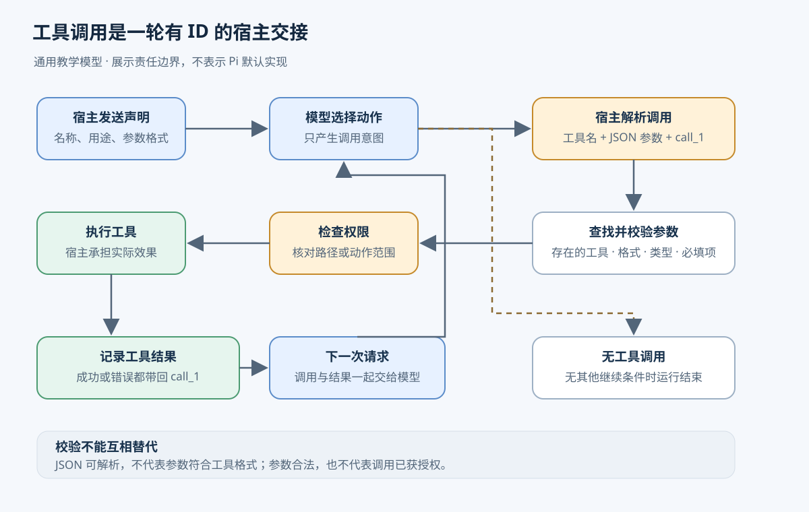
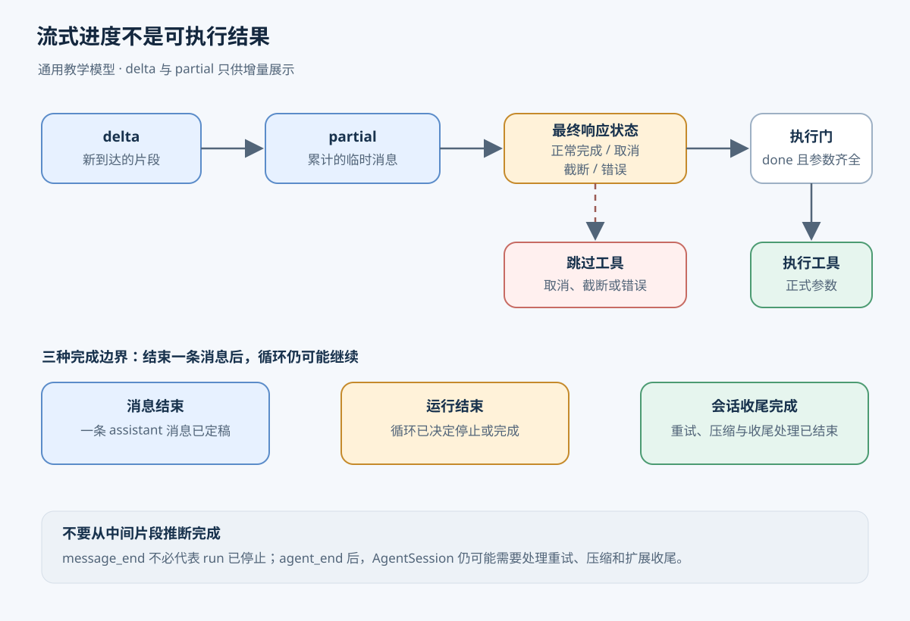

# 第 1 章　Agent 运行时

[返回目录](README.md) · [下一章：第 2 章 上下文与状态](02-context-state.md)

Agent 运行时负责把模型请求、工具执行和结果记录组织成可以持续推进的过程。模型提出读取文件等操作后，宿主程序需要校验调用、执行工具，并决定是否发起下一次模型请求。本章以读取项目配置为例，先说明参与者及请求、回合、运行与会话的关系，再介绍完整执行流程、流式输出和停止条件，最后对照 Pi 的实现。

前半章采用通用教学设计，目标是说明一个带工具、流式进度和停止条件的最小循环如何接入持续对话。后半章介绍 Pi 的常规运行路径，源码基线为提交 `96abe9a5ad45005cae34ed1c52d42f71fc88bedc`。教学设计中的预算与授权规则，以及实验 durable 路径中的恢复机制，均与默认实现分别说明。

## 1.1 模型、工具与宿主的职责

用户要求“读取项目配置，解释它使用哪个模型”，但程序最初只有文件路径。一次模型请求会把提示词、已有消息与工具说明发送给模型服务，再接收一次响应。模型能依据请求中的路径提出读取要求，却不能仅凭路径取得本地文件；实际内容必须由能够访问文件系统的程序提供。自然语言回答“我将读取配置”也不会触发读取操作。

工具（tool）是宿主提供的可调用操作。以 `read` 为例，工具声明描述名称、用途和路径参数，供模型决定是否调用；执行函数根据路径读取文件并返回内容。宿主指运行 Agent、持有工具及权限的应用程序。它负责保存执行函数，可以在本机完成操作，也可以把操作交给已配置的远端后端。

Tool calling（工具调用）规定模型与宿主如何交换操作请求和结果。模型输出结构化的工具名称、参数与调用 ID；宿主识别调用并执行，随后返回带有同一 ID 的结果。调用 ID 用于建立对应关系。例如，模型连续两次调用 `read` 时，两份结果虽然来自同一工具，却必须分别关联到各自的读取请求。

假设模型提出调用 `read`，参数为 `{"path":"project.json"}`，调用 ID 为 `call_1`。JSON 是一种用字段和数组表达数据的文本格式。宿主先查找已注册的 `read`，解析参数，检查 `path` 是字符串，并检查该路径是否允许读取，随后执行。结果携带同一个 `call_1`，内容可以是文件文本，也可以是“文件不存在”。语法正确、参数符合类型、动作有权限，是不同的检查，不能彼此替代。

不同模型接口可以使用不同字段表示调用，但执行责任相同：模型提出操作，宿主检查是否允许执行，工具报告实际观察到的结果。工具说明中的“只读取工作目录”能够引导模型选择路径；要保证访问范围，宿主仍需在执行前检查路径。



图示说明通用工具交接协议。参数校验与授权检查由宿主执行，Pi 的默认实现见 1.6 节。

## 1.2 请求、回合、运行与会话

读取工具返回内容后，宿主需要再次调用模型，才能获得基于文件事实的解释。Agent Loop（Agent 循环）持续执行请求模型、处理工具调用和记录结果，并在每轮结束时判断是否继续。循环保存的消息既是执行记录，也是准备下一次请求的材料。

本章约定 Turn（回合）包含一次完整 assistant 响应，以及它提出的一批工具调用和结果；assistant 表示模型回复的角色。一次 Run（运行）从接收一项输入或显式继续开始，到循环停止为止，可以有多个回合。不同框架对 turn 的定义可能不同，阅读接口时需要先确认口径。

Session（会话）把多次相关运行组织在一起。用户先让程序解释配置，得到回答后又问“这个模型支持图片吗”，这是同一会话里的后续输入。宿主保留前面的交互，在新请求中选入所需内容，模型才能知道“这个模型”指什么。会话可以先保存在内存中；若要关闭应用后继续对话，就需要持久保存。

| 层次 | 配置读取示例 | 状态维护职责 |
| --- | --- | --- |
| 模型请求 | 发送当前上下文，接收一次模型响应 | 宿主准备消息，模型服务处理本次请求 |
| 第一个回合 | 模型请求 `read`，宿主执行并记录 `call_1` 的结果 | 运行时保存完整调用与对应结果 |
| 第二个回合 | 模型读到工具结果，生成解释 | 运行时保存这次完整回复 |
| 一次运行 | 两个回合完成同一项用户要求 | 运行时还保存取消信号、当前阶段与停止原因 |
| 会话 | 后续追问继续使用前面的交互 | 会话层保留历史，并选择下一次请求要使用的上下文 |

会话历史与请求上下文承担不同职责。历史保存已经发生的交互，上下文只包含本次调用需要使用的信息。受模型输入容量限制，历史通常不能无限制地原样发送；有些应用状态也不适合作为对话消息。下一章讨论这些材料的选择与压缩。会话 ID 只用于标识会话，历史传递和中断恢复仍需相应的程序机制。

## 1.3 读取任务的完整执行流程

以下流程采用三个假设：一个会话同时只处理一项输入，工具按顺序执行，运行期间没有新输入插入。这样可以先说明一次正常读取的控制流程，再讨论并发、取消和排队带来的变化。

宿主收到用户要求后，将它追加到会话历史，建立本次运行状态。历史中的消息标出来源：user 是用户输入，assistant 是模型输出，工具结果保存调用 ID 与执行结果。system 消息表达应用设置的提示词；工具声明由接口约定的字段携带。Pi 会将工具声明变化记录在 system 消息中，这是后文的具体实现。

第一次请求携带用户要求和 `read` 的声明，尚未包含文件内容。模型提出 `call_1` 后，宿主先保存完整 assistant 消息，再执行读取。读取成功时，宿主追加带有 `call_1` 的文件结果；读取失败时，则追加同一 ID 对应的错误结果。后续请求因此能够同时表达读取意图和执行所得。只保留文件文本会丢失调用与结果之间的关联。

第二次请求纳入用户要求、assistant 工具调用和对应的工具结果。模型依据新获得的内容生成解释，也可能提出下一次调用。存在新调用时，宿主继续循环；响应正常且不含工具调用、也没有其他继续条件时，宿主结束运行，记录停止原因并完成会话收尾，然后允许下一项输入开始。

这项任务包含两次模型请求和一次工具执行。读取返回是工具执行的完成边界，生成停止是模型响应的完成边界，循环决定退出则是运行的完成边界。工具调用者、界面和会话层分别依赖这些通知取得结果、更新显示和安排后续工作，因此不能将它们合并成一个完成标记。

### 1.3.1 最小循环与执行契约

以下是教学伪代码，函数名描述职责，不是 Pi API。它采用每回合完整接收响应后再执行工具的策略，区分正常结束、取消、预算用尽和故障。示例使用最大模型调用次数限制重复请求；token、时间和费用预算可以在此基础上分别实现。

```text
run(session, userInput, tools, maxModelCalls, signal):
  require session 当前没有活动运行
  session.history.append(user(userInput))
  markActiveRun(session)
  calls = 0
  try:
    while true:
      if signal.cancelled: return finish(cancelled)
      if calls >= maxModelCalls: return finish(budget_exhausted)

      context = selectContext(session.history, toolDeclarations(tools))
      calls += 1
      response = collectStream(model(context, signal), showProgress)
      session.history.append(response.finalMessage)

      if signal.cancelled: return finish(cancelled)
      if response.failed: return finish(failed)
      if response.truncated: return finish(incomplete)
      if response.toolCalls is empty: return finish(completed)

      for call in response.toolCalls:
        if signal.cancelled:
          result = notExecuted("cancelled")
        else:
          try:
            tool = lookup(tools, call.name)
            args = validate(tool.schema, call.arguments)
            authorize(tool, args)
            result = execute(tool, args, signal)
          catch toolError:
            result = errorResult(toolError)
        session.history.append(toolResult(call.id, result))
  catch runtimeError:
    return finish(failed, runtimeError)
  finally:
    try: settleHistoryAndStatus(session)
    finally: clearActiveRun(session)
```

`collectStream` 收集片段，返回完整消息和明确的结束状态；流中断时必须报告失败，不能把暂存文本认作成功结果。`finish` 记录本次运行的终态与原因，`finally` 无论正常返回还是异常退出都清理活动状态。收尾失败也要向调用者报告，不能先显示“已经保存”再忽略保存错误。前面的会话忙碌检查与标记需作为一次受保护的准入操作，避免两个并发调用同时通过。

工具查找、校验和权限拒绝都进入对应调用的错误结果，模型有机会修正输入。取消后的剩余调用标为未执行，保留调用与结果关系；已经启动的工具需要报告它实际观察到的状态。若取消时无法确认外部动作有没有完成，应记录结果未知，不能伪造“未执行”。伪代码中的 `execute` 必须按这个契约返回或抛出带相应状态的错误。取消发生在整批工具开始之前时，可以直接停止；再次使用这段历史发起请求前，需要补齐未执行结果或选取合法的请求上下文。

`selectContext` 在小例子中可以保留全部消息。`settleHistoryAndStatus` 可以只更新内存；要求跨进程保存时，再接入存储。最大调用次数、权限检查以及截断后立即停止是本教学设计的策略，Pi 并未把这些策略全部作为低层循环的默认行为。

## 1.4 流式输出与完整响应

Streaming（流式输出）允许宿主在生成尚未完成时逐步接收内容。界面可以提前显示文字，也可以展示工具参数的生成进度。delta 表示本次新增的片段，partial 表示目前累计的部分消息；两者都可能出现在完整响应形成之前。

例如工具参数先收到 `{"path":"pro`，随后收到 `ject.json"}`。第一段不能作为路径调用读取。即使某次累计内容已经能解析成 JSON，也仍要等本次响应明确完成，并确认没有截断或错误。模型可能还会补字段；有些解析器还会修补不完整 JSON，得到语法合法却缺少语义内容的对象。

宿主需要区分展示数据与执行依据。正在生成的临时消息供界面更新，完整消息则用于历史保存和后续执行。事件流通知开始、增量与结束，最终结果记录完整内容及停止原因。连接断开说明传输发生故障，不能充当正常结束信号。工具也可以报告进度，例如已读取的字节数，但执行者仍须单独提供最终结果。

流式处理减少的是首段内容可见的等待时间，不能保证整个回答更早完成。生产者持续发送事件而消费者处理缓慢时，缓冲区还会不断增长。应用可以合并可替代的界面增量、限制缓冲容量，或让生产者等待消费者；这些选择会改变内存占用与显示延迟。能够通过重绘替代的进度可以合并，完整结果、失败状态与工具结果则必须保留。



图示采用本章教学策略：消息结束、运行结束与会话收尾分别判定，取消或截断的响应不会进入工具执行。

## 1.5 停止条件与运行控制

### 1.5.1 运行终态与任务验收

运行结束与任务成功需要分别判定。正常的无工具回复足以结束最小循环，却不能证明配置已经正确读取或修改已经通过检查。例如，工具返回“文件不存在”后，模型可以解释失败并正常结束交互；任务的读取目标仍未达成。运行终态记录程序如何停止，任务验收依据产物与检查结果判断目标是否完成。

工具失败通常可以反馈给模型：错误路径可能被修正，缺失文件可能需要用户补充。网络中断则可能连一条完整模型回复都没有，此时宿主可以停止，或在明确的重试策略下重新请求。无限把错误送回模型会形成另一种循环，所以预算检查应覆盖失败后的继续；更细的规则见[重试、超时与幂等](06-retry-timeout-idempotency.md)。

预算给运行设置可解释的上限。最简单的是限制模型请求次数；时间预算还要覆盖正在等待的模型与工具，不能只在下一轮开始时才检查。token 是模型处理文本的计量单位，token 与费用预算需要根据每次响应的用量累计，并给下一次请求设置合理上限。次数上限容易实现，但一次调用仍可能很慢、很贵，因此它不能代替其他限制。预算用尽时应保留已有结果和停止原因，让用户决定是否继续。

### 1.5.2 取消传播与外部效果

取消由宿主发起，并沿执行路径传播。用户取消读取后，宿主停止发起新请求，把信号传给当前模型连接、工具和扩展回调；各接收方检查信号后停止等待或执行，宿主再等待收尾并清理活动状态。若工具忽略信号，它仍可能继续运行。需要强制停止进程时，执行环境必须提供对应能力。

取消无法自动撤销已发生的外部效果。读取通常不改变文件，但若工具换成写配置，取消前写入可能已经成功。下一次继续运行应使用真实结果，或先检查文件状态，不能简单重新执行所有调用。保存历史能帮助解释发生过什么，进程崩溃后恢复未完成操作还需要持久执行与幂等设计。

### 1.5.3 工具并行的条件与结果顺序

两个独立文件的读取可以并发推进，使网络或磁盘等待相互重叠。涉及同一配置的写入与读取则具有顺序依赖，执行先后会改变结果。最小循环使用顺序执行以简化行为；扩展到并发时，应先确认工具之间的独立性，再设置同时执行数量的上限。

并行还让“完成顺序”和“消息顺序”分离。第二个文件可能先读完，界面可以先显示它完成；写回历史时仍可按原调用顺序排列，每条结果都保留自己的调用 ID。这样即使耗时变化，结果也不会错配。模型同批提出的调用参数已经确定；若后一个动作要依据前一个结果才能决定参数，通常应等待结果返回后再进行下一次模型请求。

### 1.5.4 新输入的准入与消费边界

同一会话正在执行读取，用户又补充“只解释生产环境配置”。若直接修改正在发送的请求，会使实际请求和历史记录不一致。宿主可以先排队，在当前回合工具完成后把补充放进下一次上下文；另一些输入可以等当前任务原本要停止时再处理。队列的消费边界决定这两种交互何时生效。

最小实现也可以直接拒绝并行输入，要求用户等当前运行结束。排队是更方便的交互选择，但需要新增待处理状态和取消规则。无论采用哪种方式，都要防止两个循环同时改写同一份会话历史。

## 1.6 参考实现：Pi 的常规运行路径

Pi 的常规运行路径分为模型层、低层 Agent 和 coding-agent 会话层。模型层统一消息及提供方协议，Agent 推进内存中的执行循环，会话层保存历史并处理扩展、压缩和重试。实验 durable 路径另行维护持久任务及恢复状态；常规会话能够重新打开，不表示未完成任务具备同样的恢复能力。

| 对象 | 职责 | 提供的数据与事件 |
| --- | --- | --- |
| 模型 | 依据当前消息和工具声明生成文本或调用意图 | 完整响应与流式进度 |
| `Agent` | 执行模型请求与工具，维护内存状态，检查继续条件 | 消息、工具结果与运行事件 |
| `AgentContext` | 保存低层循环当前使用的消息与可执行工具 | 下一轮执行需要的数据 |
| `AgentSession` | 保存会话条目、集成扩展、刷新请求上下文 | 后续请求的消息投影与会话收尾 |

### 1.6.1 读取任务的事件序列

事件是运行时报告某一步开始、更新或结束的通知。下面保留 Pi 的事件名称，对应前面那条没有额外输入、没有显式继续要求的读取路径。start 表示开始，end 表示结束；idle 表示低层 Agent 已空闲，settled 表示会话层也完成收尾。`prompt` 指交给程序的输入。

```text
prompt("读文件并解释")
  agent_start → turn_start
  user: message_start → message_end
  assistant #1: start → 多个 delta → message_end
  read: tool_execution_start → tool_execution_end
  toolResult: message_start → message_end
  turn_end
  turn_start
  assistant #2: start → 多个 delta → message_end
  turn_end → agent_end
  所有 Agent 监听器完成 → Agent idle
  AgentSession 后处理完成 → agent_settled
```

assistant #1 提出调用，`toolResult` 提供文件内容，assistant #2 才能据此解释。提示词或工具声明变化时，还会插入 system 消息。可用已有[事件顺序测试](https://github.com/earendil-works/pi/blob/96abe9a5ad45005cae34ed1c52d42f71fc88bedc/packages/coding-agent/test/suite/agent-session-retry-events.test.ts#L292-L338)逐项核对。


图中展示一次输入触发的两次模型请求。重试、压缩、取消和额外输入未包含在这条路径中，其他任务的回合数取决于各自的执行过程。

### 1.6.2 工具声明与执行接口

`AgentContext.tools` 保存可执行工具；模型请求使用的 `TranscriptContext` 只有消息，工具声明由 system 消息携带。`StreamFn` 是发起模型请求的函数接口，`AgentEvent` 是对外报告循环进度的事件类型。这里的类型规定数据形状，让模型协议与本地执行实现各自满足同一交接约定。`StreamFn` 还要求请求失败进入事件流，以最终的 `stopReason: error/aborted` 表达，便于错误路径也完成收尾。接口见 [packages/agent/src/types.ts:19-37](https://github.com/earendil-works/pi/blob/96abe9a5ad45005cae34ed1c52d42f71fc88bedc/packages/agent/src/types.ts#L19-L37)、[packages/agent/src/types.ts:501-539](https://github.com/earendil-works/pi/blob/96abe9a5ad45005cae34ed1c52d42f71fc88bedc/packages/agent/src/types.ts#L501-L539)。

### 1.6.3 输入准入与运行状态

`Agent` 保存 `_state`、两个输入队列、监听器和 `activeRun`。活动运行期间再调用 `prompt()` 会被拒绝；后来输入可以通过队列 API 进入。API 指程序调用另一组件的接口。运行开始时创建 `AbortController` 并设置 `isStreaming`，结束时由 `finishRun()` 清理。`AbortController` 是 JavaScript 的取消信号控制器，通知接收方停止，仍需模型、工具与回调配合。`activeRun` 记录当前进程中的运行，不提供跨进程恢复。代码见 [packages/agent/src/agent.ts:188-228](https://github.com/earendil-works/pi/blob/96abe9a5ad45005cae34ed1c52d42f71fc88bedc/packages/agent/src/agent.ts#L188-L228)、[packages/agent/src/agent.ts:370-411](https://github.com/earendil-works/pi/blob/96abe9a5ad45005cae34ed1c52d42f71fc88bedc/packages/agent/src/agent.ts#L370-L411)、[packages/agent/src/agent.ts:507-556](https://github.com/earendil-works/pi/blob/96abe9a5ad45005cae34ed1c52d42f71fc88bedc/packages/agent/src/agent.ts#L507-L556)。

创建运行上下文时只复制消息数组的顶层，每条消息对象仍然共享。`processEvents()` 收到 `message_end` 才向公开对话记录追加消息，`message_update` 只更新 `streamingMessage`。保留数组或事件对象不能保证内容以后不变，要比较两个时刻就需要独立快照。状态更新与复制方式见 [packages/agent/src/agent.ts:460-465](https://github.com/earendil-works/pi/blob/96abe9a5ad45005cae34ed1c52d42f71fc88bedc/packages/agent/src/agent.ts#L460-L465)、[packages/agent/src/agent.ts:565-603](https://github.com/earendil-works/pi/blob/96abe9a5ad45005cae34ed1c52d42f71fc88bedc/packages/agent/src/agent.ts#L565-L603)。

为避免继续时重复追加用户要求，`runAgentLoop()` 与 `runAgentLoopContinue()` 分别处理新输入和已有上下文。前者追加输入并发出对应事件，后者直接沿已有上下文运行。低层继续入口拒绝空上下文和以 assistant 结尾的上下文；应用自定义的尾消息必须由调用方保证能转换为合法 user/toolResult。较外层的 `Agent.continue()` 可以先取排队输入，所以 assistant 结尾时仍可能启动下一轮。[低层入口](https://github.com/earendil-works/pi/blob/96abe9a5ad45005cae34ed1c52d42f71fc88bedc/packages/agent/src/agent-loop.ts#L102-L151)与 [Agent 队列检查](https://github.com/earendil-works/pi/blob/96abe9a5ad45005cae34ed1c52d42f71fc88bedc/packages/agent/src/agent.ts#L383-L411)应分开阅读。

### 1.6.4 后续回合的触发条件

Pi 将两种输入队列称为 steering 和 follow-up。steering 在当前回合工具全部处理完后优先接入，follow-up 在模型原本可以停止时接入。常规情况下，工具后续与 steering 推进内层循环，follow-up 由外层循环检查。

准备请求和决定继续也有各自入口。`prepareRequest` 在每次请求前执行，包括第一次；`prepareNextTurn` 只在一轮完成且已确定继续后执行，可以更换上下文、模型、思考级别或追加消息。若准备期间来了 steering，且此前尚未取到输入，循环还会补取，避免在逐条消费模式下一轮取走两条。见 [packages/agent/src/agent-loop.ts:163-242](https://github.com/earendil-works/pi/blob/96abe9a5ad45005cae34ed1c52d42f71fc88bedc/packages/agent/src/agent-loop.ts#L163-L242)。

`finishTurn` 在回合完成后决定结束或继续，请求准备回调则决定下一次发送的内容。两类回调分别控制是否调用模型和调用时采用的上下文，具体关系如下。

| 完成响应后的条件 | 当前循环行为 |
| --- | --- |
| `error` / `aborted` | 调用 `finishTurn`，发出结束事件，直接退出低层运行 |
| 正常消息含工具调用 | 执行工具，追加工具结果，再判断下一轮 |
| `finishTurn` 返回 `end` | 直接结束，保留尚未取走的输入队列 |
| `finishTurn` 返回 `continue` | 确保下一次请求；已有工具后续、steering 或 follow-up 可满足它 |
| 无工具后续、无 steering | 检查 follow-up，再检查显式继续要求 |
| 无任何继续条件 | 发出 `agent_end` |

分支集中在 [packages/agent/src/agent-loop.ts:245-320](https://github.com/earendil-works/pi/blob/96abe9a5ad45005cae34ed1c52d42f71fc88bedc/packages/agent/src/agent-loop.ts#L245-L320)。所以收到普通文本时，仍要结合队列和回合决策判断本次低层运行是否停止。

### 1.6.5 请求转换与流式状态更新

Pi 发起请求前按 `transformContext → convertToLlm → normalizeContext → 动态取 API key → StreamFn` 的顺序处理输入。API key 是模型服务接受的访问凭证。`streamAssistantResponse()` 收到 `start` 后把部分消息放进循环内部上下文，增量到达时替换尾消息并发出 `message_update`；收到 `done/error` 后通过 `result()` 取得最终消息，再发出 `message_end`。见 [packages/agent/src/agent-loop.ts:381-469](https://github.com/earendil-works/pi/blob/96abe9a5ad45005cae34ed1c52d42f71fc88bedc/packages/agent/src/agent-loop.ts#L381-L469)。

事件中的 `partial` 是模型适配器持续更新的共享对象。`EventStream` 用 FIFO 队列支持异步迭代，即按先进先出顺序逐次等待事件；另有最终结果 Promise，表示稍后可以等待取得的最终值。队列没有容量上限，消费者慢也不会阻塞 `push()`。这既影响快照保存，也影响积压位置，见 [packages/ai/src/types.ts:785-817](https://github.com/earendil-works/pi/blob/96abe9a5ad45005cae34ed1c52d42f71fc88bedc/packages/ai/src/types.ts#L785-L817)、[packages/ai/src/utils/event-stream.ts:25-93](https://github.com/earendil-works/pi/blob/96abe9a5ad45005cae34ed1c52d42f71fc88bedc/packages/ai/src/utils/event-stream.ts#L25-L93)。

模型协议的适配可继续看 [OpenAI Responses 实现](https://github.com/earendil-works/pi/blob/96abe9a5ad45005cae34ed1c52d42f71fc88bedc/packages/ai/src/api/openai-responses.ts#L127-L236)：请求成功后发出 `start`，读取响应流，正常结束发 `done`，异常转成 `error`。阅读与模拟这段处理无需真实模型请求。

### 1.6.6 工具执行顺序与错误结果

Pi 默认并行执行同批工具，但先逐个准备和校验参数、运行 `beforeToolCall`，然后才并发执行允许的调用。hook（钩子）是留给扩展的函数入口，`beforeToolCall` 可以阻止操作。实际执行的 `tool_execution_end` 随完成进度发出，写回对话的 toolResult 仍按 assistant 原调用顺序排列；准备阶段直接失败的调用也产生对应结束事件。任一工具要求顺序执行时，整批改为顺序模式。见 [packages/agent/src/agent-loop.ts:508-660](https://github.com/earendil-works/pi/blob/96abe9a5ad45005cae34ed1c52d42f71fc88bedc/packages/agent/src/agent-loop.ts#L508-L660)。

工具不存在、参数验证失败、被拦截或执行抛错都会形成错误工具结果，通常再交给模型判断。响应若因 `length` 截断，其中所有工具调用都会跳过并返回错误，因为补救 JSON 解析可能掩盖参数缺失。前面的教学伪代码选择立即停止，Pi 则可以让模型重新提出完整调用。只有整批最终结果的 `terminate` 都为 true，才停止由工具结果触发的继续，输入队列与 `finishTurn` 仍可能要求下一次请求。分别见[截断处理](https://github.com/earendil-works/pi/blob/96abe9a5ad45005cae34ed1c52d42f71fc88bedc/packages/agent/src/agent-loop.ts#L471-L503)、[参数与调用前检查](https://github.com/earendil-works/pi/blob/96abe9a5ad45005cae34ed1c52d42f71fc88bedc/packages/agent/src/agent-loop.ts#L690-L777)、[执行与调用后处理](https://github.com/earendil-works/pi/blob/96abe9a5ad45005cae34ed1c52d42f71fc88bedc/packages/agent/src/agent-loop.ts#L821-L909)。

### 1.6.7 低层循环与会话的完成边界

`AgentSession` 在构造时订阅 Agent，并安装工具、请求投影、下一轮刷新和运行边界回调。它处理 `message_end` 时向 SessionManager 追加相应条目，再从会话投影构造后续请求上下文。投影就是从保存的历史推导本次模型可见消息；扩展与历史更新因此可以进入下一次请求，界面无需自行拼消息。入口见 [packages/coding-agent/src/core/agent-session.ts:485-526](https://github.com/earendil-works/pi/blob/96abe9a5ad45005cae34ed1c52d42f71fc88bedc/packages/coding-agent/src/core/agent-session.ts#L485-L526)、[packages/coding-agent/src/core/agent-session.ts:787-843](https://github.com/earendil-works/pi/blob/96abe9a5ad45005cae34ed1c52d42f71fc88bedc/packages/coding-agent/src/core/agent-session.ts#L787-L843)、[packages/coding-agent/src/core/agent-session.ts:1103-1196](https://github.com/earendil-works/pi/blob/96abe9a5ad45005cae34ed1c52d42f71fc88bedc/packages/coding-agent/src/core/agent-session.ts#L1103-L1196)。

Agent 按订阅顺序等待监听器返回的 Promise；发出 `agent_end` 时，最后一批监听器可能还没完成，`waitForIdle()` 要等它们结束并清理运行状态。Session 的 `prompt()` 在低层运行后还要处理重试、压缩和 `agent_before_settle`，这些处理可能引发新的低层运行，最终才发 `agent_settled`。所以界面不能把 `agent_end` 直接当作整次会话请求已经结束。

Session 公共 `subscribe` 的监听器返回 void，分发时直接调用，不会像 Agent 一样等待异步返回值。把异步保存放到这个公共监听器里，不会自动获得“会话完成前已保存”的保证。两种等待契约见 [packages/agent/src/agent.ts:256-269](https://github.com/earendil-works/pi/blob/96abe9a5ad45005cae34ed1c52d42f71fc88bedc/packages/agent/src/agent.ts#L256-L269)、[packages/agent/src/agent.ts:605-611](https://github.com/earendil-works/pi/blob/96abe9a5ad45005cae34ed1c52d42f71fc88bedc/packages/agent/src/agent.ts#L605-L611)、[packages/coding-agent/src/core/agent-session.ts:1038-1043](https://github.com/earendil-works/pi/blob/96abe9a5ad45005cae34ed1c52d42f71fc88bedc/packages/coding-agent/src/core/agent-session.ts#L1038-L1043)、[packages/coding-agent/src/core/agent-session.ts:1822-1851](https://github.com/earendil-works/pi/blob/96abe9a5ad45005cae34ed1c52d42f71fc88bedc/packages/coding-agent/src/core/agent-session.ts#L1822-L1851)。


图中普通文本分支表示没有排队输入或显式继续条件时结束低层运行；`finishTurn` 的 `end`、`continue` 和其他队列条件仍按前表处理。该图覆盖常规会话收尾，进程退出后恢复持久任务属于另一条实验路径。

### 1.6.8 默认能力与扩展边界

低层 Agent 依据工具结果、输入队列与回调决定继续条件。持久任务调度、全局预算、通用最大轮次数和工具并发池均不在其默认能力中。采用本章教学策略的宿主需要自行维护调用计数、截止时间与执行容量。

`abort()` 通知模型、工具与回调停止，无法撤销已发生的外部效果。`EventStream` 没有磁盘日志、消费确认或有界缓冲，可靠投递与积压控制也需要额外设计。进程退出后的任务恢复及重复效果风险，见[重试、超时与幂等](06-retry-timeout-idempotency.md)。

## 1.7 源码定位

下表列出运行时各层的代码归属。具体函数及行号链接位于 1.6 节相应小节，可按准入、回合决策、工具执行和会话收尾分别查阅。

| 层次 | 当前实现 | 本章使用的标记 |
| --- | --- | --- |
| `packages/ai` | 统一消息类型、模型服务的流式协议、最终响应 | 稳定库 |
| `packages/agent` | 内存中的执行循环、工具执行、输入队列、取消、状态与事件 | 稳定库 |
| `packages/coding-agent/src/core` | 持久化会话、扩展、压缩、重试、模式共用的会话运行时 | 常规集成 |
| `packages/durable` 与 coding-agent 的 durable 入口 | 独立的持久任务、会话和文档运行时 | 实验实现 / 实验集成 |

“稳定库”在这里区分常规代码路径与实验目录，类型本身仍可能变化。

## 1.8 本章术语

| 术语 | 在 Pi 中的含义 |
| --- | --- |
| Run | 一次 `Agent.prompt()` 或 `Agent.continue()` 启动的低层执行，可包含多个 turn |
| Turn | 一条 assistant 响应，以及它触发的一批工具调用和结果 |
| Transcript | 按顺序排列的消息，system 消息还携带提示词与工具声明变化 |
| `AgentMessage` | 标准模型消息加上应用扩展的消息类型 |
| `StreamFn` | 将模型和规范化上下文转换为 `AssistantMessageEventStream` 的函数 |
| Steering | 当前回合工具全部处理完后，优先进入下一次请求的输入 |
| Follow-up | 模型原本可以停止时才处理的后续输入 |
| Settled | 会话层的重试、压缩和扩展收尾也已经完成 |

消息、流和事件的完整定义见 [packages/agent/src/types.ts:19-58](https://github.com/earendil-works/pi/blob/96abe9a5ad45005cae34ed1c52d42f71fc88bedc/packages/agent/src/types.ts#L19-L58)、[packages/agent/src/types.ts:509-539](https://github.com/earendil-works/pi/blob/96abe9a5ad45005cae34ed1c52d42f71fc88bedc/packages/agent/src/types.ts#L509-L539)。

## 1.9 练习：使用模型替身验证循环

练习首先为教学循环构造内存模型替身：第一次返回 `call_1` 读取请求，第二次检查上下文中确有 `call_1` 的结果，再返回普通文本。工具替身只从一个内存文件表读取。运行后应有两次模型请求、一次工具执行，历史中按顺序保留用户消息、assistant 调用、工具结果和最终回复。保留 Session 后再提交一个追问，检查新请求确实能引用前面的内容。

随后将工具参数分成两个流式片段发送。第一个片段到达时，界面可以显示进度，工具执行次数必须仍为零。分别模拟最终截断、工具不存在、取消和模型不断重复读取，检查停止原因、调用次数上限与调用结果的关联。取消发生在执行前和执行后时，应得到不同的执行状态。这样验证的是循环协议，不需要模型密钥或付费请求。

以下已有测试覆盖相应的循环边界：

| 验证行为 | 对应测试 |
| --- | --- |
| 工具声明与可执行集合一致 | [packages/agent/test/agent.test.ts:163-279](https://github.com/earendil-works/pi/blob/96abe9a5ad45005cae34ed1c52d42f71fc88bedc/packages/agent/test/agent.test.ts#L163-L279) |
| `agent_end` 发出后仍等待监听器 | [packages/agent/test/agent.test.ts:361-432](https://github.com/earendil-works/pi/blob/96abe9a5ad45005cae34ed1c52d42f71fc88bedc/packages/agent/test/agent.test.ts#L361-L432) |
| 错误响应仍完成收尾 | [packages/agent/test/agent.test.ts:330-359](https://github.com/earendil-works/pi/blob/96abe9a5ad45005cae34ed1c52d42f71fc88bedc/packages/agent/test/agent.test.ts#L330-L359) |
| Session 的文本与工具事件顺序 | [packages/coding-agent/test/suite/agent-session-retry-events.test.ts:269-358](https://github.com/earendil-works/pi/blob/96abe9a5ad45005cae34ed1c52d42f71fc88bedc/packages/coding-agent/test/suite/agent-session-retry-events.test.ts#L269-L358) |

对照事件轨迹记录 `messages`、`streamingMessage`、`pendingToolCalls` 的变化，再用模拟 `StreamFn` 返回一次 toolCall 和一次文本。在 `agent_end` 监听器中设置可手动释放的 Promise，可以观察 `prompt()` 与 `waitForIdle()` 何时完成。

Agent 测试使用内存事件流；会话测试使用 faux provider 和内存 SessionManager，均无需真实密钥。[会话测试支架](https://github.com/earendil-works/pi/blob/96abe9a5ad45005cae34ed1c52d42f71fc88bedc/packages/coding-agent/test/suite/harness.ts#L150-L225)提供这类构造。若要运行，在对应包的根目录使用 `node ../../node_modules/vitest/dist/cli.js --run test/agent.test.ts`，或在 coding-agent 下指定 `test/suite/agent-session-retry-events.test.ts`；选择定向用例，避免运行包含 e2e 的全套测试。

下一章[上下文与状态](02-context-state.md)讨论会话增长后请求信息的选择，以及执行状态的独立保存。学习[重试、超时与幂等](06-retry-timeout-idempotency.md)时，可以在工具执行与结果记录之间加入一次故障，分析恢复者是否拥有足够的证据继续执行。
