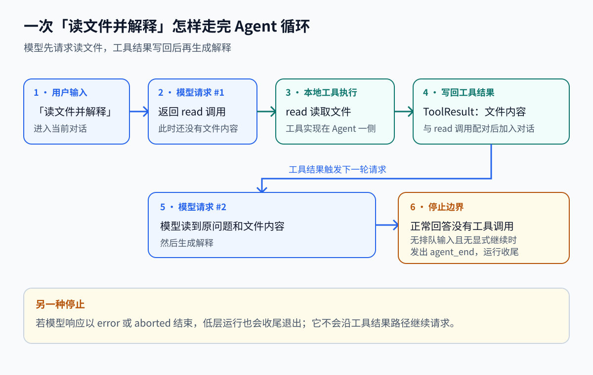
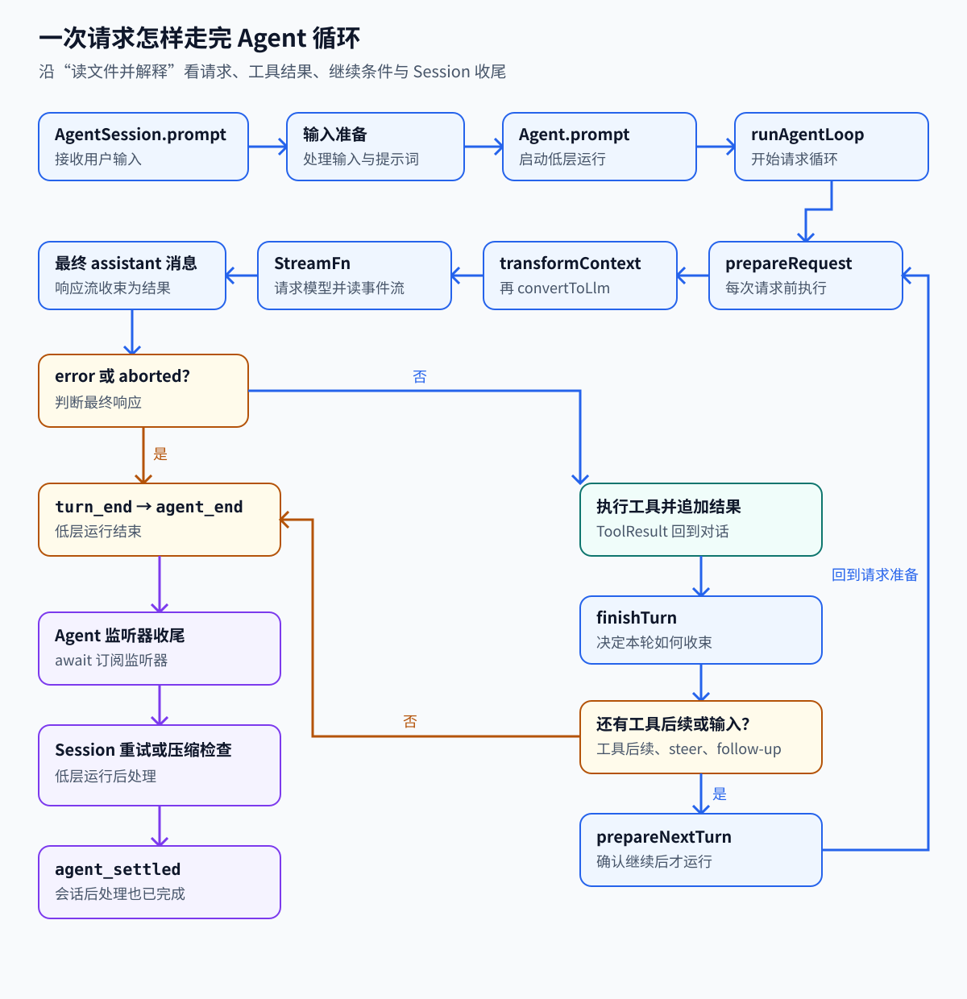

# 01. 一次请求如何变成 Agent 循环

[返回学习地图](README.md) · 下一篇：[历史与上下文](02-context-state.md)

Agent Runtime 是把用户任务交给模型、执行模型提出的工具操作、再让模型根据结果继续工作的程序。本文从“读文件并解释”开始，讲清这段循环之后，再读它的输入、输出与收尾代码。内容依据源码提交 `96abe9a5ad45005cae34ed1c52d42f71fc88bedc`。

## Agent 怎样替你把一件事做下去

一次模型请求，是程序把一组信息送给模型服务，再接收它的输出。单次请求只能依据送进去的信息回答。假如文件内容还没送进去，模型就缺少文件里的事实；程序需要给它读取文件的办法。

工具是程序中可以执行的操作，例如接收文件路径并返回内容的 `read`。工具调用是模型产生的一份请求，里面写着工具名、参数和调用 ID；这个 ID 用来把之后的结果与本次调用对应起来。模型服务收到的是工具说明，真正能读文件的函数留在执行程序中。

“读文件并解释”因而要走完下面的过程：

1. 程序收下用户输入，准备本次要发送的消息和工具说明。
2. 模型返回读取请求，例如读取项目配置。
3. 程序找到 `read`，校验路径参数并执行；失败也会形成工具结果。
4. 程序把结果放回消息里，再发起模型请求。模型现在能依据文件内容生成解释。
5. 程序检查是否还要执行工具、接收排队输入或继续请求；没有继续条件时收尾。

Agent Loop 中的 loop 就是这个循环。它需要决定什么时候再请求一次、什么时候结束，也要保证每次工具结果能回到对话。用一组对象分别承担这些工作，才形成下面的关系。

| 对象 | 负责什么 | 与下一步的关系 |
| --- | --- | --- |
| 模型 | 依据当前消息和工具声明，返回文本或工具调用 | 工具调用交给 Agent 执行 |
| `Agent` | 运行模型请求、工具和继续条件，维护本次运行的内存状态 | 将工具结果加入消息，再决定是否请求模型 |
| `AgentContext` | 提供消息与可执行工具 | 作为 Agent 循环本次运行的输入 |
| `AgentSession` | 保存会话条目、集成扩展，并在请求边界刷新上下文 | 为后续请求重建模型可见消息 |

这里把 assistant（模型回复）的一次输出及其触发的一批工具调用和结果称为 Turn（回合）；一次 Run（运行）可以包含多个回合。下面先看一条简单路径：过程中没有新输入或显式继续条件，所以正常文本回复后结束。

对话消息会标出来源：user 是用户输入，assistant 是模型输出，toolResult 是工具返回的结果。system 消息提供程序设置的提示词与工具声明。prompt 指用户交给程序的输入，API 是程序调用另一个组件或服务的接口。

程序还会发出事件，也就是“某一步开始、更新或结束”的通知。下面用事件名记录刚才的读取过程：start 表示开始，end 表示结束，delta 表示输出中新到达的一部分；idle 是低层 Agent 已空闲，settled 是会话收尾也已完成。事件名是源码标识，先用它核对流程，后文再解释对应实现。

```text
prompt("读文件并解释")
  agent_start → turn_start
  user: message_start → message_end
  assistant #1: start → 多个 delta → message_end
  read: tool_execution_start → tool_execution_end
  toolResult: message_start → message_end
  turn_end
  turn_start
  assistant #2: start → 多个 delta → message_end
  turn_end → agent_end
  所有 Agent 监听器完成 → Agent idle
  AgentSession 后处理完成 → agent_settled
```

第一次请求没有文件内容，模型返回 `read` 调用。Agent 执行读取，把 `toolResult` 写入消息后再请求模型；第二次请求因此能依据文件内容生成解释。模型输出和工具执行都通过事件报告。提示词或工具声明发生变化时，轨迹中还会增加 system 消息。事件顺序的完整测试见 [packages/coding-agent/test/suite/agent-session-retry-events.test.ts:292-338](../../packages/coding-agent/test/suite/agent-session-retry-events.test.ts#L292-L338)。



这条例子说明了循环为何需要多个 Turn。接下来逐步看输入怎样进入循环，消息怎样变成模型请求，工具结果又如何影响下一步。

## 输入怎样进入一次运行

### 模型看到什么，工具又在哪里执行

这里有两个接口之间的交接。循环内部需要可执行工具，才能真的读取文件；模型请求需要工具名称、用途与参数说明，才能提出合法调用。把这两份信息分开，可以让同一个循环连接不同的模型服务，同时仍由本机或已配置的后端执行工具。

源码中的“类型”规定接口的数据形状。例如消息必须说明角色和内容，工具必须说明名称、参数和执行函数。`StreamFn` 是发起模型请求的函数接口，`AgentContext` 是循环拿到的消息与工具集合，`AgentEvent` 是循环对外报告进度的消息。先知道这些数据在哪一步使用，再读类型字段就有了对应对象。

先读 `StreamFn`、`AgentContext`、`AgentEvent`，可以看清模型请求与本地执行的分工。`AgentContext.tools` 保存可执行的工具实现；模型服务收到的 `TranscriptContext` 只有消息，工具声明由 system 消息携带。`StreamFn` 还约定，请求失败要进入事件流，以最终的 `stopReason: error/aborted` 表达，这样失败也能走完正常的事件收尾。相关类型见 [packages/agent/src/types.ts:19-37](../../packages/agent/src/types.ts#L19-L37)、[packages/agent/src/types.ts:501-539](../../packages/agent/src/types.ts#L501-L539)。

### 同一次运行里的状态与新输入

运行状态是程序当前执行情况的记录，例如模型是否正在输出、哪些工具尚未完成。如果同一个 Agent 在工具未结束时同时启动两次运行，两次运行就可能争用消息和停止状态。因此它限制同一时刻的活动运行，并为后来到达的输入提供队列。队列先保存输入，循环到约定的边界再取用。

`AbortController` 是 JavaScript 的取消信号控制器。它可以通知模型请求或工具“该停止了”，接收方需要检查并配合；已经写入的文件不会因信号自动恢复。`activeRun` 则让程序追踪本次运行是否仍存在。这些字段服务于启动、取消和结束，不是跨进程恢复记录。

`Agent` 持有 `_state`、两个输入队列、监听器和 `activeRun`。当前运行尚未结束时，`prompt()` 会拒绝再启动一个运行；新消息仍可通过队列 API 送入。开始时创建 `AbortController` 并设置 `isStreaming`，最终由 `finishRun()` 清理这些运行状态。沿 [packages/agent/src/agent.ts:188-228](../../packages/agent/src/agent.ts#L188-L228)、[packages/agent/src/agent.ts:370-411](../../packages/agent/src/agent.ts#L370-L411)、[packages/agent/src/agent.ts:507-556](../../packages/agent/src/agent.ts#L507-L556) 阅读，可以把一次运行的起止对应到这些字段。

运行上下文只复制消息数组的顶层，每条消息对象仍然共享。观察流式输出时也要分开看：`processEvents()` 收到 `message_end` 才向公开对话记录追加完整消息，`message_update` 只更新 `streamingMessage`。因此，保留数组或事件对象都不足以保证拿到一份不可变的消息快照。见 [packages/agent/src/agent.ts:460-465](../../packages/agent/src/agent.ts#L460-L465)、[packages/agent/src/agent.ts:565-603](../../packages/agent/src/agent.ts#L565-L603)。

### 继续运行时为什么不再追加用户消息

首次输入需要进入对话，后续某次继续却可能只是用已有工具结果重新请求模型。若每次继续都重复追加原用户输入，同一个任务就会在对话里出现多次。因此源码分别提供“带新输入启动”和“沿现有上下文继续”两个入口；是否还需要从队列取新输入，由较外层的 Agent 决定。

初次进入 `runAgentLoop()`，它会追加本次输入并发出对应事件；`runAgentLoopContinue()` 则使用已有输入，不再追加一次。低层继续执行的入口拒绝空上下文和以 assistant 结尾的上下文；若尾部是应用自定义消息，调用者要保证它能转换成合法的 user/toolResult。`Agent.continue()` 在此基础上还会检查队列：即使当前以 assistant 结尾，也可先取排队输入启动新一轮。其中，steering 是本轮工具全部处理完后优先接入的输入，follow-up 则等模型原本可以停止时才处理。两层入口可以对照 [packages/agent/src/agent-loop.ts:102-151](../../packages/agent/src/agent-loop.ts#L102-L151)、[packages/agent/src/agent.ts:383-411](../../packages/agent/src/agent.ts#L383-L411)。

### `runLoop()` 怎样决定再请求一次

循环每轮完成后都要检查下一步：工具结果是否需要交回模型，是否有调整当前工作的输入，是否有等待最终回答的后续任务。应用还可以在 `finishTurn` 回调里明确要求结束或继续。这个回调是回合结束时的决策入口；与请求前的准备回调分开，才不会把“要不要继续”和“继续时发送什么”混成一项操作。

工具结果送回模型，或 steering 要求调整当前工作时，内层循环继续；准备停止时，外层才检查 follow-up。请求前有两个不同的准备时机：`prepareRequest` 每次都执行，包括第一次请求；`prepareNextTurn` 要等当前一轮完成且已确定继续后才执行。后者可以换上下文、模型和思考级别，也可以追加消息；如果准备期间又收到 steering，循环会补取它。读 [packages/agent/src/agent-loop.ts:163-242](../../packages/agent/src/agent-loop.ts#L163-L242) 时，可以用下面的条件表判断下一次请求怎样产生。

| 完成响应后的条件 | 当前循环行为 |
| --- | --- |
| `error` / `aborted` | 调用 `finishTurn`，发出结束事件，直接退出低层运行 |
| 正常消息含工具调用 | 执行工具，追加工具结果，再决定下一轮 |
| `finishTurn` 返回 `end` | 直接结束，保留尚未取走的输入队列 |
| `finishTurn` 返回 `continue` | 确保下一次请求；已有工具后续、steering 或 follow-up 可满足它 |
| 无工具后续、无 steering | 检查 follow-up，然后检查显式要求继续的条件 |
| 无任何继续条件 | 发出 `agent_end` |

各个退出与继续分支集中在 [packages/agent/src/agent-loop.ts:245-320](../../packages/agent/src/agent-loop.ts#L245-L320)。

## 模型响应怎样变成消息

Streaming（流式输出）让程序在模型还没生成完整回答时就收到部分内容。用户因而能看到逐渐出现的文字，程序也能报告进度。不过，部分内容与最终消息要分开：一个工具参数可能先收到半段 JSON，之后才补齐；程序不能把每次增量都当成完整工具调用执行。

JSON 是用字段、数组等形式表达数据的文本格式，工具参数可以用它表示路径等输入。解析成功只说明文本符合格式，校验还要检查字段是否符合工具要求。Promise 则代表一个稍后完成的值，程序可以等待它；异步迭代用于逐次等待新的事件。FIFO 表示先进入队列的事件先取出。这些机制分别用于表达参数、等待最终结果和消费流式输出。

整个接收过程是：发起请求，建立一份正在生成的消息，按增量更新它，等待结束信号，然后取得最终消息。delta 指“这次新来的变化”，partial 指“目前拼出的部分消息”。事件把这个过程报告给界面；最终消息才交给后续工具处理与对话记录。因此这里既有事件流，也有最终结果，两者用途不同。

发出请求前，程序需要把内部消息转换成模型接口接受的格式，并取得 API key，也就是服务接受的访问凭证。对应 `streamAssistantResponse()` 中的顺序是 `transformContext → convertToLlm → normalizeContext → 动态取 API key → StreamFn`。收到 `start`，它把尚未完成的消息放入循环内部上下文；后续增量会替换内部尾消息，并发出 `message_update`；直到 `done/error`，才通过 `result()` 取得最终消息。这段适配逻辑见 [packages/agent/src/agent-loop.ts:381-469](../../packages/agent/src/agent-loop.ts#L381-L469)。

这里的 `partial` 是模型服务适配器持续更新的共享对象。若想比较某两个时刻的内容，需要自己保存快照，仅保留事件对象会继续看到它的后续变化。`EventStream` 用 FIFO 队列支持异步迭代，另有一个最终结果 Promise；队列没有容量上限，消费较慢也不会阻塞 `push()`。这决定了订阅端如何存消息，也决定了积压可能发生在哪里。见 [packages/ai/src/types.ts:785-817](../../packages/ai/src/types.ts#L785-L817)、[packages/ai/src/utils/event-stream.ts:25-93](../../packages/ai/src/utils/event-stream.ts#L25-L93)。

想继续追到模型服务协议，可以读 OpenAI Responses：请求成功后发 `start`，随后解析响应流，正常结束发 `done`，异常则转为 `error`。阅读这段适配器就能对应上述事件，无需调用真实 API：[packages/ai/src/api/openai-responses.ts:127-236](../../packages/ai/src/api/openai-responses.ts#L127-L236)。

## 工具结果如何回到对话

模型可能一次提出读取两个文件。程序可以同时开始两次读取，让等待重叠，这叫并行执行。实际完成顺序可能是第二个文件先返回，但每个结果仍要带调用 ID，才能对应原请求。程序还要区分“工具执行失败”和“整个循环无法继续”：文件不存在可以作为错误结果交给模型，由它选择另一路径。

这一步的完整交接是：解析调用、验证参数、执行调用前检查、运行工具、形成结果、按调用关系加入对话。hook（钩子）是其中预留给扩展的函数入口，扩展可以检查或阻止操作。参数错误或被阻止的调用也要给出对应结果，否则对话中会留下没有结果的工具请求。

一条响应可能包含多个工具调用。默认并行模式先逐个准备和验证参数、运行 `beforeToolCall`，再并发执行允许执行的工具。于是 `tool_execution_end` 按实际完成顺序出现，而写回对话的 toolResult 仍按 assistant 的原调用顺序排列。任一工具要求顺序执行时，整批都改为顺序执行。把事件顺序与消息顺序分开看，才能读懂 [packages/agent/src/agent-loop.ts:508-660](../../packages/agent/src/agent-loop.ts#L508-L660) 中的两段处理。

参数验证失败、工具不存在、被拦截或执行抛错，都会转成错误工具结果，通常交给模型判断下一步。但响应因 `length` 截断时，其中所有工具调用都跳过：补救 JSON 解析即使得到合法语法，参数也可能缺了一部分。至于停止条件，只有整批最终结果的 `terminate` 都为 true，才停止由工具结果触发的继续；输入队列与 `finishTurn` 仍按各自规则决定是否再请求。三个分支可对照 [packages/agent/src/agent-loop.ts:471-503](../../packages/agent/src/agent-loop.ts#L471-L503)、[packages/agent/src/agent-loop.ts:690-777](../../packages/agent/src/agent-loop.ts#L690-L777)、[packages/agent/src/agent-loop.ts:821-909](../../packages/agent/src/agent-loop.ts#L821-L909)。

## 模型停止后，会话还要继续收尾

同一个终端会话可以接收多次输入，每次输入又可能运行多个回合。会话层需要把这些运行连起来，保存历史并处理重试、压缩和扩展收尾。因此有两种结束需要识别：这次低层循环已经停止；会话为这次输入做的处理已经全部结束。界面若在第一种结束时就允许按“完全完成”处理，可能早于后面的重试或压缩。

在 coding-agent 中，持久历史与循环的连接由 `AgentSession` 完成。它在构造时订阅 Agent，并安装工具、请求投影、下一轮刷新和运行边界回调；每次 `message_end` 追加 SessionManager 条目，下一次请求再从会话投影取上下文。这样，已保存的历史和扩展修改就能进入后续请求，UI 无需自行拼接消息。连接位置见 [packages/coding-agent/src/core/agent-session.ts:485-526](../../packages/coding-agent/src/core/agent-session.ts#L485-L526)、[packages/coding-agent/src/core/agent-session.ts:787-843](../../packages/coding-agent/src/core/agent-session.ts#L787-L843)、[packages/coding-agent/src/core/agent-session.ts:1103-1196](../../packages/coding-agent/src/core/agent-session.ts#L1103-L1196)。

回到开头的轨迹，Agent 会按订阅顺序等待监听器返回的 Promise，所以发出 `agent_end` 时仍可能没有空闲。Session 的 `prompt()` 在低层运行之后还要等待重试、压缩和 `agent_before_settle`，最后才发 `agent_settled`。另一个需要分清的地方是 Session 公开的 `subscribe`：它的监听器返回 void，并不采用 Agent 那套可等待的契约。等待语义分别见 [packages/agent/src/agent.ts:256-269](../../packages/agent/src/agent.ts#L256-L269)、[packages/agent/src/agent.ts:605-611](../../packages/agent/src/agent.ts#L605-L611)、[packages/coding-agent/src/core/agent-session.ts:1038-1043](../../packages/coding-agent/src/core/agent-session.ts#L1038-L1043)、[packages/coding-agent/src/core/agent-session.ts:1822-1851](../../packages/coding-agent/src/core/agent-session.ts#L1822-L1851)。



图把上面讲过的请求、工具、继续判断与收尾放在一条路径中。图中普通文本在没有排队输入或显式继续条件时结束低层运行；实际的 `finishTurn` 还可返回 `end` 或 `continue`，其余队列分支见条件表。

## 边界与未实现

前面跟随的是常规循环；把它接入真实应用时，以下限制需要宿主另行安排：

- 当前低层 Agent 由工具结果、队列和回调决定是否继续，尚无持久任务调度、全局预算、通用最大轮次数或工具并发池。宿主若需要这些限制，要另行安排。
- 取消也需要模型服务、工具与回调配合 AbortSignal；`abort()` 无法撤销已经发生的外部效果。
- 事件传递方面，`EventStream` 没有磁盘日志、消费确认或有界缓冲，可靠投递与积压控制仍需要额外设计。
- 进程退出后如何恢复持久任务，是另一条实验路径的职责，见[重试、超时与幂等](06-retry-timeout-idempotency.md)。

## 源码位置与术语速查

| 层次 | 当前实现 | 本篇使用的标记 |
| --- | --- | --- |
| `packages/ai` | 统一消息类型、模型服务的流式协议、最终响应 | 稳定库 |
| `packages/agent` | 内存中的执行循环、工具执行、输入队列、取消、状态与事件 | 稳定库 |
| `packages/coding-agent/src/core` | 持久化会话、扩展、压缩、重试、模式共用的会话运行时 | 常规集成 |
| `packages/durable` 与 coding-agent 的 durable 入口 | 独立的持久任务、会话和文档运行时 | 实验实现 / 实验集成 |

表中的“稳定库”区分常规代码路径与实验目录，类型本身仍可能变化。

### 文中术语

| 术语 | 在这个项目中的含义 |
| --- | --- |
| Run | 一次 `Agent.prompt()` 或 `Agent.continue()` 启动的低层执行过程，可以包含多个 turn |
| Turn | 一条 assistant 响应，以及它触发的一批工具调用和结果 |
| Transcript | 按顺序排列的消息；system 消息也携带提示词和工具声明变化 |
| `AgentMessage` | 标准模型消息加上应用扩展的消息类型 |
| `StreamFn` | 把模型和规范化上下文转换为 `AssistantMessageEventStream` 的函数 |
| Steering | 当前一轮的工具全部处理完后，优先进入下一次模型请求的输入 |
| Follow-up | 模型原本可以停止时才处理的后续输入 |
| Settled | 会话层的重试、压缩、扩展收尾也已经完成 |

消息、流和事件的定义可以对照 [packages/agent/src/types.ts:19-58](../../packages/agent/src/types.ts#L19-L58)、[packages/agent/src/types.ts:509-539](../../packages/agent/src/types.ts#L509-L539)。

## 测试与练习

| 学习问题 | 对应已有测试 |
| --- | --- |
| 工具声明与可执行集合怎样保持一致 | [packages/agent/test/agent.test.ts:163-279](../../packages/agent/test/agent.test.ts#L163-L279) |
| 为什么 `agent_end` 不能直接当作 idle | [packages/agent/test/agent.test.ts:361-432](../../packages/agent/test/agent.test.ts#L361-L432) |
| 错误响应是否仍然会收尾 | [packages/agent/test/agent.test.ts:330-359](../../packages/agent/test/agent.test.ts#L330-L359) |
| Session 的文本与工具事件序列 | [packages/coding-agent/test/suite/agent-session-retry-events.test.ts:269-358](../../packages/coding-agent/test/suite/agent-session-retry-events.test.ts#L269-L358) |

练习可以直接沿用开头的轨迹：在每个事件旁写出 `messages`、`streamingMessage`、`pendingToolCalls` 的变化，再用测试里的模拟 `StreamFn` 返回一次 toolCall 和一次普通文本，对照轮次数与模型调用数。确认消息流转后，在 `agent_end` 监听器里放一个可手动释放的 Promise，观察 `prompt()` 与 `waitForIdle()` 如何等待它。

Agent 测试构造内存事件流；会话测试使用 faux provider 和内存 SessionManager，均无需真实模型密钥。测试支架见 [packages/coding-agent/test/suite/harness.ts:150-225](../../packages/coding-agent/test/suite/harness.ts#L150-L225)。若要运行，在对应包的根目录使用 `node ../../node_modules/vitest/dist/cli.js --run test/agent.test.ts`，或在 coding-agent 下指定 `test/suite/agent-session-retry-events.test.ts`；选择这些定向用例即可，避免运行包含 e2e 的全套测试。

继续读[历史与上下文](02-context-state.md)，理解为何下一次请求可以换一份上下文；再读[重试、超时与幂等](06-retry-timeout-idempotency.md)，区分重做模型响应与重做工具效果。
