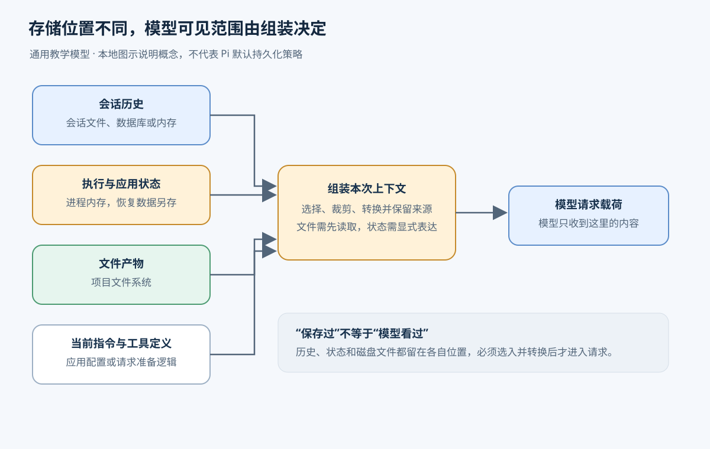
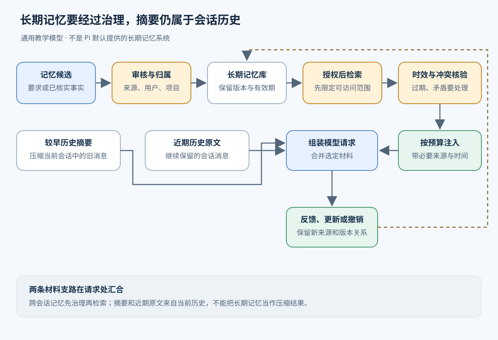
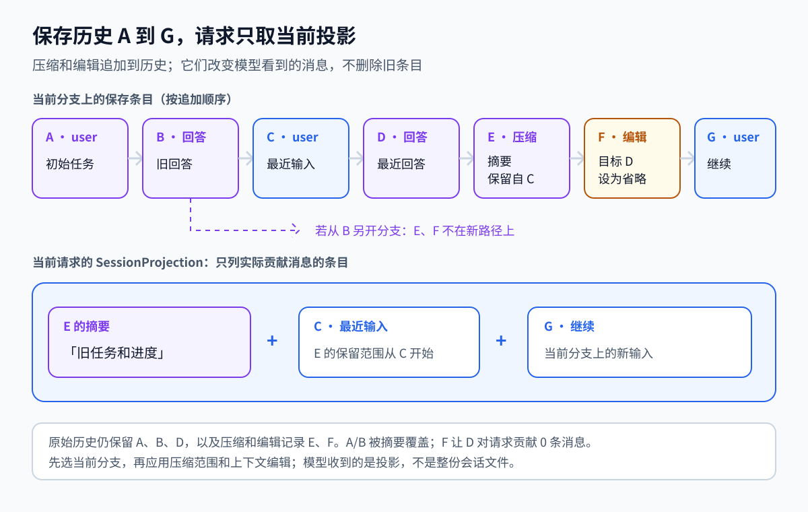
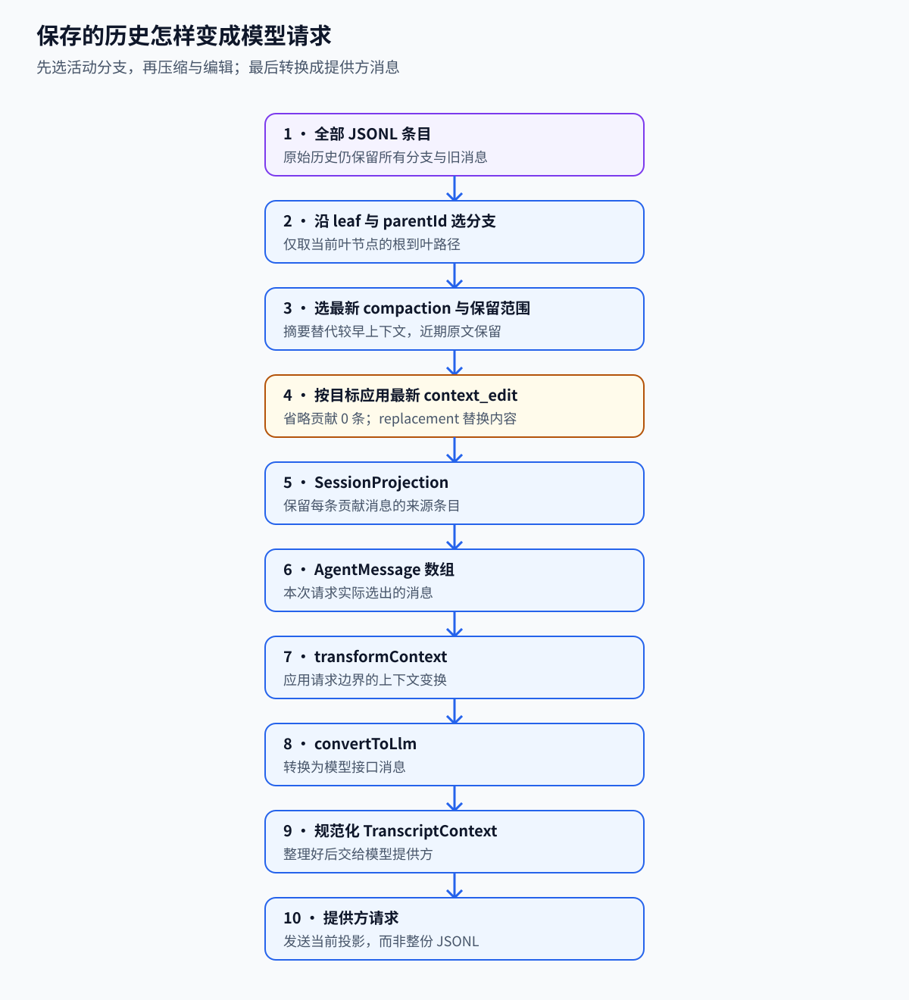

# 第 2 章　上下文与状态

[返回目录](README.md) · [上一章：第 1 章 Agent 运行时](01-agent-runtime.md) · [下一章：第 3 章 任务队列与 Worker](03-queues-workers.md)

上下文管理决定一次模型调用能够使用哪些信息。会话历史、程序状态与磁盘产物各自保存，程序需要在调用前选取相关内容并组装请求。本章先区分这些数据的职责，再以配置修改任务说明请求如何随执行进度更新，随后讨论窗口容量、摘要、检查点与长期记忆，最后对照 Pi 的默认 CLI 和实验 durable 路径。

## 2.1 上下文的作用与代价

用户要求：“给项目增加一个模型配置，保留已有配置，并检查能否加载。”Agent 先读取配置，发现已有两个模型；随后写入第三个，再运行加载检查。每次模型请求都需要知道任务推进到了哪里。例如，写入前要看到原配置和“保留已有配置”的约束，写入后要知道工具是否成功，以及验证还没有完成。

上下文决定模型本轮能看见什么。这里的上下文（context）是程序实际交给一次模型调用的信息，包括系统指令、用户要求、选出的历史消息、工具声明和工具结果。在本章讨论的请求接口中，模型依据这次收到的内容继续生成；本地保存了文件、上一次读过配置，都不代表这些内容自动出现在下一次请求里。

上下文过少会使任务缺少必要依据：只发送“继续”时，模型可能无法确定待完成的操作。上下文过多则会超出容量，例如数小时积累的文件内容和命令输出。程序需要在每次调用前选择足够的信息，并明确容量不足时的取舍。同时，程序还要保存“文件已写入、验证未完成”等执行状态，以便决定下一阶段。支持模型理解任务与支持程序恢复执行，需要的记录形式并不相同。

以下描述属于教学设计，不表示 Pi 已经内置其中所有功能。

## 2.2 上下文、历史与执行状态的保存位置

会话（Session）把多次相关交互组织在一起。会话历史记录发生过的消息与操作：用户提出要求、模型发起读取、工具返回文件、模型请求写入、工具报告结果。历史通常保存到文件或数据库；进程也可以只在内存中保留临时会话。持久存储让关闭程序后仍能查看已有记录。

程序从历史及其他材料中选取当前任务需要的内容，加入系统指令、工具定义或检索结果，再转换为模型服务接受的格式。由保存材料计算出的视图称为投影（projection）。历史不变时，投影仍可以变化，例如省略某次失败答案，或使用摘要替代较早的消息。

状态（state）泛指程序为了继续运行而维护的数据。当前使用的模型、正在等待的工具、取消标记、排队输入，都属于运行状态；配置路径、任务阶段和验证结果属于应用状态。它们可能只在进程内存中，也可能由应用保存到持久存储。保存方式决定程序退出后哪些数据还能找回。

| 对象 | 配置任务中的内容 | 保存位置 | 进入模型请求的方式 |
| --- | --- | --- | --- |
| 会话历史 | 用户要求、读取调用、配置原文、写入结果 | 会话文件或数据库，也可仅在内存 | 程序选取并转换相关消息 |
| 本轮上下文 | 保留旧模型的要求、当前配置、待验证事项、可用工具声明 | 组装请求时的内存与请求载荷 | 它本身就是交给模型的输入 |
| 执行与应用状态 | 当前阶段为验证、工具是否仍在运行、任务是否取消 | 运行时内存；需恢复的部分另行持久化 | 只有显式整理成消息的内容才会进入 |
| 配置产物 | 工具实际写入的项目配置 | 项目文件系统 | 读取工具返回内容后，程序才能把它纳入请求 |

因此，“历史里有写入成功的消息”“磁盘上的配置确实正确”“程序可以从验证阶段恢复”是三个需要分别核实的事实。日志可能记录工具报告了成功，但文件之后仍可能被其他程序修改。内存里记着待验证，也不能保证重启后还能找到这一阶段。



图示为通用教学模型：持久存在或留在内存里的数据都不会自动成为模型上下文。

## 2.3 一次配置任务的上下文组织

以下流程假设应用保存会话历史，并为需要恢复的任务维护独立状态。它展示的是信息如何交接；具体的调用与工具执行循环见[第 1 章 Agent 运行时](01-agent-runtime.md)。

### 2.3.1 接收要求与第一次调用

程序保存用户输入，给任务分配身份，并记录目标配置文件、任务约束和初始阶段。准备模型请求时，加入系统指令、用户要求和可用工具的定义。工具定义说明工具名称、作用及参数格式；此时模型尚未看过项目文件，不能把未读取的内容当成已知事实。

模型请求读取配置后，运行时执行工具，将调用及结果加入历史。随后准备第二次请求：保留用户要求、读取调用和读取结果。调用标识把某份结果关联到发起它的请求，模型才能理解这段配置从哪里来。

### 2.3.2 工具返回后的记录更新

第二次模型调用提出修改，运行时执行写入。工具成功返回后，程序记录结果，并在应用状态中把阶段推进到“待验证”。下一次上下文要同时表达“配置已写入”和“尚未验证”，避免模型把编辑成功直接当成整个任务完成。

程序随后执行加载检查，将检查结果纳入历史和后续上下文。只有检查证据满足成功条件，应用才把任务标为完成。面向用户的回答可以引用这项结果；任务状态中的完成标记则供程序查询和调度使用。

请求组装需要随执行进度更新。刚读取的配置可能仍是修改依据，已经被新结果替代的旧日志则未必需要全文发送。所选内容还应保留来源，区分用户要求、工具结果、摘要与跨会话检索记录。这样可以判断一项结论是直接观察所得，还是经过摘要或推断形成。

### 2.3.3 持续交互中的约束与进度保存

用户后来补充“默认模型不要变”，这条新约束需要进入后续请求，也应更新任务记录。长任务可能经历多次读取和验证，窗口中放不下全部内容时，程序可以保留近期操作，并把较早内容整理为摘要。摘要应准确交代“增加第三个模型，保留前两个与原默认项；修改已写入，加载检查尚未完成”，而不是只写“讨论了配置”。

摘要生成成功后，还要保存它覆盖到哪里、从哪里开始保留原文。下次请求才有确定的组装规则：当前指令和工具声明、摘要、保留的近期消息，以及之后新增的输入。旧历史可以继续保存在存储中，用于查看、审计或重新取得被摘要遗漏的原文。

## 2.4 有限窗口中的容量分配

上下文窗口是一次模型调用能够容纳的信息容量，通常以 token 计量。Token 是模型处理内容时使用的单位，不等于一个汉字或一个单词。容量预算要同时考虑输入与即将生成的输出；模型服务对输入、输出和总窗口的具体限制，应按所用接口执行。

用户问题只是输入的一部分。系统指令、工具名称和参数结构、历史回答、工具调用参数、工具返回的大段配置或日志，都可能消耗预算。输出也需要空间：模型可能要写解释，也可能要生成下一次工具调用的参数。如果输入已经挤满窗口，就没有足够余量继续工作。

程序因此先为输出预留空间，再给其余内容安排输入预算。一次工具调用返回了很长的日志，即使上次模型报告用量尚低，下一次请求也可能已经过大。窗口检查必须针对即将发送的内容，不能用会话文件大小或过时的用量代替。工具定义很多时，只缩短聊天消息也可能不够。

### 2.4.1 裁剪与摘要的信息损失

裁剪是省略部分内容，例如不再发送早先一次失败的加载日志，或只保留大文件中相关片段。它不需要额外生成摘要，成本较低；代价是被省略的信息从本次请求中消失。若裁掉了用户早先说的“保留默认项”，后面即使有最新配置，模型也可能不知道这条限制。

摘要是把较早材料改写成更短的工作说明。它能够保留跨多轮讨论的目标、约束、进度与理由，但生成本身需要时间和 token，也可能漏掉条件、改错数字或把未验证的推测写成事实。反复压缩旧摘要还可能放大这种误差。摘要不能无损恢复原文，需要精确比较配置时应重新读取对应文件或历史证据。

两种办法可以配合：丢掉已无用途的重复输出，对较早工作做摘要，对当前修改所需的配置片段保留原文。仍然有效的用户约束、确切路径、重要错误信息和未完成事项必须有明确去处。可以为这些信息保留单独区域，并在压缩后检查是否齐全；硬性权限与安全限制仍须由程序执行，不能只依赖模型记住一段摘要。

工具调用和结果还存在结构上的约束。假设模型发起一次读取，结果通过调用 ID 指回它；只留下结果却删掉调用，会形成缺少对应调用的工具消息，并可能违反模型接口的消息要求。安全切点需要保留整组相关消息，或把这组内容一起转换成普通摘要。只按字符数截断，会同时破坏语义与消息结构。

### 2.4.2 摘要启用条件与压缩失败

生成摘要本身也是模型请求。如果只收到半段摘要就中断，而程序已经切换到它，后续上下文可能丢掉还未写出的约束和进度。通用做法是先准备摘要与保留边界，确认结果完整，再保存并启用；生成失败时继续以旧记录作为依据。

即使摘要完整，也要检查压缩后的预算。近期保留内容过大、单个工具结果过长，或摘要本身太长，都可能使下一次请求继续溢出。提前按阈值处理可以减少请求被拒绝的机会；收到服务端“上下文过大”后再处理属于故障恢复，两者的触发时机不同。

## 2.5 检查点的内容与保存边界

检查点（checkpoint）是在某个明确边界保存的一组恢复依据。它的内容取决于要恢复什么。要重建模型上下文，需要当前指令、所选历史位置、摘要和保留范围；要恢复任务执行，则需要机器能解释的阶段、输入和已确认结果。后者不能仅靠自然语言写着“下一步验证”。

以配置任务为例，一个任务检查点可以记录任务 ID、配置路径、已读版本或内容标识、目标修改、已完成阶段、写入结果引用，以及下一步要运行的检查。如果程序允许暂停，还要记录是在等待工具、等待用户决定，还是可以继续。格式版本帮助恢复程序判断这些字段能否读取。工具仍在运行的进程句柄和网络连接通常不能原样恢复，重启后需要查询结果或重新建立执行环境。

保存边界决定这些字段能证明什么。写文件之前保存“准备写入”，只能证明操作计划；写入成功并记录结果后保存“待验证”，才足以据此安排验证。若文件已经写好，但进程在记录结果前崩溃，恢复者只看到“准备写入”，无法仅凭旧检查点确定写入是否发生。此时应检查当前文件及其版本，必要时查询外部操作结果；盲目重做可能覆盖他人的后续修改。

较可靠的设计会让相关任务状态与结果记录一起提交，避免出现“阶段已推进，结果引用却不存在”的组合。这个提交通常只覆盖同一存储中的记录，不能自动把项目文件或外部服务也包进同一事务。跨越这条边界的未知结果，需要第 05、06 章讨论的恢复、幂等与核验机制。

保存得频繁，故障后需要重做的范围通常较小，但写入与协调成本更高。只在整个任务结束时保存则更简单，却无法从中间阶段继续。应围绕可验证的阶段结果选择检查点，例如读取完成、写入得到确认、验证完成，并说明每一处提交覆盖哪些状态。

摘要可能在源码中被称作 context checkpoint，它保存的是供模型理解的交接内容，仍可能有信息损失。精确的任务检查点需要结构化字段和明确提交规则。重新打开聊天记录可以恢复对话；它本身不表示程序会接管先前仍在运行的工具或从中断指令处继续。

## 2.6 跨会话记忆的写入与检索

短期上下文服务于当前调用。长期记忆则跨越多次交互，甚至跨会话保存有用信息，再按当前任务取回。例如用户明确表示“这个项目新增模型时始终保留原默认项”，应用可能希望下一次配置任务继续采用这条约定。

把全部聊天记录无限保存，只完成了留档。要让这条约定以后有效，还需要确定它是否值得保存、属于谁、在哪些项目适用，以及当前请求能否读取。以下是一种可实现的记忆流程，Pi 的覆盖范围见 2.9.3。

### 2.6.1 写入时的内容、归属与依据

任务结束时，应用可以从明确的用户要求或已核实结果中提出候选记忆。“用户要求保留该项目的默认模型”有具体来源；模型猜测用户偏好某个提供方则不能直接当作已确认偏好。候选内容应经过应用规则审核，敏感、影响较大或含糊的内容可交给用户确认，再写入持久存储。

一条记录除正文外，还应带上归属用户或团队、适用项目、来源消息或文档、写入时间、版本与有效期等信息。项目约定不要未经判断变成用户对所有项目的全局偏好。原始凭证也不适合因为出现在配置文件中就被复制进通用记忆。

记忆写入的责任应由应用明确分配。应用执行写入规则，用户或组织确定可保存范围，存储系统落实保存与访问约束。模型可以提取候选内容，但候选总结只有经过这些规则处理后，才能成为后续任务采用的持久记录。

### 2.6.2 检索时的权限、相关性与时效

新会话收到配置任务后，程序用当前用户和项目身份限定可访问范围，再检索相关记录。检索可以使用关键词、结构化条件或语义相似度；相似度高只说明文本相关，不能证明内容仍然正确或可以给当前用户看。权限应在内容进入模型请求前执行。

取回“保留默认模型”后，还要核对其来源和适用范围。如果记录来自旧版项目说明，而当前用户明确要求切换默认项，程序需要识别冲突，并按应用规定的来源优先级处理；必要时询问用户，不能让检索排序静默替代决策。具有失效时间或已被新版本替代的记录应刷新、标记失效或停止注入。

经过核验的记忆仍需编入本次上下文，附带必要的来源和时间信息，并占用输入预算。存储中的其他记录不会因此全部变成模型知识。检索材料还可能包含引用的命令或不可信指令，应以资料身份提供，不能把它提升成系统权限。

任务结束后，若用户修正了原约定，应用应更新对应记录、保留来源关系，并让后续检索采用新版本。删除和撤销也要能作用于以后读取。这样形成“候选提取、审核写入、授权检索、时效与冲突核验、注入请求、反馈更新”的闭环。保存更多记录会增加覆盖面，也会增加噪声、过期内容和治理成本。



图示为通用教学模型：跨会话长期记忆需要治理和检索，不等同于当前历史的摘要压缩。

## 2.7 参考实现：Pi 的历史树与请求投影

Pi 的常规会话由 `SessionManager` 保存历史树，`SessionProjection` 表示当前分支的模型可见消息及其来源。`AgentState` 则在内存中保存当前模型、思考级别、消息、工具和执行状态。原有源码材料以提交 `96abe9a5ad45005cae34ed1c52d42f71fc88bedc` 为基线；以下行为也已对照当前工作区实现。

### 2.7.1 分支对历史范围的限定

配置修改失败后，用户可以回到某条旧消息，尝试另一种修改方法。历史条目的 `id` 标识自身，`parentId` 指向它接在哪条记录之后；当前叶节点是这次尝试走到的最后一条记录。沿叶节点逐个回到父节点，就得到当前分支。旧尝试继续保存在树中，当前请求沿所选路径取材，避免混入另一种尝试的结论。

`buildSessionPath()` 取得根到叶节点的路径。`getSessionContextSettings()` 沿完整路径重放模型和思考级别变化，assistant 消息也会提供模型信息。恢复这些设置所需的范围可以大于最终发送的对话范围。

压缩（compaction）追加摘要与近期内容的保留起点；上下文编辑（`context_edit`）指向某条已有记录，指定在投影中省略它，或替换它的内容。两种操作都保留旧记录。前者处理较早的一段上下文，后者改变指定条目的贡献。

### 2.7.2 压缩边界与投影计算

以下 A 到 G 是示意 ID，沿同一条分支依次发生：

```text
A user: 初始任务
B assistant: 旧回答
C user: 最近输入
D assistant: 最近回答
E compaction: summary="旧任务和进度"，firstKeptEntryId=C
F context_edit: targetId=D，replacement=null
G user: 继续
```

E 写入时，A 到 D 没有从会话文件中删除。E 记录了摘要与 `firstKeptEntryId=C`，因此后续计算上下文时有了新的范围规则：A/B 由摘要接替，C/D 保留原文，E 之后的新记录继续参加计算。将摘要放在近期消息前面，模型才先获得旧目标与进度，再阅读接下来的具体操作。

`buildContextEntries()` 找到当前路径最新的 compaction，先放入 E，再接 C、D 和压缩之后的 F、G，得到 E、C、D、F、G。保留范围中即使含有更早的 compaction，投影也只让最新摘要贡献消息，防止旧摘要重复进入请求。

接着，`buildSessionProjection()` 收集所选范围内的编辑，同一目标采用最后出现的编辑。`projectContextEntry()` 将 null 变成零条消息，将 replacement 用作新内容并保留角色、usage 等元数据。F 因而使 D 不再贡献消息，最终对话内容是 `E 的摘要 + C + G`。

如果此前已有 system 状态，E 还会保存 system 检查点，即重放后的当前提示词与工具声明。后续投影使用它，并排除保留尾段里的旧 system 消息，避免把过时提示状态再次混进来。压缩边界保存了重建规则；真正改变下一次模型输入的是随后的投影计算。



图示范围限于 Pi 的历史与投影关系。原始历史仍可用于审计和查看旧回答；重试失败回复时也可追加省略记录，让失败尝试退出请求而留在日志中。如果从 B 另开分支，新路径不经过 E/F，压缩和省略便不会影响它。

`SessionProjection.entries` 通过 `sourceEntry` 保留原始条目来源，同时记录每个条目贡献的消息。被省略的条目仍可出现在其中，只是消息数组为空。这既便于定位持久编辑的目标，也让 token 估算发现内容已经变化。

### 2.7.3 保存、显示与发送模型的三条通路

扩展保存一条状态，不意味着模型会看到它；界面隐藏一条消息，也不意味着请求会省略它。Pi 的条目转换有以下规则，最终通过消息转换进入提供方请求：

| 条目或消息 | 是否进入模型 | 使用目的 |
| --- | --- | --- |
| `custom` | 否 | 扩展持久状态，重载时由扩展扫描恢复 |
| `custom_message` | 是，转换为 user | 扩展提供的上下文 |
| `custom_message.display=false` | 仍然进入模型 | 控制 TUI 显示，不会省略模型上下文 |
| `branch_summary` / `compaction` | 摘要转换为 user；compaction 还可带 system checkpoint | 分支交接或窗口压缩 |
| `bashExecution.excludeFromContext=true` | 否 | 保存手动 shell 执行记录，但不发给模型 |

例如扩展用 `custom` 保存配置任务阶段，需要由扩展自己恢复和解释。要让模型知道这一阶段，还须显式形成 `custom_message` 或其他模型消息。

## 2.8 参考实现：压缩摘要的准备与启用

Pi 的压缩过程依次完成预算判断、选择切点、生成摘要、保存边界和刷新上下文。它使用当前投影作为压缩材料，所以已经省略或替换的内容也会影响压缩输入。

### 2.8.1 预算判断与当前投影

默认自动压缩在 `contextTokens > contextWindow - reserveTokens` 时触发。`reserveTokens` 默认为 16,384，为下一次输出预留空间；近期原文的保留预算是 20,000 tokens。前者决定何时提前处理，后者用于选择保留起点。

以教学用的 100,000 窗口为例，预留 16,384 后，阈值为 83,616。20,000 则是向前选取近期原文时使用的预算，并非摘要长度，也不保证实际切点恰好落在那里；合法消息边界还会影响选取。

估算优先采用最新有效的 assistant usage，再估算其后新增的消息。usage 是模型服务对已经处理过的调用报告的用量，不能覆盖后来刚追加的工具结果。如果后续 context_edit 或 compaction 已经改变消息集合，旧 usage 代表的范围便不再适用，需要重新估算当前投影。`estimateTokens()` 使用字符数除以四等启发式规则，也会考虑工具声明等内容，它不是提供方的精确分词器。

阈值检查发生在会话边界，包括发送新输入前、运行结束后，以及准备下一次 assistant 响应时。服务端已经拒绝过大请求时，程序走溢出恢复；普通网络错误另走重试分类。

### 2.8.2 切点选择与回合边界

`prepareCompaction()` 从投影选择近期原文的保留起点。切点遵守工具调用与结果的关联关系，不能留下 toolResult 却切掉对应 assistant 调用。选择结果决定哪些消息交给摘要、哪些继续保留原文。

配置任务可能在一个用户回合中连续读取许多文件、写入配置并验证。若切点落在这个回合中间，只总结更早的完整回合，会漏掉当前用户要求和本回合已经完成的工作。Pi 因此把切点之前的材料分成较早历史与当前回合前缀，按需串行生成两部分摘要，再合并 usage，并附加读写文件清单。近期尾段仍是原文，通过前缀摘要能够理解“为什么已经写入，却还要验证”。

### 2.8.3 摘要内容与文件清单

默认摘要提示词要求记录目标、约束、已完成与进行中的工作、阻塞、决策、下一步和必要背景，并保留精确路径、函数名及错误信息。已有摘要与新增消息一起参与更新，见[摘要提示词与更新规则](https://github.com/earendil-works/pi/blob/96abe9a5ad45005cae34ed1c52d42f71fc88bedc/packages/coding-agent/src/core/compaction/compaction.ts#L515-L578)。

配置任务中，“保留原模型；已读配置；新模型已写入但尚未验证”比“讨论了配置”更能支持下一次调用，但这段摘要仍由模型生成，可能遗漏细节。源码另从识别出的 `read/write/edit` 调用参数提取路径，包括工具结果记录的嵌套调用，将读取和修改清单附在摘要后。路径清单不能验证修改成功，也不覆盖任意 Shell 或外部工具，见[文件操作提取和清单生成](https://github.com/earendil-works/pi/blob/96abe9a5ad45005cae34ed1c52d42f71fc88bedc/packages/coding-agent/src/core/compaction/utils.ts#L30-L89)。

### 2.8.4 结果保存与请求刷新

准备阶段计算压缩方案，不会先删改会话。默认摘要生成若以 `error` 或 `length` 结束，流程拒绝将不完整文本提交为摘要检查点。拿到完整结果后，`appendCompaction()` 才追加摘要、保留起点和当前 system 状态，并刷新上下文。

请求运行期间，公开的 `Agent.state.messages` 保存已完成的对话，未完成输出位于 `streamingMessage`。低层循环持有顶层数组快照，在内部维护流式消息；coding-agent 在请求边界再从 SessionManager 的投影刷新上下文。因此，在工具执行途中直接修改 `agent.state.messages`，不能替代持久的上下文编辑：后续重建可能覆盖这一临时变化。需要跨请求保留的省略或替换，应记录到历史中。



图中按十个步骤展示 Pi 的请求投影过程，包括历史选择、压缩、编辑与格式转换。通用长期记忆服务和任务恢复协议不属于该流程。

### 2.8.5 手动、自动与扩展压缩的差异

手动压缩先中止当前工作，完成后不会自动继续被中止的用户回合。自动流程处理阈值、上下文溢出和可恢复的输出截断；溢出或可恢复截断可能在压缩后重试一次，正常完成后的阈值处理则不重跑已完成响应。具体恢复范围见[第 6 章 重试、超时与幂等](06-retry-timeout-idempotency.md)。

扩展可通过 `session_before_compact` 取消默认处理或提供自定义摘要。返回的保留起点仍决定原文范围。示例 `custom-compaction.ts` 使用另一个模型生成摘要，却返回准备阶段的 `firstKeptEntryId`，因此仍保留近期尾段；顶部注释声称“丢弃全部旧回合”，与实际返回值不一致，应按实现理解。

### 2.8.6 参考实现：durable 侧的压缩策略与失败处理

durable harness 的压缩是一个可持久任务 `pi.compaction`：先在 `select` 阶段提交选定切点的检查点，再在 `summarize` 阶段发送摘要请求，重试退避以 sleeping 状态保存，最后把摘要条目经提交放置。与默认 CLI 相比，有三点值得对照。

- 按模型覆盖策略：`settings.compaction.modelOverrides` 以精确的 `"provider/modelId"` 为键，对指定模型逐字段覆盖整体压缩策略（`enabled`、`reserveTokens`、`keepRecentTokens`、`backgroundTokens`），使同一 harness 同时服务大小窗口模型；阈值判断、溢出恢复和压缩任务都使用其所服务模型的对应条目，见[压缩策略选择](https://github.com/earendil-works/pi/blob/482c1381a00d8d00bc81697e4a980c593db6803e/packages/durable/src/harness/compaction.ts#L260-L270)与[设置类型](https://github.com/earendil-works/pi/blob/482c1381a00d8d00bc81697e4a980c593db6803e/packages/durable/src/harness/types.ts#L515-L519)，默认值见[默认策略](https://github.com/earendil-works/pi/blob/482c1381a00d8d00bc81697e4a980c593db6803e/packages/durable/src/harness/agent.ts#L27-L27)。
- 摘要请求内容：串行化对话时省略 system 与 thinking 块。重放的 thinking 常常不在实际上下文中，包含它可能使摘要请求大于被摘要的上下文而每轮失败；工具结果文本被截断到固定字符数，见[对话串行化](https://github.com/earendil-works/pi/blob/482c1381a00d8d00bc81697e4a980c593db6803e/packages/durable/src/harness/compaction.ts#L373-L404)。请求的输出上限取预留量的 80% 与模型输出上限的较小值（[摘要请求构造](https://github.com/earendil-works/pi/blob/482c1381a00d8d00bc81697e4a980c593db6803e/packages/durable/src/harness/compaction.ts#L143-L154)）。
- 失败处理：摘要重试退避以 `{ status: "sleeping" }` 检查点保存，进程可在退避期间停止或休眠，重开后在到期之前再次入睡，见[退避与重试阶段](https://github.com/earendil-works/pi/blob/482c1381a00d8d00bc81697e4a980c593db6803e/packages/durable/src/harness/compaction.ts#L203-L221)。失败会记入 `pi.live.compactionFailure`；被阻塞的代在其阻塞阈值压缩失败、被隔离或中止时不再继续发送请求，而是以 `model_error`（`Compaction failed: …`）结束，见[阻塞压缩失败处理](https://github.com/earendil-works/pi/blob/482c1381a00d8d00bc81697e4a980c593db6803e/packages/durable/src/harness/generation.ts#L355-L379)。

## 2.9 参考实现：会话重开与任务恢复的范围

### 2.9.1 JSONL 历史的重建

JSONL 文件每行保存一条 JSON 数据。Pi 的 SessionEntry 带有 `id`、`parentId` 和时间戳；追加时把当前叶节点作为父节点，再把叶节点推进到新条目。文件顺序表示追加顺序，父节点关系表达分支。

当会话首次出现 user 或 assistant 消息，SessionManager 创建文件，并写出此前留在内存里的初始化条目；此后逐条追加。因此，第一条用户输入即使还没有得到回答，也已经写入会话。加载时，程序逐行解析、跳过坏 JSON、检查会话头并重建索引。

单独调用 `branch()` 只移动内存中的叶节点，下一次追加才把新路径写入历史。重新加载时，`_buildIndex()` 以最后一条记录为叶节点。因此，切回旧节点后直接退出，不会另行持久保存这次导航位置。

这些记录可以重建对话与模型上下文，但逐行解析不代表所有条目都经过完整结构验证，也不提供事务级原子提交保证。如果配置写入后、保存工具结果前进程崩溃，JSONL 本身不能证明外部操作是否完成。常规 SessionManager 没有通用任务检查点、外部效果账本或自动跨进程工作流接管机制。

### 2.9.2 durable 的应用状态模型

实验 durable 提供应用文档与任务检查点，其 Session、conversation 和 task 作用域属于这条持久执行路径。给常规 JSONL SessionManager 更换存储配置，不会自动获得这些恢复语义。

durable 的模型上下文仍从条目推导：head 标记确定活动范围，编辑记录省略或替换内容，`deriveRange()` 先合并编辑，再整理工具结果。aborted/error/deferred 的 assistant 留在原始历史中，但不进入模型上下文。缺少工具结果时，程序合成错误消息；找不到对应调用的孤立结果会被丢掉。这些动作整理下一次请求，不会执行工具或补写原始历史。

应用状态另存为 durable document。定义文档时选择 Session、conversation 或 task 作用域；conversation 还区分 latest-only 与 rewindable 语义，分别涉及采用最新状态还是可以沿历史恢复状态。文档地址由 kind、scope、owner 和可选 family key 共同区分，读取时核对保存记录的作用域、语义和版本。

在配置任务中，Session 范围的状态由整个会话运行实例使用，conversation 状态归属于相应对话，task 状态归属于具体工作。kind 区分文档种类，owner 在相应作用域中标识所属对话或任务；Session 归属由所在实例确定。family key 允许同一种类下再分多份文档，从而避免两项工作误用同一份独立状态。

创建文档不会自动将内容发送给模型。上下文仍来自条目的 model 消息，应用需要决定哪些文档内容转成请求，以及状态更新怎样配合任务恢复。提交、分支和状态复制见[第 5 章 持久执行与恢复](05-durable-execution.md)与[第 7 章 分布式状态与一致性](07-distributed-state.md)。

### 2.9.3 长期记忆的缺口

当前项目保存会话历史，允许扩展保存状态并提供模型消息，但没有通用的长期记忆检索数据库。压缩接替的是当前路径较早的消息，不会从其他会话自动搜索项目偏好；durable 文档也不会自动变成模型记忆。

若要实现本章的跨会话配置约定，应用还需要候选审核、用户与项目归属、授权检索、时效和冲突处理，再将选出的记录接入请求投影。已有历史和扩展接口能提供材料与接入位置，记忆的写入政策及可信依据仍需明确设计。

## 2.10 源码定位

| 机制 | 源码入口 |
| --- | --- |
| 历史条目与投影类型 | [条目定义](https://github.com/earendil-works/pi/blob/96abe9a5ad45005cae34ed1c52d42f71fc88bedc/packages/coding-agent/src/core/session-manager.ts#L57-L180)、[投影定义](https://github.com/earendil-works/pi/blob/96abe9a5ad45005cae34ed1c52d42f71fc88bedc/packages/coding-agent/src/core/session-manager.ts#L209-L227) |
| 从分支计算模型上下文 | [模型设置恢复](https://github.com/earendil-works/pi/blob/96abe9a5ad45005cae34ed1c52d42f71fc88bedc/packages/coding-agent/src/core/session-manager.ts#L390-L433)、[投影完整链路](https://github.com/earendil-works/pi/blob/96abe9a5ad45005cae34ed1c52d42f71fc88bedc/packages/coding-agent/src/core/session-manager.ts#L468-L583)、[A 到 G 示例对应逻辑](https://github.com/earendil-works/pi/blob/96abe9a5ad45005cae34ed1c52d42f71fc88bedc/packages/coding-agent/src/core/session-manager.ts#L476-L573) |
| 条目与消息转换 | [扩展条目类型](https://github.com/earendil-works/pi/blob/96abe9a5ad45005cae34ed1c52d42f71fc88bedc/packages/coding-agent/src/core/session-manager.ts#L118-L165)、[转换为模型消息](https://github.com/earendil-works/pi/blob/96abe9a5ad45005cae34ed1c52d42f71fc88bedc/packages/coding-agent/src/core/messages.ts#L148-L196) |
| 运行消息与请求刷新 | [公开运行状态](https://github.com/earendil-works/pi/blob/96abe9a5ad45005cae34ed1c52d42f71fc88bedc/packages/agent/src/agent.ts#L82-L110)、[循环数组快照](https://github.com/earendil-works/pi/blob/96abe9a5ad45005cae34ed1c52d42f71fc88bedc/packages/agent/src/agent.ts#L460-L465)、[请求投影](https://github.com/earendil-works/pi/blob/96abe9a5ad45005cae34ed1c52d42f71fc88bedc/packages/coding-agent/src/core/agent-session.ts#L787-L814) |
| 压缩预算与 Token 估算 | [默认值](https://github.com/earendil-works/pi/blob/96abe9a5ad45005cae34ed1c52d42f71fc88bedc/packages/coding-agent/src/core/compaction/compaction.ts#L120-L142)、[上下文估算与阈值](https://github.com/earendil-works/pi/blob/96abe9a5ad45005cae34ed1c52d42f71fc88bedc/packages/coding-agent/src/core/compaction/compaction.ts#L192-L270)、[消息大小估算](https://github.com/earendil-works/pi/blob/96abe9a5ad45005cae34ed1c52d42f71fc88bedc/packages/coding-agent/src/core/compaction/compaction.ts#L294-L349) |
| 切点、摘要与提交 | [压缩准备](https://github.com/earendil-works/pi/blob/96abe9a5ad45005cae34ed1c52d42f71fc88bedc/packages/coding-agent/src/core/compaction/compaction.ts#L802-L936)、[摘要生成与合并](https://github.com/earendil-works/pi/blob/96abe9a5ad45005cae34ed1c52d42f71fc88bedc/packages/coding-agent/src/core/compaction/compaction.ts#L965-L1071)、[拒绝不完整摘要](https://github.com/earendil-works/pi/blob/96abe9a5ad45005cae34ed1c52d42f71fc88bedc/packages/coding-agent/src/core/compaction/compaction.ts#L581-L593)、[保存检查点](https://github.com/earendil-works/pi/blob/96abe9a5ad45005cae34ed1c52d42f71fc88bedc/packages/coding-agent/src/core/session-manager.ts#L1260-L1287)、[刷新上下文](https://github.com/earendil-works/pi/blob/96abe9a5ad45005cae34ed1c52d42f71fc88bedc/packages/coding-agent/src/core/agent-session.ts#L2843-L2850) |
| 压缩入口与扩展 | [手动入口](https://github.com/earendil-works/pi/blob/96abe9a5ad45005cae34ed1c52d42f71fc88bedc/packages/coding-agent/src/core/agent-session.ts#L2749-L2767)、[自动处理分类](https://github.com/earendil-works/pi/blob/96abe9a5ad45005cae34ed1c52d42f71fc88bedc/packages/coding-agent/src/core/agent-session.ts#L2926-L2945)、[自定义压缩返回值](https://github.com/earendil-works/pi/blob/96abe9a5ad45005cae34ed1c52d42f71fc88bedc/packages/coding-agent/examples/extensions/custom-compaction.ts#L100-L109) |
| JSONL 写入、加载与分支 | [文件追加](https://github.com/earendil-works/pi/blob/96abe9a5ad45005cae34ed1c52d42f71fc88bedc/packages/coding-agent/src/core/session-manager.ts#L1160-L1214)、[文件加载](https://github.com/earendil-works/pi/blob/96abe9a5ad45005cae34ed1c52d42f71fc88bedc/packages/coding-agent/src/core/session-manager.ts#L616-L670)、[索引重建](https://github.com/earendil-works/pi/blob/96abe9a5ad45005cae34ed1c52d42f71fc88bedc/packages/coding-agent/src/core/session-manager.ts#L1085-L1134)、[恢复叶节点](https://github.com/earendil-works/pi/blob/96abe9a5ad45005cae34ed1c52d42f71fc88bedc/packages/coding-agent/src/core/session-manager.ts#L1103-L1122)、[分支导航](https://github.com/earendil-works/pi/blob/96abe9a5ad45005cae34ed1c52d42f71fc88bedc/packages/coding-agent/src/core/session-manager.ts#L1573-L1593) |
| durable 上下文 | [条目筛选](https://github.com/earendil-works/pi/blob/96abe9a5ad45005cae34ed1c52d42f71fc88bedc/packages/durable/src/harness/context.ts#L8-L16)、[编辑与范围推导](https://github.com/earendil-works/pi/blob/96abe9a5ad45005cae34ed1c52d42f71fc88bedc/packages/durable/src/harness/context.ts#L117-L189)、[工具结果整理](https://github.com/earendil-works/pi/blob/96abe9a5ad45005cae34ed1c52d42f71fc88bedc/packages/durable/src/harness/context.ts#L255-L293) |
| durable 应用文档 | [作用域定义](https://github.com/earendil-works/pi/blob/96abe9a5ad45005cae34ed1c52d42f71fc88bedc/packages/durable/src/documents.ts#L38-L80)、[地址、语义与版本检查](https://github.com/earendil-works/pi/blob/96abe9a5ad45005cae34ed1c52d42f71fc88bedc/packages/durable/src/documents.ts#L108-L190) |

## 2.11 本章术语

| 术语 | 本章定义 |
| --- | --- |
| Context | 下一次模型请求使用的消息和提示词声明 |
| State | 应用或运行时的状态，如当前模型、排队输入、任务进度、扩展数据 |
| 原始历史 | SessionManager 保存的所有条目，包括其他分支和已经被摘要覆盖的消息 |
| Active branch | 从当前叶节点沿 `parentId` 回到根的一条路径 |
| Projection | 从原始条目计算出的模型可见消息，同时保留来源条目 |
| Compaction | 用摘要替代较早的上下文，保留一段近期原文 |
| Context edit | 追加条目，改变某个旧条目对模型上下文的贡献 |
| Durable document | 有明确作用域、版本和恢复语义的持久 JSON 状态 |

## 2.12 练习

用 `SessionManager.inMemory()` 追加两个 user 消息，再省略第一条，比较 `getEntries()` 与 `buildSessionProjection()`。原始条目仍在，模型消息已经变化。把叶节点分支回第一条 user，可以确认省略编辑不会影响新分支；再手动追加固定摘要，观察 `firstKeptEntryId=null` 如何把保留起点指向摘要自身，让全部旧消息退出上下文。整个练习无需生成摘要或调用模型，现有例子见[内存会话用例](https://github.com/earendil-works/pi/blob/96abe9a5ad45005cae34ed1c52d42f71fc88bedc/packages/coding-agent/test/session-context-edit.test.ts#L129-L193)。

| 验证问题 | 对应已有测试 |
| --- | --- |
| 摘要是否在保留尾段之前，模型设置是否沿完整路径恢复 | [上下文构建](https://github.com/earendil-works/pi/blob/96abe9a5ad45005cae34ed1c52d42f71fc88bedc/packages/coding-agent/test/session-manager/build-context.test.ts#L126-L208) |
| 同一历史树切换叶节点后，上下文如何变化 | [分支投影](https://github.com/earendil-works/pi/blob/96abe9a5ad45005cae34ed1c52d42f71fc88bedc/packages/coding-agent/test/session-manager/build-context.test.ts#L211-L285) |
| 省略、替换怎样只影响所在分支 | [上下文编辑](https://github.com/earendil-works/pi/blob/96abe9a5ad45005cae34ed1c52d42f71fc88bedc/packages/coding-agent/test/session-context-edit.test.ts#L36-L127) |
| 旧 usage 为什么在编辑、压缩后失效 | [Token 估算](https://github.com/earendil-works/pi/blob/96abe9a5ad45005cae34ed1c52d42f71fc88bedc/packages/coding-agent/test/session-context-edit.test.ts#L195-L265) |
| 压缩是否使用已编辑的模型内容 | [压缩输入](https://github.com/earendil-works/pi/blob/96abe9a5ad45005cae34ed1c52d42f71fc88bedc/packages/coding-agent/test/session-context-edit.test.ts#L348-L363) |

在 `packages/coding-agent` 下可运行 `node ../../node_modules/vitest/dist/cli.js --run test/session-context-edit.test.ts test/session-manager/build-context.test.ts`。这两份测试只使用内存消息和会话，无需配置真实 API。
