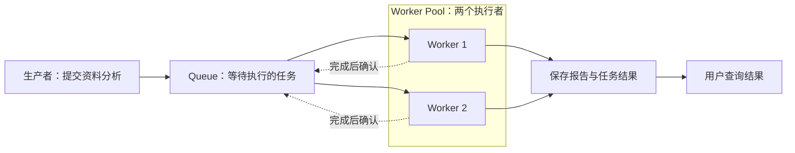

# 03. 任务队列、Worker 与执行容量

假设十位用户同时要求 Agent 分析资料，每份资料需要读取文件、请求模型，再保存一份报告。机器目前只允许两份分析同时进行。余下八份放在哪里？第一份结束后，谁决定接着分析哪份？如果执行到一半进程退出，用户是否必须重新提交？

这些问题发生在 Agent 循环之外。循环知道怎样推进一份分析，任务基础设施还要管理许多份分析的等待、执行和结果。本章先以这个假设的分析服务讲清通用设计，再对照 Pi 已有的局部实现。通用例子中的任务队列和共享 Worker Pool，不代表 Pi 已经提供这些组件。

Pi 案例对应提交 `96abe9a5ad45005cae34ed1c52d42f71fc88bedc`。各章入口在[学习索引](README.md)，任务之间的关系和重启恢复分别见[任务编排](04-orchestration.md)、[持久执行](05-durable-execution.md)。

## 一份任务怎样从请求变成待执行的工作

用户点击“分析”时，系统需要保存的工作可以写成：“分析资料 A，使用这套规则，把报告存到指定位置。”这是一份任务。它有可以辨认的身份、足够开始执行的输入，以及完成条件。仅保存“分析一下”几个字通常不够；执行程序之后可能在另一个进程中运行，它还需要知道资料在哪里、允许使用什么工具、结果交给谁。

任务的大小由系统选择。一份任务可以包含整个 Agent 循环，也可以只包含一次资料抓取。前者易于把完整工作交给一个执行者，后者便于单独重试和调度各个步骤，但要额外处理步骤之间的依赖。本章先把“一份资料分析”作为一份任务，避免在还没有讲清执行关系时引入任务拆分。

任务记录与一次执行也要分开。资料 A 的任务编号可以一直是 A，但第一次执行可能遇到网络故障，第二次执行才完成。记录说明系统还欠用户哪项工作；执行尝试说明这次是谁在运行、已经运行多久、为什么结束。若只保存一个内存中的函数调用，进程一退出，系统连“还有 A 没完成”这件事都可能忘记。

十份请求一起到达时，直接启动十个 Agent 会超过允许的执行容量。让调用方一直保持连接也不能保证等待可靠：连接可能断开，服务可能重启。因此可以先接收任务，保存在 Queue，也就是队列中，等执行资源空出来。队列把提交时刻与执行时刻分开。是否落盘是另一个选择：进程内数组也能排队，但要承诺重启后仍保留已接收任务，就必须有相应的持久存储。

提交任务的一方称为生产者，领取任务的一方称为消费者。这是操作角色：用户请求处理程序可以生产分析任务，分析程序又可以生产资料抓取任务。消费者读取一项工作后，需要实际执行代码；承载这段执行的程序称为 Worker。它可以是一个异步执行循环、线程、独立进程，也可以运行在另一台机器上。“Worker”本身不保证隔离，也不指定部署方式。

如果服务维护两个能够处理资料分析的 Worker，任意一个空闲后都可以领取下一份资料，这两个 Worker 就构成一个 Worker Pool，即共享工作池。Queue 保存等待的工作，Pool 管理可用的执行资源，调度规则决定哪份工作可以交给哪个执行者。在简单系统里，Worker 自己从队列取下一项；在复杂系统里，独立的调度器还会检查优先级、依赖或资源需求。这些职责可以写在同一个程序里，概念上仍然有区别。

下面是通用任务服务的关系图。结果存储与队列分开，是为了让用户在 Worker 退出后仍能查询报告。



## 提交、等待、领取、执行、确认各改变什么

继续跟踪任务 A。以下是一种需要在进程故障后继续工作的通用设计，状态名称用于讲解，并非 Pi 的接口约定。

| 阶段 | 系统做的事 | 此时能向提交方承诺什么 |
| --- | --- | --- |
| 提交 | 检查输入与容量，保存任务，返回任务编号 | 接收成功；持久性取决于接收确认前是否已可靠保存 |
| 等待 | 任务留在待执行集合中 | 任务还没有开始，用户可用编号查询 |
| 领取 | 原子地登记此次执行者，使其他执行者不能正常领取同一次分配 | 已分配一次执行尝试，尚未产生结果 |
| 执行 | Worker 读取资料、运行 Agent 循环、调用工具 | 工作正在推进，期间仍可能失败 |
| 保存结果 | 保存报告以及成功或失败的任务结论 | 有可查询的结果，是否成功由任务完成条件决定 |
| 确认 | 告诉队列本次交付已处理，可以结束待确认记录 | 队列不再按这次交付继续安排工作 |

下面的通用生命周期图把确认前后的责任分开；租约到期会重新打开交付机会，但不能证明旧 Worker 已停止。


领取必须有并发控制。两个 Worker 若都先读取“任务 A 正在等待”，再分别写入“由我执行”，便可能同时启动 A。队列需要把检查与状态变更作为不可分割的操作，或由唯一的调度者完成分配。这只能防止这一领取步骤的冲突；网络中断后的重新交付仍可能导致重复执行，后文会解释。

成功领取后也不能立即丢掉一切记录。假设 Worker 刚取走 A 就退出，如果队列已经彻底删除 A，系统没有证据判断它是否完成。支持故障恢复的队列通常会保留“已交付、尚未确认”的信息。在约定期限内由当前 Worker 负责，过期后允许再次领取。这个临时执行权通常称为租约；有些消息队列用“可见性超时”表达消息暂时不再供其他消费者领取的时间。

执行完成与确认交付针对不同对象。Worker 算出了报告，还需要可靠保存它；队列收到确认，也不会自动替用户保存报告。若先确认再保存，确认后进程崩溃可能造成结果丢失。若先保存再确认，保存后崩溃可能导致任务再次交付。把相关写入放进同一事务可以缩小某些故障窗口，但外部工具和消息服务不一定共享一个事务，因此仍要设计重复执行的处理办法。

这里还区分两次“收到”：提交时对生产者说“任务已接收”，执行后由消费者对队列说“这次交付已处理”，后者常称为 ack。用户断开查询连接只表示用户暂时不等了，不应被自动解释为任务取消。取消任务需要独立改变任务状态，并通知正在执行的 Worker。

## 两个 Worker 能同时做多少事

Worker 1 请求模型后，要等网络响应。这段等待中，Worker 2 可以读取另一份资料。两份分析的生存时间重叠，称为并发；如果两个 CPU 核心此时分别执行两份分析的计算，才是在该时刻并行执行。单线程程序可以通过异步等待让多项任务并发推进，不要求每项任务各占一个线程。

因此，限制“同时运行两份分析”时，要先说明运行包括什么。本例把已经领取、尚未结束的分析都计入，即使它们正在等待模型响应。这样可以约束在途请求、上下文内存和工具占用。Worker 的数量不一定等于任务并发数：一个进程可以允许多个任务并发，一个任务内部也可能同时发出多个请求。若限制的是模型接口调用数，就需要在实际请求处另设预算，不能只数分析任务。

Pool 的复用发生在执行者上。Worker 1 完成 A 后回到空闲状态，再领取 C，不必为 C 重新启动整套运行环境。复用可以减少启动和连接初始化成本，但必须清理上一项任务的上下文、临时文件和权限状态，避免把用户 A 的资料带入用户 C 的分析。对无法安全清理的工作，可以选择每项任务启动新进程；仍然可以限制同时启动的数量，只是没有复用这些进程。

管理 Pool 还要知道执行者是否可用。一个刚启动、尚未加载工具的 Worker 不能立即算作空闲容量；已经崩溃的 Worker 也必须从可分配集合中移除，再按需要补充。缩减容量时，可以让选中的 Worker 停止领取新任务，等当前任务结束再退出。若直接终止正在工作的进程，就进入了后文讨论的故障恢复流程。对于专属某个会话的执行者，还应按会话归属分配，不能因为它暂时空闲就把另一用户的工作塞进去。

容量也不能只由“机器还能启动几个进程”决定。假设每份分析独占一个执行槽，平均用时 30 秒，两个槽在持续满载且没有其他瓶颈的理想情况下，每分钟约完成四份。增加到四个槽，只有在模型接口、磁盘和内存还容许时才有机会提高吞吐量。若服务端已经限制请求速率，更多 Worker 可能只是同时等待或收到限流错误。

Agent 任务的耗时还经常不同。A 只需读取一个文件，B 可能连续调用十次工具。即使按先进先出领取，A、B、C 的完成次序仍由执行时间决定。要求同一会话严格顺序处理时，需要把同一会话的任务串行化，或明确它们的依赖；一个共享 FIFO 队列本身不能保证完成顺序。FIFO 指先进队列的工作先被取出，范围应明确到具体队列或任务分组。

## 排队以后，谁先获得空出来的执行槽

假设八份分析在等待，此时又来了一项紧急请求。FIFO 会让它排在后面。业务可以为任务设置优先级，让紧急请求在下次有槽位时先被选中。这个规则影响下一次选择，并不意味着已经执行的模型请求会立即停止。要中断正在运行的任务，还需要取消、保存进度以及恢复规则。

严格优先级会产生另一个问题：紧急请求每次都先到，普通分析可能一直没有机会运行。这种长期得不到执行机会的情况称为饥饿。可以随着等待时间增加提高旧任务的优先级，也可以预留一部分执行机会给普通任务。前者需要定义等多久才能提升，后者会让部分紧急任务稍晚开始；系统要根据能够接受的等待时间选择规则。

多个用户共享 Pool 时，公平性还涉及用户之间的分配。一个用户一次提交一万份资料，另一个用户只提交一份。单一 FIFO 会把后者压在很长的队尾。按用户轮流选取、限制单个用户占用的执行槽，或者为不同类别保留容量，都能缓解这个问题。每次轮流取一项仍不一定公平，因为一项可能运行数秒，另一项运行数小时；必要时还要按执行时间或资源消耗记账。

调度规则需要和任务依赖配合。报告汇总必须等待资料分析完成，即使它优先级最高，也不能提前运行。队列保存了一个任务，并不表示任务已经满足执行条件。调度器先判断哪些任务可以运行，再从这些候选任务中决定顺序。[任务编排](04-orchestration.md) 会继续讨论依赖与等待。

## 限制并发之后，为什么还需要背压

仍按每分钟完成四份分析估算。如果每分钟新来十份，执行中始终最多两份，但等待集合每分钟会增加约六份。并发上限保护了正在执行的资源，却没有限制排队所占的存储，也没有保证用户能在合理时间内拿到结果。把队列搬到数据库，只是扩大了能积压的规模。

背压是把处理能力不足的事实传回提交方，让生产速度随消费能力调整。一个具体设计可以允许最多二十份等待任务：到达上限后，提交接口要么拒绝并提示稍后重试，要么让上游在有限时间内等待有空位，再确认接收。若接口一直返回成功，同时把新任务藏进另一份无上限的内存列表，拥塞只是换了位置。

上限应该对应真正会耗尽的资源。只限制任务数量时，一份附带巨大资料的任务仍可能占满存储，所以任务常保存资料引用，并另外限制输入字节数。等待期限也有用：已经过期的分析可以结束为超时，避免 Worker 花时间处理用户不再需要的结果。若用户因接收响应超时而重试提交，还需用稳定的请求编号识别同一次提交，否则背压期间可能制造更多重复任务。

选择措施时，可以分别问：最多允许多少项正在执行？最多接收多少项等待？每个用户能占多少？容量不足怎样明确反馈？并发限制、队列容量和准入策略共同决定服务能承受的负载，其中任意一项都不能替代另外两项。等待数量、最老任务等待时间和实际完成速率能帮助判断瓶颈；仅看 Worker 是否忙碌不足以判断积压是否可控。

下图展示到达速率超过完成速率时，为什么并发槽之外还需要队列上限和准入反馈。这是通用容量模型，不是 Pi 的默认配置。


## 执行失败与 Worker 消失，需要不同的恢复判断

Worker 仍活着时，如果模型返回临时错误，程序可以保存失败原因，再决定延迟重试还是结束任务。如果输入资料根本不存在，立即反复重试通常没有帮助。重试应有次数或时间预算，并让一段时间过去再尝试，避免故障期间把更多请求同时送给已经过载的服务。

Worker 崩溃时，它来不及报告任何结论。队列只能观察到约定时间内没有收到确认。为了让任务还有机会完成，可以在租约或可见性超时后重新交付。长任务则需要续期，说明执行者仍在工作。持续失败的任务也不能永远阻塞正常工作，可以移到单独保存失败任务的集合，也就是死信队列，供调查和人工决定是否重新执行。

超时表达的是“无法继续确认原执行者负责”，不能证明原执行者已经停止。Worker 1 可能因网络中断没能续期，Worker 2 因租约过期领取 A，随后 Worker 1 又恢复连接。此时两边都可能继续操作。对于共享状态写入，可以要求每次执行带上递增的所有权版本，由存储拒绝旧版本的写入；这种版本凭证称为 fencing token。它只有在写入方实际校验时才有效，不能自动约束所有外部工具。

更常见的重复窗口不需要两个 Worker 同时运行：A 已经把报告发送到外部服务，进程却在保存成功状态或确认队列之前退出。重启后重新执行 A，便可能再次发送。允许未确认任务重投的设计追求的是工作能获得再次执行的机会，不能据此承诺外部效果恰好发生一次。

幂等解决的就是重复尝试产生什么效果。同一个逻辑操作重复执行，仍只保留约定的一份效果。例如给外部报告创建请求带上由任务 A 派生的稳定操作编号，接收服务对这个编号只创建一次，并把原结果返回给重试者。每次尝试都生成新的编号会破坏这种去重。对于发邮件等没有相应去重能力的动作，需要额外的发送记录、结果核对或人工处理，队列本身无法补足外部接口的保证。

因此至少要区分提交去重与副作用幂等。前者防止用户重复点击变成两个任务；后者防止同一个任务的重复执行造成重复外部效果。结果保存和 ack 之间的窗口也要纳入设计。[持久执行](05-durable-execution.md) 讨论怎样保存可恢复的进度，重试边界则在后续章节展开。

## 用这些概念看 Pi 的三种实现

Pi 中的“排队”涉及不同对象。默认 CLI 有内存输入队列，实验 durable 路径有持久输入收件箱和任务调度器，subagent 扩展示例则用本地并发循环安排一批子进程。它们没有共用一个消息代理。消息代理（broker）是替生产者和消费者管理消息保存与交付的服务；通用任务队列也可以借助数据库实现，不要求一定增加独立 broker 产品。

| Pi 中的对象 | 保存或承载什么 | 对应前文哪一部分 |
| --- | --- | --- |
| durable 的 `pi.inbox` | 等待交给一个会话的新输入或写入 | 输入消息的等待与消费时机 |
| durable scheduler | 持久任务及其当前执行尝试 | 判断可运行性、登记和启动任务、重开恢复 |
| 实验 Session worker | 一个 Session 的服务与活跃任务 | 专属会话的执行进程 |
| subagent 扩展的并发循环 | 单次调用中的一批子任务 | 本地执行槽与待处理列表 |

收件箱中的一条补充要求不一定独立启动一份任务；同一轮 Agent 工作可能消费多条消息。另一方面，一个会话内部可以有多个持久任务。只有先分清排队的对象，才能判断“输入已放置”“任务正在运行”和“Worker 还活着”分别说明什么。

### 输入收件箱：把补充要求送进一个正在工作的会话

Agent 正在读配置，用户又发来两句话：“保持只读”和“结束后检查日志”。第一句要影响当前工作接下来的模型请求；第二句要等当前回答结束后再开始。这是会话输入的交付问题，下面沿实验性的 `packages/durable` 路径说明。

模型请求已经发出时，新的输入无法改变这个请求。会话会为每条输入建立一条持久提交记录（submission），状态为 `queued`，并把内容放进会话文档的 `pi.inbox.items`。因此，“系统已接收”只表示内容有了可恢复的记录；模型还没看到它，输入也还没有成为对话 entry。

提交方在“保持只读”上选择 `steer`，在“结束后检查日志”上选择 `follow-up`。这两个名字描述交付时机：steer 等当前工具轮的边界，follow-up 等当前回答的边界。系统不读自然语言来推断时机。

下图仅表示 Pi durable 的会话输入机制，不是前文通用任务队列的领取与确认流程。


入口 `submit()` 在 [packages/durable/src/harness/submissions.ts L62-L95](../pi/packages/durable/src/harness/submissions.ts#L62-L95)。它把准入操作排入 Session 的串行提交线（同一会话按顺序保存状态的执行线），并返回可查询、可等待的 submission 句柄。忙碌会话会把输入放进 inbox；若调用方选择 `whenBusy: "reject"`，则直接拒绝。具体分支在 [packages/durable/src/harness/submissions.ts L160-L241](../pi/packages/durable/src/harness/submissions.ts#L160-L241)。

这里要区分三种进度：`queued` 表示已收下、等待边界；`placed` 表示已追加到对话；`done` 或 `unanswered` 表示这条提交已结算。等待句柄只等待提交记录结算，不会改变它的处理顺序。

#### 工具轮结束时补充当前工作

“保持只读”要在当前工作还能继续发起模型请求时生效。工具执行完毕后，generation（当前一轮工作的执行过程）到达 `postTools` 边界；边界处理从 inbox 选择 steer 输入，把它追加到对话，再把 submission 标为 `placed` 并移除对应队列项。随后当前 generation 才会发出下一次模型请求，所以模型能在后续工作中看到这条要求。已经发出的请求和已经运行的工具不会被改写。

这些改动必须作为一次状态提交完成：对话 entry 已写入，submission 状态已更新，inbox 项也已移除。否则进程若恰好在两次写入之间退出，重开时就可能丢消息或重复放置。这里的“提交”是会话存储的一次 commit，与 Git commit 无关。

消费时，`prepareBoundary()` 先读取边界需要的状态，`applyBoundary()` 再选择消息、追加 entry、更新 submission 并移除已处理项，见 [packages/durable/src/harness/inbox.ts L47-L110](../pi/packages/durable/src/harness/inbox.ts#L47-L110)。这两个函数对应的就是前面所说的“找出此时可以交付的消息，再一起保存交付结果”。

工具结果就绪后，generation 在 [packages/durable/src/harness/generation.ts L598-L656](../pi/packages/durable/src/harness/generation.ts#L598-L656) 处理 `postTools`；若工作已终止，则处理 `final`。另一处 `final` 调用位于 [packages/durable/src/harness/generation.ts L514-L544](../pi/packages/durable/src/harness/generation.ts#L514-L544)。本例中，工具轮结束时只有“保持只读”进入当前对话，“检查日志”仍留在 inbox。

#### 回答结束后启动后续工作

“检查日志”要等当前读取配置的工作给出最终回答。`final` 边界选择这条 follow-up，把它放入对话并将 submission 标为 `placed`；之后 `startRun()` 创建下一轮 generation，处理检查日志的要求。此时只是开始处理这条输入，仍要等新一轮给出答案或以其他原因结束，提交记录才会结算。消息从队列移除，并不表示它要求的工作已经完成。

### 持久任务调度器：登记一次执行，再调用代码

新一轮工作已经有了输入，还需要有人调用代码执行它。durable 的运行框架 Harness 用调度器（scheduler）查找可以开始的任务，登记一次执行，再调用对应处理函数。“检查日志”这轮工作就由这条路径启动。

系统同时保留两种记录：存储里的任务记录说明要做什么、进度到哪里；内存里的执行对象负责这一次实际调用和取消信号。前者在重启后还能读取，后者随进程消失。代码分别把它们称为 `TaskRecord` 和 `Invocation`，定义见 [packages/durable/src/types.ts L501-L584](../pi/packages/durable/src/types.ts#L501-L584) 和 [packages/durable/src/harness/scheduler.ts L69-L95](../pi/packages/durable/src/harness/scheduler.ts#L69-L95)。区分两者，才能在进程退出后根据任务记录重新安排执行。

开始执行前，调度器先检查任务是否仍需等待、是否已被取消，以及对应代码是否已安装。符合条件时，它在一次状态提交中将任务记为 `running`，登记本次执行；提交成功后，再在状态提交线外调用处理函数。这样任务等待网络或工具时，其他状态更新仍能保存。调度入口和预留逻辑见 [packages/durable/src/harness/scheduler.ts L1094-L1195](../pi/packages/durable/src/harness/scheduler.ts#L1094-L1195)，启动逻辑见 [packages/durable/src/harness/scheduler.ts L1301-L1338](../pi/packages/durable/src/harness/scheduler.ts#L1301-L1338)。

### Session worker：一个会话的专属进程

刚才的任务由谁运行，取决于宿主怎样承载 Harness。在 durable 实验服务中，一个 Session（会话实例）由专属 Node 子进程承载，同一会话的多个客户端附件共享这个进程。该 worker 处理此会话的服务、请求和活跃任务；它不从一个全局积压队列中竞争领取单条输入。

`session-worker-manager` 按 Session 路径复用现有或正在启动的 worker，需要时启动 `session-worker`，见 [packages/coding-agent/src/experimental/session-worker-manager.ts L175-L187](../pi/packages/coding-agent/src/experimental/session-worker-manager.ts#L175-L187) 和 [packages/coding-agent/src/experimental/session-worker-manager.ts L449-L503](../pi/packages/coding-agent/src/experimental/session-worker-manager.ts#L449-L503)。客户端断开后，如果请求或 Harness 任务仍在活动，worker 还要继续运行；`WorkerLifecycle` 会等连接需求、请求和 Harness 活动都清空后才退出，见 [packages/coding-agent/src/experimental/session-worker.ts L183-L305](../pi/packages/coding-agent/src/experimental/session-worker.ts#L183-L305)。

worker 打开 SQLite 前还会取得目录锁，并用 `proper-lockfile` 的 stale 与 update 配置维护本地 Session 的所有权：[packages/coding-agent/src/experimental/session-worker.ts L509-L544](../pi/packages/coding-agent/src/experimental/session-worker.ts#L509-L544)。目录锁保护这份本地会话存储，不是任务级租约，也不会让多个 worker 竞争领取任务。锁与活跃任务判断的实现分别见 [packages/coding-agent/src/experimental/session-worker.ts L509-L544](../pi/packages/coding-agent/src/experimental/session-worker.ts#L509-L544) 和 [packages/coding-agent/src/experimental/session-worker.ts L585-L594](../pi/packages/coding-agent/src/experimental/session-worker.ts#L585-L594)。

### subagent 示例：单次调用中的本地并发限制

subagent 扩展展示了一个进程内的本地限流例子：一次调用最多接受 8 项并行任务，最多同时运行 4 项。`mapWithConcurrencyLimit()` 使用共享的 `nextIndex` 和多个异步循环逐项取任务，每项任务启动一个带 `--no-session` 的 `pi` 子进程。限制值、循环和子进程启动分别见 [packages/coding-agent/examples/extensions/subagent/index.ts L33-L36](../pi/packages/coding-agent/examples/extensions/subagent/index.ts#L33-L36)、[packages/coding-agent/examples/extensions/subagent/index.ts L219-L237](../pi/packages/coding-agent/examples/extensions/subagent/index.ts#L219-L237)、[packages/coding-agent/examples/extensions/subagent/index.ts L300-L350](../pi/packages/coding-agent/examples/extensions/subagent/index.ts#L300-L350)。这是扩展对单次调用的本地限流，不是 durable scheduler 的默认并发配置。

若传入八项，最初四项占据执行槽；某项结束后，对应异步循环领取下一项。这里复用的是取任务的循环与并发槽，实际 `pi` 子进程仍逐任务启动。这与共享长驻进程的 Worker Pool 有不同的启动成本和状态隔离方式。限制也只覆盖这次调用，不能推出整个服务、所有用户或所有会话最多运行四项。

### 重开恢复：从任务记录建立新的执行

worker 退出时，原来的处理函数和 Promise 都留在已退出的进程内，无法恢复。Harness 重开时，`open()` 扫描仍活跃的任务，将遗留的 `running` 状态改回 `pending`，并保留 checkpoint、input 和 abort mark。重新打开本身不会立即分派任务；显式 `resume()`、提交输入或等待工作才会启用调度。恢复逻辑见 [packages/durable/src/harness/scheduler.ts L288-L321](../pi/packages/durable/src/harness/scheduler.ts#L288-L321)。

调度前还需要找到任务对应的 kind/version 处理定义和迁移函数。缺定义、版本过旧或迁移失败会阻塞任务；registry 与宿主 settings 不持久化，因此宿主重启后必须重新安装任务代码并提供设置。缺定义的普通任务仍会影响空闲等待，主动取消时可按条件结算为 `orphaned`；带 `abandonOnRestart` 的任务会等定义可用，以便运行清理逻辑。查找位置见 [packages/durable/src/harness/scheduler.ts L1209-L1236](../pi/packages/durable/src/harness/scheduler.ts#L1209-L1236)。

## 从 Pi 局部机制扩展为共享任务服务，还缺哪些环节

这里有持久输入、任务调度和本地并发循环，但它们还没有组成分布式队列系统。记录中的 `running` 表示调度器曾为任务建立一次执行，不带可过期的分布式租约；scheduler 没有任务租约、心跳、全局并发槽、优先级、租户配额或租约超时。`pi-durable` 要求一个进程拥有 storage，跨进程锁由宿主提供，约定见 [packages/durable/README.md L630-L641](../pi/packages/durable/README.md#L630-L641)。

实验 durable 任务已有包入口、存储适配器和测试，但仍标为 Experimental，[packages/durable/README.md L1-L7](../pi/packages/durable/README.md#L1-L7)。实验 client/server 只提供源码入口，不进入 npm 包和独立二进制，[packages/coding-agent/src/experimental/services/README.md L1-L12](../pi/packages/coding-agent/src/experimental/services/README.md#L1-L12)。稳定版 coding-agent 默认内核没有因此改用这套执行方式。

若多个执行者要从共享积压中竞争领取工作，就要补上共享任务存储、原子领取和执行资源管理。可以使用消息代理，也可以在满足并发与持久性要求的数据库上实现。当前没有共享 broker、ack/nack、可见性超时、死信队列或竞争消费；其中 nack 表示消费者报告本次交付未成功处理，是否重投还应由失败策略决定。跨主机接管还需处理租约续期与旧执行者写入，例如由存储校验 fencing token。Session worker 不会自动把会话实例迁移到另一台主机。

积压也需要单独设上限。inbox 准入没有队列长度或字节配额，本地 scheduler 没有全局任务并发预算。[分布式状态](07-distributed-state.md) 的公开状态交付通道有 100 帧上限，那约束观察通道，不能限制输入队列。

如果要把开头的十份资料分析服务建在 Pi 之上，可以在会话执行层外增加任务服务：先持久保存分析请求，由调度层按容量和用户配额分配，再让执行者打开所需会话，运行后保存报告和任务结果。完成确认、重投策略及副作用幂等要一起设计。会话自身的目录锁继续保护本地存储；新增共享任务的所有权则由新增调度协议负责。这是扩展方案，不能从已有 `running` 状态或目录锁推导出这些能力已经存在。

## 源码补充

以下内容供对照源码时查阅，包括输入排序的其他分支和调度实现细节。

- inbox 变空时会保存完整 base（文档基准值），让恢复时少重放一段增量，见 [packages/durable/src/harness/inbox.ts L7-L29](../pi/packages/durable/src/harness/inbox.ts#L7-L29)。
- `TaskRecord` 保存输入、版本、归属、检查点和取消标记；`Invocation` 保存本次处理函数、Promise、AbortController 和临时 watch。调度器的 `kick` 把 `drain` 排到 JavaScript 微任务中，随后执行预留和启动步骤。

- `write` 可写入会话而不创建 generation；display-only 的 `note` 也是即时写入，不调用模型。若 reset 已排队，note 会排在 reset 后面。边界处理先放置 write，再放置选中的用户输入，因此 submission ID 顺序可能不同于 transcript entry 顺序。相关代码见 [packages/durable/src/harness/submissions.ts L160-L241](../pi/packages/durable/src/harness/submissions.ts#L160-L241) 和 [packages/durable/src/harness/inbox.ts L47-L110](../pi/packages/durable/src/harness/inbox.ts#L47-L110)。
- 调用方可提供 `requestId`，在同一 conversation 内防止重复准入。同一个 ID 再次用于同类型 submission 时返回原记录，即使第二次内容不同；不同类型则报错。去重只约束输入准入，不会阻止外部工具重复产生副作用，见 [packages/durable/src/harness/submissions.ts L160-L241](../pi/packages/durable/src/harness/submissions.ts#L160-L241)。
- `postTools` 默认选择第一条 steer，或按设置选择全部；`final` 对 follow-up 使用相同规则。queued reset 会让 `postTools` 按 `final` 处理。已被 reset 切出活动范围的 write 会结算为 stale。具体选择、写入顺序与移除规则见 [packages/durable/src/harness/inbox.ts L47-L110](../pi/packages/durable/src/harness/inbox.ts#L47-L110)。
- 输入可以排在现有 inbox 项之后；显示型 write 只有遇到排队 reset 才必须等待。忙碌时选择 reject 会抛出 `ConversationBusy`。具体准入顺序见 [packages/durable/src/harness/submissions.ts L160-L241](../pi/packages/durable/src/harness/submissions.ts#L160-L241)。

## 源码位置与术语速查

| 机制 | 主要源码位置 |
| --- | --- |
| 提交准入与去重 | `packages/durable/src/harness/submissions.ts` |
| 会话队列（`pi.inbox`） | `packages/durable/src/harness/inbox.ts` |
| 边界消费（`final` / `postTools`） | `packages/durable/src/harness/generation.ts` |
| 任务调度与恢复 | `packages/durable/src/harness/scheduler.ts` |
| 任务记录与执行类型 | `packages/durable/src/types.ts` |
| 会话子进程 | `packages/coding-agent/src/experimental/session-worker-manager.ts`、`session-worker.ts` |
| 本地限流示例 | `packages/coding-agent/examples/extensions/subagent/index.ts` |

| 术语 | 在这个项目中的含义 |
| --- | --- |
| Submission | 一条输入或写入的持久记录，有 `placed` / `queued` 等状态 |
| `pi.inbox` | 会话文档中的排队条目集合，含 `steer`、`followUp`、`write` 三种 |
| Steer | 在 `postTools` 边界加入当前工作的调整输入 |
| Follow-up | 等当前最终回答后，在 `final` 边界创建后续 generation 的输入 |
| Generation | 一轮工作的执行单位，提供 `final` 与 `postTools` 两个消费边界 |
| TaskRecord | 持久任务记录：输入、版本、归属、checkpoint 和取消标记 |
| Invocation | 当前进程中的一次执行：AbortController、Promise 和临时 watch |
| Session worker | 承载一个会话实例的专属 Node 子进程 |

## 测试与练习

先用开头的分析服务检查自己是否理解了队列与执行的关系：

1. 两个执行槽平均每分钟完成四份任务，连续五分钟每分钟接收十份。假设没有初始积压、任务耗时均匀，等待数量会怎样变化？若只增加队列容量，变化趋势是否改变？
2. A 先领取但需要一分钟，B 后领取只需十秒。FIFO 能保证谁先完成？如果业务要求 A 完成后才能执行 B，应把约束加在哪里？
3. Worker 保存报告后、确认队列前退出。恢复程序掌握哪些证据？分别需要什么机制，才能避免丢报告和重复发送报告？
4. 共享 Pool 中一个用户持续提交高优先级任务。请给普通任务设计一种仍能获得执行机会的规则，并说明高优先级任务为此付出的代价。

再用下列测试核对 Pi 的局部机制。它们验证的是输入与会话生命周期，不能据此认定 Pi 具备了前述共享队列的全部保证。

| 阅读位置 | 可核对的行为 |
| --- | --- |
| [packages/durable/test/harness-submissions.test.ts L57-L107](../pi/packages/durable/test/harness-submissions.test.ts#L57-L107) | 忙碌时拒绝输入不产生写入；request ID 按 conversation 去重 |
| [packages/durable/test/harness-submissions.test.ts L134-L147](../pi/packages/durable/test/harness-submissions.test.ts#L134-L147) | 取消等待后，已经放置的工作继续存在 |
| [packages/durable/test/harness-submissions.test.ts L178-L221](../pi/packages/durable/test/harness-submissions.test.ts#L178-L221) | 重开后取回 submission；提交和等待都会启用调度 |
| [packages/coding-agent/test/experimental-session-worker-lifecycle.test.ts L23-L107](../pi/packages/coding-agent/test/experimental-session-worker-lifecycle.test.ts#L23-L107) | 客户端连接需求、Harness 活动和请求持有共同决定进程退出 |

可以在纸上跟踪读取配置的当前工作、“保持只读”、“检查日志”和 note，逐次记录 inbox 与 submission 状态。再加入 queued reset，对照 `applyBoundary()` 看写入先于用户输入放置时会发生什么。这个练习无需真实模型，也不用修改文件。

如果自行验证局部测试，从 `packages/durable` 执行：

```powershell
node ../../node_modules/vitest/dist/cli.js --run test/harness-submissions.test.ts
```

这里跑的是输入队列测试，只需 faux provider；provider e2e 和 shell 交互示例需另行安排。跨进程 Session worker 的部署细节在 [Agent Runtime](01-agent-runtime.md)。
