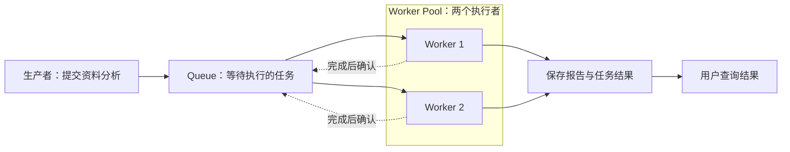
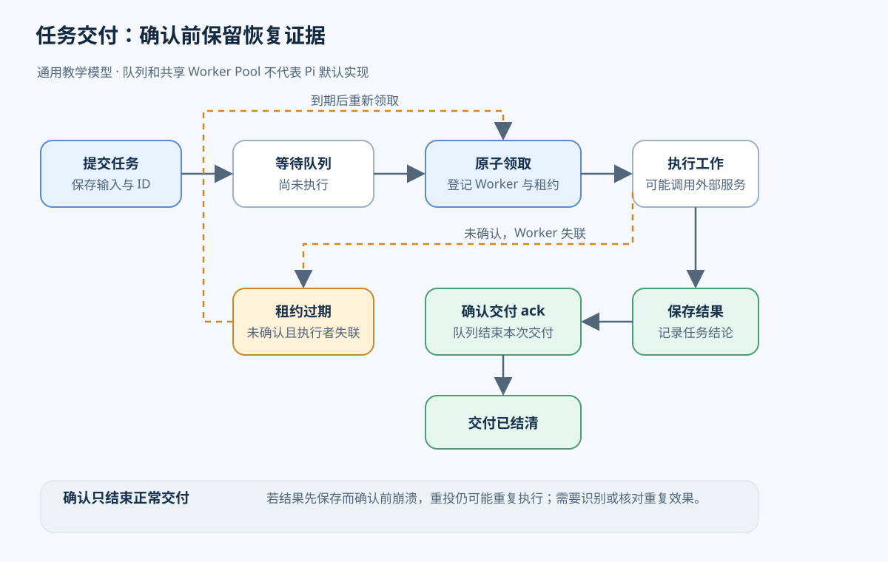
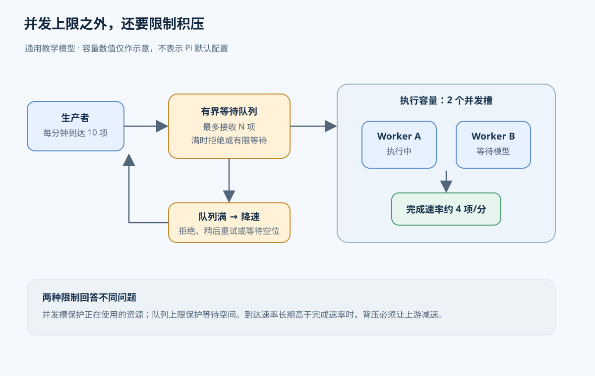
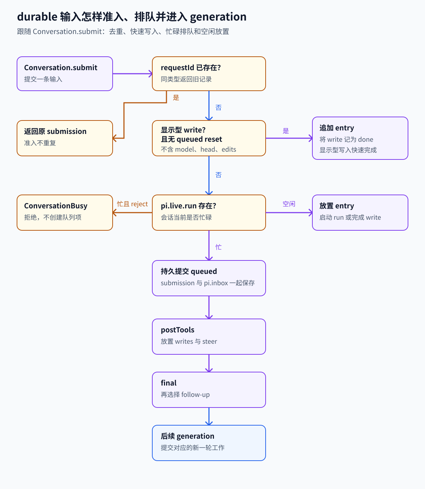

# 第 3 章　任务队列与 Worker

[返回目录](README.md) · [上一章：第 2 章 上下文与状态](02-context-state.md) · [下一章：第 4 章 调度与多 Agent 编排](04-orchestration.md)

任务队列保存等待执行的工作，Worker 承担实际执行，调度规则决定工作获得执行资源的顺序。三者共同处理多项 Agent 任务的接收、等待与完成。本章先建立任务和执行尝试的概念，再追踪领取、执行、保存结果及确认的完整流程，随后讨论容量、公平性、背压与故障恢复，最后说明 Pi 各条实现路径的适用范围。

贯穿本章的例子是一个资料分析服务：十位用户同时提交请求，每份任务需要读取资料、请求模型并保存报告，机器只允许两份分析同时进行。Agent 循环负责推进其中一份分析，任务基础设施则负责保存其余请求、分配空闲资源，并在进程退出后保留未完成工作的记录。这是一种通用教学设计，其中的共享任务队列与 Worker Pool 不代表 Pi 已有相应组件。

Pi 案例对应提交 `96abe9a5ad45005cae34ed1c52d42f71fc88bedc`。各章入口在[学习索引](README.md)，任务之间的关系和重启恢复分别见[任务编排](04-orchestration.md)、[持久执行](05-durable-execution.md)。

## 3.1 任务记录、执行尝试与队列

任务是一项具有身份、输入和完成条件的工作。在资料分析服务中，任务记录需要表达分析哪份资料、采用哪些规则，以及报告保存到哪里。执行程序可能稍后在另一个进程中启动，因此记录还应提供资料位置、允许使用的工具与结果接收方。只保存“分析一下”无法满足这些执行要求。

任务粒度决定调度和重试的范围。把整个 Agent 循环作为一项任务，便于交给一个执行者完成；把资料抓取等步骤拆成独立任务，则可以分别重试和安排执行，但程序需要额外维护步骤依赖。本章以整份资料分析为任务单位，任务拆分在下一章讨论。

同一个任务可以经历多次执行尝试。任务 A 第一次因网络故障停止，第二次完成时，其逻辑身份仍为 A。任务记录保存尚待完成的工作，执行尝试则记录本次执行者、开始时间及停止原因。若系统只保留内存中的函数调用，进程退出后，这两类信息都可能丢失，恢复程序也就无法判断 A 是否仍需执行。

队列（Queue）把任务提交与实际执行分开。十份请求同时到达而系统只有两个执行槽时，已接收的其他任务留在队列中等待资源。等待不宜完全依赖调用方连接，因为连接可能中断，服务也可能重启。进程内数组可以实现排队；若接收接口承诺重启后保留任务，则队列还必须使用满足该承诺的持久存储。

生产者负责提交任务，消费者负责领取任务。这两个名称表示操作角色，同一程序可以同时承担两种角色：分析程序消费分析任务，也可以生产资料抓取任务。Worker 是承载实际执行代码的程序，可以采用异步循环、线程、独立进程或远端程序等形式。因此，Worker 的部署方式与隔离能力需要另外规定。

Worker Pool（共享工作池）管理一组可以处理同类任务的执行者。例如两个分析 Worker 中任意一个空闲后，都可以领取下一份资料。队列保存待执行工作，工作池管理可用资源，调度规则负责在工作与执行者之间建立分配关系。简单系统可由 Worker 主动取下一项；复杂系统则由调度器进一步检查优先级、依赖和资源需求。即使这些逻辑位于同一程序，职责仍应分别定义。

下面是通用任务服务的关系图。结果存储与队列分开，是为了让用户在 Worker 退出后仍能查询报告。



## 3.2 任务交付的生命周期

任务 A 从提交到完成会经过以下阶段。表中的状态用于说明支持进程故障恢复的通用设计，不是 Pi 的接口约定。每个阶段能够提供的保证取决于此前已经保存的证据。

| 阶段 | 系统操作 | 当前状态与保证 |
| --- | --- | --- |
| 提交 | 检查输入与容量，保存任务，返回任务编号 | 接收成功；持久性取决于接收确认前是否已可靠保存 |
| 等待 | 任务留在待执行集合中 | 任务还没有开始，用户可用编号查询 |
| 领取 | 原子地登记此次执行者，使其他执行者不能正常领取同一次分配 | 已分配一次执行尝试，尚未产生结果 |
| 执行 | Worker 读取资料、运行 Agent 循环、调用工具 | 工作正在推进，期间仍可能失败 |
| 保存结果 | 保存报告以及成功或失败的任务结论 | 有可查询的结果，是否成功由任务完成条件决定 |
| 确认 | 告诉队列本次交付已处理，可以结束待确认记录 | 队列不再按这次交付继续安排工作 |

下面的通用生命周期图把确认前后的责任分开；租约到期会重新打开交付机会，但不能证明旧 Worker 已停止。



任务领取需要把条件检查与状态更新作为一次不可分割的操作。否则，两个 Worker 可能先后读到“A 正在等待”，再各自登记为执行者，导致 A 同时启动。也可以由唯一调度者负责分配，以避免这一冲突。领取阶段的并发控制只能保护本次分配；故障后重新交付仍可能产生重复执行。

队列在交付任务后仍需保留未确认记录。若 Worker 领取 A 后立即退出，而队列已经删除 A，系统将无法判断任务是否完成。支持恢复的设计通常授予 Worker 一段有期限的执行权，并在到期后允许重新领取，这种临时权利称为租约。消息队列中的可见性超时则表示某段时间内不再向其他消费者交付该消息。

执行结果与交付确认分别保存在不同的位置。Worker 完成计算后要可靠保存报告，再向队列确认本次交付已处理。先确认、后保存会产生确认后崩溃而结果丢失的风险；先保存、后确认则会产生保存后崩溃而任务再次交付的风险。同一事务内的相关写入可以缩小部分故障窗口，但外部工具和消息服务未必共享事务，重复执行仍需单独处理。

确认还应区分方向。接收阶段由服务向生产者确认任务已经保存；处理结束后由消费者向队列确认交付已经处理，后者常简称 ack。用户断开查询连接只终止本次等待。若要取消任务，程序还需改变任务状态，并通知正在执行的 Worker。

## 3.3 并发容量与 Worker 复用

并发描述多项任务的执行区间重叠，并行描述多个计算操作在同一时刻执行。Worker 1 等待模型响应时，Worker 2 可以读取另一份资料，两项分析便在并发推进；若两个 CPU 核心同时执行各自的计算，则该时刻发生了并行。异步等待也能在单线程程序中实现并发，因此每项任务不一定需要独立线程。

并发限制必须指定统计对象。本例把已经领取、尚未结束的分析计入执行槽，等待模型响应的任务也占用槽位，以约束在途请求、上下文内存和工具资源。Worker 数量与任务并发数并不固定对应：一个进程可以执行多个任务，一个任务又可以发出多个请求。限制模型接口调用数量时，程序需要在请求层设置相应预算，不能仅统计分析任务。

工作池可以复用执行环境。Worker 1 完成 A 后回到空闲状态，再领取 C，因而不必为 C 重建整套运行环境和连接。复用前需要清理 A 的上下文、临时文件及权限状态，避免它们影响 C。无法可靠清理时，可以逐任务创建新进程，并限制同时存在的进程数量；这种方式保留并发控制，但不复用进程。

管理 Pool 还要知道执行者是否可用。一个刚启动、尚未加载工具的 Worker 不能立即算作空闲容量；已经崩溃的 Worker 也必须从可分配集合中移除，再按需要补充。缩减容量时，可以让选中的 Worker 停止领取新任务，等当前任务结束再退出。若直接终止正在工作的进程，就进入了后文讨论的故障恢复流程。对于专属某个会话的执行者，还应按会话归属分配，不能仅因暂时空闲就向它分配另一用户的工作。

容量也不能只由“机器还能启动几个进程”决定。假设每份分析独占一个执行槽，平均用时 30 秒，两个槽在持续满载且没有其他瓶颈的理想情况下，每分钟约完成四份。增加到四个槽，只有在模型接口、磁盘和内存还容许时才有机会提高吞吐量。若服务端已经限制请求速率，更多 Worker 可能只是同时等待或收到限流错误。

Agent 任务的耗时还经常不同。A 只需读取一个文件，B 可能连续调用十次工具。即使按先进先出领取，A、B、C 的完成次序仍由执行时间决定。要求同一会话严格顺序处理时，需要把同一会话的任务串行化，或明确它们的依赖；一个共享 FIFO 队列本身不能保证完成顺序。FIFO 指先进队列的工作先被取出，范围应明确到具体队列或任务分组。

## 3.4 调度顺序与公平性

优先级用于改变下一次任务选择的顺序。八份分析正在等待时，紧急请求按 FIFO 会排在队尾；设置较高优先级后，调度器可以在下一个槽位空闲时优先选择它。已经执行的请求不会因此自动停止。若需要抢占正在运行的任务，还必须定义取消、进度保存和恢复规则。

严格优先级可能使普通任务长期得不到执行机会，这种现象称为饥饿。系统可以随等待时间增加提升旧任务的优先级，也可以为普通任务预留部分执行机会。前者需要确定等待时间与优先级的关系，后者会推迟部分紧急任务。选择策略时应明确不同任务可接受的等待时间。

多个用户共享 Pool 时，公平性还涉及用户之间的分配。一个用户一次提交一万份资料，另一个用户只提交一份。单一 FIFO 会把后者压在很长的队尾。按用户轮流选取、限制单个用户占用的执行槽，或者为不同类别保留容量，都能缓解这个问题。每次轮流取一项仍不一定公平，因为一项可能运行数秒，另一项运行数小时；必要时还要按执行时间或资源消耗记账。

调度规则需要和任务依赖配合。报告汇总必须等待资料分析完成，即使它优先级最高，也不能提前运行。队列保存了一个任务，并不表示任务已经满足执行条件。调度器先判断哪些任务可以运行，再从这些候选任务中决定顺序。[任务编排](04-orchestration.md) 会继续讨论依赖与等待。

## 3.5 队列容量与背压

到达速率持续超过完成速率时，限制并发仍会产生积压。按每分钟完成四份、接收十份估算，等待任务每分钟增加约六份，即使执行中始终只有两份。并发上限保护执行资源，队列容量则决定允许保留多少待执行工作。把队列迁移到数据库会扩大存储能力，但不会改变积压增长的趋势。

背压（backpressure）通过拒绝或延迟接收，将下游容量不足传递给上游。假设等待队列最多容纳二十份任务，达到上限后，接口可以拒绝新任务并提示稍后重试，也可以在有限时间内等待空位再确认接收。若接口始终返回成功，却把任务转存到另一份无上限列表，生产速度没有下降，积压也只是转移到了新的位置。

上限应该对应真正会耗尽的资源。只限制任务数量时，一份附带巨大资料的任务仍可能占满存储，所以任务常保存资料引用，并另外限制输入字节数。等待期限也有用：已经过期的分析可以结束为超时，避免 Worker 花时间处理用户不再需要的结果。若用户因接收响应超时而重试提交，还需用稳定的请求编号识别同一次提交，否则背压期间可能制造更多重复任务。

容量设计需要同时规定执行并发上限、等待容量、单用户配额和过载时的准入行为。它们分别约束正在执行的工作、等待中的存储占用和用户之间的资源分配。运行时还应观察等待数量、最老任务等待时间及实际完成速率，才能判断积压是否可控；Worker 忙碌只说明当前有工作，无法说明后续等待需要多久。

下图展示到达速率超过完成速率时的容量控制：并发槽约束执行中的工作，队列上限与准入反馈约束持续积压。这是通用容量模型，不是 Pi 的默认配置。



## 3.6 执行失败、失联与重复交付

Worker 仍在运行时，如果模型返回临时错误，程序可以保存失败原因，再决定延迟重试还是结束任务。如果输入资料根本不存在，立即反复重试通常没有帮助。重试应有次数或时间预算，并让一段时间过去再尝试，避免故障期间把更多请求同时送给已经过载的服务。

Worker 崩溃后通常无法报告结果，队列只能根据约定期限内未收到确认来判断是否重新交付。长任务可以续期以维持当前执行权；租约或可见性超时后，队列允许再次分配任务。持续失败的任务应退出正常重试通路，例如进入单独保存失败任务的死信队列，由运维人员调查并决定是否重做。

超时表达的是“无法继续确认原执行者负责”，不能证明原执行者已经停止。Worker 1 可能因网络中断没能续期，Worker 2 因租约过期领取 A，随后 Worker 1 又恢复连接。此时两边都可能继续操作。对于共享状态写入，可以要求每次执行带上递增的所有权版本，由存储拒绝旧版本的写入；这种版本凭证称为 fencing token。它只有在写入方实际校验时才有效，不能自动约束所有外部工具。

重复效果也可能发生在两次先后执行之间。任务 A 已向外部服务发送报告，却在保存成功状态或确认队列之前崩溃。下一次执行根据未完成记录重做 A，就可能再次发送报告。未确认任务的重新交付提供再次执行机会，本身不能保证外部效果只发生一次。

幂等解决的就是重复尝试产生什么效果。同一个逻辑操作重复执行，仍只保留约定的一份效果。例如给外部报告创建请求带上由任务 A 派生的稳定操作编号，接收服务对这个编号只创建一次，并把原结果返回给重试者。每次尝试都生成新的编号会破坏这种去重。对于发邮件等没有相应去重能力的动作，需要额外的发送记录、结果核对或人工处理，队列本身无法补足外部接口的保证。

因此至少要区分提交去重与副作用幂等。前者防止用户重复点击变成两个任务；后者防止同一个任务的重复执行造成重复外部效果。结果保存和 ack 之间的窗口也要纳入设计。[持久执行](05-durable-execution.md) 讨论怎样保存可恢复的进度，重试边界则在后续章节展开。

## 3.7 参考实现：Pi 的输入队列与执行单元

Pi 根据运行路径维护不同的排队对象。默认 CLI 使用内存输入队列，实验 durable 提供持久输入收件箱与任务调度器，subagent 扩展示例则在单次调用中安排一批子进程。它们没有共享消息代理。消息代理（broker）是管理消息保存与交付的服务；通用任务队列也可以由数据库实现，是否引入独立 broker 取决于存储和交付要求。

| Pi 中的对象 | 管理内容 | 对应职责 |
| --- | --- | --- |
| durable 的 `pi.inbox` | 等待交给一个会话的新输入或写入 | 输入消息的等待与消费时机 |
| durable scheduler | 持久任务及其当前执行尝试 | 判断可运行性、登记和启动任务、重开恢复 |
| 实验 Session worker | 一个 Session 的服务与活跃任务 | 专属会话的执行进程 |
| subagent 扩展的并发循环 | 单次调用中的一批子任务 | 本地执行槽与待处理列表 |

收件箱中的一条补充要求不一定独立启动一份任务；同一轮 Agent 工作可能消费多条消息。另一方面，一个会话内部可以有多个持久任务。只有先分清排队的对象，才能判断“输入已放置”“任务正在运行”和“Worker 还活着”分别说明什么。

### 3.7.1 持久输入收件箱与交付边界

会话输入需要按适当边界进入模型上下文。例如 Agent 正在读取配置时，用户提交“保持只读”和“结束后检查日志”。前者用于约束当前工作的后续请求，后者用于启动当前工作结束后的另一轮处理。以下以实验 `packages/durable` 的收件箱说明这两种交付时机。

模型请求已经发出时，新的输入无法改变这个请求。会话会为每条输入建立一条持久提交记录（submission），状态为 `queued`，并把内容放进会话文档的 `pi.inbox.items`。因此，“系统已接收”只表示内容有了可恢复的记录；模型还没看到它，输入也还没有成为对话 entry。

提交方在“保持只读”上选择 `steer`，在“结束后检查日志”上选择 `follow-up`。这两个名字描述交付时机：steer 等当前工具轮的边界，follow-up 等当前回答的边界。系统不读自然语言来推断时机。

下图仅表示 Pi durable 的会话输入机制，不是前文通用任务队列的领取与确认流程。



入口 `submit()` 在 [packages/durable/src/harness/submissions.ts L62-L95](https://github.com/earendil-works/pi/blob/96abe9a5ad45005cae34ed1c52d42f71fc88bedc/packages/durable/src/harness/submissions.ts#L62-L95)。它把准入操作排入 Session 的串行提交线（同一会话按顺序保存状态的执行线），并返回可查询、可等待的 submission 句柄。忙碌会话会把输入放进 inbox；若调用方选择 `whenBusy: "reject"`，则直接拒绝。具体分支在 [packages/durable/src/harness/submissions.ts L160-L241](https://github.com/earendil-works/pi/blob/96abe9a5ad45005cae34ed1c52d42f71fc88bedc/packages/durable/src/harness/submissions.ts#L160-L241)。

submission 状态描述输入的处理进度：`queued` 表示已接收并等待交付边界，`placed` 表示已经追加到对话，`done` 或 `unanswered` 表示提交已经结算。等待句柄观察的是这条记录的结算结果，不参与排序，也不改变交付时机。

工具轮边界用于将 steer 输入交付给当前工作。工具执行完毕后，generation（当前一轮工作的执行过程）到达 `postTools` 边界；边界处理从 inbox 选择“保持只读”，把它追加到对话，再把 submission 标为 `placed` 并移除对应队列项。随后当前 generation 才会发出下一次模型请求，模型因此能够在后续工作中使用这条约束。已经发出的请求和已经运行的工具不会被改写。

这些改动必须作为一次状态提交完成：对话 entry 已写入，submission 状态已更新，inbox 项也已移除。否则进程若恰好在两次写入之间退出，重开时就可能丢消息或重复放置。这里的“提交”是会话存储的一次 commit，与 Git commit 无关。

消费时，`prepareBoundary()` 先读取边界需要的状态，`applyBoundary()` 再选择消息、追加 entry、更新 submission 并移除已处理项，见 [packages/durable/src/harness/inbox.ts L47-L110](https://github.com/earendil-works/pi/blob/96abe9a5ad45005cae34ed1c52d42f71fc88bedc/packages/durable/src/harness/inbox.ts#L47-L110)。这两个函数对应的就是前面所说的“找出此时可以交付的消息，再一起保存交付结果”。

工具结果就绪后，generation 在 [packages/durable/src/harness/generation.ts L598-L656](https://github.com/earendil-works/pi/blob/96abe9a5ad45005cae34ed1c52d42f71fc88bedc/packages/durable/src/harness/generation.ts#L598-L656) 处理 `postTools`；若工作已终止，则处理 `final`。另一处 `final` 调用位于 [packages/durable/src/harness/generation.ts L514-L544](https://github.com/earendil-works/pi/blob/96abe9a5ad45005cae34ed1c52d42f71fc88bedc/packages/durable/src/harness/generation.ts#L514-L544)。本例中，工具轮结束时只有“保持只读”进入当前对话，“检查日志”仍留在 inbox。

回答边界用于交付 follow-up 输入并安排后续工作。读取配置的工作给出最终回答后，`final` 边界选择“检查日志”，把它放入对话并将 submission 标为 `placed`；之后 `startRun()` 创建下一轮 generation。提交记录还需等待新一轮给出答案或以其他原因结束才会结算。因此，队列项移除表示输入已经交付，所要求的工作此时尚未完成。

### 3.7.2 持久任务的预留与启动

durable 的运行框架 Harness 通过调度器（scheduler）将任务记录转换为实际执行。调度器查找当前可以开始的任务，登记一次执行，再调用相应处理函数。“检查日志”的输入形成新一轮工作后，由这一流程启动。

系统同时保留两种记录：存储里的任务记录说明要做什么、进度到哪里；内存里的执行对象负责这一次实际调用和取消信号。前者在重启后还能读取，后者随进程消失。代码分别把它们称为 `TaskRecord` 和 `Invocation`，定义见 [packages/durable/src/types.ts L501-L584](https://github.com/earendil-works/pi/blob/96abe9a5ad45005cae34ed1c52d42f71fc88bedc/packages/durable/src/types.ts#L501-L584) 和 [packages/durable/src/harness/scheduler.ts L69-L95](https://github.com/earendil-works/pi/blob/96abe9a5ad45005cae34ed1c52d42f71fc88bedc/packages/durable/src/harness/scheduler.ts#L69-L95)。区分两者，才能在进程退出后根据任务记录重新安排执行。

开始执行前，调度器先检查任务是否仍需等待、是否已被取消，以及对应代码是否已安装。符合条件时，它在一次状态提交中将任务记为 `running`，登记本次执行；提交成功后，再在状态提交线外调用处理函数。这样任务等待网络或工具时，其他状态更新仍能保存。调度入口和预留逻辑见 [packages/durable/src/harness/scheduler.ts L1094-L1195](https://github.com/earendil-works/pi/blob/96abe9a5ad45005cae34ed1c52d42f71fc88bedc/packages/durable/src/harness/scheduler.ts#L1094-L1195)，启动逻辑见 [packages/durable/src/harness/scheduler.ts L1301-L1338](https://github.com/earendil-works/pi/blob/96abe9a5ad45005cae34ed1c52d42f71fc88bedc/packages/durable/src/harness/scheduler.ts#L1301-L1338)。

### 3.7.3 Session worker 的会话归属

Harness 的承载方式由宿主决定。在 durable 实验服务中，一个 Session（会话实例）由专属 Node 子进程承载，同一会话的多个客户端附件共享这个进程。该 worker 管理本会话的服务、请求和活跃任务，其分配单位是会话实例，不会从全局队列竞争领取单条输入。

`session-worker-manager` 按 Session 路径复用现有或正在启动的 worker，需要时启动 `session-worker`，见 [packages/coding-agent/src/experimental/session-worker-manager.ts L175-L187](https://github.com/earendil-works/pi/blob/96abe9a5ad45005cae34ed1c52d42f71fc88bedc/packages/coding-agent/src/experimental/session-worker-manager.ts#L175-L187) 和 [packages/coding-agent/src/experimental/session-worker-manager.ts L449-L503](https://github.com/earendil-works/pi/blob/96abe9a5ad45005cae34ed1c52d42f71fc88bedc/packages/coding-agent/src/experimental/session-worker-manager.ts#L449-L503)。客户端断开后，如果请求或 Harness 任务仍在活动，worker 还要继续运行；`WorkerLifecycle` 会等连接需求、请求和 Harness 活动都清空后才退出，见 [packages/coding-agent/src/experimental/session-worker.ts L183-L305](https://github.com/earendil-works/pi/blob/96abe9a5ad45005cae34ed1c52d42f71fc88bedc/packages/coding-agent/src/experimental/session-worker.ts#L183-L305)。

worker 打开 SQLite 前还会取得目录锁，并用 `proper-lockfile` 的 stale 与 update 配置维护本地 Session 的所有权：[packages/coding-agent/src/experimental/session-worker.ts L509-L544](https://github.com/earendil-works/pi/blob/96abe9a5ad45005cae34ed1c52d42f71fc88bedc/packages/coding-agent/src/experimental/session-worker.ts#L509-L544)。目录锁保护这份本地会话存储，不是任务级租约，也不会让多个 worker 竞争领取任务。锁与活跃任务判断的实现分别见 [packages/coding-agent/src/experimental/session-worker.ts L509-L544](https://github.com/earendil-works/pi/blob/96abe9a5ad45005cae34ed1c52d42f71fc88bedc/packages/coding-agent/src/experimental/session-worker.ts#L509-L544) 和 [packages/coding-agent/src/experimental/session-worker.ts L585-L594](https://github.com/earendil-works/pi/blob/96abe9a5ad45005cae34ed1c52d42f71fc88bedc/packages/coding-agent/src/experimental/session-worker.ts#L585-L594)。

### 3.7.4 subagent 示例的本地并发限制

subagent 扩展展示了一个进程内的本地限流例子：一次调用最多接受 8 项并行任务，最多同时运行 4 项。`mapWithConcurrencyLimit()` 使用共享的 `nextIndex` 和多个异步循环逐项取任务，每项任务启动一个带 `--no-session` 的 `pi` 子进程。限制值、循环和子进程启动分别见 [packages/coding-agent/examples/extensions/subagent/index.ts L33-L36](https://github.com/earendil-works/pi/blob/96abe9a5ad45005cae34ed1c52d42f71fc88bedc/packages/coding-agent/examples/extensions/subagent/index.ts#L33-L36)、[packages/coding-agent/examples/extensions/subagent/index.ts L219-L237](https://github.com/earendil-works/pi/blob/96abe9a5ad45005cae34ed1c52d42f71fc88bedc/packages/coding-agent/examples/extensions/subagent/index.ts#L219-L237)、[packages/coding-agent/examples/extensions/subagent/index.ts L300-L350](https://github.com/earendil-works/pi/blob/96abe9a5ad45005cae34ed1c52d42f71fc88bedc/packages/coding-agent/examples/extensions/subagent/index.ts#L300-L350)。这是扩展对单次调用的本地限流，不是 durable scheduler 的默认并发配置。

八项任务进入本地并发循环后，最初四项占用执行槽；某项结束时，对应异步循环再取下一项。循环和槽位得到复用，但每项任务仍会新建 `pi` 子进程。这与复用长驻 Worker 的工作池具有不同的启动成本和状态隔离方式。四项上限只对本次调用生效，不能据此限定整个服务、全部用户或所有会话的总并发数。

### 3.7.5 重开后的任务恢复

worker 退出时，原来的处理函数和 Promise 都留在已退出的进程内，无法恢复。Harness 重开时，`open()` 扫描仍活跃的任务，将遗留的 `running` 状态改回 `pending`，并保留 checkpoint、input 和 abort mark。重新打开本身不会立即分派任务；显式 `resume()`、提交输入或等待工作才会启用调度。恢复逻辑见 [packages/durable/src/harness/scheduler.ts L288-L321](https://github.com/earendil-works/pi/blob/96abe9a5ad45005cae34ed1c52d42f71fc88bedc/packages/durable/src/harness/scheduler.ts#L288-L321)。

调度前还需要找到任务对应的 kind/version 处理定义和迁移函数。缺定义、版本过旧或迁移失败会阻塞任务；registry 与宿主 settings 不持久化，因此宿主重启后必须重新安装任务代码并提供设置。缺定义的普通任务仍会影响空闲等待，主动取消时可按条件结算为 `orphaned`；带 `abandonOnRestart` 的任务会等定义可用，以便运行清理逻辑。查找位置见 [packages/durable/src/harness/scheduler.ts L1209-L1236](https://github.com/earendil-works/pi/blob/96abe9a5ad45005cae34ed1c52d42f71fc88bedc/packages/durable/src/harness/scheduler.ts#L1209-L1236)。

## 3.8 参考实现：共享任务服务的能力边界

这里有持久输入、任务调度和本地并发循环，但它们还没有组成分布式队列系统。记录中的 `running` 表示调度器曾为任务建立一次执行，不带可过期的分布式租约；scheduler 没有任务租约、心跳、全局并发槽、优先级、租户配额或租约超时。`pi-durable` 要求一个进程拥有 storage，跨进程锁由宿主提供，约定见 [packages/durable/README.md L630-L641](https://github.com/earendil-works/pi/blob/96abe9a5ad45005cae34ed1c52d42f71fc88bedc/packages/durable/README.md#L630-L641)。

实验 durable 任务已有包入口、存储适配器和测试，但仍标为 Experimental，[packages/durable/README.md L1-L7](https://github.com/earendil-works/pi/blob/96abe9a5ad45005cae34ed1c52d42f71fc88bedc/packages/durable/README.md#L1-L7)。实验 client/server 只提供源码入口，不进入 npm 包和独立二进制，[packages/coding-agent/src/experimental/services/README.md L1-L12](https://github.com/earendil-works/pi/blob/96abe9a5ad45005cae34ed1c52d42f71fc88bedc/packages/coding-agent/src/experimental/services/README.md#L1-L12)。稳定版 coding-agent 默认内核没有因此改用这套执行方式。

若多个执行者要从共享积压中竞争领取工作，就需要共享任务存储、原子领取和执行资源管理。可以使用消息代理，也可以在满足并发与持久性要求的数据库上实现。当前没有共享 broker、ack/nack、可见性超时、死信队列或竞争消费；其中 nack 表示消费者报告本次交付未成功处理，是否重投还应由失败策略决定。跨主机接管还需处理租约续期与旧执行者写入，例如由存储校验 fencing token。Session worker 不会自动把会话实例迁移到另一台主机。

积压也需要单独设上限。inbox 准入没有队列长度或字节配额，本地 scheduler 没有全局任务并发预算。[分布式状态](07-distributed-state.md) 的公开状态交付通道有 100 帧上限，那约束观察通道，不能限制输入队列。

如果要把开头的十份资料分析服务建在 Pi 之上，可以在会话执行层外增加任务服务：先持久保存分析请求，由调度层按容量和用户配额分配，再让执行者打开所需会话，运行后保存报告和任务结果。完成确认、重投策略及副作用幂等要一起设计。会话自身的目录锁继续保护本地存储；新增共享任务的所有权则由新增调度协议负责。这是扩展方案，不能从已有 `running` 状态或目录锁推导出这些能力已经存在。

## 3.9 参考实现：输入排序与准入规则

输入准入与边界消费还包含以下规则。它们决定条目写入顺序、重复提交的处理方式，以及恢复时需要重放的状态范围。

- inbox 变空时会保存完整 base（文档基准值），让恢复时少重放一段增量，见 [packages/durable/src/harness/inbox.ts L7-L29](https://github.com/earendil-works/pi/blob/96abe9a5ad45005cae34ed1c52d42f71fc88bedc/packages/durable/src/harness/inbox.ts#L7-L29)。
- `TaskRecord` 保存输入、版本、归属、检查点和取消标记；`Invocation` 保存本次处理函数、Promise、AbortController 和临时 watch。调度器的 `kick` 把 `drain` 排到 JavaScript 微任务中，随后执行预留和启动步骤。

- `write` 可写入会话而不创建 generation；display-only 的 `note` 也是即时写入，不调用模型。若 reset 已排队，note 会排在 reset 后面。边界处理先放置 write，再放置选中的用户输入，因此 submission ID 顺序可能不同于 transcript entry 顺序。相关代码见 [packages/durable/src/harness/submissions.ts L160-L241](https://github.com/earendil-works/pi/blob/96abe9a5ad45005cae34ed1c52d42f71fc88bedc/packages/durable/src/harness/submissions.ts#L160-L241) 和 [packages/durable/src/harness/inbox.ts L47-L110](https://github.com/earendil-works/pi/blob/96abe9a5ad45005cae34ed1c52d42f71fc88bedc/packages/durable/src/harness/inbox.ts#L47-L110)。
- 调用方可提供 `requestId`，在同一 conversation 内防止重复准入。同一个 ID 再次用于同类型 submission 时返回原记录，即使第二次内容不同；不同类型则报错。去重只约束输入准入，不会阻止外部工具重复产生副作用，见 [packages/durable/src/harness/submissions.ts L160-L241](https://github.com/earendil-works/pi/blob/96abe9a5ad45005cae34ed1c52d42f71fc88bedc/packages/durable/src/harness/submissions.ts#L160-L241)。
- `postTools` 默认选择第一条 steer，或按设置选择全部；`final` 对 follow-up 使用相同规则。queued reset 会让 `postTools` 按 `final` 处理。已被 reset 切出活动范围的 write 会结算为 stale。具体选择、写入顺序与移除规则见 [packages/durable/src/harness/inbox.ts L47-L110](https://github.com/earendil-works/pi/blob/96abe9a5ad45005cae34ed1c52d42f71fc88bedc/packages/durable/src/harness/inbox.ts#L47-L110)。
- 输入可以排在现有 inbox 项之后；显示型 write 只有遇到排队 reset 才必须等待。忙碌时选择 reject 会抛出 `ConversationBusy`。具体准入顺序见 [packages/durable/src/harness/submissions.ts L160-L241](https://github.com/earendil-works/pi/blob/96abe9a5ad45005cae34ed1c52d42f71fc88bedc/packages/durable/src/harness/submissions.ts#L160-L241)。

## 3.10 源码定位

| 机制 | 主要源码位置 |
| --- | --- |
| 提交准入与去重 | `packages/durable/src/harness/submissions.ts` |
| 会话队列（`pi.inbox`） | `packages/durable/src/harness/inbox.ts` |
| 边界消费（`final` / `postTools`） | `packages/durable/src/harness/generation.ts` |
| 任务调度与恢复 | `packages/durable/src/harness/scheduler.ts` |
| 任务记录与执行类型 | `packages/durable/src/types.ts` |
| 会话子进程 | `packages/coding-agent/src/experimental/session-worker-manager.ts`、`session-worker.ts` |
| 本地限流示例 | `packages/coding-agent/examples/extensions/subagent/index.ts` |

## 3.11 本章术语

| 术语 | 在 Pi 中的含义 |
| --- | --- |
| Submission | 一条输入或写入的持久记录，有 `placed` / `queued` 等状态 |
| `pi.inbox` | 会话文档中的排队条目集合，含 `steer`、`followUp`、`write` 三种 |
| Steer | 在 `postTools` 边界加入当前工作的调整输入 |
| Follow-up | 等当前最终回答后，在 `final` 边界创建后续 generation 的输入 |
| Generation | 一轮工作的执行单位，提供 `final` 与 `postTools` 两个消费边界 |
| TaskRecord | 持久任务记录：输入、版本、归属、checkpoint 和取消标记 |
| Invocation | 当前进程中的一次执行：AbortController、Promise 和临时 watch |
| Session worker | 承载一个会话实例的专属 Node 子进程 |

## 3.12 练习

以下问题以本章的分析服务为例，检验队列、容量与交付保证之间的关系：

1. 两个执行槽平均每分钟完成四份任务，连续五分钟每分钟接收十份。假设没有初始积压、任务耗时均匀，等待数量会怎样变化？若只增加队列容量，变化趋势是否改变？
2. A 先领取但需要一分钟，B 后领取只需十秒。FIFO 能保证谁先完成？如果业务要求 A 完成后才能执行 B，应把约束加在哪里？
3. Worker 保存报告后、确认队列前退出。恢复程序掌握哪些证据？分别需要什么机制，才能避免丢报告和重复发送报告？
4. 共享 Pool 中一个用户持续提交高优先级任务。请给普通任务设计一种仍能获得执行机会的规则，并说明高优先级任务为此付出的代价。

以下测试用于核对 Pi 的局部机制。它们验证的是输入与会话生命周期，不能据此认定 Pi 具备了前述共享队列的全部保证。

| 阅读位置 | 可核对的行为 |
| --- | --- |
| [packages/durable/test/harness-submissions.test.ts L57-L107](https://github.com/earendil-works/pi/blob/96abe9a5ad45005cae34ed1c52d42f71fc88bedc/packages/durable/test/harness-submissions.test.ts#L57-L107) | 忙碌时拒绝输入不产生写入；request ID 按 conversation 去重 |
| [packages/durable/test/harness-submissions.test.ts L134-L147](https://github.com/earendil-works/pi/blob/96abe9a5ad45005cae34ed1c52d42f71fc88bedc/packages/durable/test/harness-submissions.test.ts#L134-L147) | 取消等待后，已经放置的工作继续存在 |
| [packages/durable/test/harness-submissions.test.ts L178-L221](https://github.com/earendil-works/pi/blob/96abe9a5ad45005cae34ed1c52d42f71fc88bedc/packages/durable/test/harness-submissions.test.ts#L178-L221) | 重开后取回 submission；提交和等待都会启用调度 |
| [packages/coding-agent/test/experimental-session-worker-lifecycle.test.ts L23-L107](https://github.com/earendil-works/pi/blob/96abe9a5ad45005cae34ed1c52d42f71fc88bedc/packages/coding-agent/test/experimental-session-worker-lifecycle.test.ts#L23-L107) | 客户端连接需求、Harness 活动和请求持有共同决定进程退出 |

可以在纸上跟踪读取配置的当前工作、“保持只读”、“检查日志”和 note，逐次记录 inbox 与 submission 状态。再加入 queued reset，对照 `applyBoundary()` 看写入先于用户输入放置时会发生什么。这个练习无需真实模型，也不用修改文件。

如果自行验证局部测试，从 `packages/durable` 执行：

```powershell
node ../../node_modules/vitest/dist/cli.js --run test/harness-submissions.test.ts
```

该命令只执行输入队列测试，使用 faux provider 即可；provider e2e 和 shell 交互示例需另行安排。运行时的分层与执行边界参见[第 1 章 Agent 运行时](01-agent-runtime.md)。
