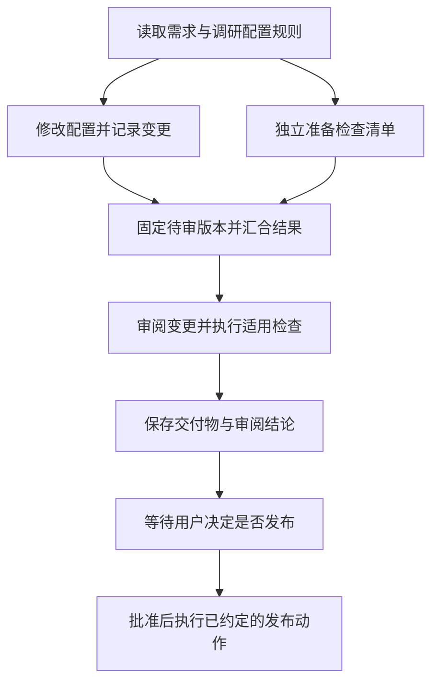
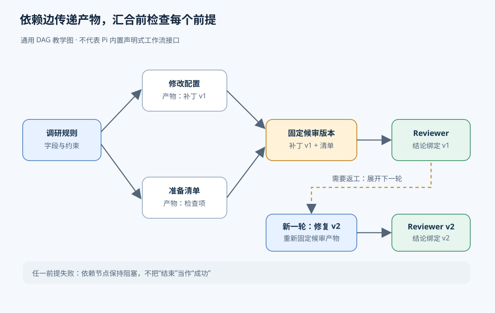
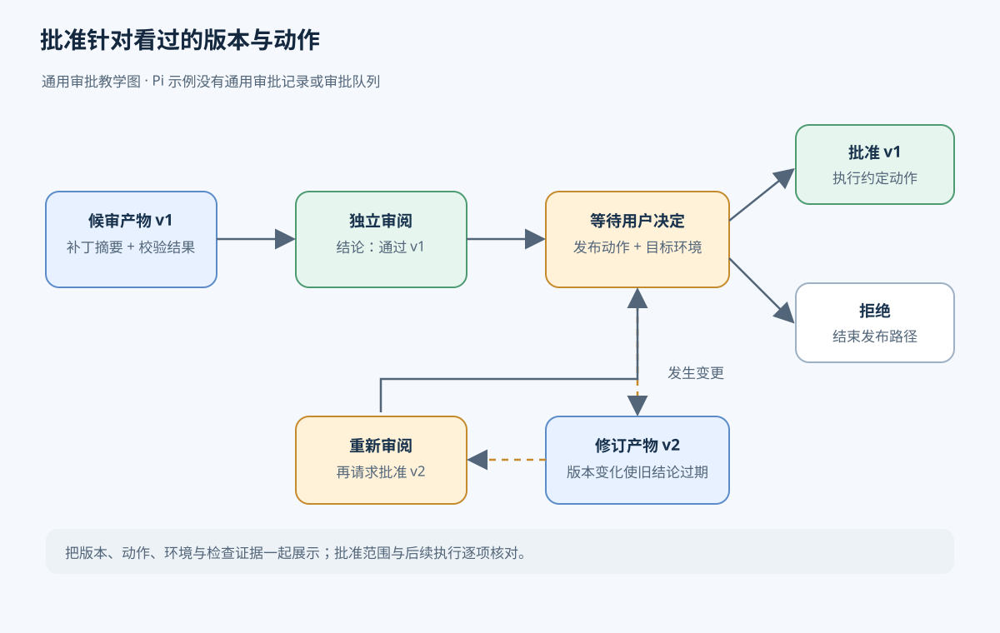
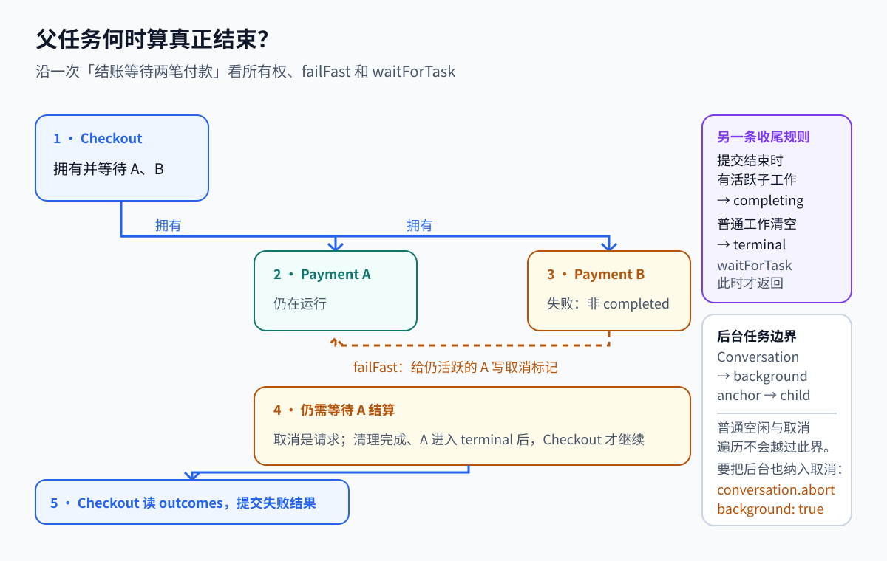
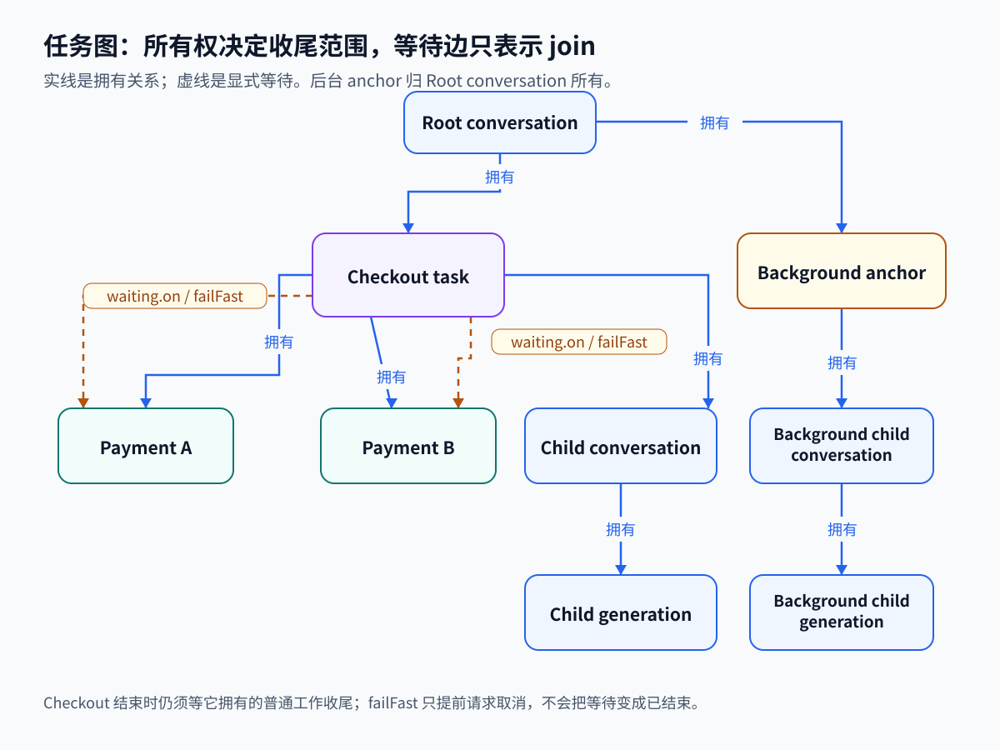

# 第 4 章　调度与多 Agent 编排

[返回目录](README.md) · [上一章：第 3 章 任务队列与 Worker](03-queues-workers.md) · [下一章：第 5 章 持久执行与恢复](05-durable-execution.md)

多 Agent 编排需要将一项总目标分解为可验收的任务，并维护任务间的依赖、结果交付和生命周期责任。本章以“给项目增加一个模型配置，保留已有配置，检查结果，发布前让我决定”为例，先介绍任务分解与依赖图，再讨论共享工作、子任务所有权、审阅和人工决策，最后对照 Pi 的实验实现与扩展示例。

编排（orchestration）规定各项任务的输入、产物、完成条件及相互关系；调度（scheduling）根据当前状态和资源，安排已经满足条件的任务运行。在配置任务中，编排规定审阅必须等待修改和检查清单，调度则决定这两项就绪工作何时获得执行资源。只有同时明确结果依赖与执行责任，程序才能判断下一阶段是否可以开始，以及取消时需要停止哪些工作。

单个 Agent 可以顺序完成整项配置任务。涉及多个模块时，独立调研或审阅可能减少一份上下文需要承担的工作，但同时增加交接与协调成本。以下完整工作流属于教学设计，不是 Pi 内置产品功能；其中引入子 Agent、持久状态和审批记录的条件会分别说明。

## 4.1 任务分解的粒度与验收

配置任务包含调研、修改、验证和发布决策。调研确定配置格式与约束，修改形成文件变更，验证检查变更后的行为，发布决策确认用户是否接受这一结果。任务分解把这些阶段的依赖与验收条件写成明确约定，使后续步骤能够根据已交付证据开始，而不必依赖执行者未记录的临时判断。

可独立交付的目标是确定子任务边界的依据。例如，“阅读配置加载逻辑，列出增加条目所需字段，并附源码位置”包含对象、产物和结束条件。相比之下，“帮我看看项目”没有规定需要形成什么结果，执行者即使返回项目概述，父任务也无法判断是否已获得修改配置所需的依据。

分解任务会增加上下文准备、模型调用、工具执行、汇报和结果核对的成本。若原任务只需一次读取和修改，委派多个 Agent 反而可能使交接成为主要耗时。因此，应先确定可独立验收的产物，再判断该产物是否需要模型推理。固定校验命令可以作为普通任务运行，无需额外创建模型对话。

### 4.1.1 子任务的输入、输出与操作范围

子任务约定是父任务与执行者共享的工作说明，规定输入、输出和操作边界。它可以采用自然语言，也可以采用结构化字段。配置调研任务的约定如下。

| 约定内容 | 配置调研示例 | 缺失风险 |
| --- | --- | --- |
| 目标与输入 | 针对指定项目版本，找出新增模型条目的位置、必需字段和加载路径 | 执行者可能研究了另一个版本，或只找到了显示名称 |
| 可操作范围 | 只读相关源码，不修改文件 | 调研和实施同时改动文件，后续难以确定变更来源 |
| 输出 | 字段清单、依据所在文件、仍不确定的问题 | 一句“可以添加”不足以支持下一步修改 |
| 完成条件 | 每个必需字段都有依据；找不到依据时明确报告阻塞 | 执行者可能用猜测填补空白，再宣布完成 |
| 失败与退出 | 缺少文件或达到预算时返回已查证内容和未完成项 | 父任务只能看到超时，无法利用已有工作 |

执行状态与验收状态需要分别保存。子 Agent 返回最终消息只说明这一轮执行已结束，父任务仍需检查输出是否满足约定。例如，字段清单缺少默认值说明时，执行过程可以正常结束，但调研产物尚不足以支持修改。后续任务应根据验收结果启动，避免把正常退出误记为业务成功。

结果应附带产物引用和证据。代码任务需要说明变更位置、依据版本及检查结果，审阅任务需要说明问题位置和复现条件。父 Agent 通过这些材料核对结论，再安排后续工作。单独指定“调研者”或“审阅者”等角色，不会自动提高输出的可信度。

## 4.2 依赖图与工作流推进

工作流从调研开始，因为修改需要先获得配置规则。调研完成后，修改配置与准备检查清单可以分别进行：前者生成变更，后者依据已确认的规则形成检查项目。清单准备者此时尚未取得最终补丁，不能把清单视为对补丁的验证。两份产物都完成后，工作流固定待审版本，再进入审阅。

依赖图用有向边记录前置条件。边 A 到 B 表示 B 需要 A 提供约定结果，只有这一条件满足后，B 才成为可执行任务。没有相互依赖的工作可以重叠执行，但实际能否同时启动，还取决于调度器掌握的资源。以下流程图只描述通用依赖关系，不表示 Pi 提供声明式工作流接口。

这种没有循环依赖的有向图称为 DAG（directed acyclic graph，无环有向图）。“无环”保证能找到一个不再等待其他未完成节点的起点。若修改任务等审阅结论才能开始，而审阅又等修改完成，两个任务都无法前进。通用 DAG 引擎通常在接收依赖图时检查这种环，再逐步释放前置条件已满足的节点。拓扑排序就是排列这些节点，使每个前置任务都排在依赖它的任务之前；可以同时就绪的节点不必强行串行。

图中的边传递的是可检查的产物：审阅需要等修改和清单都交付，再针对固定版本工作。下面是对通用依赖关系的另一种细节视图，不表示 Pi 提供声明式 DAG 引擎。

扇出（fan-out）指从一个节点启动多个分支，汇合（fan-in 或 join）指等待这些分支并收集结果。汇合需要同时规定等待条件与结果判定。本例要求修改和检查清单都通过验收，审阅才能开始；两项执行都停止并不足以满足这一条件。调研失败时，依赖其产物的修改应进入阻塞状态，而不能仅因前置执行结束就启动。

返工可以表示为新的任务尝试，也可以表示为任务内部的阶段变化。审阅发现缺陷后，创建“修复版本二”和“审阅版本二”，并使其依赖上一轮发现；每次尝试有独立标识时，执行历史仍可表示为无环图。若无需分别观察或重试各轮，也可以由一个任务维护重复阶段。两种表示都需要停止条件，例如预算耗尽、同一问题重复出现或需求取舍需要人工决定。

### 4.2.1 编排与调度的职责划分

编排逻辑决定调研产物的接收方、审阅所需结果、返工路径及人工等待位置。调度器依据这些规则形成的任务状态分配资源。例如调研完成后，修改和清单准备同时就绪；仅有一个执行槽时，调度器启动其中一项，另一项保持等待。

任务就绪表示依赖已经满足，任务运行表示调度器已为它安排执行。并发上限、资源不足或暂停状态都可能使就绪任务继续等待。配置是否符合业务要求则由任务代码或验证步骤判断。很短的固定流程可以使用顺序函数与本地并发收集；需要跨重启继续、多轮汇合或长时间等待人工决定时，才需要保存相应的任务状态。

## 4.3 上下文分配与共享写入

每个子 Agent 的上下文应围绕其职责组织。调研者需要配置规则，修改者需要调研结论与相关源码，审阅者需要需求、最终变更和检查证据。复制父会话全部历史会重复消耗输入预算，并可能引入过时讨论；只发送简短的继续指令又会遗漏约束。交付给子 Agent 的材料应包含目标、有效约束、当前产物、原始证据入口和未解决问题。

独立会话仍可能访问同一文件。若两个 Agent 同时读取旧配置，一个添加模型，另一个调整字段顺序，再分别写回各自版本，后写入者可能覆盖前者新增的内容。协调方式包括划分写入范围、使用隔离工作区，或让并行任务提交补丁并由单一执行者汇总写入。工作区隔离避免即时覆盖，但合并时仍需检查变更是否兼容。

本例只允许一个执行者修改配置，另一个执行者准备只读检查清单，使两项判断能够重叠而不引入共享写入。审阅前还需固定产物版本；若实施者在审阅期间继续修改，结论可能已经不适用于最新文件。因此，每份结果都应标明所检查的产物，后续变更触及该对象时再判断是否需要重新审阅。

多 Agent 的收益主要来自独立子问题可以重叠执行，以及审阅者能从另一组检查目标出发核对产物。代价包括重复读取、模型费用、协调等待和结果整合。多个 Agent 若依赖同一错误假设，也可能给出一致的错误结论。增加数量之前，应先判断独立输入和可核验产物是否存在。执行时间最终仍受最长依赖链限制；增加清单准备者无法缩短必须顺序完成的修改、审阅和人工决策。

## 4.4 所有权与等待关系

父任务发起或组织工作，子任务承担被委派的部分。所有权（ownership）记录父任务对专属子工作的生命周期责任，包括请求停止、等待清理和报告最终结果。例如用户取消配置修改时，修改任务及专用检查任务通常也应停止，否则界面已报告取消，后台仍可能继续改写文件。

等待关系表示一个阶段继续执行所需的结果。多个任务可以同时等待共享规则索引，其中一个等待者取消时，其他任务仍可能需要索引，因此 join 不应自动赋予取消被等待任务的权利。相应地，父任务即使没有显式 join 某个专属子任务，也仍需依据所有权完成该子任务的收尾。

所有权关系用于确定取消与收尾范围，依赖关系用于确定执行先后。分别保存两类关系，程序才能解释任务阻塞的原因和取消的影响范围。后台工作也需要明确归属：当前对话结束后是否继续、由哪个持久对象管理、结果投递到哪里，以及谁有权停止。仅将任务标记为后台，无法替代这些生命周期规则。

前台委派使父工具调用持续等待，子任务结果返回后进入父 Agent 上下文，适用于下一步直接依赖该结果的情况。后台委派先返回受理状态，再由报告任务在子工作完成时投递结果，允许父 Agent 处理其他工作。后台路径需要保存任务标识、收件会话和投递状态，并处理父会话空闲、忙碌或任务已取消的情形。依赖仍然存在，只是由报告任务承担等待。

## 4.5 审阅、交接与人工决策

### 4.5.1 审阅对象与判定标准

Reviewer（审阅者）承担独立检查职责。在本例中，它拿到需求、已固定的变更版本和检查清单，逐项核对“新模型可被加载”“原配置仍保留”等条件。发现问题时，应报告位置、触发条件和影响；没有发现时，也要说明已经检查的范围以及没能验证的部分。父任务据此选择修复、补充验证或提交给用户。

审阅可以由另一个 Agent 执行，也可以由确定性的校验程序和人共同承担。单独设置 Agent 有助于隔离实施过程中的临时假设，但角色提示词不能替代测试，也不能保证审阅者读到了正确版本。若要求只读，应同时限制提供给它的工具，而不只在提示词中写“不要修改”。

审阅结论与修复记录应分别保存。审阅发现原模型条目被覆盖后，实施者产生的修复属于新版本，需要重新核验，不能直接沿用旧结论。重复审阅还应设置预算与退出条件，防止不断追加审阅请求。高风险或涉及多个模块的变更可以采用独立审阅 Agent；范围有限且已有充分检查的小改动则未必需要这一成本。

### 4.5.2 交接内容与执行权限

Handoff（交接）将后续工作所需的信息交给新上下文或另一执行者。调研阶段可能积累大量读取与搜索记录，而实施阶段只需要已经确认的规则、产物和约束。交接说明应记录已完成事项、证据位置、当前产物、待定决定及允许继续的操作，使接收者能够据此检索原始材料并推进任务。

本例中，一份有用的交接说明可以表达：“配置修改已完成，待审版本为本次保存的补丁；检查清单已交付，加载校验通过，原配置保留尚待审阅；发布必须等待用户决定。”后续执行者据此读取补丁和证据。若只写“配置任务快完成了”，它就可能跳过审阅或重复修改。

交接摘要会丢失细节，所以应保留原始记录的引用。它也不会自动转移外部资源、终止已有子任务或授予新的权限。这些动作若需要发生，应由编排逻辑单独处理。仅因上下文变长而重置对话，不应让仍在执行的工作失去负责者。

### 4.5.3 人工决策与产物版本

Human-in-the-loop 指工作流在指定步骤等待人的输入或决定。本例明确要求发布前由用户决定，因此审阅结束后需要暂停发布，并展示具体变更和验证结果。批准对象是这一版本对应的发布动作；调研授权、计划批准和发布批准应分别记录。

审批开始时，程序保存产物版本、拟执行动作、目标环境及检查结果，并将工作流标记为等待决定。随后结束当前自动执行片段，等待用户查看，期间无需反复调用模型询问。收到批准后，宿主核对答复所属请求、批准范围和当前产物，再恢复指定步骤。拒绝时结束该路径；要求修改时生成新产物，并按规则重新检查和审批。

若等待期间补丁已变化，旧批准应如何处理必须有规则。本例适合要求重新展示新版本，因为人之前看到的检查结论可能已失效。长时间审批还需要规定谁有权决定、决定是否过期、重启后怎样恢复等待，以及重复提交批准如何避免重复执行。对于单机演示，保存计划并等待一次用户输入已经能说明基本流程；生产审批是否需要队列、身份验证和审计记录，取决于业务要求。

人也可以在实施前审批计划。那时审批对象是拟采用的步骤与范围，之后仍需验证产物。计划批准、审阅通过与发布批准发生在不同位置，应避免用一个“approved”字段覆盖它们。

审批应展示版本、拟执行动作和检查证据；等待期间若产物变化，旧决定不能自动覆盖新版本。下图为通用教学流程，并非 Pi 内置审批功能。

## 4.6 失败、取消与补偿

分支失败后的处理取决于汇合节点是否仍需要其他结果。修改任务失败而检查清单仍在生成时，编排可以等待全部分支结束，以保留诊断信息；也可以尽早请求其他专属分支停止，减少无用消耗。后一种策略称为 fail-fast，适用于其他分支结果已无法支持后续工作的情况。

取消请求发出后，执行者可能还需关闭连接、终止子进程或清理临时文件，共享资源也未必允许当前任务直接删除。父任务应先记录取消意图，等待其负责的工作完成收尾，再报告最终状态。因此，任务结果已确定和所有子工作已结束是两个不同的生命周期边界。

本例在审阅阶段取消时，可以保留已生成的补丁与检查记录，并说明未发布。若某个外部操作已经发生，仅仅停止 Agent 无法撤回它。补偿指另外执行一项业务动作来抵消先前效果，例如撤销一个已创建的临时资源；补偿可能失败，也可能没有可用的逆操作。需要外部补偿的工作流必须记录已发生的效果和处理结果，不能假设运行时取消等于业务回滚。持久状态与重复执行的处理会在后两章继续展开。

## 4.7 参考实现：Pi 的父子任务与工具委派

以下实现主要位于 `packages/durable`；[README](https://github.com/earendil-works/pi/blob/96abe9a5ad45005cae34ed1c52d42f71fc88bedc/packages/durable/README.md#L1-L7) 标明了它的 Experimental 状态，子任务、取消与 task graph 的说明见 [packages/durable/README.md L624-L712](https://github.com/earendil-works/pi/blob/482c1381a00d8d00bc81697e4a980c593db6803e/packages/durable/README.md#L624-L712)。稳定 coding-agent 的 subagent 扩展与实验 durable TUI 各有入口。阅读时需确认所在路径，不能把实验任务的恢复行为视为默认 CLI 的能力。

### 4.7.1 前台委派的执行与结果返回

以配置调研为例，父 Agent 可以要求子 Agent 只读相关文件，返回新增模型所需字段及其依据。接入前台工具后，一次委派按下面的顺序完成：

1. 父模型调用 subagent 工具，把任务目标、配置位置和检查要求放进参数。
2. 工具按当前父工具任务查找已有子会话；没有时创建一个，并将它归入父工具任务。示例会从子会话配置中移除 subagent 扩展，防止它继续递归委派。
3. 工具向子会话提交输入，使用稳定的请求 ID 标记这次提交。子会话按自己的配置与工具执行工作。
4. 工具等待这次提交结束，从子会话的 answer entry 读取文本。
5. 工具把文本作为工具结果返回。父模型收到结果后，继续自己的模型与工具流程。

父模型看见的是一次工具调用及其结果。子 Agent 内部可以经历多轮模型请求和工具调用。若子工作尚未完成，前台工具就仍在等待；这很适合需要答案才能继续的步骤。仓库中的前台例子见 [packages/durable/test/examples/22-subagent-foreground.ts L38-L79](https://github.com/earendil-works/pi/blob/96abe9a5ad45005cae34ed1c52d42f71fc88bedc/packages/durable/test/examples/22-subagent-foreground.ts#L38-L79)。

前台委派需要处理工具执行重放。示例使用 `ownerTaskId` 查找已创建的 child，并以 `subagent:<taskId>` 作为 `requestId` 提交输入。重启后重新执行工具时，可以据此找到原有 conversation 与 submission，并从对应 answer entry 取得结果，避免再次创建会话或重复准入。子会话独立保存历史，继承父会话的 agent 配置但不复制全部对话；完成任务所需信息仍须由委派参数提供。

在配置工作流中，调研可以采用这一前台委派方式。父模型取得调研结果后再判断是否进入修改阶段。示例负责创建子会话、提交输入、等待和取回结果；任务约定的完整性及证据是否充分，仍需调用者验收。

### 4.7.2 前台子工作的所有权

创建 child 时，Pi 会记录它归哪个任务管理。这个关系称为所有权（ownership）。父任务结束时要检查自己拥有的工作，取消时也沿所有权关系传播。前台 subagent 把 child conversation 归到当前工具任务之下，所以工具失败或取消会传到 child 的工作；conversation 记录本身仍保留。

Pi 的 Task 保存工作进度和结果，Conversation 保存对话与输入。父任务可以显式等待不归自己所有的任务，等待不会扩大取消范围；它拥有的普通工作即使没在 join 集合里，也仍参与父任务收尾。这使前文区分的责任关系与结果依赖在实现中各有作用。

### 4.7.3 Checkout 示例的取消与结算

Pi 用 abort mark 保存取消意图，等待正在运行的 invocation 退出后，再执行 abort handler 并完成结算。这个顺序允许子任务关闭连接、结束进程或清理临时文件。若父任务在提出取消后立即报告终态，调用者可能错误地认为这些资源已经释放。

失败提前通知和最终收尾的区别，可以用结账任务看得更清楚。Checkout 创建 Payment A 与 Payment B，同时保存自己的下一阶段和等待集合。两个支付任务运行时，Checkout 的处理函数已经退出。若 B 失败，`failFast` 会给仍活跃的 A 写取消标记；A 执行清理并结算。等两个 Payment 都进入终态，Checkout 才恢复，从 `runtime.outcomes()` 读取结果并决定订单结果。即使决定失败，只要它拥有的普通工作尚未结束，最终结果也先进入 `completing`；所有工作收尾后才成为 `terminal`，`waitForTask(checkout)` 此时才返回。完整例子在 [packages/durable/test/examples/24-child-tasks.ts L59-L105](https://github.com/earendil-works/pi/blob/96abe9a5ad45005cae34ed1c52d42f71fc88bedc/packages/durable/test/examples/24-child-tasks.ts#L59-L105)。

普通等待要等 `on` 集合里的成员全部 terminal，才会再次调度父任务；调度器检查仍活跃成员的逻辑见 [packages/durable/src/harness/scheduler.ts L1197-L1207](https://github.com/earendil-works/pi/blob/96abe9a5ad45005cae34ed1c52d42f71fc88bedc/packages/durable/src/harness/scheduler.ts#L1197-L1207)。failFast 在某成员出现非 completed outcome 后提前给其他活跃成员写 abort marks，但仍等它们结算才进入下一 phase，见 [packages/durable/src/harness/scheduler.ts L609-L619](https://github.com/earendil-works/pi/blob/96abe9a5ad45005cae34ed1c52d42f71fc88bedc/packages/durable/src/harness/scheduler.ts#L609-L619)。业务层仍由 Checkout 判断付款结果。

父任务自己决定结束时，调度器检查它拥有的普通工作；若还有活跃工作，先保存为 `completing`，见 [packages/durable/src/harness/scheduler.ts L1448-L1470](https://github.com/earendil-works/pi/blob/96abe9a5ad45005cae34ed1c52d42f71fc88bedc/packages/durable/src/harness/scheduler.ts#L1448-L1470)。后续结算逐轮推进已无活跃 child 的 owner，child 结束也可能让更上层的 owner 达到结束条件，见 [packages/durable/src/harness/scheduler.ts L639-L674](https://github.com/earendil-works/pi/blob/96abe9a5ad45005cae34ed1c52d42f71fc88bedc/packages/durable/src/harness/scheduler.ts#L639-L674)。主动取消则先写入 abort mark，再等当前 run invocation 退出，之后向下处理取消、撤回排队输入并推进结算，见 [packages/durable/src/harness/scheduler.ts L339-L366](https://github.com/earendil-works/pi/blob/96abe9a5ad45005cae34ed1c52d42f71fc88bedc/packages/durable/src/harness/scheduler.ts#L339-L366) 和 [packages/durable/src/harness/scheduler.ts L573-L628](https://github.com/earendil-works/pi/blob/96abe9a5ad45005cae34ed1c52d42f71fc88bedc/packages/durable/src/harness/scheduler.ts#L573-L628)。由于取消意图已持久保存，重启后还能接着处理；每个任务的 abort handler 负责清理它自己的效果。

后台工作会改变取消边界。普通空闲检查和取消遍历会在 background 边界停止；若 conversation abort 要连后台工作也取消，必须指定 `background: true`，见 [packages/durable/src/harness/scheduler.ts L391-L414](https://github.com/earendil-works/pi/blob/96abe9a5ad45005cae34ed1c52d42f71fc88bedc/packages/durable/src/harness/scheduler.ts#L391-L414)。因此后台子 Agent 能在父会话暂时空闲后继续运行。

以下两图描述 Pi 实验实现中的 Checkout 示例：第一图展示 Payment B 失败后的收尾顺序，第二图以实线表示所有权、虚线表示显式等待。该支付场景用于说明任务生命周期，其业务处理不构成通用多 Agent 工作流模板。

等待关系也有局部校验：[packages/durable/src/harness/scheduler.ts L1472-L1498](https://github.com/earendil-works/pi/blob/96abe9a5ad45005cae34ed1c52d42f71fc88bedc/packages/durable/src/harness/scheduler.ts#L1472-L1498) 会检查成员存在，拒绝等待自己或祖先 owner，要求 failFast 成员是直接 owned tasks，并禁止 abort handler 再转入 waiting。这些规则覆盖特定无法完成的依赖；它们不是对整张等待图的环检查，完整能力边界见 4.10 节。

### 4.7.4 后台结果的持久投递

后台委派将子工作管理与结果报告分为两个职责。父会话无需立即取得答案、可以继续其他工作时，由一个对象拥有子工作，另一个报告任务等待结果并投递到父会话。这样，父工具调用可以先返回，而结果交付仍有明确的负责人。

后台示例 [packages/durable/test/examples/23-subagent-background.ts L56-L126](https://github.com/earendil-works/pi/blob/96abe9a5ad45005cae34ed1c52d42f71fc88bedc/packages/durable/test/examples/23-subagent-background.ts#L56-L126) 用 background anchor 拥有 child，另由 background reporter 等待答案并发送父会话 follow-up。reporter 分为 `deliver` 与 `report` 两个 phase：child request ID、parent report request ID 分别去重，答复 entry ID 也会记录，以免多条输入共用一份回答时重复报告。anchor 很快可以结束；它与 child 的关系仍保存在 `ConversationRecord.owner` 中，所以 anchor 从 live task graph 消失不表示 child conversation 被删除。

这个示例的所有权和 reporter 结构可单独参考，返回字段需要留意：[packages/durable/test/examples/23-subagent-background.ts L149-L153](https://github.com/earendil-works/pi/blob/96abe9a5ad45005cae34ed1c52d42f71fc88bedc/packages/durable/test/examples/23-subagent-background.ts#L149-L153) 的 `reply()` 和实验 durable subagent 返回 `content`；当前 tool runtime 读取 `output`，见 [packages/durable/src/harness/tool.ts L500-L508](https://github.com/earendil-works/pi/blob/96abe9a5ad45005cae34ed1c52d42f71fc88bedc/packages/durable/src/harness/tool.ts#L500-L508)。这一处接口出入会影响示例的完整输出行为。

稳定 coding-agent 的 subagent 扩展示范了另一种、保留在单次调用内存中的编排。[packages/coding-agent/examples/extensions/subagent/index.ts L550-L601](https://github.com/earendil-works/pi/blob/96abe9a5ad45005cae34ed1c52d42f71fc88bedc/packages/coding-agent/examples/extensions/subagent/index.ts#L550-L601) 的 chain 把 `{previous}` 替换为上一步文本，顺序运行并在失败时停止；[packages/coding-agent/examples/extensions/subagent/index.ts L604-L685](https://github.com/earendil-works/pi/blob/96abe9a5ad45005cae34ed1c52d42f71fc88bedc/packages/coding-agent/examples/extensions/subagent/index.ts#L604-L685) 的 parallel 用本地并发函数收集结果。它以数组顺序和本次调用状态组织任务，子进程使用 `--no-session`。这适合了解顺序链和本地扇出；这条扩展路径没有保存可供重启恢复的任务进度，也没有跨主机调度。

## 4.8 参考实现：审阅、上下文交接与计划模式

### 4.8.1 审阅循环的继续条件

钩子（hook）是在指定运行边界调用的扩展逻辑。审阅扩展可以在模型准备结束一轮时检查退出条件，条件未满足则追加输入并继续运行。这一机制控制审阅循环，审阅对象、产物版本和质量标准则由调用者提供。

durable 示例 [packages/durable/test/examples/28-reviewer.ts L31-L44](https://github.com/earendil-works/pi/blob/96abe9a5ad45005cae34ed1c52d42f71fc88bedc/packages/durable/test/examples/28-reviewer.ts#L31-L44) 安装审阅角色的 section，用 `GenerationTask.onYield` 检查回答是否包含终止短语。没有该短语时，钩子追加“再看一遍”的输入，让同一 run 继续；它没有验证发现是否全部解决。创建与提交逻辑见 [packages/durable/test/examples/28-reviewer.ts L77-L100](https://github.com/earendil-works/pi/blob/96abe9a5ad45005cae34ed1c52d42f71fc88bedc/packages/durable/test/examples/28-reviewer.ts#L77-L100)：它创建没有 owner 的审阅会话，选择另一模型，只提供只读工具和独立工作目录。示例第一轮读取后提交发现，第二轮带结束短语，输入记录才完成。这是审阅循环的独立用途，不是前台 subagent 必经的一步。

### 4.8.2 reset 的上下文交接语义

durable Harness 的 `root.reset(handoff)` 会写一条 `head: "self"` 的 `pi.reset`，把交接说明作为新上下文的 user message，旧 entries 仍保存在存储中，见 [packages/durable/src/harness/harness.ts L113-L120](https://github.com/earendil-works/pi/blob/96abe9a5ad45005cae34ed1c52d42f71fc88bedc/packages/durable/src/harness/harness.ts#L113-L120)。工具也能返回 `control.handoff`；工具轮结束时，`finishToolRound()` 选调用顺序里最后一份说明，写 reset 并结束当前 run，然后处理排队的后续输入，见 [packages/durable/src/harness/generation.ts L627-L656](https://github.com/earendil-works/pi/blob/96abe9a5ad45005cae34ed1c52d42f71fc88bedc/packages/durable/src/harness/generation.ts#L627-L656)。

这条 Handoff 路径为后续模型请求设置新的上下文起点，原 Session 仍由现有运行环境承载。它只改变上下文的组织方式，不迁移会话到其他机器或 Agent 进程。

### 4.8.3 计划保存与显式恢复

Pi 的计划模式示例将人工决定置于两个执行片段之间。第一段限制执行者只能调研并提交计划，保存后停止当前轮；用户查看后，由主机显式恢复工具和执行。该示例用于说明计划保存、暂停与继续的连接方式。

durable plan 示例 [packages/durable/test/examples/27-plan-mode.ts L28-L62](https://github.com/earendil-works/pi/blob/96abe9a5ad45005cae34ed1c52d42f71fc88bedc/packages/durable/test/examples/27-plan-mode.ts#L28-L62) 先把工具限制为 read 和 `submit_plan`，将计划存入可回看历史值的 `PlanDoc`，再用 `terminate` 停止当前轮。用户审阅后，主机调用 `configure(leavePlanMode)` 并提交“Go ahead.”，见 [packages/durable/test/examples/27-plan-mode.ts L93-L100](https://github.com/earendil-works/pi/blob/96abe9a5ad45005cae34ed1c52d42f71fc88bedc/packages/durable/test/examples/27-plan-mode.ts#L93-L100)，然后恢复工具与执行。

稳定 coding-agent 的 plan-mode 扩展给出具体界面：[packages/coding-agent/examples/extensions/plan-mode/index.ts L301-L336](https://github.com/earendil-works/pi/blob/96abe9a5ad45005cae34ed1c52d42f71fc88bedc/packages/coding-agent/examples/extensions/plan-mode/index.ts#L301-L336) 让用户选择 Execute、Stay 或 Refine。Execute 恢复工具并排入 follow-up；Refine 先读取用户补充，再投递消息。这个 UI 是扩展提供的交互方式。plan 示例没有通用审批记录或审批队列，也没有授权身份、批准版本、过期规则和审批崩溃恢复协议。危险工具阻断与可信项目确认见[第 10 章 权限、安全与凭据](10-permissions-secrets.md)。

## 4.9 参考实现：任务定义与关系检查

任务（Task）保存一项工作的阶段和结果，会话（Conversation）保存 Agent 的对话与输入。一个任务可以拥有子任务或会话；子 Agent 常在独立会话中执行工作。任务定义提供 `initial` 起点、各个 `phases` 处理函数、`abort` 取消处理、`migrate` 旧版本转换，以及 join policy。定义在 [packages/durable/src/types.ts L242-L277](https://github.com/earendil-works/pi/blob/96abe9a5ad45005cae34ed1c52d42f71fc88bedc/packages/durable/src/types.ts#L242-L277)；每个 phase 要提交新的 checkpoint 或终态，见 [packages/durable/src/types.ts L142-L155](https://github.com/earendil-works/pi/blob/96abe9a5ad45005cae34ed1c52d42f71fc88bedc/packages/durable/src/types.ts#L142-L155)。checkpoint 保存恢复时要运行的阶段及其数据。

`defineTask()` 将 definition 包装成任务对象，见 [packages/durable/src/tasks.ts L1-L8](https://github.com/earendil-works/pi/blob/96abe9a5ad45005cae34ed1c52d42f71fc88bedc/packages/durable/src/tasks.ts#L1-L8)。主机还需安装包含该定义的 extension，调度器才有对应处理函数。创建记录发生在 [packages/durable/src/session/transaction.ts L383-L427](https://github.com/earendil-works/pi/blob/96abe9a5ad45005cae34ed1c52d42f71fc88bedc/packages/durable/src/session/transaction.ts#L383-L427) 的 `createTask()`：它解析 owner 和 conversation，运行 `initial`，生成 `pending` 记录。后台边界也依赖这类归属记录：子任务不能直接设 `background: true`；后台标记设在由会话拥有的任务上。任务也可以拥有另一个会话，把那份会话里的工作纳入自己的生命周期。

提交时还有一条约束：owner 若已是 `terminal`、正在 `completing`，或带有 abort mark，就不能再接收新工作。[packages/durable/src/session/transaction.ts L852-L874](https://github.com/earendil-works/pi/blob/96abe9a5ad45005cae34ed1c52d42f71fc88bedc/packages/durable/src/session/transaction.ts#L852-L874) 在组装提交时检查这一点。因而创建 child 并把父任务设为 waiting 可以在同一次提交中完成；若同一提交又结束 owner，则会被拒绝。父任务发出结束请求后等待的，是已经归属自己的工作。

任务被反复切断时有崩溃循环保护：崩溃、驱逐或 reset 切断的任务在每次重开时计一次重启，连续达到 `settings.restartLimit`（默认 5）的任务会被停置，阻塞原因显示为 `restart_limit`，由报告回调给出一次 `task_parked`；`harness.retryTask(id)` 可以重新运行它，任务提交新状态后计数归零。见 [崩溃循环保护](https://github.com/earendil-works/pi/blob/482c1381a00d8d00bc81697e4a980c593db6803e/packages/durable/README.md#L204) 与 [重启上限判定](https://github.com/earendil-works/pi/blob/482c1381a00d8d00bc81697e4a980c593db6803e/packages/durable/src/harness/scheduler.ts#L421-L442)。

### 4.9.1 活跃任务关系视图

Pi 的 live task graph 展示当前活跃任务的所有权与等待关系，供运行时观察使用。它与工作流设计中的概念依赖图用途不同；读取同一视图中的边时，仍需区分生命周期归属和显式等待。

运行时可用 `Harness.taskGraph()` 查看仍在进行的任务。[packages/durable/src/harness/task-graph.ts L19-L49](https://github.com/earendil-works/pi/blob/482c1381a00d8d00bc81697e4a980c593db6803e/packages/durable/src/harness/task-graph.ts#L19-L49) 的状态包含 live status（`pending`/`running`/`waiting`/`sleeping`/`completing`，`sleeping` 带 `until`）与 phase，节点包含 owner、background、abortRequested、`blocked` 原因，以及任务拥有的 conversations。初始图由 [build](https://github.com/earendil-works/pi/blob/482c1381a00d8d00bc81697e4a980c593db6803e/packages/durable/src/harness/task-graph.ts#L180-L200) 在 Session line 上原子构造，之后随 commit publication 更新，见 [advance](https://github.com/earendil-works/pi/blob/482c1381a00d8d00bc81697e4a980c593db6803e/packages/durable/src/harness/task-graph.ts#L203-L251)；registry 变化或迁移失败后由 [refreshBlocked](https://github.com/earendil-works/pi/blob/482c1381a00d8d00bc81697e4a980c593db6803e/packages/durable/src/harness/task-graph.ts#L159-L178) 重新推导阻塞原因。terminal 节点会离开 live graph。

这个视图只保留 live records，完整历史以及 checkpoint/outcome 的大载荷要从其他入口读取。阻塞原因（`missing_task`、`task_too_old`、`migration_failed`、`restart_limit`）直接显示在节点上，并随注册表变化更新；更完整的检查仍可用 `harness.inspect()`，见[可观测性与调试](11-observability-debugging.md)。

## 4.10 参考实现：通用工作流的能力边界

Pi 的等待校验没有遍历全图找环。两个独立任务通过 `allSettled` 互等，不能只凭这个函数断定会被拒绝。若用这些构件搭建通用 DAG（无环有向图）工作流，还要自行定义和验证依赖。当前实现没有任意工作流的声明语言、拓扑排序器、全图环检查、声明式分支或 workflow DSL。

任务的 abort handler 负责清理自己的效果；库没有通用补偿事务引擎，也不会自动回滚外部系统。Checkout 示例用内存假银行展示结算顺序，退款行为不代表真实外部系统具备事务保证。

稳定 coding-agent subagent 扩展示例把执行状态留在一次调用的内存中。重启恢复需另外保存 checkpoint；这条路径也没有共享 broker 或跨主机调度。Reviewer 示例在临时目录和 MemoryStorage 中运行，没有创建真实 git worktree，也没有演示跨进程保存；其中角色和配置可以随 Harness 存储，跨进程保留仍取决于后端。Reviewer 不会自动把发现转成补丁或合并闸门，示例也没有设循环最大轮数。

`TaskScheduler` 只在一个 Harness 实例内调度，目前没有跨机器编排服务或 worker lease。早期的实验 services 层曾只暴露 root conversation，并把 keyed subagent services 列为后续工作；这批包与入口已整体移除，库内没有远端服务接口。因此前后台示例中的 conversation 关系只在本 Harness 实例内成立。

## 4.11 源码定位

| 机制 | 主要源码位置 |
| --- | --- |
| 任务定义与包装 | `packages/durable/src/types.ts`、`packages/durable/src/tasks.ts` |
| 创建任务与提交组装 | `packages/durable/src/session/transaction.ts` |
| 等待、取消与结算 | `packages/durable/src/harness/scheduler.ts` |
| 工具轮与 handoff | `packages/durable/src/harness/generation.ts`、`packages/durable/src/harness/tool.ts` |
| live task graph | `packages/durable/src/harness/task-graph.ts` |
| Checkout / 前后台 subagent 示例 | `packages/durable/test/examples/24-child-tasks.ts`、`22-subagent-foreground.ts`、`23-subagent-background.ts` |
| 审阅与计划示例 | `packages/durable/test/examples/28-reviewer.ts`、`27-plan-mode.ts` |
| 稳定 subagent / plan-mode 扩展 | `packages/coding-agent/examples/extensions/subagent/index.ts`、`plan-mode/index.ts` |

## 4.12 本章术语

| 术语 | 在 Pi 中的含义 |
| --- | --- |
| `completing` | 父结果已保存，但拥有的普通工作尚未清空的过渡状态 |
| `terminal` | 任务及其收尾全部完成的终态 |
| Ownership | 工作归属的持久记录，决定等待范围与取消范围 |
| Join / `allSettled` | 显式等待其他任务的边，不改变对方的归属或取消规则 |
| failFast | 一个成员出现非 completed outcome 时，提前给其他活跃成员写 abort mark |
| Abort mark | 持久化的取消意图，重启后仍可读取并继续处理 |
| Background anchor / reporter | 后台示例中拥有 child 的任务 / 负责把答案投递回父会话的任务 |
| Handoff | 以 `pi.reset` 保存的上下文交接点 |

## 4.13 练习：工作流完整性检查

以新增模型配置为例，为调研、修改、清单准备和审阅分别编写任务约定，并绘制依赖图。尝试把清单准备者改成另一个文件修改者：哪些文件可能被同时写入？若给它独立工作区，在哪里汇总与检查冲突？说明这个改动是否真能缩短整条流程。

在流程中加入审阅通过后补丁再次变化的情形。原审阅结论和用户批准分别对应哪一份产物？如何让恢复后的执行者判断下一步应重新审阅、等待用户，还是继续执行？交接包至少应保留哪些证据，才不会把尚待决定写成已经批准？

生命周期练习以 Pi 的实现为参照：复述前台 subagent 的答案返回路径，再画 Checkout 的 owner 边和 wait 边。令 Payment B 失败后，预测哪些任务收到 abort mark、Checkout 何时回到下一 phase、`waitForTask()` 什么时候返回。把一项工作放到 background anchor 下，比较父会话空闲与 worker 能否退出这两个判断。

以下测试包含对应的状态断言：

| 阅读位置 | 可跟踪的过程 |
| --- | --- |
| [packages/durable/test/harness-task-graph.test.ts L84-L166](https://github.com/earendil-works/pi/blob/96abe9a5ad45005cae34ed1c52d42f71fc88bedc/packages/durable/test/harness-task-graph.test.ts#L84-L166) | waiting、completing、owner conversations，以及 terminal 节点删除 |
| [packages/durable/test/harness-task-graph.test.ts L168-L238](https://github.com/earendil-works/pi/blob/96abe9a5ad45005cae34ed1c52d42f71fc88bedc/packages/durable/test/harness-task-graph.test.ts#L168-L238) | 重开后变为 pending，重放 graph operations |
| [packages/durable/test/harness-tasks-recovery.test.ts L176-L245](https://github.com/earendil-works/pi/blob/96abe9a5ad45005cae34ed1c52d42f71fc88bedc/packages/durable/test/harness-tasks-recovery.test.ts#L176-L245) | 取消 mark、abort handler 和 terminal 各阶段的恢复 |
| [packages/durable/test/harness-tasks-recovery.test.ts L513-L526](https://github.com/earendil-works/pi/blob/482c1381a00d8d00bc81697e4a980c593db6803e/packages/durable/test/harness-tasks-recovery.test.ts#L513-L526) | 定义无法迁移时任务保持阻塞；取消阻塞任务按条件结算为 orphaned |

若自行验证，从 `packages/durable` 运行 `node ../../node_modules/vitest/dist/cli.js --run test/harness-task-graph.test.ts`，无需真实模型。支付示例使用内存假银行，其中的退款行为没有给真实外部系统增加事务保证。
