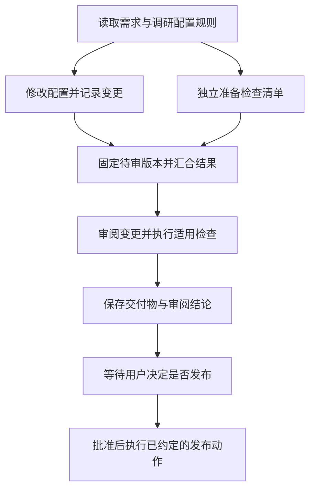

# 04. 怎样拆解任务，并让多个 Agent 协作完成

假设用户提出：“给项目增加一个模型配置，保留已有配置，检查结果，发布前让我决定。”一个 Agent 可以顺序完成这些步骤。若配置涉及多个模块，调研、修改与验证会占据越来越长的上下文；另一个 Agent 也许能独立检查遗漏。拆分工作之后，程序就必须知道每份结果交给谁、哪些步骤可以同时做、检查没通过怎么办，以及用户尚未批准时停在哪里。

编排（orchestration）负责组织这条完整工作流。它把目标分成有输入、有产物、有完成条件的任务，再规定任务之间的关系。调度（scheduling）负责从当前可以执行的任务中安排实际运行。两者共同作用，才能把“找几个 Agent 帮忙”变成有开始、有交付、有收尾的过程。

本章先用上述改配置任务讲一般设计，再用 Pi 对应机制解释如何实现其中一部分。文中的完整工作流是教学假设，不是 Pi 内置的产品功能。读完后，应当能自己画出任务依赖，说明每项工作的责任人和交付条件，并判断何时值得增加子 Agent、审阅和人工决策。

[学习索引](README.md) · 前置：[队列与执行](03-queues-workers.md) · 后续：[持久执行](05-durable-execution.md)

## 把大任务拆到什么程度

“增加模型配置”包含不同性质的工作。调研要查清配置格式和已有约束；修改要产生具体文件变更；验证要检查变更后的行为；发布决定还涉及用户是否接受这份结果。如果只给一个执行者“把事情做好”，这些步骤仍会发生，只是依赖与验收都藏在它的临时判断里。拆解使这些判断成为可以检查的工作约定。

一个子任务应当有相对完整的目标。例如“阅读配置加载逻辑，列出增加条目所需字段，并附源码位置”可以独立交付。“帮我看看项目”则没有明确停止点，返回一段概述后，父 Agent 仍不知道是否得到了修改所需的信息。

拆解也有成本。每个子 Agent 都需要获得上下文、进行模型请求、使用工具并汇报；父 Agent 还要核对结果。有时单次读取和修改即可完成的工作，拆成三个 Agent 会把交接成本变成主要耗时。因此，拆任务时先找能独立验收的产物；只有这项产物需要模型判断时，才考虑用子 Agent 执行。运行固定校验命令可以是普通任务，无需再启动一个模型对话。

### 子任务需要一份可执行的约定

这里的“约定”指父任务与执行者共同使用的输入、输出和边界。它可以写成清楚的自然语言，也可以由程序中的字段表达。对调研任务，可以这样约定：

| 内容 | 本例中的具体约定 | 缺少它会发生什么 |
| --- | --- | --- |
| 目标与输入 | 针对指定项目版本，找出新增模型条目的位置、必需字段和加载路径 | 执行者可能研究了另一个版本，或只找到了显示名称 |
| 可操作范围 | 只读相关源码，不修改文件 | 调研和实施同时改动文件，后续难以确定变更来源 |
| 输出 | 字段清单、依据所在文件、仍不确定的问题 | 一句“可以添加”不足以支持下一步修改 |
| 完成条件 | 每个必需字段都有依据；找不到依据时明确报告阻塞 | 执行者可能用猜测填补空白，再宣布完成 |
| 失败与退出 | 缺少文件或达到预算时返回已查证内容和未完成项 | 父任务只能看到超时，无法利用已有工作 |

执行完成与业务验收也应分别判断。子 Agent 返回最终消息，表示它结束了这一轮；父任务还要检查输出是否满足约定。例如返回的字段清单没有说明默认值，运行本身可以正常结束，调研结果却仍需补充。把这两种结果都记作“成功”，后续修改就会在缺失前提下启动。

输出最好包含产物引用和证据。代码任务交付变更所在位置、所依据的版本以及检查结果，审阅任务交付问题位置与复现条件。父 Agent 据此确认事实，再决定下一步。子 Agent 的结论是一份待核对的输入，角色名称本身不会提高结论的可信度。

## 从顺序步骤到依赖图

调研必须先于修改，因为修改依赖调研产物。调研完成后，可以让一个执行者修改配置，另一个执行者根据已确认的规则独立准备检查清单。后者此时检查的是需求与规则，不能声称已经验证尚未完成的补丁。等修改和清单都交付，再把最终变更交给审阅者。这个汇合步骤避免了“审阅早就做完，后来提交的代码却没人看过”。

依赖关系用有向边表达：从 A 指向 B，表示 B 开始前需要 A 提供约定的结果。只有前置条件满足，B 才变成可执行。没有相互依赖的任务可以并行，这里的并行表示执行区间可以重叠，不保证程序有足够资源让它们同时运行。

下面是本章假设工作流的一次正常路径。图只表达通用设计，不表示 Pi 已有对应的声明式工作流接口。

这种没有循环依赖的有向图称为 DAG（directed acyclic graph，无环有向图）。“无环”保证能找到一个不再等待其他未完成节点的起点。若修改任务等审阅结论才能开始，而审阅又等修改完成，两个任务都无法前进。通用 DAG 引擎通常在接收依赖图时检查这种环，再逐步释放前置条件已满足的节点。拓扑排序就是排列这些节点，使每个前置任务都排在依赖它的任务之前；可以同时就绪的节点不必强行串行。

图中的边传递的是可检查的产物：审阅需要等修改和清单都交付，再针对固定版本工作。下面是对通用依赖关系的另一种细节视图，不表示 Pi 提供声明式 DAG 引擎。

从一个节点启动多个分支通常称为扇出（fan-out）；后续节点等待这些分支并收集结果称为汇合（fan-in 或 join）。汇合还需要一个结果规则。本例要求修改与检查清单都有效才能审阅；仅仅等到两个执行过程停止，还不足以满足这个条件。如果调研任务失败，依赖它的修改应报告阻塞，不能把“调研已经结束”误读成“调研已成功”。

实际工作还会发生返工。审阅发现缺陷后，可以创建“修复版本二”和“审阅版本二”，让新一轮依赖上一轮的发现。每次尝试有独立标识时，已执行的历史仍可以表示为无环图。也可以在一个任务内部用阶段状态表达重复过程。选择哪种表示取决于是否需要单独观察和重试每一轮；都应规定何时停止，例如预算用尽、同一问题反复出现，或必须由人决定需求取舍。

### 编排决定做什么，调度决定何时运行

在图中，编排逻辑规定调研产物可被谁使用、审阅需要哪些结果、出现发现时如何返工，以及什么时候等待人。调度器接到的是具体任务和当前状态：调研完成后，修改与准备清单同时就绪；如果只有一个执行名额，调度器先启动其中一项，另一项继续排队。

因此，“依赖已满足”和“正在执行”是不同状态。调度器还可能受并发上限、资源或暂停状态限制。它也不应自行判定一个模型配置是否合理，这类业务判断属于任务实现或专门的验证步骤。对于很短的固定流程，用顺序函数调用和本地并发收集就够了；需要进程重启后继续、多轮汇合或人工长时间等待时，保存任务状态才成为必要设计。

## 多个 Agent 怎样共享工作而不相互覆盖

子 Agent 通常需要自己的上下文。调研者可以看到配置规则，修改者需要调研结论和相关源码，审阅者需要需求、变更及检查证据。把父会话的全部历史复制给所有执行者，会重复消耗输入预算，也可能把过时讨论带入后续判断；只发送“继续处理”又会丢失约束。适当的交接包应保留任务目标、有效约束、当前产物、证据入口和未解决问题，让接收者能继续读取原始材料。

上下文独立并不意味着文件独立。假设两个 Agent 同时读取同一配置文件：一个添加模型，另一个整理字段顺序。如果两者都按自己读到的旧内容写回，后一份写入可能覆盖前一份新增内容。即便它们有不同会话，也仍在竞争同一文件。推荐的协调办法是划分写入范围、为每份变更提供隔离工作区，或让并行任务只提出补丁，由一个执行者汇总写入。隔离工作区只能延后冲突；合并时仍要检查两份修改是否兼容。

本章的工作流把修改文件交给一个执行者，另一个只准备清单，正是为了保留可并行的判断，同时减少共享写入。审阅前固定待审版本也很重要：若审阅期间实施者继续修改，审阅结论可能对应旧文件。每次返回结果都应说明自己检查了哪份产物，后续变更触及检查对象时应重新判断是否需要审阅。

多 Agent 的收益主要来自独立子问题可以重叠执行，以及审阅者能从另一组检查目标出发核对产物。代价包括重复读取、模型费用、协调等待和结果整合。多个 Agent 若依赖同一错误假设，也可能给出一致的错误结论。增加数量之前，应先判断独立输入和可核验产物是否存在。执行时间最终仍受最长依赖链限制；增加清单准备者无法缩短必须顺序完成的修改、审阅和人工决策。

## 谁负责子工作，谁只是在等结果

父任务是发起或组织工作的一方，子任务是它委派出的工作。若用户取消本次改动，修改者与专用检查任务通常也应停止，否则主界面已经报告取消，文件却还在继续变化。所有权（ownership）把这种生命周期责任记录下来：谁必须请求停止、等待清理，并报告最终结果。

等待关系回答另一个问题：某个阶段需要哪些结果才能继续。例如多个任务都可能等待同一份共享规则索引。取消其中一个等待者，不应自动取消所有人还在使用的索引构建。因此，join 只声明“我需要等它”，不能顺便取得对方的取消权。反过来，父任务启动了一个专属子任务，即使忘了显式 join，它仍应履行对该子任务的收尾责任。

所有权图表达责任，依赖图表达先后。设计系统时分别保存这两类关系，才能回答“下一步为什么没开始”和“按取消会影响谁”。也要决定后台工作的归属：用户结束当前对话时，后台调研是否继续？若继续，由哪个持久对象管理它，结果交到哪里，谁可以最后停止它？“放到后台”需要这些生命周期约定。

前台委派适合父 Agent 下一步就需要结果的情况。调用持续等待，子结果返回后进入父 Agent 上下文。后台委派适合父 Agent 还有其他工作可做的情况：先返回已受理，再由独立报告任务在完成时投递结果。后者要记录任务标识、收件会话和投递状态，处理父会话已空闲、忙于另一轮或任务已取消等情况；它没有消除依赖，只把依赖的等待位置移开了。

## 审阅、交接和人工决策加入流程后

### 审阅者需要检查对象和判定标准

Reviewer（审阅者）承担独立检查职责。在本例中，它拿到需求、已固定的变更版本和检查清单，逐项核对“新模型可被加载”“原配置仍保留”等条件。发现问题时，应报告位置、触发条件和影响；没有发现时，也要说明已经检查的范围以及没能验证的部分。父任务据此选择修复、补充验证或提交给用户。

审阅可以由另一个 Agent 执行，也可以由确定性的校验程序和人共同承担。单独设置 Agent 有助于隔离实施过程中的临时假设，但角色提示词不能替代测试，也不能保证审阅者读到了正确版本。若要求只读，应同时限制提供给它的工具，而不只在提示词中写“不要修改”。

推荐把审阅结论与修复动作分开记录。审阅者发现原模型条目被覆盖，实施者修复后，需要针对新版本复查；不能沿用旧结论。重复审阅应设置预算和退出条件，否则“再看一遍”可能无限延长任务。高风险或多模块改动值得付出这份成本；一个范围明确、已有充分检查的小改动不一定需要独立审阅 Agent。

### Handoff 让后续执行者知道从哪里继续

如果调研已经读了大量材料，后面的实施与审阅可能不需要保留每条搜索过程。Handoff（交接）将继续工作必需的信息交给新的上下文或另一个执行者。通用设计中的交接包应写清已经完成什么、依据是什么、产物在哪里、哪些决定仍待作出，以及接下来允许做什么。

本例中，一份有用的交接说明可以表达：“配置修改已完成，待审版本为本次保存的补丁；检查清单已交付，加载校验通过，原配置保留尚待审阅；发布必须等待用户决定。”后续执行者据此读取补丁和证据。若只写“配置任务快完成了”，它就可能跳过审阅或重复修改。

交接摘要会丢失细节，所以应保留原始记录的引用。它也不会自动转移外部资源、终止已有子任务或授予新的权限。这些动作若需要发生，应由编排逻辑单独处理。仅因上下文变长而重置对话，不应让仍在执行的工作失去负责者。

### 人工决策要绑定具体产物

Human-in-the-loop 指工作流在某个步骤需要人的输入或决定。本例中的用户明确要求发布前决定，因此审阅完成后应暂停发布，把具体变更和验证结果交给用户。这里的审批对象是某个版本的发布动作；“允许调研”或“计划看起来可以”不会自然涵盖后续所有动作。

通用审批设计可以按以下过程实现。先保存待决定的产物版本、拟执行动作、目标环境及当前检查结果，记录工作流正在等待这个决定。随后结束当前自动执行片段，让用户有时间查看，等待期间不应靠反复请求模型来询问是否可以继续。收到批准后，主机核对答复对应的请求、批准范围和产物是否仍一致，再恢复被暂停的步骤。拒绝则结束该路径；要求修改则创建新产物，再按需要进入检查与决策。

若等待期间补丁已变化，旧批准应如何处理必须有规则。本例适合要求重新展示新版本，因为人之前看到的检查结论可能已失效。长时间审批还需要规定谁有权决定、决定是否过期、重启后怎样恢复等待，以及重复提交批准如何避免重复执行。对于单机演示，保存计划并等待一次用户输入已经能说明基本流程；生产审批是否需要队列、身份验证和审计记录，取决于业务要求。

人也可以在实施前审批计划。那时审批对象是拟采用的步骤与范围，之后仍需验证产物。计划批准、审阅通过与发布批准发生在不同位置，应避免用一个“approved”字段覆盖它们。

审批应展示版本、拟执行动作和检查证据；等待期间若产物变化，旧决定不能自动覆盖新版本。下图为通用教学流程，并非 Pi 内置审批功能。

## 失败和取消之后，什么时候才算结束

假设修改任务失败，检查清单仍在生成。编排可以等待所有分支结束，保留尽量多的诊断信息；也可以在失败后尽早请求其他专属分支停止，以减少继续消耗。后者常称为 fail-fast，适用于其他分支结果已经没有用处的情况。采取哪种策略，要由汇合节点的业务需要决定。

取消是一个请求。正在运行的工具可能需要关闭连接、终止子进程或清理临时文件；共享资源甚至不能由这个任务直接清除。父任务应记录取消意图，等待负责的工作确认结束，再向调用者报告最终状态。任务已经决定失败，与其拥有的所有工作已经收尾，是两个时间点。

本例在审阅阶段取消时，可以保留已生成的补丁与检查记录，并说明未发布。若某个外部操作已经发生，仅仅停止 Agent 无法撤回它。补偿指另外执行一项业务动作来抵消先前效果，例如撤销一个已创建的临时资源；补偿可能失败，也可能没有可用的逆操作。需要外部补偿的工作流必须记录已发生的效果和处理结果，不能假设运行时取消等于业务回滚。持久状态与重复执行的处理会在后两章继续展开。

## Pi 案例：把委派接入父 Agent 的工具循环

以下实现主要位于 `packages/durable`；[README](https://github.com/earendil-works/pi/blob/96abe9a5ad45005cae34ed1c52d42f71fc88bedc/packages/durable/README.md#L1-L7) 标明了它的 Experimental 状态，子任务、取消与 task graph 的说明见 [packages/durable/README.md L508-L596](https://github.com/earendil-works/pi/blob/96abe9a5ad45005cae34ed1c52d42f71fc88bedc/packages/durable/README.md#L508-L596)。稳定 coding-agent 的 subagent 扩展与实验 durable TUI 各有入口。阅读时需确认所在路径，不能把实验任务的恢复行为视为默认 CLI 的能力。

### 前台委派如何返回结果

以配置调研为例，父 Agent 可以要求子 Agent 只读相关文件，返回新增模型所需字段及其依据。接入前台工具后，一次委派按下面的顺序完成：

1. 父模型调用 subagent 工具，把任务目标、配置位置和检查要求放进参数。
2. 工具按当前父工具任务查找已有子会话；没有时创建一个，并将它归入父工具任务。示例会从子会话配置中移除 subagent 扩展，防止它继续递归委派。
3. 工具向子会话提交输入，使用稳定的请求 ID 标记这次提交。子会话按自己的配置与工具执行工作。
4. 工具等待这次提交结束，从子会话的 answer entry 读取文本。
5. 工具把文本作为工具结果返回。父模型收到结果后，继续自己的模型与工具流程。

父模型看见的是一次工具调用及其结果。子 Agent 内部可以经历多轮模型请求和工具调用。若子工作尚未完成，前台工具就仍在等待；这很适合需要答案才能继续的步骤。仓库中的前台例子见 [packages/durable/test/examples/22-subagent-foreground.ts L38-L79](https://github.com/earendil-works/pi/blob/96abe9a5ad45005cae34ed1c52d42f71fc88bedc/packages/durable/test/examples/22-subagent-foreground.ts#L38-L79)。

工具执行可能因重启而重放，所以它不能每次都盲目创建新会话或重复提交。示例先用 `ownerTaskId` 查找已创建的 child，再用 `subagent:<taskId>` 作为 `requestId` 提交输入。恢复后再次执行时，这些标识让工具找到原来的 conversation 和 submission，最后仍从对应的 answer entry 取回文本。子会话的历史独立保存；继承的是父会话的 agent 配置，不是父会话全部对话，因此参数需要携带子 Agent 完成任务所需的信息。

把它放回改配置工作流：调研可以成为这样一次委派，父模型收到调研结果后再判断是否进入修改。例子实现了创建、提交、等待和取回；任务约定是否完整、返回的依据是否充分，仍由调用者判断。

### 所有权如何约束前台子工作

创建 child 时，Pi 会记录它归哪个任务管理。这个关系称为所有权（ownership）。父任务结束时要检查自己拥有的工作，取消时也沿所有权关系传播。前台 subagent 把 child conversation 归到当前工具任务之下，所以工具失败或取消会传到 child 的工作；conversation 记录本身仍保留。

Pi 的 Task 保存工作进度和结果，Conversation 保存对话与输入。父任务可以显式等待不归自己所有的任务，等待不会扩大取消范围；它拥有的普通工作即使没在 join 集合里，也仍参与父任务收尾。这使前文区分的责任关系与结果依赖在实现中各有作用。

### 用结账示例观察取消与最终收尾

子任务收到取消请求后，可能还要关闭连接、结束进程或清理临时文件。因此“已经请求取消”不等于“已经结束”。父任务若立即返回终态，调用者会以为资源已经收好。Pi 会把取消意图记为 abort mark，等正在运行的 invocation 退出，再执行 abort handler 并完成结算。

失败提前通知和最终收尾的区别，可以用结账任务看得更清楚。Checkout 创建 Payment A 与 Payment B，同时保存自己的下一阶段和等待集合。两个支付任务运行时，Checkout 的处理函数已经退出。若 B 失败，`failFast` 会给仍活跃的 A 写取消标记；A 执行清理并结算。等两个 Payment 都进入终态，Checkout 才恢复，从 `runtime.outcomes()` 读取结果并决定订单结果。即使决定失败，只要它拥有的普通工作尚未结束，最终结果也先进入 `completing`；所有工作收尾后才成为 `terminal`，`waitForTask(checkout)` 此时才返回。完整例子在 [packages/durable/test/examples/24-child-tasks.ts L59-L105](https://github.com/earendil-works/pi/blob/96abe9a5ad45005cae34ed1c52d42f71fc88bedc/packages/durable/test/examples/24-child-tasks.ts#L59-L105)。

普通等待要等 `on` 集合里的成员全部 terminal，才会再次调度父任务；调度器检查仍活跃成员的逻辑见 [packages/durable/src/harness/scheduler.ts L1197-L1207](https://github.com/earendil-works/pi/blob/96abe9a5ad45005cae34ed1c52d42f71fc88bedc/packages/durable/src/harness/scheduler.ts#L1197-L1207)。failFast 在某成员出现非 completed outcome 后提前给其他活跃成员写 abort marks，但仍等它们结算才进入下一 phase，见 [packages/durable/src/harness/scheduler.ts L609-L619](https://github.com/earendil-works/pi/blob/96abe9a5ad45005cae34ed1c52d42f71fc88bedc/packages/durable/src/harness/scheduler.ts#L609-L619)。业务层仍由 Checkout 判断付款结果。

父任务自己决定结束时，调度器检查它拥有的普通工作；若还有活跃工作，先保存为 `completing`，见 [packages/durable/src/harness/scheduler.ts L1448-L1470](https://github.com/earendil-works/pi/blob/96abe9a5ad45005cae34ed1c52d42f71fc88bedc/packages/durable/src/harness/scheduler.ts#L1448-L1470)。后续结算逐轮推进已无活跃 child 的 owner，child 结束也可能让更上层的 owner 达到结束条件，见 [packages/durable/src/harness/scheduler.ts L639-L674](https://github.com/earendil-works/pi/blob/96abe9a5ad45005cae34ed1c52d42f71fc88bedc/packages/durable/src/harness/scheduler.ts#L639-L674)。主动取消则先写入 abort mark，再等当前 run invocation 退出，之后向下处理取消、撤回排队输入并推进结算，见 [packages/durable/src/harness/scheduler.ts L339-L366](https://github.com/earendil-works/pi/blob/96abe9a5ad45005cae34ed1c52d42f71fc88bedc/packages/durable/src/harness/scheduler.ts#L339-L366) 和 [packages/durable/src/harness/scheduler.ts L573-L628](https://github.com/earendil-works/pi/blob/96abe9a5ad45005cae34ed1c52d42f71fc88bedc/packages/durable/src/harness/scheduler.ts#L573-L628)。由于取消意图已持久保存，重启后还能接着处理；每个任务的 abort handler 负责清理它自己的效果。

后台工作会改变取消边界。普通空闲检查和取消遍历会在 background 边界停止；若 conversation abort 要连后台工作也取消，必须指定 `background: true`，见 [packages/durable/src/harness/scheduler.ts L391-L414](https://github.com/earendil-works/pi/blob/96abe9a5ad45005cae34ed1c52d42f71fc88bedc/packages/durable/src/harness/scheduler.ts#L391-L414)。因此后台子 Agent 能在父会话暂时空闲后继续运行。

下面两张图只描述 Pi 实验实现及其 Checkout 示例。第一张跟踪 Payment B 失败后的收尾顺序；第二张区分所有权实线与等待虚线。支付场景在这里用于观察任务状态，无需把它当作多 Agent 工作流的业务模板。

等待关系也有局部校验：[packages/durable/src/harness/scheduler.ts L1472-L1498](https://github.com/earendil-works/pi/blob/96abe9a5ad45005cae34ed1c52d42f71fc88bedc/packages/durable/src/harness/scheduler.ts#L1472-L1498) 会检查成员存在，拒绝等待自己或祖先 owner，要求 failFast 成员是直接 owned tasks，并禁止 abort handler 再转入 waiting。这些规则覆盖特定无法完成的依赖；它们不是对整张等待图的环检查，完整边界见后文“从这些构件到完整工作流，还缺什么”。

### 后台结果由报告任务送回

前台路径让工具一直等答案，适用于答案是父模型继续工作所需的下一项输入。若父会话可以先处理别的事情，或用户不想被一次长任务阻塞，就可以采用后台投递。此时需要把“拥有子工作的角色”和“把答案送回父会话的角色”分别安排。

后台示例 [packages/durable/test/examples/23-subagent-background.ts L56-L126](https://github.com/earendil-works/pi/blob/96abe9a5ad45005cae34ed1c52d42f71fc88bedc/packages/durable/test/examples/23-subagent-background.ts#L56-L126) 用 background anchor 拥有 child，另由 background reporter 等待答案并发送父会话 follow-up。reporter 分为 `deliver` 与 `report` 两个 phase：child request ID、parent report request ID 分别去重，答复 entry ID 也会记录，以免多条输入共用一份回答时重复报告。anchor 很快可以结束；它与 child 的关系仍保存在 `ConversationRecord.owner` 中，所以 anchor 从 live task graph 消失不表示 child conversation 被删除。

这个示例的所有权和 reporter 结构可单独参考，返回字段需要留意：[packages/durable/test/examples/23-subagent-background.ts L149-L153](https://github.com/earendil-works/pi/blob/96abe9a5ad45005cae34ed1c52d42f71fc88bedc/packages/durable/test/examples/23-subagent-background.ts#L149-L153) 的 `reply()` 和实验 durable subagent 返回 `content`；当前 tool runtime 读取 `output`，见 [packages/durable/src/harness/tool.ts L500-L508](https://github.com/earendil-works/pi/blob/96abe9a5ad45005cae34ed1c52d42f71fc88bedc/packages/durable/src/harness/tool.ts#L500-L508)。这一处接口出入会影响示例的完整输出行为。

稳定 coding-agent 的 subagent 扩展示范了另一种、保留在单次调用内存中的编排。[packages/coding-agent/examples/extensions/subagent/index.ts L550-L601](https://github.com/earendil-works/pi/blob/96abe9a5ad45005cae34ed1c52d42f71fc88bedc/packages/coding-agent/examples/extensions/subagent/index.ts#L550-L601) 的 chain 把 `{previous}` 替换为上一步文本，顺序运行并在失败时停止；[packages/coding-agent/examples/extensions/subagent/index.ts L604-L685](https://github.com/earendil-works/pi/blob/96abe9a5ad45005cae34ed1c52d42f71fc88bedc/packages/coding-agent/examples/extensions/subagent/index.ts#L604-L685) 的 parallel 用本地并发函数收集结果。它以数组顺序和本次调用状态组织任务，子进程使用 `--no-session`。这适合了解顺序链和本地扇出；这条扩展路径没有保存可供重启恢复的任务进度，也没有跨主机调度。

## Pi 案例：审阅循环、上下文交接与人工继续

### 用继续执行的钩子组织审阅循环

钩子（hook）是在运行过程的指定位置调用的扩展逻辑。对于审阅，合适的位置是模型准备结束一轮时：扩展检查是否满足退出条件，必要时补充输入，让审阅继续。它解决的是循环控制；审阅对象、版本和质量标准还需要调用者提供。

durable 示例 [packages/durable/test/examples/28-reviewer.ts L31-L44](https://github.com/earendil-works/pi/blob/96abe9a5ad45005cae34ed1c52d42f71fc88bedc/packages/durable/test/examples/28-reviewer.ts#L31-L44) 安装审阅角色的 section，用 `GenerationTask.onYield` 检查回答是否包含终止短语。没有该短语时，钩子追加“再看一遍”的输入，让同一 run 继续；它没有验证发现是否全部解决。创建与提交逻辑见 [packages/durable/test/examples/28-reviewer.ts L77-L100](https://github.com/earendil-works/pi/blob/96abe9a5ad45005cae34ed1c52d42f71fc88bedc/packages/durable/test/examples/28-reviewer.ts#L77-L100)：它创建没有 owner 的审阅会话，选择另一模型，只提供只读工具和独立工作目录。示例第一轮读取后提交发现，第二轮带结束短语，输入记录才完成。这是审阅循环的独立用途，不是前台 subagent 必经的一步。

### 以 reset 保存上下文交接点

durable Harness 的 `root.reset(handoff)` 会写一条 `head: "self"` 的 `pi.reset`，把交接说明作为新上下文的 user message，旧 entries 仍保存在存储中，见 [packages/durable/src/harness/harness.ts L113-L120](https://github.com/earendil-works/pi/blob/96abe9a5ad45005cae34ed1c52d42f71fc88bedc/packages/durable/src/harness/harness.ts#L113-L120)。工具也能返回 `control.handoff`；工具轮结束时，`finishToolRound()` 选调用顺序里最后一份说明，写 reset 并结束当前 run，然后处理排队的后续输入，见 [packages/durable/src/harness/generation.ts L627-L656](https://github.com/earendil-works/pi/blob/96abe9a5ad45005cae34ed1c52d42f71fc88bedc/packages/durable/src/harness/generation.ts#L627-L656)。

Handoff 提供后续请求的起点，工作由新的上下文接着处理。它不会把 Session 搬到另一台机器或另一个 agent 进程；这是上下文交接，不是远端迁移。

### 保存计划、停止当前轮，再由主机恢复

Pi 的计划示例对应前文的人工决策基本过程：先让执行者只能调研，保存一份待查看的计划，然后停止当前轮。恢复由主机显式触发，适合观察人在两个执行片段之间怎样插入决定。

durable plan 示例 [packages/durable/test/examples/27-plan-mode.ts L28-L62](https://github.com/earendil-works/pi/blob/96abe9a5ad45005cae34ed1c52d42f71fc88bedc/packages/durable/test/examples/27-plan-mode.ts#L28-L62) 先把工具限制为 read 和 `submit_plan`，将计划存入可回看历史值的 `PlanDoc`，再用 `terminate` 停止当前轮。用户审阅后，主机调用 `configure(leavePlanMode)` 并提交“Go ahead.”，见 [packages/durable/test/examples/27-plan-mode.ts L93-L100](https://github.com/earendil-works/pi/blob/96abe9a5ad45005cae34ed1c52d42f71fc88bedc/packages/durable/test/examples/27-plan-mode.ts#L93-L100)，然后恢复工具与执行。

稳定 coding-agent 的 plan-mode 扩展给出具体界面：[packages/coding-agent/examples/extensions/plan-mode/index.ts L301-L336](https://github.com/earendil-works/pi/blob/96abe9a5ad45005cae34ed1c52d42f71fc88bedc/packages/coding-agent/examples/extensions/plan-mode/index.ts#L301-L336) 让用户选择 Execute、Stay 或 Refine。Execute 恢复工具并排入 follow-up；Refine 先读取用户补充，再投递消息。这个 UI 是扩展提供的交互方式。plan 示例没有通用审批记录或审批队列，也没有授权身份、批准版本、过期规则和审批崩溃恢复协议。危险工具阻断与可信项目确认见[权限与 Secrets](10-permissions-secrets.md)。

## 源码补充：任务的定义、创建与关系检查

任务（Task）保存一项工作的阶段和结果，会话（Conversation）保存 Agent 的对话与输入。一个任务可以拥有子任务或会话；子 Agent 常在独立会话中执行工作。任务定义提供 `initial` 起点、各个 `phases` 处理函数、`abort` 取消处理、`migrate` 旧版本转换，以及 join policy。定义在 [packages/durable/src/types.ts L242-L277](https://github.com/earendil-works/pi/blob/96abe9a5ad45005cae34ed1c52d42f71fc88bedc/packages/durable/src/types.ts#L242-L277)；每个 phase 要提交新的 checkpoint 或终态，见 [packages/durable/src/types.ts L142-L155](https://github.com/earendil-works/pi/blob/96abe9a5ad45005cae34ed1c52d42f71fc88bedc/packages/durable/src/types.ts#L142-L155)。checkpoint 保存恢复时要运行的阶段及其数据。

`defineTask()` 将 definition 包装成任务对象，见 [packages/durable/src/tasks.ts L1-L8](https://github.com/earendil-works/pi/blob/96abe9a5ad45005cae34ed1c52d42f71fc88bedc/packages/durable/src/tasks.ts#L1-L8)。主机还需安装包含该定义的 extension，调度器才有对应处理函数。创建记录发生在 [packages/durable/src/session/transaction.ts L383-L427](https://github.com/earendil-works/pi/blob/96abe9a5ad45005cae34ed1c52d42f71fc88bedc/packages/durable/src/session/transaction.ts#L383-L427) 的 `createTask()`：它解析 owner 和 conversation，运行 `initial`，生成 `pending` 记录。后台边界也依赖这类归属记录：子任务不能直接设 `background: true`；后台标记设在由会话拥有的任务上。任务也可以拥有另一个会话，把那份会话里的工作纳入自己的生命周期。

提交时还有一条约束：owner 若已是 `terminal`、正在 `completing`，或带有 abort mark，就不能再接收新工作。[packages/durable/src/session/transaction.ts L852-L874](https://github.com/earendil-works/pi/blob/96abe9a5ad45005cae34ed1c52d42f71fc88bedc/packages/durable/src/session/transaction.ts#L852-L874) 在组装提交时检查这一点。因而创建 child 并把父任务设为 waiting 可以在同一次提交中完成；若同一提交又结束 owner，则会被拒绝。父任务发出结束请求后等待的，是已经归属自己的工作。

### 在运行时查看任务关系

前面的概念依赖图用于设计工作流；Pi 的 live task graph 用于观察当前工作。它把归属和等待放在同一视图里，读图时仍需区分两种关系。

运行时可用 `Harness.taskGraph()` 查看仍在进行的任务。[packages/durable/src/harness/task-graph.ts L18-L43](https://github.com/earendil-works/pi/blob/96abe9a5ad45005cae34ed1c52d42f71fc88bedc/packages/durable/src/harness/task-graph.ts#L18-L43) 的节点包含 live status、phase、owner、background、abortRequested、waiting.on/policy，以及任务拥有的 conversations。初始图由 [packages/durable/src/harness/task-graph.ts L107-L148](https://github.com/earendil-works/pi/blob/96abe9a5ad45005cae34ed1c52d42f71fc88bedc/packages/durable/src/harness/task-graph.ts#L107-L148) 在 Session line 上原子构造，之后随 commit publication 更新，见 [packages/durable/src/harness/task-graph.ts L155-L207](https://github.com/earendil-works/pi/blob/96abe9a5ad45005cae34ed1c52d42f71fc88bedc/packages/durable/src/harness/task-graph.ts#L155-L207)；terminal 节点会离开 live graph。

这个视图只保留 live records，完整历史以及 checkpoint/outcome 的大载荷要从其他入口读取。它也不说明 pending 为何 blocked；排查时可用 `harness.inspect()`，见[可观测性与调试](11-observability-debugging.md)。

## 从这些构件到完整工作流，还缺什么

Pi 的等待校验没有遍历全图找环。两个独立任务通过 `allSettled` 互等，不能只凭这个函数断定会被拒绝。若用这些构件搭建通用 DAG（无环有向图）工作流，还要自行定义和验证依赖。当前实现没有任意工作流的声明语言、拓扑排序器、全图环检查、声明式分支或 workflow DSL。

任务的 abort handler 负责清理自己的效果；库没有通用补偿事务引擎，也不会自动回滚外部系统。Checkout 示例用内存假银行展示结算顺序，退款行为不代表真实外部系统具备事务保证。

稳定 coding-agent subagent 扩展示例把执行状态留在一次调用的内存中。重启恢复需另外保存 checkpoint；这条路径也没有共享 broker 或跨主机调度。Reviewer 示例在临时目录和 MemoryStorage 中运行，没有创建真实 git worktree，也没有演示跨进程保存；其中角色和配置可以随 Harness 存储，跨进程保留仍取决于后端。Reviewer 不会自动把发现转成补丁或合并闸门，示例也没有设循环最大轮数。

`TaskScheduler` 只在一个 Harness 实例内调度，目前没有跨机器编排服务或 worker lease。实验 services 也只暴露 root conversation；[packages/coding-agent/src/experimental/services/README.md L38-L45](https://github.com/earendil-works/pi/blob/96abe9a5ad45005cae34ed1c52d42f71fc88bedc/packages/coding-agent/src/experimental/services/README.md#L38-L45) 将 keyed subagent services 列为后续工作。因此前后台示例中的 conversation 关系尚未全部成为远端服务接口。

## 源码位置与术语速查

| 机制 | 主要源码位置 |
| --- | --- |
| 任务定义与包装 | `packages/durable/src/types.ts`、`packages/durable/src/tasks.ts` |
| 创建任务与提交组装 | `packages/durable/src/session/transaction.ts` |
| 等待、取消与结算 | `packages/durable/src/harness/scheduler.ts` |
| 工具轮与 handoff | `packages/durable/src/harness/generation.ts`、`packages/durable/src/harness/tool.ts` |
| live task graph | `packages/durable/src/harness/task-graph.ts` |
| Checkout / 前后台 subagent 示例 | `packages/durable/test/examples/24-child-tasks.ts`、`22-subagent-foreground.ts`、`23-subagent-background.ts` |
| 审阅与计划示例 | `packages/durable/test/examples/28-reviewer.ts`、`27-plan-mode.ts` |
| 稳定 subagent / plan-mode 扩展 | `packages/coding-agent/examples/extensions/subagent/index.ts`、`plan-mode/index.ts` |

| 术语 | 在这个项目中的含义 |
| --- | --- |
| `completing` | 父结果已保存，但拥有的普通工作尚未清空的过渡状态 |
| `terminal` | 任务及其收尾全部完成的终态 |
| Ownership | 工作归属的持久记录，决定等待范围与取消范围 |
| Join / `allSettled` | 显式等待其他任务的边，不改变对方的归属或取消规则 |
| failFast | 一个成员出现非 completed outcome 时，提前给其他活跃成员写 abort mark |
| Abort mark | 持久化的取消意图，重启后仍可读取并继续处理 |
| Background anchor / reporter | 后台示例中拥有 child 的任务 / 负责把答案投递回父会话的任务 |
| Handoff | 以 `pi.reset` 保存的上下文交接点 |

## 练习：检查一份工作流是否完整

回到新增模型配置的任务。先给调研、修改、清单准备和审阅各写一份任务约定，再画依赖图。尝试把清单准备者改成另一个文件修改者：哪些文件可能被同时写入？若给它独立工作区，在哪里汇总与检查冲突？说明这个改动是否真能缩短整条流程。

再把“审阅通过”之后的补丁改动作为一次事件加入流程。原审阅结论和用户批准分别对应哪一份产物？如何让恢复后的执行者判断下一步应重新审阅、等待用户，还是继续执行？交接包至少应保留哪些证据，才不会把尚待决定写成已经批准？

最后用 Pi 的实现核对生命周期：复述前台 subagent 的答案返回路径，再画 Checkout 的 owner 边和 wait 边。令 Payment B 失败后，预测哪些任务收到 abort mark、Checkout 何时回到下一 phase、`waitForTask()` 什么时候返回。把一项工作放到 background anchor 下，比较父会话空闲与 worker 能否退出这两个判断。

相关断言可从以下位置查起：

| 阅读位置 | 可跟踪的过程 |
| --- | --- |
| [packages/durable/test/harness-task-graph.test.ts L84-L166](https://github.com/earendil-works/pi/blob/96abe9a5ad45005cae34ed1c52d42f71fc88bedc/packages/durable/test/harness-task-graph.test.ts#L84-L166) | waiting、completing、owner conversations，以及 terminal 节点删除 |
| [packages/durable/test/harness-task-graph.test.ts L168-L238](https://github.com/earendil-works/pi/blob/96abe9a5ad45005cae34ed1c52d42f71fc88bedc/packages/durable/test/harness-task-graph.test.ts#L168-L238) | 重开后变为 pending，重放 graph operations |
| [packages/durable/test/harness-tasks-recovery.test.ts L176-L245](https://github.com/earendil-works/pi/blob/96abe9a5ad45005cae34ed1c52d42f71fc88bedc/packages/durable/test/harness-tasks-recovery.test.ts#L176-L245) | 取消 mark、abort handler 和 terminal 各阶段的恢复 |

若自行验证，从 `packages/durable` 运行 `node ../../node_modules/vitest/dist/cli.js --run test/harness-task-graph.test.ts`，无需真实模型。支付示例使用内存假银行，其中的退款行为没有给真实外部系统增加事务保证。
