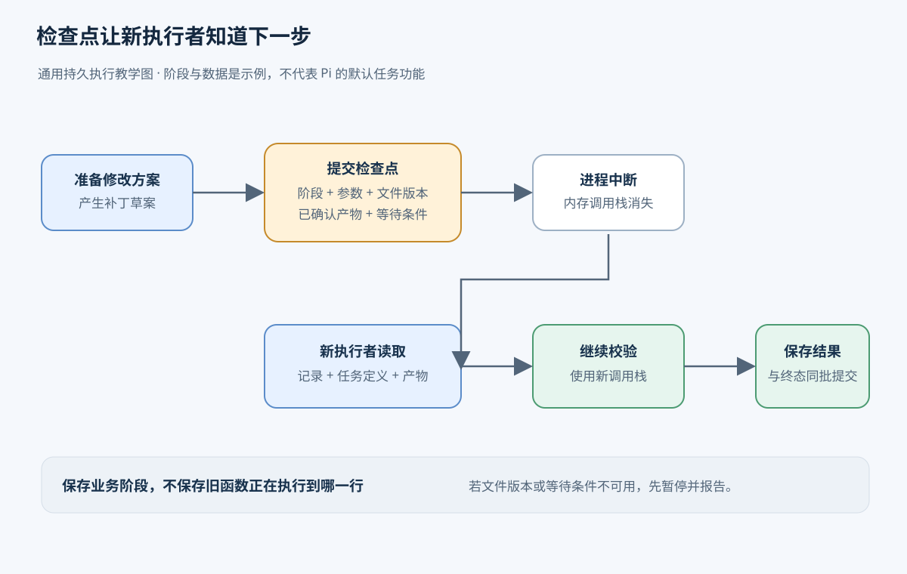
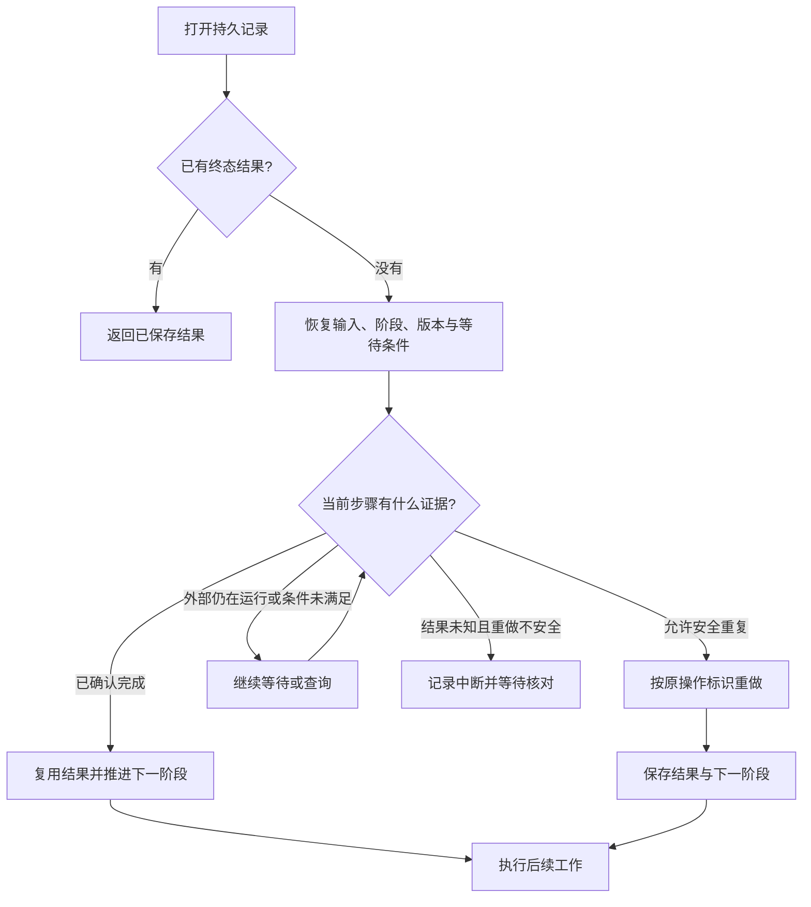
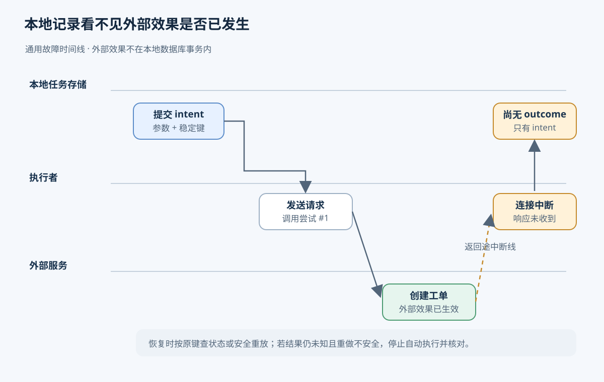

# 05. Durable Execution：进程中断以后，任务从哪里继续

用户要求 Agent 给项目增加模型配置，保留原有配置，并检查加载结果。任务可能先读文件、等待模型生成修改方案，再写文件和运行校验。如果程序在校验前退出，用户重新打开程序时，希望它知道修改已经做到哪里，继续验证，并给出结果。对需要运行几分钟、几小时，或者等待人工批准的工作，一次进程退出不应要求用户重新组织整项任务。

Durable Execution（持久执行）让任务进度在约定的故障范围内保存下来，由之后的执行者读取并继续。它接收任务输入和执行规则，持续产生可恢复的状态，最终保存结果。实现这件事，需要同时设计正常执行时保存什么，以及恢复者如何解释这些记录。把状态写到磁盘只是其中一步。

前半章用教学设计解释这个过程，不依赖 Pi 的类型或接口。后半章再用 Pi 的实验持久任务核对具体实现。从[学习索引](README.md)可以找到其他章节；任务之间的关系见[编排](04-orchestration.md)，重复调用如何避免重复效果见[重试、超时与幂等](06-retry-timeout-idempotency.md)。

## 程序退出时，丢掉的是哪些进度

运行中的程序把局部变量、异步调用的等待状态、计时器和调用栈放在进程内存里。调用栈记录当前函数执行到哪里、返回后接着执行什么。进程退出后，这些数据随之消失。新进程即使加载完全相同的代码，也没有旧调用栈，无法凭空知道应该从写文件后的哪一行继续。

文件系统和外部服务却有各自的生命周期。程序已经写入的配置可能仍在磁盘上，已经提交给模型服务的请求可能仍在后台运行。因此中断会留下两种同时存在的情况：执行者失去了内存进度，一部分操作的效果仍然存在。恢复时简单重跑全部代码，可能重复修改配置、重复付费调用，甚至重复发送通知。

保存聊天历史可以恢复用户说过什么、模型回复过什么，但历史记录未必足以决定下一步。例如历史最后一条是模型要求“写入配置”，它没有说明写入是否已经发生；历史中有“工具开始”的事件，也不能证明工具已经完成。即使结果已进入历史，还需要约定如何将它对应到任务步骤，以及怎样识别尚未完成的部分。

持久执行状态为程序提供这些明确约定：当前任务是什么，已经确认哪些结果，下一步在哪个阶段，需要哪些输入。历史服务于回顾交互；checkpoint 服务于继续工作。两者可以一起保存，也可以由完备的事件记录推导执行状态，但只保存自然语言对话不会自动获得恢复协议。

## 检查点要让另一个执行者接得上

Checkpoint（检查点）是在某个执行边界保存的一组恢复数据。判断它是否足够，可以设想一个没有见过之前内存的新执行者：只给它检查点、任务输入和程序代码，它能否判断下一步并完成这一步？若还要依赖已经消失的局部变量，检查点就缺少信息。

在改配置的教学任务中，执行者生成修改方案后，可以保存“下一阶段为应用修改”，同时保存目标文件、生成好的修改内容、原文件版本以及本次操作的稳定标识。这样重开后不必再次向模型索取方案，也能在文件已经被其他人修改时发现冲突。文件应用完后，再保存可验证的结果，将下一阶段推进为校验。校验结束时，结果和任务终态应一起保存。终态表示任务已成功、失败或取消，后续不再按原流程执行；若它与结果分别保存，恢复者可能读到“任务完成”却没有结果。

这里保存的内容有不同用途：

| 恢复所需信息 | 改配置任务中的例子 | 缺少它时会发生什么 |
| --- | --- | --- |
| 任务身份、输入与状态版本 | 哪个项目、哪项用户要求、记录格式版本 | 无法解释记录，或误把另一个任务当作当前任务 |
| 当前阶段及下一步参数 | 应用已生成的修改方案 | 只能重新推理，无法可靠地接着原计划执行 |
| 已确认的结果或持久引用 | 原文件版本、修改后的内容标识、校验输出 | 无法复用已完成工作，也无法核对当前环境 |
| 外部操作标识 | 一次文件更新请求或后台生成的标识 | 无法查询原操作，容易把恢复变成新操作 |
| 等待条件 | 审批记录、依赖任务、下次允许尝试的时间 | 重启后可能过早执行，或永远无人继续 |

这些是通用设计需要考虑的数据，不表示每项任务都要保存整张表。金额固定的转账任务可以很小；生成研究报告的任务可能只在检查点里保存阶段和产物位置，将大文件存到独立存储。采用引用时，产物本身也必须在恢复期间保持可用。保存一个指向临时文件的路径，并不能让那个文件随任务一起持久化。

检查点的核心是让新执行者可判断下一阶段，并能取得所需产物和等待条件；它不保存旧进程的调用栈。下面是通用持久执行教学图。



检查点描述的是业务步骤，通常不尝试序列化整个进程。打开的网络连接和函数闭包很难跨进程重建，程序版本变化后，旧指令位置也可能失去含义。把“接下来验证这份配置”写成显式状态，新执行者就可以用新调用栈完成同一职责。

## 保存时机决定丢多少工作，也决定能否安全重做

如果只在整项任务结束时保存，中途崩溃就没有任何进度可复用。若每处理一个字符都保存，存储写入量和等待提交的时间又可能超过实际工作。检查点粒度是在恢复成本与正常执行成本之间取舍。

适合保存的边界通常是一个步骤产生了可复用结果，或者程序即将进入可能长时间等待的状态。改配置任务在模型方案生成后保存，可以避免重做昂贵的生成；在等待人工批准前保存，可以让等待跨过进程重启。对很便宜、没有外部效果的格式转换，恢复时重新计算可能比每次存储结果更简单。

外部写操作还需要执行前的记录。执行者先保存 intent（操作意图），明确准备对哪个对象做哪件事，再发起操作，最后保存 outcome（结果）。执行前的检查点让恢复者知道操作可能已经开始；执行后的结果让它知道哪些工作可以跳过。两次保存之间仍有无法仅靠本地状态消除的窗口，下一节会据此判断恢复动作。

时间等待也必须保存其含义。假设服务要求到某个时刻才能重试，若只创建内存计时器，重启后计时器就不存在了。保存绝对截止时间后，新执行者可以计算还需等待多久；若时间已过，便继续执行。每次重启都重新等待完整时长，会延长任务；重开后立即执行，则可能违背限流或退避要求。

## 从中断到继续，恢复者按什么顺序工作

下面仍是教学用系统。假设改配置任务已经保存修改方案，准备调用一个文件更新服务；该服务支持按操作标识查询结果，并能识别同一操作的重复请求。这里引入服务是为了清楚地区分任务存储和文件修改的效果，不代表普通本地文件写入自动具有这些能力。

1. 正常执行者先保存目标文件、预期版本、修改内容和稳定操作标识，把阶段推进为“应用修改”。只有提交成功后，才把请求发送给文件更新服务。
2. 服务写入文件并返回结果。执行者还未来得及把结果写入任务存储，进程退出。此时文件已改变，任务存储仍显示“应用修改”。
3. 新执行者打开持久存储，发现任务尚未进入终态。它不能因为旧记录写着“运行中”就认定旧进程仍在执行。单进程系统可以在重开时重新调度；多个执行者共享任务时，还需要确认旧执行权已经失效，这属于第 07 章的协调问题。
4. 恢复者读取任务输入、检查点、已保存结果和状态版本，找到能解释这些记录的执行代码。若代码或必需产物缺失，就暂停并报告原因，不能猜测下一步。
5. 恢复者按操作标识查询更新服务。若服务确认已经完成，就保存返回的结果并跳过写入；若能安全地重发，则使用原标识重发；若服务仍在执行，就保存等待条件后继续查询。若结果未知且重做不安全，则留下需处理的中断状态，等待人工或专门的核对流程。
6. 修改结果保存成功后，执行者进入校验阶段。校验完成时保存结果与终态。以后再打开任务，直接返回已完成结果，不再执行写入和校验。

这条过程包含“重做”“复用已有结果”“继续等待”和“停止等待处理”几种选择。选择依据是已保存的事实、外部系统能提供的证据，以及操作是否允许重复。恢复不能把未知结果当成失败，也不能把未知结果当成成功。



图只描述恢复决策。让两个执行者同时走这张图并不能保证安全：谁有权推进同一任务，仍需独立的协调机制。

## Recovery、resume 和 replay 各指哪一部分

Recovery（恢复）指从故障后重新获得可继续工作的状态这一整段过程，包括打开存储、检查未完成任务、迁移旧记录、确定外部结果和重新安排执行。它的结果可能是继续运行，也可能是确认完成或停下来等待人工处理。

Resume（继续执行）指在恢复出的进度上允许任务继续推进。前面例子中，读取记录、发现写入结果未知，还处在恢复判断中；确认写入结果后开始校验，就是继续执行。系统可以把“打开并检查状态”与“开始执行”分开，允许宿主先安装代码、检查设置，再开放运行。

Replay（重放）需要说明重放的对象。一个常见用法是重新调用尚未确认完成的步骤：再次发送同一文件更新请求，再次执行读取，或重新计算一个纯函数。这些代码会实际运行，外部效果是否重复取决于工具和服务的约定。另一个用法是读取以前保存的结果，让后续逻辑继续使用这些结果，而不再次调用外部服务。

有些工作流系统采用确定性历史回放：执行规则从起点重新运行，遇到过去已经完成的活动时，由历史记录提供当时的结果；执行规则按相同顺序走到尚未完成的地方后，才安排新活动。要让重放走出同一路径，影响分支的时间、随机值和外部结果必须由历史或受控接口提供，代码变化也需要兼容历史。模型活动也要使用当时已记录的结果；重新请求模型可能得到不同答案，使后续逻辑进入另一个分支。

本章主要讲显式状态机恢复。状态机把工作分成命名阶段，由已保存的阶段选择下一段处理代码，因此可以直接从“应用修改”或“校验”继续。它不要求重新执行从起点到当前阶段的所有控制逻辑，但任务作者必须明确设计检查点和迁移规则。两种方式都需要处理外部效果；确定性回放控制逻辑本身，也不会把外部转账纳入本地存储事务。Pi 实验路径采用阶段和检查点来恢复，没有提供通用的确定性历史回放引擎。

## 结果记录和实际效果之间为什么仍有空隙

用一笔假转账更容易看清风险。执行者先保存“准备转账”以及稳定业务标识，调用服务转账，然后保存 receipt（服务返回的结果凭证）。若服务已完成转账，而执行者在保存 receipt 前退出，本地只知道“准备转账”，无法判断钱是否已经转出。

这个本地状态也可能来自另一种故障：执行者刚保存准备记录，就在调用服务前退出。两种情况留下相同的记录，但实际效果不同。恢复者如果一律跳过，前一种情况能避免重复，后一种情况会漏掉转账；如果一律重做，后一种情况能完成工作，前一种情况可能重复转账。

因此，保存完成标记的先后顺序无法独自解决问题。先保存“完成”再执行，会在两步之间退出时漏掉效果；先执行再保存“完成”，会在两步之间退出时留下重复执行风险。本地事务可以让结果和任务终态一起出现，却不能自动把独立服务的业务变化包括进去。

幂等调用提供一种可用的解决方式：同一业务操作在恢复和重试时使用同一个标识，服务保存这个标识及结果，再次收到它时返回原结果，不重新应用效果。稳定标识必须在首次调用前确定并保存，恢复时重新生成一个新标识会被服务视为另一笔业务。另一种方式是查询外部 receipt，核对后再推进；查询接口必须能对“已完成”“尚在执行”和“未知”给出足够明确的语义。

这些机制可以让处理函数多次执行、业务效果只应用一次，前提是外部服务确实实施了相应约定。对于既不能安全重做、也不能查询结果的操作，持久执行只能保留不确定状态，并交给人工或业务核对流程处理。第 06 章将进一步解释幂等范围、重试预算和超时为何不能证明操作失败。

意图提交、外部效果和结果记录是三个不同事件；两次本地提交之间若进程退出，恢复者可能无法判断外部效果是否已发生。下图概括这一通用崩溃窗口。



## 恢复还依赖代码和存储的有效范围

任务可能在旧版本程序中开始，在新版本程序中恢复。假设旧记录只有“已修改文件”，新流程却要求先记录原文件版本再校验，新代码就不能把旧字段强行解释成新证据。状态版本用于识别记录格式；migration（迁移函数）把旧输入与检查点转换成新代码能够解释的结构。迁移需要保留任务已完成的事实、业务标识和等待条件，不能通过生成新标识把同一业务变成另一次操作。

新规则需要的数据不一定存在。此时可以保留能执行旧任务的代码，或阻塞任务直到补齐信息；具体选择取决于系统是否支持这些方式。迁移函数不能推导出从未记录过的外部效果。状态机的迁移关注阶段及其数据；采用历史回放的系统还要考虑代码变化是否会改变历史活动的顺序或分支。

持久性也必须说明针对什么故障。内存存储能测试状态转换，但进程退出后没有数据。磁盘存储可以在进程重启后读取记录，整机掉电时最新提交能否保留还取决于数据库的同步策略。磁盘损坏或整机永久丢失，又涉及备份、复制及其数据恢复范围。一个后端满足其中一种情况，不代表它覆盖所有情况。

“没有收到提交成功”也可能表示结果未知：后端先成功写入，随后连接断开，执行者就收不到确认。恢复者应重新读取持久记录，按稳定请求标识核对是否已经接收或完成，不能直接假设写入失败。下面的 Pi 案例会说明它如何处理这类错误；事务、WAL 和分布式一致性在[第 07 章](07-distributed-state.md)展开。

## Pi 对照：一个自定义任务怎样跨重开继续

`packages/durable` 提供存储提交、文档版本、任务 checkpoint、工具意图与重开调度。[packages/durable/README.md L1-L7](../pi/packages/durable/README.md#L1-L7) 将它标为实验库，API 会变化。以下对照基于提交 `96abe9a5ad45005cae34ed1c52d42f71fc88bedc`，稳定 coding-agent 的普通 session 没有自动采用这套持久任务引擎。

恢复测试用假转账服务隔离外部副作用。服务记录调用次数，并按业务 key 保存应用结果，用于验证重复调用和业务去重的关系。

任务创建时，输入保存金额，初始 checkpoint 是 `prepare`。准备阶段先把请求金额记入 memo，再提交阶段 `apply` 和由任务 ID 生成的稳定 key。若示意编号是 42，可以写成 `{ phase: "apply", key: "transfer-42" }`；源码实际使用 `transfer-${task.id}`，恢复测试按 `transfer-${id}` 检查同一个标识。

进入 `apply` 后，处理函数把 key 和金额交给服务。服务应用效果并返回 receipt，处理函数再提交 receipt 与终态 outcome。测试在第一次服务调用后制造中断，所以数据库还没有结果，仍停在 `apply`。重开时宿主重新安装任务定义和 settings；打开存储只整理状态，不自动执行任务。直到宿主调用 `resume()`，调度器才根据检查点再次进入 `apply`。

服务收到原 key 后返回已有结果，任务将其保存为终态。测试观察到两次服务调用、一次实际效果；第三次重开直接读到完成记录。任务引擎负责回到处理阶段，假服务负责按 key 去重。CPU 指令位置、局部变量、闭包、Promise 和 timer 都没有被保存或复活。

| 中断位置 | 本地最后保存的内容 | 重开后的情况 |
| --- | --- | --- |
| apply 检查点提交前 | 仍是之前的任务阶段 | 调度器按之前阶段重新进入处理函数 |
| 检查点之后、服务效果之前 | `phase` 与稳定 key | 任务会再次调用服务；服务需要识别同一 key |
| 服务效果之后、结果提交之前 | 仍只有 `phase` 与稳定 key | 本地无法判断效果是否已经发生；重试可能再次调用服务 |
| 结果与终态提交之后 | receipt 与终态 outcome | 调度器读取完成结果，不再执行该任务 |

服务前与服务后、结果前的两个窗口，在本地数据库里留下相同的 apply 记录。数据库不能仅凭这条记录判断是否转过账。稳定 key 必须交给支持幂等的服务，或者由业务方查询外部 receipt 后核对。这样可以让处理函数重复运行而不重复产生业务效果；如果外部服务既不支持幂等，也无法查询结果，本地记录不能提供 exactly-once 效果保证。

测试用假服务验证了这一区别：[packages/durable/test/harness-tasks-recovery.test.ts L47-L90](../pi/packages/durable/test/harness-tasks-recovery.test.ts#L47-L90) 定义服务，[packages/durable/test/harness-tasks-recovery.test.ts L112-L145](../pi/packages/durable/test/harness-tasks-recovery.test.ts#L112-L145) 覆盖恢复。恢复后 apply 调用次数可以大于一，而 `service.applied` 中的实际效果仍只有一次。

图展示的是工具任务在各个崩溃点保存了什么，以及自定义转账如何按 checkpoint 重进 apply。时间线里的提交指数据库状态提交，外部操作发生在提交之间；图示不提供 exactly-once 保证。


在 Pi 的任务记录中，checkpoint 是任务保存的 `{ phase, ... }` JSON 状态，调度器用它选择阶段处理函数。intent（意图）是执行前持久化的操作说明；自定义任务可把它表示为 checkpoint，工具任务会另外保存执行参数和重放策略。outcome（结果）记录成功、失败或取消以及任务终态。它们分别回答“下一步做什么”“允许怎样重做”“最终发生了什么”，但都不能替外部服务确认副作用。

### 调度器如何解释恢复记录

阶段名称只有结合任务定义才有意义。数据库保存任务类型、版本、checkpoint 和输入；宿主注册表提供对应版本的阶段处理代码。恢复不会从数据库加载可执行的旧函数。

打开时，[packages/durable/src/harness/scheduler.ts L288-L315](../pi/packages/durable/src/harness/scheduler.ts#L288-L315) 扫描 pending、running、waiting、completing 任务，把遗留的 running 改回 pending，同时保留 checkpoint、input 和 abort mark。之后，[packages/durable/src/harness/scheduler.ts L1317-L1383](../pi/packages/durable/src/harness/scheduler.ts#L1317-L1383) 根据 `checkpoint.phase` 选择处理函数。函数返回时必须留下持久进展，否则调度器会把任务判为故障，避免原地反复运行。

前面讨论的状态迁移在这里由任务定义提供。调度器在 [packages/durable/src/harness/scheduler.ts L1209-L1236](../pi/packages/durable/src/harness/scheduler.ts#L1209-L1236) 按 kind/version 查找定义和 migration；缺少定义、当前版本过旧或迁移失败都会阻塞任务，并报告原因。

执行中的 `runtime.sleep(until)` 只是当前 invocation 的等待。若重开后仍需等到某个时间，应把绝对时间 `until` 写进 checkpoint，再由新 invocation 比较当前时间。内建 generation 的 retry 与 poll 阶段也采用这种方式。其他恢复所需数据应进入 checkpoint、memo、document 或 entry。缺少定义的普通任务仍算活跃，会影响空闲等待；主动取消时可按条件结算为 orphaned。设置 `abandonOnRestart` 的任务在重启取消时会等定义可用，以便执行清理。

## Pi 对照：模型生成选择重发或查询

生成过程中已经显示的文字、后台生成的身份和原 HTTP 连接，是三种不同的状态。Pi 可以保存部分输出供历史查看，也可以在 provider 支持时保存后台响应的查询 handle；原进程正在消费的 HTTP 流不会随任务记录恢复。普通流式生成与后台生成因此走不同的恢复路径。

内建 `GenerationTask` 有 `prepare/request/retry/poll/tools` 五类 phase，定义见 [packages/durable/src/harness/generation.ts L51-L90](../pi/packages/durable/src/harness/generation.ts#L51-L90)。`request` 保存模型引用、thinking level、流式请求选项和上下文截止位置 `cutoff`；`retry` 保存尝试次数和绝对等待时间 `until`；`poll` 保存 provider 返回的 deferred handle 与 `pollAt`。

流式请求的恢复轨迹是：

```text
prepare → 提交 request checkpoint
→ 发起模型请求 → 节流提交 partial → 进程中断
→ 重新打开并 resume
→ 已提交 partial 转为 stopReason=aborted 的历史 assistant entry
→ 按原 cutoff 重新发起请求 → 保存最终响应
```

重开的 `request` 会建立新模型请求，旧 HTTP 流不会续上。已提交 partial 转成 aborted 历史 entry，供历史和 UI 查看；它不会作为未完成前缀接着补写。[packages/durable/src/harness/generation.ts L166-L233](../pi/packages/durable/src/harness/generation.ts#L166-L233) 中的 `request` phase 会跳过 prepare，但重新运行 `beforeRequest` hooks。hook 可能再次执行，而它当次修改的请求没有完整进入 checkpoint，所以新请求不保证逐字节相同。

| 重开时的 phase | 已保存的信息 | 恢复动作 |
| --- | --- | --- |
| `request` | 请求配置、cutoff、可能已有 partial | 将 partial 记为 aborted，再建立新请求 |
| `retry` | attempt 与绝对 `until` | 等到时间，再发起下一次尝试 |
| `poll` | provider handle 与 `pollAt` | 调用 `fetchDeferred()` 查询原后台响应 |

partial 默认每 100 ms 节流提交到 `LiveDoc.generation.message`，同一时间最多有一个提交进行。[packages/durable/src/harness/generation.ts L353-L420](../pi/packages/durable/src/harness/generation.ts#L353-L420) 中的 pending、timer、inFlight 留在内存，尚未落盘的增量可能随进程丢失。100 ms 是配置的提交间隔，不构成“最多丢 100 ms”的保证；实际时序还受机器与存储影响。终态处理会停掉计时器并等待正在进行的提交完成，避免旧 partial 覆盖最终状态。

延迟响应也有窗口。[packages/durable/src/harness/generation.ts L423-L453](../pi/packages/durable/src/harness/generation.ts#L423-L453) 的 `classify()` 要把 handle 与 `phase=poll` 一起提交，重开后才能查询。如果服务已经返回 handle，而进程在提交前退出，数据库仍停在 request，恢复会再发请求。只有持久化的 handle 能用于查询；内存中正在消费的流不会保存下来。

## Pi 对照：工具重放要满足两个 safe

对于模型提出的工具调用，Pi 在执行前决定恢复时是否允许再次调用。[packages/durable/src/harness/tool.ts L155-L185](../pi/packages/durable/src/harness/tool.ts#L155-L185) 在 execute 前保存最终参数和 replay policy（重放策略），默认值是 unsafe。恢复到 execute 阶段时，只有保存的策略和当前工具声明都为 safe，运行时才重跑。unsafe 或工具已不可用时，运行时会给模型一条 interrupted 错误，并保留已提交输出。

safe 是工具作者对“允许重跑”的承诺，运行时不会证明命令没有副作用。[packages/durable/src/harness/tool.ts L570-L630](../pi/packages/durable/src/harness/tool.ts#L570-L630) 可以把 transcript result 或 nested-call result 与 task outcome 一起结算；文件写入、HTTP 请求和 shell 命令仍发生在数据库事务之外。

| 中断位置 | 已保存的证据 | 恢复时可能发生什么 |
| --- | --- | --- |
| intent 提交前 | call checkpoint | 重新解析、校验并运行 beforeTool |
| intent 后、effect 前 | execute 参数与 policy | safe 时重跑；unsafe 时报告 interrupted |
| effect 后、outcome 前 | 与上一行相同 | 本地无法判断效果是否发生，仍按 replay policy 处理 |
| outcome 已提交 | terminal receipt 与结果 | 不再执行该 task |

intent 提交后、outcome 提交前，外部效果发生前后都留下同样的本地记录。和转账例子一样，保证业务效果不重复要靠外部系统提供幂等或 receipt 核对。

memo 是 first-writer-wins 的备忘记录，一个名字只保留最先写入的 JSON 值，适合固定随机决定、业务 key 或人工决定，见 [packages/durable/src/harness/scheduler.ts L1584-L1599](../pi/packages/durable/src/harness/scheduler.ts#L1584-L1599)。但 memo 与外部效果并不原子。[packages/durable/test/examples/13-recovery.ts L27-L45](../pi/packages/durable/test/examples/13-recovery.ts#L27-L45) 的示例先写 `printed-n`，再调用 console.log。若打印后退出，恢复会跳过第二次打印；若 memo 落盘后、打印前退出，恢复也会跳过，于是打印漏掉。先写 memo 可以避免重复，却可能漏掉尚未发生的效果。

## Pi 实现补充：检查点怎样提交给存储

以下细节用于从源码核对持久记录的形成过程。它们解释本地提交的范围；第 07 章会把事务和 WAL 放进更完整的存储与一致性问题中讨论。

### 提交后再采用内存状态和通知观察者

恢复依赖一批彼此一致的记录。例如任务变为完成时，结果也必须同时保存；否则重开后会看到“已完成”却没有结果。Transaction（事务）将相关存储变化作为一批提交。Session 还可能同时收到工具结果、新输入和界面读取请求，因此它把提交和需要一致快照的读取排队，避免两个回调各自根据旧状态写入。

这里的顺序也解释了“发布”：成功提交后，再把新状态交给内存中的 tracker、调度器、界面或订阅者。若先通知界面“转账已完成”，再保存结果，进程可能在两者之间退出，界面显示的完成就没有持久记录支持。实现先保存，再采用内存状态，最后发布。

Session 把 commit 与一致快照读取排进同一条 Promise 队列，见 [packages/durable/src/session/session.ts L220-L245](../pi/packages/durable/src/session/session.ts#L220-L245)；具体排队实现是 [packages/durable/src/session/session.ts L854-L861](../pi/packages/durable/src/session/session.ts#L854-L861) 的 `#enqueue()`。源码称它为 mutation line，即串行处理状态变化的提交线。它只协调本进程里的会话。转账请求发生在外部系统，不会自动进入这条线或本地事务。

任务回调先改文档草稿，已经发布的值保持不变。[packages/durable/src/session/transaction.ts L671-L692](../pi/packages/durable/src/session/transaction.ts#L671-L692) 在 callback 成功后封闭事务，检查所有异步 Tx 操作已经完成，再 prepare 文档变化并组装写入批次；失败时 abort 草稿，这批变化不会进入 Storage。callback 内的读取要通过 `tx`。直接调用 Harness 或 runtime 的排队读取，可能排在正在执行的 callback 后面，双方会一直等待。表读取也须在第一次表写入前完成，约束见 [packages/durable/src/session/transaction.ts L922-L939](../pi/packages/durable/src/session/transaction.ts#L922-L939)。外部 I/O 留在任务处理函数中，避免长时间占住提交线。

草稿准备好后，[packages/durable/src/session/session.ts L690-L742](../pi/packages/durable/src/session/session.ts#L690-L742) 依次运行 callback 并 prepare writes、调用 `storage.commit(writes, withoutAbortSignal(context))`、用 `tx.adopt(seq)` 更新内存 tracker，再由 `#publish()` 通知 scheduler、view 和订阅者。存储提交成功后，内存才采用候选状态，观察者随后才收到变化。提交一旦准入，即使调用者取消，也会完成存储结算，避免等待取消后无法判断是否落盘。

存储已提交、内存采用候选状态却失败时，内存会落后于数据库，Session 因而失败关闭。普通宿主监听器抛错只会被报告，已持久化的 commit 保持不变。[packages/durable/src/session/session.ts L730-L775](../pi/packages/durable/src/session/session.ts#L730-L775) 处理这两种提交后的失败。

### 后端保存内容与故障范围

上述记录通过所选 Storage 后端提交。MemoryStorage 提供相同接口与原子语义，但进程退出后数据消失；跨进程恢复需要其他后端，[packages/durable/README.md L630-L639](../pi/packages/durable/README.md#L630-L639) 列出了差别。

[packages/durable/src/types.ts L703-L748](../pi/packages/durable/src/types.ts#L703-L748) 定义的 `StorageWrite` 可以在同一批次保存 conversation、entry、task、submission 与 document base/delta。entry 保存不可变的交互记录，task 保存最新完整任务记录，document 保存应用状态。文档可保存完整值（base）和相对前一值的改动（delta）；读取时从 base 开始按顺序应用 delta。

SQLite 后端在 [packages/durable/src/storage/sqlite/storage.ts L175-L198](../pi/packages/durable/src/storage/sqlite/storage.ts#L175-L198) 的单个数据库事务中检查 ID、写入表和文档，再推进 commit sequence。读取文档时，[packages/durable/src/storage/sqlite/storage.ts L607-L642](../pi/packages/durable/src/storage/sqlite/storage.ts#L607-L642) 取最新适用的 base 并按顺序应用同版本 delta；版本变化时需要新的 base。

WAL 是 write-ahead log（预写日志）：数据库先记录用于恢复的变更日志，再按数据库机制处理数据页。WAL 帮助本地数据库恢复；是否在断电后保留最新提交还取决于同步设置。进程崩溃、整机掉电和存储损坏是不同的故障范围，不能只凭“使用 SQLite”判断所有持久保证。

| 后端 | 保存方式与故障范围 |
| --- | --- |
| Memory | 进程消失后数据消失；适合测试状态转换 |
| Node SQLite | WAL、`synchronous = NORMAL`；进程崩溃可恢复，掉电或主机故障可能丢失最新 commit |
| JSONL | README 描述 append-only；`fsync: true` 才会在 commit marker 前 flush，历史也保留在内存 |
| Cloudflare SQLite | 依赖一个 SQLite-backed Durable Object 的 storage transaction |

Node 的事务入口和设置分别见 [packages/durable/src/storage/sqlite/node.ts L140-L159](../pi/packages/durable/src/storage/sqlite/node.ts#L140-L159)、[packages/durable/src/storage/sqlite/node.ts L179-L210](../pi/packages/durable/src/storage/sqlite/node.ts#L179-L210)。这些后端共享 Storage 接口，具体故障保证由各自实现决定。

### 关闭与存储错误

进程退出也可能来自正常关闭或存储错误。正常 close 在 [packages/durable/src/harness/harness.ts L336-L339](../pi/packages/durable/src/harness/harness.ts#L336-L339) 与 [packages/durable/src/harness/scheduler.ts L323-L330](../pi/packages/durable/src/harness/scheduler.ts#L323-L330) 中封闭准入、通知观察者、取消并等待 invocation，最后关闭 Storage。它不会把所有任务写成 aborted。忽略 AbortSignal 的处理函数会拖住关闭；强杀则会留下无法继续的 Promise 和调用栈，重开仍依据存储记录恢复。

Storage 错误的处理见 [packages/durable/src/session/session.ts L1049-L1075](../pi/packages/durable/src/session/session.ts#L1049-L1075)。Session 会锁定 failure 并关闭，Harness 不会自动重试。后端可能已经落盘后才向调用者抛错，所以没有收到确认不能证明提交没发生。重新打开后可以取回 submission，用相同 requestId 判断此前是否已经准入。

## Pi 的支持范围

以上恢复机制围绕单进程、单存储中的任务记录与执行选择。更大范围的协调没有在这套库里实现：

- mutation line 只协调本进程里的会话；多主节点共识和跨进程事务协调未实现。
- 等待规则按任务定义是否可运行推进，没有队列自动重试次数策略；任务 lease、分布式抢占、共识，以及多个进程共同持有同一存储的协调也未实现。
- 通用外部副作用的 exactly-once 保证和分布式事务未实现。必须发生的效果需要稳定 intent/key，加上外部幂等调用或 receipt 核对；多个独立系统要同时改变，还需另行设计协调协议。
- 这仍是实验路径；稳定 coding-agent 的各类 session 并没有自动采用它。

## 测试与源码索引

可以把转账例子中的检查点前、服务效果前、服务效果后和 outcome 后分别作为中断点，观察测试里的 `service.calls` 与 `service.applied.size`，解释调用次数为何可能多于实际应用次数。再用同样的方法读模型流和工具结果。

| 阅读位置 | 覆盖的故障点 |
| --- | --- |
| [packages/durable/test/harness-tasks-recovery.test.ts L291-L425](../pi/packages/durable/test/harness-tasks-recovery.test.ts#L291-L425) | mark、abort、terminal、reservation 提交前后 |
| [packages/durable/test/harness-tasks-recovery.test.ts L429-L524](../pi/packages/durable/test/harness-tasks-recovery.test.ts#L429-L524) | 缺定义、版本不兼容、migration 失败与更换定义 |
| [packages/durable/test/harness-tools-recovery.test.ts L109-L163](../pi/packages/durable/test/harness-tools-recovery.test.ts#L109-L163) | unsafe interrupted；保存策略与当前声明都为 safe 的判定 |
| [packages/durable/test/harness-generation-recovery.test.ts L124-L162](../pi/packages/durable/test/harness-generation-recovery.test.ts#L124-L162) | 保存 partial、转换为 aborted entry、按原上下文范围重发 |
| [packages/durable/test/harness-generation-recovery.test.ts L201-L228](../pi/packages/durable/test/harness-generation-recovery.test.ts#L201-L228) | 重开后通过原 handle 查询 deferred 响应 |

若自行验证，从 `packages/durable` 执行 `node ../../node_modules/vitest/dist/cli.js --run test/harness-tasks-recovery.test.ts`。该测试用假外部服务和受控存储制造故障窗口。
