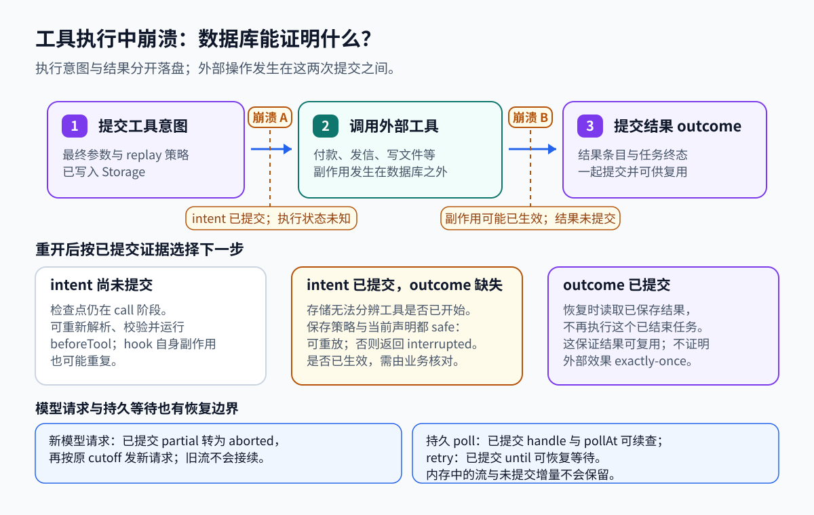
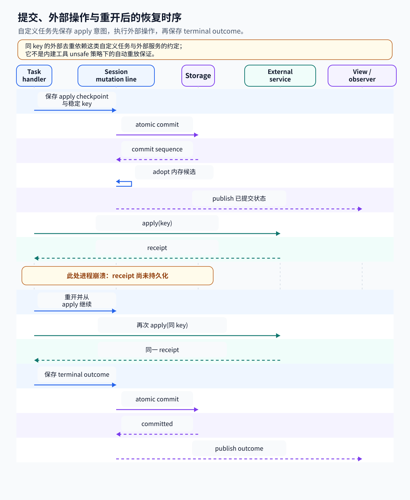

# 05. 进程中断以后，任务从哪里继续

Durable Execution（持久执行）让程序在运行进程消失后，仍能从已保存的进度继续处理任务。普通内存变量随进程退出而消失；持久记录写在能够重新打开的存储里。恢复时读取这些记录，重新建立执行。能保存什么、哪些步骤可以重做，需要由运行时和任务代码约定。

先用修改配置来理解：程序可以把“接下来验证配置”与配置路径保存下来。重开后调度器读到这个阶段，就调用验证函数。它没有恢复先前 CPU 执行到的那一行，也没有恢复那个函数的局部变量；要继续使用的数据必须显式保存。

一次可恢复任务的完整过程是：

1. 建立持久任务记录，保存初始输入与阶段。
2. 执行前提交检查点，说明下一步要做什么、需要哪些数据。
3. 在存储提交之外调用模型、工具或外部服务。
4. 得到结果后，再提交新检查点或终态结果。
5. 进程中断后，重新打开存储，读取最后成功提交的阶段，并按恢复策略建立新执行。

第 3、4 步之间尤其需要注意：操作可能已成功，而本地尚未保存结果。为了看清这个窗口，下面改用具有明确外部效果的转账例子。

持久执行要解决的是：进程在一项工作中途停止后，程序怎样从已保存的信息继续。以转账为例，外部服务可能已经完成付款，进程却在保存 receipt 前退出。数据库能保存任务状态，不能保存正在运行的函数、闭包、Promise 或 timer；重开后，程序只能依据最后一次提交的记录重新调用处理函数。

| 执行过程 | 留下的记录 | 怎样接到下一步 |
| --- | --- | --- |
| 执行前保存意图（intent） | 检查点（checkpoint）保存 `phase` 与完整 JSON 状态；自定义任务可用它表达意图，工具任务还会保存执行参数和重放策略（replay policy） | 重开后据此选择处理阶段并判断是否重跑 |
| 调用外部服务 | 外部效果（external effect）由外部服务或系统产生 | 数据库不能单独证明效果是否发生 |
| 执行后保存结果 | 结果（outcome）记录成功、失败或取消及任务终态 | 调用者可复用已提交结果，不必再次运行该任务 |

用转账贯穿一次完整执行：任务先保存 `{ phase: "apply", key: "transfer-42" }`，这个 checkpoint 表示要做哪一步，也携带稳定业务 key，构成这项自定义任务的执行意图。接着处理函数调用外部服务。外部服务完成转账后，任务再保存 receipt（结果凭证）和终态 outcome。若进程在外部服务返回前退出，数据库仍停在 apply；若它在服务成功、receipt 提交前退出，数据库同样只知道 apply。重开后调度器从 checkpoint 重新调用 apply。要避免第二次转账，稳定 key 必须交给支持幂等（同一业务 key 重复调用仍产生同一效果）的外部服务，或由业务方核对外部 receipt。数据库本身不能判定效果究竟有没有生效。

这三步是分开的提交与副作用：保存 intent，执行外部 effect，保存 outcome。每个崩溃点留下的证据不同；effect 已发生而 outcome 未提交时，数据库中看起来仍和 effect 尚未发生时相同。

[packages/durable/test/harness-tasks-recovery.test.ts L47-L90](../../packages/durable/test/harness-tasks-recovery.test.ts#L47-L90) 的假服务与 [packages/durable/test/harness-tasks-recovery.test.ts L112-L145](../../packages/durable/test/harness-tasks-recovery.test.ts#L112-L145) 的恢复测试把这个窗口留了出来：apply 被调用两次，外部效果只应用一次。持久任务负责重新到达这一步，去重依赖外部服务的约定。

本文对应提交 `96abe9a5ad45005cae34ed1c52d42f71fc88bedc`。从[学习索引](README.md)可以找到其他章节，任务关系见[编排](04-orchestration.md)，重复执行的业务处理见[重试、超时与幂等](06-retry-timeout-idempotency.md)。

这条恢复路径由 `packages/durable` 实现，已有存储提交、文档版本、任务 checkpoint、工具意图与重开调度。[packages/durable/README.md L1-L7](../../packages/durable/README.md#L1-L7) 将其标为实验库，API 会变化。这里说的 durable，是选定 Storage 提交后能够恢复的记录。MemoryStorage 只提供同样的接口与原子语义，跨进程保存需要其他后端，[packages/durable/README.md L630-L639](../../packages/durable/README.md#L630-L639) 列出了它们的差别。

图先对照工具任务在各个崩溃点保存了什么，再看自定义转账如何按 checkpoint 重进 apply。时间线里的提交是数据库状态提交，外部操作发生在提交之间；图示不提供 exactly-once 保证。





## 一次提交怎样成为可观察的状态

持久状态通常包含互相依赖的变化。比如把任务设为完成时，也需要保存它的结果；若只保存其中一项，重开后就可能读到“已完成但没有结果”。Transaction（事务）把一批存储变化作为一个整体提交，让恢复读取到的是一致的一批记录。

本进程还可能同时收到工具结果、新输入和界面读取请求。Session 的提交线把这些状态提交与一致读取排好顺序，避免两个回调各自依据旧值修改状态。它协调的是本进程对这个 Session 的访问；外部转账请求发生在另外一个系统，不会自动进入这里的事务。

“发布”是把成功提交的状态通知界面、调度器或订阅者。若先显示完成，再保存存储，进程恰好退出时，用户看到的完成就可能没有恢复依据。因此下面的顺序是先存储、再采用内存状态、最后发布。

转账的三步分别由数据库提交和外部调用组成，了解提交顺序后，才能判断崩溃时哪份状态可信。Session 把 commit 与需要一致快照的读取排在同一条 Promise 队列上，见 [packages/durable/src/session/session.ts L220-L245](../../packages/durable/src/session/session.ts#L220-L245)；具体排队实现是 [packages/durable/src/session/session.ts L854-L861](../../packages/durable/src/session/session.ts#L854-L861) 的 `#enqueue()`。源码将它称为 mutation line，也就是串行处理状态变化的提交线。它只协调本进程里的会话。

任务回调先改文档草稿，已经发布的值还不变。[packages/durable/src/session/transaction.ts L671-L692](../../packages/durable/src/session/transaction.ts#L671-L692) 在 callback 成功后封闭事务，检查所有异步 Tx 操作已经完成，再 prepare 文档变化，组装写入批次。失败会 abort 草稿，这一批不进入 Storage。

因此，callback 内的读取要通过 `tx`。直接调用 Harness 或 runtime 的排队读取，可能排到正在执行的 callback 后面，双方一直等待。表读取也须在第一次表写入前完成，约束在 [packages/durable/src/session/transaction.ts L922-L939](../../packages/durable/src/session/transaction.ts#L922-L939)。外部 I/O 应留给任务处理函数，长时间放在 commit callback 里会占住提交线。

草稿准备好后，[packages/durable/src/session/session.ts L690-L742](../../packages/durable/src/session/session.ts#L690-L742) 依次完成以下步骤：

1. 运行 callback 并 prepare writes。
2. `storage.commit(writes, withoutAbortSignal(context))`。
3. `tx.adopt(seq)` 更新内存 tracker。
4. `#publish()` 通知 scheduler、view 和订阅者。

第二步成功，内存才采用候选状态，观察者随后才收到变化。提交一旦准入，调用者取消也不会打断存储结算，避免取消等待时又留下无法判定是否落盘的结果。

存储已提交、内存采用候选状态却失败时，内存就落后于数据库，Session 会失败关闭。普通宿主监听器抛错则只被报告，已经持久化的 commit 保持原样。[packages/durable/src/session/session.ts L730-L775](../../packages/durable/src/session/session.ts#L730-L775) 把这两种失败放在提交前后的对应位置处理。

## 数据库里留下了什么

数据库后端负责把运行时的一批记录真正保存下来。不同记录的用途不同：entry 保存不可变的交互，task 保存当前阶段，document 保存应用状态。文档可以保存完整值，也可以保存相对于前一值的改动。完整值叫 base，改动叫 delta；加载时从 base 开始按顺序应用 delta，才得到当前文档。

WAL 是 write-ahead log，即预写日志：数据库先记录用于恢复的变更日志，再按数据库机制处理数据页。它帮助本地数据库恢复，是否在断电后保留最新提交还要看同步设置。进程崩溃、整机掉电、存储损坏是不同故障范围，因此不能只凭“用了 SQLite”判断全部持久保证。

[packages/durable/src/types.ts L703-L748](../../packages/durable/src/types.ts#L703-L748) 定义的 `StorageWrite` 可以在同一批次保存 conversation、entry、task、submission 与 document base/delta。任务保存最新完整记录，entry 是不可变的 transcript 记录，文档则可以保存基准值和后续增量。

SQLite 后端在 [packages/durable/src/storage/sqlite/storage.ts L175-L198](../../packages/durable/src/storage/sqlite/storage.ts#L175-L198) 的一个数据库事务中检查 ID，执行表与文档写入，再推进 commit sequence。读取文档时，[packages/durable/src/storage/sqlite/storage.ts L607-L642](../../packages/durable/src/storage/sqlite/storage.ts#L607-L642) 取最新适用的 base，按顺序应用同版本 delta；版本变化要有新的 base，才能继续恢复。

能否跨进程保留，以及什么故障可能丢数据，要继续看后端：

| 后端 | 保存方式与故障范围 |
| --- | --- |
| Memory | 进程消失后数据消失；适合测试模型与状态转换 |
| Node SQLite | WAL、`synchronous = NORMAL`；进程崩溃可恢复，掉电或主机故障可能丢最新 commit |
| JSONL | README 描述 append-only；`fsync: true` 才在 commit marker 前 flush，历史也保留在内存 |
| Cloudflare SQLite | 依赖一个 SQLite-backed Durable Object 的 storage transaction |

Node 的事务入口和设置分别在 [packages/durable/src/storage/sqlite/node.ts L140-L159](../../packages/durable/src/storage/sqlite/node.ts#L140-L159)、[packages/durable/src/storage/sqlite/node.ts L179-L210](../../packages/durable/src/storage/sqlite/node.ts#L179-L210)，其余后端说明来自前述 README。这些后端共享 Storage 接口，故障保证仍由各自实现决定。

## 重新打开时，调度器如何找到下一步

重开可以分成“找记录”和“找代码”。记录说明任务种类、版本、阶段和输入；注册表提供这个种类、版本对应的处理代码。两边都齐全，调度器才知道怎样执行。保存 checkpoint 没有把执行函数也保存进数据库，所以宿主重启后仍需安装任务定义。

版本是为了识别状态与代码是否匹配。假设旧状态用一个字段表示阶段，新代码改用了另一种结构，直接执行就可能误读。migration（迁移函数）负责把旧状态转换为当前代码能理解的状态；无法转换时，阻塞并报告原因比盲目执行更可检查。

[packages/durable/src/harness/scheduler.ts L288-L315](../../packages/durable/src/harness/scheduler.ts#L288-L315) 的 open 扫描 pending、running、waiting、completing，把遗留的 running 改回 pending，保留 checkpoint、input 与 abort mark。接下来，[packages/durable/src/harness/scheduler.ts L1317-L1383](../../packages/durable/src/harness/scheduler.ts#L1317-L1383) 从 checkpoint.phase 选择处理函数。函数返回时必须留下 checkpoint 的持久进展，否则调度器会把这个任务判为故障，避免无进展地反复运行。

保存状态的责任是显式的。执行中的函数、闭包、Promise 和 timer 都不会序列化；`runtime.sleep(until)` 只是当前 invocation 的等待。若希望重开后仍知道截止时间，应把 `until` 写进 checkpoint。内建 generation 的 retry/poll 就这样保存绝对时间。其他需要恢复的数据也要进入 checkpoint、memo、document 或 entry。

还要找回执行代码。[packages/durable/src/harness/scheduler.ts L1209-L1236](../../packages/durable/src/harness/scheduler.ts#L1209-L1236) 按 kind/version 查任务定义和 migration；缺少定义、当前版本过旧或迁移失败都会让任务阻塞。Registry 与宿主 settings 不会持久化，重启主机需要重新安装代码并提供相应配置。

缺定义的普通任务仍算活跃，会影响空闲等待，主动取消时可按条件结算为 orphaned。带 `abandonOnRestart` 的任务在重启取消时会等到定义可用，以便执行清理。这套等待规则按定义是否可运行推进。

## 模型请求中断后的几种去向

模型请求与外部工具的恢复证据不同。普通流式回答没有可续接的服务凭证时，只能保留已提交的部分输出，再发起新请求；某些后台模型服务会返回一个查询句柄，程序保存它之后，可以继续查询原来的响应。句柄就是用于识别那次后台工作的值，不是原网络连接。

等待也要保存数据。内存计时器可以等到某一时刻，却会随进程消失；检查点保存绝对截止时间，重开后才能比较“现在是否已到时间”。下面的 request、retry、poll 阶段，就是按这些不同证据区分恢复方法。

内建 generation 任务把模型生成分成几类 phase，每类都保存相应恢复数据。

`GenerationTask` 把模型生成分成 `prepare/request/retry/poll/tools` 五类阶段，定义见 [packages/durable/src/harness/generation.ts L51-L90](../../packages/durable/src/harness/generation.ts#L51-L90)。`request` 保存模型引用、thinking level、流式请求选项和上下文截止位置 `cutoff`；`retry` 保存绝对等待时间 `until`；拿到延迟响应时，`poll` 保存 provider 的 deferred handle 与 `pollAt`。

流式请求可以按下面的轨迹恢复：

```text
prepare → 提交 request checkpoint
→ 发起模型请求 → 节流提交 partial → 进程中断
→ 重新打开并 resume
→ 已提交 partial 转为 stopReason=aborted 的历史 assistant entry
→ 按原 cutoff 重新发起请求 → 保存最终响应
```

已经提交的 partial 转成 aborted 历史 entry，继续供历史和 UI 查看。新请求会重新生成回答，旧 partial 不会作为一个未完成前缀接着补写，原来的 HTTP 连接也不会恢复。[packages/durable/src/harness/generation.ts L166-L233](../../packages/durable/src/harness/generation.ts#L166-L233) 中的 `request` phase 跳过 prepare，但重新运行 `beforeRequest` hooks；这些 hooks 当次修改的请求没有完整进入 checkpoint，重发请求因而不能保证逐字节相同。

| 重开时的 phase | 保存的证据 | 恢复方式 |
| --- | --- | --- |
| `request` | 请求配置、cutoff、可能已有 partial | 把 partial 记为 aborted，再发起新请求 |
| `retry` | attempt 与绝对 `until` | 等到时间，再发起下一次尝试 |
| `poll` | provider handle 与 `pollAt` | 调用 `fetchDeferred()` 查询原后台响应 |

部分响应（partial）默认每 100 ms 节流提交到 `LiveDoc.generation.message`，同一时间最多有一个提交进行。[packages/durable/src/harness/generation.ts L353-L420](../../packages/durable/src/harness/generation.ts#L353-L420) 的 pending、timer、inFlight 留在内存，没落盘的增量可能随进程丢失。100 ms 是配置的提交间隔，实际机器和存储并没有因此得到硬性的丢失窗口上限。终态处理会停止计时器，等待正在进行的提交完成，避免旧 partial 覆盖最终状态。

延迟响应也有一个提交窗口。[packages/durable/src/harness/generation.ts L423-L453](../../packages/durable/src/harness/generation.ts#L423-L453) 的 `classify()` 要把 handle 与 `phase=poll` 一起存下来，重开后才能续查。服务已经返回 handle、但进程在提交前中断时，数据库仍停在 request，恢复会再次请求。可以续查的凭证是落盘的 handle，正在内存中消费的流不会随之保存。

## 工具执行前后，存储能证明哪些事

工具先写意图再执行；存储能证明任务记录走到哪一步，不能证明外部效果是否发生。

工具也先写意图。[packages/durable/src/harness/tool.ts L155-L185](../../packages/durable/src/harness/tool.ts#L155-L185) 在 execute 前保存最终参数与可重放策略（replay policy），默认 unsafe。恢复到 execute 时，只有已保存的策略和当前工具声明都为 safe，才会重跑；unsafe 或工具已不可用时，运行时会给模型一条 interrupted 错误，并保留已提交的输出。

safe 是工具作者关于可重放的承诺，运行时没有证明命令绝无副作用。[packages/durable/src/harness/tool.ts L570-L630](../../packages/durable/src/harness/tool.ts#L570-L630) 能把 transcript result 或 nested-call result 与 task outcome 一起结算，外部文件写入、HTTP 请求和 shell 命令仍在数据库事务之外。遇到中断，结果取决于存储已经走到哪一步：

| 崩溃位置 | 已有持久证据 | 下一次可能行为 |
| --- | --- | --- |
| intent 提交前 | call checkpoint | 重走解析、校验与 beforeTool |
| intent 后、effect 前 | execute 参数与 policy | safe 重跑；unsafe interrupted |
| effect 后、outcome 前 | 与上一行相同 | 无法判断外部效果，仍遵循 replay policy |
| outcome 已提交 | terminal receipt 与结果 | 不再次执行该 task |

intent 已提交而 outcome 未提交的两个窗口，在自己的数据库里留下相同证据。

备忘记录（memo）可以固定一次决定，却也有同样的外部窗口。[packages/durable/src/harness/scheduler.ts L1584-L1599](../../packages/durable/src/harness/scheduler.ts#L1584-L1599) 的 first-writer-wins 表示一个名字只保留最先写入的 JSON 值，适合保存随机决定、业务键或人工决定。[packages/durable/test/examples/13-recovery.ts L27-L45](../../packages/durable/test/examples/13-recovery.ts#L27-L45) 的打印示例先写 `printed-n`，再 console.log。打印后退出，恢复会跳过第二次打印；若 memo 落盘后、打印前退出，恢复也会跳过，于是这次打印漏掉了。memo 与打印没有原子提交，单靠这一顺序无法保证 exactly-once。

## 关闭与失败之后再打开

除了崩溃窗口，正常关闭、Storage 错误与强杀也各自留下不同的现场，这一节说明恢复时分别面对什么。

正常 close 在 [packages/durable/src/harness/harness.ts L336-L339](../../packages/durable/src/harness/harness.ts#L336-L339) 与 [packages/durable/src/harness/scheduler.ts L323-L330](../../packages/durable/src/harness/scheduler.ts#L323-L330) 中封闭准入、通知观察者，取消并等待 invocation，最后关闭 Storage。它不会把所有任务写成 aborted。忽略 AbortSignal 的处理函数会拖住关闭过程；强杀进程则是另一种故障情形，留下的 Promise 和调用栈都不能原地继续。

Storage 错误的处理在 [packages/durable/src/session/session.ts L1049-L1075](../../packages/durable/src/session/session.ts#L1049-L1075)。Session 会锁定 failure 并关闭，Harness 不自动重试。后端可能已经落盘，再向调用者抛错，所以没有收到确认仍需核对存储。重新打开后可以取回 submission，用同一个 requestId 判断此前是否已经准入。

## 边界与未实现

前面各节的恢复机制都在单进程、单存储的前提下成立；超出这个范围的部分，库里尚未实现：

- mutation line 只协调本进程里的会话；多主节点共识、跨进程事务协调都没有在这里实现。
- 任务的等待规则只按定义是否可运行推进，没有队列自动重试次数策略；任务 lease、分布式抢占、共识，以及多个进程共同持有同一存储的协调也尚未实现。
- 通用外部副作用的 exactly-once 保证、分布式事务都没有在库里实现。必须发生的效果需要稳定 intent/key，加上外部幂等调用或 receipt 核对；几个独立系统要同时改变，还需要另外设计协调协议。
- 这套机制仍是实验路径：稳定 coding-agent 的各类 session 并没有自动采用它。

## 源码位置与术语速查

### 文中术语

| 术语 | 在这个项目中的含义 |
| --- | --- |
| checkpoint | 任务保存的 `{ phase, ... }` JSON 状态，重开后调度器据此选择处理函数 |
| intent | 执行前提交的操作意图，例如工具的 execute 参数与重放策略 |
| outcome | 执行后提交的结果与任务终态，可以是成功、失败或取消 |
| mutation line | Session 串行处理 commit 与一致快照读取的提交线 |
| partial | 流式响应的节流提交增量；重开后转成 aborted 历史 entry |
| replay policy | 工具作者关于可重放的承诺，safe/unsafe；恢复时须保存值与当前声明同时为 safe 才重跑 |
| memo | first-writer-wins 的备忘记录，适合固定随机决定、业务键或人工决定 |

## 测试与练习

可以把开头转账的 intent 前、effect 前、effect 后和 outcome 后分别标为崩溃点，读测试中的 `service.calls` 与 `service.applied.size`，解释调用次数为何会多于实际应用次数。随后再把相同读法用于模型流和工具结果。

下面的测试分别覆盖这些故障点。

| 阅读位置 | 故障点 |
| --- | --- |
| [packages/durable/test/harness-tasks-recovery.test.ts L291-L425](../../packages/durable/test/harness-tasks-recovery.test.ts#L291-L425) | mark、abort、terminal、reservation 提交前后 |
| [packages/durable/test/harness-tasks-recovery.test.ts L429-L524](../../packages/durable/test/harness-tasks-recovery.test.ts#L429-L524) | 缺定义、版本不兼容、migration 失败与更换定义 |
| [packages/durable/test/harness-tools-recovery.test.ts L109-L163](../../packages/durable/test/harness-tools-recovery.test.ts#L109-L163) | unsafe interrupted；stored/current 双重 safe 判定 |
| [packages/durable/test/harness-generation-recovery.test.ts L124-L162](../../packages/durable/test/harness-generation-recovery.test.ts#L124-L162) | 保存 partial、转换 aborted entry、重发原上下文范围 |
| [packages/durable/test/harness-generation-recovery.test.ts L201-L228](../../packages/durable/test/harness-generation-recovery.test.ts#L201-L228) | 重开后通过原 handle 续查 deferred 响应 |

若自行验证，从 `packages/durable` 执行 `node ../../node_modules/vitest/dist/cli.js --run test/harness-tasks-recovery.test.ts`。这个测试用假外部服务和受控存储制造故障窗口，恢复练习应留在这些测试数据中，避免操作真实支付、生产数据库或已有 Session 文件。
