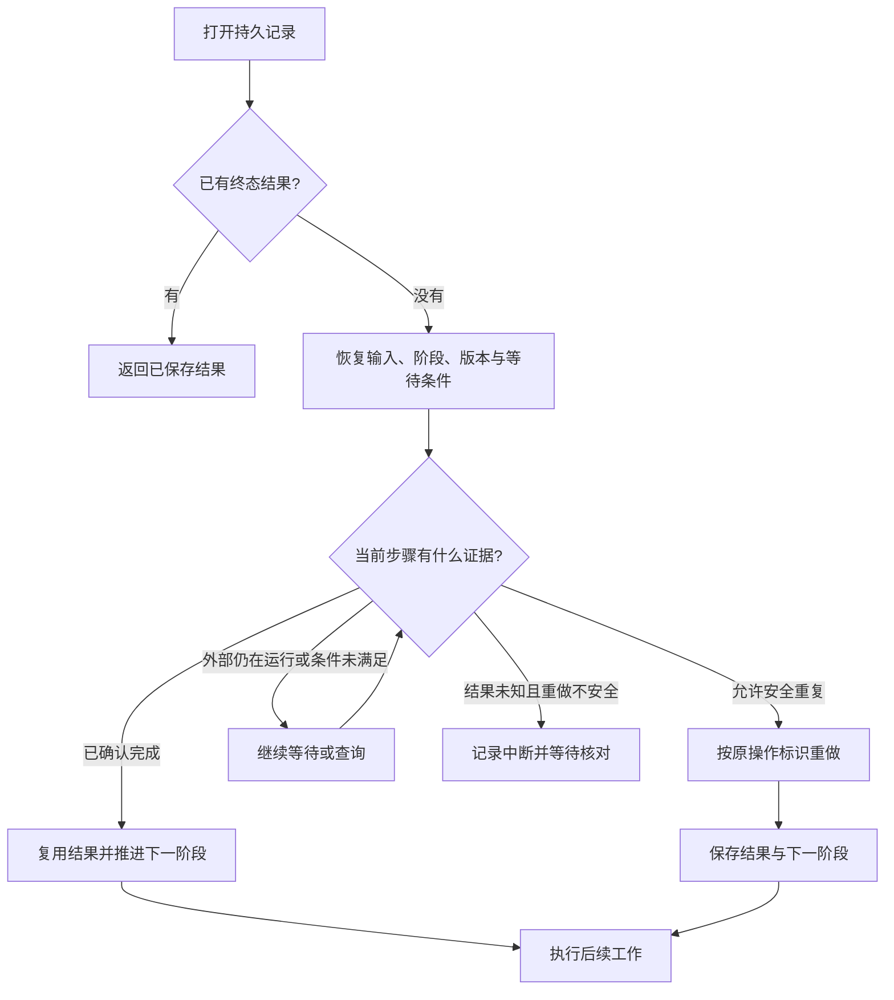

# 第 5 章　持久执行与恢复

[返回目录](README.md) · [上一章：第 4 章 调度与多 Agent 编排](04-orchestration.md) · [下一章：第 6 章 重试、超时与幂等](06-retry-timeout-idempotency.md)

持久执行处理进程中断后的任务恢复：程序需要保存足以确定下一阶段的数据，并核实中断期间可能已经发生的外部操作。本章从检查点的内容与提交边界出发，以配置修改和转账为例说明恢复流程，再讨论代码版本、存储故障范围，以及 Pi 实验 durable 库对自定义任务、模型生成和工具调用的具体处理。

用户要求 Agent 给项目增加模型配置，保留原有配置，并检查加载结果。任务依次读取文件、请求模型生成修改方案、写入配置、运行校验。若进程在校验前退出，磁盘可能已有修改，但内存中的进度已经消失。对于持续几分钟、几小时或等待人工批准的任务，系统需要让后续执行者识别已完成部分，并继续剩余工作。持久执行（durable execution）就是在约定的故障范围内保存这些进度和结果，并规定后续执行者如何使用它们。

前半章用教学设计解释这个过程，不依赖 Pi 的类型或接口；后半章以 Pi 的实验持久任务核对具体实现。任务之间的关系见[第 4 章 调度与多 Agent 编排](04-orchestration.md)，重复调用如何避免重复效果见[第 6 章 重试、超时与幂等](06-retry-timeout-idempotency.md)。

## 5.1 进程退出后的进度损失

进程内存保存局部变量、异步调用的等待状态、计时器和调用栈。调用栈描述当前函数的位置及返回后的执行顺序。进程退出时，这些运行数据随之丢失；新进程即使加载相同代码，也无法据此恢复旧函数的位置。

文件系统和外部服务独立于 Agent 进程运行。进程退出后，已经写入的配置通常仍在磁盘，已经提交的模型请求也可能继续在服务端执行。因此，故障后的状态可能是“本地执行进度丢失，外部效果已经发生”。若恢复程序从头执行全部步骤，就可能重复修改文件、重复产生模型调用费用，或重复发送通知。

会话历史能够说明用户要求、模型输出和工具事件，却未必能够确定恢复动作。例如，最后一条消息要求写入配置，只能证明模型提出了调用；“工具开始”也不能证明写入完成。即使历史中已经有结果，程序仍需将它关联到任务步骤，并识别未完成的工作。

可恢复的执行状态需要明确任务身份、已确认结果、当前阶段及下一阶段的输入。完整的事件记录可以用于推导这些状态，结构化检查点也可以直接保存它们。两种方式都需要确定的解释规则；自然语言对话本身没有规定进程重启后的执行协议。

## 5.2 检查点的内容与恢复条件

检查点（checkpoint）是在明确执行边界保存的一组恢复数据。其完整性取决于后续处理是否仍需旧进程内存：新执行者应能仅凭检查点、任务输入、必要产物和程序代码，确定下一阶段及其参数。任何只能从旧局部变量取得的信息，都需要持久保存或能够可靠地重新取得。

在配置任务中，模型完成修改方案后，执行者保存目标文件、修改内容、原文件版本和稳定操作标识，并将阶段设为“应用修改”。恢复程序因此可以复用生成结果，也能检查文件是否已被其他人修改。收到写入确认后，执行者保存结果并转入校验；校验结束时，将结果与任务终态一起提交。终态表示成功、失败或取消，调度器不再按原流程推进该任务。若结果与终态分开保存，重启后可能出现任务已完成却无结果可读的状态。

下表按用途列出检查点可能需要的内容。具体任务应根据自己的恢复步骤选择字段。

| 恢复所需信息 | 改配置任务中的例子 | 缺少它时会发生什么 |
| --- | --- | --- |
| 任务身份、输入与状态版本 | 哪个项目、哪项用户要求、记录格式版本 | 无法解释记录，或误把另一个任务当作当前任务 |
| 当前阶段及下一步参数 | 应用已生成的修改方案 | 只能重新推理，无法可靠地接着原计划执行 |
| 已确认的结果或持久引用 | 原文件版本、修改后的内容标识、校验输出 | 无法复用已完成工作，也无法核对当前环境 |
| 外部操作标识 | 一次文件更新请求或后台生成的标识 | 无法查询原操作，容易把恢复变成新操作 |
| 等待条件 | 审批记录、依赖任务、下次允许尝试的时间 | 重启后可能过早执行，或永远无人继续 |

检查点不必包含所有产物全文。金额固定的转账只需少量状态；研究报告任务可以保存阶段和持久产物的位置，将大文件放在独立存储中。采用引用时，产物必须在恢复期间保持可访问。临时文件一旦被清理，检查点中保留其路径也无法恢复内容。

图中，新执行者从已提交的阶段、参数和产物继续工作。恢复所依赖的是业务状态，而非原进程的调用栈。


通常不对整个进程进行序列化。网络连接、函数闭包难以跨进程重建，程序升级后旧指令位置也可能不再适用。将“验证这份配置”表示为显式阶段，新进程即可调用该阶段的处理函数，在新的调用栈中完成后续工作。

## 5.3 保存时机与重做范围

检查点粒度决定正常执行的存储成本与故障后的重做范围。只在任务结束时提交，中途故障就没有可复用进度；按极小单位频繁提交，则会增加写入量和等待时间，甚至使提交成本超过实际计算。

适合提交检查点的时机包括取得可复用结果，以及进入较长等待之前。例如，保存模型生成的修改方案可以避免重复生成；在人工审批前记录等待状态，可以让审批跨越进程重启。没有外部效果且计算成本很低的格式转换，则可在恢复时重新计算，无须逐次存储。

外部写操作通常分为三步：先保存操作意图（intent），记录目标、参数和标识；随后发起操作；最后保存结果（outcome）。执行前的记录证明操作已经准备就绪，执行后的记录提供已完成证据。在这两次提交之间退出时，本地可能只剩意图而没有结果，恢复流程必须进一步核实外部状态。

等待条件同样属于恢复状态。服务要求在某个时刻之后重试时，程序应保存绝对截止时间，而不能只创建内存计时器。新执行者读取时间后，计算剩余等待；已经到期则继续执行。若每次重启都等待完整时长，任务会被反复延后；若忽略等待直接执行，则可能违反限流或退避要求。

## 5.4 配置任务的恢复流程

以下教学流程为配置写入引入一个文件更新服务。假定该服务支持按操作标识查询，并能识别同一操作的重复请求。任务存储负责阶段和结果，更新服务负责文件效果；普通本地文件写入不会自动具备这些查询与去重能力。

1. 正常执行者先保存目标文件、预期版本、修改内容和稳定操作标识，把阶段推进为“应用修改”。只有提交成功后，才把请求发送给文件更新服务。
2. 服务写入文件并返回结果。执行者还未来得及把结果写入任务存储，进程退出。此时文件已改变，任务存储仍显示“应用修改”。
3. 新执行者打开持久存储，发现任务尚未进入终态。它不能因为旧记录写着“运行中”就认定旧进程仍在执行。单进程系统可以在重开时重新调度；多个执行者共享任务时，还需要确认旧执行权已经失效，这属于第 7 章的协调问题。
4. 恢复者读取任务输入、检查点、已保存结果和状态版本，找到能解释这些记录的执行代码。若代码或必需产物缺失，就暂停并报告原因，不能猜测下一步。
5. 恢复者按操作标识查询更新服务。若服务确认已经完成，就保存返回的结果并跳过写入；若能安全地重发，则使用原标识重发；若服务仍在执行，就保存等待条件后继续查询。若结果未知且重做不安全，则留下需处理的中断状态，等待人工或专门的核对流程。
6. 修改结果保存成功后，执行者进入校验阶段。校验完成时保存结果与终态。以后再打开任务，直接返回已完成结果，不再执行写入和校验。

恢复程序根据已保存的事实、外部查询结果和重复执行条件，选择复用结果、重新执行、继续等待或转入核对。结果未知应保持为独立状态：它既不证明操作失败，也不证明操作成功。



该图描述单个恢复者的决策。多个执行者共享任务时，还需要独立的执行权协调，才能防止它们同时推进同一任务。

## 5.5 恢复、继续执行与重放

恢复（recovery）包括重新打开存储、检查未完成任务、迁移旧记录、核实外部结果，以及重新安排执行。经过恢复，系统可能确认任务已经完成，也可能允许继续运行，或因证据不足而等待人工处理。

继续执行（resume）表示允许任务从已恢复的进度向前推进。配置例子中，读取记录并核查未知写入结果属于恢复；确认写入后开始校验属于继续执行。系统可将两者分开，使宿主先安装任务代码、检查设置，再开放调度。

重放（replay）的含义取决于重放对象。重新调用未确认完成的步骤，会实际执行读取、文件更新或纯计算；重复效果由工具与服务协议决定。另一类重放则读取历史保存的活动结果，供后续逻辑使用，而不再次调用外部服务。讨论恢复保证时，需要明确采用哪一种行为。

有些工作流系统采用确定性历史回放：执行规则从起点重新运行，遇到过去已经完成的活动时，由历史记录提供当时的结果；执行规则按相同顺序走到尚未完成的地方后，才安排新活动。要让重放走出同一路径，影响分支的时间、随机值和外部结果必须由历史或受控接口提供，代码变化也需要兼容历史。模型活动也要使用当时已记录的结果；重新请求模型可能得到不同答案，使后续逻辑进入另一个分支。

本章主要讲显式状态机恢复。状态机把工作分成命名阶段，由已保存的阶段选择下一段处理代码，因此可以直接从“应用修改”或“校验”继续。它不要求重新执行从起点到当前阶段的所有控制逻辑，但任务作者必须明确设计检查点和迁移规则。两种方式都需要处理外部效果；确定性回放控制逻辑本身，也不会把外部转账纳入本地存储事务。Pi 实验路径采用阶段和检查点来恢复，没有提供通用的确定性历史回放引擎。

## 5.6 外部效果与结果提交的崩溃窗口

转账可以说明本地记录与外部效果之间的差异。执行者先保存“准备转账”和稳定业务标识，再请求服务转账，最后保存服务返回的结果凭证（receipt）。若服务完成转账后、凭证提交前进程退出，本地记录仍只有操作意图，无法判断是否已经转出。

执行者在保存意图后、发送请求前退出，也会留下完全相同的本地记录。两种故障对应不同外部事实：前者已经转账，后者尚未转账。统一跳过会遗漏后者，统一重做则可能使前者重复转账。

调整完成标记的保存顺序不能消除这个窗口。先记完成再执行，可能留下没有实际效果的完成记录；先执行再记完成，可能留下无法确认的已发生效果。本地事务能够共同提交任务终态和结果，但独立转账服务的状态变化不在该事务之内。

幂等调用提供一种可用的解决方式：同一业务操作在恢复和重试时使用同一个标识，服务保存这个标识及结果，再次收到它时返回原结果，不重新应用效果。稳定标识必须在首次调用前确定并保存，恢复时重新生成一个新标识会被服务视为另一笔业务。另一种方式是查询外部 receipt，核对后再推进；查询接口必须能对“已完成”“尚在执行”和“未知”给出足够明确的语义。

只有外部服务实施相应协议，重复调用才能复用原结果而不重复应用业务效果。既不能安全重做、也不能查询结果的操作，应保留不确定状态并交给业务核对或人工处理。第 6 章进一步讨论幂等范围、重试预算和超时的证据限制。

下图分别标出意图提交、外部效果和结果提交。进程在两次本地提交之间退出时，恢复程序需要依赖外部证据确定效果是否发生。


## 5.7 恢复对代码与存储的依赖

任务可能在旧版本程序中开始，在新版本程序中恢复。假设旧记录只有“已修改文件”，新流程却要求先记录原文件版本再校验，新代码就不能将旧字段作为未曾保存的版本证据。状态版本用于识别记录格式；migration（迁移函数）把旧输入与检查点转换成新代码能够解释的结构。迁移需要保留任务已完成的事实、业务标识和等待条件，不能通过生成新标识把同一业务变成另一次操作。

新规则需要的数据不一定存在。此时可以保留能执行旧任务的代码，或阻塞任务直到提供所需信息；具体选择取决于系统是否支持这些方式。迁移函数不能推导出从未记录过的外部效果。状态机的迁移关注阶段及其数据；采用历史回放的系统还要考虑代码变化是否会改变历史活动的顺序或分支。

持久性也必须说明针对什么故障。内存存储能测试状态转换，但进程退出后没有数据。磁盘存储可以在进程重启后读取记录，整机掉电时最新提交能否保留还取决于数据库的同步策略。磁盘损坏或整机永久丢失，又涉及备份、复制及其数据恢复范围。一个后端满足其中一种情况，不代表它覆盖所有情况。

“没有收到提交成功”也可能表示结果未知：后端先成功写入，随后连接断开，执行者就收不到确认。恢复者应重新读取持久记录，按稳定请求标识核对是否已经接收或完成，不能直接假设写入失败。下面的 Pi 案例会说明它如何处理这类错误；事务、WAL 和分布式一致性在[第 7 章 分布式状态与一致性](07-distributed-state.md)展开。

## 5.8 参考实现：Pi 自定义任务的重启恢复

`packages/durable` 提供存储提交、文档版本、任务 checkpoint、工具意图与重开调度。[packages/durable/README.md L1-L7](https://github.com/earendil-works/pi/blob/96abe9a5ad45005cae34ed1c52d42f71fc88bedc/packages/durable/README.md#L1-L7) 将它标为实验库，API 会变化。以下对照基于提交 `96abe9a5ad45005cae34ed1c52d42f71fc88bedc`，稳定 coding-agent 的普通 session 没有自动采用这套持久任务引擎。

恢复测试用假转账服务隔离外部副作用。服务记录调用次数，并按业务 key 保存应用结果，用于验证重复调用和业务去重的关系。

自定义任务以金额作为输入，以 `prepare` 作为初始 checkpoint。准备阶段将金额写入 memo（按名称保存的备忘记录），再提交 `apply` 阶段及由任务 ID 派生的稳定 key。任务 ID 为示意值 42 时，检查点可表示为 `{ phase: "apply", key: "transfer-42" }`；源码使用 `transfer-${task.id}`，恢复测试以 `transfer-${id}` 核对同一标识。

在 `apply` 阶段，处理函数向假服务提交 key 和金额，随后将返回的 receipt 与终态 outcome 一起提交。测试在第一次服务调用完成后注入中断，使数据库仍停留在 `apply`。重开存储时，宿主重新安装任务定义和 settings；打开动作只整理记录，直到调用 `resume()` 才重新调度该阶段。

再次调用时，假服务识别原 key 并返回已有结果，任务随后保存终态。测试因此观察到两次调用、一次业务效果；第三次重开直接读取完成记录。恢复职责分别由两层承担：任务引擎按检查点重新进入阶段，服务按 key 排除重复效果。CPU 指令位置、局部变量、闭包、Promise 和 timer 均未被保存。

| 中断位置 | 本地最后保存的内容 | 重开后的情况 |
| --- | --- | --- |
| apply 检查点提交前 | 仍是之前的任务阶段 | 调度器按之前阶段重新进入处理函数 |
| 检查点之后、服务效果之前 | `phase` 与稳定 key | 任务会再次调用服务；服务需要识别同一 key |
| 服务效果之后、结果提交之前 | 仍只有 `phase` 与稳定 key | 本地无法判断效果是否已经发生；重试可能再次调用服务 |
| 结果与终态提交之后 | receipt 与终态 outcome | 调度器读取完成结果，不再执行该任务 |

服务前与服务后、结果前的两个窗口，在本地数据库里留下相同的 apply 记录。数据库不能仅凭这条记录判断是否转过账。稳定 key 必须交给支持幂等的服务，或者由业务方查询外部 receipt 后核对。这样可以让处理函数重复运行而不重复产生业务效果；如果外部服务既不支持幂等，也无法查询结果，本地记录不能提供 exactly-once 效果保证，即保证所声明范围内的业务效果恰好发生一次。

测试用假服务验证了这一区别：[packages/durable/test/harness-tasks-recovery.test.ts L47-L90](https://github.com/earendil-works/pi/blob/96abe9a5ad45005cae34ed1c52d42f71fc88bedc/packages/durable/test/harness-tasks-recovery.test.ts#L47-L90) 定义服务，[packages/durable/test/harness-tasks-recovery.test.ts L112-L145](https://github.com/earendil-works/pi/blob/96abe9a5ad45005cae34ed1c52d42f71fc88bedc/packages/durable/test/harness-tasks-recovery.test.ts#L112-L145) 覆盖恢复。恢复后 apply 调用次数可以大于一，而 `service.applied` 中的实际效果仍只有一次。

图展示的是工具任务在各个崩溃点保存了什么，以及自定义转账如何按 checkpoint 重进 apply。时间线里的提交指数据库状态提交，外部操作发生在提交之间；图示不提供 exactly-once 保证。


Pi 的 checkpoint 是包含 `{ phase, ... }` 的 JSON 状态，调度器据此选择阶段处理函数。自定义任务可以在其中记录操作意图；工具任务另外保存最终参数和重放策略。outcome 保存成功、失败或取消的结果及终态。这些记录为调度与恢复提供依据，外部效果的确认仍需来自实际执行方。

### 5.8.1 调度器对恢复记录的解释

阶段名称只有结合任务定义才有意义。数据库保存任务类型、版本、checkpoint 和输入；宿主注册表提供对应版本的阶段处理代码。恢复不会从数据库加载可执行的旧函数。

打开时，[packages/durable/src/harness/scheduler.ts L288-L315](https://github.com/earendil-works/pi/blob/96abe9a5ad45005cae34ed1c52d42f71fc88bedc/packages/durable/src/harness/scheduler.ts#L288-L315) 扫描 pending、running、waiting、completing 任务，把遗留的 running 改回 pending，同时保留 checkpoint、input 和 abort mark。之后，[packages/durable/src/harness/scheduler.ts L1317-L1383](https://github.com/earendil-works/pi/blob/96abe9a5ad45005cae34ed1c52d42f71fc88bedc/packages/durable/src/harness/scheduler.ts#L1317-L1383) 根据 `checkpoint.phase` 选择处理函数。函数返回时必须留下持久进展，否则调度器会把任务判为故障，避免原地反复运行。

前面讨论的状态迁移在这里由任务定义提供。调度器在 [packages/durable/src/harness/scheduler.ts L1209-L1236](https://github.com/earendil-works/pi/blob/96abe9a5ad45005cae34ed1c52d42f71fc88bedc/packages/durable/src/harness/scheduler.ts#L1209-L1236) 按 kind/version 查找定义和 migration；缺少定义、当前版本过旧或迁移失败都会阻塞任务，并报告原因。

invocation 指调度器当前启动的一次处理函数执行。`runtime.sleep(until)` 只影响这次执行中的等待。若重开后仍需等到某个时间，应把绝对时间 `until` 写进 checkpoint，再由新 invocation 比较当前时间。内建 generation 的 retry 与 poll 阶段也采用这种方式。其他恢复所需数据应进入 checkpoint、memo、document 或 entry。缺少定义的普通任务仍算活跃，会影响空闲等待；主动取消时可按条件结算为 orphaned。设置 `abandonOnRestart` 的任务在重启取消时会等定义可用，以便执行清理。

## 5.9 参考实现：模型请求重发与后台结果查询

模型生成涉及部分输出、后台响应标识和 HTTP 连接三类状态。Pi 可以在恢复时将已提交的部分输出转入历史；提供方支持后台生成时，也可保存用于查询的 handle（响应句柄）。HTTP 流属于旧进程的连接状态，无法随任务记录恢复，因此普通流式请求需要重发，已保存句柄的后台请求则可以查询。

内建 `GenerationTask` 有 `prepare/request/retry/poll/tools` 五类 phase，定义见 [packages/durable/src/harness/generation.ts L51-L90](https://github.com/earendil-works/pi/blob/96abe9a5ad45005cae34ed1c52d42f71fc88bedc/packages/durable/src/harness/generation.ts#L51-L90)。`request` 保存模型引用、thinking level、流式请求选项和上下文截止位置 `cutoff`；`retry` 保存尝试次数和绝对等待时间 `until`；`poll` 保存 provider 返回的 deferred handle 与 `pollAt`。

流式请求的恢复轨迹是：

```text
prepare → 提交 request checkpoint
→ 发起模型请求 → 节流提交 partial → 进程中断
→ 重新打开并 resume
→ 已提交 partial 转为 stopReason=aborted 的历史 assistant entry
→ 按原 cutoff 重新发起请求 → 保存最终响应
```

重开的 `request` 会建立新模型请求，原 HTTP 连接及其响应流不会恢复。已提交 partial 转成 aborted 历史 entry，供历史和 UI 查看；后续请求不会以它作为前缀继续生成。[packages/durable/src/harness/generation.ts L166-L233](https://github.com/earendil-works/pi/blob/96abe9a5ad45005cae34ed1c52d42f71fc88bedc/packages/durable/src/harness/generation.ts#L166-L233) 中的 `request` phase 会跳过 prepare，但重新运行 `beforeRequest` hooks。hook 可能再次执行，而它当次修改的请求没有完整进入 checkpoint，所以新请求不保证逐字节相同。

| 重开时的 phase | 已保存的信息 | 恢复动作 |
| --- | --- | --- |
| `request` | 请求配置、cutoff、可能已有 partial | 将 partial 记为 aborted，再建立新请求 |
| `retry` | attempt 与绝对 `until` | 等到时间，再发起下一次尝试 |
| `poll` | provider handle 与 `pollAt` | 调用 `fetchDeferred()` 查询原后台响应 |

partial 默认每 100 ms 节流提交到 `LiveDoc.generation.message`，同一时间最多有一个提交进行。[packages/durable/src/harness/generation.ts L353-L420](https://github.com/earendil-works/pi/blob/96abe9a5ad45005cae34ed1c52d42f71fc88bedc/packages/durable/src/harness/generation.ts#L353-L420) 中的 pending、timer、inFlight 留在内存，尚未落盘的增量可能随进程丢失。100 ms 是配置的提交间隔，不构成“最多丢 100 ms”的保证；实际时序还受机器与存储影响。终态处理会停止计时器并等待正在进行的提交完成，避免旧 partial 覆盖最终状态。

延迟响应也有窗口。[packages/durable/src/harness/generation.ts L423-L453](https://github.com/earendil-works/pi/blob/96abe9a5ad45005cae34ed1c52d42f71fc88bedc/packages/durable/src/harness/generation.ts#L423-L453) 的 `classify()` 需要将 handle 与 `phase=poll` 一起提交，重开后才能查询。如果服务已经返回 handle，而进程在提交前退出，数据库仍停在 request，恢复会再发请求。只有持久化的 handle 能用于查询；内存中正在消费的流不会保存下来。

## 5.10 参考实现：工具重放策略与备忘记录

对于模型提出的工具调用，Pi 在执行前决定恢复时是否允许再次调用。[packages/durable/src/harness/tool.ts L155-L185](https://github.com/earendil-works/pi/blob/96abe9a5ad45005cae34ed1c52d42f71fc88bedc/packages/durable/src/harness/tool.ts#L155-L185) 在 execute 前保存最终参数和 replay policy（重放策略），默认值是 unsafe。恢复到 execute 阶段时，只有保存的策略和当前工具声明都为 safe，运行时才重跑。unsafe 或工具已不可用时，运行时会给模型一条 interrupted 错误，并保留已提交输出。

safe 是工具作者对“允许重跑”的承诺，运行时不会证明命令没有副作用。[packages/durable/src/harness/tool.ts L570-L630](https://github.com/earendil-works/pi/blob/96abe9a5ad45005cae34ed1c52d42f71fc88bedc/packages/durable/src/harness/tool.ts#L570-L630) 可以把 transcript result 或 nested-call result 与 task outcome 一起结算；文件写入、HTTP 请求和 shell 命令仍发生在数据库事务之外。

| 中断位置 | 已保存的证据 | 恢复时可能发生什么 |
| --- | --- | --- |
| intent 提交前 | call checkpoint | 重新解析、校验并运行 beforeTool |
| intent 后、effect 前 | execute 参数与 policy | safe 时重跑；unsafe 时报告 interrupted |
| effect 后、outcome 前 | 与上一行相同 | 本地无法判断效果是否发生，仍按 replay policy 处理 |
| outcome 已提交 | terminal receipt 与结果 | 不再执行该 task |

intent 提交后、outcome 提交前，外部效果发生前后都留下同样的本地记录。和转账例子一样，保证业务效果不重复要靠外部系统提供幂等或 receipt 核对。

memo 是 first-writer-wins 的备忘记录，一个名字只保留最先写入的 JSON 值，适合固定随机决定、业务 key 或人工决定，见 [packages/durable/src/harness/scheduler.ts L1584-L1599](https://github.com/earendil-works/pi/blob/96abe9a5ad45005cae34ed1c52d42f71fc88bedc/packages/durable/src/harness/scheduler.ts#L1584-L1599)。但 memo 与外部效果并不原子。[packages/durable/test/examples/13-recovery.ts L27-L45](https://github.com/earendil-works/pi/blob/96abe9a5ad45005cae34ed1c52d42f71fc88bedc/packages/durable/test/examples/13-recovery.ts#L27-L45) 的示例先写 `printed-n`，再调用 console.log。若打印后退出，恢复会跳过第二次打印；若 memo 落盘后、打印前退出，恢复也会跳过，于是打印漏掉。先写 memo 可以避免重复，却可能漏掉尚未发生的效果。

## 5.11 参考实现：检查点提交与存储后端

以下细节用于从源码核对持久记录的形成过程。它们解释本地提交的范围；第 7 章会把事务和 WAL 放进更完整的存储与一致性问题中讨论。

### 5.11.1 提交后的内存状态与观察者通知

恢复依赖一批彼此一致的记录。例如任务变为完成时，结果也必须同时保存；否则重开后会看到“已完成”却没有结果。Transaction（事务）将相关存储变化作为一批提交。Session 还可能同时收到工具结果、新输入和界面读取请求，因此它把提交和需要一致快照的读取排队，避免两个回调各自根据旧状态写入。

这里的顺序也解释了“发布”：成功提交后，再把新状态交给内存中的 tracker、调度器、界面或订阅者。若先通知界面“转账已完成”，再保存结果，进程可能在两者之间退出，界面显示的完成就没有持久记录支持。实现先保存，再采用内存状态，最后发布。

Session 把 commit 与一致快照读取排进同一条 Promise 队列，见 [packages/durable/src/session/session.ts L220-L245](https://github.com/earendil-works/pi/blob/96abe9a5ad45005cae34ed1c52d42f71fc88bedc/packages/durable/src/session/session.ts#L220-L245)；具体排队实现是 [packages/durable/src/session/session.ts L854-L861](https://github.com/earendil-works/pi/blob/96abe9a5ad45005cae34ed1c52d42f71fc88bedc/packages/durable/src/session/session.ts#L854-L861) 的 `#enqueue()`。源码称它为 mutation line，即串行处理状态变化的提交线。它只协调本进程里的会话。转账请求发生在外部系统，不会自动进入这条线或本地事务。

任务回调先改文档草稿，已经发布的值保持不变。[packages/durable/src/session/transaction.ts L671-L692](https://github.com/earendil-works/pi/blob/96abe9a5ad45005cae34ed1c52d42f71fc88bedc/packages/durable/src/session/transaction.ts#L671-L692) 在 callback 成功后封闭事务，检查所有异步 Tx 操作已经完成，再 prepare 文档变化并组装写入批次；失败时 abort 草稿，这批变化不会进入 Storage。callback 内的读取要通过 `tx`。直接调用 Harness 或 runtime 的排队读取，可能排在正在执行的 callback 后面，双方会一直等待。表读取也须在第一次表写入前完成，约束见 [packages/durable/src/session/transaction.ts L922-L939](https://github.com/earendil-works/pi/blob/96abe9a5ad45005cae34ed1c52d42f71fc88bedc/packages/durable/src/session/transaction.ts#L922-L939)。外部 I/O 留在任务处理函数中，避免长时间阻塞提交队列。

Session 的提交流程在 [packages/durable/src/session/session.ts L690-L742](https://github.com/earendil-works/pi/blob/96abe9a5ad45005cae34ed1c52d42f71fc88bedc/packages/durable/src/session/session.ts#L690-L742) 中依次运行 callback 并 prepare writes、调用 `storage.commit(writes, withoutAbortSignal(context))`、用 `tx.adopt(seq)` 更新内存 tracker，再由 `#publish()` 通知 scheduler、view 和订阅者。存储提交成功后，内存才采用候选状态，观察者随后才收到变化。提交一旦准入，即使调用者取消，也会完成存储结算，避免等待取消后无法判断是否落盘。

存储已提交、内存采用候选状态却失败时，内存会落后于数据库，Session 因而失败关闭。普通宿主监听器抛错只会被报告，已持久化的 commit 保持不变。[packages/durable/src/session/session.ts L730-L775](https://github.com/earendil-works/pi/blob/96abe9a5ad45005cae34ed1c52d42f71fc88bedc/packages/durable/src/session/session.ts#L730-L775) 处理这两种提交后的失败。

### 5.11.2 后端保存内容与故障范围

上述记录通过所选 Storage 后端提交。MemoryStorage 提供相同接口与原子语义，但进程退出后数据消失；跨进程恢复需要其他后端，[packages/durable/README.md L630-L639](https://github.com/earendil-works/pi/blob/96abe9a5ad45005cae34ed1c52d42f71fc88bedc/packages/durable/README.md#L630-L639) 列出了差别。

[packages/durable/src/types.ts L703-L748](https://github.com/earendil-works/pi/blob/96abe9a5ad45005cae34ed1c52d42f71fc88bedc/packages/durable/src/types.ts#L703-L748) 定义的 `StorageWrite` 可以在同一批次保存 conversation、entry、task、submission 与 document base/delta。entry 保存不可变的交互记录，task 保存最新完整任务记录，document 保存应用状态。文档可保存完整值（base）和相对前一值的改动（delta）；读取时从 base 开始按顺序应用 delta。

SQLite 后端在 [packages/durable/src/storage/sqlite/storage.ts L175-L198](https://github.com/earendil-works/pi/blob/96abe9a5ad45005cae34ed1c52d42f71fc88bedc/packages/durable/src/storage/sqlite/storage.ts#L175-L198) 的单个数据库事务中检查 ID、写入表和文档，再推进 commit sequence。读取文档时，[packages/durable/src/storage/sqlite/storage.ts L607-L642](https://github.com/earendil-works/pi/blob/96abe9a5ad45005cae34ed1c52d42f71fc88bedc/packages/durable/src/storage/sqlite/storage.ts#L607-L642) 取最新适用的 base 并按顺序应用同版本 delta；版本变化时需要新的 base。

WAL 是 write-ahead log（预写日志）：数据库先记录用于恢复的变更日志，再按数据库机制处理数据页。WAL 帮助本地数据库恢复；是否在断电后保留最新提交还取决于同步设置。进程崩溃、整机掉电和存储损坏是不同的故障范围，不能只凭“使用 SQLite”判断所有持久保证。

| 后端 | 保存方式与故障范围 |
| --- | --- |
| Memory | 进程消失后数据消失；适合测试状态转换 |
| Node SQLite | WAL、`synchronous = NORMAL`；进程崩溃可恢复，掉电或主机故障可能丢失最新 commit |
| JSONL | README 描述 append-only；`fsync: true` 才会在 commit marker 前 flush，历史也保留在内存 |
| Cloudflare SQLite | 依赖一个 SQLite-backed Durable Object 的 storage transaction |

Node 的事务入口和设置分别见 [packages/durable/src/storage/sqlite/node.ts L140-L159](https://github.com/earendil-works/pi/blob/96abe9a5ad45005cae34ed1c52d42f71fc88bedc/packages/durable/src/storage/sqlite/node.ts#L140-L159)、[packages/durable/src/storage/sqlite/node.ts L179-L210](https://github.com/earendil-works/pi/blob/96abe9a5ad45005cae34ed1c52d42f71fc88bedc/packages/durable/src/storage/sqlite/node.ts#L179-L210)。这些后端共享 Storage 接口，具体故障保证由各自实现决定。

### 5.11.3 关闭与存储错误

进程退出也可能来自正常关闭或存储错误。正常 close 在 [packages/durable/src/harness/harness.ts L336-L339](https://github.com/earendil-works/pi/blob/96abe9a5ad45005cae34ed1c52d42f71fc88bedc/packages/durable/src/harness/harness.ts#L336-L339) 与 [packages/durable/src/harness/scheduler.ts L323-L330](https://github.com/earendil-works/pi/blob/96abe9a5ad45005cae34ed1c52d42f71fc88bedc/packages/durable/src/harness/scheduler.ts#L323-L330) 中封闭准入、通知观察者、取消并等待 invocation，最后关闭 Storage。它不会把所有任务写成 aborted。忽略 AbortSignal 的处理函数会使关闭持续等待；强制终止进程会使 Promise 和调用栈一同丢失，重开仍依据存储记录恢复。

Storage 错误的处理见 [packages/durable/src/session/session.ts L1049-L1075](https://github.com/earendil-works/pi/blob/96abe9a5ad45005cae34ed1c52d42f71fc88bedc/packages/durable/src/session/session.ts#L1049-L1075)。Session 会锁定 failure 并关闭，Harness 不会自动重试。后端可能已经落盘后才向调用者抛错，所以没有收到确认不能证明提交没发生。重新打开后可以取回 submission，用相同 requestId 判断此前是否已经准入。

## 5.12 参考实现的覆盖范围

以上恢复机制围绕单进程、单存储中的任务记录与执行选择。更大范围的协调没有在这套库里实现：

- mutation line 只协调本进程里的会话；多主节点共识和跨进程事务协调未实现。
- 等待规则按任务定义是否可运行推进，没有队列自动重试次数策略；任务 lease、分布式抢占、共识，以及多个进程共同持有同一存储的协调也未实现。
- 通用外部副作用的 exactly-once 保证和分布式事务未实现。必须发生的效果需要稳定 intent/key，加上外部幂等调用或 receipt 核对；多个独立系统要同时改变，还需另行设计协调协议。
- 这仍是实验路径；稳定 coding-agent 的各类 session 并没有自动采用它。

## 5.13 源码定位

| 阅读位置 | 覆盖的故障点 |
| --- | --- |
| [packages/durable/test/harness-tasks-recovery.test.ts L291-L425](https://github.com/earendil-works/pi/blob/96abe9a5ad45005cae34ed1c52d42f71fc88bedc/packages/durable/test/harness-tasks-recovery.test.ts#L291-L425) | mark、abort、terminal、reservation 提交前后 |
| [packages/durable/test/harness-tasks-recovery.test.ts L429-L524](https://github.com/earendil-works/pi/blob/96abe9a5ad45005cae34ed1c52d42f71fc88bedc/packages/durable/test/harness-tasks-recovery.test.ts#L429-L524) | 缺定义、版本不兼容、migration 失败与更换定义 |
| [packages/durable/test/harness-tools-recovery.test.ts L109-L163](https://github.com/earendil-works/pi/blob/96abe9a5ad45005cae34ed1c52d42f71fc88bedc/packages/durable/test/harness-tools-recovery.test.ts#L109-L163) | unsafe interrupted；保存策略与当前声明都为 safe 的判定 |
| [packages/durable/test/harness-generation-recovery.test.ts L124-L162](https://github.com/earendil-works/pi/blob/96abe9a5ad45005cae34ed1c52d42f71fc88bedc/packages/durable/test/harness-generation-recovery.test.ts#L124-L162) | 保存 partial、转换为 aborted entry、按原上下文范围重发 |
| [packages/durable/test/harness-generation-recovery.test.ts L201-L228](https://github.com/earendil-works/pi/blob/96abe9a5ad45005cae34ed1c52d42f71fc88bedc/packages/durable/test/harness-generation-recovery.test.ts#L201-L228) | 重开后通过原 handle 查询 deferred 响应 |

若自行验证，从 `packages/durable` 执行 `node ../../node_modules/vitest/dist/cli.js --run test/harness-tasks-recovery.test.ts`。该测试用假外部服务和受控存储制造故障窗口。

## 5.14 本章术语

| 术语 | 含义与范围 |
| --- | --- |
| 检查点 | 在执行边界保存的阶段、参数和恢复依据 |
| 操作意图 | 外部执行前记录的目标、最终参数及操作标识 |
| 结果凭证 | 执行方返回的结果，可用于核实或复用操作结果 |
| 终态 | 任务成功、失败或取消后的完成状态 |
| 状态迁移 | 将旧版本输入和检查点转换为当前定义可解释的数据 |
| 重放策略 | 工具作者声明的重新调用许可；实际幂等性仍由工具与外部系统保证 |
| mutation line | Session 内串行处理提交与一致快照读取的队列 |

## 5.15 练习

可以把转账例子中的检查点前、服务效果前、服务效果后和 outcome 后分别作为中断点，观察测试里的 `service.calls` 与 `service.applied.size`，解释调用次数为何可能多于实际应用次数。再用相同方法分析模型流与工具结果的提交边界。
