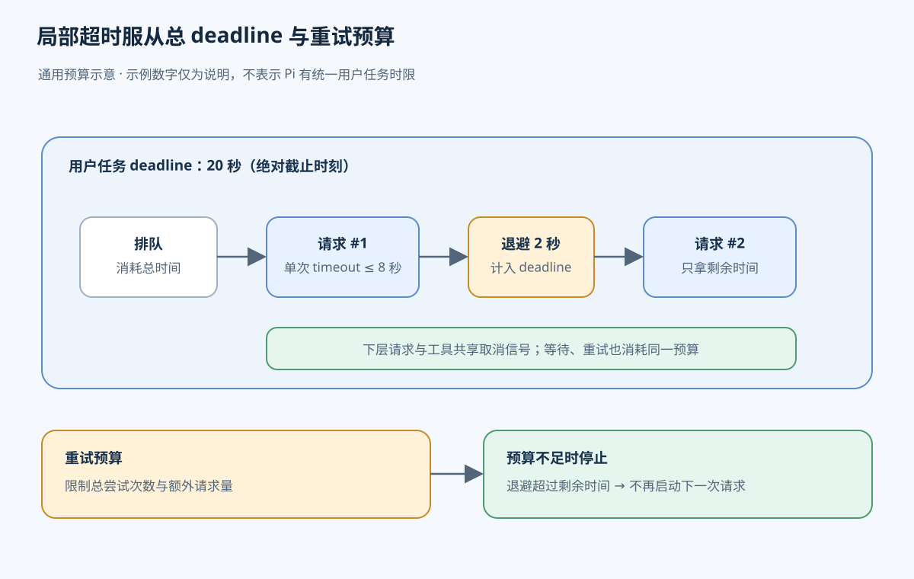
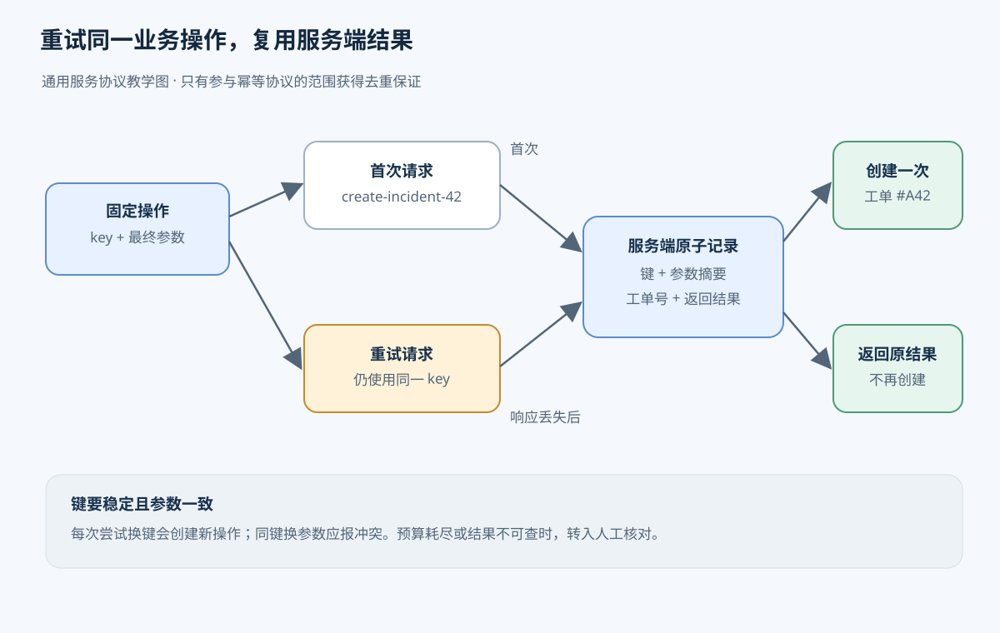
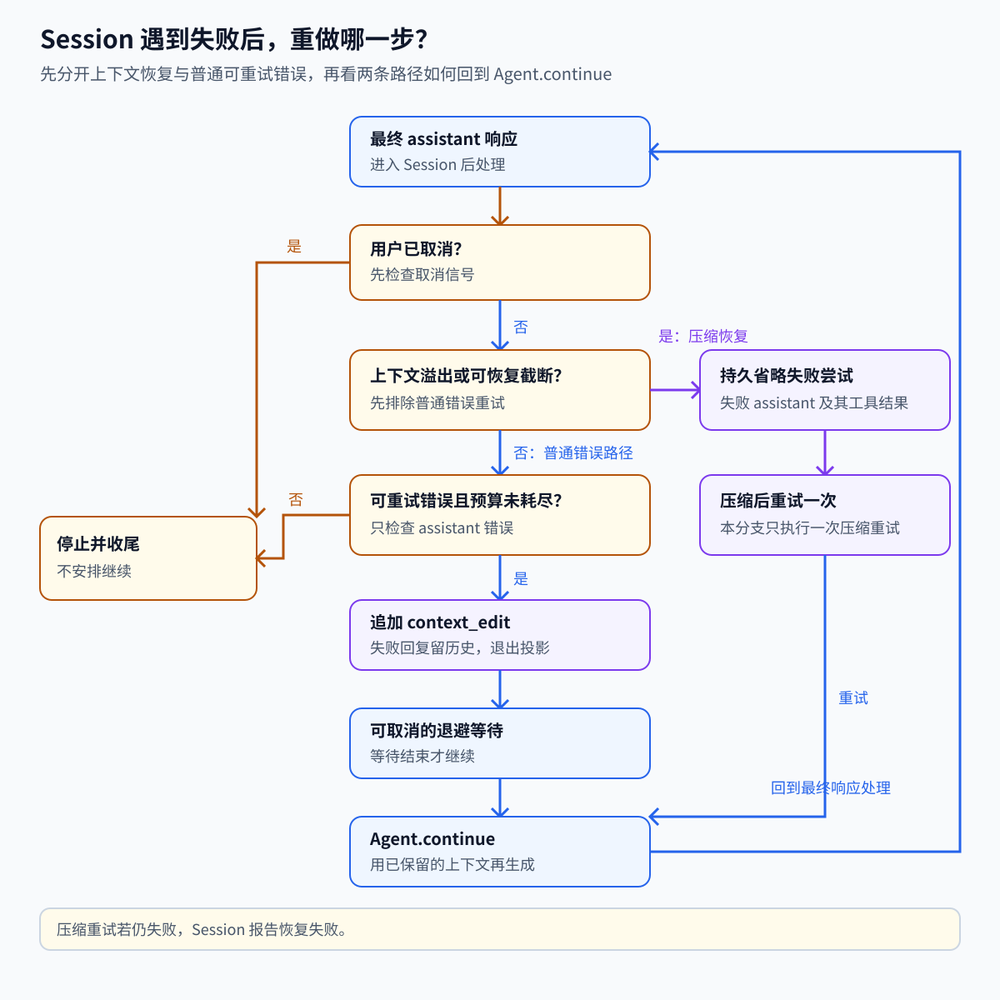

# 06. 重试、超时与幂等：失败后怎样安全继续

[返回学习地图](README.md) · 前置：[Agent 循环](01-agent-runtime.md)、[历史与上下文](02-context-state.md)

用户让 Agent 阅读一份故障报告，并在外部系统创建工单。正常情况下，Agent 读出报告，生成工单内容，向服务发送创建请求，收到工单编号，再把编号保存下来交给用户。若创建工单后连接断开，Agent 屏幕上的“请求失败”可能与服务端已经存在的工单同时成立。此时再创建一次，用户可能得到两张工单；直接结束，又无法告诉用户原工单在哪里。

本章讨论的输入是一项未能正常结束的操作，以及调用方已经保存的执行证据。输出可能是成功结果、等待后再试、修改输入后再执行，也可能是需要核对的未知状态。要选择下一步，必须知道失败发生在哪里、重做会覆盖哪段工作，以及此前的外部效果能否确认。

下面先用创建工单讲通用设计。示例中的操作记录、全局截止时间和服务端幂等协议是教学架构，不能直接当成 Pi 默认已有的功能。后半章再对照 Pi 的普通 Session 重试和实验 durable 路径。

## 失败信息能证明什么

假设工单服务第一次明确返回“当前过载，请稍后再试”，并且接口约定这类拒绝发生在创建之前。调用方知道本次没有创建工单，原参数也没有问题；负载下降后，相同请求有机会成功。这类原因可能自行消失的失败叫临时失败。重试（retry）就是再次尝试选定的操作，希望故障条件已经改变。

如果服务返回“项目不存在”，等待并不会让错误的项目编号变正确。调用方需要修正参数，或者让用户补充正确项目；在这些条件改变前，它属于永久失败。“永久”针对当前请求和当前条件，并不意味着服务永远不可用。权限不足、参数不合法、余额或配额耗尽也要根据实际原因处理，不能仅因它们带有错误码就反复发送。

第三种情况更难：请求发出后，调用方一直没有收到响应。服务可能根本没收到，也可能已创建工单，只是响应丢失。调用方目前只能判定结果未知。未知描述的是证据不足；即使网络中断本身是临时故障，也不能由此推出重新创建是安全的。错误分类因此要回答两个问题：相同操作再做一次是否可能成功，以及前一次操作是否可能已经成功。

状态码和错误文本能帮助判断，但应以接口协议和操作语义为依据。例如，一个服务明确拒绝创建，比一条笼统的“连接关闭”提供了更强的证据。调用方至少要保存操作标识、最终参数、尝试记录以及收到的结果，才能在进程退出后继续判断。只保存一条“失败”日志，会把“明确未执行”和“可能已执行”混在一起。

## 重试哪一段，决定了什么会重复

创建工单这项任务包含读取报告、生成内容和调用外部接口。若读取暂时失败，可以重试读取；若模型生成解释时中断，可以重新生成；若工单创建的结果未知，就应先处理这个外部操作的状态。把整个任务从头再跑一遍，会让前面已经成功的步骤一起重做。

因此，要先划定重试范围：一次网络请求、一轮模型生成、一个工具操作，或者一整项工作流。范围内的代码会再次执行，范围外的已知结果应当复用。重新生成模型输出也可能得到不同内容，所以“同一项创建工单操作”的参数最好在第一次发送前固定下来。若重试期间模型把标题或所属项目改了，就需要先判断这是否已经成为另一项业务操作。

只读操作通常较容易重试，因为它不主动改变外部状态，但两次读取仍可能看到不同版本。写操作需要更严格地分析重复效果。“把状态设置为关闭”重复执行后可能仍是关闭；“增加一张工单”每次执行都会多出一张。是否安全取决于具体操作及服务协议，不能只看工具名或 HTTP 方法。

## 给重试次数和等待时间共同设限

即使临时失败值得重试，也必须有结束条件。假设教学示例允许初次尝试之外再试两次，单次请求最多等待 8 秒，并要求整项任务在开始后的 20 秒内结束。这里有三个不同限制：重试次数限制请求数量，单次超时（timeout）限制一次等待，总截止时间（deadline）限制整个任务持续多久。具体数字只是示例配置。

假设前两次都等满 8 秒，中间退避用了 2 秒，那么最后一次开始前只剩 2 秒。调用方要把剩余时间传给下层请求，或判断剩余时间不足而结束，不能重新给最后一次完整的 8 秒。总截止时间也应覆盖排队、退避和子调用；否则每一小步都遵守自己的超时，整项任务仍可能让用户等很久。

次数预算和时间预算各有用途。响应很快的错误可能在短时间内产生大量请求，次数上限可以限制这种消耗；次数很少但每次都很慢，则需要截止时间约束。新一次尝试开始前应重新检查错误是否仍可重试、次数是否有余量、截止时间是否已到，以及任务是否被取消。任务跨进程恢复时，需要保存这些预算的有关状态，否则重启会把预算重置。

等待本身也需要设计。服务因过载拒绝请求时，所有客户端立即重发，会进一步增加负载。退避（backoff）是在失败后等待再发；指数退避让等待逐次增大，例如等待约 1 秒、2 秒、4 秒，并设置最大等待值。较短的第一次等待有利于尽快恢复，后续更长的间隔给持续故障留出恢复时间。

如果大量客户端都按相同节奏等待，它们还会在下一秒一起醒来。随机抖动（jitter）会在等待时间中加入随机差异，分散再次到达的请求。服务给出等待提示时，应结合提示和剩余截止时间决定下一步：若建议等待的时间已经超过预算，就结束本次自动恢复。退避让恢复变慢，换来更低的额外负载；它无法修复持续超出服务能力的请求量。

多个重试层还会放大次数。若外层允许总共 3 次尝试，每次里面的请求层也允许 3 次，持续失败时就可能发出 9 次请求。更多层都这样做，就会形成重试风暴：服务越慢，客户端制造的额外请求越多。设计时应明确由哪层负责哪些故障，把总截止时间向下传递，并对总请求数或整体重试流量设限。局部重试便于处理局部错误，但不能从各层都有上限推导出全局消耗很小。

总截止时间覆盖排队、退避和子调用，各层应使用剩余时间并共享重试预算。下图用示例时长说明预算如何逐步耗尽，不代表 Pi 默认设置。



## 超时和取消为什么不能证明操作没发生

回到工单创建：客户端在第 8 秒超时，而服务在第 7 秒已经保存工单。超时描述的是客户端没有及时拿到结果，服务端的保存不会因为客户端停止等待而自动撤销。即使服务尚未完成，它也可能在客户端超时后继续处理。

取消是调用方主动要求停止当前工作。它可以来自用户点击停止，也可以来自总截止时间到期。为了尽快停止无用工作，取消信号应从任务传到等待退避的代码、模型请求和正在执行的工具。等待函数收到信号后不再启动下一次尝试；本地工具应停止运行并清理资源；下层服务只有在协议和实现支持时才会响应取消。

取消需要每层配合。丢弃一个等待结果，并不一定终止产生该结果的工作；终止 shell 进程，也无法收回它此前已经发出的邮件或写入的文件。远端可能在取消到达前提交结果，取消响应与成功响应也可能交错到达。因此，用户不再等待之后，系统仍可能需要保存迟到结果，或者把操作交给恢复与核对流程。

这时应该向用户报告“停止等待，创建结果待确认”，而不是凭超时把它记成“确定没有创建”。明确保留未知状态，才能避免后续执行者将它当成一项全新的创建请求。

## 同一项操作重试时，怎样避免重复创建

幂等（idempotency）指同一操作重复请求后，业务效果与只执行一次相同。工单创建本来会不断新增记录；若服务支持幂等键，调用方可以为这次业务操作生成稳定标识，例如 `create-incident-42`，并在第一次发送之前把它和最终参数保存下来。此后因为断线而再次尝试时，仍使用同一个键。用户确实要创建另一张工单时，才生成新键。

键要标识业务意图，不能每次网络尝试都重新生成。否则服务看到的每次请求都像新操作，无法去重。反过来，把某个用户的所有请求都固定为一个键，也会把后续合法的新工单误当成重复。操作标识的生命周期需要跟随业务操作，而不是连接、进程或模型回复。

服务收到键后，要在约定的去重范围内检查它是否已经处理过。例如，键可以只在同一租户、同一种接口中唯一，不能假定它在所有账户和所有服务间通用。服务还要比较参数：同一个键携带不同项目或不同工单内容时，应拒绝或明确报告冲突，不能悄悄复用一个语义不同的旧结果。

对于由服务自己保存的工单，常见做法是在同一原子提交中登记键、创建工单并保存返回结果。原子提交表示这些关联更新要么一起生效，要么一起不生效。重复请求发现该键已完成，就返回原工单编号；发现它仍在处理中，则等待或返回可查询的处理中状态。两个相同键的并发请求也必须由服务协调，不能都先查到“没有”，然后分别创建。

去重记录和业务效果若各自提交，仍会留下崩溃窗口：先创建后记键，进程可能在两步之间退出，下一次又创建；先记键后创建，进程退出后可能永远没有实际工单。若业务效果还要交给另一个外部系统执行，同一数据库事务也包不住那次外部请求，必须继续依靠下游协议或结果核对。幂等能力的保证只覆盖真正参与协议的范围。

结果缓存也有用途。服务保留原工单编号和返回内容后，重试不仅避免再创建，还能取得第一次操作的结果。调用方需要知道这些记录保存多久；若去重记录已经过期，过了很久再用旧键重试也可能重新创建。保留期限应覆盖业务允许的重试与恢复窗口，超出窗口时改为查询或人工核对。

在开头的故障中，调用方先保存键和参数，再发送创建请求；服务提交工单与该键的结果，但返回途中连接断开。调用方超时后仍保留同一键，检查重试预算并退避，然后查询操作状态，或按照服务协议带同一键重新提交。服务返回已经创建的工单编号，调用方保存结果并向用户完成交付。服务端保存的去重与结果记录，为这次恢复提供了依据。

下图把“响应丢失”与“创建失败”区分开：相同业务键让服务返回第一次保存的结果，不再创建第二张工单。这是通用幂等协议示意。



## 没有可靠去重接口时，怎样结束未知状态

有些服务没有幂等键，但允许用调用方提供的唯一业务编号查询。恢复者可以先查询，找到匹配结果就复用。查不到时仍需理解查询的保证：如果读取会延迟看到新记录，“暂时没查到”不能证明原请求没有执行；若原请求还在处理中，此刻重新创建也可能和它同时成功。只有服务协议能提供足够证据时，才自动重做。

邮件就是需要明确范围的例子。邮件服务若按稳定发送 ID 去重并保存结果，调用方可以依约恢复；仅在本地记一条“准备发送”，无法证明收件人是否已经收到。结果未知时再次发送可能产生重复邮件，应该先查服务侧记录。查询仍不能消除疑问时，保留收件人、内容摘要、发送 ID 和时间，交给人工核对是否需要补发。

`git push` 也要按具体结果判断。将同一个提交推到同一个远端引用，在引用已到达目标时，再次推送通常不会再创建一份提交。但连接中断后，仍需读取远端引用，核对预期提交是否已经到达；远端引用也可能又被其他人推进。发布脚本如果还会创建资源、发通知或触发外部动作，应分别核对这些效果，不能从引用更新的状态推出整段脚本都安全完成。创建云资源同样应优先按操作 ID 或唯一标识查找原资源，避免换一个随机名字再创建。

当预算耗尽、去重记录失效，或者查询证据不足以排除重复效果时，可以停止自动重试并进入人工对账。对账是把本地操作记录与外部事实逐项核对，决定是否复用结果、补做或处理重复。它需要保留原操作和证据，而不只是报一个“失败”。若已经产生重复，撤销或删除也是新的业务操作，需要单独确认是否允许以及会造成什么后果。

## Pi 案例：文件已经读到了，解释中断后怎样接着完成

Pi 的默认 CLI 可以演示模型生成层的重试。模型先调用读取文件的 read 工具，成功后，Agent 把读取结果（`toolResult`）加入会话；下一次模型请求开始解释文件，连接却在输出中途断开。Agent 的执行循环收到一条以 error 结束的模型回复（assistant 消息），于是结束本次运行。它不会执行这条错误回复中的工具调用。

Session 接着检查这条回复是否属于可重试错误，以及预算是否还有余量。此时已有的成功证据是 read 的结果，失败范围是后一轮模型生成。Session 保留失败回复在会话历史中，并追加 `context_edit`，把它从下一次模型请求的上下文投影中省略。投影是从保存的历史中选出本次要发送给模型的内容；失败经过仍可查看，半截解释则不再作为有效回答传入下一次请求。

准备重试后，Session 记录尝试并退避等待，避免服务还在过载时立即连续请求。等待期间可以取消；错误不可重试、预算耗尽或等待被取消时，都不会开始新请求。等待结束且运行仍有效，外围循环调用 `Agent.continue()`，重新请求模型。read 的成功结果仍在上下文中，所以模型可以直接完成解释。自动重试不会重跑 read；新模型回复仍可主动要求再次读取。

新请求成功后，这条恢复路径结束；若又收到可重试错误，Session 会按同一规则继续，直到成功、取消或耗尽预算。一次恢复的记录顺序如下：

```text
模型 #1 → read 调用 → read 成功 → toolResult 已保存
模型 #2 → 部分文本 → 网络 terminated → assistant error 已保存
Session 追加 context_edit，省略失败的 assistant #2
等待退避 → Agent.continue()
模型 #3 读取已有 read 结果，重新生成解释
```



图中还画了取消和上下文压缩分支；上面的 read 例子对应其中普通 assistant 错误重试的路径。压缩恢复的条件见源码补充。

## Pi 的三种错误由不同层处理

一次 Agent 运行会经历建立请求、接收模型回复和执行工具。相同的“超时”字样出现在不同结果里，会交给不同代码处理；由谁处理又决定了哪一段会被重做。下面的三层不能合并成一个“发生错误就重试”的规则。

### 请求没有建立成功

Provider 是模型服务提供方。请求层在拿到模型回复之前就可能遇到网络错误或服务端状态码。`retryProviderRequest()` 会按状态和响应头决定是否重新建立请求，并在尝试之间退避。这个重试发生在一次 assistant 回复形成之前，具体状态码、头字段顺序与等待上限见源码补充。

如果连接在响应到达前断开，本地没有收到回复；服务端是否已经处理请求，取决于断开时请求传到了哪一步。请求层重试能处理短暂故障，不能单凭本地错误证明服务端没有收到请求。

请求一旦收到响应，读取响应体时再发生的中断会变成最终 assistant error，交给上一节所说的 Session 路径。OpenAI Responses 适配器会关闭 SDK 自带重试，由项目的请求重试函数处理建立请求阶段；响应体读取失败不会返回给该函数，因此不会继续走同一层请求重试。

### 模型回复以错误结束

assistant 回复中的可重试错误由 assistant 重试策略分类。Session 在整次运行结束后再检查这条错误，必要时记录失败、从后续投影中省略并继续请求。配额或账单耗尽等确定性问题会被排除；错误文本启发式可能识别过载、限速、5xx、DNS、连接中断、超时和提前 EOF。错误描述因服务而异，所以文本分类不保证覆盖所有服务。

这条路径重做模型生成，不会自动重放之前成功的工具。请求层和 assistant 层各有预算，一次 Session 恢复可能在每次生成中再触发多次底层请求；项目没有统一的整项用户任务时限或总重试预算。

### 工具返回 `isError`

普通工具失败会作为 `toolResult.isError=true` 交给模型。模型可以根据错误结果选择解释、修正参数或提出新的工具调用；常规 Agent 循环不会因此自动重复执行同一工具。错误文本里即使有“timeout”，它仍是工具结果，不会因此变成 assistant 错误。

## 普通 Session 保存历史，但不会接管崩溃中的重试

Pi 的取消信号可以中止等待和正在配合取消的执行路径。Shell 超时可以终止进程树，但进程退出之前可能已经写文件或调用服务。因而这里也需要前面讲过的证据边界：本地停止后，外部效果仍可能需要查询。

普通 `AgentSession` 的重试计数和等待中的 AbortController 属于运行时内存状态。重新打开 JSONL 会话可以重建历史及省略关系，却不会恢复原来的退避计时或接管未完成的工作流。超时与取消也没有统一的“整项用户任务最多 N 秒”设置。

## 实验 durable 怎样处理执行结果未知

若需要进程重启后恢复工具任务，可以对照 Pi 的实验 durable 路径；它与重新打开普通 JSONL 会话是不同机制。沿用创建工单的例子，服务已经完成创建，本地进程却在保存工具结果前退出。恢复者看到的执行记录，必须把“想要执行”和“已经取得结果”区分开。付款工具也有相同窗口：付款成功后、本地保存结果前退出，重跑可能重复付款，直接跳过又可能漏付。此类业务仍需要稳定操作 ID、外部服务去重或对账接口。

durable（持久执行运行时）把工具调用拆成执行意图 `intent` 和执行结果 `outcome`。意图记录说明运行时准备按哪些最终参数执行，结果记录说明它已经拿到什么。运行时先保存最终参数与重放策略，再执行工具，完成后保存结果和任务终态。崩溃后系统根据最后一个已提交的阶段判断能做什么：

| 崩溃位置 | 本地存储能证明什么 | 恢复时的行为 |
| --- | --- | --- |
| intent 提交之前 | 仍在 `call` 阶段 | 可重新准备参数和运行 beforeTool；hook 自身副作用也可能重复 |
| intent 之后、execute 之前 | 只知道计划执行 | safe 可重跑；unsafe 报告未知，即使工具可能尚未开始 |
| execute 产生效果后、outcome 之前 | 仍只有 execute intent | safe 可能重复效果；unsafe 不重跑，但无法确认效果是否成功 |
| outcome 已提交 | 结果和任务终态已保存 | 复用已保存结果，不再执行已结束的任务 |

恢复到 `phase=execute` 时，只有已保存的重放策略和当前工具策略都为 `safe`，durable 才会重跑。两份策略分别来自原执行意图和恢复时的工具定义；检查两者可以避免仅凭后来放宽的策略去重跑原先没有承诺安全的操作，也避免在当前策略已收紧时沿用旧许可。默认策略是 `unsafe`，此时会返回 interrupted 错误并提示效果可能已经部分发生。即使真实情况是工具尚未开始，只有 intent 的本地记录也无法证明这一点。

`safe` 是工具作者允许重放的声明，运行时据此决定是否再次调用。要把创建工单声明为安全，工具作者仍须保证重复执行不会多建工单，例如把原来保存的业务操作键继续传给支持去重的服务。声明本身不会创建服务端幂等协议；错误地标为 `safe` 仍可能产生重复效果。

结果和任务终态在 `settle()` 的同一次本地提交中写入，但 `tool.execute()` 以及外部 HTTP 或 shell 效果发生在这次提交之前。事务只保护本地结果记录，不会把外部操作纳入本地事务。工程讨论中的 exactly-once 通常要求在声明的范围内只有一次业务效果；调用尝试仍可能发生多次，要说明重复效果由哪一层排除。Pi durable 不提供通用 exactly-once 保证，未知的外部效果仍要按业务协议恢复。

## 源码补充

### 请求重试的判断与退避

`retryProviderRequest()` 先检查 `x-should-retry` 的明确指示；没有该指示时，无状态码网络错误以及 408、409、429、5xx 可重试，调用方还可排除状态码。退避优先采用 `retry-after-ms`，再看 `retry-after` 的秒数或日期；没有服务端提示时，从 0.5 秒指数增长到 8 秒，并乘以 0.75 到 1 的随机系数。服务端等待超过默认 60 秒上限会直接抛错；将上限设为 0 会禁用这个限制。

OpenAI Responses 适配器将 SDK 的 `maxRetries` 设为 0，再由项目函数包住 `responses.create(...).withResponse()`。收到响应后才读取响应体；读取中途失败会成为最终 assistant error，而不会返回请求建立函数。函数未收到 `maxRetries` 时取 0；类型注释提到的 SDK 原生默认两次不适用于这一层。

### assistant 重试预算与上下文压缩

`retryAssistantCall()` 只处理最终 `AssistantMessage` 中被判为可重试的错误。正常回复、aborted 和确定性错误直接返回。`maxRetries=3` 表示一次初始调用加最多三次重试；每次重试依次触发 `onRetryScheduled → sleep → onRetryAttemptStart → produce`。只有确实安排过重试时才触发 `onRetryFinished`。若 `produce()` 本身抛异常，函数会向外传播，不会把异常变成消息再试。退避为 `baseDelayMs * 2^(attempt-1)`，每次不超过 `maxAgentDelayMs`，默认 60 秒；这里没有请求层的随机抖动。此处上限设为 0 表示等待 0 秒，与请求层的 0 不同。

上下文过大时，重复发送相同输入仍会失败。Session 会改走一次压缩后重试，失败 assistant 及其工具结果会按恢复分支省略；再失败则报告恢复失败。若回答已经成功，只是 usage 越界，压缩的是后续上下文，已完成回答仍保留。普通 `length` 结果不是 assistant error；摘要层会判定它不完整并拒绝保存，assistant 重试函数本身不会重新生成截断摘要。

### Session 历史与事件

低层循环遇到 error 或 aborted 后结束本次运行，不执行错误回复中的工具。`AgentSession._handlePostAgentRun()` 决定是否重试；外围循环准备成功后调用 `agent.continue()`。因此，同一个 Session 输入可以经历多次 `agent_end`，最后才发出 `agent_settled`。

`_prepareRetry()` 增加尝试计数、检查预算、发出 `auto_retry_start`，调用 `_omitRecoveryAttempt()`，再进入可取消等待。省略操作追加 `context_edit(targetId, null)`：失败回复仍在 Session 树中，但退出模型投影。摘要生成也使用 assistant 重试策略，不过有自己的局部预算，不与对话尝试合并。

### durable 嵌套调用

嵌套工具按父任务下的 key 复用已有子任务。例如，父任务准备完报告后调用一个创建工单的子工具；父任务恢复时用相同 key 找回这个子任务，就能复用已保存的完成结果。相同 key 必须始终对应相同工具和参数；默认 key 来自调用顺序，若重试时控制流可能变化，显式稳定 key 更可靠。

这个 key 的去重范围是父任务内的子任务记录。若子任务只有执行意图、尚未保存工单编号，找回子任务仍然会遇到外部创建结果未知的问题，需要继续按重放策略和外部服务协议处理。因此它避免重复创建同一子调用，不能替代外部服务的幂等协议。durable 的 `safe/unsafe` 重放策略也不同于 `AgentTool` 类型的 `safe/never`；常规 Agent 循环不会读取后者来做崩溃恢复。

## 测试与练习

先不用源码，推演一次工单恢复：服务已创建工单，本地只有键和参数，响应丢失后还剩一次尝试。分别假设服务支持幂等键、只支持延迟可见的查询、完全没有查询接口，说明每种情况下谁能提供什么证据，以及何时应停止自动执行。再把服务建议的等待时间设为超过任务剩余时间，判断是否还应该发起下一次请求。能够回答这些问题后，再对照 Pi 的具体恢复边界。

可检查 quota 不重试、取消与次数预算、服务端等待上限、Session 多次 `agent_end`、safe/unsafe 恢复及 intent 前 hook。练习时把“read 成功、assistant 连续两次失败、第三次成功”代入历史树和模型投影，再用 faux responses 验证省略记录；随后对照 durable 的 `started → close → reopen` 与提交边界，判断 `runs=1` 和 `runs=2` 分别意味着什么。无需真实模型服务。

在 `packages/ai` 下运行原定向命令 `node ../../node_modules/vitest/dist/cli.js --run test/retry.test.ts test/provider-retry.test.ts`；在 `packages/coding-agent` 指定 `test/suite/agent-session-retry-events.test.ts`，在 `packages/durable` 指定 `test/harness-tools-recovery.test.ts -t "reruns a tool only"`。这些用例使用模拟错误、faux provider 或本地 SQLite，不需要真实模型服务。

## 源码位置与延伸阅读

- 请求重试判断：[provider-retry.ts 判断](https://github.com/earendil-works/pi/blob/96abe9a5ad45005cae34ed1c52d42f71fc88bedc/packages/ai/src/utils/provider-retry.ts#L11-L37)、[状态码判断](https://github.com/earendil-works/pi/blob/96abe9a5ad45005cae34ed1c52d42f71fc88bedc/packages/ai/src/utils/provider-retry.ts#L107-L128)、[退避](https://github.com/earendil-works/pi/blob/96abe9a5ad45005cae34ed1c52d42f71fc88bedc/packages/ai/src/utils/provider-retry.ts#L39-L69)、[初始化默认值](https://github.com/earendil-works/pi/blob/96abe9a5ad45005cae34ed1c52d42f71fc88bedc/packages/ai/src/utils/provider-retry.ts#L99-L117)、[等待与取消](https://github.com/earendil-works/pi/blob/96abe9a5ad45005cae34ed1c52d42f71fc88bedc/packages/ai/src/utils/provider-retry.ts#L77-L97)
- Provider 实例：[OpenAI Responses](https://github.com/earendil-works/pi/blob/96abe9a5ad45005cae34ed1c52d42f71fc88bedc/packages/ai/src/api/openai-responses.ts#L178-L231)、[模型请求选项](https://github.com/earendil-works/pi/blob/96abe9a5ad45005cae34ed1c52d42f71fc88bedc/packages/ai/src/types.ts#L156-L210)
- assistant 重试：[错误分类](https://github.com/earendil-works/pi/blob/96abe9a5ad45005cae34ed1c52d42f71fc88bedc/packages/ai/src/utils/retry.ts#L7-L107)、[分类入口](https://github.com/earendil-works/pi/blob/96abe9a5ad45005cae34ed1c52d42f71fc88bedc/packages/ai/src/utils/retry.ts#L243-L257)、[控制流程](https://github.com/earendil-works/pi/blob/96abe9a5ad45005cae34ed1c52d42f71fc88bedc/packages/ai/src/utils/retry.ts#L191-L241)、[退避计算](https://github.com/earendil-works/pi/blob/96abe9a5ad45005cae34ed1c52d42f71fc88bedc/packages/ai/src/utils/retry.ts#L109-L132)
- Session 与压缩：[低层循环](https://github.com/earendil-works/pi/blob/96abe9a5ad45005cae34ed1c52d42f71fc88bedc/packages/agent/src/agent-loop.ts#L245-L270)、[Session 继续](https://github.com/earendil-works/pi/blob/96abe9a5ad45005cae34ed1c52d42f71fc88bedc/packages/coding-agent/src/core/agent-session.ts#L1822-L1891)、[准备重试](https://github.com/earendil-works/pi/blob/96abe9a5ad45005cae34ed1c52d42f71fc88bedc/packages/coding-agent/src/core/agent-session.ts#L1237-L1253)、[省略历史](https://github.com/earendil-works/pi/blob/96abe9a5ad45005cae34ed1c52d42f71fc88bedc/packages/coding-agent/src/core/agent-session.ts#L3758-L3802)、[摘要重试](https://github.com/earendil-works/pi/blob/96abe9a5ad45005cae34ed1c52d42f71fc88bedc/packages/coding-agent/src/core/compaction/compaction.ts#L612-L639)、[事件转发](https://github.com/earendil-works/pi/blob/96abe9a5ad45005cae34ed1c52d42f71fc88bedc/packages/coding-agent/src/core/agent-session.ts#L3715-L3744)、[摘要长度检查](https://github.com/earendil-works/pi/blob/96abe9a5ad45005cae34ed1c52d42f71fc88bedc/packages/coding-agent/src/core/compaction/compaction.ts#L581-L593)、[错误分类](https://github.com/earendil-works/pi/blob/96abe9a5ad45005cae34ed1c52d42f71fc88bedc/packages/coding-agent/src/core/agent-session.ts#L3705-L3713)、[压缩恢复](https://github.com/earendil-works/pi/blob/96abe9a5ad45005cae34ed1c52d42f71fc88bedc/packages/coding-agent/src/core/agent-session.ts#L2977-L3046)、[普通工具结果](https://github.com/earendil-works/pi/blob/96abe9a5ad45005cae34ed1c52d42f71fc88bedc/packages/agent/src/agent-loop.ts#L821-L857)、[运行时字段](https://github.com/earendil-works/pi/blob/96abe9a5ad45005cae34ed1c52d42f71fc88bedc/packages/coding-agent/src/core/agent-session.ts#L402-L417)
- durable 与工具：[类型策略](https://github.com/earendil-works/pi/blob/96abe9a5ad45005cae34ed1c52d42f71fc88bedc/packages/agent/src/types.ts#L479-L498)、[工具阶段](https://github.com/earendil-works/pi/blob/96abe9a5ad45005cae34ed1c52d42f71fc88bedc/packages/durable/src/harness/tool.ts#L64-L67)、[意图提交](https://github.com/earendil-works/pi/blob/96abe9a5ad45005cae34ed1c52d42f71fc88bedc/packages/durable/src/harness/tool.ts#L123-L185)、[执行与结果](https://github.com/earendil-works/pi/blob/96abe9a5ad45005cae34ed1c52d42f71fc88bedc/packages/durable/src/harness/tool.ts#L391-L428)、[settle](https://github.com/earendil-works/pi/blob/96abe9a5ad45005cae34ed1c52d42f71fc88bedc/packages/durable/src/harness/tool.ts#L570-L630)、[嵌套调用 key](https://github.com/earendil-works/pi/blob/96abe9a5ad45005cae34ed1c52d42f71fc88bedc/packages/durable/src/harness/tool.ts#L281-L285)、[key 复用](https://github.com/earendil-works/pi/blob/96abe9a5ad45005cae34ed1c52d42f71fc88bedc/packages/durable/src/harness/tool.ts#L360-L387)、[子任务复用](https://github.com/earendil-works/pi/blob/96abe9a5ad45005cae34ed1c52d42f71fc88bedc/packages/durable/src/harness/tool.ts#L656-L718)
- 超时实现：[Agent 取消](https://github.com/earendil-works/pi/blob/96abe9a5ad45005cae34ed1c52d42f71fc88bedc/packages/agent/src/agent.ts#L335-L352)、[Session abort](https://github.com/earendil-works/pi/blob/96abe9a5ad45005cae34ed1c52d42f71fc88bedc/packages/coding-agent/src/core/agent-session.ts#L2431-L2451)、[shell 默认与设置](https://github.com/earendil-works/pi/blob/96abe9a5ad45005cae34ed1c52d42f71fc88bedc/packages/coding-agent/src/core/tools/bash.ts#L27-L43)、[shell 进程终止](https://github.com/earendil-works/pi/blob/96abe9a5ad45005cae34ed1c52d42f71fc88bedc/packages/coding-agent/src/core/tools/bash.ts#L124-L163)
- 测试：[retry](https://github.com/earendil-works/pi/blob/96abe9a5ad45005cae34ed1c52d42f71fc88bedc/packages/ai/test/retry.test.ts#L137-L285)、[provider retry](https://github.com/earendil-works/pi/blob/96abe9a5ad45005cae34ed1c52d42f71fc88bedc/packages/ai/test/provider-retry.test.ts#L48-L88)、[Session retry](https://github.com/earendil-works/pi/blob/96abe9a5ad45005cae34ed1c52d42f71fc88bedc/packages/coding-agent/test/suite/agent-session-retry-events.test.ts#L33-L123)、[重试后工具调用](https://github.com/earendil-works/pi/blob/96abe9a5ad45005cae34ed1c52d42f71fc88bedc/packages/coding-agent/test/suite/agent-session-retry-events.test.ts#L196-L227)、[durable 恢复](https://github.com/earendil-works/pi/blob/96abe9a5ad45005cae34ed1c52d42f71fc88bedc/packages/durable/test/harness-tools-recovery.test.ts#L108-L163)、[intent 前 hook](https://github.com/earendil-works/pi/blob/96abe9a5ad45005cae34ed1c52d42f71fc88bedc/packages/durable/test/harness-tools-recovery.test.ts#L213-L250)
- 相关章节：[持久执行](05-durable-execution.md)、[执行环境与隔离](08-sandbox-environment.md)、[评估与回放](12-evaluation-replay.md)
