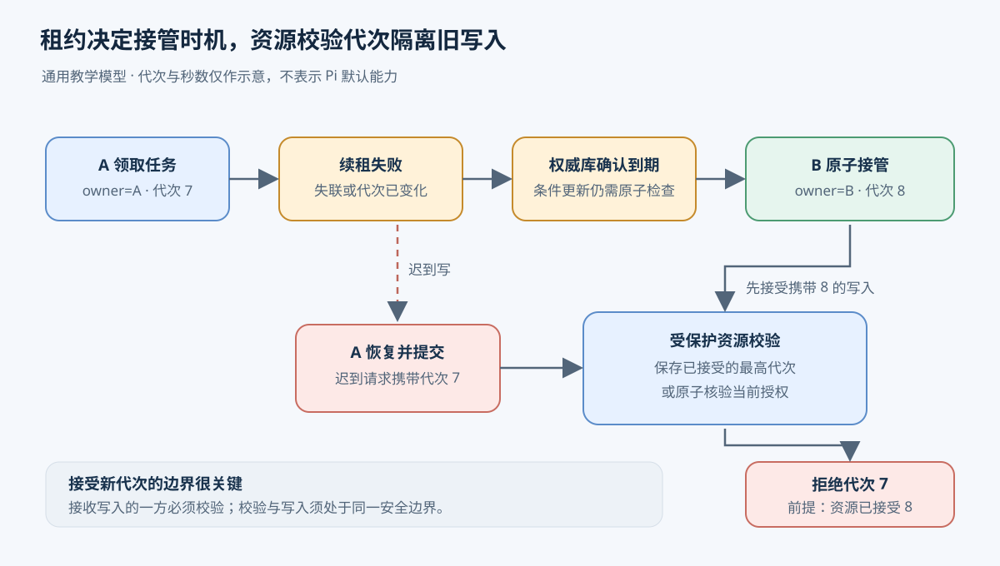
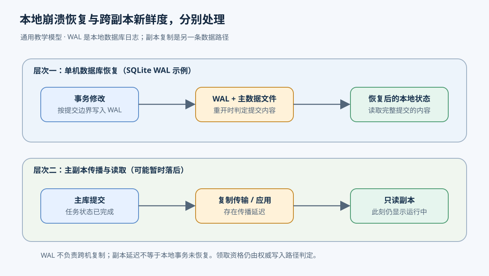
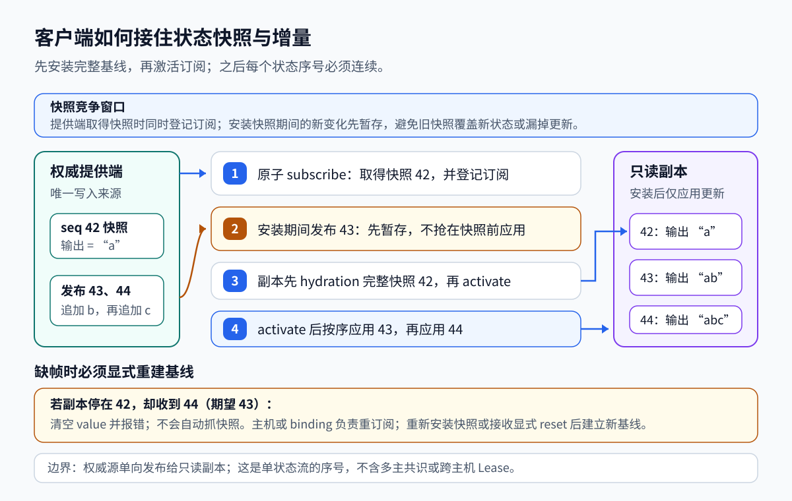
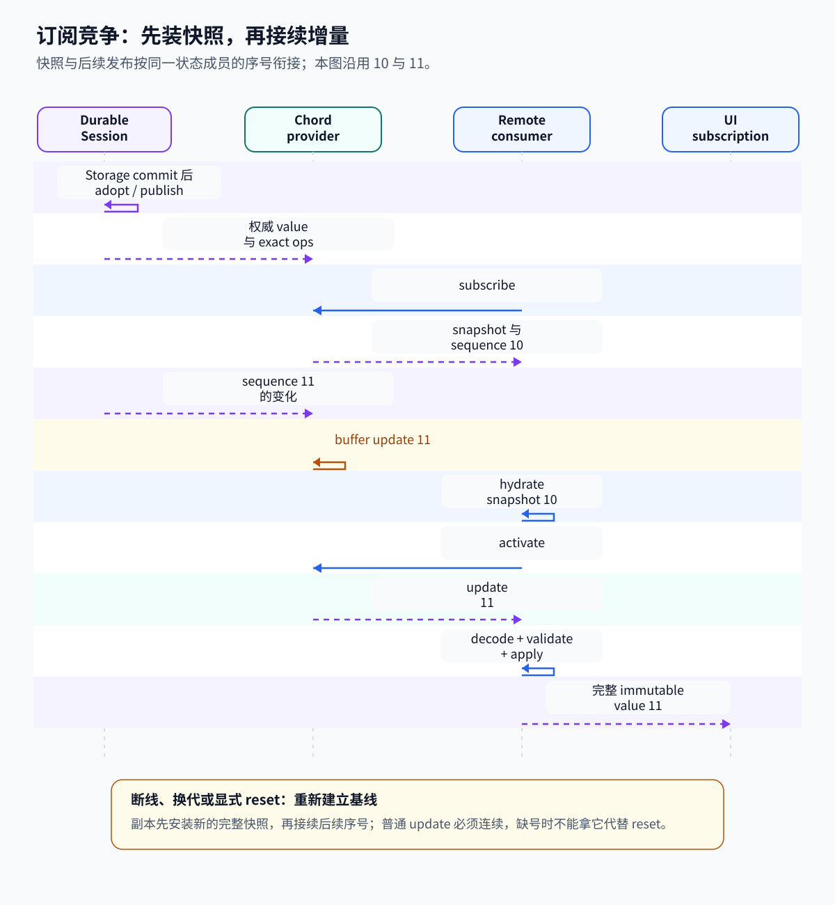

# 07. 多个 Worker 怎样共享状态、接管任务并更新副本

一个 Agent 服务收到“读取资料并生成报告”的任务，把它保存到数据库。Worker A 和 Worker B 都能查询待办，谁空闲就领取。用户则在网页上查看进度，希望刷新后仍能看到任务状态；A 中途退出时，也希望 B 能继续处理。

这里有几个相互依赖的问题：两个 Worker 可能读到同一条待办；领取信息可能只写了一半就中断；失联的 Worker 可能稍后恢复；页面和数据库副本可能还停留在旧版本。解决这些问题，需要把状态更新的边界、执行权的期限，以及读取允许有多旧分别说明。

下面先用共享数据库的双 Worker 系统讲通用设计。示例中的任务表、跨主机租约和接管协议是教学架构，Pi 当前没有实现这套分布式调度。后半章再对照 Pi 的实验 durable 存储和 Chord 只读状态复制。

本文对应提交 `96abe9a5ad45005cae34ed1c52d42f71fc88bedc`。各章入口在[学习索引](README.md)，持久化的提交顺序见[持久执行](05-durable-execution.md)，客户端和工具边界见[Tools 与 MCP](09-tools-mcp.md)。

## 两个 Worker 都读到待办，谁能开始执行

数据库中有任务 T，状态为“待处理”。A 查询得到 T，尚未来得及修改它；B 也查询得到 T。两次读取都正确，因为读取本身没有改变任务。如果它们随后分别写入“运行中”并开始调用工具，即使最后数据库只留下一个 owner（当前执行者），也已经发生两次执行。

领取需要把“仍可领取吗”和“将执行者设为我”合成一个不可分割的动作，这叫原子操作。最小做法是条件更新：只在 T 仍为待处理时，将它改为运行中并写入 owner。数据库在执行更新时检查条件；A 成功修改一行，B 随后发现条件不成立，修改零行。B 必须依据这次更新的结果放弃 T，继续找其他任务。先查询得到的内容只能帮助筛选候选任务，不能充当领取凭证。

假设一次领取还要新增一条执行记录，记录本次尝试的编号和开始时间。任务表已经写了 owner，执行记录却因进程退出而没写成功，恢复程序就无法判断这次执行从哪里开始。事务（transaction）把这些相关修改包在同一个提交边界内：全部成功才提交；其中一步失败就回滚，已做的修改不作为本次成功结果保留。

不变量是每次更新后都必须成立的约束。本例要求每次成功领取都同时留下唯一的当前 owner、有效期和对应执行记录；完成任务时，结果引用和“已完成”状态也必须一起提交。数据库可以用条件更新配合事务完成它们。仅把两次普通读写放进事务还不够：并发控制必须能够排除上述竞争，例如使用适当的行锁、可串行化隔离，或在实际写入时重新检查状态。数据库的隔离级别规定并发事务允许看到什么、发生冲突时怎样处理；事务这个名字本身不代表所有竞争都已解决。

Worker 应在领取事务提交成功后开始生成报告，不要把耗时的模型调用放在数据库事务内一直持锁。这样会阻塞其他领取者，外部调用也通常无法随数据库回滚。任务完成后再开一个短事务，核对执行资格，保存结果引用并改为已完成。这里的原子性只覆盖同一数据库中的更新；已经发出去的邮件或外部文件写入要另外处理，参见[重试与幂等](06-retry-timeout-idempotency.md)。

## 领取写到一半时崩溃，数据库怎样恢复

事务给调用方规定了“整体成功或失败”，数据库还需要在进程突然停止后维持这个结果。写前日志（write-ahead log，WAL）是一种实现办法：先把修改及其提交边界记录到日志，再将修改合入主要数据文件。以 SQLite 为例，恢复时可用有效提交记录区分完整事务与未完成的尾部；读取还可能需要结合主文件和 WAL，不能仅凭主文件判断最新状态。后续 checkpoint 将日志中已提交的内容合入主文件。这里的 checkpoint 是数据库维护动作，与 Agent 保存任务执行位置的检查点不是同一层。[SQLite WAL 文档](https://www.sqlite.org/wal.html)

假设 A 的领取已提交，数据库尚未完成 checkpoint 就停止。若所需日志已可靠保存，重新打开后仍可还原领取结果；若停止发生在提交前，不应出现只有 owner 而缺少对应执行记录的半笔领取。不过，“提交返回”是否已经抵抗掉电，取决于同步落盘策略。SQLite 在 WAL 模式下使用 `synchronous = NORMAL` 时，应用进程崩溃与机器掉电的保证不同，掉电或系统崩溃仍可能丢失最近已提交事务。[SQLite synchronous 说明](https://www.sqlite.org/pragma.html#pragma_synchronous)

WAL 解决本地数据库的恢复问题。它本身不会把数据复制到另一台机器，也不会让另一台机器取得写权。本例若要让两个跨主机 Worker 共享任务，应通过提供并发控制的数据库服务访问；不能把 SQLite WAL 文件放到共享网络目录，就当作分布式任务协调服务。

恢复后还有一种不确定性：数据库已提交领取，但成功响应在网络中丢失，A 不知道自己是否领到了 T。A 应使用本次请求的稳定标识查询权威记录，确认 owner 和执行代次；不能因为没有收到响应就自行开始，也不能无条件重复创建一次领取。事务与日志保证存储中的结果，调用方仍要处理“结果已发生，但我没收到确认”。

## Worker 失联后，什么时候允许另一个接管

如果 owner 永远有效，A 一旦退出，T 就会永久停在运行中。给执行权加上期限，就得到租约（lease）。本例让数据库在领取时写入 A、执行代次 7 和到期时间。到期前，A 定期请求续租；数据库只在 owner、代次和当前有效期仍匹配时延长期限。续租与接管都必须经过同一个权威存储的原子检查，避免各 Worker 按自己的时钟各做一个决定。

心跳（heartbeat）是周期性发送的活性通知。可以让心跳携带续租请求，但“收到了心跳”与“租约续期成功”是两件事：续租可能因数据库不可用、代次已经变化或租约已过期而失败。A 只有得到成功确认，才知道这次有效期被延长。调度端很久没收到心跳，也只能知道没有新消息，无法区分进程已退出、网络中断或长时间暂停。

例如租约还有 30 秒，A 每 10 秒请求续租。这只是教学参数。若 A 失联，数据库中的期限不会继续延长；到期后，B 发起条件更新，把已过期的 T 领为自己的任务，同时将代次增加到 8，写入新期限和接管记录。其他 Worker 同时尝试时仍只有一个能成功。B 然后读取上次保存的检查点和工具结果，确定从哪里继续。租约回答谁可以尝试恢复，检查点回答恢复到哪里；未落盘的计算可能需要重做，外部操作结果未知时仍需查询或幂等机制。

有效期越短，故障后的等待越短，也越容易把短暂卡顿当成失联；期限越长，误接管较少，但任务会等待更久。续租频率还会增加存储压力。执行者无法确认续租时应停止继续发起工作，但这一自觉约束不足以保证安全，因为已经发出的请求无法总是撤回，进程暂停期间也无法运行停止逻辑。

## 旧 Worker 恢复后，谁来拒绝它的写入

B 接管为代次 8 后，A 从暂停中恢复，仍握着代次 7 的报告结果。A 甚至可能在暂停前就发出了一个写请求，现在请求才到达。仅在 A 开始工作前检查过一次租约，无法阻止这次迟到的写入。

Fencing token 是随执行权换代而单调增加的凭证，本例可使用由权威存储分配的执行代次。A、B 的每次受保护写入都要携带它，接收写入的一方必须校验。若结果保存在同一数据库，完成事务应同时检查当前 owner、代次和租约仍有效；当前代次已是 8，携带 7 的更新就被拒绝。校验和写入必须处于同一原子边界，不能先单独查一下再无条件落盘。

如果报告写到另一个文件服务，任务数据库中的条件更新就保护不到那个服务。文件服务必须参与 fencing：例如可靠保存它已接受的最高代次，并拒绝更低代次。这个规则只能保证在服务接受 8 之后拒绝 7；若要求接管一完成就立即拒绝所有旧请求，还需要把新代次先安装到该资源，或在写入时原子地核验当前授权。只给请求加一个数字，而服务不检查，没有隔离旧执行者的效果。

即便资源支持 fencing，也不会自动撤销 A 之前已完成的外部动作，更不会让整个任务只执行一次。它限制过期执行者继续修改受保护资源；已经发生的重复外部效果仍属于幂等与恢复协议的范围。

图中资源必须实际校验代次；只有接受 8 之后，保存最高代次的资源才可据此拒绝 7。

## 数据已经提交，为什么页面还显示旧状态

B 完成报告，权威数据库已经把 T 改成“已完成”。服务为了减轻主存储的读取压力，将数据复制到另一份数据库，页面从这份副本查询。复制（replication）让多处保有同一数据的拷贝；写入先到主存储，再传到副本，传输和应用需要时间，所以页面此刻仍可能显示“运行中”。

一致性（consistency）约定读取与写入之间允许怎样的关系。对任务领取这种判断，本例要求在权威存储中执行原子条件更新。即使 B 从旧副本读到 T 仍为待处理，也必须经过这次更新才有资格执行。对进度展示，用户可能允许状态稍后才更新。两种用途可以选择不同的读取保证。

以线性一致的读写作为这里“强一致”的具体含义：B 已收到 T 完成提交的成功响应，随后才开始的同一任务状态读取，必须反映这次写入或更晚的写入。它仍可能与并发写入有先后顺序，已经开始的读取也不会实时变化；保证只覆盖服务承诺的操作范围，不会自动把数据库、邮件服务和多个状态对象组成一个事务。要提供这种读取，服务必须确认自己拥有足够新的状态，在故障或网络分区时可能需要等待或拒绝请求。

如果选择最终一致的副本读取，提交成功后页面仍可暂时显示“运行中”；在停止写入且复制持续正常的条件下，副本最终应追上“已完成”。这并不承诺最多落后多少秒，也不自动保证切换副本后读到的版本只增不减。产品若要求用户提交后立即看到自己的结果，可以将后续读取路由到权威存储，或携带提交版本，让读取等待副本至少追到该版本。等待会增加延迟，不能满足等待条件时还要定义超时后的行为。

图中两条路径处理不同问题：WAL 参与本地崩溃恢复，副本可能因传播延迟而暂时读旧状态。

同步复制可以让提交等待指定副本确认，降低某些故障下丢失已确认数据的风险，但会增加写入等待。异步复制缩短这段等待，主存储故障时却可能有尚未传出的提交。把一个落后的副本直接提升为主存储，可能重新出现已领取的待办。因此，主存储故障恢复还需要决定谁能成为新主、哪些提交已被承认，以及怎样隔离旧主。

共识协议负责让参与节点在故障条件下对一系列决定达成约定；Raft 是一种常见实现。复制数据并不自动提供共识，数据库产品需要把复制、故障检测和主节点切换配合起来。本章无需实现完整共识协议，但要区分：本地 WAL、数据库事务、副本读保证和主节点选举各自解决不同步骤。作为可核对的系统实例，[etcd 的 API 保证](https://etcd.io/docs/v3.5/learning/api_guarantees/) 区分线性一致读取与可能读到旧状态的读取；这不是 Pi 的依赖或现有能力。

## Pi 的存储边界：单进程提交与本地所有权

前面的双 Worker 共享任务表尚不是 Pi 的运行方式。Pi 当前 durable 库采用单进程拥有 storage 的前提，实验 Worker 用本地目录锁维护 Session 所有权，没有实现跨主机任务租约与接管协议。默认 CLI 也不能因此被理解为分布式执行器；这里讨论的是实验 durable 与 coding-agent services 路径。

Session 将修改放进串行提交线，Node SQLite 用 `BEGIN IMMEDIATE` / `COMMIT` 将一个存储批次原子提交，配置 WAL 与 `synchronous = NORMAL`。这让相关记录有共同的提交边界，并为重开数据库后的恢复留下依据；掉电仍可能丢最近提交，不能将“原子提交”写成“任何故障都绝不丢失”。Storage 成功后，Session 才采用状态并发布，conversation view 随 commit 更新。

实验目录锁有 stale 检测和周期 update，用于本地所有权保活。env 连接也会定期 ping，沉默超时后清理连接或进程。它们没有提供前面任务表中的领取、续租、代次检查和跨主机接管流程。若扩展成多个 Worker 共享同一任务库，需要补齐这些机制，不能用发布序号或服务实例编号代替执行资格。

## 界面状态也是副本，但只承担观察职责

Worker 一边运行任务，一边把输出从 `a` 写成 `ab`，再写成 `abc`。终端或浏览器可能在中途才打开，它需要马上显示已有内容，并继续显示后续变化。Worker 维护可写的权威值，界面持有供显示的只读副本。这个副本可以帮助用户观察任务，不能据此判定哪个进程有权执行或修改持久任务。

项目里的 Chord 包负责这类状态交付，实验版 coding-agent 用它将 Worker 的会话视图交给客户端。完整值可以直接显示，但每次都传完整值会重复传输。Chord 可以把后续变化编码成增量（delta），例如只传“在末尾追加 `c`”。增量依赖前一个值，所以界面必须先得到完整快照作为起点，再按顺序应用后续变化。晚加入的界面因此不必重放全部历史业务事件。

durable Storage 负责保存与恢复，Chord 把当前 view 同步给观察者。普通 `replicatedState(initial)` 自己不写磁盘，可以连接任意权威数据源。实验服务在 [packages/coding-agent/src/experimental/services/transcript-provider.ts L5-L15](../pi/packages/coding-agent/src/experimental/services/transcript-provider.ts#L5-L15) 中通过 `createTranscriptServiceFacet()` 直接取得 `conversation.viewState()` 作为 Transcript.state，并在退出时 dispose。Delta 的有序交付、丢包与乱序处理、重新连接和订阅，由协议和宿主共同负责。

两张图使用不同的示意序号：42、43、44说明基线后的连续更新及缺帧后的恢复；10、11展示实际订阅建立顺序。箭头表示状态交付，不表示副本取得写权。

## Worker 怎样发布一个完整变化

界面要收到 `abc`，Worker 得先把一次修改作为完整状态变化发布。假设任务状态从“读取中”变为“读取完成”，同时加入结果引用；这两个字段应属于同一次修改。若逐字段发布，观察者可能短暂看到状态已完成却没有结果引用。

`draft` 是一次修改期间使用的临时草稿。调用方在草稿上修改字段，准备完成后再整体采用并发布；若回调抛错，草稿被放弃，观察者仍看到旧的完整状态。一次 `state.change` 可以更新多个字段，形成该 state 对象的一次原子 revision。若 prepare 后没有操作，方法直接返回，发布序号也不增加。

[packages/chord/src/services/state.ts L184-L244](../pi/packages/chord/src/services/state.ts#L184-L244) 的 `MutableReplicatedStateImpl.change()` 打开 draft，运行 mutate，准备候选值，再采用并发布。回调返回 Promise 也会被拒绝，因此网络等待应放在这个同步回调之外。

这种交接依赖不可变值的所有权约定。状态发布后，使用方不能再修改同一个对象，否则同一 revision 对不同观察者可能呈现不同内容。传给 `track()` 或 `replicatedState()` 的 initial root 转交给 tracker，发布后的 value 和 ops 都不能再改。放进 draft 的外部值会先验证再复制，细节见 [packages/chord/src/delta/README.md L1-L41](../pi/packages/chord/src/delta/README.md#L1-L41)。

这是一项调用方约定，不是运行时对所有对象执行了 deep freeze。TypeScript 的只读类型也不提供冻结或隔离。在进程内直连时，提供端与消费端可能共享容器；消费端若擅自修改，就会破坏权威状态。把值交给会修改数据的代码前，应在边界复制或序列化。

增量是一批相对于前一版本的操作。[packages/chord/src/delta/index.ts L21-L41](../pi/packages/chord/src/delta/index.ts#L21-L41) 定义整值替换、set/delete、字符串追加与截断，以及数组 splice/permutation；[packages/chord/src/delta/index.ts L408-L435](../pi/packages/chord/src/delta/index.ts#L408-L435) 通过 copy-on-write 应用操作，保留前一版不可变值。输出从 `"a"` 变为 `"ab"` 时，线上可以只送 append，副本应用后仍得到完整值 `"ab"`。操作只要求在正确基线上按序应用后结果一致，编码形式不必唯一或最小，也不代表业务事件的含义。

## 界面中途加入，怎样既拿到快照又接住更新

Worker 已发布 `ab`，界面此时才订阅。若提供端先读当前值，过一会儿再登记订阅，Worker 可能在两步之间发布 `abc`，界面既没在快照里看到它，也收不到更新。若先开始交付更新再安装旧快照，界面可能先得到 `abc`，随后又被 `ab` 覆盖。提供端因此要原子地捕获快照并登记订阅；消费者则要先安装快照，再启用后续交付。

在这个例子里，提供端捕获 `ab` 和序号 10，同时登记订阅。此后发布的序号 11 暂存起来。消费端安装完整快照 10 后调用 `activate`，提供端才交付 11。Hydration 指用完整快照建立副本基线；它先于增量交付，避免旧快照覆盖新变化，也避免读快照与注册之间漏掉变化。

[packages/chord/src/services/provider.ts L239-L276](../pi/packages/chord/src/services/provider.ts#L239-L276) 将 subscriber 加入注册表、捕获 snapshot、记录快照覆盖的 state sequences，再返回 activate/close。[packages/chord/src/services/provider.ts L424-L443](../pi/packages/chord/src/services/provider.ts#L424-L443) 中，每个 state member 的快照带完整 `r` 和当前 sequence；普通发布通过已经登记的精确操作监听器继续前进。

consumer 的 singleton 入口在 [packages/chord/src/services/consumer.ts L594-L633](../pi/packages/chord/src/services/consumer.ts#L594-L633)。它先校验并安装 snapshot，再 activate。实际接收增量的是 [packages/chord/src/services/state.ts L376-L415](../pi/packages/chord/src/services/state.ts#L376-L415) 的 replica，也就是只读副本。它安装完整快照后，要求每个更新序号恰好比上次多一。

序号检查的是交付是否连续。假设副本基线是 `a`，下一项追加 `b`，再下一项追加 `c`。漏掉第一项却直接应用第二项，副本会得到 `ac`；序号跳变能在使用这个错误结果前发现问题。它不验证任务代码或业务内容，也不构成多写入方共识。

普通 `state` update 即使携带完整 `r`，仍必须遵守严格的 `+1` 连续序号。完整值不能让一个普通 update 自动变成新基线，因为序号之间可能还有实例生命周期变化。只有显式 snapshot/reset hydration 才能建立新起点。收到重复、缺号、无效操作或无效 JSON 结果时，replica 会清空 value 并报错；它不会自行向提供端请求 snapshot。主机或 binding 负责重新绑定、订阅；[packages/chord/src/services/consumer.ts L540-L570](../pi/packages/chord/src/services/consumer.ts#L540-L570) 展示了这条重建路径。

Chord 的实现见 [packages/chord/README.md L1-L7](../pi/packages/chord/README.md#L1-L7) 与 [packages/chord/README.md L32-L57](../pi/packages/chord/README.md#L32-L57)。它是独立的应用组合包，不依赖其他 Pi workspace 包，负责让一个权威状态源向本地和远端消费者发布快照、增量，并维护序号、实例换代和重新绑定。实验 coding-agent services 用它把 worker 的会话视图交给客户端；durable 和这组 services 的入口仍属于实验层。

## 缺帧、断线或服务换代时，副本怎样恢复

缺帧后，副本已经清空数据，不能把随后到达的普通更新当成新起点。主机需要重新订阅并安装快照，或交付显式 reset。reset 会给状态建立新的完整基线，之后副本再按连续序号应用增量。重新绑定也会清空旧值，直到新快照安装完成；界面可以继续保存句柄，同时识别数据尚未就绪的阶段。

断线还可能让旧句柄指向错误的服务实例。假设某个 key 对应的子服务关闭，后来以相同 key 创建新服务。只检查 key 的旧客户端可能把针对旧工作的调用发给新工作。当前 provider 给复用 key 的实例分配新的 generation，区分两段生命周期；[packages/chord/src/services/provider.ts L183-L212](../pi/packages/chord/src/services/provider.ts#L183-L212) 在复用 key 时增加 generation，[packages/chord/src/services/provider.ts L377-L409](../pi/packages/chord/src/services/provider.ts#L377-L409) 用它拒绝旧实例调用。这份编号保存在当前 provider 的 Map 中，用于限制旧服务实例访问。

单例服务替换时会保留对外接口对象，换入新的状态快照。消费端重新绑定会先清空旧值，再等新快照安装。这让界面可以保留接口句柄，同时知道此刻状态还没准备好。generation 标记服务实例生命周期，不是持久任务的租约代次。

## 慢消费者积压时，为什么两种订阅有不同处理

订阅回调可能等待很久。如果积压的是完整值，中间版本可以舍弃，最新值仍能独立显示；如果积压的是增量，跳过一步会破坏后续操作所依赖的基线。因此 public state subscription 保留较新的完整值，provider remote subscription 在积压过多时改送显式 reset。

[packages/chord/src/services/state.ts L28-L95](../pi/packages/chord/src/services/state.ts#L28-L95) 与 [packages/chord/src/services/state.ts L149-L181](../pi/packages/chord/src/services/state.ts#L149-L181) 为每个 public subscriber 串行调用 callback，正在执行的回调不计入 pending。其他订阅者和同步的精确操作监听器仍能继续处理发布。

| 位置 | 交付内容 | 溢出后的处理 |
| --- | --- | --- |
| public state subscription | 捕获的完整 value/context/delivery | 100 个 pending 后清空旧 pending，保留最新；未开始的 hydration 可保留 |
| provider remote subscription | 精确 state 操作与实例 lifecycle updates | 新增第 101 个 pending 时换成一个显式 reset，包含当前完整订阅 snapshot |
| 应用 transport 的异步队列 | 宿主自行定义 | 不自动继承上述上限 |

公开订阅交付完整值，因此允许跳过发布序号。远端订阅交付精确增量，必须保持连续；[packages/chord/src/services/provider.ts L445-L465](../pi/packages/chord/src/services/provider.ts#L445-L465) 在 pending 达到上限时用 reset 替换积压，给每个状态建立新基线。reset 还会重建 keyed membership，避免丢掉 close/spawn 后仍留下已经不存在的实例。上限按帧数计算，较大的 snapshot 仍可能占用较多字节。应用 transport 的异步队列由宿主定义，不自动继承这两处限制。

## 实现补充：编码字典、校验与边界

Delta encoder 在路径第二次出现时引入 ID，decoder 必须先收到配套定义；具体过程见 [packages/chord/src/delta/index.ts L506-L553](../pi/packages/chord/src/delta/index.ts#L506-L553) 与 [packages/chord/src/delta/index.ts L622-L662](../pi/packages/chord/src/delta/index.ts#L622-L662)。同一连接承载多个独立状态时，每个状态都有自己的字典。不同客户端的编码进度可能不同，因此不能用一个有状态编解码器编码一次后复用于所有客户端。

[packages/chord/src/services/state-codec.ts L27-L58](../pi/packages/chord/src/services/state-codec.ts#L27-L58) 按 instance/member 创建 codec；[packages/chord/src/services/state-codec.ts L60-L137](../pi/packages/chord/src/services/state-codec.ts#L60-L137) 在 snapshot、reset、replacement、unavailable、closed 时重置或移除对应字典。快照、重置和实例替换会处理字典生命周期。它是传输编码状态，不是任务检查点。解码和应用会拒绝 `__proto__`、`constructor`、`prototype` 这类危险路径。[packages/chord/src/delta/index.ts L118-L170](../pi/packages/chord/src/delta/index.ts#L118-L170) 检查操作形状与路径，整个结果还要通过另一层严格 JSON 验证。

本章的有序读副本协议以单一权威源为前提，以下能力需要另外的机制：

- 多写者数据库冲突处理没有实现，包括 Raft/Paxos 共识、leader election、quorum、CRDT 合并和网络分区下的多主写入。Session SQLite 的跨进程共享存储与所有权也需要另行协调。
- 一次 `state.change` 只形成单个 state 对象的一次原子 revision；跨多个 state members 的强一致事务没有实现。
- key/generation 编号保存在当前 provider 的 Map 中，只限制旧服务实例访问；它不提供跨主机 worker lease 或持久 leader term。
- 队列上限只作用于对应队列。实验 worker manager 在 [packages/coding-agent/src/experimental/session-worker-manager.ts L614-L639](../pi/packages/coding-agent/src/experimental/session-worker-manager.ts#L614-L639) 用 `deliveryTail` 串行转发服务事件，但这条 Promise 链没有同样的 100-frame 上限，因此整个网络通道还没有端到端背压。
- 远端服务授权需要单独判断。service token allowlist 和 stale-generation 检查还没有组成完整租户授权；[packages/coding-agent/src/experimental/services/README.md L14-L24](../pi/packages/coding-agent/src/experimental/services/README.md#L14-L24) 把认证身份与按客户端投影状态列为后续工作。

## 源码位置与术语速查

本章会遇到几种编号。它们记录不同对象，没有统一的全局含义：

| 标识 | 记录什么 | 范围 |
| --- | --- | --- |
| Session commit `Seq` | 原子数据库批次，编号可有间隙 | 不要求等于远端 state 的连续发布序号 |
| source cursor | attached source 的连续帧 | 没有跨 storage 全局时钟含义 |
| member sequence | 一个 state stream 的发布基线 | 没有多个 members 的事务边界含义 |
| key/generation | service instance 生命周期 | 不负责任务续租或共识 term |

### 文中术语

| 术语 | 当前实现 | 范围与限制 |
| --- | --- | --- |
| Transaction | Session mutation line 串行提交；Node SQLite 用 `BEGIN IMMEDIATE` / `COMMIT` 原子落盘 | 跨主机、跨外部服务的分布式事务尚未实现 |
| WAL | Node SQLite 用 write-ahead log 先记录日志以支持恢复，配合 `synchronous = NORMAL` | 掉电仍可能丢最新 commit；这份日志用于本地数据库 |
| Lease | durable task 没有可到期和续租的跨 worker 租约；实验 worker 有本地目录锁的 stale/update | 目录锁不负责 task reservation、多主共识或全局 fencing |
| Heartbeat | 实验目录锁周期更新；env 连接定期 ping，沉默超时会清理连接/进程 | 用于本地所有权保活与连接活性，无法证明任务仍有执行资格 |

Session 提交线在 [packages/durable/src/session/session.ts L220-L245](../pi/packages/durable/src/session/session.ts#L220-L245)，SQLite 事务与 WAL 设置在 [packages/durable/src/storage/sqlite/node.ts L140-L159](../pi/packages/durable/src/storage/sqlite/node.ts#L140-L159)、[packages/durable/src/storage/sqlite/node.ts L179-L202](../pi/packages/durable/src/storage/sqlite/node.ts#L179-L202)。实验目录锁则在 [packages/coding-agent/src/experimental/session-worker.ts L517-L522](../pi/packages/coding-agent/src/experimental/session-worker.ts#L517-L522) 设置 `stale: 2000`、`update: 1000`；env ping 的 Node/Rust 两端和故障处理见[Sandbox 与执行环境](08-sandbox-environment.md)。

## 测试与练习

先画出任务 T 的记录变化：待处理，A 以代次 7 领取，续租失败，到期后 B 以代次 8 接管，A 的迟到结果被拒绝。分别标出每一步由谁检查、哪些字段必须在一次事务中更新。再设想文件服务不检查代次，指出数据库拒绝 A 的完成提交后，仍可能发生什么外部写入。

让 B 完成任务后立即打开进度页：主存储已提交，副本尚未追上。写出强一致读取与最终一致读取各自允许返回的结果，并说明为什么从副本看到“待处理”不能直接授权 Worker 执行。

可以在纸上维护 `{ output: "a" }` 的副本：hydrate 10，append 11，漏掉 12，再收到 13。按连续序号规则，value 会清空；之后显式 reset 把基线设为 20，21 才能继续应用。再试一次让普通 update 13 携带 `r`，检查为什么完整值仍无法免去缺号校验。

下面的测试可以用来核对这些协议行为。

| 阅读位置 | 可观察的协议行为 |
| --- | --- |
| [packages/chord/test/services.test.ts L575-L658](../pi/packages/chord/test/services.test.ts#L575-L658) | hydration 时的竞争；重复与缺号即便带 root replacement 也清空副本 |
| [packages/chord/test/services.test.ts L660-L771](../pi/packages/chord/test/services.test.ts#L660-L771) | rebind 后完整 hydration；复用 key 时旧 handle 失效 |
| [packages/chord/test/state-delivery.test.ts L59-L129](../pi/packages/chord/test/state-delivery.test.ts#L59-L129) | 慢 public callback 不阻塞精确发布；pending 的限制 |
| [packages/chord/test/service-delivery.test.ts L78-L135](../pi/packages/chord/test/service-delivery.test.ts#L78-L135) | provider 显式 overflow reset 与正在交付的帧 |
| [packages/chord/test/service-delivery.test.ts L211-L335](../pi/packages/chord/test/service-delivery.test.ts#L211-L335) | codec reset 后继续接增量；重建 keyed membership |

若自行运行，从 `packages/chord` 执行 `node ../../node_modules/vitest/dist/cli.js --run test/service-delivery.test.ts`。这是本地协议测试，不需要登录、真实模型或远端部署。
