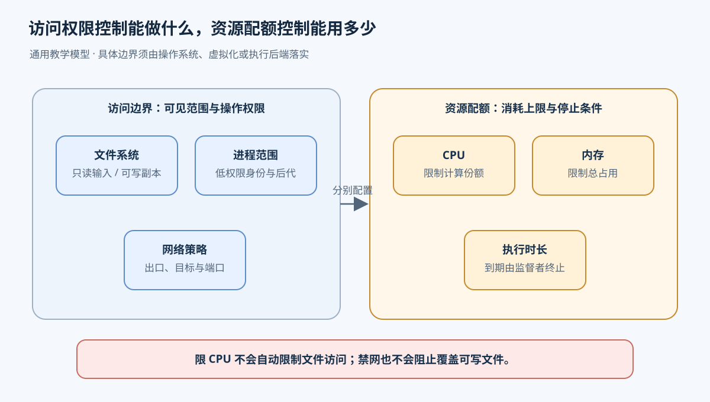
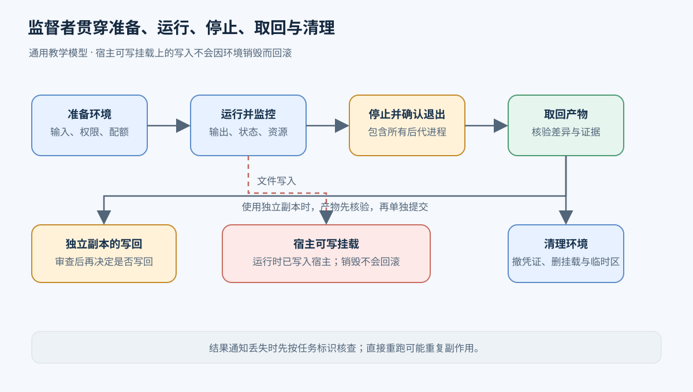
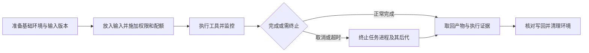
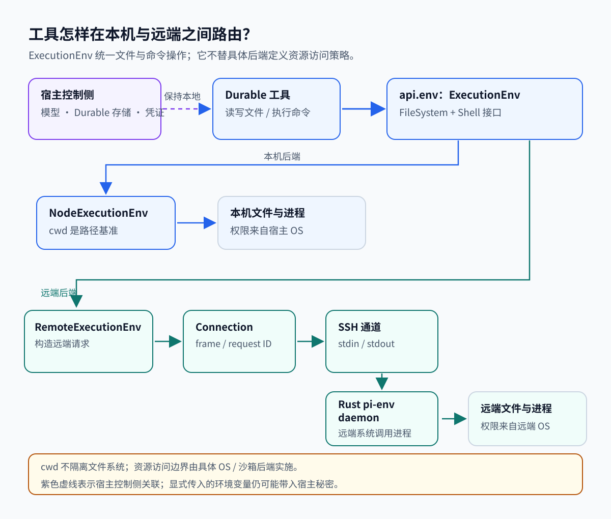
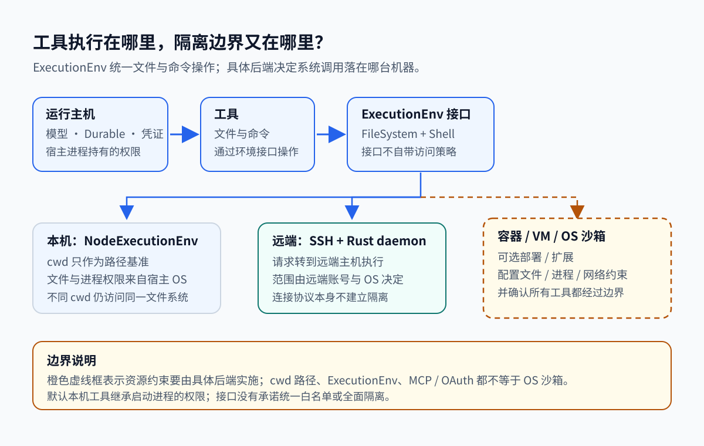

# 08. 沙箱怎样限制工具访问，并收回执行环境

[返回索引](README.md) · [下一章：工具与 MCP](09-tools-mcp.md)

本章按提交 `96abe9a5ad45005cae34ed1c52d42f71fc88bedc` 阅读源码。

一个 coding agent 接到“修改解析器并验证”的任务。它要用 Git 查看改动，通过 shell 启动 Python 脚本、构建工具和测试程序，最后交回补丁与测试结果。测试还可能启动一个本地 HTTP 服务。模型给出的命令只是入口；仓库脚本、依赖中的代码以及它们创建的子进程都会实际执行。

如果这些程序直接继承开发者账号的权限，一个路径写错就可能覆盖工作区外的文件，测试脚本也可能读取凭证、连接内网，或启动持续占用 CPU 的后台进程。Sandbox（沙箱）是在执行代码周围施加访问和资源限制的环境。调用方交给它代码、输入和允许的操作范围，期望取回产物与执行证据，并在任务结束后收回进程和临时资源。限制需要由操作系统或虚拟化边界执行，提示词里的“只操作项目目录”无法阻止一次实际系统调用。

以下先设计这一任务的通用执行环境；它是教学方案，不表示 Pi 已经实现这些策略。宿主指承载执行环境的机器；虚拟机内部的系统称为客体。随后再用 Pi 区分环境接口、默认本机操作与可选沙箱部署。

## 先决定让程序看见和改动什么

### 文件系统：输入、工作副本与输出分开处理

执行器先准备任务需要的源文件和依赖。可以把固定输入以只读方式挂载进环境：挂载把一个目录呈现在环境内的指定路径，只读限制阻止其中的进程通过该挂载修改文件。编译器仍需要写中间文件，Agent 也需要修改代码，因此另外提供可写工作副本、临时目录和产物目录。任务能读到哪些内容、能写到哪些位置，是两项分别配置的权限。只读挂载保护文件不被修改，却仍允许读取其中的秘密。

工作副本有两种常见安排。如果把宿主项目目录直接以可写方式挂载进去，Agent 保存文件时就已经修改了宿主；销毁沙箱不会撤销这些写入。若给任务复制一份输入或建立独立工作区，执行器可以在任务结束时取出差异与产物，核对目标路径和基准版本后再写回。后者多了一次复制或同步，却可以把“运行成功”和“接受这次改动”分开处理。提交回来的补丁仍是待审查输入，收集器不能因为文件来自沙箱就允许它覆盖任意宿主路径。

`cwd` 是当前工作目录，只决定相对路径从哪里开始解析。例如在 `/work/project` 中访问 `../other.txt` 会指向 `/work/other.txt`，能否读取取决于真实权限。Git worktree 能提供独立的工作文件，减少两个任务互相覆盖，但不会建立操作系统隔离；其进程仍可能访问其他目录和共享的 Git 管理数据。路径字符串检查也需要考虑符号链接等实际解析结果。系统强制限制文件可见范围与写权限，才能约束绕开工具直接运行的程序。

### 进程：限制脚本及其后代

构建命令会启动编译器，测试程序又可能启动服务。只约束最外层 shell 会漏掉这些后代。执行器要把任务的进程放在同一个受控范围内，用低权限身份运行，限制它们接触其他任务进程、宿主设备和管理接口；创建子进程时也应保留限制。否则任务虽然不能直接读取一个文件，却可能通过有更高权限的服务完成同样的操作。

Linux 的 namespace（命名空间）可以让进程拥有不同的挂载、进程编号或网络视图；这解释了容器内为什么可以看到不同的目录与进程列表。可见性还需要与用户权限、能力限制等机制配合。容器通常共享宿主内核，虚拟机则运行自己的客体内核，由虚拟化层隔开；二者的信任边界不同。虚拟机仍可通过共享目录或被传入的管理接口访问宿主资源，因此“在 VM 中运行”不足以推导具体访问权限。

覆盖范围也要先选定。整进程隔离把 Agent、扩展和工具一起放入边界，模型连接、持久化数据和凭证也要为这一部署安排出口。只隔离工具则让 Agent 留在宿主，选定的文件或命令操作进入沙箱，集成较方便，但未接管的文件工具与扩展代码仍拥有宿主权限。检查范围时需要沿所有实际执行路径核对，不能只看 bash 命令是否带了一个包装器。

### 网络：出站访问和测试服务分别授权

这次任务需要下载依赖时，可以先在受控准备阶段取得依赖，再关闭执行阶段的外部访问；也可以允许执行环境通过指定出口访问依赖源。前一种方式便于复用固定输入，后一种方式适合必须联网的任务，却需要控制目标地址、协议和使用的凭证。限制应落实到网络策略或代理等执行机制，不能只禁用一个下载工具，因为 Python 和测试代码同样可以发出请求。

网络允许列表还要考虑宿主地址、内网服务和云环境的元数据服务。即使程序只打算下载公开包，给它完整宿主网络仍可能暴露这些额外目标。网络命名空间提供不同的网络视图，具体允许哪些流量仍取决于配置的接口、路由与过滤规则。相关 Linux 机制见 [namespaces(7)](https://man7.org/linux/man-pages/man7/namespaces.7.html)。

本地 HTTP 测试则需要环境内部的回环通信：测试客户端连接同一环境中的服务。如果用户要从外部预览页面，执行器还要显式转发或发布端口，并决定哪些调用方可访问它。内部服务能够启动，不代表宿主自动能连上；开放一个预览端口也不要求开放任意出站访问。任务结束时，服务进程和端口映射都属于需要清理的资源。

## 资源额度怎样改变执行结果

脚本即使没有越权，也可能耗尽机器资源。假设解析器测试进入循环：CPU 配额可以限制它挤占其他任务的计算能力，但循环依然可能永不结束；执行时限才会使这次任务最终停止。另一种测试不断积累输入，即使 CPU 使用很少，也可能耗尽内存。因此执行器需要分别选择额度，并记录究竟是哪一种限制导致任务结束。

| 限制 | 约束什么 | 对任务的影响 |
| --- | --- | --- |
| CPU 配额 | 一个环境及其进程可使用的计算份额或预算 | 并行编译可能变慢；限速本身通常不结束命令 |
| 内存上限 | 被计入同一环境的内存使用 | 超额可能使分配失败或触发进程终止，需要保留具体原因 |
| 执行时长 | 命令或整个任务允许经过的实际时间 | 到期由监督者取消执行，并清理仍存活的子进程 |

这些限制需要明确计量范围。给每个编译器单独限制内存，无法直接约束十个编译器的总和；逐条命令都满足时限，也不能保证整个任务按时结束。进程数量、磁盘和日志空间同样会被消耗，可按工作负载补充上限。Linux 的 cgroup 将进程组织在层级中，由不同控制器管理资源，适合对一个任务及其后代统一计量与约束；它与文件访问授权是不同职责。具体语义见 [Linux cgroup v2 文档](https://www.kernel.org/doc/html/latest/admin-guide/cgroup-v2.html)。

资源额度不等于权限。内存只有少量可用的进程，仍可能读取已挂载的凭证；网络被禁用的程序，仍可能覆盖可写目录。设计时应分别写出允许的操作和允许消耗的资源，再检查两者是否都已经生效。



图中访问控制与资源配额分开配置和核验，任一类限制都不会自动替代另一类。

## 从准备环境到取回补丁

负责管理环境的监督者应留在任务无法随意修改的控制范围内。它保存任务标识、输入版本、环境标识、权限配置、截止时间和最终状态。以一次解析器修改为例，完整过程如下：

1. 监督者选择包含所需 shell、Git、Python 和构建工具的基础环境，建立本次任务的工作副本，记录输入版本。复用已有环境可以减少启动成本，但需要确认没有前次任务留下的文件、后台服务或秘密。
2. 放入输入，设置只读与可写挂载，选择执行身份，配置网络出口和资源额度。只传入本次操作需要的环境变量和凭证。监督者核验配置已经生效，再允许任务启动；必要的隔离建立失败时，任务应以准备失败结束。
3. Agent 通过受控工具执行修改、构建与测试。监督者持续收集 stdout（标准输出）、stderr（标准错误输出）、退出状态和资源使用，区分普通测试失败、权限拒绝、资源超限与运行中的任务。输出过大时可以保留摘要并另存完整日志，同时限制日志占用的存储。
4. 命令完成后收集结果；任务取消或超时后，监督者要求其停止，再在有限宽限期后强制终止仍存活的任务进程。检查范围要包含编译器、后台测试服务和其他后代。只让调用方停止等待，不能证明执行已经停止。
5. 确认进程退出后，取回补丁、报告和允许的产物，保存结束原因。失败任务也可能留下有用日志或部分改动，但不能把它们记成验证通过的结果。采用独立工作副本时，先核对改动再写回目标版本。
6. 移除端口映射、临时挂载和工作空间，撤回临时凭证，销毁环境或完成复用前的清理。若清理失败，记录残留资源并继续回收，避免把仍有进程的环境重新分配给另一个任务。



宿主可写挂载上的文件在运行时已经写入宿主，销毁环境不会回滚这些更改。



图中的“终止”和“清理”是执行器要确认完成的动作。执行器若与任务一同崩溃，需要另一个管理进程根据环境记录和期限回收资源。保留容器或 VM 可以方便调查失败，却也延长了资源占用与秘密暴露时间，应限定保留期限和访问者。

## 出错时根据哪份证据继续

沙箱初始化失败后如果直接改用宿主 shell，同一条命令就获得了不同权限。允许这种回退的交互式工具需要明确报告实际后端；要求强制隔离的任务应停止启动。是否继续由任务的隔离要求决定，不能把一次成功的本机执行记成沙箱执行成功。

另一种遗漏发生在覆盖范围：bash 受到限制，但 Agent 的文件工具仍能直接写宿主目录。这种行为走的是未覆盖的入口。它与利用内核或虚拟化漏洞突破边界的“逃逸”不同，排查时先核对工具路径、挂载、传入的凭证和管理接口，再调查边界本身。沙箱只能保护其实施并覆盖到的资源，不能对所有漏洞作绝对保证。

两个任务也可能各自在正确配置的容器中，却同时挂载同一份可写源码。任务甲读取旧文件，任务乙写入修改，甲随后按旧内容保存，就会覆盖乙的结果。两个任务都遵守了沙箱规则，问题是共享写入缺少协调。独立工作副本能隔开执行期间的修改；写回时还需比较基准版本、合并差异，或串行提交。若使用 worktree，仍要协调共享 Git 状态。隔离环境的数量不能代替写入冲突控制。

还有一种失败发生在命令结束之后：环境已经写出产物，结果通知却丢失。控制侧此时只能记录结果未知，并按任务标识查询环境或检查产物；直接重跑可能重复外部操作。取消任务和销毁环境都不会自动撤销已经发出的网络请求或已经落到宿主可写挂载中的更改。[重试与超时](06-retry-timeout-idempotency.md) 讨论这类结果未知时如何决定下一步。

## Pi 对照：先创建环境，再把操作交给它

Pi 的环境接口可以表达文件与命令操作，但上述隔离规则需要具体后端实施。先看 Durable 实验 harness 的本机请求，再看可选扩展如何改变覆盖范围。

假设当前会话的项目目录是 `/work/project`，模型请求工具运行 `git status`。输入是命令和会话工作目录，结果是命令输出、退出状态或错误。一次调用按以下顺序完成：

1. 工具任务先调用 `runtime.env(context)`，经 `Harness.buildEnv()` 从当前 `AgentDoc` 读取会话的 `cwd`，再交给应用配置的环境工厂。本例工厂返回本机 `NodeExecutionEnv`。
2. 工具任务把创建好的环境放进工具 API，再调用工具。工具里的 `requireEnv()` 只读取已经注入的环境；没有配置时，它会报普通错误，不会创建默认环境。
3. `createBashTool` 从参数中取出命令和可选超时，把环境的工作目录作为 cwd 传给 `env.exec()`。cwd（当前工作目录）是相对路径的起点。环境变量是传给程序的键值配置；实际传入哪些值取决于环境的合并选项。
4. 本机后端在该目录启动命令并收集 stdout 和 stderr。stdout 是程序的正常输出流，stderr 是错误输出流。命令完成后，后端把输出、退出状态或错误交给工具；工具再把结果写入会话，供后续模型请求读取。

宿主是运行 Pi 的机器和进程。本例的宿主就是启动 Durable harness 的机器，命令也在宿主进程权限下运行。命令被取消或设置的超时到达时，Node 环境会结束对应的进程树；内置 bash 工具没有默认超时，只有调用方提供超时才会按时限结束命令。

这条路径属于 Durable 实验 harness。稳定版 coding-agent 的内置 bash 默认走本机 `BashOperations`，不经过 `ExecutionEnv`。扩展可以替换 `BashOperations`，例如把 bash 操作交给远端或沙箱。两套接口表达相似的执行需求，具体工具如何接入后端由各自运行路径决定。

### 同一条命令要在远端运行时

若项目在另一台机器上，应用可以让环境工厂为这次工具调用返回 `RemoteExecutionEnv`。工具仍提交 `git status`，后端改为通过 SSH 在远端执行，再把结果送回会话。SSH 是建立远端连接并以远端账号启动程序的通道；daemon 是连接期间在远端运行、负责实际文件与命令操作的进程。应用显式配置了远端后端时才会走这条路径，稳定版 CLI 的本机 bash 不会默认经过它。

操作过程仍是取得环境、解析工作目录和命令参数、执行、收集并返回结果。远端版本把执行环境换成 `RemoteExecutionEnv`：它通过连接把 cwd、命令和环境覆盖项发送给 daemon；daemon 在远端账号下运行命令；连接按请求 ID 把输出和最终结果送回工具。请求 ID 用来将并行操作的响应交给发起它的调用。远端的文件与进程权限由远端账号及其操作系统决定。



这张图只描述执行路由，没有表示文件、网络或资源策略已生效。远端只改变了操作执行的位置。主机密钥验证、daemon 部署、消息帧与断线后的写入状态属于连接实现细节，放在本章末尾的源码补充中。

## Pi 的可选隔离部署覆盖哪些操作

下面两个示例分别使用 OS 沙箱和 micro-VM。对照前面的设计，需要检查实际接管了哪些工具、映射了哪些宿主资源，以及隔离初始化失败后怎样处理。CPU、内存和执行时长也需要分别检查，环境接口提供取消方法并不代表资源额度已经启用。

### sandbox 扩展怎样启用和回退

仓库中的 sandbox 扩展示例在 macOS/Linux 上初始化 sandbox runtime，再通过 `createSandboxedBashOps()` 和 `wrapWithSandbox()` 包装命令。它替换 `bash`，也为用户输入的 `!` 提供沙箱操作。示例默认配置启用沙箱；启动时读取全局和项目配置，并检查命令行的 `--no-sandbox` 标志。平台不支持、配置关闭或初始化失败时，示例会保留本机 bash 操作。`read/write/edit` 没有被这个扩展示例替换，因此不能据此认为所有文件操作都经过沙箱。它是可选扩展，Pi 默认没有强制沙箱策略（[packages/coding-agent/examples/extensions/sandbox/index.ts:55-139](../pi/packages/coding-agent/examples/extensions/sandbox/index.ts#L55-L139)、[packages/coding-agent/examples/extensions/sandbox/index.ts:130-150](../pi/packages/coding-agent/examples/extensions/sandbox/index.ts#L130-L150)、[packages/coding-agent/examples/extensions/sandbox/index.ts:201-285](../pi/packages/coding-agent/examples/extensions/sandbox/index.ts#L201-L285)）。

### Gondolin 把什么映射进虚拟机

Gondolin 示例把七个内置工具和用户输入的 `!` 转交给 micro-VM。启动时，`VM.create()` 把 `/workspace` 挂载到 `RealFSProvider(localCwd)`。该挂载允许虚拟机修改宿主工作区中的文件，路径转换只负责让工具找到映射后的文件。

bash 的 `env` 只去掉非字符串值，没有过滤敏感变量。文件凭证仍放在宿主文件系统，但通过宿主环境变量传入的 provider key 可能进入 VM。审查这类配置时，需要同时看工具覆盖了哪些操作、哪些宿主目录被挂载，以及哪些环境变量被传入（[packages/coding-agent/examples/extensions/gondolin/index.ts:67-85](../pi/packages/coding-agent/examples/extensions/gondolin/index.ts#L67-L85)、[packages/coding-agent/examples/extensions/gondolin/index.ts:315-363](../pi/packages/coding-agent/examples/extensions/gondolin/index.ts#L315-L363)、[packages/coding-agent/examples/extensions/gondolin/index.ts:379-398](../pi/packages/coding-agent/examples/extensions/gondolin/index.ts#L379-L398)、[packages/coding-agent/examples/extensions/gondolin/index.ts:443-520](../pi/packages/coding-agent/examples/extensions/gondolin/index.ts#L443-L520)）。

容器化文档还区分 whole-process 与 tool-only。整进程部署把 Pi 和扩展一起放进容器；只隔离工具则只转交选定的操作。Docker、Docker Sandboxes 和 OpenShell 是文档列出的外部部署方案，仓库默认启动路径不会自动启用它们（[packages/coding-agent/docs/containerization.md:3-27](../pi/packages/coding-agent/docs/containerization.md#L3-L27)）。

| 执行路径 | 操作在哪里执行 | 需要检查的范围 |
| --- | --- | --- |
| Durable 的 `ExecutionEnv` | 由应用配置的后端 | 接口本身没有访问控制策略 |
| `NodeExecutionEnv` | 本机 Node 文件与进程操作 | cwd 是路径基准；权限来自启动进程的用户 |
| `RemoteExecutionEnv` | 远端 Rust daemon | SSH 账号和远端操作系统决定可访问范围 |
| sandbox 扩展示例 | OS 沙箱中的 bash，以及用户 `!` | 其他文件工具未被替换；关闭或初始化失败时回退本机 bash |
| Gondolin 扩展示例 | micro-VM 中的七个内置工具和用户 `!` | 工作区可写挂载，未接管的扩展仍可能在宿主执行 |



### 默认权限与未实现的策略

Pi 默认继承启动用户和进程的权限。仓库根文档说明，Pi 没有内置的文件、进程、网络或凭证访问限制系统；默认本地操作也按这个方式执行（[README.md:88-96](../pi/README.md#L88-L96)、[packages/coding-agent/src/core/tools/bash.ts:96-118](../pi/packages/coding-agent/src/core/tools/bash.ts#L96-L118)）。

远端连接可能在文件已写入、结果尚未返回时断开。客户端此时无法确认写入结果。等待中的请求会以错误结束并标记为 `lost`，当前写操作不会自动重放；下一次请求才会启动新 daemon。文件句柄带有打开它的 session ID，因此旧句柄不会误指向新 daemon 重新编号的句柄。重连恢复通信，但不提供事务恢复、自动回滚或写入结果确认（[packages/env/src/connection.ts:164-199](../pi/packages/env/src/connection.ts#L164-L199)、[packages/env/src/connection.ts:307-320](../pi/packages/env/src/connection.ts#L307-L320)、[packages/env/src/remote-env.ts:130-155](../pi/packages/env/src/remote-env.ts#L130-L155)）。

这些实现没有统一的路径白名单、网络授权、秘密代理或租户资源配额。应用需要这些限制时，必须由实际部署的后端或整进程隔离来实施，并确认所有相关工具都经过该边界。本地与 remote 的一致性测试检查 API 语义；容器和 VM 的安全策略仍需单独验证。

## 源码补充

### 环境结果和本机命令输出

Durable 环境把可预期的失败作为结果返回，形式是 `{ ok: true, value }` 或 `{ ok: false, error }`。文件操作和命令操作使用各自的错误类型；工具将成功值或错误转成会话可保存的工具结果。这个 `Result` 类型表达一次操作的结果，不建立文件或进程访问规则（[packages/durable/src/env/index.ts:4-4](../pi/packages/durable/src/env/index.ts#L4-L4)）。

`ExecutionEnv extends FileSystem, Shell` 的声明把文件系统、命令、取消及文件变化观察等操作放在统一接口中。文件操作返回 `Result<T, FileError>`，命令返回 `Result<ShellExecResult, ExecutionError>`；调用方可以按 `not_found`、`permission_denied`、`timeout` 等分支处理，无须匹配平台错误字符串。接口和错误定义见 [packages/durable/src/env/index.ts:3-12](../pi/packages/durable/src/env/index.ts#L3-L12)、[packages/durable/src/env/index.ts:171-236](../pi/packages/durable/src/env/index.ts#L171-L236)、[packages/durable/src/env/index.ts:309-324](../pi/packages/durable/src/env/index.ts#L309-L324)、[packages/durable/src/env/index.ts:35-75](../pi/packages/durable/src/env/index.ts#L35-L75)。

环境创建与读取的顺序可对照 [packages/durable/src/harness/harness.ts:229-235](../pi/packages/durable/src/harness/harness.ts#L229-L235)、[packages/durable/src/harness/tool.ts:395-403](../pi/packages/durable/src/harness/tool.ts#L395-L403) 和 [packages/durable/src/tools/env.ts:1-8](../pi/packages/durable/src/tools/env.ts#L1-L8)。环境为每次工具调用重新构造，恢复后的重跑使用当时的配置，不会沿用第一次调用的 Node 实例。每会话示例按 `conversationId` 查找 Sandbox 文档后返回环境；示例只分配不同目录，容器后端仍需应用提供（[packages/durable/test/examples/29-sandbox-per-conversation.ts:1-14](../pi/packages/durable/test/examples/29-sandbox-per-conversation.ts#L1-L14)、[packages/durable/test/examples/29-sandbox-per-conversation.ts:42-54](../pi/packages/durable/test/examples/29-sandbox-per-conversation.ts#L42-L54)）。

`NodeExecutionEnv({ cwd: "/work/project" })` 将 `../other.txt` 解析为 `/work/other.txt`，随后调用 Node 文件 API，没有自动拒绝越出 cwd 的路径（[packages/durable/src/env/node.ts:72-85](../pi/packages/durable/src/env/node.ts#L72-L85)、[packages/durable/src/env/node.ts:913-923](../pi/packages/durable/src/env/node.ts#L913-L923)）。不同 cwd 的实例仍共享文件系统，所有实例的 `id = "node:local"` 相同。接口用 `id` 表示相同路径是否属于同一个文件命名空间，它不代表会话权限或租户身份（[packages/durable/src/env/node.ts:603-617](../pi/packages/durable/src/env/node.ts#L603-L617)、[packages/durable/src/env/index.ts:171-179](../pi/packages/durable/src/env/index.ts#L171-L179)）。

字符串命令 `"echo a | wc -c"` 经过 shell 解析，数组 `["echo", "a | wc -c"]` 则直接启动第一项程序，其余项作为普通参数。默认环境按 `process.env → shellEnv → options.env` 合并，后者覆盖前者；`inheritEnv: false` 只保留显式传入的 `options.env`（[packages/durable/src/env/node.ts:261-273](../pi/packages/durable/src/env/node.ts#L261-L273)、[packages/durable/src/env/node.ts:652-680](../pi/packages/durable/src/env/node.ts#L652-L680)）。

stdout 和 stderr 分别解码，因此多字节字符跨数据块时仍能保留。取消或超时会终止命令的进程树，`cleanup()` 清理环境仍在追踪的命令（[packages/durable/src/env/node.ts:708-736](../pi/packages/durable/src/env/node.ts#L708-L736)、[packages/durable/src/env/node.ts:833-936](../pi/packages/durable/src/env/node.ts#L833-L936)、[packages/durable/src/env/node.ts:1220-1224](../pi/packages/durable/src/env/node.ts#L1220-L1224)）。

命令输出超过保留阈值时，完整原始输出会写入临时文件，结果保留供模型读取的输出窗口，并通过诊断给出完整输出路径。spill 指的就是这份临时文件。命令的 stdout 与 stderr 会被收集为工具输出；退出码非零时，工具结果仍带输出和退出码，并标记为错误。

### 远端连接、SSH 身份与 daemon

`RemoteExecutionEnv` 先从 `hello` 取得远端操作系统、主目录和各盘符的工作目录，再按远端规则解析路径。`exec()` 检查取消与超时，然后构造 `command` 或 `argv` 请求。连接为每次请求分配 ID，再按 ID 把结果和错误交还调用者。daemon 为文件操作使用 16 个 worker 线程；较长的 `exec/watch` 各自使用线程。取消会在操作开始前登记，因此紧随请求到达的取消也能生效（[packages/env/src/remote-env.ts:347-399](../pi/packages/env/src/remote-env.ts#L347-L399)、[packages/env/src/remote-env.ts:834-930](../pi/packages/env/src/remote-env.ts#L834-L930)、[packages/env/src/connection.ts:214-305](../pi/packages/env/src/connection.ts#L214-L305)、[packages/env/daemon/src/main.rs:389-436](../pi/packages/env/daemon/src/main.rs#L389-L436)）。

SSH 主机密钥指纹由 `scanHostKey()` 沿实际 SSH 路线取得。主机拥有者通过其他可信渠道比对后，应用才调用 `acceptHostKey()`。正常连接严格检查专用 known-hosts 文件；已保存的同类型主机密钥发生变化时会拒绝自动接受。SSH 参数还关闭 agent、X11 和其他转发、共享连接、配置中的远端或本地命令以及 `SendEnv`（[packages/env/src/ssh.ts:72-120](../pi/packages/env/src/ssh.ts#L72-L120)、[packages/env/src/ssh.ts:177-207](../pi/packages/env/src/ssh.ts#L177-L207)、[packages/env/src/ssh.ts:253-279](../pi/packages/env/src/ssh.ts#L253-L279)）。

客户端检查远端 daemon 二进制。文件按 SHA-256 命名，上传先写临时文件，校验通过后再改名；每次启动都会验证或部署它。校验确认运行字节与包内二进制一致，不会扩大 daemon 的系统权限（[packages/env/src/ssh.ts:369-407](../pi/packages/env/src/ssh.ts#L369-L407)、[packages/env/src/ssh.ts:434-451](../pi/packages/env/src/ssh.ts#L434-L451)、[packages/env/src/ssh.ts:480-530](../pi/packages/env/src/ssh.ts#L480-L530)）。

远端命令默认继承 daemon 所在机器的环境。客户端发送 `shellEnv` 和本次 `env` 覆盖项，不会把本地 `process.env` 全量复制进 SSH 请求；设 `inheritEnv: false` 后，命令也不再继承 daemon 的环境（[packages/env/src/remote-env.ts:850-881](../pi/packages/env/src/remote-env.ts#L850-L881)、[packages/env/docs/semantics.md:45-60](../pi/packages/env/docs/semantics.md#L45-L60)）。

SSH 连接两端每 5 秒发送一次 ping。daemon 连续 30 秒收不到字节或 stdin 结束时，会杀掉自己启动的进程组。每个协议帧最多 16 MiB，大传输由客户端拆块。启动时输出的随机 `PI-ENV <token>` 让客户端跳过远端 Shell 的杂项输出，找到协议起点；它是同步标记，不提供用户授权。stdin、stdout、stderr 是程序的标准输入、标准输出和错误输出流。daemon 在连接期间读取 stdin、写入 stdout，不提供 HTTP 服务。协议帧是客户端与 daemon 交换的消息单位，包含长度、类型、请求 ID、JSON 和原始字节（[packages/env/src/connection.ts:12-17](../pi/packages/env/src/connection.ts#L12-L17)、[packages/env/src/connection.ts:322-369](../pi/packages/env/src/connection.ts#L322-L369)、[packages/env/daemon/src/main.rs:438-488](../pi/packages/env/daemon/src/main.rs#L438-L488)）。

## 测试与练习

环境测试先检查后端是否遵守同一份接口契约。[packages/durable/test/env-node-conformance.test.ts:33-60](../pi/packages/durable/test/env-node-conformance.test.ts#L33-L60) 让 Node 后端复用一致性测试，包含 polling 模式；[packages/env/test/conformance.test.ts:10-30](../pi/packages/env/test/conformance.test.ts#L10-L30) 则在本地 pipe 上对 remote 后端检查相同契约。

连接行为有更具体的测试：[packages/env/test/remote.test.ts:59-97](../pi/packages/env/test/remote.test.ts#L59-L97) 覆盖即时取消、没有输出的命令超时，以及断线后拒绝旧句柄；[packages/env/test/remote.test.ts:122-137](../pi/packages/env/test/remote.test.ts#L122-L137) 检查大文件分块传输后的内容与顺序。

可以先做一个只涉及临时文件的练习：放好 `project/note.txt` 和旁边的 `other.txt`，设 `cwd = project`，依次读取 `note.txt` 与 `../other.txt`，记录是否成功以及解析后的路径。预期两次读取都能成功，这说明 cwd 只是路径基准。整个练习无须访问用户目录或真实凭证。

再用 faux provider 运行每会话环境分配示例，比较 Alice 和 Bob 的相对写入位置。去掉其中一个会话的环境映射后，观察工具怎样报错。两份目录能演示分配过程，还不足以验证多租户隔离（[packages/durable/test/examples/29-sandbox-per-conversation.ts:28-38](../pi/packages/durable/test/examples/29-sandbox-per-conversation.ts#L28-L38)、[packages/durable/test/examples/29-sandbox-per-conversation.ts:73-82](../pi/packages/durable/test/examples/29-sandbox-per-conversation.ts#L73-L82)）。

仓库依赖已经可用时，可以在 `packages/durable` 单独运行下面的测试。

```powershell
node ../../node_modules/vitest/dist/cli.js --run test/env-node-conformance.test.ts
```

remote 测试还需要已有的 daemon 二进制，缺少它时会明确失败。阅读和上述临时文件练习不要求自动安装或构建 daemon（[packages/env/test/daemon.ts:4-13](../pi/packages/env/test/daemon.ts#L4-L13)）。

[MCP 工具适配](09-tools-mcp.md) 继续讨论模型可以调用哪些工具；[权限与秘密](10-permissions-secrets.md) 解释授权钩子、认证 token 与 OS 隔离分别控制什么。

## 源码位置与术语速查

| 术语 | 在这个项目中的含义 |
| --- | --- |
| `ExecutionEnv` | 实现文件与命令操作的后端接口，声明为 `extends FileSystem, Shell` |
| `requireEnv()` | 工具读取执行环境的入口；应用没有配置环境时会报普通错误 |
| daemon | 远端连接期间运行的 Rust 进程，读 stdin、写 stdout，执行实际系统调用 |
| 协议帧（frame） | 客户端与 daemon 交换的消息单位，带长度、类型、请求 ID、JSON 和原始字节 |
| spill | 命令输出超过阈值时，将完整原始输出写入临时文件的机制 |
| known-hosts | 记录已接受主机密钥的专用文件；同类型主机密钥变化时拒绝自动接受 |
