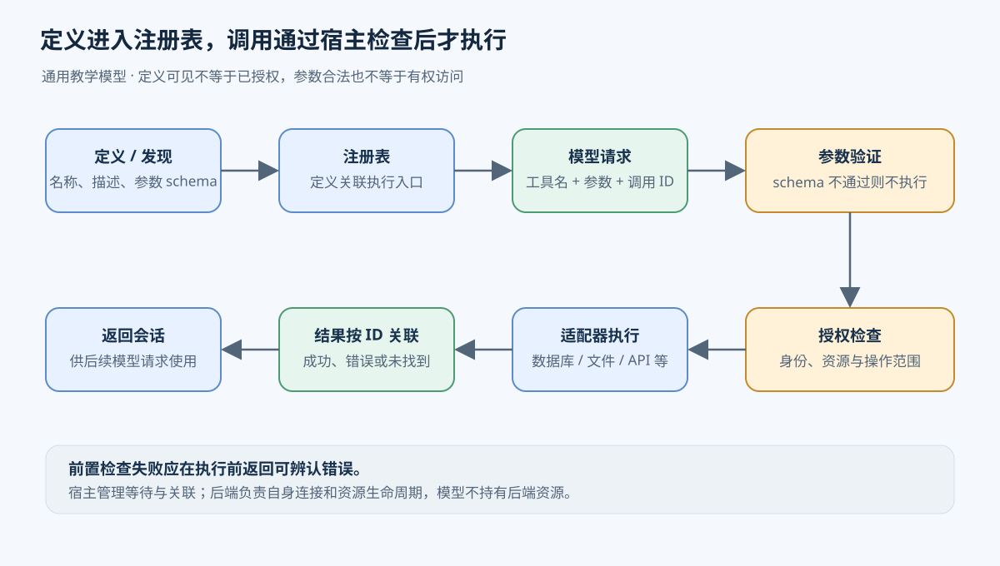
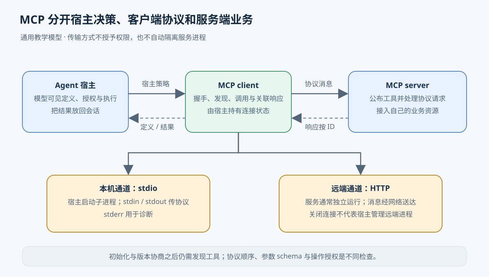
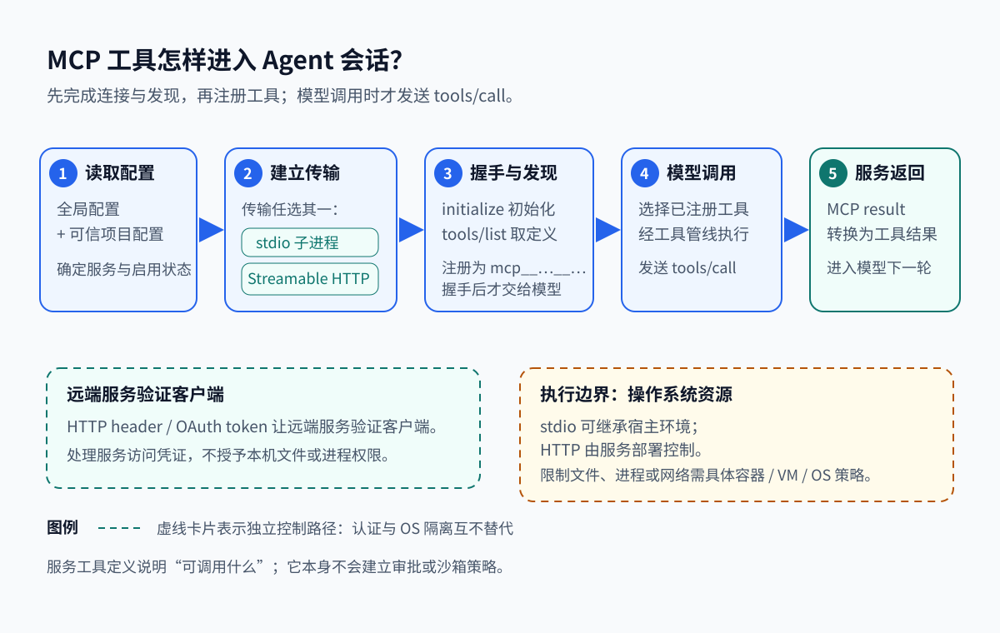
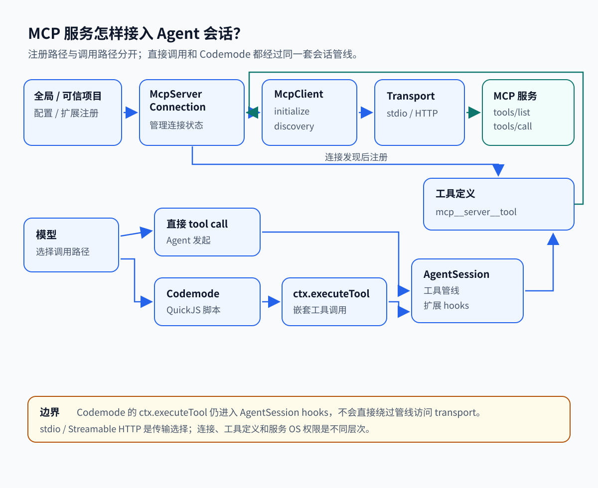

# 09. 工具怎样被发现、执行并接入 MCP

[返回索引](README.md) · [上一章：执行环境](08-sandbox-environment.md) · [下一章：权限与秘密](10-permissions-secrets.md)

本章按提交 `96abe9a5ad45005cae34ed1c52d42f71fc88bedc` 阅读源码。

## 从“查一下订单”到真正读取数据

假设用户让 Agent 核对订单 A17 的发货状态，并与本地记录比较。数据库里有订单状态，文件里有上次导出的记录。遇到差异时，Agent 还可能需要通过浏览器查看物流页面、调用物流 API，或用 Shell 命令整理导出文件。这里有五种执行方式：数据库查询、文件读写、浏览器操作、网络 API 和进程执行。每种方式的参数、返回值和失败方式都不同。

模型可以根据用户请求生成“调用订单查询工具，订单号为 A17”这样的结构化请求。真正读取数据库的是运行 Agent 的程序及其工具实现。模型生成了请求，只能说明它选择了一项操作；程序仍需找到实现、检查参数和权限、执行操作，然后把结果交回会话。没有这层管理，主循环就得分别理解数据库连接、浏览器页面、进程退出码及各种 API 的错误格式。

工具基础设施给这些能力提供共同入口，使主循环能按“给定工具名和参数，等待关联结果”的方式工作。下文先用一个教学架构说明这层职责，再对照 Pi。示例订单工具是教学设定，不代表仓库已实现订单系统，也不要求这些能力全部通过 MCP 接入。

## 先定义模型能请求什么

程序准备一个名为 `lookup_order` 的工具。名称用于准确选择实现；描述解释它按订单号读取发货状态，帮助模型判断何时使用；输入 schema 规定参数结构，例如必须有字符串类型的 `orderId`。Schema 是机器可读的结构约定，可以描述必填项、类型和允许值。若输出也有 schema，可以约定成功时返回订单号和发货状态，方便后续程序处理。

描述与 schema 各有用途。“查询订单”这几个字不能让程序判断 `orderId` 是否缺失；仅有一个字符串字段也不能让模型知道它代表订单号还是客户名。定义需要同时提供使用含义和可校验的格式。

定义还必须与执行函数建立对应关系。运行 Agent 的程序称为宿主。它把工具名、定义和执行入口存进注册表，这个动作叫注册。内置文件工具可以在启动时注册；外部服务的工具可以先从服务取得清单，再适配并注册。取得可用定义的过程叫发现。注册表保存了什么、模型本轮看见什么，是两个不同状态：宿主可以已知很多工具，只把当前任务需要的部分定义送进模型请求。

工具接口可以统一，后端仍保留各自的执行方式。数据库适配器负责查询和连接，浏览器适配器负责定位页面并操作，Shell 适配器负责启动命令和读取输出。适配器是把共同调用格式转换成具体后端操作的程序。它让主循环复用调用流程，同时保留后端需要的控制。

## 一次调用怎样经过共同入口

以下流程发生在教学架构中。假设模型已经看见 `lookup_order` 的定义，决定先查 A17，再根据结果选择是否读取本地文件。

1. 模型返回工具名 `lookup_order` 和参数 `{"orderId":"A17"}`。宿主接收请求，为这次调用保留标识和等待状态。后面即使同时发生其他查询，也能把每个结果交给正确的等待者。
2. 调度层查注册表，确认工具仍可用，再按 schema 校验参数。若模型漏掉 `orderId`，程序返回可纠正的参数错误，数据库不会收到查询。
3. 校验通过后，程序检查当前主体是否有权读取该订单。一个符合字符串格式的订单号可能属于别的客户；参数合法不代表操作获得授权。授权检查需要身份和资源信息，具体机制见[权限与秘密](10-permissions-secrets.md)。
4. 数据库适配器取得连接，把参数交给查询实现，等待后端完成。工具管理层把取消信号和截止时间传入这一过程。数据库连接归适配器管理，调用等待状态归宿主管理，模型不会持有或关闭连接。
5. 后端返回订单状态，适配器把它转换为约定的工具结果。若查不到订单，结果应说明“未找到”，让模型判断下一步；若连接失败，应保留执行失败的含义，不能伪装成空订单。
6. 宿主将结果与本次调用关联，加入会话上下文。连接按约定释放或回到连接池。下一次模型请求收到 A17 的实际状态，才有依据调用文件读取工具核对记录。

格式检查也不能判断一个操作是否符合用户目的。例如 Shell 工具的 `command` 确实是字符串，里面却可能是一条删除文件的命令；文件工具的路径也可能格式正确，却指向工作目录之外。调用的实际含义、授权范围和执行环境需要各自检查。Schema 解决输入结构问题，不能独自提供这些保证。

这里的统一结果不要求把所有内容都变成一段文字。文本、图像和结构化数据各有用途，例如浏览器截图与数据库记录就应保留不同内容类型。共同约定需要让宿主知道内容是什么、对应哪次调用，以及是否发生错误；模型提供方所需的消息格式可以在最后一步转换。

资源生命周期也进入了这条流程。文件句柄用完要关闭，浏览器页面可能要跨调用保留，数据库连接可复用，Shell 子进程则要等退出或被终止。工具管理层需要知道谁创建资源、谁保留它、会话结束由谁清理。每次调用都重建浏览器会增加启动成本；一直保留所有页面又会积累资源。统一接口提供清理入口，具体保留策略仍由后端及宿主决定。



参数验证与授权分别检查输入结构和操作资格；两者通过后才进入后端执行。

## 调用失败后，程序究竟知道什么

参数错误发生在执行前，修正参数后可以再次请求。执行过程中出现超时，信息就少得多：客户端只知道自己没及时得到结果。对于订单查询，这可能是一条仍在运行的查询；如果工具执行的是修改地址，写入可能已经完成，只是响应丢失。错误归一化要保留失败阶段和可用证据，不能把所有异常压成“请重试”。

取消也要沿调用链传播。用户取消等待后，宿主把信号交给适配器，适配器再尝试取消数据库操作或终止子进程。后端若不支持取消，停止等待并不等于停止执行。超时、取消和资源释放需要配合，否则会话虽然结束，连接和进程仍可能运行。已经发生的写入不会因为等待者退出而自动撤销；[重试、超时与幂等](06-retry-timeout-idempotency.md)进一步说明结果未知时如何处理。

数据量也会影响返回过程。如果任务扩大为核对全年订单，查询返回整年的明细，直接放进模型上下文会挤掉用户要求和其他证据。工具层可以分页、截断展示内容，把完整结果存为文件或可再次读取的资源，并告诉调用者剩余数据如何取得。截断必须可辨认，否则模型会把片段当成全部数据。另一种方式是在程序里先筛选记录，再向模型提供用于判断的部分；这要求仍能追溯筛选所用的原始结果。

## 工具多起来后，定义怎样保持可用

只有几个工具时，宿主可以每轮都提供全部定义。工具增加到数百个，定义本身就会消耗上下文，相近描述也会增加选择困难。按需发现让模型先搜索候选工具，再取得所需 schema，代价是多一次发现过程，且搜索描述必须足以找到正确工具。控制可见性可以减少选择范围，但真正执行时仍需检查权限。

定义还会随服务更新而变化。假设 `lookup_order` 新增必填字段，而会话仍缓存旧 schema：模型按旧定义生成的请求会被服务拒绝。工具管理层需要在获知清单变化后刷新注册表，移除失效入口，并让下一次模型请求看到新定义。刷新与调用也可能交错，因此服务端仍应验证请求，客户端要把工具已删除或定义已变化的错误交回会话。统一接口解决共同格式，不能替外部服务承诺永久兼容。

## MCP 把外部服务接到这层接口上

若每个外部服务都使用不同的“列出工具”和“执行工具”接口，Agent 宿主就要逐个编写连接代码。MCP（Model Context Protocol，模型上下文协议）约定客户端如何初始化连接、发现工具及资源、发送调用并接收结果。Shell、Filesystem、Browser、DB、API 能力可以由 MCP 服务提供，也可以直接在宿主内实现；是否使用 MCP 取决于怎样组织和复用这些能力。

MCP 中，server（服务端）公布能力并处理请求，例如把订单查询接到数据库；client（客户端）由 Agent 宿主持有，负责与一个服务通信、保存连接状态和关联请求响应。宿主在客户端之上决定给模型哪些定义、何时允许执行，以及怎样把结果放回会话。

Protocol（协议）规定消息含义与交互顺序，例如初始化后才能正常使用已协商的能力。Transport（传输）负责把消息送到对端，例如通过本机进程的标准输入输出，或通过 HTTP 网络连接。客户端可以复用协议处理，替换传输以连接另一种部署方式；服务端则把协议请求接到自己的业务实现。双方不需要共享同一种数据库驱动或 Agent 主循环。

握手协商的协议版本与工具定义版本也不同。前者决定双方能否理解消息规则，后者决定某个工具需要哪些参数。成功握手后仍需发现工具。能力声明表示双方声称支持的交互范围，宿主还要实际实现相应处理逻辑。MCP 本身不授予访问权限，也不会默认建立进程隔离或人工审批。



stdio 和 HTTP 说明消息如何传输，不能据此推断服务进程获得了隔离或宿主对远端进程有管理权。

### 本机 stdio：宿主启动并管理服务进程

对于本机订单服务，宿主先取得启动命令及运行配置，创建子进程，再把客户端连到子进程的标准输入和标准输出。stdio 就是这两条标准流组成的消息通道；标准错误流可用于诊断，避免日志混进协议消息。

客户端发送初始化请求，服务返回协议版本、能力和服务信息。客户端确认可使用的版本并发送初始化完成通知，然后请求工具清单。宿主把返回的名称、描述和输入 schema 适配成自己的工具定义，注册后才让模型使用。模型选中工具时，宿主先走自己的检查和执行管线，再让客户端发送调用；服务处理后沿同一通道返回结果。

会话结束时，宿主要关闭连接，并按进程管理策略结束它启动的服务。子进程使用哪些文件和网络权限取决于启动环境及额外隔离措施。选择 stdio 只说明通信方式，不会把该进程自动限制在工作目录内。

### 远端 HTTP：连接已运行的服务

远端订单服务由服务提供方启动和运维，Agent 宿主取得服务地址，并按服务要求准备连接凭证。客户端通过 HTTP 发送初始化消息，确认协议版本和能力，然后发现工具、注册定义。后续调用仍经过宿主工具管线，服务端才实际访问数据库。客户端关闭连接时负责结束自己的会话和等待请求，通常没有远端服务进程的管理权。

Streamable HTTP 用 POST 发送消息，返回可以是普通 JSON，也可以采用 SSE（服务端发送事件格式）持续传递消息。需要并且服务支持时，客户端还能打开 GET 流接收服务消息。若服务建立了会话，后续请求携带相应会话标识。协议负责说明某条消息属于哪个请求，HTTP 负责跨网络运送消息。

网络断开后，客户端可能仍不知道一次操作是否完成。恢复结果流与重新执行操作必须分别处理：能够继续接收结果，并不意味着可以再次发送具有副作用的调用。认证失败则需要修复凭证，这与续接消息流也是不同问题。Pi 对这些情况的具体处理放在后面的源码补充。

## Pi 对照：让 echo 经过配置、发现和调用

下面用一个本机 stdio `echo` 服务核对上述职责。它接收 `text` 参数并返回相同文字。为让调用路径可见，示例明确把工具呈现方式设为 `direct`；仓库默认呈现方式是 `codemode`。假设输入是 `{"text":"hello"}`，服务返回 `hello`。这是数据流向示意，不是仓库 fixture 的实测输出。

### 配置决定连接谁，握手确认怎样通信

流程从配置开始，因为 Pi 必须先知道服务在哪里、怎样启动，以及它的工具要以什么方式呈现。coding-agent 先读全局 `mcp.json`；项目可信时再读 `.pi/mcp.json`。项目中同名条目可以替换服务，也可以只覆盖 `enabled`、`exposure`（工具呈现方式）和 `toolExposure`。同名文件配置优先于扩展注册（[packages/coding-agent/src/extensions/mcp/config.ts:91-155](https://github.com/earendil-works/pi/blob/96abe9a5ad45005cae34ed1c52d42f71fc88bedc/packages/coding-agent/src/extensions/mcp/config.ts#L91-L155)、[packages/coding-agent/src/extensions/mcp/index.ts:345-363](https://github.com/earendil-works/pi/blob/96abe9a5ad45005cae34ed1c52d42f71fc88bedc/packages/coding-agent/src/extensions/mcp/index.ts#L345-L363)）。

到 `session_start` 时，连接任务转到后台启动。第一次 prompt 只有限等待 `direct` 服务；`codemode`、`tool_search` 和资源工具等到实际需要时才等待相应服务就绪。这样，慢启动的非直接工具不必拖住第一次模型请求（[packages/coding-agent/src/extensions/mcp/index.ts:1111-1206](https://github.com/earendil-works/pi/blob/96abe9a5ad45005cae34ed1c52d42f71fc88bedc/packages/coding-agent/src/extensions/mcp/index.ts#L1111-L1206)）。

配置给出命令后，Pi 启动 echo 子进程。本地 stdio 传输用标准输入和标准输出交换协议消息，标准错误流留作诊断。客户端先启动通道，再发送初始化请求。服务返回协议版本、能力和服务信息后，客户端发送 `notifications/initialized`；完成这次握手后才开始询问工具清单，避免在服务尚未准备好时发送调用。

`McpTransport` 以 `start/send/close` 和事件接口统一 stdio 子进程与 HTTP 通道；`McpClient.connect()` 在通道上完成握手与版本校验（[packages/mcp/src/transports/transport.ts:9-17](https://github.com/earendil-works/pi/blob/96abe9a5ad45005cae34ed1c52d42f71fc88bedc/packages/mcp/src/transports/transport.ts#L9-L17)、[packages/mcp/src/client.ts:202-248](https://github.com/earendil-works/pi/blob/96abe9a5ad45005cae34ed1c52d42f71fc88bedc/packages/mcp/src/client.ts#L202-L248)）。

### 发现定义，适配成会话工具

握手只确认客户端和服务已经就绪，还没有告诉模型有哪些操作。接下来客户端调用 `tools/list` 取得工具定义。每项定义带有名称、说明和 JSON Schema；schema 是描述参数结构的机器可读格式，模型据此构造参数。

coding-agent 将服务名与工具名组合成 Pi 工具名。例如服务 `docs` 中的 `search` 可以成为 `mcp__docs__search`，以便 Agent 区分不同服务中的同名工具。适配定义保留输入 schema、输出 schema 和布尔 annotations，实际发送给服务的仍是服务原来的工具名（[packages/coding-agent/src/extensions/mcp/tools.ts:78-93](https://github.com/earendil-works/pi/blob/96abe9a5ad45005cae34ed1c52d42f71fc88bedc/packages/coding-agent/src/extensions/mcp/tools.ts#L78-L93)、[packages/coding-agent/src/extensions/mcp/tools.ts:244-295](https://github.com/earendil-works/pi/blob/96abe9a5ad45005cae34ed1c52d42f71fc88bedc/packages/coding-agent/src/extensions/mcp/tools.ts#L244-L295)）。

服务清单也可能在会话中改变。服务发出 `tools/list_changed` 后，客户端刷新定义；已经删除或禁用的工具会以 hidden 形式重新注册，让模型不再看到旧定义（[packages/coding-agent/src/extensions/mcp/runtime.ts:378-435](https://github.com/earendil-works/pi/blob/96abe9a5ad45005cae34ed1c52d42f71fc88bedc/packages/coding-agent/src/extensions/mcp/runtime.ts#L378-L435)、[packages/coding-agent/src/extensions/mcp/index.ts:446-463](https://github.com/earendil-works/pi/blob/96abe9a5ad45005cae34ed1c52d42f71fc88bedc/packages/coding-agent/src/extensions/mcp/index.ts#L446-L463)）。

### 模型提出请求，宿主执行并返回结果

现在 Agent 会话已有 echo 定义，模型可以在需要时生成一次 Pi 工具调用。模型输出的是工具名和参数；AgentSession 校验参数并运行扩展工具钩子，之后适配工具才通过 MCP 客户端，将 `{"text":"hello"}` 转成发给 echo 服务的 `tools/call`。在 direct 示例中，这条转换链路直接可见。Codemode 发起的嵌套调用也会经过同一个 AgentSession 管线，并携带 `parentToolCallId`，所以扩展钩子也能看到这些调用（[packages/coding-agent/src/core/agent-session.ts:652-681](https://github.com/earendil-works/pi/blob/96abe9a5ad45005cae34ed1c52d42f71fc88bedc/packages/coding-agent/src/core/agent-session.ts#L652-L681)、[packages/coding-agent/src/core/agent-session.ts:726-764](https://github.com/earendil-works/pi/blob/96abe9a5ad45005cae34ed1c52d42f71fc88bedc/packages/coding-agent/src/core/agent-session.ts#L726-L764)）。

服务执行后，MCP 客户端按请求关联响应，再由适配层转换为 Agent 能处理的工具结果。结果可以含文本、图像、资源、结构化内容和 `isError`。本例收到文本 `hello`，Pi 将它交回 Agent，随后进入下一次模型请求。direct 路径会把服务标记的 `isError` 转成工具错误（[packages/coding-agent/src/extensions/mcp/tools.ts:124-145](https://github.com/earendil-works/pi/blob/96abe9a5ad45005cae34ed1c52d42f71fc88bedc/packages/coding-agent/src/extensions/mcp/tools.ts#L124-L145)、[packages/coding-agent/src/extensions/mcp/tools.ts:167-230](https://github.com/earendil-works/pi/blob/96abe9a5ad45005cae34ed1c52d42f71fc88bedc/packages/coding-agent/src/extensions/mcp/tools.ts#L167-L230)）。

模型只生成 Pi 工具调用；模型不会直接生成或发送 JSON-RPC。AgentSession 接住调用后，MCP 适配层才按协议构造请求并交给服务。下面两图分别展示连接和注册过程，以及注册后的完整调用管线。图的范围是 Pi 的 MCP 集成；HTTP、Codemode 和隔离都不是本例 stdio direct 路径的必经步骤。





### Codemode 改变模型怎样使用工具

逐个注册工具适合工具数量有限的服务。如果有数百个工具，每次把所有参数定义都交给模型会占用大量上下文。Pi 因此提供不同呈现方式，控制工具何时对模型可见：

| 配置值 | 模型怎样使用 |
| --- | --- |
| `codemode`（默认） | 脚本通过 `searchTools/describeTool` 发现并调用 |
| `deferred` | `tool_search` 加载声明后直接调用；不要求 Codemode |
| `direct` | 像内置工具一样直接声明，也可被脚本调用 |
| `hidden` | 在这套工具管线中不可达 |

`deferred` 让模型先搜索再加载所需定义；`codemode` 让模型写 JavaScript 来发现和组合调用。两者都减少一次性提供全部工具定义的需要。Codemode 是工具呈现和调用组织方式，MCP 连接不要求经过它。呈现方式只控制模型看到哪些工具、何时看到定义，不会改变服务的操作系统权限。服务给出的 annotations 也是提示，不能证明调用受到了执行隔离（[packages/coding-agent/src/core/mcp-servers.ts:43-77](https://github.com/earendil-works/pi/blob/96abe9a5ad45005cae34ed1c52d42f71fc88bedc/packages/coding-agent/src/core/mcp-servers.ts#L43-L77)、[packages/coding-agent/src/core/mcp-servers.ts:233-242](https://github.com/earendil-works/pi/blob/96abe9a5ad45005cae34ed1c52d42f71fc88bedc/packages/coding-agent/src/core/mcp-servers.ts#L233-L242)）。

另一个压力来自返回内容。适配层发送给模型的文本若超过 20 KiB，会保留首尾片段并把完整文本写入临时文件；非图像的二进制资源也保存为文件。Codemode 脚本可以组合调用，只把后续推理所需的部分交给模型。在 Codemode 路径中，脚本读取完整的 `CallToolResult`（适配层移除顶层 `_meta`），可以自行检查 `result.isError` 并选择输出内容。这里的错误处理与 direct 不同：direct 由适配层把 `isError` 转为工具错误；脚本路径把完整结果交给脚本，由脚本决定怎样处理（[packages/coding-agent/src/extensions/codemode/execute.ts:398-410](https://github.com/earendil-works/pi/blob/96abe9a5ad45005cae34ed1c52d42f71fc88bedc/packages/coding-agent/src/extensions/codemode/execute.ts#L398-L410)）。

## 源码补充：HTTP 连接、续流和认证

Pi 连接已部署的远端服务时，用 Streamable HTTP 代替 echo 示例中的本机进程通道。HTTP 通过 POST 发送消息，响应可以是 JSON 或 SSE；握手后客户端再打开到服务端的 GET 流，并带上会话 ID 和协议版本。

若 GET 流中断且服务为事件分配了 ID，客户端用 `Last-Event-ID` 续接 GET 流，从断点继续接收结果。它不会因此重发原来的工具 POST。没有事件 ID 的响应流提前结束时，请求失败（[packages/mcp/src/transports/streamable-http.ts:225-256](https://github.com/earendil-works/pi/blob/96abe9a5ad45005cae34ed1c52d42f71fc88bedc/packages/mcp/src/transports/streamable-http.ts#L225-L256)、[packages/mcp/src/transports/streamable-http.ts:309-320](https://github.com/earendil-works/pi/blob/96abe9a5ad45005cae34ed1c52d42f71fc88bedc/packages/mcp/src/transports/streamable-http.ts#L309-L320)、[packages/mcp/src/transports/streamable-http.ts:361-404](https://github.com/earendil-works/pi/blob/96abe9a5ad45005cae34ed1c52d42f71fc88bedc/packages/mcp/src/transports/streamable-http.ts#L361-L404)）。

HTTP 的认证是服务连接自己的认证路径。收到 401，或收到要求更大 scope（授权范围）的 403 时，客户端会交由认证提供方处理一次，再用新凭证重试。这与恢复网络事件流是两条不同路径；凭证如何取得见[权限与秘密](10-permissions-secrets.md)（[packages/mcp/src/transports/streamable-http.ts:159-169](https://github.com/earendil-works/pi/blob/96abe9a5ad45005cae34ed1c52d42f71fc88bedc/packages/mcp/src/transports/streamable-http.ts#L159-L169)、[packages/mcp/src/transports/streamable-http.ts:277-307](https://github.com/earendil-works/pi/blob/96abe9a5ad45005cae34ed1c52d42f71fc88bedc/packages/mcp/src/transports/streamable-http.ts#L277-L307)）。

## 源码补充：命名、脚本运行与资源边界

注册名要符合模型提供方对工具名的限制：只能使用字母、数字、下划线和连字符，最长 64 个字符。Pi 会先把不符合规则的字符替换为下划线。若生成名过长，或清理后与另一个原始服务名/工具名撞名，会在截短后的名称末尾附加由原始服务名和工具名计算出的哈希，避免覆盖定义（[packages/coding-agent/src/extensions/mcp/tools.ts:48-93](https://github.com/earendil-works/pi/blob/96abe9a5ad45005cae34ed1c52d42f71fc88bedc/packages/coding-agent/src/extensions/mcp/tools.ts#L48-L93)）。

QuickJS 是运行 JavaScript 的引擎。Pi 在其中建立受限脚本环境；脚本没有宿主 Node、文件系统或网络 API，外部操作只能通过桥接工具和可选的 `models` 接口发起。VM 默认内存上限为 256 MiB，整段脚本默认没有超时，也可以由输入指定超时。脚本调用 bash 时，命令实际在哪里执行仍由工具后端决定；VM 限制的是脚本访问宿主接口的能力，不等同于沙箱 bash（[packages/coding-agent/src/extensions/codemode/execute.ts:441-495](https://github.com/earendil-works/pi/blob/96abe9a5ad45005cae34ed1c52d42f71fc88bedc/packages/coding-agent/src/extensions/codemode/execute.ts#L441-L495)、[packages/codemode/src/runtime/vm.ts:81-91](https://github.com/earendil-works/pi/blob/96abe9a5ad45005cae34ed1c52d42f71fc88bedc/packages/codemode/src/runtime/vm.ts#L81-L91)、[packages/codemode/src/runtime/vm.ts:135-188](https://github.com/earendil-works/pi/blob/96abe9a5ad45005cae34ed1c52d42f71fc88bedc/packages/codemode/src/runtime/vm.ts#L135-L188)）。

脚本可以并发调用工具、发现定义、收集输出，并用 `store()` 保存少量状态。状态只在脚本成功后保存；若脚本失败，先前调用已经造成的工具副作用不会撤销（[packages/coding-agent/src/extensions/codemode/execute.ts:298-313](https://github.com/earendil-works/pi/blob/96abe9a5ad45005cae34ed1c52d42f71fc88bedc/packages/coding-agent/src/extensions/codemode/execute.ts#L298-L313)、[packages/coding-agent/src/extensions/codemode/execute.ts:497-510](https://github.com/earendil-works/pi/blob/96abe9a5ad45005cae34ed1c52d42f71fc88bedc/packages/coding-agent/src/extensions/codemode/execute.ts#L497-L510)）。MCP 客户端也能脱离 coding-agent 单独使用，但单独调用 `new McpClient().callTool()` 不会接入 coding-agent 的会话扩展钩子。

服务还可以提供以 URI 标识、供客户端读取的资源。Pi 将资源访问适配成 list、list templates、read 三个工具。当前不渲染 MCP App UI，因此相应内容会被过滤。客户端宣告的 `roots` 是目录信息，不会把 stdio 子进程的文件访问限制在该目录内（[packages/coding-agent/src/extensions/mcp/index.ts:465-492](https://github.com/earendil-works/pi/blob/96abe9a5ad45005cae34ed1c52d42f71fc88bedc/packages/coding-agent/src/extensions/mcp/index.ts#L465-L492)、[packages/coding-agent/src/extensions/mcp/runtime.ts:138-153](https://github.com/earendil-works/pi/blob/96abe9a5ad45005cae34ed1c52d42f71fc88bedc/packages/coding-agent/src/extensions/mcp/runtime.ts#L138-L153)、[packages/coding-agent/src/extensions/mcp/runtime.ts:378-384](https://github.com/earendil-works/pi/blob/96abe9a5ad45005cae34ed1c52d42f71fc88bedc/packages/coding-agent/src/extensions/mcp/runtime.ts#L378-L384)）。

资源工具的呈现范围由可读资源的服务决定：只要有一个此类服务采用 `direct`，资源工具就按最宽的可达范围注册；没有这类服务时则隐藏。这个范围说明模型如何看到资源入口，不限制子进程的文件访问（[packages/coding-agent/src/extensions/mcp/index.ts:465-492](https://github.com/earendil-works/pi/blob/96abe9a5ad45005cae34ed1c52d42f71fc88bedc/packages/coding-agent/src/extensions/mcp/index.ts#L465-L492)）。

## 源码补充：消息关联、分页、关闭与重试

服务可能同时处理多个请求。JSON-RPC（请求响应消息格式）给每个请求分配 `id`；请求包含 `id/method/params`，响应按 ID 找到等待者，notification（通知）不等待响应。`requestInternal()` 把等待者存入 pending Map，并设置超时与取消；`listTools()`、`callTool()` 选择协议方法并检查返回形状（[packages/mcp/src/client.ts:394-439](https://github.com/earendil-works/pi/blob/96abe9a5ad45005cae34ed1c52d42f71fc88bedc/packages/mcp/src/client.ts#L394-L439)、[packages/mcp/src/client.ts:376-384](https://github.com/earendil-works/pi/blob/96abe9a5ad45005cae34ed1c52d42f71fc88bedc/packages/mcp/src/client.ts#L376-L384)）。

`tools/list` 可以分页。客户端最多读取 1000 页，重复 cursor 会被拒绝；收到 progress 会重新计时。超时和取消通常会通知服务端，初始化请求按协议不发 cancelled 通知。结束客户端等待无法撤销服务端已经发生的写入（[packages/mcp/src/client.ts:354-374](https://github.com/earendil-works/pi/blob/96abe9a5ad45005cae34ed1c52d42f71fc88bedc/packages/mcp/src/client.ts#L354-L374)、[packages/mcp/src/client.ts:531-577](https://github.com/earendil-works/pi/blob/96abe9a5ad45005cae34ed1c52d42f71fc88bedc/packages/mcp/src/client.ts#L531-L577)）。

stdio 子进程默认继承 `process.env`。底层支持 `inheritEnv: false`，但 coding-agent 默认工厂未设置它。关闭时先结束 stdin，让服务有机会自行退出；若服务仍未退出，再终止并清理子进程树（[packages/mcp/src/transports/stdio.ts:90-141](https://github.com/earendil-works/pi/blob/96abe9a5ad45005cae34ed1c52d42f71fc88bedc/packages/mcp/src/transports/stdio.ts#L90-L141)、[packages/mcp/src/transports/stdio.ts:143-207](https://github.com/earendil-works/pi/blob/96abe9a5ad45005cae34ed1c52d42f71fc88bedc/packages/mcp/src/transports/stdio.ts#L143-L207)、[packages/coding-agent/src/extensions/mcp/runtime.ts:98-122](https://github.com/earendil-works/pi/blob/96abe9a5ad45005cae34ed1c52d42f71fc88bedc/packages/coding-agent/src/extensions/mcp/runtime.ts#L98-L122)）。

当前源码协议常量为 `2025-11-25`，并接受列表中的三个旧版本。Streamable HTTP 响应或 GET 流可以使用 SSE 格式；配置拒绝旧版独立 legacy SSE transport（[packages/mcp/src/protocol/types.ts:4-10](https://github.com/earendil-works/pi/blob/96abe9a5ad45005cae34ed1c52d42f71fc88bedc/packages/mcp/src/protocol/types.ts#L4-L10)、[packages/coding-agent/src/core/mcp-servers.ts:248-275](https://github.com/earendil-works/pi/blob/96abe9a5ad45005cae34ed1c52d42f71fc88bedc/packages/coding-agent/src/core/mcp-servers.ts#L248-L275)）。

网络恢复后的重试按操作类型区分。`McpServerConnection.withClient()` 对只读资源请求的瞬态 HTTP 错误重试一次；普通工具调用不会自动重放，因为服务可能已经执行操作。已建立 session 返回 404 时，当前分支认为服务不认识该 session、请求尚未执行，因此换 session 重试一次。这个特例不保证所有工具调用都幂等（[packages/coding-agent/src/extensions/mcp/runtime.ts:265-291](https://github.com/earendil-works/pi/blob/96abe9a5ad45005cae34ed1c52d42f71fc88bedc/packages/coding-agent/src/extensions/mcp/runtime.ts#L265-L291)、[packages/coding-agent/src/extensions/mcp/runtime.ts:293-320](https://github.com/earendil-works/pi/blob/96abe9a5ad45005cae34ed1c52d42f71fc88bedc/packages/coding-agent/src/extensions/mcp/runtime.ts#L293-L320)）。

MCP 接入本身不建立 OS 隔离、审批、通用服务沙箱、副作用回滚或跨服务事务。协议类型列出的 capability（能力声明）字段不表示客户端已实现所有服务端能力，也不能证明 prompts、sampling、elicitation 或 MCP Apps UI 都受支持。具体范围取决于注册了哪些工具、request handler 实现了什么，以及资源怎样转换。

## 源码位置与测试

通信基础由 `packages/mcp` 提供 JSON-RPC 客户端、stdio/Streamable HTTP、工具与资源请求和 OAuth；coding-agent 集成层负责配置、连接状态、发现、命名、呈现方式、结果转换和管理 UI。

可用 [packages/mcp/test/client.test.ts:19-64](https://github.com/earendil-works/pi/blob/96abe9a5ad45005cae34ed1c52d42f71fc88bedc/packages/mcp/test/client.test.ts#L19-L64) 的内存 transport 构造假服务，不必启动外部进程或访问网络。[packages/mcp/test/client.test.ts:71-126](https://github.com/earendil-works/pi/blob/96abe9a5ad45005cae34ed1c52d42f71fc88bedc/packages/mcp/test/client.test.ts#L71-L126) 检查握手顺序、工具分页和定义保留；[packages/mcp/test/client.test.ts:185-226](https://github.com/earendil-works/pi/blob/96abe9a5ad45005cae34ed1c52d42f71fc88bedc/packages/mcp/test/client.test.ts#L185-L226) 检查 progress 延长超时与取消通知。

[packages/mcp/test/stdio.test.ts:9-28](https://github.com/earendil-works/pi/blob/96abe9a5ad45005cae34ed1c52d42f71fc88bedc/packages/mcp/test/stdio.test.ts#L9-L28) 用本地 fixture 子进程验证工具调用与 stderr；[packages/mcp/test/content.test.ts:5-34](https://github.com/earendil-works/pi/blob/96abe9a5ad45005cae34ed1c52d42f71fc88bedc/packages/mcp/test/content.test.ts#L5-L34) 检查文本、图像、其他内容转换和结构化内容 fallback。

[packages/codemode/test/sandbox.test.ts:686-732](https://github.com/earendil-works/pi/blob/96abe9a5ad45005cae34ed1c52d42f71fc88bedc/packages/codemode/test/sandbox.test.ts#L686-L732) 检查宿主全局变量不可见、eval 和 Function 在 VM 内执行，以及 dynamic import 无法取得 Node 模块。

复用 `createServer()` 可以观察协议差异：让第二页的 `nextCursor` 重复，确认客户端拒绝继续翻页；再让假服务分别返回 JSON-RPC error 和 `{ content: [], isError: true }`。前者使客户端 Promise 以错误结束等待，后者仍返回 `CallToolResult`，直到 coding-agent 适配层才转换成模型侧错误结果。

脚本练习可注册一个本地假 `echo` 工具，并发调用两次后用 `text()` 汇总；接着让脚本抛错，检查调用次数仍为二。这样可以观察脚本失败时，工具副作用仍可能已经发生。

已有仓库依赖时，在 `packages/mcp` 可单独运行离线客户端测试：

```powershell
node ../../node_modules/vitest/dist/cli.js --run test/client.test.ts test/content.test.ts test/stdio.test.ts
```

[权限与秘密](10-permissions-secrets.md)说明工具调用进入管线后怎样处理授权；[重试、超时与幂等](06-retry-timeout-idempotency.md)继续解释请求失败时操作仍可能已经发生。
