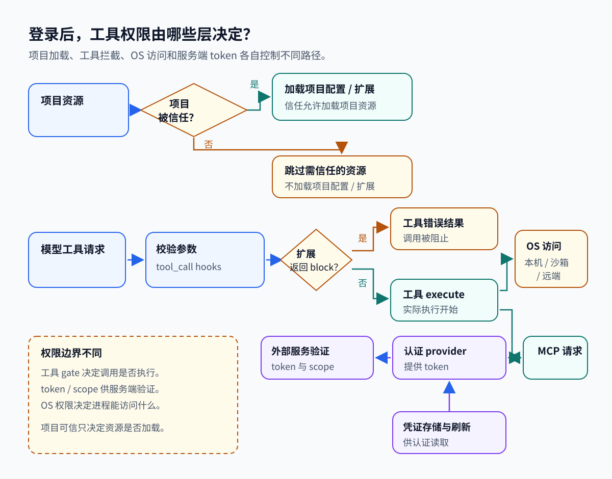

# 10. 登录之后，工具权限由谁决定

[返回索引](README.md) · [上一章：工具与 MCP](09-tools-mcp.md) · [下一章：可观测性](11-observability-debugging.md)

本章按提交 `96abe9a5ad45005cae34ed1c52d42f71fc88bedc` 阅读源码。

## 一项操作为什么被允许执行

权限管理用于判断程序可以访问什么，以及谁允许它这样做。秘密管理用于保存和传递调用服务所需的凭证。例如 Pi 请求模型时需要模型服务接受的 key 或 token；模型随后提出读文件，文件访问又由实际执行进程的权限决定。这两步面对不同系统，不能因为前一步登录成功，就认为后一步已经得到本机授权。

Key 和 token 都是服务用于识别调用方或授予访问的凭证值。认证检查“你提供的凭证是否被接受”，授权检查“这次动作是否在允许范围内”。凭证本身需要保存、更新和控制流向，否则拿到它的其他进程也可能尝试使用它。

一次受控制的交互沿这条顺序发生：启动时决定哪些项目配置与扩展可加载；请求模型前取得相应服务凭证；模型提出工具调用后，扩展检查是否放行；工具执行时由操作系统或外部服务检查实际权限；返回结果后再交给模型。下面按这几层展开，凭证存储与 OAuth 负责其中的服务登录和刷新，不会自动替所有层作决定。

认证（authentication）证明客户端持有目标服务接受的身份凭证；授权（authorization）决定某个动作是否获准；秘密（secret）是访问令牌（token）或 key 等凭证值的载体。三者有关联，职责不同。

| 对象 | 负责什么 | 作用范围 |
| --- | --- | --- |
| 认证 | 向 provider 或 MCP 服务证明客户端身份 | 决定目标服务是否接受请求 |
| 授权 | 判断动作是否可执行 | 服务端 scope（授权范围）、Agent 工具拦截和 OS 权限各管一层 |
| 秘密 | 保存或传递 token、key 等凭证值 | 文件、内存或进程环境本身不赋予额外权限 |
| 工具与执行环境 | 将模型请求变成工具操作并在某个后端执行 | `tool_call`（工具调用拦截钩子）可拦截调用；OS 或隔离后端决定进程可访问资源 |

以 `/login` 后运行任务为例，先沿完整请求走一遍：

1. `/login` 从模型 provider 取得 token，凭证存储保存它，之后模型请求用它向 provider 证明身份。
2. 模型提出 `bash` 或 MCP 工具调用。AgentSession 校验参数，再触发扩展 `tool_call` 钩子；扩展可以返回 block。
3. 放行的调用进入工具实现。bash 在已配置的本机、沙箱或远端环境中运行，可访问资源由执行进程的 OS 权限与隔离配置决定。
4. MCP 工具把请求送给服务。服务验证 token，再按授予的 scope 决定是否允许服务端动作。
5. 认证失败、工具调用被拦截、OS 拒绝访问是不同结果。provider token 和 OAuth scope 都不会为 bash 建立本机文件白名单（[packages/coding-agent/src/core/tools/bash.ts:186-212](../../packages/coding-agent/src/core/tools/bash.ts#L186-L212)、[packages/coding-agent/src/core/tools/bash.ts:361-369](../../packages/coding-agent/src/core/tools/bash.ts#L361-L369)）。

项目信任还决定能否加载项目设置、资源和扩展，它发生在工具调用之前。下图把这些控制路径和凭证路径分开；箭头只表示各自处理的请求或数据流。



## 项目能加载什么，工具能执行什么

项目扩展是可以在 Pi 进程里运行的代码。加载它的决定发生在模型调用工具之前，因此项目信任要先处理：允许加载一个项目提供的扩展，可能让该扩展执行宿主代码。工具拦截则针对后来模型提出的某次操作，例如是否运行某条 bash 命令。两者控制的对象不同，已加载扩展拥有的进程权限也不会由工具提示自动收回。

操作系统权限处于实际资源访问层。ACL 是访问控制列表，用于规定哪个身份能访问哪些资源；沙箱可以进一步限制进程可达范围。工具钩子拒绝一次调用能阻止那次执行，但没有为整个进程建立同样的系统限制。下面先读加载决定，再读调用阻断，可以把它们放回完整流程的相应位置。

项目信任与工具拦截发生在不同阶段：前者控制项目资源是否加载，后者控制已经提出的工具调用是否执行。

进入项目时，Pi 要先决定能否加载项目提供的内容。`resolveProjectTrusted()` 优先处理显式 override，然后处理扩展的 `project_trust` 事件、记住的决定和默认策略。需要询问却没有 UI 时，尚未决定的项目返回 false。允许信任后，Pi 才能加载 `.pi` 设置和资源、安装缺少的项目包，并执行项目扩展；提示文案询问的就是这些动作（[packages/coding-agent/src/core/project-trust.ts:25-39](../../packages/coding-agent/src/core/project-trust.ts#L25-L39)、[packages/coding-agent/src/core/project-trust.ts:47-97](../../packages/coding-agent/src/core/project-trust.ts#L47-L97)）。

MCP 读取配置时也使用 `projectTrusted`。项目文件不能设置 `auth.provider`，因而无法通过这个选项选择一个 URL，让 Pi 把用户的 provider token 发过去。全局配置可以设置它，但目标必须是 HTTPS 或 loopback。普通手写 headers 走另一条配置路径（[packages/coding-agent/src/extensions/mcp/config.ts:133-155](../../packages/coding-agent/src/extensions/mcp/config.ts#L133-L155)、[packages/coding-agent/src/core/mcp-servers.ts:272-290](../../packages/coding-agent/src/core/mcp-servers.ts#L272-L290)）。

工具真正执行前，`AgentSession` 会把校验过的参数交给扩展的 `tool_call`，再把扩展返回的阻止决定交回 agent 工具管线。嵌套调用也经过这条路径，并携带 `parentToolCallId`，所以 Codemode 内部的 MCP 调用同样会被拦截钩子看到（[packages/coding-agent/src/core/agent-session.ts:652-681](../../packages/coding-agent/src/core/agent-session.ts#L652-L681)、[packages/coding-agent/src/core/agent-session.ts:726-764](../../packages/coding-agent/src/core/agent-session.ts#L726-L764)）。

`permission-gate.ts` 展示了如何使用这个拦截点。它只检查名为 `bash` 的工具，用正则匹配几个命令模式；有 UI 就询问用户，非交互运行遇到这些模式则直接 block。示例没有完整解析 Shell 语法，也没有为 `read/write` 或任意 MCP 工具建立通用审批规则，因此只能据此学习如何阻止调用，不能据此保证所有危险动作都被覆盖（[packages/coding-agent/examples/extensions/permission-gate.ts:10-34](../../packages/coding-agent/examples/extensions/permission-gate.ts#L10-L34)）。

## 两次凭证更新怎样避免覆盖

模型 API key 可以是相对长期使用的凭证；OAuth 通常使用短期 access token 发请求，用 refresh token 换取新的 access token。刷新会改变存储内容，所以多个 Pi 进程同时使用同一份凭证文件时，需要协调更新。

可以把冲突想成：进程 A 读到模型服务 X 的旧凭证，进程 B 更新了服务 Y，然后 A 把整份旧文件写回，B 的更新就消失了。锁让修改者依次处理，锁内重读让 A 依据最新内容只改 X。文件权限控制谁能读写文件，文件锁控制更新顺序，二者各解决一种问题。

API key、access token、refresh token 和 client secret 都是需要保存或传递的秘密。provider 凭证的读写由 `AuthStorage` 实现 `CredentialStore` 接口，认证流程的编排则交给 `ModelRuntime` 和 pi-ai Models。底层既可以用文件后端，也可以用内存后端，后者让练习完全避开用户凭证文件（[packages/coding-agent/src/core/auth-storage.ts:1-47](../../packages/coding-agent/src/core/auth-storage.ts#L1-L47)、[packages/coding-agent/src/core/auth-storage.ts:292-360](../../packages/coding-agent/src/core/auth-storage.ts#L292-L360)）。

文件后端默认使用 agent 目录下的 `auth.json`，内容直接写成 JSON。新建目录请求 `0700`，新建文件请求 `0600`，已有文件的模式和 ACL 会保留。Windows 的实际访问控制取决于 ACL，不能直接套用 POSIX mode。后端还用文件锁协调多个进程的更新，这并没有为内容加密，也没有将它存入操作系统凭证库（[packages/coding-agent/src/core/auth-storage.ts:24-67](../../packages/coding-agent/src/core/auth-storage.ts#L24-L67)、[packages/coding-agent/src/core/auth-storage.ts:96-114](../../packages/coding-agent/src/core/auth-storage.ts#L96-L114)）。

两个进程同时刷新或登录时，不能各自把早先读到的整份配置写回，否则会覆盖对方的修改。`modify(provider, fn)` 在锁内重新读取当前文件，只合并目标 provider 的新值，其他 provider 保持不变。异步后端在回调结束和写入前检查状态；操作被取消、取锁失败或锁被破坏时，不应提交新内容（[packages/coding-agent/src/core/auth-storage.ts:116-200](../../packages/coding-agent/src/core/auth-storage.ts#L116-L200)、[packages/coding-agent/src/core/auth-storage.ts:449-481](../../packages/coding-agent/src/core/auth-storage.ts#L449-L481)）。

列出凭证与取出凭证也有差别。`list()` 只返回 provider ID 和凭证类型，不解析配置值；`read()` 读取 API key 时，会解析字面值、环境变量模板或 `!command`。其中 `!command` 在宿主 Shell 执行，普通解析会缓存结果，MCP 使用的 `resolveConfigValueOrThrow()` 则不缓存。命令是在配置读取路径中执行的，工具调用的 `tool_call` 权限提示不会覆盖这条路径（[packages/coding-agent/src/core/auth-storage.ts:441-447](../../packages/coding-agent/src/core/auth-storage.ts#L441-L447)、[packages/coding-agent/src/core/auth-storage.ts:484-489](../../packages/coding-agent/src/core/auth-storage.ts#L484-L489)、[packages/coding-agent/src/core/resolve-config-value.ts:138-216](../../packages/coding-agent/src/core/resolve-config-value.ts#L138-L216)、[packages/coding-agent/src/core/resolve-config-value.ts:221-251](../../packages/coding-agent/src/core/resolve-config-value.ts#L221-L251)）。

## MCP 登录与刷新中的服务身份

OAuth 是通过授权服务取得访问凭证的一套流程。用户在浏览器里登录并同意授权，客户端拿到授权码，再用它换取 token。MCP 登录前还要发现目标资源由哪个授权服务器管理，才能把后续请求送到正确地址；这就是 metadata（描述服务身份与端点的元数据）的用途。

流程中的校验值各有作用。state 关联发起登录与浏览器回调，防止把不属于本次登录的回调接进来；PKCE 用随机 verifier 及其摘要 challenge，把换码者与发起者联系起来；issuer 是授权服务器的身份标识；scope 描述服务端授予的访问范围。下面按发现、浏览器授权、回调、换码、存储、刷新拆开，它们都在维护同一条登录链路。

MCP OAuth 从服务发现到换码、存 token，再到刷新与 scope 合并，顺序如下。

HTTP 服务没有显式 Authorization header 或 `auth.provider` 时，会使用 MCP OAuth。连接先尝试已有 token，无法刷新时进入 needs-auth 状态，等用户登录后再发起浏览器授权流程，不会自行打开浏览器。设置了 `auth.provider` 的服务则每次请求都取当前 provider token，MCP store 不另存一份副本（[packages/coding-agent/src/extensions/mcp/runtime.ts:82-87](../../packages/coding-agent/src/extensions/mcp/runtime.ts#L82-L87)、[packages/coding-agent/src/extensions/mcp/runtime.ts:204-218](../../packages/coding-agent/src/extensions/mcp/runtime.ts#L204-L218)、[packages/coding-agent/src/extensions/mcp/oauth.ts:1-11](../../packages/coding-agent/src/extensions/mcp/oauth.ts#L1-L11)）。

用户发起登录后，discovery 先读取 protected-resource metadata 和授权服务器 metadata，默认检查 issuer，并核对 resource 的 origin/path。`authorizeMcp()` 随后选择已注册的 client，或动态注册一个 client；配置启用时，也可以使用 Client ID Metadata Document。

授权 URL 带随机 state 和 S256 PKCE challenge，verifier 会预先保存。PKCE 把授权码与 verifier 绑定，换取 token 时必须证明持有 verifier。浏览器回到 loopback callback 后，客户端检查待处理的 state 与指定路径，换码前再按 metadata 核验 `iss`。取得的 token 和到期时间写入 store，后续 HTTP 请求再由 auth provider 取出 token（[packages/mcp/src/oauth/discovery.ts:119-145](../../packages/mcp/src/oauth/discovery.ts#L119-L145)、[packages/mcp/src/oauth/discovery.ts:202-215](../../packages/mcp/src/oauth/discovery.ts#L202-L215)、[packages/mcp/src/oauth/flow.ts:163-200](../../packages/mcp/src/oauth/flow.ts#L163-L200)、[packages/mcp/src/oauth/flow.ts:354-399](../../packages/mcp/src/oauth/flow.ts#L354-L399)、[packages/mcp/src/oauth/callback.ts:124-162](../../packages/mcp/src/oauth/callback.ts#L124-L162)）。

授权服务器 metadata URL 如果由配置显式指定，源码会信任该配置，不再按默认 discovery 的目标核对 issuer。这个 URL 必须是 HTTPS，loopback 才能使用 HTTP。因此读取 metadata 的信任来源也取决于配置，不能将两条路径视作相同的检查过程（[packages/mcp/src/oauth/discovery.ts:169-183](../../packages/mcp/src/oauth/discovery.ts#L169-L183)、[packages/coding-agent/src/core/mcp-servers.ts:201-208](../../packages/coding-agent/src/core/mcp-servers.ts#L201-L208)）。

登录结果默认保存在 `mcp-auth.json`，存储键包含规范化 namespace 和 URL。同一个 URL 因而可以有 work、personal 两份服务配置，各自使用不同账号。底层 provider 还会忽略 `serverUrl` 不匹配的状态，URL 改变后不能自动把旧 token 送到新服务（[packages/coding-agent/src/extensions/mcp/oauth.ts:126-169](../../packages/coding-agent/src/extensions/mcp/oauth.ts#L126-L169)、[packages/mcp/src/oauth/provider.ts:152-167](../../packages/mcp/src/oauth/provider.ts#L152-L167)）。

采用 refresh rotation（刷新时更换凭证）的服务会在刷新后返回新 refresh token，使旧 token 失效。同一份旧 token 被消费两次，就可能丢掉新授权。Pi 在同进程共享 `refreshing` Promise，跨进程则用每个服务的 refresh lock。拿到锁后再次读取 token，若另一个进程已替换了被拒绝的 token，就直接采用新值。

接近到期的 token 会提前刷新，每个 OAuth 网络请求最多等待 15 秒，关闭连接还会等刷新结果存盘。服务要求 `insufficient_scope` 时，刷新无法补足授权范围，需要用户重新登录，并合并已有与新增 scope。这个 scope 决定服务端授予哪些能力，并不批准本机命令（[packages/coding-agent/src/extensions/mcp/oauth.ts:45-56](../../packages/coding-agent/src/extensions/mcp/oauth.ts#L45-L56)、[packages/coding-agent/src/extensions/mcp/oauth.ts:171-196](../../packages/coding-agent/src/extensions/mcp/oauth.ts#L171-L196)、[packages/coding-agent/src/extensions/mcp/oauth.ts:300-374](../../packages/coding-agent/src/extensions/mcp/oauth.ts#L300-L374)、[packages/coding-agent/src/extensions/mcp/oauth.ts:521-550](../../packages/coding-agent/src/extensions/mcp/oauth.ts#L521-L550)）。

## Radius 从自己的网关登录

前面讲的是 MCP 工具服务的凭证，本节换到一个具体模型 provider 的认证实现。阅读 Radius 的价值在于对照同样的登录环节如何接到另一组端点；它属于并列案例，不是 MCP OAuth 完成后还必须执行的下一步。browser 流程需要浏览器回调，device-code 流程则让用户在授权页面输入设备码，两者最后都交给 provider 凭证接口使用。

Radius provider 通过 `createRadiusOAuth()` 提供 browser 和 device-code 两种登录方式。browser 从 gateway 的 `/v1/oauth` 发现授权页面，使用 PKCE、state，以及 `127.0.0.1:1456/oauth/callback` 回调。device-code 和 refresh 则直接访问 gateway 的 `/v1/oauth/device` 与 `/v1/oauth/token`。最终转成 provider auth 时取 `credential.access`，这条认证路径同样不为本机工具设置权限（[packages/ai/src/auth/oauth/radius.ts:18-27](../../packages/ai/src/auth/oauth/radius.ts#L18-L27)、[packages/ai/src/auth/oauth/radius.ts:134-187](../../packages/ai/src/auth/oauth/radius.ts#L134-L187)、[packages/ai/src/auth/oauth/radius.ts:189-268](../../packages/ai/src/auth/oauth/radius.ts#L189-L268)、[packages/ai/src/auth/oauth/radius.ts:275-321](../../packages/ai/src/auth/oauth/radius.ts#L275-L321)）。

实验性 relay 使用 `RadiusRelayAuthResolver`，每次尝试连接都重新解析显式 token 或文件，也可以通过 `ModelRuntime` 取得已存储的 Radius auth，并要求 OAuth 至少还有五分钟有效期。存在 `PI_OFFLINE` 时不会建立 relay 认证连接。它只提供连接认证，没有多租户 RBAC 或统一秘密代理，也不使用 MCP OAuth store 的那套机制（[packages/coding-agent/src/experimental/radius-auth.ts:16-67](../../packages/coding-agent/src/experimental/radius-auth.ts#L16-L67)）。

## 边界与未实现

登录与拦截解决的是“凭证合法、调用放行”；以下各项说明这条链路默认不覆盖什么。

- **默认权限姿态。** Pi 默认继承启动进程的权限，根文档明确说明它没有内置的文件、进程、网络或凭证访问限制系统。仓库实现的项目信任控制资源加载，工具拦截钩子控制调用是否执行，provider/MCP 的存储与 OAuth 则处理凭证。需要限制进程可访问的资源时，还要启用具体的容器、VM 或 OS 沙箱后端（[README.md:88-96](../../README.md#L88-L96)、[packages/coding-agent/src/core/tools/bash.ts:96-118](../../packages/coding-agent/src/core/tools/bash.ts#L96-L118)）。
- **没有统一的访问控制与脱敏。** 实际文件访问仍取决于操作系统 ACL（访问控制列表），项目信任只决定资源是否加载。Pi 默认没有统一的文件或网络 ACL，也没有统一审批系统、OS 凭证库、每租户秘密权限，以及全部工具结果自动脱敏的保证。
- **事件流不是授权审计。** Session/tool 事件可以用于诊断，但默认流程没有要求把每次授权决定写进独立的审计账本。因此事件流和会话记录不能自动当作授权审计（[packages/coding-agent/src/core/agent-session.ts:652-681](../../packages/coding-agent/src/core/agent-session.ts#L652-L681)、[packages/coding-agent/src/core/agent-session.ts:726-764](../../packages/coding-agent/src/core/agent-session.ts#L726-L764)）。
- **凭证仍可能沿环境泄漏。** 文件锁协调更新，PKCE/state/issuer 将 OAuth 各步骤绑定起来，持有宿主进程权限的扩展仍然可以直接读文件。MCP stdio 子进程默认继承环境，Gondolin 示例也会传入宿主 bash 环境（[packages/mcp/src/transports/stdio.ts:90-102](../../packages/mcp/src/transports/stdio.ts#L90-L102)、[packages/coding-agent/examples/extensions/gondolin/index.ts:315-349](../../packages/coding-agent/examples/extensions/gondolin/index.ts#L315-L349)）；文件凭证留在宿主时，环境变量中的凭证仍可能进入工具环境。宿主 bash 使用 `getShellEnv()` 返回的 `process.env` 副本，见 [packages/coding-agent/src/utils/shell.ts:138-150](../../packages/coding-agent/src/utils/shell.ts#L138-L150)。

## 源码位置与术语速查

各机制的实现位置与各自的决定、边界对照如下：

| 机制 | 已实现的决定 | 边界 |
| --- | --- | --- |
| 项目信任 | 是否加载项目设置、资源与扩展 | 不限制已运行工具的系统调用 |
| 工具拦截 | 扩展可返回 `block`，阻止工具 execute | 需要安装或编写具体策略 |
| `AuthStorage` | provider 凭证读写、锁与刷新时的修改接口 | 默认是 JSON 文件存储，不是秘密隔离服务 |
| MCP OAuth | 获取、保存、刷新 service token，处理 scope 增加 | scope 是服务端授予的能力，不是本机命令审批 |
| 容器/VM/OS 沙箱 | 限制执行环境的可达资源 | 要由部署或可选后端实际启用 |

### 文中术语

| 术语 | 在这个项目中的含义 |
| --- | --- |
| 认证 | 向目标服务证明客户端持有可接受的凭证 |
| 授权 | 决定允许执行哪些动作；OAuth scope、工具拦截、OS 文件权限分别控制服务、工具调用和系统访问 |
| 项目信任（project trust） | 决定能否加载 `.pi` 设置和资源、安装项目包、执行项目扩展的机制 |
| `tool_call` 钩子 | 工具执行前交给扩展的拦截点，扩展可返回 `block` 阻止执行 |
| PKCE | 把授权码与 verifier 绑定的机制；换取 token 时必须证明持有 verifier |
| Refresh rotation（刷新轮换） | 服务在刷新时返回新 refresh token 并使旧 token 失效的策略 |
| Scope | 服务端授予的能力范围；不足时需要用户重新登录并合并已有与新增 scope，不批准本机命令 |

## 测试与练习

存储测试可以验证并发更新有没有互相覆盖。[packages/coding-agent/test/auth-storage.test.ts:142-193](../../packages/coding-agent/test/auth-storage.test.ts#L142-L193) 检查新文件模式、保留已有模式、外部编辑和并发修改；[packages/coding-agent/test/auth-storage.test.ts:280-371](../../packages/coding-agent/test/auth-storage.test.ts#L280-L371) 检查取消取锁，以及取消正在执行的 callback 后不提交内容。

MCP 的两份账号和刷新过程分别见 [packages/coding-agent/test/mcp-oauth-store.test.ts:15-44](../../packages/coding-agent/test/mcp-oauth-store.test.ts#L15-L44) 与 [packages/coding-agent/test/mcp-oauth-refresh.test.ts:24-91](../../packages/coding-agent/test/mcp-oauth-refresh.test.ts#L24-L91)。前者检查同 URL 的账号分离和旧状态迁移，后者用本地假 OAuth server 检查共享刷新与关闭前保存。Radius 的 [packages/ai/test/radius-oauth.test.ts:37-117](../../packages/ai/test/radius-oauth.test.ts#L37-L117) 则通过 fetch mock 检查 device-code 和 refresh 路线。

先用 `AuthStorage.inMemory()` 存两个假 provider，修改一个，再检查另一个是否仍存在，并比较 `list()` 与 `read()` 的返回字段。假 key 可以写成 `example-only`，整个练习不从环境或用户目录取值。

接着用内存 MCP store，为同一个 `https://mcp.example.com/mcp` 保存 work、personal 两份假状态，再删除其中一份。刷新测试中的本地假 server 还能演示三份 provider 同时收到 401，最终只发生一次刷新；保留本地假服务，就不需要访问真实服务端点。

已有仓库依赖时，可以在 `packages/coding-agent` 单独运行下面的测试。

```powershell
node ../../node_modules/vitest/dist/cli.js --run test/auth-storage.test.ts test/mcp-oauth-store.test.ts test/mcp-oauth-refresh.test.ts
```

工具实际在哪里运行、能到达哪些资源，可以结合 [执行环境与沙箱](08-sandbox-environment.md) 核对。[可观测性](11-observability-debugging.md) 继续讨论调用与诊断记录，以及怎样避免把凭证值写成普通日志材料。
