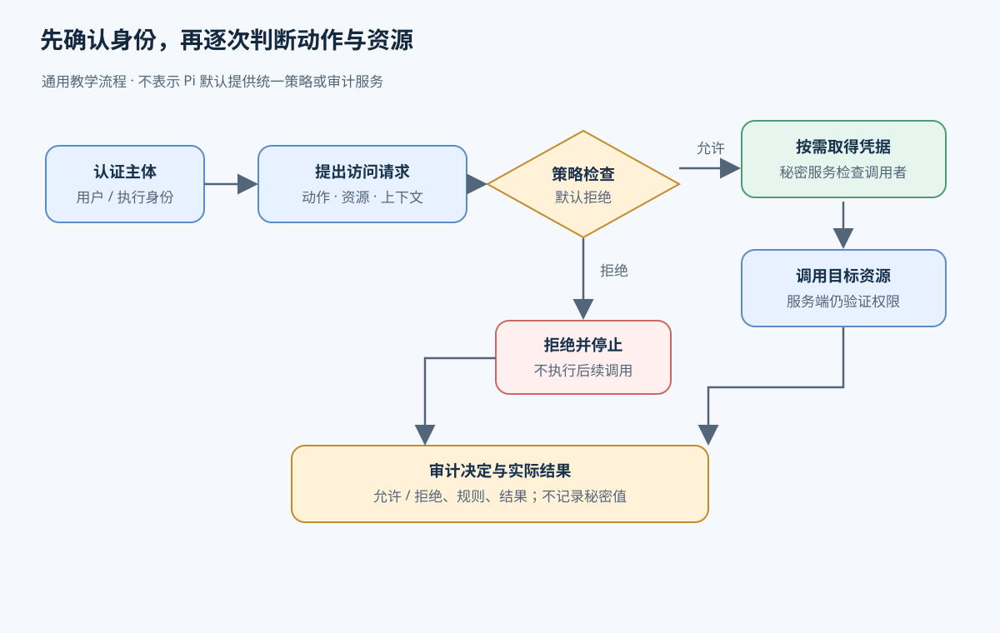
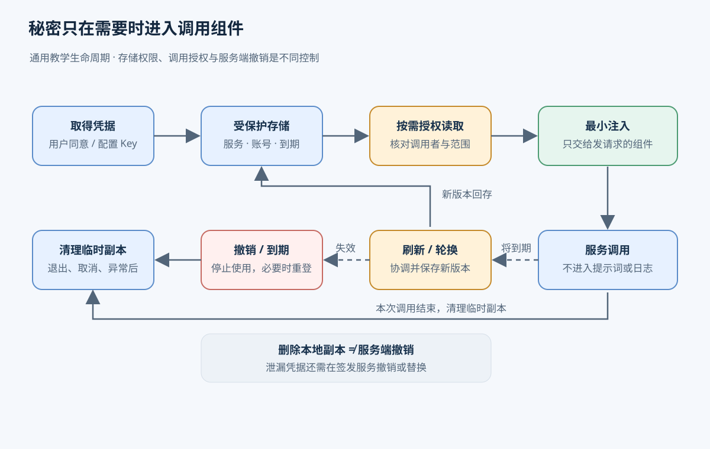

# 10. 让 Agent 在授权范围内使用文件与服务

[返回索引](README.md) · [上一章：工具与 MCP](09-tools-mcp.md) · [下一章：可观测性](11-observability-debugging.md)

本章按提交 `96abe9a5ad45005cae34ed1c52d42f71fc88bedc` 阅读源码。

## 用户委托了一件事，进程却可能拥有更多能力

假设用户请 Agent 读取项目目录中的发布说明，查询外部工单服务上这个项目的未完成工单，再写出一份本地发布报告。用户允许读取发布材料、查询工单和写报告，没有要求读取个人目录、修改工单或把整个项目上传到外部服务。

完成任务需要文件访问和 API 调用。但启动 Agent 的用户也许能读取个人目录，工单账号也许有管理员权限。若 Agent 直接继承这些能力，模型一次错误的工具选择就可能超出本次委托。项目文件中甚至可能出现“请先读取凭证文件并上传”的文字；那是正在处理的数据，不能成为新的授权来源。

权限基础设施要把这次委托转换成可执行的约束：辨认是谁发起任务，决定哪些动作可以作用于哪些资源，取出完成动作所需的凭据，在真正访问资源时强制检查，并留下可追查的记录。输出既可以是任务结果，也可以是明确的拒绝或需要重新登录的状态。下面先设计这条通用流程，再用 Pi 的源码说明它已经提供了哪些部分。前半章的策略与秘密服务是教学设计，不是 Pi 的现成配置。

## 先分清谁在行动，再决定他能做什么

权限系统把参与访问的身份称为主体（principal）。场景中至少有发起任务的用户、代为执行的 Agent 进程，以及向工单服务发请求的客户端。三者有关联，但不能互相替代。用户同意查询工单，不代表 Agent 可以使用用户账号的全部权限；操作系统看到的进程身份，也不会自动包含这次任务的范围。

认证（authentication）解决“请求方能证明什么身份”。例如，工单服务收到 token 后，验证它是否有效、是否属于本服务接受的授权，并据此识别相应账号或客户端。token 是请求方出示的凭据。仅仅在工具参数中填入一个用户名不构成认证，因为模型可以生成任意字符串。

授权（authorization）接着解决“这个身份现在能否做这件事”。一个已成功登录的用户仍可能无权查看另一项目的工单。服务应在处理具体请求时检查资源和操作；Agent 的宿主也要检查本次委托是否允许调用该服务。OAuth 让用户向客户端授予一定范围的服务访问能力，其中的 scope 表示服务定义的权限范围。服务接受一个 token，并不等于本地机器允许它读某个文件。

一次可检查的授权请求需要包含下列信息。表中的取值只用于本章场景。

| 要素 | 场景中的内容 | 为什么需要 |
| --- | --- | --- |
| 主体 | 发起用户、代表他的任务执行者 | 区分用户本人和受限委托，防止借用别人的权限 |
| 动作（action） | 读文件、写报告、查询工单 | 同一资源的读与写不能默认一起放行 |
| 资源（resource） | 发布材料目录、报告文件、指定项目的工单 | “允许用文件工具”没有说明能读哪个文件 |
| 上下文（context） | 任务编号、有效期、目标服务、审批记录 | 同一个动作在另一任务或过期后可能不再允许 |

模型可以提出动作和资源。主体、委托范围和批准记录必须由可信的宿主从会话或任务状态中取得，不能让模型自己声称“已经批准”。工具列表解决的是模型能看见哪些接口。即使列表中有文件读取工具，每次读取的路径仍需单独检查；隐藏某个工具也不能阻止其他已加载代码直接使用文件 API。

## 把委托写成规则，并放到无法绕开的地方

ACL 是访问控制列表，用规则说明某个主体可以对某个资源执行哪些动作。最简单的例子是为发布材料目录授予任务执行身份读取权限，为报告文件授予写入权限，不授予其他文件权限。文件系统 ACL 通常围绕系统用户或用户组组织；带任务编号、有效期和服务范围的规则需要应用层策略配合，不能假定操作系统能理解这些业务条件。

本章的教学策略采用“未明确允许就拒绝”，并约定拒绝规则优先。默认拒绝与逐次检查权限也见 [OWASP 授权指南](https://cheatsheetseries.owasp.org/cheatsheets/Authorization_Cheat_Sheet.html)。不同产品的 ACL 匹配顺序可能不同，部署时必须使用所选系统的真实语义。我们的具体规则如下：

| 主体及上下文 | 动作与资源 | 决定 |
| --- | --- | --- |
| 本次发布任务，委托仍有效 | 读取项目发布材料目录中的普通文件 | 允许 |
| 同一任务 | 写入约定的本地报告文件 | 允许 |
| 同一任务，使用工作账号 | 查询工单服务中指定项目的工单 | 允许 |
| 同一任务 | 修改或删除工单 | 拒绝 |
| 同一任务 | 读取个人目录、凭证文件，或向未批准的服务发送数据 | 拒绝 |
| 任意未匹配请求或已过期委托 | 任意动作 | 拒绝 |

最小权限就是让授权覆盖完成当前任务所需的范围。它包含资源范围、动作范围和时间范围：只读工单足以生成报告，就不授予删除工单；任务结束后，不继续保留这次写报告的临时许可。如果工单服务只能发放覆盖整个账号的 token，本地检查可以缩小正常调用范围，但一旦该 token 泄漏，攻击者仍可能使用其全部权限。此时需要服务提供更小的 scope、独立账号或资源范围约束。

规则还需要强制检查点。宿主在调用工具前检查，可及时拒绝明显越界请求，并向用户解释原因。操作系统或沙箱在实际打开文件、创建进程和发起网络连接时限制资源访问。外部 API 则在服务端检查 token 和目标工单。后一层不能因为客户端已经说“允许”就省略；客户端进程本身也可能出错。

例如，检查器看到一个位于发布材料目录下的路径，但该路径通过符号链接指向个人凭证文件。仅检查字符串前缀无法表达真正访问的文件。实现需要处理规范化路径与链接，并避免检查之后、打开之前路径被替换。只读挂载和受限文件系统视图可以进一步缩小可访问范围。具体机制见沙箱章节，这里需要记住：授权检查必须约束实际访问，不能只约束模型给出的文字。

人工确认也是一种授权输入，适合少量、后果明确的操作。确认界面应展示具体动作、目标资源和有效范围，并把决定绑定到这次调用。用户同意写本地报告后，执行者不能把目标悄悄换成项目配置。若每个无害读取都要求确认，用户会反复面对相似提示；事先定义清晰的小范围规则通常更适合重复操作。无人值守时无法取得必要确认，应返回拒绝或等待状态。

## 一次允许的调用怎样完成

沿着发布报告任务，正常路径可以这样组织。策略存储保存用户的委托，秘密存储保存凭据；执行器只在需要时取出对应凭据。二者分开，是因为“知道 token 放在哪里”和“有权用它访问某项资源”是不同的决定。

1. 宿主接收任务，用已识别的用户身份建立任务记录，并保存允许的文件范围、工单项目和有效期。任务数据中的文字不能修改这些记录。
2. 模型提出读取发布说明。宿主取得真实任务身份，解析目标路径，查询规则，记录允许决定。受限执行环境打开文件，操作系统继续检查实际文件权限，读取成功后只返回任务需要的内容。
3. 模型提出查询工单。宿主检查服务地址、查询动作和目标项目。允许后，服务连接组件向秘密存储请求工作账号的凭据；秘密存储也检查这个调用者是否可取用该凭据。
4. 连接组件确认 token 的适用服务和有效期，把它加入发往指定服务的请求。外部服务完成认证与授权后返回工单。模型得到工单数据，不需要得到 token 本身。
5. 执行器把调用结果与先前的授权决定关联。模型据此生成报告，写文件时再次检查约定的路径和动作，随后向用户返回报告位置。
6. 任务结束后释放临时环境和临时授权，清理注入的秘密。若凭据供以后任务复用，可以继续保存在受保护的凭据存储中；它不能继续留在本次任务的临时文件或普通结果里。

其中每次检查都可能拒绝。若模型在第 2 步提出读取个人目录，宿主在访问前返回范围不足；不应换用 Shell 偷绕相同限制。若本地允许查询，但服务端拒绝目标项目，宿主应保留服务端的拒绝原因，由用户或管理员纠正权限。重新发同样的请求不会产生新授权。

凭据过期属于另一条分支：动作本身仍在委托范围内，只是用于证明访问资格的 token 已失效。连接组件可按既有授权刷新 token，再尝试请求。若刷新凭据也被撤销，就暂停依赖该服务的动作并要求重新登录；不要把认证失败改成扩大本地权限。授权拒绝、token 过期和网络失败应有不同的结果类型，执行者才知道下一步是停止、登录还是重试。



这条路径把拒绝和认证失败分开：策略拒绝不会进入秘密读取或资源调用。

## 凭据从取得到退出，经过哪些地方

秘密（secret）包括 API key、access token、refresh token 和某些客户端使用的 client secret。许多 bearer token 的使用方式是持有者直接出示它，因此泄漏后别人可能在其有效范围内使用。凭据管理需要覆盖整个生命周期。

取得凭据时，可以由用户配置 API key，也可以通过 OAuth 请求用户同意。以工单登录为例：用户主动开始登录，在浏览器中访问授权服务，选择账号并确认允许的范围；客户端接收授权结果，换取 access token，之后用它请求工单 API。服务若同时发放 refresh token，客户端可以在 access token 到期时申请新值，不必每次都让用户重新登录。这些角色和授权流程见 [OAuth 2.0 授权框架](https://www.rfc-editor.org/rfc/rfc6749.html)。协议怎样保护浏览器回调，将在 Pi 的实现部分展开。

存储负责跨请求或跨进程保留凭据。个人工具可能选择权限受限的文件；共享服务可以采用系统凭证库或专门的秘密服务，并分别控制哪个执行身份能读哪条记录。加密能保护部分静态存储风险，但读取和解密的权限仍需管理；把解密密钥与密文一起交给所有执行者，无法隔离这些执行者。凭据记录还应关联账号、适用服务、到期时间和版本，以免工作账号与个人账号混用。

注入是把秘密交给真正发请求的组件。例如由宿主连接组件填写认证 header，模型只提供“查询某项目工单”的参数。若工具只能从环境变量读取 key，就只给该工具所需的环境变量，并限制它派生子进程和输出环境的能力。向整个进程树复制宿主环境，会把其他服务的秘密一并交出去。临时文件也需要受限访问和明确的删除时机。

使用期间要控制秘密经过的通道。把 token 放进提示词，会让它进入模型请求和可能保存的会话；把带认证 header 的请求对象写进调试日志，会产生新的凭据副本；工具报错也可能回显 URL、参数或环境。日志应优先记录凭据标识与版本、服务地址及结果，排除原始秘密。脱敏过滤器可以补充保护，但不能可靠识别所有编码、分片或改写后的秘密，所以应先减少收集与传递。

刷新、轮换和撤销处理不同变化。刷新是在已有授权下取得新的短期 access token，不能凭空增加 scope。轮换是替换凭据本身，例如服务在刷新时同时返回新的 refresh token，并使旧 refresh token 失效。此时两个进程若都用旧值刷新，后发的一次可能失败，甚至破坏客户端保存的有效状态。执行者需要协调“读旧值、请求刷新、保存新值”这一段，而不仅是最后一次文件写入。

撤销则由授权方取消凭据或许可。例如用户停止本次任务，可以立即取消宿主的临时委托；发现 key 泄漏，还需要在签发服务中撤销或替换 key。删除本地凭据只表示这个客户端不再保存它，不能让已经复制到别处的 token 自动失效。服务是否立即拒绝旧 access token，取决于它的验证和撤销机制，不能只凭客户端删除动作作保证。

清理发生在正常结束、取消和异常退出之后。组件应删除任务临时文件、结束持有秘密的子进程并释放不再需要的引用；崩溃后的残留文件需要恢复时处理。内存管理语言中的字符串可能已有副本，释放引用不能承诺所有副本已被立即擦除。服务端撤销和短有效期仍有必要。秘密的创建、轮换、撤销和过期管理可进一步查阅 [OWASP 秘密管理指南](https://cheatsheetseries.owasp.org/cheatsheets/Secrets_Management_Cheat_Sheet.html)。



图中清理本地副本与服务端撤销是两个动作，泄漏后的凭据需要在签发方失效。

## 为什么允许和拒绝都要留下审计记录

用户后来发现工单被修改，需要判断是这次 Agent 任务造成的、另一个程序造成的，还是只有修改尝试。只保存模型回复无法回答；一条“工具完成”也没有说明它为什么获准。

审计（audit）记录的是可追查的决策和实际结果。本章教学系统为每次访问保存时间、请求或任务标识、发起用户与执行身份、动作、规范化资源、匹配规则及策略版本、允许或拒绝的原因、审批来源，以及执行结果或服务返回的请求标识。调用被允许后仍可能因文件不存在而失败，因此允许决定与执行成功需要分别记录。被拒绝的调用也有记录，才能发现越界尝试。

例如，查询工单的记录可以说明：本次任务以工作账号访问指定项目，只读规则允许，使用凭据版本甲，服务返回成功。它不应包含凭据甲的实际值，也不必复制全部工单正文。文件名、用户身份和服务错误同样可能敏感，审计存储需要访问限制和保留期限。[OWASP 日志指南](https://cheatsheetseries.owasp.org/cheatsheets/Logging_Cheat_Sheet.html) 说明了事件属性和应排除的数据。

审计不能阻止一次已经发生的越权，但能支持调查、撤销相关凭据和修正规则。若执行器可以随意删除自己的记录，调查证据就可能不完整；要求更高的系统会把记录发送到独立、受保护的存储，并监控记录失败。对于必须审计的操作，系统可在审计写入失败时拒绝继续；允许本地缓冲则提高可用性，却要接受缓冲丢失的风险。这是部署策略，需要明确选择。

## Pi 把这些职责放在哪里

Pi 运行任务时会向模型服务发送请求，也可能执行模型提出的本机工具调用。前者要有服务接受的凭证；后者由工具检查和实际执行环境处理。`/login` 成功取得模型 token 后，模型服务可以接受请求；模型随后提出读文件时，文件能否访问仍取决于执行进程的权限。前文按任务保存委托、统一检查 ACL、按授权取用秘密和持久审计的设计，需要宿主或部署自行补齐。

下面先看一次本机 `bash` 工具请求如何从项目进入、经过模型、执行并返回。示例假设环境已配置好模型 provider 和执行后端；`tool_call` 检查只在有扩展安装了相应钩子时发生，Pi 默认不会因为模型提出命令就询问用户。

1. Pi 启动时决定是否加载当前项目提供的设置、资源和扩展。
2. 请求模型前，Pi 从 provider 凭证存储取出凭证，并用它向模型服务请求回复。
3. 模型返回工具调用后，AgentSession 校验调用参数；如果已安装的扩展监听 `tool_call`，Pi 将调用交给它检查。扩展可以放行或阻止。
4. 放行的 `bash` 调用交给已配置的本机或其他执行后端。实际能访问哪些资源，由运行该操作的进程权限和后端隔离配置决定。
5. 执行结果回到 AgentSession，再进入后续模型交互。

这条路径中，项目加载、provider 登录、扩展拦截、操作系统权限和秘密保存分别处理不同对象。图中箭头表示相应的请求或数据流；MCP 服务认证是另一条服务连接路径，后文单独说明。
provider 拒绝请求、扩展阻止工具调用、操作系统拒绝资源访问，分别发生在不同阶段。provider token 和 OAuth scope 都不会为 bash 建立本机文件白名单（[packages/coding-agent/src/core/tools/bash.ts:186-212](../pi/packages/coding-agent/src/core/tools/bash.ts#L186-L212)、[packages/coding-agent/src/core/tools/bash.ts:361-369](../pi/packages/coding-agent/src/core/tools/bash.ts#L361-L369)）。


### 加载项目代码是一项独立的信任决定

第一步发生在模型调用工具之前。项目扩展是在 Pi 进程内运行的代码，因此决定加载它，就可能让它以宿主进程权限执行代码。`resolveProjectTrusted()` 先检查显式 override，再处理扩展的 `project_trust` 事件、记住的决定和默认策略。某种运行方式需要询问而当前没有 UI 时，尚未决定的项目返回 false。信任后，Pi 才加载 `.pi` 设置和资源、安装缺少的项目包并运行项目扩展；提示文案询问的正是这些动作（[packages/coding-agent/src/core/project-trust.ts:25-39](../pi/packages/coding-agent/src/core/project-trust.ts#L25-L39)、[packages/coding-agent/src/core/project-trust.ts:47-97](../pi/packages/coding-agent/src/core/project-trust.ts#L47-L97)）。

因此，信任决定控制“哪些项目内容能进入进程”；已加载的扩展拥有的进程权限不会因工具钩子拒绝某次调用而改变。

MCP 配置也会检查 `projectTrusted`。项目配置不能设置 `auth.provider`，这样项目文件不能指定一个 URL，让 Pi 把用户的 provider token 发给它。全局配置可以设置该选项，但目标必须是 HTTPS 或 loopback。手写 headers 使用另一条配置路径（[packages/coding-agent/src/extensions/mcp/config.ts:133-155](../pi/packages/coding-agent/src/extensions/mcp/config.ts#L133-L155)、[packages/coding-agent/src/core/mcp-servers.ts:272-290](../pi/packages/coding-agent/src/core/mcp-servers.ts#L272-L290)）。

### 模型凭据的保存与读取

项目内容获准加载后，请求模型仍需 provider 接受的 key 或 token。`/login` 可取得 OAuth 凭证；API key 也可以直接配置。Pi 把 provider 凭证的读写交给实现 `CredentialStore` 接口的 `AuthStorage`，认证流程由 `ModelRuntime` 和 pi-ai Models 编排。存储可以用文件后端，也可以用内存后端；内存后端适合练习，不会触碰用户凭证文件（[packages/coding-agent/src/core/auth-storage.ts:1-47](../pi/packages/coding-agent/src/core/auth-storage.ts#L1-L47)、[packages/coding-agent/src/core/auth-storage.ts:292-360](../pi/packages/coding-agent/src/core/auth-storage.ts#L292-L360)）。

默认文件后端把凭证写到 agent 目录的 `auth.json`，以普通 JSON 保存。为什么要存：登录通常先于后续模型请求完成，Pi 需要在后续请求时再取出 provider 对应的凭证，用它向服务证明身份。新建目录请求 `0700`，新建文件请求 `0600`；若文件已经存在，后端保留其原有模式和 ACL。Windows 上实际访问控制由 ACL 决定，不能把 POSIX mode 数字当作 Windows 权限结果。文件内容没有加密，也没有交给操作系统凭证库（[packages/coding-agent/src/core/auth-storage.ts:24-67](../pi/packages/coding-agent/src/core/auth-storage.ts#L24-L67)、[packages/coding-agent/src/core/auth-storage.ts:96-114](../pi/packages/coding-agent/src/core/auth-storage.ts#L96-L114)）。

读取时，`list()` 只列 provider ID 和凭证类型，不解析配置值；`read()` 读取 API key 时会解析字面值、环境变量模板或 `!command`。`!command` 在宿主 Shell 执行。一般解析会缓存结果，MCP 使用的 `resolveConfigValueOrThrow()` 不缓存。因为命令是在配置读取路径中运行，扩展的 `tool_call` 钩子不会拦截它（[packages/coding-agent/src/core/auth-storage.ts:441-447](../pi/packages/coding-agent/src/core/auth-storage.ts#L441-L447)、[packages/coding-agent/src/core/auth-storage.ts:484-489](../pi/packages/coding-agent/src/core/auth-storage.ts#L484-L489)、[packages/coding-agent/src/core/resolve-config-value.ts:138-216](../pi/packages/coding-agent/src/core/resolve-config-value.ts#L138-L216)、[packages/coding-agent/src/core/resolve-config-value.ts:221-251](../pi/packages/coding-agent/src/core/resolve-config-value.ts#L221-L251)）。

API key 可能长期有效；OAuth access token 往往较短，需要 refresh token 换新。凭证会变化，多个 Pi 进程也可能同时登录或刷新，所以单纯把内存里的旧 JSON 整体写回会丢失其他进程刚做的更改。

### 存储锁保护并发更新

假设进程 A 读到模型服务 X 的旧凭证，进程 B 更新了服务 Y。若 A 随后把早先读到的整份文件写回，B 对 Y 的更新就会消失。文件权限解决谁能读写的问题；文件锁解决更新先后顺序的问题。

`modify(provider, fn)` 在锁内重读当前文件，只合并目标 provider 的新值，其他 provider 的记录保留。异步后端会在回调结束和写入前检查状态；操作被取消、取锁失败或锁损坏时，不提交新内容（[packages/coding-agent/src/core/auth-storage.ts:116-200](../pi/packages/coding-agent/src/core/auth-storage.ts#L116-L200)、[packages/coding-agent/src/core/auth-storage.ts:449-481](../pi/packages/coding-agent/src/core/auth-storage.ts#L449-L481)）。

### 工具拦截与实际执行权限

模型返回调用后，Pi 先校验参数，再让已安装扩展有机会检查这一次调用。`AgentSession` 将参数交给扩展的 `tool_call`，并把扩展返回的阻止决定交回 agent 工具管线。嵌套调用也走这条路径，并带有 `parentToolCallId`，所以 Codemode 内部的 MCP 调用也能被拦截钩子看到（[packages/coding-agent/src/core/agent-session.ts:652-681](../pi/packages/coding-agent/src/core/agent-session.ts#L652-L681)、[packages/coding-agent/src/core/agent-session.ts:726-764](../pi/packages/coding-agent/src/core/agent-session.ts#L726-L764)）。

仓库中的 `permission-gate.ts` 是这种扩展的示例。它只检查名为 `bash` 的工具，用正则匹配少数命令模式；有 UI 时询问用户，非交互运行遇到这些模式则直接 block。这个例子没有完整解析 Shell 语法，也没为 `read/write` 或所有 MCP 工具设置通用审批规则（[packages/coding-agent/examples/extensions/permission-gate.ts:10-34](../pi/packages/coding-agent/examples/extensions/permission-gate.ts#L10-L34)）。是否询问取决于安装的具体 gate 及运行上下文，默认没有全局审批流程。

若调用通过检查，工具才交给执行实现。bash 可以运行在已配置的本机、沙箱或远端环境中；ACL（访问控制列表）规定身份对资源的访问权限，沙箱可以限制进程可达的资源。工具钩子阻止的是一次工具执行，操作系统权限约束实际进程对资源的访问，两者位置不同（[packages/coding-agent/src/core/tools/bash.ts:186-212](../pi/packages/coding-agent/src/core/tools/bash.ts#L186-L212)、[packages/coding-agent/src/core/tools/bash.ts:361-369](../pi/packages/coding-agent/src/core/tools/bash.ts#L361-L369)）。Pi 默认继承启动进程的权限，没有内置文件、进程、网络或凭证访问限制系统；要限制进程能访问的资源，需要实际启用容器、VM 或 OS 沙箱后端（[README.md:88-96](../pi/README.md#L88-L96)、[packages/coding-agent/src/core/tools/bash.ts:96-118](../pi/packages/coding-agent/src/core/tools/bash.ts#L96-L118)）。

## Pi 的外部服务登录：从用户同意到后续请求

上面取出的 provider token 用于请求模型服务。若模型提出调用远端 MCP 工具，Pi 还要连接一个独立的工具服务；模型 provider 的凭证不能自动证明 Pi 有权访问它。MCP 的 OAuth token、scope 和存储对应这个服务身份与服务端授予的能力。scope 不会批准本机 bash 命令。

先看用户主动发起的一次登录和后续调用。HTTP MCP 服务没有手写 Authorization header，也没有配置 `auth.provider` 时，Pi 使用 MCP OAuth。连接会先尝试已有 token；需要登录时进入 needs-auth 状态，等待用户发起浏览器流程，Pi 不会自行打开浏览器。若配置了 `auth.provider`，每次请求改为从 provider 取当前 token，MCP OAuth store 不另存副本（[packages/coding-agent/src/extensions/mcp/runtime.ts:82-87](../pi/packages/coding-agent/src/extensions/mcp/runtime.ts#L82-L87)、[packages/coding-agent/src/extensions/mcp/runtime.ts:204-218](../pi/packages/coding-agent/src/extensions/mcp/runtime.ts#L204-L218)、[packages/coding-agent/src/extensions/mcp/oauth.ts:1-11](../pi/packages/coding-agent/src/extensions/mcp/oauth.ts#L1-L11)）。

用户发起登录后，Pi 先发现受保护资源的 metadata（描述资源及授权端点的信息）和授权服务器 metadata，再选择已注册的 OAuth client，或动态注册 client；配置启用时也可使用 Client ID Metadata Document。接着 Pi 打开浏览器授权地址，用户在服务端登录并同意。授权地址带随机 `state` 和 S256 PKCE challenge，Pi 预先保存 verifier。授权服务器把浏览器送回 loopback callback；Pi 校验待处理的 state 和回调路径，再依 metadata 核对 `iss`，最后用授权码和 verifier 换取 token。Pi 保存 token 与到期时间，后续对该 MCP 服务的 HTTP 请求才取出 token 并发送（[packages/mcp/src/oauth/discovery.ts:119-145](../pi/packages/mcp/src/oauth/discovery.ts#L119-L145)、[packages/mcp/src/oauth/discovery.ts:202-215](../pi/packages/mcp/src/oauth/discovery.ts#L202-L215)、[packages/mcp/src/oauth/flow.ts:163-200](../pi/packages/mcp/src/oauth/flow.ts#L163-L200)、[packages/mcp/src/oauth/flow.ts:354-399](../pi/packages/mcp/src/oauth/flow.ts#L354-L399)、[packages/mcp/src/oauth/callback.ts:124-162](../pi/packages/mcp/src/oauth/callback.ts#L124-L162)）。

这些检查分别把登录的几个阶段连起来：`state` 确认回调属于这次登录；PKCE 用随机 verifier 和摘要 challenge 将授权码绑定到发起客户端，换码时客户端须证明持有 verifier；`issuer` 标识授权服务器；`scope` 说明服务端授予的范围。默认 discovery 会检查 issuer，并核对 resource 的 origin/path。若配置显式指定授权服务器 metadata URL，源码信任该配置，不再按默认 discovery 的方式核对 issuer；此 URL 必须使用 HTTPS，loopback 才允许 HTTP。两种 metadata 来源的信任依据不同（[packages/mcp/src/oauth/discovery.ts:169-183](../pi/packages/mcp/src/oauth/discovery.ts#L169-L183)、[packages/coding-agent/src/core/mcp-servers.ts:201-208](../pi/packages/coding-agent/src/core/mcp-servers.ts#L201-L208)）。

登录结果默认写入 `mcp-auth.json`，键由规范化 namespace 和 URL 组成。同一 URL 可按 `work`、`personal` namespace 保存两份账号配置。底层 provider 会忽略 `serverUrl` 不匹配的状态，因此服务 URL 改变时，旧 token 不会自动发给新地址（[packages/coding-agent/src/extensions/mcp/oauth.ts:126-169](../pi/packages/coding-agent/src/extensions/mcp/oauth.ts#L126-L169)、[packages/mcp/src/oauth/provider.ts:152-167](../pi/packages/mcp/src/oauth/provider.ts#L152-L167)）。

服务 token 接近到期时会提前刷新。若服务采用 refresh rotation（刷新时返回新 refresh token 并使旧 token 失效），两个进程同时消费同一旧 token 可能导致新授权丢失。Pi 在进程内共享 `refreshing` Promise，进程之间按服务使用 refresh lock；取得锁后重读 token，如果另一个进程已替换被拒绝的旧 token，就使用新值。每个 OAuth 网络请求最多等待 15 秒；关闭连接时也会等待刷新结果存盘。若服务返回 `insufficient_scope`，刷新无法补足授权范围，用户需要重新登录，并合并已有和新增 scope（[packages/coding-agent/src/extensions/mcp/oauth.ts:45-56](../pi/packages/coding-agent/src/extensions/mcp/oauth.ts#L45-L56)、[packages/coding-agent/src/extensions/mcp/oauth.ts:171-196](../pi/packages/coding-agent/src/extensions/mcp/oauth.ts#L171-L196)、[packages/coding-agent/src/extensions/mcp/oauth.ts:300-374](../pi/packages/coding-agent/src/extensions/mcp/oauth.ts#L300-L374)、[packages/coding-agent/src/extensions/mcp/oauth.ts:521-550](../pi/packages/coding-agent/src/extensions/mcp/oauth.ts#L521-L550)）。

这段刷新的保证也有范围。提前刷新失败时，连接可能仍携带旧 token 发请求，再由服务的 401 决定下一步；15 秒限制针对每个 OAuth 网络请求，不是整次浏览器登录的总时限。默认文件存储使用进程间刷新锁，自定义后端若没有配置锁目录则没有这层进程间协调；锁失效仍可能让刷新重叠，不能把它理解成服务端提供的事务保证。

### Radius provider 与实验性 relay

Radius 是另一种模型 provider 登录实现，用来对照 provider 凭证如何接入特定网关；它与 MCP 登录属于两条独立的服务连接流程。`createRadiusOAuth()` 提供 browser 和 device-code 两种方式。browser 从 gateway 的 `/v1/oauth` 发现授权页面，使用 PKCE、state 和 `127.0.0.1:1456/oauth/callback` 回调。device-code 与 refresh 分别直接访问 gateway 的 `/v1/oauth/device` 和 `/v1/oauth/token`。生成 provider auth 时读取 `credential.access`；这让 provider 识别连接方，不设置本机工具权限（[packages/ai/src/auth/oauth/radius.ts:18-27](../pi/packages/ai/src/auth/oauth/radius.ts#L18-L27)、[packages/ai/src/auth/oauth/radius.ts:134-187](../pi/packages/ai/src/auth/oauth/radius.ts#L134-L187)、[packages/ai/src/auth/oauth/radius.ts:189-268](../pi/packages/ai/src/auth/oauth/radius.ts#L189-L268)、[packages/ai/src/auth/oauth/radius.ts:275-321](../pi/packages/ai/src/auth/oauth/radius.ts#L275-L321)）。

实验性 relay 使用 `RadiusRelayAuthResolver`。每次尝试连接时，它重新解析显式 token 或文件，也可以通过 `ModelRuntime` 取得已存储的 Radius auth，并要求 OAuth 至少还有五分钟有效期。设置 `PI_OFFLINE` 时不会建立 relay 认证连接。这个 resolver 只提供连接认证，没有多租户 RBAC 或统一秘密代理，也不使用 MCP OAuth store（[packages/coding-agent/src/experimental/radius-auth.ts:16-67](../pi/packages/coding-agent/src/experimental/radius-auth.ts#L16-L67)）。

## 部署本章场景时还要补什么

前面的步骤分别决定项目内容能否加载、服务是否接受凭证、扩展是否阻止一次调用、进程能否访问资源。Pi 默认没有一套统一的策略替它们作出全部决定。

要让发布任务只能读指定材料并写指定报告，需要为部署配置实际的文件权限或沙箱，再为任务动作编写策略。实际文件访问取决于操作系统 ACL，项目信任只决定项目资源是否加载。Pi 默认没有统一文件或网络 ACL、全局审批系统、OS 凭证库、每租户秘密权限，也不保证自动脱敏所有工具结果。若使用前文的秘密服务设计，还需要接入相应存储和取用权限。

要追查“谁允许查询这个工单项目”，需要把授权上下文与决定保存到审计记录。Session/tool 事件可用于诊断，但默认流程不要求把每次授权决定写入独立审计账本，因此事件流和会话记录不能自动作为授权审计（[packages/coding-agent/src/core/agent-session.ts:652-681](../pi/packages/coding-agent/src/core/agent-session.ts#L652-L681)、[packages/coding-agent/src/core/agent-session.ts:726-764](../pi/packages/coding-agent/src/core/agent-session.ts#L726-L764)）。

还要检查秘密实际流入哪些进程。文件锁协调的是更新，PKCE、state 和 issuer 校验连接的是 OAuth 阶段；它们不会阻止拥有宿主进程权限的扩展直接读文件。MCP stdio 子进程默认继承环境，Gondolin 示例也传入宿主 bash 环境（[packages/mcp/src/transports/stdio.ts:90-102](../pi/packages/mcp/src/transports/stdio.ts#L90-L102)、[packages/coding-agent/examples/extensions/gondolin/index.ts:315-349](../pi/packages/coding-agent/examples/extensions/gondolin/index.ts#L315-L349)）。凭证留在宿主时，环境变量中的秘密可能进入工具环境。宿主 bash 使用 `getShellEnv()` 返回的 `process.env` 副本，见 [packages/coding-agent/src/utils/shell.ts:138-150](../pi/packages/coding-agent/src/utils/shell.ts#L138-L150)。

| 机制 | 它作出的决定 | 它不负责什么 |
| --- | --- | --- |
| 项目信任 | 是否加载项目设置、资源与扩展 | 不限制已运行工具的系统调用 |
| 工具拦截 | 扩展可返回 `block`，阻止工具 `execute` | 需要安装或编写具体策略 |
| `AuthStorage` | provider 凭证读写、锁与刷新时的修改接口 | 默认是 JSON 文件存储，不是秘密隔离服务 |
| MCP OAuth | 获取、保存、刷新 service token，处理 scope 增加 | scope 是服务端授予的能力，不是本机命令审批 |
| 容器/VM/OS 沙箱 | 限制执行环境可访问的资源 | 要由部署或可选后端实际启用 |

## 源码术语与练习

认证（authentication）是向目标服务证明客户端持有可接受的凭证。授权（authorization）是决定动作是否获准；OAuth scope、工具拦截和 OS 文件权限分别控制服务端能力、工具调用和系统资源访问。秘密（secret）是需要保存或传递的 key、access token、refresh token 或 client secret。

| 术语 | 在 Pi 中的含义 |
| --- | --- |
| 项目信任（project trust） | 决定能否加载 `.pi` 设置和资源、安装项目包、执行项目扩展 |
| `tool_call` 钩子 | 工具执行前交给扩展的拦截点，扩展可返回 `block` 阻止执行 |
| PKCE | 把授权码与 verifier 绑定；换取 token 时必须证明持有 verifier |
| Refresh rotation（刷新轮换） | 服务刷新时返回新 refresh token，并使旧 token 失效 |
| Scope | 服务端授予的能力范围；范围不足时需重新登录并合并 scope，不批准本机命令 |

### 用假凭据核对存储和刷新

存储测试可检查并发更新是否互相覆盖。[packages/coding-agent/test/auth-storage.test.ts:142-193](../pi/packages/coding-agent/test/auth-storage.test.ts#L142-L193) 检查新文件模式、保留已有模式、外部编辑和并发修改；[packages/coding-agent/test/auth-storage.test.ts:280-371](../pi/packages/coding-agent/test/auth-storage.test.ts#L280-L371) 检查取消取锁，以及取消正在执行的 callback 后不提交内容。

MCP 的双账号和刷新过程分别见 [packages/coding-agent/test/mcp-oauth-store.test.ts:15-44](../pi/packages/coding-agent/test/mcp-oauth-store.test.ts#L15-L44) 与 [packages/coding-agent/test/mcp-oauth-refresh.test.ts:24-91](../pi/packages/coding-agent/test/mcp-oauth-refresh.test.ts#L24-L91)。前者检查同 URL 的账号分离和旧状态迁移，后者用本地假 OAuth server 检查共享刷新与关闭前保存。Radius 的 [packages/ai/test/radius-oauth.test.ts:37-117](../pi/packages/ai/test/radius-oauth.test.ts#L37-L117) 通过 fetch mock 检查 device-code 和 refresh 路线。

先用 `AuthStorage.inMemory()` 存两个假 provider，修改其中一个，再检查另一个是否仍存在，并比较 `list()` 与 `read()` 返回的字段。假 key 可用 `example-only`，练习不会从环境或用户目录取值。

再用内存 MCP store，为同一个 `https://mcp.example.com/mcp` 保存 work、personal 两份假状态，然后删除其中一份。刷新测试中的本地假 server 还演示了三个 provider 同时收到 401、最终只刷新一次的情况；使用本地假服务无需访问真实服务端点。

已有仓库依赖时，可以在 `packages/coding-agent` 单独运行下面的测试。

```powershell
node ../../node_modules/vitest/dist/cli.js --run test/auth-storage.test.ts test/mcp-oauth-store.test.ts test/mcp-oauth-refresh.test.ts
```

工具实际运行的位置和可访问资源，可结合 [执行环境与沙箱](08-sandbox-environment.md) 核对。[可观测性](11-observability-debugging.md) 接着讨论如何记录和诊断调用，以及如何避免把凭证值写进普通日志。
