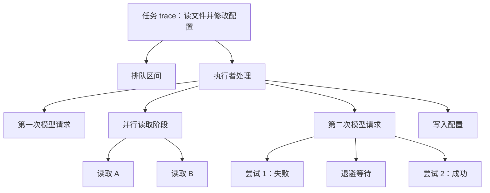

# 11. 怎样判断一次任务慢在哪里

[返回学习地图](README.md) · 前置：[Agent 循环](01-agent-runtime.md) · 关联：[评估与回放](12-evaluation-replay.md)

用户提交“读两个文件后修改配置”，等了很久才收到结果。任务最终成功，两个文件也读到了，但这些信息还不能回答：任务一直在排队吗？模型响应慢吗？两个读取真的并行了吗？中间有没有失败后重试？增加执行者数量，是否会让下一次任务更快？

可观测性要留下足以回答这些问题的运行证据。输入是执行过程中产生的时间、事件、状态和资源用量；输出是可查询的单次执行过程，以及很多次执行的汇总。排查者据此选择下一步检查或修改的位置。遥测丢失时，仍应能从业务存储判断任务是否完成；遥测记录本身不承担任务恢复职责。

前半章用一个通用任务服务说明这些证据如何产生。该服务有队列、执行者和遥测存储，属于教学架构，不代表 Pi 默认 CLI 已提供这些组件。后半章再核对 Pi 的事件、会话统计和实验性 durable 路径。

## 从一条开始日志到一条可追踪的请求

任务在入口被接受，先进入队列，空闲执行者领取后调用模型。模型要求读取 A、B 两个文件，执行者同时启动两次读取；拿到结果后再次调用模型，再写入配置，最后返回用户。每个参与者都只知道自己执行的那部分。如果执行者只打印“开始”“完成”，几项任务并发时记录便会交错；另一台机器上的子任务也无法凭日志相邻位置找回父任务。

入口因此给这次任务一个稳定的任务 ID，并建立一次 trace，即关联本次请求各项操作的追踪。trace ID 标识这组遥测记录；任务 ID 标识业务工作。二者分开保存，便于一个长任务跨恢复过程关联多段追踪，也避免把重试误认成新任务。

执行者为模型请求、文件读取、配置写入分别创建 span。span 是一次有边界的操作记录，通常有名称、开始时间、结束时间、状态、属性和自己的 span ID。创建子操作时，同时保存父 span ID，于是可以回答“这次读取属于哪个执行过程”。每次重试须有新的尝试记录和尝试序号；覆盖上一条失败记录会抹掉慢任务的原因。



图只表示操作归属，实际先后与重叠还需时间戳。若读取交给另一台 worker，提交方须把 trace ID、父 span ID 等追踪上下文放进队列消息或网络请求；接收方提取上下文后创建自己的 span。子任务还应保存父任务 ID 和自身任务 ID，帮助把追踪与业务状态对应起来。上下文没有传过去，两边即使都有日志，也只会得到两段无法自动拼接的记录。批量消费或多个父任务汇合时，可以用 span link 表示额外关联，不应伪造一个唯一父操作。

同一过程还会产生另外两种证据。日志记录离散事件，例如“第二次模型请求返回限流错误”；带上时间、错误类别和 trace ID 后，可以从追踪跳到错误细节。指标（metrics）把许多执行汇总成计数、当前值或分布，例如一分钟内完成的任务数、当前排队数和耗时分布。指标能告诉我们“最近很多任务变慢了”，但通常不保存每个任务的完整细节。trace 用于检查一个具体任务，日志补充发生的事件，指标判断现象的规模。这些信号的基本分工可参阅 [OpenTelemetry signals](https://opentelemetry.io/docs/concepts/signals/)。

## 证据怎样从执行现场到达查询界面

只有创建 span 的接口，排查人员仍然查不到运行历史。完整链路需要把采集、关联、传输和保存都接起来：

1. 入口记录接受时间和任务 ID，创建追踪上下文。队列保存入队时间与上下文；领取时记录领取时间。队列拥有任务状态，遥测记录这些状态变化的证据。
2. 执行者记录开始处理的时刻，在模型、工具、子任务和每次重试周围采集 span；日志携带同一关联信息。模型返回 usage 时，把用量归入对应请求和尝试，结束时补充状态。操作失败也要结束记录，避免正常错误看起来像一直运行。
3. 进程内遥测组件聚合计数和耗时分布，把日志与已完成的 span 放入有容量上限的缓冲区。exporter（导出器）按后端协议批量发送；需要集中处理时，再由 collector（收集服务）接收、过滤、脱敏和转发。小型程序也可直接写本地文件，无须先搭独立服务。
4. 存储后端保存可查询的 trace、日志和指标，并规定保留时间。缓冲区排满或网络不可用时，要明确丢弃、重试或阻塞策略，并记录丢失数量。否则查询缺一段时，排查者不知道是业务没执行还是遥测没送到。
5. 查询界面先按时间窗口和服务版本查看延迟或失败率，再用具体任务 ID 找到 trace。查看者沿时间线定位最长等待区间，读取相关日志，并与队列或任务存储中的当前状态对照。


任务 ID 用于 Trace 或日志下钻，不作为每个任务各自一条指标序列的标签。

跨进程传递的是可序列化的上下文，不能把内存里的 span 对象直接交给另一台 worker。跨机器的绝对时间还依赖时钟校准；单个进程内测耗时应优先使用单调时钟，避免系统时间调整导致负耗时。若两台机器时钟有偏差，不能仅凭显示位置断言哪个事件先发生，还需调用关系和消息关联信息。

## 把用户等待拆成能采取行动的时间

先为任务定义四个边界：入口接受、执行者开始处理、执行者处理结束、结果可供用户取得。接受到开始处理是排队时长；开始处理到处理结束是执行阶段时长；接受到结果可用是端到端延迟。执行阶段本身仍可能包含网络等待、退避和等待子任务，并不等于 CPU 一直在工作。如果结束后还有结果传输，也要单独计入用户等待。任务多次重新入队时，应逐段记录排队，不能把第一次领取以后的所有时间都叫执行计算。

下面是假设没有重试的一次教学测量，数值仅用于演算，不是 Pi 默认值或真实基准：排队 2 秒，第一次模型请求 1 秒；随后 A、B 同时开始，分别耗时 820 毫秒、190 毫秒；两者都完成后，第二次模型请求耗时 1 秒，写入配置耗时 100 毫秒。忽略其他开销时，端到端延迟为 4.92 秒，其中执行阶段为 2.92 秒。

A、B 的耗时相加是 1.01 秒，读取阶段实际经过的时间是 820 毫秒。并行部分按实际重叠区间计算，不能把所有 span 的 duration 相加当作总耗时；父 span 已覆盖的子 span 时间也不能重复加入。决定任务最早何时能完成的依赖链称为关键路径。这里后续模型请求必须等 A，因此把 B 从 190 毫秒优化到 50 毫秒，并不会缩短任务的结束时间。若工具开始时间不同，则连取最大 duration 也不够，需要看各自的开始、结束和后续依赖。

这个分解直接改变排查方向。若大部分时间在排队，应检查可用执行容量和输入速度；若排队正常、模型请求变长，应查看服务响应、输入输出规模与重试；若工具完成后仍长时间没有返回，应检查后续模型请求、hook、监听器和结果交付。没有对应 span 的空白只能叫尚未测量的区间，不能直接归因于模型。


本例 B 的 190 毫秒已经被 A 的等待覆盖，减少 B 的时长不会改变总延迟。

流式响应还可记录请求到首个内容片段的时间，以及请求到完整结束的时间。前者影响用户多久看到进展，后者影响工具何时获得完整参数、任务何时进入下一步。只报告首个片段到达很快，会漏掉生成阶段拖长的问题。

## 一条慢任务之外，怎样判断系统是否积压

单次追踪解释一次经历。判断这是不是普遍退化，需要在固定窗口内汇总同一类任务，并注明环境、版本、成功或失败范围。

延迟的 p50 是中位数，约一半样本不超过它；p95 表示约 95% 的样本不超过该值。若 p50 稳定而 p95 上升，说明较慢的那部分任务恶化，可能只影响特定模型、工具或重试路径。平均值会把这些长等待摊薄。各 worker 的 p95 不能直接求平均得到系统 p95，应合并原始样本或可合并的直方图后再计算；直方图分桶越粗，分位数估计越粗。

对前面的队列，同时观察以下指标才能区分突发流量正在消退，还是处理能力长期不足：

| 指标 | 在这个任务服务里怎样定义 | 能帮助判断什么 |
| --- | --- | --- |
| queue depth | 此刻尚未领取的任务数，运行中任务另计 | 积压数量是否持续增长 |
| queue age | 当前队列中最老任务已经等待多久 | 是否有低优先级任务长期得不到执行 |
| queue latency | 已被领取任务的入队到领取时长分布 | 用户通常及最慢一批等了多久 |
| throughput | 单位时间内完成的任务数，注明是否仅成功任务 | 系统实际处理速度 |
| arrival rate | 单位时间接受的任务数 | 输入是否持续超过处理能力 |

queue latency 只包含已领取任务，最老的未领取任务尚未进入分布，所以还要看 queue age。只有 depth 也不足以判断严重性：相同数量的轻任务与长任务对应不同等待。提高并发前应查看执行者资源和下游限流；若模型服务已经限流，更多并发可能制造更多重试，反而拉长队列。

指标通常按模型、工具名称、结果类别、部署版本等有限集合分组。这种不同标签值数量有限的属性称为低基数。把每个任务 ID 都作为标签，会为几乎每个任务新建一组时间序列，增加存储和查询开销。任务 ID、调用 ID 和完整错误细节应放在 trace 或日志中，汇总图需要下钻时再关联具体追踪。

## Token、成本和失败率都需要统计口径

一次任务可能调用模型多次；第二次还可能失败后重试。要解释成本，必须把每次请求的 usage 归属到任务和尝试，再汇总。Token 是模型处理文本等内容时采用的计量单位，不能简单等同于字符或单词。输入 token、输出 token、缓存读取和缓存写入可能使用不同价格；供应商对输入是否已包含缓存部分的定义也可能不同。归一化时先明确哪些类别互斥，避免把已经包含在总输入中的缓存 token 又加一次。

估计成本按每类用量乘对应单价后求和，并保留模型、价格版本、币种和计价单位。一次任务成本要包含实际发生的重试、为它生成摘要的请求及其他归属费用，不能只取最后一个成功响应。失败请求若没有返回 usage，应记为未知或另行核对，不能据此认定没有费用。应用估算值与供应商最终账单也可能因价格规则、折扣或缺失用量不同，需要单独对账。

会话是多个用户输入累积的容器。如果第一次让 Agent 读文件，第二次让它修改配置，整个 Session 的 token 总数自然可能包含两次工作。单任务统计应按明确的开始结束边界或任务归属收集；只有在期间没有其他并发工作等前提下，才可用累计值的前后差近似本次用量。

失败率也必须先决定在数什么。假设同一批 10 项任务已经全部结束，其中一项失败两次、第三次成功，其余各成功一次：任务失败率是 0/10，尝试失败率是 2/12；发生过重试的任务比例是 1/10，额外重试次数与初始任务数之比是 2/10。四个数字描述不同现象。任务失败率说明用户最终都拿到了结果，尝试失败率则显示为此多付出的延迟和调用成本。

记录时还应区分任务尝试、模型请求尝试和工具尝试，不能把不同层的 retry 混用一个分母。对运行中任务、取消、超时和主动拒绝也要预先规定归类。按窗口内结束的尝试计算失败率时，应同时说明未完成的尝试尚未进入分母，否则长期挂起的任务可能让失败率看起来很好。观测负责显示这些额外工作，重试策略负责决定是否继续投入资源。

## 遥测本身也会影响运行

每个流式 token 都写一条同步日志，会增加磁盘、网络和序列化开销，甚至让日志系统成为慢任务的来源。一般应在有诊断价值的边界采集，限制内容大小，批量导出。异步缓冲能减少业务等待，但进程退出时可能丢失未导出的记录；等待刷新能减少丢失，却会增加退出时间。需要根据诊断用途给缓冲容量和刷新时间设上限。

流量较大时可以采样，只保留部分 trace。开始时随机决定是否记录，成本较低，但会漏掉少见失败；结束后依据耗时或错误决定是否保留，有利于保留异常，却需要先暂存候选记录。无论采用哪种方法，都应知道一次查询缺记录是否由采样造成。失败率等全量指标宜在独立计数路径上采集，不能直接拿偏向失败样本的 trace 集合当全部任务统计。

文件内容、模型提示词、工具参数和结果可能含有密钥或用户数据。采集端应先确定允许记录的字段，默认保留长度、类别、用量、受控错误码等诊断信息；必要内容先脱敏，再决定是否导出，并限制访问权限与保留期限。在元数据上标记敏感不会自动完成脱敏。提示词哈希只能用于比较内容是否一致，也不能代替正文、授权或完整的匿名化措施。

遥测后端故障通常不应直接导致任务失败，但必须能观察到导出失败和丢弃数量。否则没有失败日志可能只是记录链路已断。对必须可靠留存的审计记录，应另行定义持久化和失败策略，不能依赖可采样、可丢弃的调试日志。

## 运行成功与任务做对了怎样区分

假设追踪显示没有异常、配置写入成功、耗时也达标，Agent 却把错误的配置项改了。这说明执行过程正常结束，不能证明产物满足用户意图。相反，一次中途限流后重试成功的任务，可以有失败尝试而最终产物完全正确。

可观测性帮助定位延迟、故障和资源消耗；质量评估还要拿最终配置与成功条件比较，判断修改是否正确、是否遗漏约束。二者可用任务 ID 关联：先发现评估失败，再查看同一次执行的模型输入、工具结果和重试轨迹，寻找原因。如何建立代表性案例、评分标准与回归比较，见开头关联的评估章节。

## Pi 对照：已有记录怎样支持这次排查

Pi 的 Agent 生命周期事件、工具耗时和 Session usage 可以支持局部诊断。当前版本没有默认接通完整任务追踪，没有统一指标后端或 exporter。前面的队列指标、跨 worker 上下文传播、全链路延迟分布与遥测存储，需要应用自行补充。下面先看默认 CLI/SDK 路径，再看 telemetry 接口与实验性 durable 检查能力。

### 用调用 ID 配对并行工具

回到两个文件的读取。assistant 给出两个工具调用，日志依次出现两次开始，随后 B 的结束先到、A 的结束后到。下面沿用教学数值说明 Pi 字段，它们不是仓库默认耗时或真实测量值。

| 事件 | 调用 ID | `durationMs` | 说明 |
| --- | --- | ---: | --- |
| `tool_execution_start` | `call-A` | 未提供 | A 的开始事件 |
| `tool_execution_start` | `call-B` | 未提供 | B 的开始事件 |
| `tool_execution_end` | `call-B` | 190 | B 的 `execute()` 计时 |
| `tool_execution_end` | `call-A` | 820 | A 的 `execute()` 计时 |

结束事件上的 `toolCallId` 把一次开始与对应结束关联起来。并行执行时，结束事件按实际完成顺序出现，写回对话的工具结果却按模型原始调用顺序排列。因此必须按 ID 配对，不能按两个数组的位置配对。A 的执行函数更慢由 `durationMs` 支持，单看结束先后无法得出同样结论，因为开始时间可能不同。

`tool_execution_start` 表示开始处理该调用，实际 `execute()` 前还要准备和检查参数。`executePreparedToolCall()` 使用 `performance.now()`，在执行函数成功或抛错后计算 `durationMs`。参数检查以及 before/after hook 在该计时范围外；执行函数完成后等待已发出的更新事件，也发生在耗时读数之后。被阻止或没有实际执行的工具没有这项耗时。因此开始、结束事件之间的墙钟时间与 `durationMs` 不必相等。

如果还没有 `tool_execution_start`，先检查最后的 assistant 消息是否给出了工具调用。出现开始而没有结束时，再检查错误、进程或任务状态。工具都已结束则继续查后续 assistant 消息和 Agent 生命周期，确认是否进入下一次模型请求或仍在等待监听器。`AgentEvent` 的 `message_update` 是流式增量；保存完整消息应等最终 `message_end`。一次运行可能包含多轮 assistant 回复和工具调用，看到一条消息结束不能作为整个任务已经结束的依据，也不能把暂时没有日志直接当成故障。

### 监听器和 Session 统计覆盖什么范围

`Agent.subscribe()` 允许 listener 返回 Promise，派发会按订阅顺序等待，其耗时也影响运行何时 settle。`agent_end` 虽是该次运行最后发出的事件，Agent 仍需等它的监听器完成才能进入 idle。默认 CLI/SDK 的 `AgentSession.subscribe()` 则约定返回 void；`_emit()` 同步调用 listener，不等待异步返回值。同步 listener 工作仍占用派发时间，异步返回的 Promise 则不会因这层派发而被等待。因此日志写盘是否拖慢运行，要先确认订阅的是哪一层。

单靠工具 `durationMs` 无法拆出模型请求、参数处理、hook 或监听器耗时。应用应围绕需要诊断的开始和结束边界另外计时，并采用同一运行 ID。把现有 Agent 事件打印出来，也不会自动补齐这些测量。

Session 的 `getSessionStats()` 扫描整份会话条目，包括 assistant、工具、独立 usage 条目、压缩摘要和分支摘要等用量；已经从模型上下文压缩掉的历史仍可能在累计值中。因此第二次输入修改配置时，统计值也包含第一次读文件的消耗。eval harness 会复制 Session 统计并保存 `systemPromptSha256`，该哈希可用于确认提示词是否相同，无法还原提示词正文；报告成本仍是基于价格元数据的估计值，账单金额需另行核对。


图中的实线表示 Agent 和 Session 已提供的记录，虚线是应用需接入的遥测连接。图没有表示仓库默认提供一条完整的任务追踪。

### `pi-telemetry` 的接口与内存记录器

`pi-telemetry` 提供 `startSpan()`、`addEvent()`、`setAttributes()` 和 `setStatus()`，可由调用方显式建立父子关系。Telemetry context 可以经模型请求选项传递，但具体适配器是否创建 Span 取决于自身实现。仅仅传入 context，不等于任务、模型请求、工具和重试已经全程记录。

内存适配器记录父 ID、属性、事件、状态和结束顺序，适合检验关联与生命周期；它不保存时间戳或持续时间，因而不能单独生成延迟火焰图。要实现前文的时间线，还需带计时的适配器和覆盖相应操作的采集代码。采样、敏感字段处理、导出器与跨进程上下文传播也须由调用方或适配器实现。

Schema 类型辅助器可以在 TypeScript 编写时约束名称、属性和事件形状。运行时不验证 `parents` 或 `sensitive` 元数据，也不负责脱敏。`packages/telemetry/README.md` 提到的 `AGENT_TELEMETRY_SCHEMAS`、`startAiSpan` 和 `startHarnessSpan` 在当前 [agent 导出](../pi/packages/agent/src/index.ts#L1-L5) 中并不存在，不能当作已经可用的 Agent 集成能力。内存适配器、Session 统计与 eval 事件也不能自动拼成完整历史追踪。

### 实验性 durable 路径怎样检查等待

若运行由 durable 驱动，没有结果可能是在等待子任务，也可能缺少注册定义或存在版本迁移问题。只读 `inspect()` 返回 `ready/running/waiting/completing/blocked` 等推导状态及阻塞原因。它不启动调度，也不执行迁移函数；尚待迁移且具备迁移条件的任务可以显示为带 `migrates` 的 ready，不能据此断言迁移已经成功。应先检查这些信息，再决定是否 `resume()`。

`taskGraph()` 展示存活任务的归属和等待关系，包含 completing 的 outcome 状态，但不包含完整检查点、outcome 载荷或 inspect 推导出的 blocked 原因。它帮助定位在等谁，具体阻塞还需 inspect 或相应持久记录。遥测解释过去发生的过程，持久状态提供恢复依据，二者需要结合读取。

## 源码补充：Span 生命周期

内存 Span 在回调返回或 Promise 完成后结束。属性、事件与状态写入失败会被忽略，业务回调仍执行；业务错误会传播，并默认记为 error，显式状态优先于自动结果。已结束 Span 上的记录操作不生效；迟到的子 Span 使用不记录数据的上下文，但仍执行回调。`getSpans()` 返回副本。这些行为让遥测记录尽量不改变业务语义，也意味着记录失败本身未必在业务结果中显现。

## 源码位置、测试与练习

- Agent 事件与并行工具：[事件类型](../pi/packages/agent/src/types.ts#L509-L539)、[工具执行顺序](../pi/packages/agent/src/agent-loop.ts#L586-L658)、[工具计时](../pi/packages/agent/src/agent-loop.ts#L821-L856)
- 监听器与统计：[Agent 订阅](../pi/packages/agent/src/agent.ts#L260-L269)、[Session 订阅](../pi/packages/coding-agent/src/core/agent-session.ts#L1038-L1043)、[同步发出](../pi/packages/coding-agent/src/core/agent-session.ts#L1364-L1379)、[Session stats](../pi/packages/coding-agent/src/core/agent-session.ts#L4177-L4235)、[eval 记录](../pi/packages/evals/src/harness.ts#L391-L417)
- Telemetry 实现：[接口](../pi/packages/telemetry/src/index.ts#L1-L22)、[内存 Span 生命周期](../pi/packages/telemetry/src/memory.ts#L120-L186)、[内存快照](../pi/packages/telemetry/src/memory.ts#L189-L219)、[Schema 类型辅助器](../pi/packages/telemetry/src/index.ts#L71-L74)、[Typed Span](../pi/packages/telemetry/src/index.ts#L324-L354)
- 模型与 CLI 传递：[请求上下文类型](../pi/packages/ai/src/types.ts#L157-L160)、[选项构造](../pi/packages/ai/src/api/simple-options.ts#L36-L65)、[CLI telemetry 开关](../pi/packages/coding-agent/src/core/telemetry.ts#L1-L13)、[provider attribution](../pi/packages/coding-agent/src/core/provider-attribution.ts#L38-L71)
- durable 诊断：[inspect 入口](../pi/packages/durable/src/harness/harness.ts#L258-L266)、[任务状态推导](../pi/packages/durable/src/harness/scheduler.ts#L1255-L1281)、[taskGraph 类型](../pi/packages/durable/src/harness/task-graph.ts#L18-L43)
- 延伸章节：Agent 循环、[编排](04-orchestration.md)、[持久执行](05-durable-execution.md)
- 测试：[遥测测试](../pi/packages/telemetry/test/telemetry.test.ts#L29-L151)、[conformance 实现](../pi/packages/telemetry/src/testing/conformance.ts#L60-L315)、[conformance 测试](../pi/packages/telemetry/test/conformance.test.ts#L21-L46)、[AI telemetry 透传](../pi/packages/ai/test/telemetry-options.test.ts#L68-L120)、[durable inspect](../pi/packages/durable/test/harness-inspect.test.ts#L94-L110)

练习时让 `InMemoryTelemetryContext` 创建一个父 Span 和两个子 Span，安排第二个先结束，再检查 `parentId` 和 `endSequence`。随后让回调返回 `{ ok: false }`：默认状态仍是 ok，只有显式设置或抛异常才会形成相应状态。这也说明业务返回值的含义需要调用者解释，记录器不会自行判断任务质量。原定向测试命令如下，应在 `packages/telemetry` 中运行：

```powershell
node ../../node_modules/vitest/dist/cli.js --run test/telemetry.test.ts test/conformance.test.ts
```
