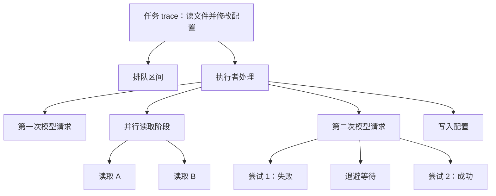
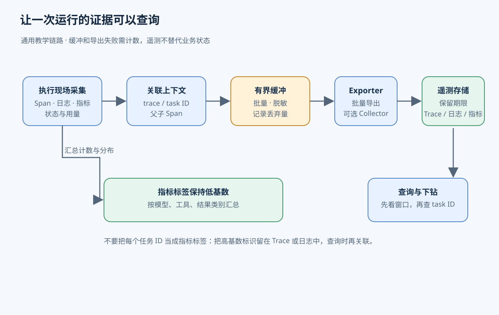
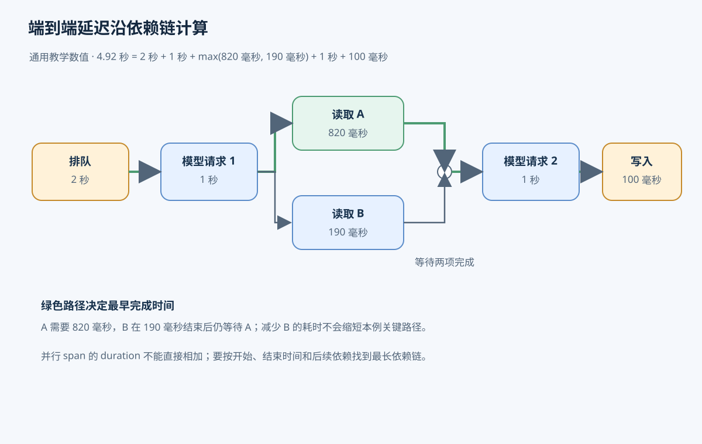
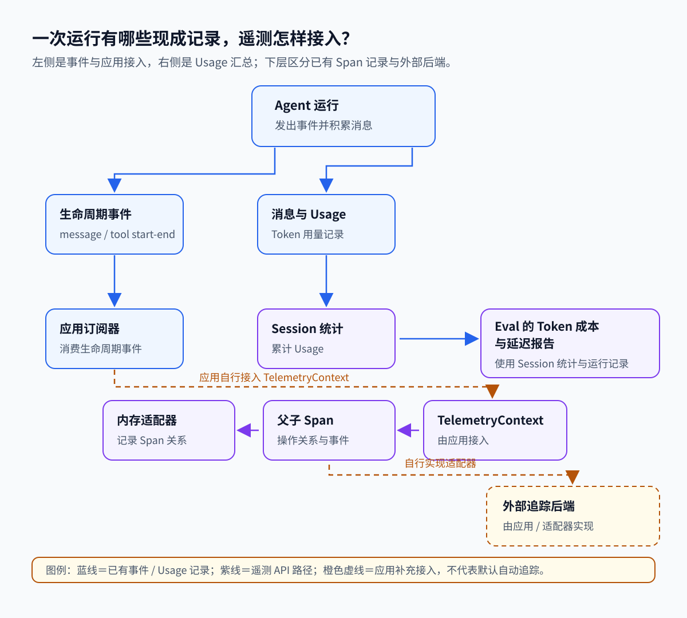

# 第 11 章　可观测性与调试

[返回目录](README.md) · [上一章：第 10 章 权限、安全与凭据](10-permissions-secrets.md) · [下一章：第 12 章 评估与回放](12-evaluation-replay.md)

任务耗时增加时，最终回答和文件产物通常不足以解释原因。可观测性通过运行记录说明时间消耗、失败位置和资源用量，调试则依据这些证据定位问题。本章先介绍追踪、日志和指标的分工，再说明遥测采集流程、延迟分解与统计口径，最后核对 Pi 的事件、会话统计和实验性 durable 检查接口。理解这些记录时，可结合[第 1 章 Agent 运行时](01-agent-runtime.md)中的调用循环。

## 11.1 运行证据与操作关联

用户要求“读两个文件后修改配置”，等待很久后收到成功结果。文件确实被读取、配置也已写入，但仍无法据此判断时间主要消耗在排队、模型请求还是工具执行，也无法确认中间是否发生重试。增加执行者只有在执行容量不足时才可能缓解等待；如果延迟来自下游模型服务，就需要另一种处理方式。

可观测性是根据系统输出的运行证据理解内部行为的能力。本章讨论的遥测包括时间、事件、状态和资源用量，用来查询单次执行并汇总多次运行。任务完成与恢复仍应以业务存储为依据，遥测丢失不能改变业务状态的判断。本章前半部分使用包含队列、执行者和遥测存储的教学架构，不表示 Pi 默认 CLI 已具备这些组件。

### 11.1.1 Trace、Span 与任务身份

教学任务先入队，执行者领取后请求模型；模型提出读取 A、B，执行者并行读取，再请求模型生成修改，写入配置并返回结果。各组件只能直接观察自己参与的部分。多个任务的日志可能交错，跨机器子任务的记录也不会自然相邻，因此需要显式关联身份。

Trace 是关联一次请求各项操作的追踪记录集合，trace ID 标识这组遥测；任务 ID 则标识业务工作。分开保存两种身份，可以让一个长任务在恢复后关联新的追踪，同时保持原任务身份，避免将重试误认为新的业务任务。

Span 是追踪中一次有明确边界的操作记录，通常包含名称、开始与结束时间、状态、属性和 span ID。执行者可分别为模型请求、文件读取和配置写入创建 span，并在子操作中保存父 span ID。重试应建立新的尝试记录并标明序号，保留先前失败，才能解释额外耗时。



这张图表达操作归属，先后顺序与重叠范围仍需时间戳。把读取交给另一台 worker 时，提交方应将 trace ID、父 span ID 等可序列化的追踪上下文放入队列消息或网络请求，接收方据此建立自己的 span。子任务同时保存自身与父任务 ID，用于关联业务状态。上下文未传递时，两侧日志无法自动组成同一追踪。批量消费或多个父任务汇合可以通过 span link 表达额外关联，无需强行指定唯一父操作。

### 11.1.2 日志与指标

日志保存离散事件，例如第二次模型请求收到限流错误。附上时间、错误类别与 trace ID 后，调试者可以从追踪定位到具体错误。指标（metrics）汇总多次执行，表现为计数、当前值或分布，例如每分钟完成数、当前排队数和耗时分布。

追踪适合检查具体任务，日志补充事件细节，指标用于判断影响规模。延迟指标可能表明最近一批任务变慢，但通常不保存每项任务的完整过程，需要进一步查询相应追踪。这些信号的基本分工见 [OpenTelemetry signals](https://opentelemetry.io/docs/concepts/signals/)。

## 11.2 遥测的采集、传输与查询

采集接口只产生记录，历史查询还需要关联、缓冲、导出与存储。教学任务服务可以按以下流程组织。

1. 入口记录接受时间和任务 ID，并创建追踪上下文。队列保存入队时间，在领取时记录领取时间。任务状态由队列管理，遥测保存状态变化的观测。
2. 执行者记录处理开始时间，为模型、工具、子任务和各次重试建立 span，日志沿用相同关联信息。模型返回 usage 后，将用量归入对应请求与尝试。成功和失败都要结束记录并填写状态，避免已失败操作被误认为仍在运行。
3. 进程内组件聚合计数与耗时分布，将日志和已完成 span 放入有上限的缓冲区。Exporter（导出器）批量发送记录；需要集中处理时，可由 collector（收集服务）过滤、脱敏和转发。小型程序也可直接保存本地文件。
4. 后端保存可查询数据并设置保留期限。缓冲区满或网络故障时，系统按既定策略丢弃、重试或阻塞，并记录丢失数量。否则，查询中的缺口无法区分未执行与未成功采集。
5. 调试者先按时间窗口和服务版本查看延迟、失败率，再按任务 ID 查找追踪，分析最长等待区间与相关日志，并对照队列或任务存储的当前状态。



图中任务 ID 用于追踪和日志查询，指标按有限类别汇总，避免为每个任务建立独立时间序列。

跨进程传播的是可序列化的标识和属性，内存 span 对象不能直接传给另一台 worker。跨机器时间线还依赖时钟校准；存在时钟偏差时，需要结合调用关系和消息关联判断顺序。进程内测量持续时间应优先使用单调时钟，避免系统时间调整造成负耗时。

## 11.3 延迟分解与关键路径

### 11.3.1 排队、执行与结果交付

任务有四个可记录的时间边界：入口接受、执行者开始处理、处理结束、结果可供用户取得。接受到开始处理是排队时长，开始到处理结束是执行阶段时长，接受到结果可用是端到端延迟。执行阶段可能包含网络、退避与子任务等待，因此不能直接作为 CPU 计算时间。

如果处理结束后还要传输结果，这部分时间同样影响用户等待。任务多次重新入队时，应分别记录每段排队时间，避免将第一次领取后的全部耗时归为执行。

### 11.3.2 并行操作的时间计算

设一次无重试的教学任务排队 2 秒，第一次模型请求耗时 1 秒。随后 A、B 同时开始读取，分别耗时 820 毫秒和 190 毫秒；两者完成后，第二次模型请求耗时 1 秒，配置写入耗时 100 毫秒。忽略其他开销，执行阶段共 2.92 秒，端到端延迟为 4.92 秒。这些数字仅用于演算，不是 Pi 默认值或实测基准。

A、B 的耗时总和为 1.01 秒，读取阶段却只经过 820 毫秒，因为两个操作重叠。计算任务总延迟时，不能简单相加所有 span 的 duration，也不能重复计入父 span 已覆盖的子操作时间。

关键路径是决定任务最早完成时间的依赖链。本例第二次模型请求必须等待 A 完成，把 B 从 190 毫秒缩短到 50 毫秒不会改变任务结束时间。若两次读取开始时间不同，仅取最大 duration 也不够，还需比较开始、结束与后续依赖。



图中 B 的执行区间完全包含在等待 A 的区间内，优化 B 不会缩短本例的关键路径。

### 11.3.3 计时结果与排查方向

排队占比高时，应检查可用执行容量和任务输入速度；模型请求变长时，应检查服务响应、输入输出规模及重试；工具完成后仍未返回时，应继续检查后续模型请求、hook、监听器和结果交付。缺少 span 的空白只是未测量区间，不能直接归因于模型。

流式请求可以分别记录首个内容片段与完整响应的到达时间。首片段时间影响用户何时看到进展，完整响应时间影响工具何时获得完整参数及任务何时继续。两项时间需要同时观察，才能识别生成阶段的延迟。

## 11.4 延迟分布与队列积压

单次追踪说明一次执行。判断是否发生普遍退化，需要在固定窗口内汇总同类任务，并说明环境、版本及成功失败的统计范围。

延迟 p50 是中位数，约一半样本不超过它；p95 表示约 95% 的样本不超过该值。p50 稳定而 p95 上升，说明较慢的一部分任务恶化，可能集中在特定模型、工具或重试路径。平均值可能掩盖这些长等待。系统 p95 需要从合并后的原始样本或可合并直方图计算，不能直接平均各 worker 的 p95；分桶越粗，分位数估计也越粗。

队列需要同时观察数量、等待和处理速度，才能判断突发流量是否正在消退。

| 指标 | 本章定义 | 诊断用途 |
| --- | --- | --- |
| queue depth | 当前尚未领取的任务数，运行中任务另计 | 判断积压是否持续增长 |
| queue age | 队列中最老任务的等待时长 | 发现长期得不到执行的任务 |
| queue latency | 已领取任务从入队到领取的时长分布 | 衡量已经开始处理的任务等待 |
| throughput | 单位时间完成数，注明是否仅计成功 | 衡量实际处理速度 |
| arrival rate | 单位时间接受数 | 比较输入与处理能力 |

Queue latency 尚未包含最老的未领取任务，因此需结合 queue age；相同 queue depth 也可能由不同长度的任务组成，不能单凭数量判断等待严重程度。增加并发前还要核对执行者资源和下游限流。模型服务已经限流时，更多并发可能增加重试并延长队列。

指标通常按模型、工具名、结果类别和部署版本等有限集合分组。标签不同取值的数量称为基数，数量有限的分组属于低基数。任务 ID 几乎每次都不同，将它作为指标标签会大量增加时间序列与查询成本。因此，任务 ID、调用 ID 和完整错误适合保存在追踪或日志中，需要分析个例时再从汇总查询关联过去。

## 11.5 用量、成本与失败率

### 11.5.1 请求用量的归属

一次任务可能包含多次模型请求和重试。Usage 是服务返回的用量数据，需要先关联任务与尝试，再汇总成本。Token 是模型处理内容的计量单位，不能直接等同于字符或单词。输入、输出、缓存读取与缓存写入可能采用不同价格，供应商对总输入是否包含缓存部分的定义也可能不同，汇总前应确认分类是否互斥，防止重复计数。

估计成本由各类用量乘单价后求和，并保留模型、价格版本、币种和计价单位。任务成本应包括实际发生的重试、摘要请求和其他归属费用。失败请求没有返回 usage 时，应记录未知或另行核对，不能视为免费。应用估算还可能因折扣、价格规则或用量缺失而不同于供应商账单，需要分别对账。

Session 可能累积多个用户任务。先读文件、再修改配置，两次输入的费用都可能进入会话总数。单任务统计需要明确的时间边界或归属；只有期间没有其他并发工作等条件成立时，累计值的前后差才可近似本次用量。

### 11.5.2 任务失败与尝试失败

假设 10 项任务均已结束，一项失败两次后第三次成功，其余各成功一次。最终任务失败率为 0/10，尝试失败率为 2/12，发生过重试的任务比例为 1/10，额外重试次数与初始任务数之比为 2/10。最终交付全部成功，仍然发生了额外延迟与调用成本，这些指标分别描述不同事实。

任务尝试、模型请求尝试与工具尝试也需要各自的分母。运行中、取消、超时和主动拒绝应按预定规则分类。若仅统计窗口内已经结束的尝试，尚未结束的操作就未进入分母；长期挂起可能使表面失败率偏低。可观测性报告这些额外工作及缺失范围，是否继续重试则由执行策略决定。

## 11.6 遥测开销与数据保护

逐个流式 token 同步写日志会增加序列化、磁盘和网络开销，记录组件本身也可能成为延迟来源。采集通常围绕有诊断意义的边界进行，并限制内容大小、批量导出。异步缓冲减少业务等待，却可能在进程退出时丢失尚未导出的数据；等待刷新减少丢失，同时增加退出时间，因此缓冲容量和刷新等待都需要上限。

高流量下可以采样，仅保存部分 trace。开始时随机决定是否记录，开销较低，但可能漏掉少见失败；结束后根据错误或耗时选择，能够保留更多异常，但需预先暂存候选记录。查询时应能辨认采样造成的缺失。失败率等全量指标宜走独立计数路径，偏向失败的采样追踪不能直接代表总体。

提示词、文件、工具参数和结果可能包含密钥或用户数据。采集端需要限定允许字段，优先保存长度、类别、用量和受控错误码；必要正文经过脱敏后再决定是否导出，同时限制访问与保留时间。敏感标记本身不会执行脱敏，提示词哈希也仅能辅助比较内容一致性，不能替代正文、授权或完整匿名化。

遥测后端故障通常不应导致业务任务失败，但导出失败与丢弃数量必须可观察。没有失败日志可能意味着记录链路中断。需要可靠保留的审计记录应另行定义持久化和失败策略，不能依赖允许采样或丢弃的调试日志。

## 11.7 执行状态与任务质量

追踪没有异常、配置写入成功、耗时达到要求，仍可能发生修改了错误配置项的情况。运行正常结束只证明执行过程完成，产物是否满足用户意图需要单独验收。反之，遇到限流并成功重试的任务，虽有失败尝试，最终产物仍可能完全正确。

可观测性用于分析延迟、故障和消耗，质量评估则把实际产物与成功条件比较。两者通过任务 ID 关联：评估发现失败后，再查看相同执行的输入、工具结果和重试记录，定位原因。案例集、评分规则与回归比较见[第 12 章 评估与回放](12-evaluation-replay.md)。

## 11.8 参考实现：Pi 的事件与会话统计

Pi 的 Agent 生命周期事件、工具耗时和 Session usage 可以支持局部诊断。本章源码基线 `96abe9a5ad45005cae34ed1c52d42f71fc88bedc` 未默认集成完整任务追踪、统一指标后端或 exporter。前面的队列指标、跨 worker 上下文传播、全链路延迟分布与遥测存储，需要应用自行补充。本节依次说明默认 CLI/SDK 事件、telemetry 接口与实验性 durable 检查能力。

### 11.8.1 调用 ID 与并行工具配对

在并行读取示例中，assistant 生成两个工具调用，随后出现两条开始事件，再依次出现 B、A 的结束事件。下表沿用教学耗时说明 Pi 字段含义，不代表默认值或实测性能。

| 事件 | 调用 ID | `durationMs` | 说明 |
| --- | --- | ---: | --- |
| `tool_execution_start` | `call-A` | 未提供 | A 的开始事件 |
| `tool_execution_start` | `call-B` | 未提供 | B 的开始事件 |
| `tool_execution_end` | `call-B` | 190 | B 的 `execute()` 计时 |
| `tool_execution_end` | `call-A` | 820 | A 的 `execute()` 计时 |

`toolCallId` 关联同一次调用的开始与结束。并行工具的结束事件按完成顺序发出，写回对话的结果则按模型原始调用顺序排列，因此事件与消息应按 ID 配对。表中 `durationMs` 表明 A 的执行函数耗时更长；仅凭结束顺序无法判断持续时间，因为开始时刻也可能不同。

`tool_execution_start` 表示开始处理该调用，实际 `execute()` 前还要准备和检查参数。`executePreparedToolCall()` 使用 `performance.now()`，在执行函数成功或抛错后计算 `durationMs`。参数检查以及 before/after hook 在该计时范围外；执行函数完成后等待已发出的更新事件，也发生在耗时读数之后。被阻止或没有实际执行的工具没有这项耗时。因此开始、结束事件之间的墙钟时间与 `durationMs` 不必相等。

排查应以最后确认的边界为起点：没有 `tool_execution_start` 时，检查 assistant 是否生成工具调用；已有开始而没有结束时，核对错误、进程与任务状态；工具结束后仍无最终结果时，继续检查后续 assistant 消息与 Agent 生命周期，判断是否进入新请求或等待监听器。`AgentEvent` 的 `message_update` 是流式增量；保存完整消息应等最终 `message_end`。一次运行可能包含多轮 assistant 回复和工具调用，看到一条消息结束不能作为整个任务已经结束的依据，也不能把暂时没有日志直接当成故障。

### 11.8.2 监听器与 Session 统计的覆盖范围

`Agent.subscribe()` 允许 listener 返回 Promise，派发会按订阅顺序等待，其耗时也影响运行何时 settle。`agent_end` 虽是该次运行最后发出的事件，Agent 仍需等它的监听器完成才能进入 idle。默认 CLI/SDK 的 `AgentSession.subscribe()` 则约定返回 void；`_emit()` 同步调用 listener，不等待异步返回值。同步 listener 工作仍占用派发时间，异步返回的 Promise 则不会因这层派发而被等待。因此，分析日志写入对运行时长的影响时，需要先确定监听器所在层。

单靠工具 `durationMs` 无法拆出模型请求、参数处理、hook 或监听器耗时。应用应围绕需要诊断的开始和结束边界另外计时，并采用同一运行 ID。输出已有 Agent 事件只能呈现已采集字段，缺失的阶段计时仍需单独实现。

Session 的 `getSessionStats()` 扫描整份会话条目，包括 assistant、工具、独立 usage 条目、压缩摘要和分支摘要等用量；已经从模型上下文压缩掉的历史仍可能在累计值中。因此第二次输入修改配置时，统计值也包含第一次读文件的消耗。eval harness 会复制 Session 统计并保存 `systemPromptSha256`，该哈希可用于确认提示词是否相同，无法还原提示词正文；报告成本仍是基于价格元数据的估计值，账单金额需另行核对。



图中的实线表示 Agent 和 Session 已提供的记录，虚线是应用需接入的遥测连接。图没有表示仓库默认提供一条完整的任务追踪。

### 11.8.3 pi-telemetry 的接口与内存记录器

`pi-telemetry` 提供 `startSpan()`、`addEvent()`、`setAttributes()` 和 `setStatus()`，可由调用方显式建立父子关系。Telemetry context 可以经模型请求选项传递，但具体适配器是否创建 Span 取决于自身实现。仅仅传入 context，不等于任务、模型请求、工具和重试已经全程记录。

内存适配器记录父 ID、属性、事件、状态和结束顺序，适合检验关联与生命周期；它不保存时间戳或持续时间，因而不能单独生成延迟火焰图。要实现前文的时间线，还需带计时的适配器和覆盖相应操作的采集代码。采样、敏感字段处理、导出器与跨进程上下文传播也须由调用方或适配器实现。

Schema 类型辅助器可以在 TypeScript 编写时约束名称、属性和事件形状。运行时不验证 `parents` 或 `sensitive` 元数据，也不负责脱敏。`packages/telemetry/README.md` 提到的 `AGENT_TELEMETRY_SCHEMAS`、`startAiSpan` 和 `startHarnessSpan` 在当前 [agent 导出](https://github.com/earendil-works/pi/blob/96abe9a5ad45005cae34ed1c52d42f71fc88bedc/packages/agent/src/index.ts#L1-L5) 中并不存在，不能当作已经可用的 Agent 集成能力。内存适配器、Session 统计与 eval 事件也不能自动拼成完整历史追踪。

### 11.8.4 实验性 durable 路径的等待检查与非致命报告

实验性 durable 驱动的任务未返回结果时，可能正在等待子任务、睡眠到某个时刻，也可能缺少注册定义或需要处理版本迁移。只读 `inspect()` 返回 `ready/running/waiting/sleeping/completing/blocked` 等推导状态及阻塞原因。它不启动调度，也不执行迁移函数；尚待迁移且具备迁移条件的任务可以显示为带 `migrates` 的 ready，不能据此断言迁移已经成功。应先检查这些信息，再决定是否 `resume()`；被 restart limit 停泊的任务可用 `retryTask()` 重新运行，宿主自行唤醒进程时，`wake()` 给出是否仍有工作及最早的睡眠时刻。

`taskGraph()` 展示存活任务的归属和等待关系，其推导状态同样包含 sleeping 和 blocked，并给出定义缺失、版本过旧、迁移失败或停泊等阻塞原因；它仍不含完整检查点与 outcome 载荷。阻塞原因随注册表变化更新，定位到原因后仍需查询 inspect 或相应持久记录。遥测解释过去发生的过程，持久状态提供恢复依据，二者需要结合读取。

非致命失败由 `HarnessOptions.onReport(error, info)` 报告，`info` 区分 `session_failed`、`task_faulted`、`task_parked`、`migration_failed`、`task_outdated`、`task_error`、`extension_error`、`host_error` 和 `listener_error`；报告函数自身的抛错或拒绝会被丢弃，因为这是错误的最后去处。压缩失败也可通过实时状态观察：`pi.live.compactionFailure` 保存最近一次失败的 taskId、原因和错误信息，直到下一次压缩产出摘要；对应事件以带 `error` 的 `compaction_end` 结束。

## 11.9 参考实现：Span 生命周期

内存 Span 在回调返回或 Promise 完成后结束。属性、事件与状态写入失败会被忽略，业务回调仍执行；业务错误会传播，并默认记为 error，显式状态优先于自动结果。已结束 Span 上的记录操作不生效；迟到的子 Span 使用不记录数据的上下文，但仍执行回调。`getSpans()` 返回副本。这些行为让遥测记录尽量不改变业务语义，也意味着记录失败本身未必在业务结果中显现。

## 11.10 源码定位与测试

- Agent 事件与并行工具：[事件类型](https://github.com/earendil-works/pi/blob/96abe9a5ad45005cae34ed1c52d42f71fc88bedc/packages/agent/src/types.ts#L509-L539)、[工具执行顺序](https://github.com/earendil-works/pi/blob/96abe9a5ad45005cae34ed1c52d42f71fc88bedc/packages/agent/src/agent-loop.ts#L586-L658)、[工具计时](https://github.com/earendil-works/pi/blob/96abe9a5ad45005cae34ed1c52d42f71fc88bedc/packages/agent/src/agent-loop.ts#L821-L856)
- 监听器与统计：[Agent 订阅](https://github.com/earendil-works/pi/blob/96abe9a5ad45005cae34ed1c52d42f71fc88bedc/packages/agent/src/agent.ts#L260-L269)、[Session 订阅](https://github.com/earendil-works/pi/blob/96abe9a5ad45005cae34ed1c52d42f71fc88bedc/packages/coding-agent/src/core/agent-session.ts#L1038-L1043)、[同步发出](https://github.com/earendil-works/pi/blob/96abe9a5ad45005cae34ed1c52d42f71fc88bedc/packages/coding-agent/src/core/agent-session.ts#L1364-L1379)、[Session stats](https://github.com/earendil-works/pi/blob/96abe9a5ad45005cae34ed1c52d42f71fc88bedc/packages/coding-agent/src/core/agent-session.ts#L4177-L4235)、[eval 记录](https://github.com/earendil-works/pi/blob/96abe9a5ad45005cae34ed1c52d42f71fc88bedc/packages/evals/src/harness.ts#L391-L417)
- Telemetry 实现：[接口](https://github.com/earendil-works/pi/blob/96abe9a5ad45005cae34ed1c52d42f71fc88bedc/packages/telemetry/src/index.ts#L1-L22)、[内存 Span 生命周期](https://github.com/earendil-works/pi/blob/96abe9a5ad45005cae34ed1c52d42f71fc88bedc/packages/telemetry/src/memory.ts#L120-L186)、[内存快照](https://github.com/earendil-works/pi/blob/96abe9a5ad45005cae34ed1c52d42f71fc88bedc/packages/telemetry/src/memory.ts#L189-L219)、[Schema 类型辅助器](https://github.com/earendil-works/pi/blob/96abe9a5ad45005cae34ed1c52d42f71fc88bedc/packages/telemetry/src/index.ts#L71-L74)、[Typed Span](https://github.com/earendil-works/pi/blob/96abe9a5ad45005cae34ed1c52d42f71fc88bedc/packages/telemetry/src/index.ts#L324-L354)
- 模型与 CLI 传递：[请求上下文类型](https://github.com/earendil-works/pi/blob/96abe9a5ad45005cae34ed1c52d42f71fc88bedc/packages/ai/src/types.ts#L157-L160)、[选项构造](https://github.com/earendil-works/pi/blob/96abe9a5ad45005cae34ed1c52d42f71fc88bedc/packages/ai/src/api/simple-options.ts#L36-L65)、[CLI telemetry 开关](https://github.com/earendil-works/pi/blob/96abe9a5ad45005cae34ed1c52d42f71fc88bedc/packages/coding-agent/src/core/telemetry.ts#L1-L13)、[provider attribution](https://github.com/earendil-works/pi/blob/96abe9a5ad45005cae34ed1c52d42f71fc88bedc/packages/coding-agent/src/core/provider-attribution.ts#L38-L71)
- durable 诊断：[inspect 入口](https://github.com/earendil-works/pi/blob/482c1381a00d8d00bc81697e4a980c593db6803e/packages/durable/src/harness/harness.ts#L289-L297)、[唤醒](https://github.com/earendil-works/pi/blob/482c1381a00d8d00bc81697e4a980c593db6803e/packages/durable/src/harness/harness.ts#L273-L276)、[重试停泊任务](https://github.com/earendil-works/pi/blob/482c1381a00d8d00bc81697e4a980c593db6803e/packages/durable/src/harness/harness.ts#L315-L318)、[状态推导](https://github.com/earendil-works/pi/blob/482c1381a00d8d00bc81697e4a980c593db6803e/packages/durable/src/harness/scheduler.ts#L1605-L1633)、[阻塞原因](https://github.com/earendil-works/pi/blob/482c1381a00d8d00bc81697e4a980c593db6803e/packages/durable/src/harness/scheduler.ts#L81-L85)、[taskGraph 节点](https://github.com/earendil-works/pi/blob/482c1381a00d8d00bc81697e4a980c593db6803e/packages/durable/src/harness/task-graph.ts#L20-L49)、[非致命报告](https://github.com/earendil-works/pi/blob/482c1381a00d8d00bc81697e4a980c593db6803e/packages/durable/src/types.ts#L144-L187)
- 延伸章节：Agent 循环、[第 4 章 调度与多 Agent 编排](04-orchestration.md)、[第 5 章 持久执行与恢复](05-durable-execution.md)
- 测试：[遥测测试](https://github.com/earendil-works/pi/blob/96abe9a5ad45005cae34ed1c52d42f71fc88bedc/packages/telemetry/test/telemetry.test.ts#L29-L151)、[conformance 实现](https://github.com/earendil-works/pi/blob/96abe9a5ad45005cae34ed1c52d42f71fc88bedc/packages/telemetry/src/testing/conformance.ts#L60-L315)、[conformance 测试](https://github.com/earendil-works/pi/blob/96abe9a5ad45005cae34ed1c52d42f71fc88bedc/packages/telemetry/test/conformance.test.ts#L21-L46)、[AI telemetry 透传](https://github.com/earendil-works/pi/blob/96abe9a5ad45005cae34ed1c52d42f71fc88bedc/packages/ai/test/telemetry-options.test.ts#L68-L120)、[durable inspect](https://github.com/earendil-works/pi/blob/96abe9a5ad45005cae34ed1c52d42f71fc88bedc/packages/durable/test/harness-inspect.test.ts#L94-L110)

## 11.11 本章术语

| 术语 | 本章含义 |
| --- | --- |
| Trace | 通过关联身份组织的一组操作追踪记录 |
| Span | 追踪中一次有明确边界的操作记录 |
| 追踪上下文 | 在组件或进程间传递的 trace ID、父 span ID 等关联信息 |
| Metrics | 多次运行的计数、当前值和分布 |
| 关键路径 | 决定任务最早完成时间的依赖链 |
| 基数 | 指标标签不同取值的数量 |
| Usage | 模型服务返回的请求用量数据 |

## 11.12 练习

练习时让 `InMemoryTelemetryContext` 创建一个父 Span 和两个子 Span，安排第二个先结束，再检查 `parentId` 和 `endSequence`。随后让回调返回 `{ ok: false }`：默认状态仍是 ok，只有显式设置或抛异常才会形成相应状态。这也说明业务返回值的含义需要调用者解释，记录器不会自行判断任务质量。以下定向测试应在 `packages/telemetry` 中运行：

```powershell
node ../../node_modules/vitest/dist/cli.js --run test/telemetry.test.ts test/conformance.test.ts
```
