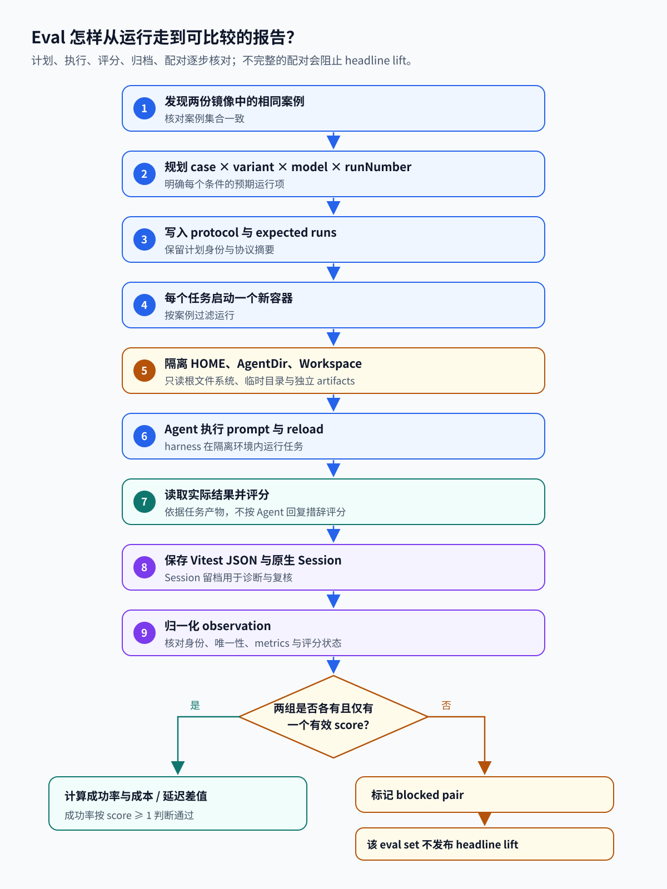
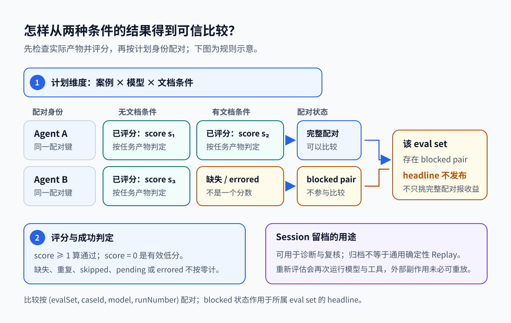

# 12. 怎样验证 Agent 真的完成了任务

[返回学习地图](README.md) · 前置：[Runtime](01-agent-runtime.md)、[可观测性](11-observability-debugging.md)

一个案例要求 Agent 为当前 Pi 安装增加模型。Agent 最后回复“已完成”，仍可能把配置写进错误目录，或覆盖掉原 provider 的模型。要判断任务是否成功，需要查看安装实际加载了什么。

Evaluation（评估）是给 Agent 明确任务，观察实际行为与产物，再按预先定义的规则判断结果。例如本章的任务要保留原模型并增加新模型，检查对象就应该是重新加载后的配置和运行时；最终回答可以辅助诊断，却不能独自证明配置正确。

一次评估的完整流程是“定义案例与成功规则 → 生成运行计划 → 准备独立环境 → 运行 Agent → 读取实际产物 → 评分并归档 → 核对数据并生成报告”。先约定检查什么，才知道执行后收集什么；先保存完整计划，才知道哪些结果没有回来。后面的 Dataset、Rubric、Harness 和 Report 都是这条流程中承担具体工作的对象。

同一个案例可以重复运行，因为模型与环境带来的变化可能让一次成功不足以代表稳定表现。也可以比较两组条件，例如是否提供文档。两组应使用可核对的案例身份与运行计划，再比较完整配对；这里学习的是仓库已有的内部评估实现，不把它当成覆盖任意任务的通用平台。

本文依据提交 `96abe9a5ad45005cae34ed1c52d42f71fc88bedc`，`evals` 为 private 包，见 [package.json:1-20](../../packages/evals/package.json#L1-L20)。

`packages/evals` 用 `vitest-evals` 实现内部评估：任务案例交给 Agent harness 执行，输出检查负责评分，运行可以重复，并在 Docker 中隔离。每次运行还会归档原生 Session，有文档和无文档两组的结果用配对报告比较。这样，“Agent 宣称完成”就有了可以核对的实际任务结果。

评估用实际任务产物检验 Agent 是否完成目标。参与者分工如下：

| 对象 | 含义与职责 | 怎样配合 |
| --- | --- | --- |
| Dataset（案例集） | 一组任务案例，主要定义在 `evals/*.eval.ts` | 给每次运行提供 prompt、预期行为和成功规则 |
| Rubric（评分规则） | 判断任务是否成功的规则，例如配置已加载且原模型保留 | 由 Judge 应用于任务的实际结果 |
| Harness（运行框架） | 为计划中的任务建立 Agent、Workspace 和 Session，并收集产物 | 在隔离容器里执行一个计划项 |
| Judge（评分器） | 按 Rubric 读取结构化结果并产生 score；可以是程序 | 结果写入 observation（一次运行的观测记录） |
| Report（报告） | 核对实际记录与计划身份，按完整配对计算统计 | 输出成功率、成本和延迟等比较结果 |

以“为当前 Pi 安装增加模型”的案例为例，完整链路如下：

1. 计划器把案例、`with_docs` / `without_docs` 文档条件、模型和运行序号组合成任务清单。
2. 每项任务在独立 Docker 容器运行，Harness 建立本次专用 Workspace、HOME、AgentDir 和 Session。
3. Agent 按 prompt 修改配置，Harness 执行 reload 重新加载；评估材料不会提供给 Agent 读取。
4. Harness 从重新加载后的实际运行状态提取结构化结果，Judge 按 Rubric 检查新模型已加载且原模型保留，再产生 score。
5. 运行结果与 Session 归档；Report 按计划身份配对两种文档条件，只有完整且有效的配对才进入比较。
6. Report 按 `score >= 1` 计算成功率并报告成本、延迟等指标；若配对不完整或状态异常，该 eval set 不发布 headline。

下面的图把任务从计划到报告的路径画在一起。箭头表示数据从计划、运行产物到报告的流向；它不表示 Session 文件本身可以确定性重放。



## 先确定每次要运行什么

案例需要同时交代任务输入与检查依据。例如输入是“增加模型”，规则是“新模型可加载且原模型保留”。runNumber 区分同一案例的第几次运行，variant 区分是否给文档，model 区分执行任务的模型。它们一起构成运行身份，后面收回结果时才能确定正在检查的是哪项计划。

运行计划也是完整性检查的基准。如果只统计已有结果，一项没有启动或在容器中失败的任务可能从分母里消失，报告看起来反而更好。先把全部应运行项目列出来，报告才能明确区分“零分结果”和“没收到结果”。

Dataset 是要评估的案例集合，这里主要写在 `evals/*.eval.ts` 中。执行前，`parseDiscoveredCases()` 从 `<eval set> > <case>` 提取身份，拒绝歧义和重复，再由 `createTaskPlan()` 按案例（case）、文档条件（variant）、模型（model）和运行序号（runNumber）展开任务。见 [plan.ts:21-59](../../packages/evals/src/plan.ts#L21-L59)。

两个案例，在两种文档条件下各重复三次，会得到 `2 × 2 × 3 = 12` 次 Agent 运行。同一案例第一次先跑 `without_docs`，第二次先跑 `with_docs`。交替顺序可以减少总是先跑同一条件带来的影响，其他实验偏差仍可能存在。

外层 CLI 还会核对两个镜像是否发现了相同案例，随后保存完整计划、镜像 ID 和 protocol 摘要。见 [cli.ts:140-173](../../packages/evals/src/cli.ts#L140-L173)。报告便能把未完成的计划项识别为缺失，计算分母时不会将它们悄悄丢掉。

## 把两种文档条件分开

评估环境需要避免上一次运行影响下一次。比如有文档组已经写好配置，无文档组若复用同一目录，就可能直接读到现成答案。独立 Workspace 是本次工作目录，HOME 是程序查用户配置的目录，AgentDir 是 Pi 自己的配置目录；分别安排它们，是为了控制本次运行读取和写入的资源。

Docker 容器提供一份单独的运行环境，artifacts 挂载用于把要保留的产物写出。隔离还涉及评分材料：Agent 若能读取预期结果，评分就失去检验能力。下面的目录、用户身份和文件可见性设置，都是在实现这个实验边界。

计划中的每个任务都由 `runTask()` 启动一次 Docker，通过案例精确匹配过滤器选择要执行的案例，见 [docker.ts:161-175](../../packages/evals/src/docker.ts#L161-L175)。容器使用只读根文件系统、临时目录和独立 artifacts 挂载，见 [docker.ts:91-124](../../packages/evals/src/docker.ts#L91-L124)。

容器里的 harness 为本次运行创建独立 Workspace、HOME、AgentDir 和 Session，随后永久降到非特权 UID。评估代码等文件不允许 Agent 读取，以免任务执行过程接触评分材料。实现见 [harness.ts:154-188](../../packages/evals/src/harness.ts#L154-L188) 和 [harness.ts:272-367](../../packages/evals/src/harness.ts#L272-L367)。

文档评估默认只提供 `read/write/edit/grep/find/ls`，并检查两种变体的 system prompt 是否符合预期。见 [harness.ts:484-536](../../packages/evals/src/harness.ts#L484-L536)。模型服务仍需要网络，这里的 Docker 隔离并不保证任意 Agent 代码绝不联网。其运行边界可结合 [Sandbox](08-sandbox-environment.md) 阅读。

## 从配置结果得到分数

Rubric 是预先明确的成功条件，Judge 是执行检查并给分的评分器。可检查结构化配置时，程序就能判断条件是否满足，无需再请一个模型评价。LLM-as-Judge 指使用大模型担任评分者，适用于需要模型判断的内容，但还需要另外设计评分提示与校准；任务由模型执行并不意味着评分也由模型完成。

要取得可靠检查对象，Agent 修改后由 Harness 执行 reload，让程序重新加载配置，再从真实 ModelRuntime 读取状态。这样可以发现“文件改了但程序没加载”或“新模型加了但旧模型丢了”。评分接在实际状态读取之后，与检查回答是否包含“完成”是不同的验证方式。

评估让 Agent 修改配置，接着执行 `reload`，最后检查重新加载后的 `ModelRuntime`。成功规则要求配置已加载，原模型也保留，这就是该案例的 Rubric；Judge 则按这些规则把实际结果转成 score，不评价回复措辞。任务定义、expected 和严格结构化 Judge 见 [models.docs.eval.ts:1-40](../../packages/evals/evals/models.docs.eval.ts#L1-L40)。加载后的配置提供了判断行为的证据，使用更复杂的模型评审是另外一种可选评分方式。

这个实际案例的要求比“模型存在”更具体：配置应作用于当前 Pi 安装，不能只写项目本地配置；新模型属于 `openai` provider，ID 为 `fixture-chat`，显示名称为 `Fixture Chat`，支持文本输入与推理，窗口为 32,768 tokens，最大输出为 4,096 tokens，用量价格为零。expected 还检查已有模型保留。Judge 使用严格结构化匹配，因而字段错误或额外字段都可能使评分不满足预期。这些明确条件把一句自然语言任务变成了可核对结果。

配置案例需要重新加载，因此 harness 除了接收单个 prompt，也能接收 `prompt → reload → prompt` 这样的步骤列表。见 [harness.ts:369-390](../../packages/evals/src/harness.ts#L369-L390)。执行结束后，`output` callback 从 Session 或当前运行时读取状态，返回 Judge 要比较的结构化结果。

文档提升案例将 `judgeThreshold: null`，所以配置虽然加载成功、某个字段却错误时，仍可以评分为 0 或其他低分，并保留为实验数据。没有模型凭证、容器出错或没有 harness run 时，属于执行异常，outcome 为 `errored`，基础设施异常仍可让测试失败。

低分是已完成评分的任务结果；`errored` 表示任务未能产生可评分结果。两者不能混为一类，否则报告无法判断实验是否完整。

多数文档提升案例都检查结构化结果，再由程序评分。任务由大模型执行时，Judge 仍可以是程序，不能将这些评分器都称为 LLM-as-Judge；这套工具目前的能力边界收在文末「边界与未实现」。

[documentation-audit.eval.ts:43-66](../../packages/evals/evals/documentation-audit.eval.ts#L43-L66) 提供了另一种评分相关案例：Agent 阅读文档和实现，提交 `match/mismatch/inconclusive`，随后由程序检查 verdict。模型参与了审查，最终检查仍由程序完成，这里没有独立、盲评的通用 Judge 服务。

无论采用哪种评分器，评分对象都要对应任务实际产物，计划与观察也必须严格对应，否则评审再细，仍可能评价了错误对象。

## 归档 Session，区分几种重放

归档留下任务当时的消息、工具记录与运行信息，用于解释某个分数为何出现。重新打开这份记录可以重建对话，但外部文件、服务状态和模型输出未必仍与当时相同。若要确定性重放，还需要固定或替换模型响应与工具输出，并控制执行环境；本项目没有仅凭 Session 自动完成这些工作的独立执行器。

Regression（回归）表示修改后某个原本满足的行为不再满足。保存案例和规则后，可以在后续版本重新评估、比较实际结果，寻找行为退化。模型任务有运行变化，比较时仍要看重复运行和数据完整性，单次波动不能直接解释为代码改动造成。

临时环境清理前，harness 会把原生 Session JSONL 写入 artifact，见 [harness.ts:424-439](../../packages/evals/src/harness.ts#L424-L439)。report 再按运行身份的 hash 分目录保存 `session.jsonl`，见 [report.ts:122-134](../../packages/evals/src/report.ts#L122-L134)。

每次运行留下这些产物：

```text
.eval/<run>/
  protocol.json           # 案例、镜像、模型、重复数、摘要
  expected-runs.json      # 完整计划
  observations.jsonl     # 实际结果
  tasks/<hash>/vitest.json
  with_docs/sessions/<hash>/session.jsonl
  without_docs/sessions/<hash>/session.jsonl
  report.json
  report.txt
```

Replay 或“重放”可能指几种不同操作，读取归档时需要说明要做哪一种：

1. 记录重建：读取 Session，重新构造消息和上下文，见 [上下文与状态](02-context-state.md)。
2. 重新评估：用同一案例再次运行模型与工具。模型、网络或环境可能改变，输出不保证逐字一致。
3. 崩溃恢复：按任务的持久状态继续执行，见 [Durable Execution](05-durable-execution.md)。

## 零分和缺一份结果怎样影响报告

配对比较是在同一案例、模型和运行序号下，对照两个文档条件的结果。两份结果都有有效评分，即使其中一份为零，也能比较任务行为；一份没有产生评分，则无法知道那一条件的行为结果。补成零分会把基础设施异常当成 Agent 失败，直接丢弃则可能选择性保留较好的结果，所以报告明确标记不可比较的配对。

headline 是报告发布的主要成功率与提升值，set 是一组评估案例。下面的规则把 set 内的 blocked pair 与 headline 发布联系起来，同时仍保留其他可检查观测。成本缺失又是另一种情况：成功评分仍可能有效，但成本比较需要单独检查覆盖数。

结果进入报告前，`readTaskObservation()` 先核对是否恰好只有一个结果，案例名称和模型身份是否正确，随后检查 metrics 数值并归类评分。见 [report.ts:136-191](../../packages/evals/src/report.ts#L136-L191)。

有文档和无文档的结果按 `(evalSet, caseId, model, runNumber)` 配对，文档条件区分配对内的两组。见 [report.ts:209-281](../../packages/evals/src/report.ts#L209-L281)。每组都必须恰好计划一次、观察一次，而且结果都是 `scored`，这一对才可用于比较。



下面两对结果只用来演示报告规则。缺一份结果时，无法把它当成零分补齐，也不能只挑另一对结果发布成功率提升。

| 观察结果 | 配对是否可用 | 原因 |
| --- | --- | --- |
| 两组各一个 score，即使 score 为 0 | 是 | 低分仍是有效行为结果 |
| 一组 missing、重复、skipped、pending、unscored 或 errored | 否 | 不符合预先设计的完整配对 |
| score 有效但成本缺失 | 成功率可用，成本指标可能不可用 | 缺测不是成本为零 |

报告按 `score >= 1` 计算成功率，并不取 score 的平均值。Lift 是实验组成功率减去对照组成功率；同一个 eval set 只要出现 blocked pair，就不会发布 headline 成功率或 lift。见 [report.ts:359-412](../../packages/evals/src/report.ts#L359-L412)。

例如，对照组的两次 score 为 `[0, 1]`，实验组为 `[1, 1]`，成功率就是 `50% → 100%`，lift 为 `0.5`，也就是提高 50 个百分点。如果实验组第二次没有结果，headline lift 会变成 `null`，不能只展示第一对的收益。报告仍可以保留有效配对的 Token、工具、延迟差值和已有观测的运营总量，读取这些指标时也要看覆盖数。

## 边界与未实现

前面介绍的评分、计划与报告都基于现有实现；这套内部工具目前的边界如下：

- 这套内部工具目前没有通用评估平台、独立 Replay 执行器或统一的 LLM-as-Judge 服务。
- 如果继续研究独立评审模型，需要考虑人工标注校准、评审顺序偏差和统计置信区间；固定响应的确定性重放则属于另一项能力。
- 当前 eval 归档主要用于诊断和复核。仓库没有独立工具，将模型响应和工具输出作为 cassette 注入，再确定性执行整个案例；单靠 Session 文件，也无法安全重复外部副作用。

## 源码位置与术语速查

本章新出现的术语如下：

| 术语 | 在这个项目中的含义 |
| --- | --- |
| Dataset | 要评估的案例集合，主要写在 `evals/*.eval.ts` 中 |
| Variant | 同一案例的文档条件：`with_docs` / `without_docs` |
| Rubric | 案例的成功规则，例如“配置已加载，原模型也保留” |
| Judge | 按 Rubric 把结构化结果转成 score 的评分器，可以是程序 |
| scored | 一次运行已完成评分的结果状态；报告按 `score >= 1` 计成功 |
| Blocked pair | 因缺失、重复或非 scored 而不可用于比较的配对 |
| Lift | 实验组成功率减去对照组成功率 |
| Headline | 报告发布的成功率与 lift 摘要；存在 blocked pair 时不发布 |

## 测试与练习

任务展开和变体交替可以从 [plan.test.ts:24-42](../../packages/evals/test/plan.test.ts#L24-L42) 看起。[comparison.test.ts:61-125](../../packages/evals/test/comparison.test.ts#L61-L125) 用人工数据检查 lift、缺失配对、重复观测，以及缺测和零的差别；[report.test.ts:115-207](../../packages/evals/test/report.test.ts#L115-L207) 检查 Session 保存、失败结果、模型身份与零分处理。

harness 的 [harness.test.ts:63-116](../../packages/evals/test/harness.test.ts#L63-L116) 检查文档变体的 prompt，并确认在容器外会拒绝 docs harness。

不用调用模型，也能练习报告规则。用 `comparison.test.ts` 的人工 observations 手算一份报告，再依次删除一组结果、复制一组结果、删除成本字段，观察 `blockedPairs`、`lift` 和 `availableRuns` 的变化。练习检验的是数据完整性，不是模型分数；固定案例也可以用来发现行为退化，即 Regression。

仓库依赖安装后，可以在 `packages/evals` 运行这些本地测试：

```powershell
node ../../node_modules/vitest/dist/cli.js --run --config vitest.test.config.ts test/plan.test.ts test/comparison.test.ts test/report.test.ts test/harness.test.ts
```

这些 `test/` 使用模拟数据。`evals/` 中的 Agent 评估会实际运行模型，一些入口还会构建 Docker 镜像，需要单独安排。
