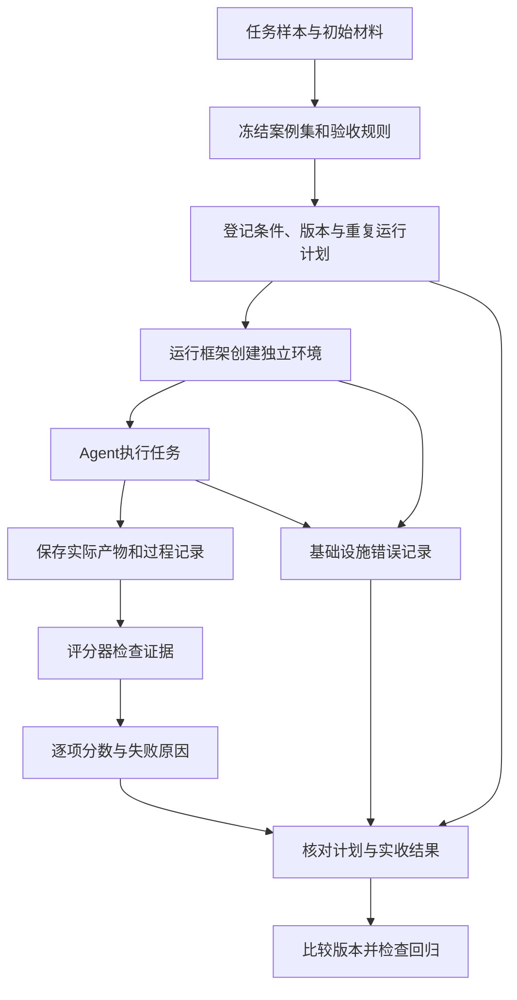

# 第 12 章　评估与回放

[返回目录](README.md) · [上一章：第 11 章 可观测性与调试](11-observability-debugging.md)

评估依据任务要求检查实际产物，并通过重复实验比较不同方案；回放则使用保存的历史输入，帮助定位程序行为差异。本章先介绍案例集、初始材料与验收规则，再说明运行计划、结果完整性和回归判断，随后区分回放、真实重新运行与恢复执行，最后分析 Pi 的内部文档评估。运行过程可结合[第 1 章 Agent 运行时](01-agent-runtime.md)阅读。

## 12.1 评估目标与案例集

用户要求为当前安装增加一个模型，并保留已有模型。Agent 修改配置并回复完成后，仍需检查目标目录是否被当前安装读取、配置是否可加载、新模型参数是否正确，以及原模型是否保留。一次正常结束的交互无法单独证明这些条件，验收依据应包括运行后的实际产物。

评估（evaluation）将这类检查组织成可重复的实验。输入包括任务、初始环境和验收规则，输出包括逐项结果、失败证据与汇总指标。开发者据此比较提示词、工具、模型或实现版本，并判断改动是否满足预先确定的要求。

### 12.1.1 案例覆盖与结果适用范围

案例集（dataset）是一组用于评估的任务及相关检查信息。配置工作可能涉及已有自定义模型、同名项目配置，或保留某个 provider 的其他设置。评估设计需要从目标使用场景选取这些差异；只有空目录新增案例，无法发现破坏旧配置的问题。

案例分布决定结论的适用范围。如果实际任务多数是简单新增，而评估全部使用冲突配置，报告主要反映冲突处理能力。可以分别报告各类任务表现，并注明总体汇总的权重。重复同一案例用于观察输出波动，增加不同案例则扩大场景覆盖，两者作用不同。

### 12.1.2 开发集、测试集与初始材料

反复分析失败并用于调整提示词的案例属于开发集。另留测试集，在方案确定后使用，可以减少针对已知题目调整造成的评估偏差。这里的隔离是指测试案例与答案不参与调参，与限制执行环境的容器隔离不同。真实用户任务进入案例集前，应移除凭据和不必要的私人数据。

Fixture 是每次运行使用的固定初始材料。本例可包括已有配置、安装目录结构、模型列表和可用工具。Harness，即运行框架，为每次试验复制这些材料、建立独立工作目录并启动 Agent。如果复用上次已经修改的目录，第二次运行可能无需新增模型就通过检查，实验就不再测量同一种行为。

## 12.2 验收规则与评分器

### 12.2.1 产物证据与成功条件

Rubric 是验收与评分规则，规定检查对象、证据、分数和成功条件。配置任务应读取重新加载后的模型列表，核对目标字段，并比较运行前后的已有模型。只搜索文件中的名称可能接受无法解析或位置错误的配置；最终回复也不能证明文件实际存在。

规则需要区分硬约束与可分级质量。例如，原有模型不得丢失可作为硬约束，违反后即不能判为成功；说明文字是否完整则可单独评分。将两者简单平均，会使文字质量抵消破坏配置的错误。分数表达完成程度，成功条件确定是否可交付，两者关系应在实验开始前固定，避免依据新旧输出事后选择有利阈值。

### 12.2.2 程序评分、模型评分与人工评审

Judge 是按照规则检查产物的评分器。能够从结构化状态直接判断的条件通常适合程序检查；需要语义判断的内容可以交给模型或人工评审。

| 待判断内容 | 检查方式 | 使用条件 |
| --- | --- | --- |
| 模型可加载、字段正确、旧模型保留 | 程序读取结构化状态并断言 | 能够可靠取得实际状态 |
| 配置说明准确、解释满足用户需要 | LLM judge，另一个模型按规则评审 | 明确证据与提示，并完成校准 |
| 规则含糊或自动裁判与证据冲突 | 人工检查产物和记录 | 用于建立标准、抽查及争议处理，成本较高 |

同一实验可以组合这些方法：程序检查配置，模型评价说明，人工复核边界案例。模型评分输入需要包含任务和实际产物，不能仅凭“已保留原模型”的回复判定保留成功。候选回答属于待审材料，其中文字不能改变评分规则。

### 12.2.3 模型评分器的校准与偏差

使用 LLM judge 前，应先按相同 rubric 人工标注一批成功、失败与边界样本，再让模型独立评分。逐项比较分歧，可以发现模型是否忽略旧模型丢失，或偏好更长的解释。调整规则和提示后，应使用另一批人工样本验证。更换裁判模型或提示也需要重新校准，否则分数变化可能来自评分器。

比较两个回答时，评分模型可能偏好先展示的位置，也可能偏好更长、更接近标准答案形式的文字。隐藏版本名、交换顺序并检查判断变化，可以帮助识别这些偏差，仍需配合人工抽查。评分输出应提供证据与未满足条款，便于复核。由于校准增加成本，可直接计算的硬约束宜优先使用程序评分。


图中完整性检查区分已取得证据的低分与未取得证据的基础设施失败，缺失观测不能直接记为零分。

## 12.3 实验执行与结果完整性

### 12.3.1 条件控制与运行身份

比较提示词改动前后的 Agent 时，实验负责人应先固定案例集和 rubric，再登记两种条件、重复次数、模型版本及运行环境。除提示词差异外，工具定义、初始文件和预算应保持一致。模型服务版本、采样参数、文档及依赖版本也需要记录；无法控制的外部变化则在报告中说明。随机 seed 可以固定部分随机来源，但不能保证远端模型或完整执行过程完全确定。

每次计划运行都应有稳定身份，例如“配置案例 A、新提示、第 2 次”。Harness 据此建立新 fixture、启动 Agent，并保存消息和工具执行记录；运行结束后读取产物，交给 Judge 保存分数、成功状态和依据。报告程序再按计划核对实际结果，才能发现计划中未获得结果的运行。产物快照必须在清理工作目录之前保存。



图示为通用教学流程，运行框架和评分器不是 Pi 专用对象。

模型输出具有波动，同一案例需要重复运行。成对比较让旧版与新版在相同案例、相同初始材料上分别运行，并重复若干轮。交替或随机安排顺序，可以减小新版总在服务较空闲时运行等固定顺序偏差，但不能消除所有时间变化，也不能使两次模型采样完全相同。

### 12.3.2 任务失败与基础设施失败

Agent 已完成运行，但加载出的配置不合格，属于有证据可评分的任务失败。容器未启动、模型服务不可用或产物采集崩溃，可能使系统根本无法取得可评分证据，应记为基础设施失败。两者都会影响交付，但不能作为同一种能力观测。

成功率（success rate）必须说明分母。计划运行 10 次，其中 8 次取得可评分产物、6 次成功、2 次环境启动失败，则可评分运行成功率为 6/8，完成覆盖率为 8/10。若报告整个流程的交付成功率，则为 6/10。只报告 75% 会隐藏两次未完成运行。比较版本时还需核对案例集合；新版若缺少最难的两个案例，比较剩余结果会产生偏差。

成本与耗时也有各自覆盖范围。价格元数据缺失时成本未知，不能填零。报告应给出有成本记录的运行数，并注明是否包含失败与重试消耗；成功率记录完整，不代表成本记录同样完整。

## 12.4 回归判断与不确定性

回归（regression）是改动后原先满足的行为不再满足。例如，新版能新增模型，却开始覆盖旧模型。总体成功率可能因其他简单案例改善而保持不变，因此还需检查硬约束、分类结果和逐项差异。

行动门槛应在实验前确定。团队可以要求破坏已有配置的情况必须人工复核，普通成功率下降超过预设幅度时暂停发布并增加样本，同时检查幅度内的关键案例。阈值取决于任务风险与预算，没有适用于所有 Agent 的统一数值。达到阈值只触发行动，不能自动证明原因是代码改动。

小样本结论需要同时表达不确定性。两次运行中从一次成功变成两次成功，观测值提高了 50 个百分点，但不能据此推断长期能力也提高同样幅度。报告可给出符合抽样设计的不确定区间，并增加独立案例或重复运行。大量重复一个案例主要改善该案例成功概率的估计；把重复运行视为全新的独立任务，会夸大对整体场景分布的把握。

发现退化后，应检查相应运行的初始材料、工具结果与产物。只有新版缺少模型响应时，首先核对环境；两版均正常完成而新版写错目录时，再定位提示或实现差异。修正后重跑失败类别，并使用未参与调整的测试集检查更广泛影响。

## 12.5 回放、真实重新运行与恢复执行

历史记录可以说明当时发生了哪些消息和调用。要再次执行程序，还必须明确使用历史输入、重新请求外部服务，还是继续原任务。这三种方式解决不同问题。

### 12.5.1 录制回放

录制式 replay（回放）先保存模型请求与响应、工具参数与结果，并记录调用次序或稳定身份。回放器在模型和工具边界返回录制值，使被检查程序接收固定历史输入。例如，读取配置时返回当时录下的内容，可以检查新版上下文处理是否产生变化。请求与录制不匹配时应报告差异，不能自动发起真实调用，否则固定输入条件已经失效。

只保存工具返回文字仍不足以复现产物。写文件工具可能只返回成功，后续程序却需要读取已修改文件；没有重建文件状态，检查就无法取得原来的内容。因此还需保存代码与工具版本、初始 fixture 和相关产物快照，必要时用受控模拟器重建副作用。外部写入应复用录制结果，避免再次向真实服务提交；包含敏感数据的录制也需要访问与保留限制。

### 12.5.2 真实重新运行

Live rerun 从初始 fixture 再次请求模型并执行工具，用于测量当前版本的行为。即使输入、seed 和版本相同，外部服务状态及模型输出仍可能变化，所以通常不能逐字复现旧轨迹。这种方式适合回归评估，但会重新消耗时间、费用，也可能产生外部副作用，相关案例应使用可重置测试环境。

### 12.5.3 恢复执行

Resume 从持久检查点继续未完成任务，依据已完成步骤与结果未知的操作决定下一步，目标是交付原任务。它不会自动成为从初始条件开始的新实验。读取 Session 并重建对话上下文的范围更窄，恢复消息也不代表恢复外部文件或服务状态。检查点与副作用处理见[第 5 章 持久执行与恢复](05-durable-execution.md)。

因此，固定历史输入下检查程序行为使用回放，测量当前版本成功率使用真实重新运行，中断后继续原任务使用恢复执行。保存记录为这些工作提供证据，完整执行器与环境快照仍需另行实现。


三种方式分别产生固定输入下的检查结果、新的一次观测，以及原任务继续执行的结果。

## 12.6 参考实现：Pi 的文档效果评估

Pi 的内部实验基于 `vitest-evals`，比较提供文档 `with_docs` 与不提供文档 `without_docs` 两种条件下的任务表现。它独立于默认 CLI 对话流程。本节以采用程序 Judge 的模型配置案例说明实现，源码基线为 `96abe9a5ad45005cae34ed1c52d42f71fc88bedc`。通用模型评分器校准、回归发布门槛与录制执行器仍不在这套内部工具的实现范围内。

1. 案例先明确要求与成功条件：增加 `openai` provider 下的 `fixture-chat` 模型，显示名为 `Fixture Chat`，支持文本输入与推理，窗口为 32,768 tokens，最大输出 4,096 tokens，价格为零；检查还要求新模型可加载且原模型保留。
2. 计划器组合案例、`with_docs` / `without_docs` 条件、执行模型和 `runNumber`，列出完整运行计划。这些值构成运行身份，后续报告才能识别缺失项并配对。两个案例、两种文档条件、每种重复三次时计划 12 次运行；每个案例交替条件先后顺序，减少固定执行顺序造成的影响，但不能消除其他实验偏差。
3. 每项计划在单独 Docker 容器运行，Harness 创建专用 Workspace、HOME、AgentDir 和 Session，再执行 Agent。Agent 根据 prompt 修改配置；任务结束后由 Harness 执行 reload，再读取重新加载后的真实 `ModelRuntime`。reload 是 Harness 的步骤，不是 Agent 调用的工具。
4. Judge 检查新模型已加载、字段符合预期且原模型仍在，再生成 score。这个案例由程序严格比较结构化字段。文档提升 eval 设置 `judgeThreshold: null`，字段错误因此保留为低分或零分，与基础设施失败分别记录。
5. 每次任务会保存结果和原生 Session。Report 检查每项计划是否恰好收回一个身份匹配的观测，并按 `(evalSet, caseId, model, runNumber)` 把两种文档条件配成一对。
6. Report 将 score `>= 1` 的运行计为成功，成功率据此计算，区别于分数均值。实验组成功率减去对照组成功率得到 lift，即成功率差。Eval set 是评估集合；若其中存在缺失、重复、pending、unscored、skipped 或 errored 等 blocked pair（无法有效比较的配对），报告不发布该集合的 headline（汇总主指标）成功率或 lift，但保留有效观测。


图里的箭头表示 Pi 实验的计划、运行产物、评分和报告之间的数据流。它不包含前面通用流程中的独立人工校准或录制回放执行器。

## 12.7 参考实现：配对完整性与汇总规则

一对结果均有有效评分时，score 为 0 仍代表已观察到的任务失败，可以参与比较。缺少结果则无法判断对应条件下的表现，填零会混淆任务失败与未完成运行，直接删除整对又可能造成选择偏差。Pi 将这类不完整配对标为 blocked，阻止所属集合发布汇总主指标。

| 观察情况 | 配对与指标含义 |
| --- | --- |
| 两种条件各有一个 score，包括 0 | 配对有效；score `>= 1` 才计为成功 |
| 缺失、重复、pending、skipped、unscored 或 errored | 配对无效；所属 eval set 的 headline 成功率和 lift 不发布 |
| score 有效但成本缺失 | 成功率仍可计算；成本指标要看自己的覆盖数量，缺测不等于零成本 |

例如对照组两次 score 为 `[0, 1]`，实验组为 `[1, 1]`，成功率是 `50% → 100%`，lift 为 `0.5`，即提升 50 个百分点。如果实验组第二次没有结果，headline lift 应为 `null`，不能只展示第一对的收益。报告仍能保留有效配对的 Token、工具、延迟差值与已有观测的运营总量，解读时要同时看覆盖数。

配对完整性同时要求计划与观测身份一致。来自不同案例或模型的两个有效分数不能作为同一对结果比较。


## 12.8 参考实现：归档与评估能力边界

Pi 保存的 Session 归档包含消息、工具记录和运行信息，可用于解释评分或重建对话。内部工具没有独立 Replay 执行器，也没有将响应与工具输出作为 cassette（录制数据）注入并重新执行整个案例的机制。外部文件、服务状态和未来模型输出并未由 Session 固定，因此归档本身不足以保证重复外部操作的安全性。统一的 LLM-as-Judge 服务也尚未实现。

多数文档提升案例由程序检查结构化结果。另一个 documentation audit 案例会让模型阅读文档和实现，提交 `match/mismatch/inconclusive`，随后由程序检查 verdict。这里模型的调查结论是被检查的输出，程序要求它提交一次成功调用且 verdict 为 `match`；这条路径没有提供独立盲评的通用裁判服务。扩展为通用模型评审时，仍需实现前面讲过的评审提示、人工样本校准与偏差检查。

现有报告保存逐次观测并比较两种条件，能够呈现结果波动；统计置信区间和发布门槛需要额外设计。结论的适用范围仍取决于案例集，部署方需要建立代表性案例和独立测试集，配置案例的成功率不能直接推广到全部 Agent 任务。

## 12.9 参考实现：身份校验、隔离与产物字段

案例主要定义在 `evals/*.eval.ts`。执行前，`parseDiscoveredCases()` 从 `<eval set> > <case>` 提取身份并拒绝歧义或重复，`createTaskPlan()` 再按案例、变体、模型与运行序号展开任务。外层 CLI 会核对两个镜像发现了相同案例，并保存完整计划、镜像 ID 和 protocol 摘要，因此未完成的计划不会从分母里消失。

每个 `runTask()` 用案例精确匹配过滤器启动 Docker。容器采用只读根文件系统、临时目录和独立 artifacts 挂载；Harness 建立 Workspace、HOME、AgentDir 与 Session，随后降到非特权 UID。评估代码等评分材料不允许 Agent 读取。文档评估默认只提供 `read/write/edit/grep/find/ls`，并检查两个变体的 system prompt；模型服务仍需要网络，Docker 隔离不保证任意 Agent 代码绝不联网。执行环境的隔离范围可结合沙箱章节阅读。

本案例的 `output` callback 从 Session 或当前运行时读取结构化状态。`judgeThreshold: null` 让严格 Judge 能把字段不匹配评分为 0 或其他低分并保留；没有模型凭证、容器出错或没有 harness run 属于执行异常，结果为 `errored`，基础设施异常仍可令测试失败。低分是已经评分的任务结果，errored 表示没有得到可评分结果。

本案例对原模型保留的检查限定于 ID 存在性：`inspectAddedModel()` 用未加载自定义配置的运行时取得该 provider 的内置模型 ID，再确认这些 ID 在重新加载后的运行时中仍然存在。它不逐字段比较所有旧模型，也不证明任意用户自定义配置都被完整保留。新增模型本身的字段则由严格结构化 Judge 与预期值匹配。

每次任务结束前，Harness 将原生 Session JSONL 写入 artifact；Report 按运行身份 hash 分目录保存。本章基线中的产物结构如下：

```text
.eval/<run>/
  protocol.json           # 案例、镜像、模型、重复数、摘要
  expected-runs.json      # 完整计划
  observations.jsonl     # 实际结果
  tasks/<hash>/vitest.json
  with_docs/sessions/<hash>/session.jsonl
  without_docs/sessions/<hash>/session.jsonl
  report.json
  report.txt
```

Report 的 `readTaskObservation()` 核对结果是否恰好一份、案例名和模型身份是否正确，再检查 metrics 数值并归类评分。配对要求每种文档条件都恰好计划一次、观察一次且状态为 `scored`。headline 按 `score >= 1` 统计成功率；blocked pair 会阻止所属 eval set 发布 headline 成功率或 lift。成本缺失只影响相应成本覆盖，不会改写成功评分。

## 12.10 源码定位与测试

- 计划与 CLI：[案例身份与展开](https://github.com/earendil-works/pi/blob/96abe9a5ad45005cae34ed1c52d42f71fc88bedc/packages/evals/src/plan.ts#L21-L59)、[镜像和计划保存](https://github.com/earendil-works/pi/blob/96abe9a5ad45005cae34ed1c52d42f71fc88bedc/packages/evals/src/cli.ts#L140-L173)
- Docker 与 Harness：[任务启动](https://github.com/earendil-works/pi/blob/96abe9a5ad45005cae34ed1c52d42f71fc88bedc/packages/evals/src/docker.ts#L161-L175)、[容器边界](https://github.com/earendil-works/pi/blob/96abe9a5ad45005cae34ed1c52d42f71fc88bedc/packages/evals/src/docker.ts#L91-L124)、[Harness 环境](https://github.com/earendil-works/pi/blob/96abe9a5ad45005cae34ed1c52d42f71fc88bedc/packages/evals/src/harness.ts#L154-L188)、[Workspace 与运行时](https://github.com/earendil-works/pi/blob/96abe9a5ad45005cae34ed1c52d42f71fc88bedc/packages/evals/src/harness.ts#L272-L367)、[工具和变体](https://github.com/earendil-works/pi/blob/96abe9a5ad45005cae34ed1c52d42f71fc88bedc/packages/evals/src/harness.ts#L484-L536)、[prompt/reload 步骤](https://github.com/earendil-works/pi/blob/96abe9a5ad45005cae34ed1c52d42f71fc88bedc/packages/evals/src/harness.ts#L369-L390)
- 案例与归档：[模型配置案例](https://github.com/earendil-works/pi/blob/96abe9a5ad45005cae34ed1c52d42f71fc88bedc/packages/evals/evals/models.docs.eval.ts#L1-L40)、[documentation audit](https://github.com/earendil-works/pi/blob/96abe9a5ad45005cae34ed1c52d42f71fc88bedc/packages/evals/evals/documentation-audit.eval.ts#L43-L66)、[Session artifact](https://github.com/earendil-works/pi/blob/96abe9a5ad45005cae34ed1c52d42f71fc88bedc/packages/evals/src/harness.ts#L424-L439)、[Session report 目录](https://github.com/earendil-works/pi/blob/96abe9a5ad45005cae34ed1c52d42f71fc88bedc/packages/evals/src/report.ts#L122-L134)
- 评分和比较：[观测校验](https://github.com/earendil-works/pi/blob/96abe9a5ad45005cae34ed1c52d42f71fc88bedc/packages/evals/src/report.ts#L136-L191)、[完整配对](https://github.com/earendil-works/pi/blob/96abe9a5ad45005cae34ed1c52d42f71fc88bedc/packages/evals/src/report.ts#L209-L281)、[成功率与 headline](https://github.com/earendil-works/pi/blob/96abe9a5ad45005cae34ed1c52d42f71fc88bedc/packages/evals/src/report.ts#L359-L412)
- 相关章节：[第 8 章 沙箱与执行环境](08-sandbox-environment.md)、[第 2 章 上下文与状态](02-context-state.md)、[第 5 章 持久执行与恢复](05-durable-execution.md)
- 测试：[计划](https://github.com/earendil-works/pi/blob/96abe9a5ad45005cae34ed1c52d42f71fc88bedc/packages/evals/test/plan.test.ts#L24-L42)、[配对比较](https://github.com/earendil-works/pi/blob/96abe9a5ad45005cae34ed1c52d42f71fc88bedc/packages/evals/test/comparison.test.ts#L61-L125)、[Report](https://github.com/earendil-works/pi/blob/96abe9a5ad45005cae34ed1c52d42f71fc88bedc/packages/evals/test/report.test.ts#L115-L207)、[Harness](https://github.com/earendil-works/pi/blob/96abe9a5ad45005cae34ed1c52d42f71fc88bedc/packages/evals/test/harness.test.ts#L63-L116)、[private 包](https://github.com/earendil-works/pi/blob/96abe9a5ad45005cae34ed1c52d42f71fc88bedc/packages/evals/package.json#L1-L20)

## 12.11 本章术语

| 术语 | 本章含义 |
| --- | --- |
| Dataset | 用于评估的任务案例及相关检查信息 |
| Fixture | 每次运行使用的固定初始文件、配置与环境材料 |
| Harness | 准备环境、执行任务和收集产物的运行框架 |
| Rubric | 明确证据、分数与成功条件的验收规则 |
| Judge | 按验收规则检查产物的程序或模型评分器 |
| Regression | 改动后原先满足的行为不再满足 |
| Replay / rerun / resume | 分别使用历史录制值、从初始环境重新调用，以及从检查点继续原任务 |
| Blocked pair | 身份或结果完整性不足、无法有效比较的一对计划运行 |

## 12.12 练习

以下练习使用人工观测数据，无需调用模型：用 `comparison.test.ts` 的人工 observations 手算一次报告，再删除或复制一组结果，最后删掉成本字段，观察 `blockedPairs`、`lift` 和 `availableRuns` 的变化。在 `packages/evals` 中可运行以下定向测试；`test/` 使用模拟数据，`evals/` 中的 Agent 评估会实际运行模型，一些入口还会构建 Docker 镜像。

```powershell
node ../../node_modules/vitest/dist/cli.js --run --config vitest.test.config.ts test/plan.test.ts test/comparison.test.ts test/report.test.ts test/harness.test.ts
```
