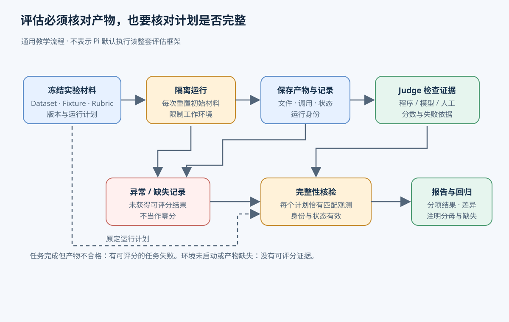
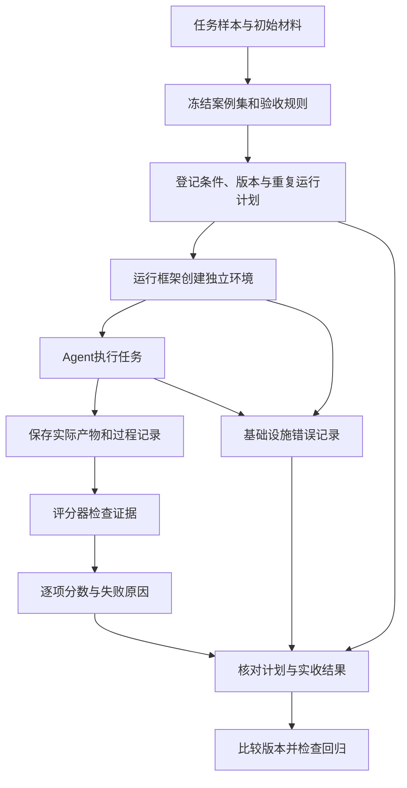
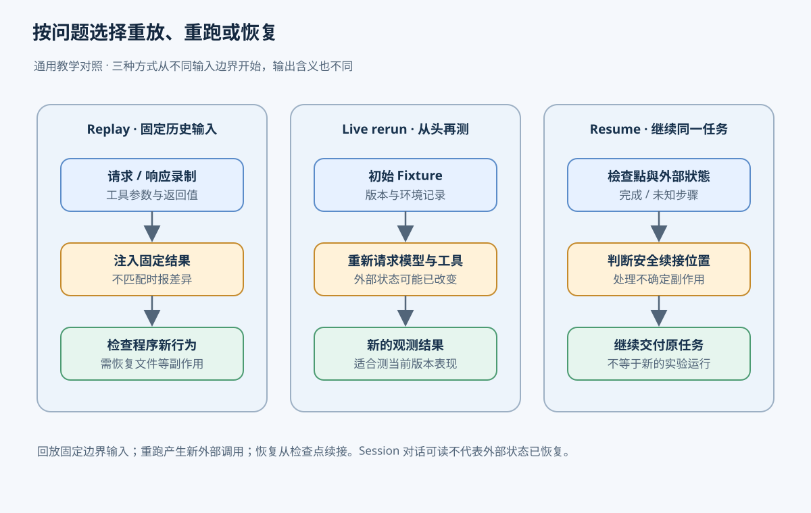

# 12. 怎样验证 Agent 真的完成了任务

[返回学习地图](README.md) · 前置：[Runtime](01-agent-runtime.md)、[可观测性](11-observability-debugging.md)

用户让 Agent 为当前安装增加一个模型，保留已有模型。Agent 修改了一个配置文件，回复“已完成”。这时仍有几个待验证的问题：它写的是当前安装会读取的目录吗？配置能加载吗？新模型参数正确吗？原模型是否被覆盖？一次回答正常结束，只能说明交互走到了结束；任务是否完成，要检查运行后的实际产物。

Evaluation（评估）把这类检查组织成可重复的实验。输入是一组任务、每项任务的初始环境和验收规则，输出是逐项结果、失败证据及汇总指标。开发者用它比较提示词、工具、模型或实现版本，决定某项改动是否值得保留。下面先讲怎样建立这样的实验，再对照 Pi 中“提供文档是否有助于完成配置任务”的内部评估。

## 先确定要检验哪些任务

只检查“新增一个模型”这一个顺利案例，很难判断 Agent 能否处理真实配置工作。用户可能已有自定义模型，可能有同名项目配置，也可能要求保留已有 provider 的其他设置。评估设计者应从目标使用场景中选出这些差异，形成 dataset（案例集）。每个案例包含给 Agent 的任务和检查所需的信息；案例集的覆盖范围决定结论能推广到哪里。

代表性并不等于把困难案例尽量堆在一起。若实际任务大部分是简单新增，评估却全部采用冲突配置，报告测量的就是冲突处理能力。反过来，只有空目录下的新增也会漏掉破坏旧配置的问题。可以按任务类型分别报告结果，再说明总体汇总的权重。重复运行同一个案例能观察波动，但不能替代增加不同类型的案例。

开发过程中反复查看失败并调整提示词的案例，属于开发集。应另留一部分测试集，在方案确定后再运行，避免把“记住这些题目的解法”误判为能力提升。这里的隔离指案例和答案不参与调参；后面会讲的容器隔离则限制运行环境，两者解决不同问题。案例来自真实用户任务时，进入评估前还要去除凭证和不必要的私人数据。

一项任务要重复运行，还需要 fixture（固定的初始材料）。配置案例的 fixture 可以包含已有配置文件、安装目录结构、当前模型列表以及允许使用的工具。Harness（运行框架）为每次试验复制这些材料，创建独立工作目录，并把任务交给 Agent。否则第一次成功写入的模型可能让第二次不做任何修改也通过，测到的就不再是新增能力。

## 把“完成”写成可检查的规则

Rubric（验收与评分规则）说明检查什么证据、怎样打分以及何时算成功。对配置任务，应先规定读取重新加载后的模型列表，核对目标模型的参数，再对比运行前后的已有模型。只找文件中的目标名称会接受无法解析或写错位置的配置；只看最终回复则连文件是否存在都不知道。

规则还要区分硬约束和可分级的质量。比如“原有模型不得丢失”可以是硬约束，违反就不能算成功；说明文字是否完整可以另行打分。若把两者简单平均，写得流畅的解释可能抵消破坏配置的行为。分数用于表达完成程度，成功条件用于决定是否达到交付要求，两者的关系必须提前规定。不要看完新旧版本的输出后，才挑一个有利于新版的阈值。

Judge（评分器）拿到产物后执行这份规则。选择哪种评分器，取决于成功条件能否直接计算：

| 待判断的内容 | 合适的检查方式 | 使用条件 |
| --- | --- | --- |
| 新模型是否可加载，字段是否正确，旧模型是否保留 | 程序 Judge 读取结构化状态并断言 | 需要能可靠取得真实状态；不要只验收 Agent 自报的结果 |
| 配置说明是否准确、是否解释了用户需要的限制 | LLM judge，即让另一个模型按规则评审 | 需要明确证据、评分提示和校准；模型意见仍可能有偏差 |
| 验收规则本身含糊，或自动裁判与证据冲突 | 人工评审产物和记录 | 成本较高，适合建立标准、抽查与处理争议 |

同一次评估可以组合这些方法。配置正确性由程序检查，说明质量交给模型，边界案例由人复核。模型裁判的评审输入应包含任务要求和实际产物；只有一段“我已经保留原模型”的回复，不足以证明保留发生过。还应把候选回答当作待审材料，不能让其中的文字改写裁判规则。

使用 LLM judge 前，先请人按同一 rubric 标注一批样本，覆盖成功、失败和容易混淆的边界情况。让模型独立评分，逐项检查它与人的分歧：它是否忽略了旧模型丢失？是否把更长的解释当作更好的结果？发现问题后修订规则或评审提示，并用另一批人工样本验证。更换裁判模型或提示也需要重新校准，否则分数变化可能来自裁判。

比较两个回答时，模型可能偏好先出现的位置，也可能偏好更长、更像标准答案的文字。隐藏版本名称、交换展示顺序并检查判断是否变化，可以帮助发现这些偏差；人工抽查仍有必要。裁判输出最好同时给出对应证据和未满足的条款，便于复核。这些措施增加评审成本，所以能由程序直接验证的硬约束通常先交给程序。



完整性核验保留基础设施错误与任务低分的区别，缺失观测不等于零分。

## 从实验计划到一份可解释的结果

假设要比较修改提示词前后的 Agent。实验负责人先冻结案例集和 rubric，再登记两种条件、重复次数、模型版本以及运行环境。除要研究的提示差异外，工具定义、初始文件和运行预算应保持一致。模型服务版本、采样参数、文档版本与依赖版本也要记录；无法固定的外部变化要在报告里说明。固定随机 seed 有助于控制部分随机来源，但不能保证远端模型服务或整个执行过程确定性相同。

每次计划运行都需要一个稳定身份，例如“配置案例A、新提示、第2次”。Harness 按身份准备新的 fixture，启动 Agent，记录消息、模型调用和工具执行。任务结束后，Harness 读取产物并交给 Judge；Judge 保存分数、成功与否及依据；报告程序最后按计划核对实际结果。先有计划，才能发现“本来应该跑、实际却没有结果”的任务。

下面是通用教学流程，图中没有 Pi 专用对象。产物快照需要在工作目录清理之前保存。



同一案例应重复运行，因为模型可能这次找对目录、下次又写到项目目录。成对比较让旧版和新版在同一个案例、同一初始材料上各运行一次，再重复若干轮。交替或随机安排运行顺序能减少固定顺序的影响，例如新版总在服务较空闲时运行；它不能消除所有时间变化，也不能让两次模型采样完全相同。

报告首先区分两类失败。Agent 完成运行，但加载出的配置不合格，这是任务失败，可以评分。容器没有启动、模型服务不可用、产物采集程序崩溃，则可能根本没有取得可评分证据，需要记为基础设施失败。两者都影响用户体验，但对“Agent 会不会完成配置”这个问题提供的证据不同。

Success rate（成功率）必须写清分母。假设计划运行10次，其中8次有可评分产物，6次成功，2次环境启动失败。可评分运行的成功率是6/8，评估完成覆盖率是8/10；若另报整个流程的交付成功率，则是6/10。只写“成功率75%”会隐藏那两次缺失。比较版本时，还要说明双方是否使用同一批案例：若新版恰好缺了最难的两个案例，直接比较剩余结果会偏向新版。

成本与耗时也有各自的覆盖范围。模型价格元数据缺失时，成本未知；把它补成零会让缺测版本看起来更便宜。报告应同时给出有成本记录的运行数，并说明是否包括失败运行和重试的消耗。成功率完整，不代表成本记录也完整。

## 怎样判断改动造成了回归

Regression（回归）指改动后原本满足的行为不再满足。例如新版新增模型成功，却开始覆盖已有模型。汇总成功率可能掩盖这件事：新版在其他简单案例多成功一次，平均值就能抵消这个失败。因此应同时查看硬约束、各类案例的结果以及逐项新旧差异。

回归门槛应在实验前确定。团队可以规定：破坏已有配置的硬约束失败必须人工复核；普通成功率下降超过预设幅度时暂停发布并扩大样本；低于幅度也要检查关键案例。具体幅度取决于任务风险和预算，没有适用于所有 Agent 的统一数字。门槛是行动规则，并不能自动证明差异由代码导致。

少量运行尤其需要谨慎。两次里从一次成功变成两次成功，观测值提高了50个百分点，但不足以断言长期能力提高同样幅度。报告可以给出与抽样设计相符的不确定区间，并增加独立案例或重复运行。一个案例重复很多次主要减少该案例成功概率的估计误差；把这些运行都视作互不相关的新任务，会夸大对整体任务分布的把握。

发现退化后，先查对应运行的初始材料、工具结果和最终产物。若只有新版缺失模型服务响应，先处理实验环境；若两边均正常完成，而新版把配置写到错误目录，则继续定位提示或实现差异。修正后重跑失败类别，并保留隔离测试集检查更广泛影响。由此完成“定义任务、执行、验收、比较、诊断、再验证”的评估周期。

## 为诊断重现什么：回放、重新运行与恢复

上面的诊断需要历史证据。Session 或轨迹记录能帮助阅读当时发生的消息和工具调用，但“看见过去”与“让程序再次按过去的输入执行”需要不同机制。

录制式 replay（回放）先保存模型请求及响应、工具参数及结果，并标记调用次序或稳定身份。回放执行器再在模型和工具边界返回录制值，让待检查的程序走过同样的输入。例如模型当时请求读取配置，回放器直接返回当时录下的内容，可以检查新版上下文处理是否仍正确。遇到请求不匹配应报告差异，不能悄悄发起真实调用，否则固定输入的前提已经改变。

只录工具的返回文字仍有缺口。写文件工具可能只返回“成功”，后续程序却要读取被修改的文件。若回放器没有重建文件状态，后续检查无法得到原来的产物。因此复现还需要代码和工具版本、初始 fixture，以及相关文件或产物的版本快照；必要时由受控模拟器重建副作用。录制外部写入时，回放应复用记录而不再次发送真实写入。记录含有敏感内容时还需限制其保存与访问。

Live rerun（真实重新运行）则从初始 fixture 再发起模型请求和工具调用，用于测量当前 Agent 的行为。即使输入、seed 和版本相同，外部服务状态与模型输出仍可能改变，所以它通常不能逐字复现旧轨迹。它适合回归评估，代价是再次耗费时间、模型费用，并可能重新产生外部副作用；这类案例应使用可重置的测试环境。

Resume（恢复执行）从一个已保存的任务检查点继续未完成工作。它要判断哪些步骤已经完成、哪些结果未知，目标是交付原任务；不会自然产生一份从同一初始条件开始的新实验。读取 Session 重建对话上下文又是更窄的操作，只恢复可读消息不代表外部配置和服务状态也恢复。关于检查点和副作用恢复的机制可接着阅读后文链接的 Durable Execution 章节。

选择方法要跟问题对应：检查程序对固定历史输入的处理，用录制回放；测量当前版本成功率，用真实重新运行；中断后继续交付同一任务，用恢复执行。保存运行记录是这些工作的证据来源，完整执行器和环境快照仍需单独设计。



这三种方式的输入边界不同，因此产物分别代表固定输入回归、新一轮观测和原任务续接。

## Pi 对照：文档提升实验怎样运行

Pi 的这个内部实验研究 `with_docs` / `without_docs` 两种条件是否影响任务表现，基于 `vitest-evals`，不属于默认 CLI 每次对话都会执行的流程。下面的模型配置案例采用程序 Judge；前面介绍的通用 LLM judge 校准、回归发布门槛和录制执行器，并没有因此自动存在于仓库中。

1. 案例先明确要求与成功条件：增加 `openai` provider 下的 `fixture-chat` 模型，显示名为 `Fixture Chat`，支持文本输入与推理，窗口为 32,768 tokens，最大输出 4,096 tokens，价格为零；检查还要求新模型可加载且原模型保留。
2. 计划器组合案例、`with_docs` / `without_docs` 条件、执行模型和 `runNumber`，列出完整运行计划。这些值构成运行身份，后续报告才能识别缺失项并配对。两个案例、两种文档条件、每种重复三次时计划 12 次运行；每个案例交替条件先后顺序，减少固定执行顺序造成的影响，但不能消除其他实验偏差。
3. 每项计划在单独 Docker 容器运行，Harness 创建专用 Workspace、HOME、AgentDir 和 Session，再执行 Agent。Agent 根据 prompt 修改配置；任务结束后由 Harness 执行 reload，再读取重新加载后的真实 `ModelRuntime`。reload 是 Harness 的步骤，不是 Agent 调用的工具。
4. Judge 检查新模型已加载、字段符合预期且原模型仍在，再生成 score。这个案例的 Judge 是严格结构化的程序；任务由模型执行不代表评分也由模型完成。文档提升 eval 将 `judgeThreshold: null`，因此字段错误可以保留为低分或零分，而不是一概变成基础设施失败。
5. 每次任务会保存结果和原生 Session。Report 检查每项计划是否恰好收回一个身份匹配的观测，并按 `(evalSet, caseId, model, runNumber)` 把两种文档条件配成一对。
6. Report 按 score `>= 1` 计算成功率，不取 score 平均值。实验组成功率减去对照组成功率得到 lift。若一个 eval set 存在缺失、重复、pending、unscored、skipped 或 errored 等 blocked pair，就不发布该 set 的 headline 成功率或 lift；有效观测仍可留在报告中。


图里的箭头表示 Pi 实验的计划、运行产物、评分和报告之间的数据流。它不包含前面通用流程中的独立人工校准或录制回放执行器。

## 结果怎样决定这组比较能不能发布

两份结果都有有效评分时，即使一份 score 为 0，仍能比较这组任务行为。缺少一份结果则无法知道该条件的行为；把它补成零分会混淆 Agent 失败和基础设施未完成，丢掉整组也可能只留下有利结果。因此报告将不完整配对标成 blocked，而不把缺失值当作零。

| 观察情况 | 配对与指标含义 |
| --- | --- |
| 两种条件各有一个 score，包括 0 | 配对有效；score `>= 1` 才计为成功 |
| 缺失、重复、pending、skipped、unscored 或 errored | 配对无效；所属 eval set 的 headline 成功率和 lift 不发布 |
| score 有效但成本缺失 | 成功率仍可计算；成本指标要看自己的覆盖数量，缺测不等于零成本 |

例如对照组两次 score 为 `[0, 1]`，实验组为 `[1, 1]`，成功率是 `50% → 100%`，lift 为 `0.5`，即提升 50 个百分点。如果实验组第二次没有结果，headline lift 应为 `null`，不能只展示第一对的收益。报告仍能保留有效配对的 Token、工具、延迟差值与已有观测的运营总量，解读时要同时看覆盖数。

图中的“完整”同时要求计划和观测身份一致；两份来自不同案例或不同模型的分数，即使都有数值，也不能凑成一对。


## Pi 的实现边界

这套内部工具没有独立 Replay 执行器，也没有统一的 LLM-as-Judge 服务。Session 归档留下消息、工具记录和运行信息，可用于解释分数或重建对话；仓库没有把这些模型响应和工具输出作为 cassette（录制数据）注入后执行整个案例的机制。Session 也不固定外部文件、服务状态或未来模型输出，不能据此安全重复外部副作用。

多数文档提升案例由程序检查结构化结果。另一个 documentation audit 案例会让模型阅读文档和实现，提交 `match/mismatch/inconclusive`，随后由程序检查 verdict。这里模型的调查结论是被检查的输出，程序要求它提交一次成功调用且 verdict 为 `match`；这条路径没有提供独立盲评的通用裁判服务。扩展为通用模型评审时，仍需实现前面讲过的评审提示、人工样本校准与偏差检查。

现有报告能保存逐次观测、发现不稳定结果并比较两种条件；统计置信区间和发布用的回归门槛还需另行设计。也应根据使用场景另建代表性案例和隔离测试集，不能把一个配置案例的成功率直接推广到所有 Agent 任务。

## 源码附录：身份校验、隔离与产物字段

案例主要定义在 `evals/*.eval.ts`。执行前，`parseDiscoveredCases()` 从 `<eval set> > <case>` 提取身份并拒绝歧义或重复，`createTaskPlan()` 再按案例、变体、模型与运行序号展开任务。外层 CLI 会核对两个镜像发现了相同案例，并保存完整计划、镜像 ID 和 protocol 摘要，因此未完成的计划不会从分母里消失。

每个 `runTask()` 用案例精确匹配过滤器启动 Docker。容器采用只读根文件系统、临时目录和独立 artifacts 挂载；Harness 建立 Workspace、HOME、AgentDir 与 Session，随后降到非特权 UID。评估代码等评分材料不允许 Agent 读取。文档评估默认只提供 `read/write/edit/grep/find/ls`，并检查两个变体的 system prompt；模型服务仍需要网络，Docker 隔离不保证任意 Agent 代码绝不联网。可结合 Sandbox 章节理解这个边界。

本案例的 `output` callback 从 Session 或当前运行时读取结构化状态。`judgeThreshold: null` 让严格 Judge 能把字段不匹配评分为 0 或其他低分并保留；没有模型凭证、容器出错或没有 harness run 属于执行异常，结果为 `errored`，基础设施异常仍可令测试失败。低分是已经评分的任务结果，errored 表示没有得到可评分结果。

“原模型保留”的具体检查范围也有限：`inspectAddedModel()` 用未加载自定义配置的运行时取得该 provider 的内置模型 ID，再确认这些 ID 在重新加载后的运行时中仍然存在。它不逐字段比较所有旧模型，也不证明任意用户自定义配置都被完整保留。新增模型本身的字段则由严格结构化 Judge 与预期值匹配。

每次任务结束前，Harness 将原生 Session JSONL 写入 artifact；Report 按运行身份 hash 分目录保存。当前产物结构如下：

```text
.eval/<run>/
  protocol.json           # 案例、镜像、模型、重复数、摘要
  expected-runs.json      # 完整计划
  observations.jsonl     # 实际结果
  tasks/<hash>/vitest.json
  with_docs/sessions/<hash>/session.jsonl
  without_docs/sessions/<hash>/session.jsonl
  report.json
  report.txt
```

Report 的 `readTaskObservation()` 核对结果是否恰好一份、案例名和模型身份是否正确，再检查 metrics 数值并归类评分。配对要求每种文档条件都恰好计划一次、观察一次且状态为 `scored`。headline 按 `score >= 1` 统计成功率；blocked pair 会阻止所属 eval set 发布 headline 成功率或 lift。成本缺失只影响相应成本覆盖，不会改写成功评分。

## 源码位置、测试与练习

- 计划与 CLI：[案例身份与展开](https://github.com/earendil-works/pi/blob/96abe9a5ad45005cae34ed1c52d42f71fc88bedc/packages/evals/src/plan.ts#L21-L59)、[镜像和计划保存](https://github.com/earendil-works/pi/blob/96abe9a5ad45005cae34ed1c52d42f71fc88bedc/packages/evals/src/cli.ts#L140-L173)
- Docker 与 Harness：[任务启动](https://github.com/earendil-works/pi/blob/96abe9a5ad45005cae34ed1c52d42f71fc88bedc/packages/evals/src/docker.ts#L161-L175)、[容器边界](https://github.com/earendil-works/pi/blob/96abe9a5ad45005cae34ed1c52d42f71fc88bedc/packages/evals/src/docker.ts#L91-L124)、[Harness 环境](https://github.com/earendil-works/pi/blob/96abe9a5ad45005cae34ed1c52d42f71fc88bedc/packages/evals/src/harness.ts#L154-L188)、[Workspace 与运行时](https://github.com/earendil-works/pi/blob/96abe9a5ad45005cae34ed1c52d42f71fc88bedc/packages/evals/src/harness.ts#L272-L367)、[工具和变体](https://github.com/earendil-works/pi/blob/96abe9a5ad45005cae34ed1c52d42f71fc88bedc/packages/evals/src/harness.ts#L484-L536)、[prompt/reload 步骤](https://github.com/earendil-works/pi/blob/96abe9a5ad45005cae34ed1c52d42f71fc88bedc/packages/evals/src/harness.ts#L369-L390)
- 案例与归档：[模型配置案例](https://github.com/earendil-works/pi/blob/96abe9a5ad45005cae34ed1c52d42f71fc88bedc/packages/evals/evals/models.docs.eval.ts#L1-L40)、[documentation audit](https://github.com/earendil-works/pi/blob/96abe9a5ad45005cae34ed1c52d42f71fc88bedc/packages/evals/evals/documentation-audit.eval.ts#L43-L66)、[Session artifact](https://github.com/earendil-works/pi/blob/96abe9a5ad45005cae34ed1c52d42f71fc88bedc/packages/evals/src/harness.ts#L424-L439)、[Session report 目录](https://github.com/earendil-works/pi/blob/96abe9a5ad45005cae34ed1c52d42f71fc88bedc/packages/evals/src/report.ts#L122-L134)
- 评分和比较：[观测校验](https://github.com/earendil-works/pi/blob/96abe9a5ad45005cae34ed1c52d42f71fc88bedc/packages/evals/src/report.ts#L136-L191)、[完整配对](https://github.com/earendil-works/pi/blob/96abe9a5ad45005cae34ed1c52d42f71fc88bedc/packages/evals/src/report.ts#L209-L281)、[成功率与 headline](https://github.com/earendil-works/pi/blob/96abe9a5ad45005cae34ed1c52d42f71fc88bedc/packages/evals/src/report.ts#L359-L412)
- 相关章节：[Sandbox](08-sandbox-environment.md)、[上下文与状态](02-context-state.md)、[Durable Execution](05-durable-execution.md)
- 测试：[计划](https://github.com/earendil-works/pi/blob/96abe9a5ad45005cae34ed1c52d42f71fc88bedc/packages/evals/test/plan.test.ts#L24-L42)、[配对比较](https://github.com/earendil-works/pi/blob/96abe9a5ad45005cae34ed1c52d42f71fc88bedc/packages/evals/test/comparison.test.ts#L61-L125)、[Report](https://github.com/earendil-works/pi/blob/96abe9a5ad45005cae34ed1c52d42f71fc88bedc/packages/evals/test/report.test.ts#L115-L207)、[Harness](https://github.com/earendil-works/pi/blob/96abe9a5ad45005cae34ed1c52d42f71fc88bedc/packages/evals/test/harness.test.ts#L63-L116)、[private 包](https://github.com/earendil-works/pi/blob/96abe9a5ad45005cae34ed1c52d42f71fc88bedc/packages/evals/package.json#L1-L20)

可以不用调用模型练习报告规则：用 `comparison.test.ts` 的人工 observations 手算一次报告，再删除或复制一组结果，最后删掉成本字段，观察 `blockedPairs`、`lift` 和 `availableRuns` 怎样变化。原定向测试命令如下；`test/` 使用模拟数据，`evals/` 中的 Agent 评估会实际运行模型，一些入口还会构建 Docker 镜像。

```powershell
node ../../node_modules/vitest/dist/cli.js --run --config vitest.test.config.ts test/plan.test.ts test/comparison.test.ts test/report.test.ts test/harness.test.ts
```
