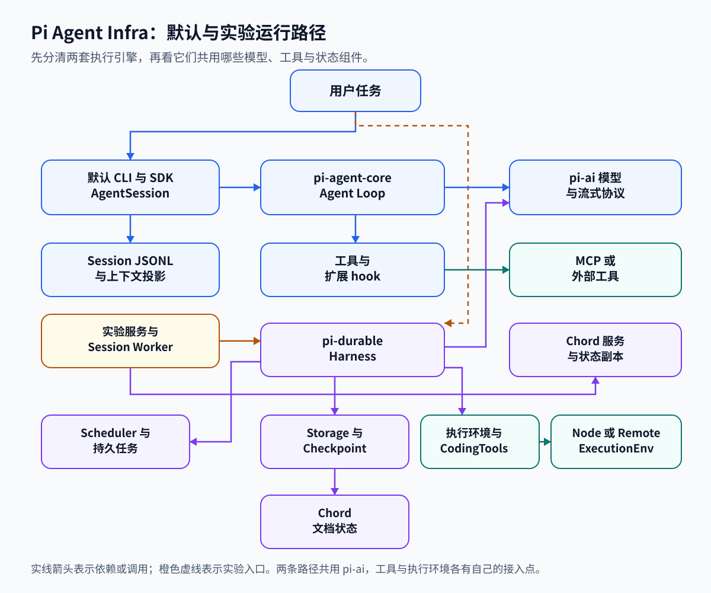

# Agent Infra 入门：从工作过程理解系统，用 Pi 验证实现

这套教材面向第一次接触 Agent 基础设施的读者。学习目标是：拿到一项需要模型参与的任务，能解释它怎样被接收、执行、保存、恢复和验证；遇到排队、重复操作或结果错误时，知道该检查哪一层。Pi 提供可以阅读的实现案例。课程还会讲 Pi 没有完整提供、但构建这类系统时需要理解的能力。

## Agent 怎样把一句要求变成实际工作

假设用户提出：“给项目增加一个模型配置，保留已有配置，并检查能否加载。”模型只能根据收到的信息生成输出。它提出读取文件时，文件还没有被读取。运行程序需要识别这个工具调用，校验参数，执行读取，再把结果送进下一次模型请求。模型据此提出修改，程序执行后再提供结果，直到任务结束、用户取消或预算耗尽。

这种反复执行“取得信息、决定下一步、调用工具、观察结果”的程序，可以称为 Agent。Agent Runtime 是推进这个循环的运行时。模型负责提出下一步，工具负责执行具体动作，运行时负责交接、记录和停止条件。流式输出让程序在模型尚未结束时接收部分内容，用来显示进度或收集调用参数；收到一段输出不表示对应操作已经完成。

用户往往会继续追问。Session（会话）把这些连续交互组织起来，但模型每次请求能看到的内容仍需由程序准备。已有对话、工具输出、用户约束都可能成为上下文；正在排队的任务、某个操作的完成标记和进程状态，则可能保存在模型看不到的地方。后续章节会分别解释这些状态如何使用。

一次循环成功后，还有一组运行问题：同时来了很多任务怎么办？命令卡住多久才停止？改完文件但没来得及记录就崩溃，重开后会不会再改一次？两个执行者是否会同时领取同一任务？Agent Infra（Agent 基础设施）承担这些工作，让模型参与的任务能够受控地运行。单机工具可以采用较少的机制；任务量、运行时间和部署范围扩大后，再按具体问题增加队列、持久执行与分布式协调。

## 十二类能力怎样共同完成一项任务

下面是一套教学用的工作过程。它描述通用系统的职责，不表示 Pi 默认安装后就具有这条完整流水线。

一个团队希望批量修改多个项目的配置。接收服务先识别请求者，并检查他能否修改这些项目。接下来的任务进入队列，空闲 Worker（执行任务的程序或进程）按调度规则领取工作。队列保存待办，Worker 提供执行能力；这让接收请求和实际执行可以有不同的速度。

Worker 启动 Agent 循环，准备本次模型上下文，通过统一工具接口读取项目。文件读取、命令执行和网络访问发生在选定的执行环境中，权限规则决定能做什么，隔离机制限制实际可触及的资源。如果工作较复杂，编排层把调研、修改和审阅拆开：独立部分可以并行，审阅等待修改产物，发布等待人工决定。

执行期间，系统保存已经完成的阶段和继续运行所需的数据。网络失败时，重试策略决定何时再试；进程崩溃时，恢复过程根据持久记录重新安排未完成工作。若外部操作已经成功而结果记录丢失，系统还需要幂等键或结果查询来避免重复效果。多台 Worker 共同工作时，存储与协调机制还须约束谁有权推进任务，以及其他进程读到的是哪个版本。

用户等待的全过程都需要观测：排队多久、模型响应多久、工具耗时多少、重试了几次、消耗多少 token。任务最终结束后，评估系统检查配置能否加载、旧配置是否保留，并把结果与其他版本比较。一次回复写着“完成”，只能证明模型给出了这段文字；产物和实际行为需要单独验证。

十二章沿这条过程分工。每章都有独立的学习目标，也会说明它与相邻章节的交接。

| 章节 | 要掌握的知识 | 学完后应能解释的问题 |
| --- | --- | --- |
| [01 · Agent Runtime](01-agent-runtime.md) | Agent loop、tool calling、streaming、Session | 一次用户输入怎样引出多次模型与工具交互？部分输出、完整回复和会话结束各发生在何时？ |
| [02 · 上下文与状态管理](02-context-state.md) | 短期上下文、运行状态、裁剪与压缩、checkpoint、长期记忆 | 信息放不进请求时如何取舍？下一次调用、进程重启和跨会话检索分别依靠什么记录？ |
| [03 · 任务队列与 Worker](03-queues-workers.md) | 任务 queue、worker、并发、优先级、backpressure、worker pool | 请求到达速度超过处理速度时，如何排队、分配容量并限制积压？ |
| [04 · 调度与多 Agent 编排](04-orchestration.md) | 任务拆解、DAG 依赖图、reviewer、handoff、HITL 人工介入 | 哪些工作能并行？谁接收产物、谁作决定？交接或审批后从哪里继续？ |
| [05 · Durable Execution](05-durable-execution.md) | durability、checkpoint、replay、resume、recovery | 进程在任意步骤退出后，哪些事实仍在，系统依据什么重建并继续工作？ |
| [06 · Retry、Timeout 与幂等](06-retry-timeout-idempotency.md) | 错误分类、重试与退避、超时、幂等 | 没收到结果时能否重做？怎样限制等待和重试，又避免产生两次外部效果？ |
| [07 · 分布式状态与一致性](07-distributed-state.md) | transaction、WAL、lease、heartbeat、replication、consistency | 多次更新如何一起生效？执行权失效后怎样接管？多个副本各能承诺读到什么？ |
| [08 · Sandbox 与执行环境](08-sandbox-environment.md) | 文件系统、进程、网络隔离，CPU、内存与时间限制 | 工具即使执行了错误命令，哪些文件、服务和资源仍应受到保护？限制由谁强制执行？ |
| [09 · 工具基础设施与 MCP](09-tools-mcp.md) | 工具统一接口、参数与结果约定、MCP 连接、发现和调用 | 不同工具怎样接进同一个循环？外部服务的工具如何成为模型可以请求的动作？ |
| [10 · 权限、安全与 Secrets](10-permissions-secrets.md) | authentication、authorization、ACL、secrets、audit | 系统怎样确认身份、判定动作许可、交付凭证，并留下可追责的操作记录？ |
| [11 · 可观测性与调试](11-observability-debugging.md) | trace、metrics、延迟分解、排队、token 与成本、失败与重试 | 一项任务为什么慢或贵？怎样从一次调用追到故障位置，再判断是否为普遍问题？ |
| [12 · Evaluation 与 Replay](12-evaluation-replay.md) | dataset、rubric、成功率、回归比较、replay、LLM judge | 如何把“做得好”变成可重复检查的标准？换模型或代码后，怎样发现能力退步？ |

这些能力的边界需要结合过程理解。checkpoint 保存继续执行所需的状态，因此同时出现在上下文管理与持久执行中；事务帮助这些记录一致地提交，因此恢复又依赖存储。重试会增加调用量，既影响幂等安全，也影响延迟与成本。trace 用于追查某次执行，评估则要在明确的数据集和评分标准下比较多次执行。各章会在相应交接处解释这些关系。

## 第一次学习的顺序

先读 01、09、02，完成一个最小循环的理解。能用自己的话描述：用户要求如何成为请求、模型怎样提出工具调用、工具结果如何回到模型、下一次请求会保留哪些信息。此时先读概念和流程，源码入口可以留到第二遍。

再读 08、10，为执行建立边界。沿“模型请求执行一条命令”判断：请求者是否有权发起、凭证从哪里来、命令在哪个环境运行、哪些访问与资源使用会被限制。这样再扩展并发时，才知道新增 Worker 应继承什么限制。

接着读 03、04，把一个任务扩展到多个任务。画出待执行队列、Worker 容量和任务依赖，区分“暂时没有执行名额”“依赖尚未完成”和“等待人工决定”。这三种等待的原因不同，后续唤醒方式也不同。

然后读 05、06、07，给上述流程加入故障。分别在操作开始前、外部操作成功后、结果持久化后中断程序，推导恢复者能看到什么；再加入第二个执行者，检查任务是否会被重复推进。事务、幂等和执行权分别处理这里的不同风险。

最后读 11、12，建立运行证据和质量判断。前者解释任务实际经历了什么，后者检验结果是否达到要求。两者共同支持改进：先从记录中发现慢或失败的环节，再用固定案例检查改动是否有效。

读完一章后，可以拿一个新场景检验理解。例如，把改配置换成生成研究报告，队列、超时和检查点仍有用途，但工具副作用和评分方式会变化。若只能复述某个 Pi 类名，尚不足以说明已经掌握该章机制。

## Pi 能提供哪些学习材料

Pi 的代码可以用来核对：某种机制把状态存在哪里，哪段代码推进下一步，失败时采用什么策略。阅读时需要区分默认 CLI、实验路径和可选示例。

默认 CLI 使用 `AgentSession` 组织模型调用、工具执行与会话记录。实验 durable harness 将工作组织成可持久保存的任务，研究调度与恢复。两条路径共用部分模型和工具能力，但执行引擎、状态记录与恢复规则不同。重新打开普通会话能恢复已有对话，这与重建尚未完成的持久任务属于不同过程。

`pi-durable` [明确标为 Experimental](https://github.com/earendil-works/pi/blob/96abe9a5ad45005cae34ed1c52d42f71fc88bedc/packages/durable/README.md#L1-L7)。`coding-agent/src/experimental` 下的入口也属于实验路径，`examples` 提供可选扩展示例。把某个示例接入应用需要相应配置；不能把几个分别存在的示例当成默认已经组合好的系统。

| 学习范围 | Pi 对应材料与覆盖边界 |
| --- | --- |
| 运行循环、上下文与工具 | 有直接可读的模型调用、工具执行、流式事件、历史投影和压缩实现；长期记忆检索仍需额外设计 |
| 排队与编排 | 有输入队列、本地任务调度、Session Worker 和子 Agent 示例；输入排队不能代替通用任务队列，现有关系图也不等于完整 DAG 工作流引擎 |
| 持久执行与失败处理 | 实验路径提供持久状态、检查点和恢复案例；默认 CLI 的重试与会话记录有自己的适用范围；外部效果的去重还取决于工具和服务 |
| 状态与协调 | 可研究事务、SQLite、快照与增量同步，以及本地执行权；没有据此构成完整的多主调度、分布式租约或数据库共识系统 |
| 执行环境与安全 | 可研究 Node、SSH 后端及沙箱示例，凭证保存、认证和工具拦截；执行位置本身不保证隔离，统一 ACL 与网络策略也未默认内置 |
| 观测与评估 | 有事件、usage、成本、遥测接口及评估案例；完整自动 trace、metrics 后端和导出仍需接入；评估所用判定器要按实际产物选择 |

教材中的通用设计会讲清这些缺口为何出现、需要什么机制，以及实现它们要承担的代价。项目没有某项完整实现时，可以先用教学流程理解它，再返回 Pi 判断现有代码覆盖到了哪一步。

源码材料以 Pi 提交 `96abe9a5ad45005cae34ed1c52d42f71fc88bedc` 为基线，教材与图示更新于 2026-10-12。GitHub 上的源码链接固定到上述 Pi 提交与行号，便于在线核对。若在本地 VS Code 阅读，可使用 `local-vscode` 分支；请将 Pi 源码仓库与本文档仓库放在同一个父目录下。教材记录的是指定提交的实现；如果本地 Pi 代码版本不同，行号可能略有变化。阅读其他版本时，应重新检查相应实现和测试。

章节中的测试命令需要在 Pi 源码仓库的指定目录执行。独立文档仓库只保存教材和图示，不包含运行这些测试所需的源码与依赖。

## 图示索引

每章有两张通用概念细节图，共 24 张，嵌在相应解释之后；另保留 21 张 Pi 实现图。先沿概念图理解参与者、状态和交接，再用实现图核对项目代码。03 的输入边界图只覆盖消息排队，07 的订阅图只覆盖状态副本同步，08 的路由图只覆盖执行后端；这些图都不代表该章通用能力的全部范围。

下表列出 Pi 实现图，通用概念图索引接在其后。

| 章节 | 流程与关系 | 具体例子 |
| --- | --- | --- |
| 总览 | [默认与实验运行路径](figures/00-runtime-map.svg) | 两条执行引擎共用哪些组件 |
| [01 · Agent 循环](01-agent-runtime.md) | [请求、工具与会话收尾](figures/01-runtime-flow.svg) | [一次读文件任务](figures/01-agent-loop.svg) |
| [02 · 上下文与状态](02-context-state.md) | [从历史推导模型请求](figures/02-projection-flow.svg) | [历史与请求投影](figures/02-context-projection.svg) |
| [03 · 队列与 Worker](03-queues-workers.md) | [输入准入、排队与消费边界](figures/03-queue-boundaries.svg) | 沿分支区分去重、拒绝、排队和放置 |
| [04 · 多 Agent 编排](04-orchestration.md) | [任务所有权与等待关系](figures/04-task-ownership.svg) | [父子任务收尾](figures/04-child-lifecycle.svg) |
| [05 · 持久执行](05-durable-execution.md) | [提交、外部操作与恢复时序](figures/05-commit-recovery-sequence.svg) | [工具崩溃窗口](figures/05-crash-recovery.svg) |
| [06 · 重试与幂等](06-retry-timeout-idempotency.md) | [取消、压缩恢复与错误重试](figures/06-session-retry-flow.svg) | 对照失败类型选择下一步 |
| [07 · 状态同步](07-distributed-state.md) | [快照与增量的订阅时序](figures/07-subscription-sequence.svg) | [快照接上增量](figures/07-snapshot-delta.svg) |
| [08 · 执行环境](08-sandbox-environment.md) | [本机与远端环境路由](figures/08-env-routing.svg) | [执行位置与隔离](figures/08-execution-boundaries.svg) |
| [09 · 工具与 MCP](09-tools-mcp.md) | [注册、直接调用与脚本调用](figures/09-mcp-integration.svg) | [MCP 工具接入](figures/09-mcp-tool-path.svg) |
| [10 · 权限与凭证](10-permissions-secrets.md) | [项目信任、工具拦截与服务认证](figures/10-permission-layers.svg) | 区分加载权限、工具调用与系统访问 |
| [11 · 可观测性](11-observability-debugging.md) | [事件、统计与遥测接入](figures/11-observation-flow.svg) | 实线记录与虚线接入分别由谁负责 |
| [12 · 评估与回放](12-evaluation-replay.md) | [从任务计划到配对报告](figures/12-evaluation-flow.svg) | [评估结果配对](figures/12-evaluation-pairs.svg) |

通用概念图聚焦每章的两个具体问题：

| 章节 | 第一张细节图 | 第二张细节图 |
| --- | --- | --- |
| 01 · Agent 循环 | [模型与宿主怎样交接工具调用](figures/01-concept-tool-handoff.svg) | [流式片段与完成边界](figures/01-concept-stream-finality.svg) |
| 02 · 上下文与状态 | [哪些材料进入模型请求](figures/02-concept-context-sources.svg) | [长期记忆的审核与检索](figures/02-concept-memory-governance.svg) |
| 03 · 队列与 Worker | [领取、确认与重新交付](figures/03-concept-queue-lifecycle.svg) | [并发容量与背压](figures/03-concept-capacity-backpressure.svg) |
| 04 · 多 Agent 编排 | [依赖边如何传递产物](figures/04-concept-dag-artifacts.svg) | [审阅与批准绑定哪个版本](figures/04-concept-review-approval.svg) |
| 05 · 持久执行 | [检查点怎样支持重启](figures/05-concept-checkpoint-restart.svg) | [效果发生但结果未保存](figures/05-concept-crash-window.svg) |
| 06 · 重试与幂等 | [稳定幂等键如何避免重复创建](figures/06-concept-idempotent-retry.svg) | [超时与重试共用预算](figures/06-concept-deadline-budget.svg) |
| 07 · 分布式状态 | [接管后如何限制旧执行者](figures/07-concept-lease-fencing.svg) | [WAL 恢复与副本读取](figures/07-concept-wal-replica.svg) |
| 08 · 执行环境 | [访问限制与资源配额](figures/08-concept-boundaries.svg) | [准备、停止、取回与清理](figures/08-concept-lifecycle.svg) |
| 09 · 工具与 MCP | [统一工具调用经过哪些检查](figures/09-concept-tool-pipeline.svg) | [宿主、客户端与服务端的分工](figures/09-concept-mcp-roles.svg) |
| 10 · 权限与凭据 | [身份、动作授权与审计](figures/10-concept-authorization-flow.svg) | [秘密的获取、使用与退出](figures/10-concept-secret-lifecycle.svg) |
| 11 · 可观测性 | [并行操作如何影响总耗时](figures/11-concept-critical-path.svg) | [遥测怎样变成可查询记录](figures/11-concept-telemetry-pipeline.svg) |
| 12 · 评估与回放 | [产物验收与计划完整性](figures/12-concept-evaluation-pipeline.svg) | [回放、重跑和恢复的区别](figures/12-concept-replay-rerun-resume.svg) |

源码阅读放在每章概念教学之后。先看最小成功路径，再看相关状态和失败分支，最后读测试如何构造输入与检查结果。大部分单元测试可以使用 mock 或 faux provider；实际模型评估、SSH、容器和微虚拟机案例则需要各自的环境。
