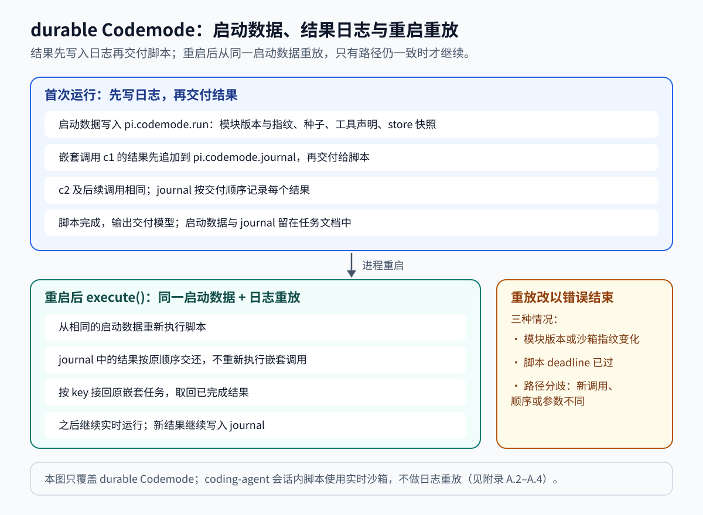

# 附录 A：Codemode 专题

第 9 章把 Codemode 作为 MCP 工具的呈现方式之一介绍（9.7.4），并在 9.9 概述了脚本运行与 durable 的确定性重放。本附录把这条线展开为完整专题：脚本模型与接口（A.2）、工具如何进入脚本（A.3）、执行边界（A.4），以及 durable 任务中的确定性重放（A.5）。Codemode 有两条实现路径——coding-agent 会话内的实时沙箱，和 durable 任务内可跨重启重放的沙箱；前面几节先讲两条路径共用的部分，差异集中在 A.5。

## A.1 用脚本组织工具调用（概念）

当服务的工具只有几个时，把定义直接声明给模型最简单。工具达到数百个时，每次请求携带全部参数定义会占用大量上下文；第 9 章 9.7.4 的表列出四种呈现方式，Pi 默认的 `codemode` 让模型写 JavaScript 来发现和组合调用。脚本在 QuickJS 虚拟机中执行，多次嵌套调用的参数和中间结果都不进入模型上下文，只有脚本自己用 `text()` 等助手输出的内容回到模型。这既降低定义占用，也减少多步调用的中间结果占用。

脚本路径也有额外成本：模型要能写出正确脚本，失败时的排查对象从"一次工具调用"变成"一段脚本加其中若干次调用"。嵌套调用本身仍走完整会话管线，因此权限、钩子和审计的检查点没有减少，只是入口变成脚本。

激活与呈现范围由扩展和设置控制。codemode 扩展默认注册为非活动状态，用 `--tools`、`defaultTools` 或 `setActiveTools` 激活；当 MCP 工具只能经脚本到达时，MCP 扩展会自动激活它。设置 `codemode.mode` 取 `"on"`（默认）时，直接可见的工具照常声明，脚本另行列出无直接暴露的工具；取 `"only"` 时不声明活动直接工具，所有可脚本调用的工具都经 codemode 列出。`codemode.inlineBudget`（默认 3000）限制内联工具声明的估算 token 数，超出预算的工具改为经 `describeTool()` 查看（[packages/coding-agent/src/extensions/codemode/index.ts:1-21](https://github.com/earendil-works/pi/blob/482c1381a00d8d00bc81697e4a980c593db6803e/packages/coding-agent/src/extensions/codemode/index.ts#L1-L21)、[packages/coding-agent/src/core/settings-schema.ts:148-169](https://github.com/earendil-works/pi/blob/482c1381a00d8d00bc81697e4a980c593db6803e/packages/coding-agent/src/core/settings-schema.ts#L148-L169)、[packages/coding-agent/src/core/settings-defaults.ts:57-60](https://github.com/earendil-works/pi/blob/482c1381a00d8d00bc81697e4a980c593db6803e/packages/coding-agent/src/core/settings-defaults.ts#L57-L60)）。

需要区分的两个边界：脚本隔离不等于权限或操作系统隔离，嵌套调用能不能执行由会话工具管线决定；脚本调用 `bash` 时，命令实际在哪里执行仍由工具后端决定（第 8 章）。Codemode 是调用组织方式，不是沙箱 bash 的替代品。

## A.2 脚本模型：接口、选项与输出（参考实现）

脚本拿到一组全局接口，没有宿主 Node、文件系统或网络 API：`tools.<name>(args)` 调用单个工具，`ALL_TOOLS` 列出可调用工具，`text()`/`image()` 追加输出，`exit()` 提前成功结束，`console.*` 追加标记为控制台文本的输出，`store()`/`load()` 读写脚本状态，`models.*`（可选，默认开启）提供模型目录、分类和图像生成。操作参考见 [packages/coding-agent/docs/codemode.md:5-59](https://github.com/earendil-works/pi/blob/482c1381a00d8d00bc81697e4a980c593db6803e/packages/coding-agent/docs/codemode.md#L5-L59)。

脚本可以在开头用 `// @options: {...}` 声明两个选项，由解析器统一校验：`max_output_tokens` 限制输出，默认 10000；`timeout_ms` 是整段脚本的硬期限，默认不设（[packages/codemode/src/source.ts:1-16](https://github.com/earendil-works/pi/blob/482c1381a00d8d00bc81697e4a980c593db6803e/packages/codemode/src/source.ts#L1-L16)）。输出超过 token 预算时保留首尾，完整文本写入临时文件（[packages/coding-agent/docs/codemode.md:15-16](https://github.com/earendil-works/pi/blob/482c1381a00d8d00bc81697e4a980c593db6803e/packages/coding-agent/docs/codemode.md#L15-L16)）。

脚本的资源占用有硬上限：`store` 单值 256 KiB、总量 1 MiB；`text()`/`image()`/`console.*` 累计输出 16 MiB 或 10 万项，超出即失败——宿主要在脚本结束前保留全部输出，没有上限的打印循环会耗尽宿主内存（[packages/codemode/src/runtime/prelude-source.ts:34-43](https://github.com/earendil-works/pi/blob/482c1381a00d8d00bc81697e4a980c593db6803e/packages/codemode/src/runtime/prelude-source.ts#L34-L43)）。

脚本失败分成四类：`script`（脚本抛出、未捕获）、`timeout`（到中断预算或 `timeout_ms`）、`aborted`（调用方取消）、`sandbox`（运行环境故障）。错误结果会附上失败前已发生的嵌套调用清单，并注明它们不会撤销（[packages/coding-agent/src/extensions/codemode/execute.ts:322-337](https://github.com/earendil-works/pi/blob/482c1381a00d8d00bc81697e4a980c593db6803e/packages/coding-agent/src/extensions/codemode/execute.ts#L322-L337)）。宿主关闭沙箱时若脚本尚未产出结果，也不写入任何结果，durable 路径会在重启后重放该脚本（见 A.5）。

## A.3 工具如何进入脚本（参考实现）

只有会话上下文中可达的工具才可被脚本调用：`getCodemodeCallableTools(ctx.tools)` 取全集，每个工具绑定一个执行函数，函数内部通过 `ctx.executeTool()` 发起嵌套调用。因此参数校验、扩展钩子、权限检查都复用会话管线，调用记录还会携带 `parentToolCallId` 供 UI 和审计关联（[packages/coding-agent/src/extensions/codemode/execute.ts:467-500](https://github.com/earendil-works/pi/blob/482c1381a00d8d00bc81697e4a980c593db6803e/packages/coding-agent/src/extensions/codemode/execute.ts#L467-L500)）。

结果转成脚本值时按声明分流：工具声明了 `outputSchema`，脚本收到 `structuredContent`（错误结果只要带结构化内容也照此传递，例如 MCP 的 `isError` 结果）；其他工具收到文本内容；失败则让脚本的 `await` 拒绝（[packages/coding-agent/src/extensions/codemode/execute.ts:422-434](https://github.com/earendil-works/pi/blob/482c1381a00d8d00bc81697e4a980c593db6803e/packages/coding-agent/src/extensions/codemode/execute.ts#L422-L434)）。MCP 工具的输出 schema 就是去掉了顶层 `_meta` 的整个 `CallToolResult`，脚本可以自行检查 `isError` 并选择输出方式，这与 direct 路径由适配层转成工具错误不同（[packages/coding-agent/src/extensions/mcp/tools.ts:275-285](https://github.com/earendil-works/pi/blob/482c1381a00d8d00bc81697e4a980c593db6803e/packages/coding-agent/src/extensions/mcp/tools.ts#L275-L285)）。

工具对脚本的呈现形式是渲染出来的 TypeScript 声明：`tools` 对象成员、`declare function` 全局、JSON Schema 转成类型，属性描述与约束放在注释行。类型无法表达的约束用 JSDoc 风格标签承载，如 `@integer @minimum 1 @default 20`；递归或远端引用渲染为 `unknown`；输入类型超过 16000 字符时同样渲染为 `unknown`，并去掉约束标签。声明只用于阅读，不参与校验（[packages/codemode/src/declarations.ts:40-85](https://github.com/earendil-works/pi/blob/482c1381a00d8d00bc81697e4a980c593db6803e/packages/codemode/src/declarations.ts#L40-L85)、[packages/codemode/src/declarations.ts:250-337](https://github.com/earendil-works/pi/blob/482c1381a00d8d00bc81697e4a980c593db6803e/packages/codemode/src/declarations.ts#L250-L337)、[packages/codemode/src/declarations.ts:10](https://github.com/earendil-works/pi/blob/482c1381a00d8d00bc81697e4a980c593db6803e/packages/codemode/src/declarations.ts#L10)）。

`store()` 的写入只在脚本成功后保存：宿主把变更集作为会话分支上的自定义条目追加，`load()` 在下次脚本运行时从分支上折叠读取；脚本失败则不追加，但失败前嵌套调用对文件或外部系统造成的副作用仍然存在（[packages/coding-agent/src/extensions/codemode/execute.ts:539-544](https://github.com/earendil-works/pi/blob/482c1381a00d8d00bc81697e4a980c593db6803e/packages/coding-agent/src/extensions/codemode/execute.ts#L539-L544)、[packages/coding-agent/src/extensions/codemode/execute.ts:241-251](https://github.com/earendil-works/pi/blob/482c1381a00d8d00bc81697e4a980c593db6803e/packages/coding-agent/src/extensions/codemode/execute.ts#L241-L251)）。

## A.4 执行边界：QuickJS、Worker 与中断（参考实现）

虚拟机是独立的 QuickJS wasm 实例，宿主桥被收进 prelude 的闭包，脚本只能通过它拿到 `tools`、输出助手和全局；prelude 在脚本运行前冻结内建对象并把内置全局改为只读，防止脚本修改影响宿主侧报告（[packages/codemode/src/runtime/prelude-source.ts:1-33](https://github.com/earendil-works/pi/blob/482c1381a00d8d00bc81697e4a980c593db6803e/packages/codemode/src/runtime/prelude-source.ts#L1-L33)）。

每个执行使用自己的 worker 线程：跑飞的脚本（包括只转微任务队列的）用 `terminate()` 结束，不会污染后续运行；终止前宿主先置共享中断标志，因为 Bun 的 `terminate()` 停不下正在 wasm 里自旋的线程。有些内建调用不轮询该标志，因此在 Bun 上停止请求会先返回结果，worker 可能活得更久（[packages/codemode/src/runtime/host.ts:12-19](https://github.com/earendil-works/pi/blob/482c1381a00d8d00bc81697e4a980c593db6803e/packages/codemode/src/runtime/host.ts#L12-L19)、[packages/coding-agent/docs/codemode.md:227](https://github.com/earendil-works/pi/blob/482c1381a00d8d00bc81697e4a980c593db6803e/packages/coding-agent/docs/codemode.md#L227)）。

资源限制：默认内存上限 256 MiB，超出抛 `InternalError: out of memory`；栈上限默认 `MAX_STACK_SIZE`（512 KiB），让深递归变成可捕获的 `RangeError`（[packages/coding-agent/src/extensions/codemode/execute.ts:56](https://github.com/earendil-works/pi/blob/482c1381a00d8d00bc81697e4a980c593db6803e/packages/coding-agent/src/extensions/codemode/execute.ts#L56)、[packages/codemode/src/runtime/vm.ts:53-56](https://github.com/earendil-works/pi/blob/482c1381a00d8d00bc81697e4a980c593db6803e/packages/codemode/src/runtime/vm.ts#L53-L56)、[packages/codemode/src/runtime/vm.ts:160-179](https://github.com/earendil-works/pi/blob/482c1381a00d8d00bc81697e4a980c593db6803e/packages/codemode/src/runtime/vm.ts#L160-L179)）。整个 Pi 进程同时存活的 codemode worker 最多两个，取消的 worker 在退出前仍占名额；到上限时新脚本立即失败而不启动新 worker（[packages/coding-agent/src/extensions/codemode/execute.ts:514-524](https://github.com/earendil-works/pi/blob/482c1381a00d8d00bc81697e4a980c593db6803e/packages/coding-agent/src/extensions/codemode/execute.ts#L514-L524)、[packages/coding-agent/docs/codemode.md:228](https://github.com/earendil-works/pi/blob/482c1381a00d8d00bc81697e4a980c593db6803e/packages/coding-agent/docs/codemode.md#L228)）。

整段脚本默认没有超时，可由 `timeout_ms` 指定（[packages/coding-agent/src/extensions/codemode/execute.ts:510](https://github.com/earendil-works/pi/blob/482c1381a00d8d00bc81697e4a980c593db6803e/packages/coding-agent/src/extensions/codemode/execute.ts#L510)）。在没有 `timeout_ms` 的宿主（如 Cloudflare Durable Object）里，内联沙箱用中断预算兜底：QuickJS 周期轮询中断处理器，launcher 统计轮询数，超过预算（默认 100000 次）即以 `kind: "timeout"` 失败。轮询速率实测约为 Apple M 系列笔记本每秒 5 万次、Cloudflare DO 每秒 1 万次，因此默认预算约等于 2–10 秒连续计算；平台自身的 CPU 限额会重启 DO，预算应明显低于该限额（[packages/codemode/src/runtime/inline.ts:1-27](https://github.com/earendil-works/pi/blob/482c1381a00d8d00bc81697e4a980c593db6803e/packages/codemode/src/runtime/inline.ts#L1-L27)、[packages/codemode/src/runtime/inline.ts:39](https://github.com/earendil-works/pi/blob/482c1381a00d8d00bc81697e4a980c593db6803e/packages/codemode/src/runtime/inline.ts#L39)）。

还有两个即时失败条件：脚本等待一个永远不会落定的 promise（没有待处理的工具调用）会立即失败，因为 VM 里没有定时器；脚本不能启动另一个 `codemode` 脚本（[packages/coding-agent/docs/codemode.md:229-230](https://github.com/earendil-works/pi/blob/482c1381a00d8d00bc81697e4a980c593db6803e/packages/coding-agent/docs/codemode.md#L229-L230)）。

沙箱按部署位置有三种：Node/Bun 的 worker 线程（默认）、宿主轮询预算的内联实现（`InlineCodemodeSandbox`）、以及可序列化的远端实现（`RemoteCodemodeSandbox`，用于 Cloudflare Workers/Durable Objects，从包的 `/portable` 入口导出）。三者共享同一脚本接口与确定性重放协议（[packages/codemode/README.md:3-14](https://github.com/earendil-works/pi/blob/482c1381a00d8d00bc81697e4a980c593db6803e/packages/codemode/README.md#L3-L14)）。

## A.5 durable Codemode：确定性重放（参考实现）

durable 任务的脚本要在进程崩溃重启后继续，而脚本是任意 JavaScript，无法简单"从断点继续"。机制是确定性执行加结果日志：沙箱以固定种子、虚拟时钟和 UTC 运行脚本，重启后重头执行也能到达相同状态；每个交付给脚本的结果先写入任务文档 `pi.codemode.journal` 再交付，重放时按原顺序交还。启动数据（模块版本与沙箱指纹、种子、工具声明、`store` 快照）在第一次运行前写入 `pi.codemode.run`。嵌套调用按 key（`c<VM 调用号>`）接回原任务而不是重新执行，正在等待的调用则由任务系统完成或取消（[packages/durable/src/codemode/codemode.ts:116-166](https://github.com/earendil-works/pi/blob/482c1381a00d8d00bc81697e4a980c593db6803e/packages/durable/src/codemode/codemode.ts#L116-L166)、[packages/durable/src/codemode/codemode.ts:403-442](https://github.com/earendil-works/pi/blob/482c1381a00d8d00bc81697e4a980c593db6803e/packages/durable/src/codemode/codemode.ts#L403-L442)、[packages/durable/src/codemode/codemode.ts:817-840](https://github.com/earendil-works/pi/blob/482c1381a00d8d00bc81697e4a980c593db6803e/packages/durable/src/codemode/codemode.ts#L817-L840)）。

重放只在路径仍然一致时继续。三种情况改用错误结果结束：启动数据里的模块版本或沙箱指纹与当前不一致；脚本的 deadline 已过；重放到某一步时脚本发出的调用与日志不符——新调用、顺序不同或参数不同。指纹由 QuickJS 版本、prelude 哈希、栈与堆上限、中断预算拼接而成，任何一项变化都会使旧日志不可用（[packages/durable/src/codemode/codemode.ts:444-454](https://github.com/earendil-works/pi/blob/482c1381a00d8d00bc81697e4a980c593db6803e/packages/durable/src/codemode/codemode.ts#L444-L454)、[packages/durable/src/codemode/codemode.ts:610-637](https://github.com/earendil-works/pi/blob/482c1381a00d8d00bc81697e4a980c593db6803e/packages/durable/src/codemode/codemode.ts#L610-L637)、[packages/codemode/src/runtime/vm.ts:314-320](https://github.com/earendil-works/pi/blob/482c1381a00d8d00bc81697e4a980c593db6803e/packages/codemode/src/runtime/vm.ts#L314-L320)）。



与 coding-agent 会话内的脚本相比，关键差别不在于沙箱能力，而在于重放语义：会话内的 `execute()` 直接读真实时钟与随机数、不写日志，失败即以错误结果结束；durable 的脚本在确定性约束下运行，结果日志与启动数据使其可跨重启继续（[packages/codemode/test/deterministic.test.ts:385-386](https://github.com/earendil-works/pi/blob/482c1381a00d8d00bc81697e4a980c593db6803e/packages/codemode/test/deterministic.test.ts#L385-L386)、[packages/codemode/src/runtime/vm.ts:94-125](https://github.com/earendil-works/pi/blob/482c1381a00d8d00bc81697e4a980c593db6803e/packages/codemode/src/runtime/vm.ts#L94-L125)）。

durable 侧的提示与工具声明也做了预算控制：工具声明按命名空间分组，`mcp__github__` 这类前缀按最长前缀归组；提示段的声明预算为 3000 token，超出部分由脚本用 `searchTools()`/`describeTool()`/`describeNamespace()` 自行查找。脚本里的 `models` 目录接口来自模型注册表，另有 `classify` 与图 `generateImages` 两个会付费的内部工具（声明为只能由工具调用）（[packages/durable/src/codemode/describe.ts:13-30](https://github.com/earendil-works/pi/blob/482c1381a00d8d00bc81697e4a980c593db6803e/packages/durable/src/codemode/describe.ts#L13-L30)、[packages/durable/src/codemode/models.ts:25-40](https://github.com/earendil-works/pi/blob/482c1381a00d8d00bc81697e4a980c593db6803e/packages/durable/src/codemode/models.ts#L25-L40)）。

## A.6 源码定位与测试

| 机制 | 源码入口 |
| --- | --- |
| 脚本解析与选项 | [源代码语法与选项字段](https://github.com/earendil-works/pi/blob/482c1381a00d8d00bc81697e4a980c593db6803e/packages/codemode/src/source.ts#L1-L16) |
| 声明渲染 | [类型、约束标签与预算](https://github.com/earendil-works/pi/blob/482c1381a00d8d00bc81697e4a980c593db6803e/packages/codemode/src/declarations.ts#L40-L85)、[约束标签提取](https://github.com/earendil-works/pi/blob/482c1381a00d8d00bc81697e4a980c593db6803e/packages/codemode/src/declarations.ts#L250-L337) |
| VM 与 prelude | [VM 创建与指纹](https://github.com/earendil-works/pi/blob/482c1381a00d8d00bc81697e4a980c593db6803e/packages/codemode/src/runtime/vm.ts#L160-L179)、[闭包桥与内建冻结](https://github.com/earendil-works/pi/blob/482c1381a00d8d00bc81697e4a980c593db6803e/packages/codemode/src/runtime/prelude-source.ts#L1-L43) |
| Worker 与终止 | [每执行一个 worker](https://github.com/earendil-works/pi/blob/482c1381a00d8d00bc81697e4a980c593db6803e/packages/codemode/src/runtime/host.ts#L12-L19)、[停止与中断标志](https://github.com/earendil-works/pi/blob/482c1381a00d8d00bc81697e4a980c593db6803e/packages/codemode/src/runtime/host.ts#L59-L66) |
| 内联中断预算 | [轮询预算与默认值](https://github.com/earendil-works/pi/blob/482c1381a00d8d00bc81697e4a980c593db6803e/packages/codemode/src/runtime/inline.ts#L1-L39) |
| 会话集成 | [脚本执行与嵌套调用](https://github.com/earendil-works/pi/blob/482c1381a00d8d00bc81697e4a980c593db6803e/packages/coding-agent/src/extensions/codemode/execute.ts#L467-L525)、[工具描述与 store](https://github.com/earendil-works/pi/blob/482c1381a00d8d00bc81697e4a980c593db6803e/packages/coding-agent/src/extensions/codemode/tool.ts#L1-L22) |
| durable 重放 | [任务文档与日志](https://github.com/earendil-works/pi/blob/482c1381a00d8d00bc81697e4a980c593db6803e/packages/durable/src/codemode/codemode.ts#L116-L166)、[重放与分歧检查](https://github.com/earendil-works/pi/blob/482c1381a00d8d00bc81697e4a980c593db6803e/packages/durable/src/codemode/codemode.ts#L403-L454) |
| durable 声明与目录 | [命名空间与预算](https://github.com/earendil-works/pi/blob/482c1381a00d8d00bc81697e4a980c593db6803e/packages/durable/src/codemode/describe.ts#L13-L30)、[目录接口与内部工具](https://github.com/earendil-works/pi/blob/482c1381a00d8d00bc81697e4a980c593db6803e/packages/durable/src/codemode/models.ts#L25-L40) |

[packages/codemode/test/deterministic.test.ts:107-180](https://github.com/earendil-works/pi/blob/482c1381a00d8d00bc81697e4a980c593db6803e/packages/codemode/test/deterministic.test.ts#L107-L180) 检查相同种子与结果产生相同输出、UTC 执行、结果按序交付；[packages/codemode/test/declarations.test.ts:6-68](https://github.com/earendil-works/pi/blob/482c1381a00d8d00bc81697e4a980c593db6803e/packages/codemode/test/declarations.test.ts#L6-L68) 检查类型渲染与约束标签，[packages/codemode/test/declarations.test.ts:217](https://github.com/earendil-works/pi/blob/482c1381a00d8d00bc81697e4a980c593db6803e/packages/codemode/test/declarations.test.ts#L217) 检查超预算类型渲染为 `unknown`。

[packages/codemode/test/worker-lifetime.test.ts:13-54](https://github.com/earendil-works/pi/blob/482c1381a00d8d00bc81697e4a980c593db6803e/packages/codemode/test/worker-lifetime.test.ts#L13-L54) 检查准入拒绝时不启动 worker、失败时释放名额；[packages/codemode/test/sandbox.test.ts:686-732](https://github.com/earendil-works/pi/blob/482c1381a00d8d00bc81697e4a980c593db6803e/packages/codemode/test/sandbox.test.ts#L686-L732) 检查宿主全局不可见与 dynamic import 边界。

[packages/durable/test/codemode.test.ts:197-274](https://github.com/earendil-works/pi/blob/482c1381a00d8d00bc81697e4a980c593db6803e/packages/durable/test/codemode.test.ts#L197-L274) 检查脚本恢复、结果按到达顺序重放与时钟随机数跨重启保持一致；[packages/durable/test/codemode.test.ts:446](https://github.com/earendil-works/pi/blob/482c1381a00d8d00bc81697e4a980c593db6803e/packages/durable/test/codemode.test.ts#L446) 检查调用清单出现在结果明细中。[packages/coding-agent/test/suite/agent-session-codemode.test.ts:206-248](https://github.com/earendil-works/pi/blob/482c1381a00d8d00bc81697e4a980c593db6803e/packages/coding-agent/test/suite/agent-session-codemode.test.ts#L206-L248) 检查嵌套调用并行执行并只返回脚本结果、且经过扩展钩子；[packages/coding-agent/test/suite/agent-session-codemode.test.ts:484-523](https://github.com/earendil-works/pi/blob/482c1381a00d8d00bc81697e4a980c593db6803e/packages/coding-agent/test/suite/agent-session-codemode.test.ts#L484-L523) 检查 `timeout_ms`、内存上限与输出截断。

在 `packages/codemode` 可单独运行确定性测试：

```powershell
node ../../node_modules/vitest/dist/cli.js --run test/deterministic.test.ts test/declarations.test.ts
```

durable 的脚本重放测试在 `packages/durable` 下运行 `test/codemode.test.ts`，需要该包现有的测试辅助。

## A.7 附录术语

| 术语 | 含义 |
| --- | --- |
| 声明渲染 | 把工具 schema 转成脚本体内的 TypeScript 声明文本 |
| 约束标签 | 类型无法表达的约束，如 `@integer @minimum 1`，写在属性注释行 |
| 嵌套调用 | 脚本经 `executeTool()` 发起的另一个工具任务，结果不进入转录 |
| 中断预算 | 内联沙箱允许的 QuickJS 轮询次数，超过即按超时失败 |
| 启动数据 | 首次运行前写入 `pi.codemode.run` 的版本、种子、声明与 store 快照 |
| 结果日志 | `pi.codemode.journal` 中按交付顺序记录的结果，重放时原序交还 |
| 指纹 | QuickJS 版本、prelude 哈希、栈堆上限与中断预算的摘要，用于拒绝不匹配的重放 |
| 内联沙箱 | 宿主按轮询预算中断脚本的执行方式，用于没有超时能力的运行时 |

## A.8 练习

写一段脚本用 `store()` 记录处理过的条目数，再并发调用两次同一个工具，然后故意抛错。观察结果中的调用清单、`store` 未被更新，以及下次运行从旧值继续。

给脚本加上 `// @options: {"timeout_ms": 50}` 和一段死循环，确认得到 `Script timed out`；去掉 `timeout_ms` 后同样的脚本在 worker 沙箱上没有超时，靠调用方取消。

在 durable 测试里提交一个中途重启的脚本（`test/codemode.test.ts` 的恢复用例展示构造方式），观察重启后没有重跑已完成的嵌套调用，以及把脚本改为发出新调用时重放如何以错误结束。

[第 9 章 工具基础设施与 MCP](09-tools-mcp.md)介绍脚本调用的上游管线与 MCP 集成；[第 8 章 沙箱与执行环境](08-sandbox-environment.md)讨论工具后端自身的执行位置与隔离；[第 5 章 持久执行与恢复](05-durable-execution.md)解释结果日志与重启恢复的通用机制。
