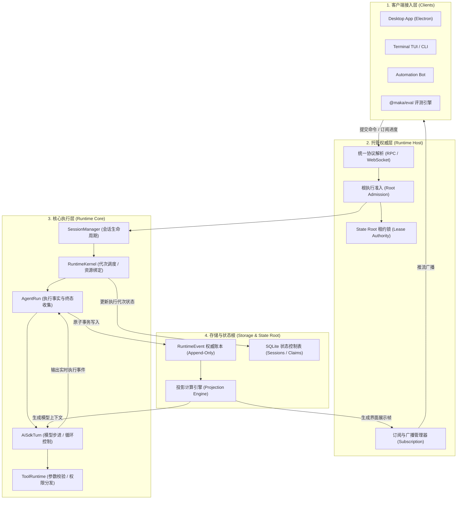
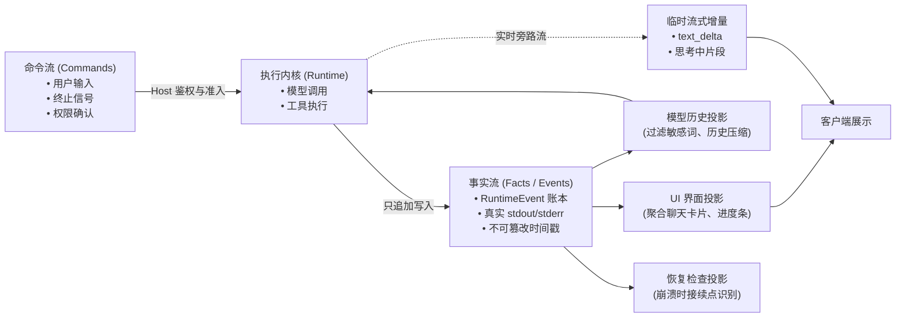
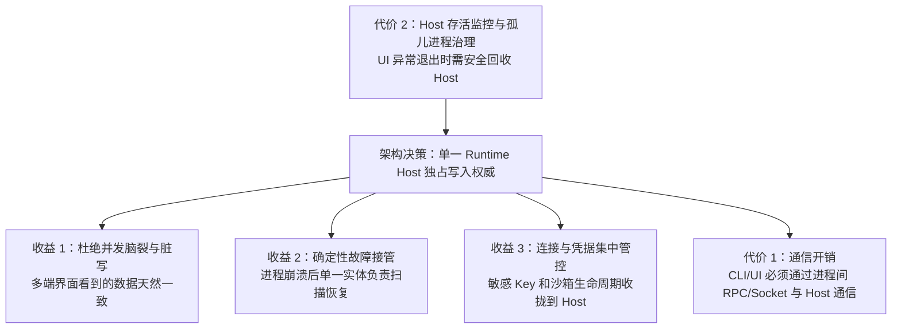

# 整体架构：Maka 执行系统的组成与分层

[返回手册目录](../README.md)

在生产环境中构建 Agent 系统，最棘手的问题往往不在于如何调用大模型，而在于如何协调**并发交互、状态一致性与执行安全性**。当用户在桌面端（Desktop）发起了“重构代码”任务，同时在终端（TUI）打开同一工作区，后台还有持续集成的自动化机器人（Bot）在运行评测时，系统必须保证多个接入端看到的是同一份真实进展，且不会发生并发写入冲突。

Maka 的整体架构正是为了解决这一核心矛盾而设计。本章先介绍系统的四层职责模型与三股核心数据流，再以“读取 `config.json` 并修复错误”为例剖析各组件的协同过程，最后给出 Host 准入与执行的教学伪代码及架构对比。

---

## 1. 概念先行：为什么必须分层？

直接基于大模型 SDK（如 `streamText()`）编写 Agent 时，开发者很容易将网络请求、工具执行、界面渲染和数据存储耦合在同一个 UI 事件回调中。这种“单体脚本思维”在单机单任务时尚可运转，但一旦面临多端协同，便会暴露出三大硬伤：

1. **状态脑裂（Split-Brain）**：如果每个客户端都自己实例化一个 Agent 并直接读写底层数据库，两端同时发指令就会产生并发事务竞争、文件写覆盖以及死锁。
2. **易失性与恢复黑洞**：如果执行状态仅保存在客户端内存中，一旦界面卡顿被强关，正在后台运行的外部命令（如长达 10 分钟的编译测试）就会彻底失联，重启后无法判定该操作究竟是成功还是失败。
3. **上下文与审计日志混杂**：模型为了节省 Token 需要做历史压缩，但工程审计与故障复盘必须保留每一次工具调用的真实原始输出。如果两者不分，压缩就会破坏系统的持久化真实性。

为了化解这些冲突，Maka 确立了系统分层的核心原则：**客户端只表达意图与展示视图，由唯一的 Runtime Host 承担法定写入权威，Runtime Core 负责纯粹的执行推进，而 Storage 则提供只追加的不可变事实保障。**

---

## 2. 职责视图：四层核心模型

Maka 将整个系统划分为四个清晰的职责层级：



### 各层职责与边界约束

| 层级 | 核心组件 | 主要职责 | 边界红线（绝对不能做的事） |
| :--- | :--- | :--- | :--- |
| **1. 客户端接入层** | Desktop, TUI, CLI, Bot, Eval | 采集用户输入、展示界面组件、代理前端特有能力（如前端浏览器、系统原生对话框）。 | **严禁直接连接底层 SQLite**，严禁自行实例化独立的模型运行时。 |
| **2. 托管权威层** | Runtime Host, Admission, Lease | 占有 State Root 的独占写入租约；负责请求去重、并发准入、客户端连接鉴权与多端事件广播。 | **不介入具体提示词构造**与模型单步算法，纯粹作为执行权威守护者。 |
| **3. 核心执行层** | SessionManager, RuntimeKernel, AgentRun, AiSdkTurn | 维护会话与后端资源代次；驱动 Agent 循环、处理流式片段、看门狗监控与工具安全结算。 | **不直接假定 UI 展现形式**，所有输出统一抽象为标准 `SessionEvent`。 |
| **4. 存储层** | SQLite, RuntimeEvent Log, Projection | 提供 ACID 事务保证，按只追加方式持久化不可变运行事实，计算模型历史投影与恢复快照。 | **不包含业务执行逻辑**，不持有易失性内存连接或定时器。 |

---

## 3. 数据流视图：命令、事实与投影

在 Maka 架构中，系统内流动的数据被严密隔离为三种性质截然不同的流：



1. **命令流（Commands）**：具有**易失性与意图性**。例如用户点击“取消”或发送新指令。命令可能被拒绝（如会话繁忙且不允许插队），也可能被排队，不能直接等同于系统事实。
2. **事实流（Facts / Events）**：具有**不可变性与客观性**。一旦模型返回了调用、工具产生了输出，这些事实被封装为 `RuntimeEvent` 写入数据库。它们是系统复盘和恢复的绝对基石。
3. **投影流（Projections）**：具有**按需计算与视图性**。
   - 大模型不需要知道所有的底层 UI 状态，因此**模型投影**只提取与任务相关的上下文；
   - 客户端界面需要流畅打字机效果，因此**UI 投影**关注字符增量；
   - 进程重启时，**恢复投影**扫描未完成的事件以重建内存上下文。

---

## 4. 贯穿任务：修改 `config.json` 的端到端时序

为了看清各层如何协同工作，追踪以下具体任务：**“用户要求读取 `config.json`，将超时时间修改为 60 并运行测试验证”**。

### 阶段一：客户端接入与 Host 准入
1. 用户在桌面端输入命令，桌面端将其包装为标准 RPC 请求发往本地常驻的 Runtime Host。
2. Host 检查当前会话（Session）的状态：确认当前无活动运行（或将新输入置于等待队列），生成全局唯一的 `turnId` 与 `runId`。
3. Host 向底层存储登记 `invocation_opened` 事实，确立本次执行的法律地位。

### 阶段二：Runtime 初始化与代次分配
1. Host 将执行控制权交给 `SessionManager`，调用 `RuntimeKernel.startTurn()`。
2. Kernel 检查当前配置代次（`BackendGeneration`）：如果当前已有空闲且配置匹配的模型后端（`AiSdkBackend`），则直接复用；若用户刚刚切换了模型配置，则平滑销毁旧后端并构建新代次。
3. 创建本次执行专享的 `AgentRun`（负责审计记录）与 `AiSdkTurn`（负责循环控制）。

### 阶段三：驱动第一步（Step 1：读配置）
1. `AiSdkTurn` 从存储层拉取该会话的已确认事件，投影成大模型所需的 `messages` 数组，并附带 `Read` 工具声明。
2. 适配器通过流式接口调用模型。看门狗（Watchdog）启动计时，防止网络无响应挂起。
3. 模型输出 `tool-call: Read("config.json")`。Turn 拦截到该调用，暂停文本生成，将其提交给 `ToolRuntime`。
4. `ToolRuntime` 验证文件路径在工作区白名单内，调用沙箱读取本地文件，返回 `timeout = 30`。
5. 结果作为 `tool_result` 事件原子写入 `RuntimeEvent` 账本。Host 广播更新，桌面端弹出“已读取 config.json”卡片。

### 阶段四：驱动第二步（Step 2：写文件与验证）
1. `AiSdkTurn` 自动将第一步的调用与结果纳入上下文，发起第二次模型请求。
2. 模型输出两组工具调用：`Write("config.json", ...)` 和 `Bash("npm test")`。
3. 写入成功，跑测退出码为 0。所有 stdout/stderr 均以不可变事实入库。

### 阶段五：收尾与结清（Finalization）
1. 模型最终输出一段解释文本：“已将超时时间修复为 60s，单元测试已全部通过”，并返回 `finishReason = 'stop'`。
2. `AiSdkTurn` 检测到无后续工具调用，判定回合正常结束，发出 `complete` 事件。
3. `AgentRun.finalize()` 结清用量与终态，Kernel 释放 Turn 作用域，Host 将会话重置为就绪状态。

---

## 5. 教学伪代码：Host 准入与执行协调契约

以下伪代码抽象了 Runtime Host 与 Kernel 在协调多端请求时的核心控制逻辑，展示了互斥准入、代次复用与异常清理的关键契约：

```text
class RuntimeHostCoordinator:
    function handleClientCommand(sessionId, userInput, clientConnection):
        // 1. 独占锁检查：确保当前 Host 仍持有 State Root 租约
        assert this.lease.isValid(), "Lost lease authority over State Root"

        // 2. 根准入检查 (Admission Control)
        session = this.store.loadSession(sessionId)
        if session.isBusy():
            if userInput.isSteering():
                // 运行中引导：直接注入当前活动的 Turn 队列
                return session.activeTurn.injectSteering(userInput)
            else:
                // 排队后继：压入等待队列
                return session.queueFollowUp(userInput)

        // 3. 确立执行身份
        runId = generateUUID()
        turnId = generateUUID()
        this.store.recordEvent(invocation_opened(runId, turnId, session.config))

        // 4. 派发执行
        try:
            kernel = this.sessionManager.getKernel()
            eventStream = kernel.startTurn(sessionId, runId, turnId, userInput)

            // 5. 边消费边向客户端广播
            for await event in eventStream:
                // 持久化权威事件
                if event.isDurable():
                    this.store.commitRuntimeEvent(event)
                
                // 广播给所有已连接的订阅端 (Desktop, CLI, etc.)
                this.subscriptionHub.broadcast(sessionId, projectUI(event))
        catch Exception as err:
            this.handleExecutionFailure(runId, turnId, err)
        finally:
            this.store.commitTerminalStatus(runId, "completed")
            this.subscriptionHub.notifyIdle(sessionId)
```

---

## 6. 核心权衡：单一 Host 权威的代价与收益

在架构设计中，没有任何方案是没有代价的。Maka 坚持“单一 Host 写入权威”带来了巨大的收益，但也引入了特定的工程挑战：



- **为什么不采用 Pi 的纯嵌入式设计？**
  Pi 作为一个优秀的单体编码代理，设计上偏向将 Agent 直接嵌入主 CLI 进程中。这使得 Pi 启动极快、毫无 IPC 开销。但在多端场景下（如既要桌面 App 又要终端 TUI），嵌入式设计会导致两个进程争夺同一个工作区，或者必须自己实现外部网络锁。Maka 明确选择了托管架构，用少量的本地 IPC 开销，换取了跨客户端协同的高可靠性。

---

## 7. 思考题与延伸阅读

1. **思考题**：如果在工具执行过程中（例如正在写文件），客户端与 Host 之间的 WebSocket 连接断开，正在运行的工具会被中断吗？为什么？（提示：回顾 Host 与 Client 的生命周期解耦）
2. **思考题**：为什么“模型历史投影”不能直接由客户端来做，而必须由存储层或核心执行层来计算？
3. **延伸阅读**：
   - 了解身份体系在代码中的具体结构，阅读 [00.3 领域模型](domain-model.md)。
   - 深入理解各层在代码目录中的分布，阅读 [00.2 仓库与依赖地图](repository-map.md)。
   - 探索一条输入在代码中的逐行流动，阅读 [01.1 从请求到响应](../01-runtime/request-to-response.md)。
