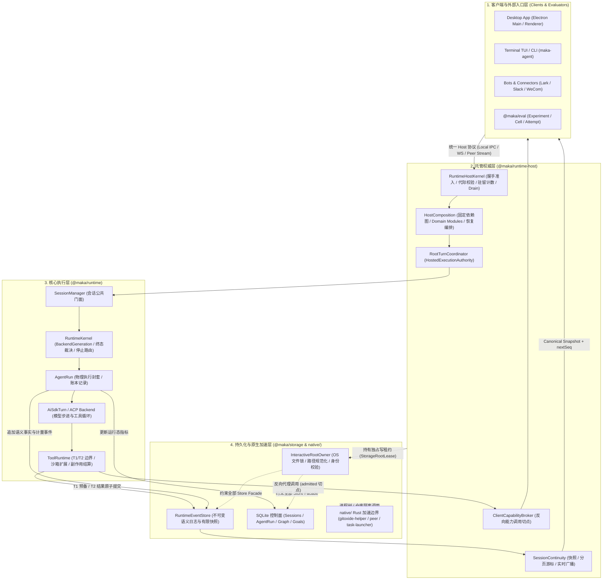
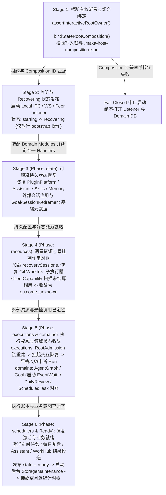
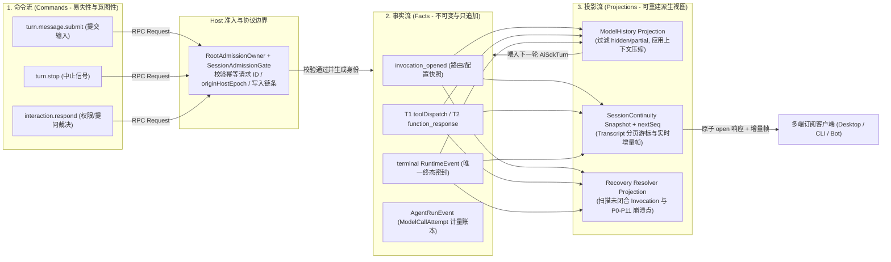

# 整体架构：Maka 执行系统的组成与分层

[返回手册目录](../README.md)

在原型阶段，构建一个 Agent 看似只需要调用一次大模型的流式接口（如 `streamText()`），在循环里拦截工具调用再塞回上下文。然而，当 Agent 真正进入工程生产环境时，最棘手的难题早已不再是“如何向模型发一次请求”，而是**多端并发接入、状态一致性、故障确定性收敛与系统级安全隔离**。

设想这样一个真实场景：用户在桌面端（Desktop）发起了一次“重构整个模块”的长任务，随后在终端（TUI）打开同一个工作区观察日志，同时后台还有定时巡检（Scheduled Task）和自动评估流水线（Eval）准备接入同一份本地数据。如果桌面端与终端各自运行一套内存状态机并直连本地数据库，系统会在几秒内陷入状态脑裂与数据损毁。

Maka 的整体架构正是为了根治这一系列分布式状态难题而设计的。其核心哲学可以浓缩为一句话：**一个 State Root 在同一时刻最多只允许一个 Runtime Host 拥有写入权威；客户端只表达意图与渲染投影，执行内核只推进物理状态机，事实账本只追加不可变语义事件。**

---

## 1. 概念先行：四层职责模型与边界契约

Maka 在整体架构上划分为四个边界清晰的职责层级，外加两项受严格协议约束的外围系统（Peer Mesh 网络层与 `@maka/eval` 评测引擎）：



### 各层权威分工与工程红线

“Host 是写入权威”并不意味着内核可以理解全部业务语义。Maka 在系统内部对权限和决策权做了极其精细的切割：

| 权威主体 | 它决定什么（职责边界） | 它绝不决定什么（边界红线） |
| :--- | :--- | :--- |
| **Storage Root Owner** | 哪个进程持有对应 `rootId` 的独占 OS 写入锁（`StorageRootLease`）。 | 客户端权限分级、应用安装版本、Turn 业务成败。 |
| **RuntimeHostKernel** | 连接握手准入、协议代际协商、操作路由、`idle`/`drain` 驻留计数与优雅退出。 | Turn 的提示词内容、大模型选型、Agent 图调度策略。 |
| **HostComposition** | 固定化的领域模块（Domain Module）集合、五阶段恢复顺序与逆序关闭链路。 | 运行时动态插件发现（Ready 后禁止新增 Module）、绕过装配的全局单例状态。 |
| **RootTurnCoordinator** | 实现 `HostedExecutionAuthority`，准入、挂起、恢复或停止某个 Session 的顶层执行。 | Goal 或 Scheduled Task 如何解读一次执行结果或决定下次调度时机。 |
| **SessionManager & RuntimeKernel** | 管理 `BackendGeneration` 代次隔离、驱动模型/工具步进循环、执行单终态密封。 | 发现 Host 地址、客户端默认工作区选择、跨客户端安装激活。 |
| **SessionContinuityCoordinator** | 从不可变 `RuntimeEvent` 构造会话快照、有界分页 Transcript 与增量订阅流。 | 凭前端通知推断后台执行已结束，或代客户端重放失败命令。 |
| **ClientCapabilityBroker** | 按亲和度选择客户端提供的本地能力，管控 `accepted → admitted` 反向调用切点。 | 把 Session/Run 所有权转移给客户端，或在结果不明时自动重放外部副作用。 |
| **Peer Mesh / `@maka/eval`** | 网络端点发现与可恢复字节流（Mesh）；Benchmark 实验单元与客观尝试裁决（Eval）。 | 直接读写本地 SQLite 控制表、越过 Host 准入启动第二套 Runtime。 |

---

## 2. 故障推演：如果不坚持分层与单 Host 权威，系统会怎样崩坏？

为了理解 Maka 架构中大量“看似繁琐”的锁、租约和准入协议的必要性，我们必须直接推演破坏这些边界时会发生的真实故障：

1. **故障一：多端直连引发的“状态脑裂（Split-Brain）”**
   - *场景*：桌面端与 CLI 同时读取了同一份 `SessionHeader`，接着同时追加用户消息并各自拉起模型循环。
   - *后果*：两边的本地内存缓存相互不可见，SQLite WAL 频繁出现锁竞争或逻辑序列号交错，界面上的聊天气泡顺位与大模型实际看到的上下文彻底错乱，甚至把旧配置覆写到新配置之上。
   - *Maka 防护*：所有客户端（含 `@maka/eval` 的被测 Maka Subject）必须通过公共 Host 协议接入同一个 `RuntimeHostKernel`；任何业务代码都无法绕过 `StorageRootLease` 直接打开可写数据库句柄。

2. **故障二：基于发现缓存或 PID 判断存活导致的“双写者灾难”**
   - *场景*：旧 Host 进程仍在执行耗时的工具收尾写入，此时外部清理脚本误删了运行时控制目录里的 `registration.json` 发现文件，或只看到一个同名缓存缺失便启动了第二个 Host。
   - *后果*：两个宿主同时向同一份账本写入事件，彻底毁坏只追加日志的因果序列。
   - *Maka 防护*：发现文件、PID、Socket 路径和健康探针**仅是观察提示（Observation Hints）**；真正的排他写权限来自账本之外、稳定路径上的**操作系统内核级文件锁**。删除发现文件绝不可能凭空制造出第二个合法写入者。

3. **故障三：“刚进门却看不见”的退出竞争窗口**
   - *场景*：客户端刚发出 `turn.message.submit` 请求，请求正在异步进入准入队列，尚未创建物理 `AgentRun`；恰逢 Host 的 `idleGraceMs`（默认 30s）计时器到期触发自动退出，或者收到升级排空指令。
   - *后果*：Kernel 以为当前没有任何活跃任务，直接关闭端口并释放底层 Store，导致客户端以为请求成功、实际任务却消失在真空里。
   - *Maka 防护*：在请求进入异步准入逻辑**之前**，Operation Lease 立即向 `HostResidencyRegistry` 申请一枚 `drain` 类型的驻留句柄，直到执行真正接管或准入明确失败才释放，彻底封死这个并发窗口。

4. **故障四：半恢复状态下提前放行请求导致的因果倒置**
   - *场景*：Host 重启后刚连上数据库、尚未扫描修复崩溃前残留的活跃 `AgentRun` 与未决审批请求，就急于向客户端开放常规操作。
   - *后果*：用户在界面上发出新指令，与上一轮未闭合的工具副作用或僵尸子进程发生重叠写，甚至把已崩溃的执行永远卡死在 `running` 状态。
   - *Maka 防护*：`RuntimeHostKernel` 严格区分 `starting`、`recovering`、`ready`、`draining` 生命周期状态，在六阶段恢复完成前，除 `availability === 'bootstrap'` 的受限探针操作外，其余所有领域操作全部返回 `host_not_ready`。

---

## 3. 核心机制一：State Root 单写入权威与 OS 租约护栏

在 Maka 中，**State Root** 是持久化工作状态与执行身份的物理主权边界，每个 State Root 都有一个持久不变的随机标识 `rootId`（与具体路径字符串解耦）。

### 物理身份绑定与别名防御

直接用文件路径字符串（如 `~/maka/data`）作为权威标识极其危险：符号链接、大小写不敏感文件系统、挂载点变化或用户直接复制目录都会制造出“两个路径指向同一目录”或“新目录冒充旧身份”的陷阱。

因此，`@maka/storage` 中的 `resolveStorageRoot()` 在授予能力句柄前执行三步校验：
1. **规范化真实路径**：通过 `realpath` 消除一切符号链接和相对路径别名。
2. **绑定底层文件系统身份**：读取根目录下 `.maka-storage-root.json` 标记，交叉验证其中的 `rootId` 与当前目录的物理 `(dev, ino)` 元组。若目录是被普通 `cp` 复制出来的副本，其 `(dev, ino)` 与标记记录不匹配，系统立即抛出 `root_identity_collision` 拒绝打开；合法的跨机迁移或归档还原必须走显式的 `adoptStorageRootOnImport()` 路径重建本地绑定。
3. **进程内不可伪造鉴权**：`StorageRootCapability` 与 `StorageRootLease` 采用 TypeScript 私有 Symbol Brand 与进程内 `WeakMap` 登记双重保护，阻止业务层自行构造“伪造租约对象”传入存储门面。

### 账号本地所有权命名空间与 OS 互斥锁

写入锁并不放在 State Root 目录内部（避免工作目录备份或权限迁移带走临时锁文件），而是集中存放在**账号本地所有权命名空间（Account-Local Ownership Namespace）**下（macOS 位于 `~/Library/Application Support/Maka/state-root-owners`，Windows 位于 `%LOCALAPPDATA%\Maka\state-root-owners`，Linux 位于 `~/.local/share/Maka/state-root-owners`），按 `<rootId>.lock` 命名。

`InteractiveRootOwner` 通过底层原生扩展（`fs-native-extensions` 的 `tryLock` / `waitForLock`）持有排他 OS 文件锁。关闭 `InteractiveRootOwner` 时遵循严格的**先封门、再等结束、后释锁**顺序：首先将租约标记为失效以拒绝任何新的存储操作进入，等待已进入的原子事务收尾，最后关闭全部 Store Handle，并在全部 Store 关闭之后才释放 OS 文件句柄。

---

## 4. 核心机制二：Host Composition 与六阶段恢复初始化

`RuntimeHostKernel` 本身不包含任何具体业务逻辑（如 Goal、WorkHub、Scheduled Task 或大模型调用），它只是一个严格执行连接准入、操作派发和生命周期仲裁的微内核。所有业务能力都通过静态声明的 **`HostComposition`** 注入。

### 静态组合契约

在监听端口打开之前，装配层（`execution-composition.ts`）组装出一个固定的 `RuntimeHostDomainModule[]` 列表。每个 Domain Module 仅通过纯接口契约向内核暴露五类挂载点：
- `id`：合法的领域模块标识（如 `storage-maintenance`、`plugin-platform`、`session`、`execution`、`client-capability`、`agent-graph`、`goal`、`scheduled-task` 等）。
- `handlers`：该模块负责处理的 RPC 操作映射表。`composeRuntimeHostDomainHandlers()` 会在启动期校验：**每个公开操作名在整个 Host 中只能被恰好一个模块声明**，重复认领或未知操作名将直接在装配阶段抛错崩溃，绝不留到运行期覆盖。
- `recover(phase)`：按预设恢复阶段顺序执行的异步状态修复钩子。
- `beginDrain()` / `close()`：逆序执行的排空通知与资源释放钩子（合并聚合所有异常，绝不因为前一个模块报错就跳过后续释放）。
- `releaseConnection?(connectionId)`：当某条客户端连接断开时，供模块清理与该连接强绑定的临时状态（如内存订阅、客户端能力注册、外部 Agent 临时会话）。

### 六阶段启动恢复与初始化流转

当一个 Host 进程启动接管 State Root 时，必须完整穿过以下六个不可跳过的初始化与恢复阶段。其中 Stage 3 至 Stage 6 精准对应 `HostComposition` 内部的五大 `HOST_RECOVERY_PHASES`（`state` → `resources` → `executions` → `domains` → `schedulers`）及最终 Ready 发布：



这一严格序列解决了大量隐晦的启动竞争隐患：
- **为什么要先把 `.maka-host-composition.json` 绑死在监听之前？** 防止旧版本或错误形态的二进制程序误挂载了高版本或不同用途的 State Root 并直接向数据库写入不兼容记录。
- **为什么 `resources` 必须在 `executions` 之前恢复？** 因为如果在 `executions` 阶段恢复某个等待中的逻辑上下文时，尚未将崩溃前挂起的外部 Client Capability 调用标记为 `outcome_unknown`，恢复逻辑就可能误以为该工具从未调用过。
- **为什么 `schedulers` 必须排在最后一个恢复阶段？** 如果在 `executions` 尚未把残留的执行链路接上、在 `domains` 尚未把 Goal 和 Scheduled Task 的待处理记录对齐之前就放开定时器，调度器立刻会基于陈旧事实触发重复任务。
- **为什么 `StorageMaintenance` 在 `ready` 发布之后才启动？** 物理磁盘清理、历史压缩归档属于可退避重试的后台维护工作；即使它暂时失败，也不应阻塞正常的用户交互就绪。

### 生命周期驻留模型：`idle` 与 `drain` 的精确解耦

对于按需拉起的临时宿主（`lifecycleMode: 'ephemeral'`），如何判断“什么时候可以安全退出”是极易出错的点。如果只用一个粗粒度的引用计数，要么把“等待今晚 10 点触发的定时任务”算作忙碌而导致升级一直被阻塞，要么在“异步准入刚刚起步”时误判为空闲而提前自杀。

Maka 的 `HostResidencyRegistry` 将驻留句柄严格区分为两种互斥语义：

| 驻留类型（`HostResidencyKind`） | 是否阻止自然空闲退出（Idle Exit） | 是否阻塞优雅排空与维护升级（Drain / Maintenance） | 典型持有者 |
| :--- | :--- | :--- | :--- |
| **`idle`** | **是**（只要存在就保持进程存活） | **否**（升级排空或维护检查可直接越过或触发回收） | 已挂载待触发的 Scheduled Task、Armed/Paused 状态的 Goal、空闲 Daily Review、`retainUntilProcessExit` 标记。 |
| **`drain`** | **是** | **是**（必须等待全部句柄释放，或通过协作式 Handoff 证明全量覆盖） | 正在进行中的 `OperationLease`、已准入但未接管的 Turn、活跃的 `AgentRun`、持久化交接流程、受管 Shell/PTY 进程。 |

---

## 5. 核心机制三：三股正交的数据流（命令、事实与投影）

跨越上述四层与六阶段生命周期，整个系统内部流动的数据被严格切分为三股性质截然不同的流，任何时候都绝不混为一谈：



1. **命令流（Commands）**：表达调用方的**易失意图**。命令可能因为会话正忙被排入后继队列、因为版本代际过期（`originHostEpoch` 不匹配）被直接拒绝为 `operation_conflict`，或者在网络断线时变成结果未知。**核心准则：连接断开重连后，绝不能在传输层盲目重放写命令（Mutation）**，而必须携带原始幂等 `messageId` / `actionId` 向 Domain 查询确认。
2. **事实流（Facts / Events）**：记录客观发生的物理与语义事实，由 `RuntimeEventStore`（语义脊柱）与 `AgentRunStore`（运维计量）双账本承载。一旦通过数据库事务密封落盘，便成为系统历史的不可篡改基准。流式生成过程中的打字机字符块（`partial: true`）绝不作为永久增量条目塞满日志，而是通过有界可变呈现快照（mutable presentation snapshot）并在最终 `non-partial` 事件到达时被原子覆盖。
3. **投影流（Projections）**：面向特定消费者按需计算出的**派生视图**，即使全部清空也可以从权威事实流重新构造：
   - **模型历史投影**：丢弃 `partial` 片段和 `modelVisibility: 'hidden'` 的系统开篇/控制事件，配对 `stepId` 与思考签名，并受上下文预算裁剪与检查点压缩。
   - **Canonical 观察投影（`SessionContinuityCoordinator`）**：当客户端打开会话订阅时，Host 在同一原子观察点返回当前的 `canonical snapshot`、`nextSeq`（实时序号起点）以及当前活跃的流 ID，并确保 Open 响应一定先于后续实时增量帧发出。客户端一旦遇到 `nextSeq` 断层或 `HostEpoch` 变更，不依赖本地猜测，而是重新打开订阅拉取新快照与分页游标（Transcript Cursor）。
   - **恢复判定投影**：进程重启扫描未闭合 `Invocation`，精确定位工具边界与安全续跑点。

---

## 6. 教学伪代码：Host 六阶段恢复与逆序关闭协议

以下教学伪代码展示了 `RuntimeHostKernel` 与 `HostComposition` 如何在启动期守住单写者租约、分阶段按序恢复，并在退出时通过逆序聚合错误实现确定性清理：

```text
const HOST_RECOVERY_PHASES = ["state", "resources", "executions", "domains", "schedulers"]

class RuntimeHostKernel:
    function start(options):
        // Stage 1: 验证进程内 OS 写租约真实性，并绑定 State Root 组合 ID
        owner = authenticateInteractiveRootOwner(options.owner)
        await assertInteractiveRootOwner(owner)
        await bindStateRootComposition(owner.lease, options.composition.descriptor.id)

        // Stage 2: 启动协议监听（此时 state = "recovering"，拒绝非 bootstrap 业务请求）
        this.listeners = await startListeners(
            accept: (conn) -> this.serveConnection(conn),
            isReady: () -> this.state == "ready" and not this.shutdownRequested
        )
        this.state = "recovering"
        await this.publishRegistration()

        // 构造固定 Domain Modules（静态依赖图，Ready 后不再动态增删）
        this.composition = await options.composition.create(this.createContext())

        // 校验所有公开 RPC 操作仅被唯一一个 Domain Module 认领
        this.operationHandlers = composeRuntimeHostDomainHandlers(this.composition.modules)

        // Stage 3 ~ Stage 6: 严格串行推进五大恢复阶段
        for phase in HOST_RECOVERY_PHASES:
            for module in this.composition.modules:
                await module.recover(phase)

        // 全部阶段就绪且未被抢先要求关闭 -> 开放全部业务流量并拉起后台维护
        if not this.shutdownRequested:
            this.state = "ready"
            await this.publishRegistration()
            this.composition.startMaintenance?.()
            this.scheduleIdleIfNeeded()

    function close():
        // 1. 立即停止接收新连接与新命令操作，触发所有模块的排空信号
        this.state = "draining"
        this.listeners.closeAdmission()
        await this.publishRegistration()

        // 2. 按模块构造的【严格逆序】通知排空，先停上游调度与入口，再停底层执行与存储
        for module in reverse(this.composition.modules):
            safeInvoke(() -> module.beginDrain())

        // 3. 等待活跃 Command Operation 与所有 drain 类型驻留归零（带超时兜底）
        await waitForBoundedDrain(this.activeCommandOperations, this.residencies.drainCount)

        // 4. 按【严格逆序】逐一关闭模块资源，即使某个失败也继续关闭其余资源并聚合错误
        errors = []
        for module in reverse(this.composition.modules):
            try:
                await module.close()
            catch err:
                errors.push(err)

        // 5. 关闭所有底层持久化句柄，最后才能释放 OS 写租约
        try:
            await this.composition.storage.close()
        catch err:
            errors.push(err)

        await removeHostRegistration(owner.controlDirectory, this.hostEpoch)
        await owner.close() // <- 在此之后 OS 文件锁才真正释放

        if errors.length > 0:
            throw AggregateError(errors, "Host shutdown did not cleanly close every resource")
```

---

## 7. 多维对比：不同形态的 Agent 架构如何取舍？

| 对比维度 | Maka（单一 State Root 托管微内核） | 单体嵌入式 Agent（如经典 Pi CLI） | 纯云端无状态 Worker 架构 |
| :--- | :--- | :--- | :--- |
| **状态权威位置** | 本地 State Root 独占 OS 锁 + 单一常驻/按需 `RuntimeHost` | 当前运行 CLI 的应用进程内存与局部文件 | 远端中心化数据库 + 消息队列 |
| **多端并发协同** | **原生支持**：Desktop、TUI、Bot、Eval 共享同一 Host 实时投影与队列 | 不支持跨进程共享同一活跃工作区，易冲突 | 支持多端，但高度依赖强网络连通与云端存储 |
| **离线与本地工作区** | **零延迟本地执行**：直接在用户机器访问沙箱文件、Shell 与原生 GUI | 同样具备零延迟本地访问优势 | 必须把代码同步到云容器或依赖复杂反向代理 |
| **进程崩溃收敛** | 依靠五阶段 `HOST_RECOVERY_PHASES` 与只追加日志精确定性收尾 | 依赖单次进程的断点捕获或简易恢复 | 依赖分布式队列死信重投 |
| **主要工程代价** | 需维护本地 IPC 传输、租约锁管理、`idle`/`drain` 驻留模型与装配顺序 | **极简启动**：无 IPC 开销、无后台守护进程治理负担 | 高昂的同步延迟与云端沙箱成本 |

---

## 8. 工程判断与延伸阅读

1. **判断：不要把“跨端共享状态”等价于“让客户端直连数据库文件”**
   SQLite 的 WAL 模式虽然允许单写多读，但客户端依然缺乏 Host 内存中的代次状态、准入序列、正在进行的流式投影以及对外部子进程生命周期的统一管控。保持唯一的 `RuntimeHostKernel` 作为读写边界，是防止多端协同系统失控的最低成本防线。
2. **判断：把恢复阶段（`state → resources → executions → domains → schedulers`）做成显式框架契约，而不是散落的回调函数**
   当系统演化到包含十余个领域子系统（插件、MCP、记忆、Worktree、目标追踪、调度器、任务图）时，隐式的异步初始化先后顺序早晚会引发死锁或状态污染。通过 `HostComposition` 强制将初始化切分为有序阶段，并用“逆序聚合关闭”兜底异常路径，才能保证系统在任何时刻都能被干净地拉起与安全退场。

### 延伸阅读

- 深入理解代码仓库的包分层、依赖反转与 Rust 原生加速边界，阅读 [00.2 仓库与依赖地图](repository-map.md)。
- 剖析执行主链中六层身份如何编码及无损重建算法，阅读 [00.3 领域对象模型](domain-model.md)。
- 全面梳理支撑这套架构的 10 个核心工程权衡，阅读 [00.4 设计模式与架构权衡](design-tradeoffs.md)。
- 追踪一条用户请求从 Host 准入到模型步进的完整执行流，阅读 [01.1 从请求到响应](../01-runtime/request-to-response.md)。
- 深入了解 State Root 锁、协作式热交接与客户端重连同步，阅读 [04.2 Host 所有权与多端同步](../04-state/host-ownership-and-sync.md)。
- 了解工作区 Git 版本权威与受控演进的底层设计，参阅 [04.3 Gitoxide 与工作区版本控制](../04-state/gitoxide-and-workspace-versioning.md)。
