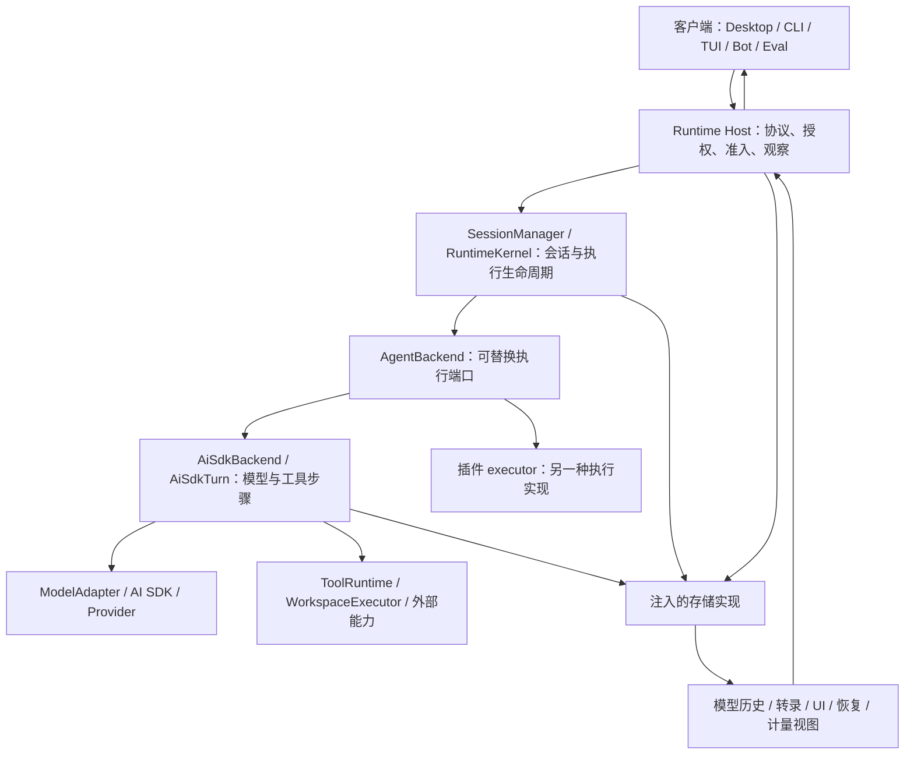
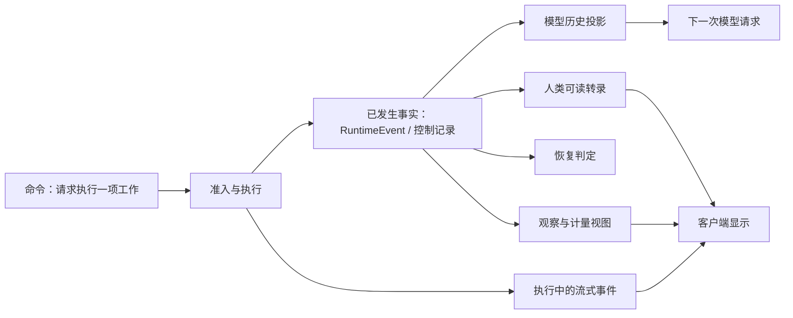
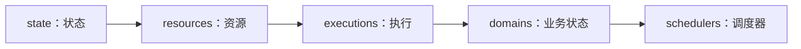

# 整体架构：Maka 执行系统的组成与分层

[手册目录](../README.md)

本文不要求读者预先认识全部类名。首先将“读取配置并修复错误”拆解为需要有人负责的事项，随后考察 Maka 将它们划分到不同层的原因。
源码基线为 `15d0a0d`；架构事实以实际契约与组装代码为依据，关于成本和替代方案的判断会明确标为分析。

## 1. 起点：模型 SDK 与编码助手的差距

用户说：“读 config.json，找出配置错误，修好后验证。”
模型服务可以返回文字和工具调用意图，但以下事情仍需要宿主程序完成：

1. 确定这个请求属于哪个会话，是否允许开始新的工作。
2. 选择模型、连接、提示词、工具声明以及可见历史。
3. 接收流式响应，把完整工具参数交给本地实现。
4. 检查访问边界，执行读写，把结果交回模型。
5. 保存足够事实，使另一个界面或重启后的进程能解释这次工作。
6. 把进度显示出来，并区分“模型停止输出”和“任务已可靠收尾”。

`streamText()` 只覆盖其中的模型调用部分。
如果把所有逻辑放进某个 UI 按钮回调，打开第二个窗口时很容易再次创建一份运行与写入者。
Maka 的整体设计首先要解决的是：**多个产品入口如何使用同一套执行、状态和安全边界。**

这也是上游架构文档把 Runtime Host 放在所有产品入口之后的原因。[总体契约][architecture]

## 2. 职责视图：客户端、Host、runtime 与 storage



箭头表示职责间的数据或控制交接，不代表每一条都是 `package.json` 的直接依赖。
存储虽然被执行层使用，具体实现可以由 Host 作为接口注入；包依赖的准确方向见[目录与依赖地图](repository-map.md)。

### 2.1 客户端：表达意图与呈现状态

客户端将“用户想做什么”传递给 Host，并呈现 Host 返回的观察结果。
客户端可以持有输入框、流式文本缓冲和当前选择的会话，但这些显示状态不能决定工具是否已经提交或工作能否恢复。

这并不意味着客户端没有任何逻辑。
客户端可能负责浏览器、桌面等能力的实际执行；此时需要另一套能力发布、接受和准入协议。
“执行发生在客户端”与“客户端有权绕过 Host 启动根工作”是两个不同的概念。
相关实现在[客户端能力与 MCP](../03-tools/mcp-and-client-capabilities.md)。

### 2.2 Host：请求接入与执行授权

Host 验证调用者、operation、Session 和执行身份，管理根执行准入、交互等待、订阅以及服务生命周期。
例如同一 turnId 再次到达时，不能未经核对就再次调用模型；新输入到达一个忙碌的 Session 时，也不能直接创建第二个根循环。

Host 是服务边界，不应将其理解为某个固定的远端 HTTP 服务。
本地产品与远端连接可以有不同的进程和传输部署，执行权威的职责仍要保持一致。
协议与传输不能替代其后的运行事实。

### 2.3 runtime：执行推进

SessionManager 是会话执行服务；RuntimeKernel 协调活动 backend、Run 和事件消费。
AgentRun 建立本次执行身份并接收需要记录的运行事实。
AiSdkTurn 则负责一项逻辑工作中的模型 step、工具结算、重试和结束判断。

将它们全部统称为“Agent loop”虽然方便，但会掩盖生命周期与模型步骤的不同责任。
一个组件可以负责驱动 `backend.send()`，但不直接决定下一次模型提示词；另一个组件可以驱动模型步骤，但不拥有整个 State Root。
详细对象图见[会话与对象生命周期](../01-runtime/session-lifecycle.md)。

### 2.4 storage：事实持久化

存储层提供运行事件、操作账本、Session 及业务控制状态的持久实现。
它不是 Eval 实验成绩的所有者，也不是将屏幕上显示的文字随意落成日志文件的机制。

工具准备派发与工具结果提交有专门的原子接口。
SQLite 可以保证本地事务中的多条记录同时生效，但不能将远程工单系统、文件写入和本地数据库自动纳入同一个分布式事务。
因此存储解决“本地知道什么”，无法消除“外部可能发生了什么”的全部不确定性。

## 3. 数据流视图：命令、事实与投影

阅读源码时，常会同时遇到 Input、SessionEvent、RuntimeEvent、StoredMessage 和 subscription frame。
它们不能因为都携带文本而互相替换。



一个 Read 例子即可说明命令、事实与投影的差别：

| 数据 | 示例含义 | 何时能出现 |
| --- | --- | --- |
| 命令 | “请读取 config.json” | 动作发生之前 |
| 工具调用事实 | 模型提出了具体参数 | 不一定已经派发 |
| dispatch 事实 | 已跨过允许派发的持久边界 | 实现可能开始产生效果 |
| 工具结果事实 | 已保存读取结果及稳定的模型投影 | 不能只靠 UI 图标替代 |
| UI 事件 | 工具开始、完成或失败的显示信息 | 内容可能是裁剪后的协议视图 |
| 模型历史 | 下个请求可以消费的工具调用/结果对 | 还要经过投影与协议约束 |

RuntimeEvent 契约明确指出它不是 UI 事件或 trace 行；BackendSendInput 则明确禁止将旧 `context: StoredMessage[]` 视为 provider history 权威。[事件契约][runtime-event]、[后端输入][backend-input]

这种层次划分并不是为了增加数据格式数量。
模型历史受窗口和调用配对约束，UI 需要展示中断片段，恢复需要读取被模型隐藏的控制事实。
三类读者所需的信息不同，一份“当前消息数组”无法同时准确服务它们。

## 4. State Root 单一写入权威及其并发边界

State Root 是持久状态的边界，不是 `cwd`。
Host 对它持有写入权威；在该边界内，再按 Session、运行、工具操作处理不同粒度的竞争。

```text
State Root 唯一 owner
  ├─ Session A：当前根 Turn 与待处理输入
  ├─ Session B：另一项工作，可以并发推进
  └─ 业务协调器：按自己的持久身份接纳后续工作
```

应避免据此得出两个错误结论：

- “只有一个 Host，所以所有 Session 串行执行。”根所有权与执行并发并非同一把锁。
- “SQLite 支持事务，所以两个 Host 可以各自启动模型循环。”事务不能自动识别谁拥有这项业务执行权。

State Root 的具体实现涉及真实目录身份、持久锁位置、操作系统锁和受限 lease。
Peer Mesh 负责不同 Host 的发现和连接，但并未因此合并它们的写入权威，也没有产生全局工作调度器。[Host 所有权与状态同步](../04-state/host-ownership-and-sync.md)

## 5. 启动流程与就绪条件

考虑应用刚启动、磁盘上仍留有一项未结束工具调用和一个计划继续运行的任务的情形。
如果调度器在创建后立即启动工作，而执行恢复尚未完成，就可能重做未知效果或与旧准入记录冲突。

`host-composition.ts` 给出了固定的恢复阶段：



`recoverRuntimeHostDomainModules()` 的循环顺序是“阶段在外、模块在内”：

```ts
// 真实函数中的核心循环。
for (const phase of HOST_RECOVERY_PHASES) {
  for (const module of modules) await module.recover(phase);
}
```

假设有 A、B 两个模块，实际顺序是 A.state、B.state、A.resources、B.resources……
并非 A 先从 state 一路执行到 schedulers，B 才开始。
这样后续阶段的模块可以建立在前面阶段整体完成的基础上。
这是可以从循环结构直接核对的保证，不是“所有启动操作天然可以并行”。[恢复代码][module-recovery]

模块定义（`RuntimeHostDomainModuleDefinition` 描述 handlers、各阶段 recovery、drain 与 close）、handler 装配时对重复与未知 operation 的拒绝、按模块逆序关闭并以 AggregateError 汇总、closeTask 缓存等细节，在[仓库地图](repository-map.md)的 Domain Module 小节展开。
本篇仅保留结论：两个模块争夺同一个协议入口会在组装时失败；关闭按模块逆序执行，单个 close 失败不会跳过后续模块。

## 6. Composition 与磁盘的绑定

Composition 在这里指“这套 Host 安装了哪些服务与执行实现”的程序组合，不是聊天摘要。
如果两种语义不同的程序组合先后使用同一个 State Root，后一种程序未必能正确解释前一种留下的工作。

`bindStateRootComposition()` 将 compositionId 绑定到该状态根：

1. 验证 compositionId 形状。
2. 在有效 write lease 下读取已有标记。
3. 已有标记时要求它与本次组合相同。
4. 没有标记时发布新标记；发布竞争失败则读取获胜记录并再次比较。

它不会在发现不一致时直接覆盖旧 ID；错误为 `composition_mismatch`。
这体现了一个实用原则：在无法确认自己能解释现有状态时，应先拒绝以另一套语义接管它。[组合绑定][root-composition]

## 7. backend 接口而非统一基类

`AgentBackend` 在 core 中定义 send、stop、dispose 和相应可选能力。
类型模块的说明明确指出：实现者与消费者依赖一个小的纯类型模块，而不是具体 backend 文件。[后端端口][backend-port]

这带来一个实际的接入方式：

```text
Host 选择并准备实现
  → 交给 Kernel 一个满足 AgentBackend 契约的对象
  → Kernel 消费 send(input) 产生的事件
  → 实现内部可以是 AiSdkTurn，也可以是插件 executor
```

它不保证两个 backend 的所有能力完全等价。
例如压缩和 composition preparation 在契约中是可选能力，依赖这些能力的上层流程必须判断是否提供。
统一接口隐藏的是调用边界，而不是消除实现差异。

从设计分析看，这减少了产品入口直接耦合某家模型 SDK 的程度；代价是事件协议、可选能力和生命周期契约都需要额外测试。
这项代价并不是“接口越多越好”，而是当前需要多个产品入口和后端时必须支付的协调成本。

## 8. 故障场景下的分层验证

将进程中断置于“文件已写，工具结果尚未可靠提交”的时刻：

| 层 | 此时应回答什么 | 不该代替谁作决定 |
| --- | --- | --- |
| 客户端 | 显示连接或运行状态不确定，重新查询 | 不能为了补齐 UI 而自动重写文件 |
| Host | 恢复执行身份与准入状态 | 不能仅凭客户端超时生成新的同义工作 |
| Runtime 恢复 | 区分已提交结果与未知效果 | 不能将缺少 T2 当作工具一定未执行 |
| 存储 | 提供可信事务边界内的记录 | 不能替外部文件系统证明回滚 |
| 工具或业务协议 | 提供结果查询、幂等或明确的人工处置 | 不能靠提示词声称实现 exactly-once |

此表可用于检验后续扩展：新增客户端、工具或 executor 时，需要明确其接入的层次与承担的保证类型。
仅调通 API 不足以证明崩溃、取消和重复请求场景下行为的正确性。

## 9. 与 Pi 的关系：可编程系统与默认组装边界

Pi 的 coding-agent 也可以被开发者嵌入；Maka 也不只是一个不可编程的桌面程序。
因此“一个是给用户用、一个是给开发者用”不是可靠的区分。

Pi 默认入口通常由 `createAgentSession()` 组装 Agent 与 AgentSession，再把模型通信交给 pi-ai。
Maka 产品入口通过 Host，Host 组装会话、执行、持久状态与观察协议。
Pi 的 durable 是另一条实验性任务执行路径，不能因默认 AgentSession 并非它，就推断 Pi 没有持久任务能力。

这只是架构组织方式的比较，不依据类和文件数量判断哪一个更可靠、更快或模型效果更好。
选型需要从具体的嵌入方式、共享状态、恢复边界和工具副作用出发，[Pi 与 Maka 对照](../07-comparison/pi-and-maka.md)将用具体场景展开。

## 相关专题

- [目录与依赖地图](repository-map.md)：将本篇职责图对应到包、导出子路径、源文件和测试目录。
- [领域模型](domain-model.md)：解释会话、逻辑轮次、物理执行与持久事实之间的精确关系。
- [完整请求与事件回程](../01-runtime/request-to-response.md)：沿一条请求定位具体方法与调用顺序。
- [设计模式与权衡](design-tradeoffs.md)：讨论为何使用接口注入、联合类型和可重建投影，以及它们的成本。

[architecture]: ../../../../maka/ARCHITECTURE.md#L23
[runtime-event]: ../../../../maka/packages/core/src/runtime-event.ts#L20
[backend-input]: ../../../../maka/packages/core/src/backend-types.ts#L60
[backend-port]: ../../../../maka/packages/core/src/backend-types.ts#L20
[module-recovery]: ../../../../maka/packages/runtime-host/src/server/host-composition.ts#L122
[root-composition]: ../../../../maka/packages/storage/src/state-root-composition.ts#L54
