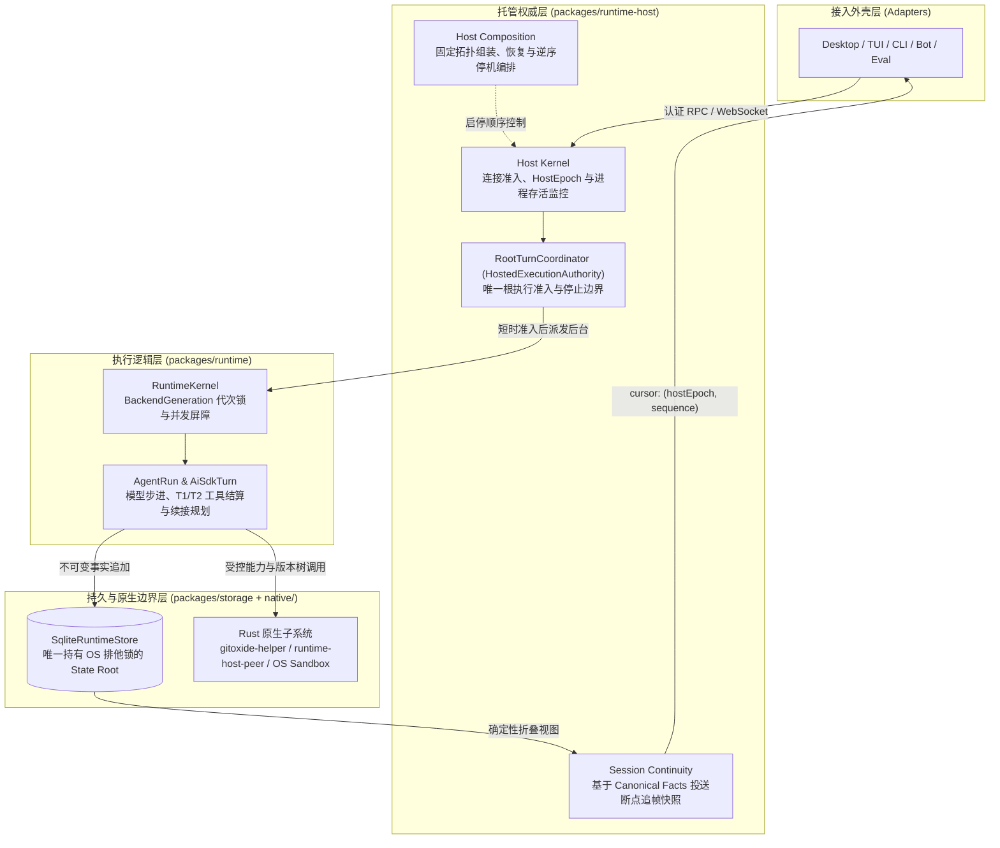

# 四层隔离与单 Host 权威：多端并发下的物理写入收拢架构

## 1. 为什么传统桌面 Agent 的“本地直连库”注定走向脑裂？

在一个真实的生产级智能体平台里，底层工作区永远不可能只服务一个窗口：用户上午在 Electron 桌面端开启了一轮代码重构，中午在集成终端 CLI 用命令检查日志并插话纠偏（Steering），与此同时后台还有一个定时调度 Bot 或容器化的评测进程（Eval）正在读取进度。

如果桌面 UI、CLI 与后台 Worker 各自在内存里跑着独立的调度循环并直接打开本地 SQLite 数据库写入：
1. **双写覆盖与事务互锁**：两端各自从内存缓存在旧快照上追加对话轮次，提交时要么触发 SQLite `SQLITE_BUSY` 崩溃，要么默默覆盖掉对方刚刚提交的工具结果。
2. **订阅流撕裂与重连丢帧**：桌面窗口刷新或终端短时切网休眠后，如果服务端正在进行的流式文本和后台 `Bash` 子进程进度挂在某个临时 HTTP 请求句柄上，客户端断开即意味着任务与状态永久丢失。
3. **无控制面的失控恢复**：进程崩溃重启后，A 模块急着把半截旧对话投影给用户，B 模块已经在悄悄往外部 API 重发未完成请求，还没恢复完毕的数据库瞬间遭到“未准备先接客”的二次污染。

Maka TypeScript 版给出的根本解法是 **单 State Root 物理写入权威 + 四层正交职责分离 + 严格顺序启动的 Host Composition**。

---

## 2. 四层权威版图：谁决定什么，谁绝不越界？

Maka 拒绝将所有权含糊地摊给“某个叫 Manager 的大类”。在系统边界内部，控制面、逻辑内核、状态存储与底层原生隔离有着毫不妥协的权责分割线：



下表精确划定了各核心角色“**管什么**”与“**坚决不管什么**”的双向契约（整理自 `docs/architecture/runtime-host-architecture` 边界规范）：

| 架构角色 | 唯一握持的权威 | 严禁越权的领域 |
| :--- | :--- | :--- |
| **Storage Root Owner** | 唯一决定哪一个物理进程允许对当前 State Root 执行数据库写操作（借助 OS 排他锁） | 不判断客户端角色权限、不解释业务回合成败 |
| **Host Kernel** | 统一收口连接鉴权、请求路由、`HostEpoch` 分配、排空（Drain）与关停门禁 | 不理解大模型选型、压缩策略或 Turn 内部细节 |
| **Host Composition** | 编译期锚定静态模块依赖图、领域集及“恢复启动 -> 逆序停机”时间轴 | 不做运行时黑盒自动扫描发现，也不覆盖单会话配置 |
| **`RootTurnCoordinator`** | 落实 `HostedExecutionAuthority`，负责准入落盘 `runId`、叫停以及触发崩溃恢复入口 | 不参与 Goal、计划或外部调度图如何评价执行结果的含义 |
| **`RuntimeKernel` / `AgentRun`** | 驱动多轮模型请求、工具周期结算、生成代次隔离与 Continuation 推进 | 不接触传输发现、跨客户端默认宿主选择或安装包管理 |
| **Session Continuity** | 纯粹基于规范事实流构造快照、完整转录视图与实时推流 | 绝不允许拿内存通知当作任务完结证据，更不代客户重发消息 |
| **Client Capability Broker** | 挑选端侧代理实现、追踪端侧执行反向调用 `accepted → admitted` 边界 | 绝不将 Session 或 Run 的控制所有权让渡给客户端窗口 |

---

## 3. State Root 唯一写入锁与正交身份基座

在一个物理 State Root 上，永远遵循 **Single Writer Host** 铁律：**无论外部连着几个桌面窗口或几个 CLI，任何物理写库操作必须收口至同一个获锁 Runtime Host 进程之内**。

为了杜绝新旧实例碰撞与跨界混用，宿主层维持了四枚正交且不可互换的系统身份：
- **`rootId`**：当前状态根目录在协议里的持久逻辑身份（显式创建或修复确定，而非可随意挂载变动的文件路径字符串）。
- **`HostEpoch`**：当前宿主机进程每一次重启都会递增生成的单调纪元凭证；只要进程度过崩溃重拉，`HostEpoch` 必然跳变，彻底阻断新进程误吞旧实例残留的半截流序。
- **Composition ID & Revision**：写入在工作区根元信息中的“允许解释本状态库的代码组合拓扑 ID 及修订版本”。客户端发起协同接入时会先比对修订兼容度，阻止旧版二进制盲目开启新格式工作区引发悄悄丢字段惨剧。

---

## 4. 六阶段有序恢复启动与严格逆序停机

很多宿主服务崩溃的原因在于启动图太松散：RPC 监听端口刚一开启，订阅推送循环还没跟数据库状态对齐，客户端发进来的新 `turn.start` 请求就已经顺着异步回调撞进了半恢复期的老任务中间。

Maka 的 **`Host Composition`** 将宿主的启动期锁死为一条不可越级的单向恢复装配流水线：

```typescript
// 概念演示：Host Composition 六阶段严格激活与停机逆序收缩
class HostCompositionLifecycle {
  async boot(stateRootPath: string): Promise<void> {
    // Stage 1 (state): 获取 OS 排他写锁，运行 SQLite Schema 与数据前向迁移
    const rootLock = await acquireExclusiveRootLock(stateRootPath);
    const stores = await openAndMigrateStores(stateRootPath, rootLock);

    // Stage 2 (resources): 装填托管凭据库 (SecretStore)、模型目录与底层工作线程准备
    await initializeManagedResources(stores);

    // Stage 3 (executions): 扫库执行 resolveRuntimeRecovery，密封所有断电悬空的 T1/T2 或遗留进程
    await recoverPendingExecutions(stores);

    // Stage 4 (domains): 激活 MCP 连接管理、Agent Graph 协调器、Archive 清理及会话连续性投影
    await activateDomainCoordinators(stores);

    // Stage 5 (schedulers): 直到领域全数恢复一致，才解除休眠拉起 Goal 与 ScheduledTask 定时唤醒
    await startBackgroundSchedulers(stores);

    // Stage 6 (ready): 一切真相就位，最后才对外开放 IPC/WebSocket RPC 准入大门
    await openHostListenerGate();
  }

  async shutdown(): Promise<void> {
    // 严格逆序收缩：先关大门挡新单 -> 停后台定时触发 -> 排空运行中 Turn -> 归档领域与托管进程 -> 最后放行 Root OS 锁
    await closeHostListenerGate();
    await stopSchedulersAndDrainTurns();
    await teardownDomainAndResources();
    await closeStoresAndReleaseRootLock();
  }
}
```

这个“**先恢复事实 -> 再封存遗留 -> 然后起调度 -> 最后开端口（`state → resources → executions → domains → schedulers → ready`）**”的黄金六阶段设计，从流程拓扑上物理消除了“服务还没恢复完，外头请求已经把现场搅乱”这一整类冷启动竞态！

---

## 5. 三股正交的数据流：命令、事实与投影

在日常稳定运行期，Host 与 Kernel 内部的三股数据流从不交叉污染：
1. **下行命令流（Commands）**：从接入端通过短时准入锁（`SessionAdmissionGate`）检验后进入，优先写成一条持久化意图（例如 `RootTurnAdmission`），立刻把异步执行权交还给后台协程，释放接入门锁绝不阻塞后续交互。
2. **上行事实流（Canonical Facts）**：后台执行引擎向存储唯一追加不可变的 `RuntimeEvent` 脊柱与配套的 `AgentRunStore` 操作账本。
3. **只读投影流（Projections）**：`Session Continuity` 把规范账本确定性地折叠投射为客户端可消费的 `CanonicalSessionProjection`，并在每次流式吐字与事件落地时打上单调 `(hostEpoch, sequence)` 坐标经带背压的单泵引擎投送给所有订阅者。

---

## 6. 总结

Maka TypeScript 架构之所以能承载重度多端并行与高可靠桌面体验，依靠的不是“写一个更健壮的全局锁”，而是三层纪律严明的划分：
- **唯一物理写主权**：靠 State Root OS 排他锁彻底收敛跨客户端写入；
- **六阶段冷启防抢跑**：确保一切挂起副作用与崩溃遗产未封存完毕，端口绝对紧闭；
- **命令、事实与投影彻底分流**：使网络闪断、UI 频繁刷新和异步推理流之间不再存在脆弱耦合。

明确了整个系统的物理边界后，下一步我们需要深入数据核心：当进程在半空意外掉电重启时，这套系统靠什么数据模型，能在内存全丢的前提下从硬盘上 100% 重构出刚刚做到一半的执行拓扑？请看下一篇：[六层执行身份与双账本重构：如何做到跨崩溃无损历史还原？](./domain-model.md)。
