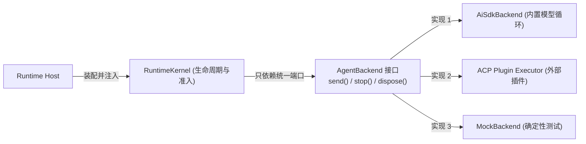
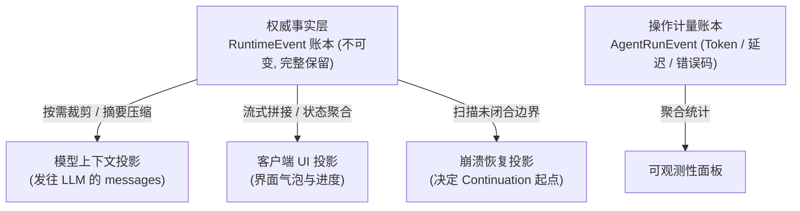

# 设计模式与架构权衡

[返回手册目录](../README.md)

软件架构的本质是在相互冲突的约束之间做取舍。对于简单的脚本型 Agent，追求的是开发速度与极简依赖；而对于需要支持多端同步、断电恢复、工具沙箱与多模型切换的工业级基础设施，每一次接口抽象和状态设计的背后，都有着明确要防范的故障场景与必须承担的工程代价。

本章梳理 Maka 核心设计中的关键技术决策，用工程化的视角回答：**“为什么必须这样设计？”“如果不这样做会出什么故障？”“我们为此付出了什么代价？”**

---

## 1. 接入抽象：可替换的 `AgentBackend` 端口

### 为什么需要？
假设用户让系统执行“读取 `config.json` 并解释”。对于大多数请求，系统通过内置的 AI SDK 适配器直接调用 Claude 或 GPT 模型；但在企业环境中，部分用户希望接入外部的 ACP（Agent Client Protocol）代理插件，或在测试环境中注入一个完全确定性的 Mock 引擎。

如果 `RuntimeKernel` 直接写死调用 `streamText()`，那么每增加一种执行方式（如外部 CLI 代理、远程容器执行），核心的会话管理、准入控制、历史记录和计费逻辑都要重写一遍。

### 设计方案与代价
Maka 在 `core` 层定义了纯粹的端口契约 `AgentBackend`（核心方法仅为 `send()`、`stop()`、`dispose()`）。Host 在装配阶段根据配置选择具体的后端实现注入 Kernel。

- **收益**：核心生命周期、并发控制、订阅广播逻辑完全复用，新执行引擎的接入成本被限制在实现单一端口之内。
- **代价**：`send()` 必须返回标准化的异步事件流（`AsyncIterable<SessionEvent>`），后端内部的细粒度特性必须通过标准事件信封对外表达，增加了适配器层的转换工作量。

---

## 2. 状态来源：判别联合类型与严格解码

### 为什么需要？
在一次执行打开（`invocation_opened`）时，它的来源可能是多种多样的：
- 用户在输入框发了一条普通消息（`fresh`）；
- 进程崩溃重启后，恢复引擎发起了断点接续（`continuation`）；
- 父任务派发了一个子任务交接（`handoff`）。

如果用一个大杂烩结构体，把 `parentRunId`、`checkpointId`、`userPrompt` 全做成可选字段（`optional`），代码里很快就会充斥着脆弱的猜测逻辑：“如果 `parentRunId` 存在，那大概是个子任务吧”。一旦某个字段漏填，程序就会在运行时出现静默逻辑错误。

### 设计方案与代价
Maka 在事件和身份模型中广泛使用**判别联合类型（Discriminated Unions）**，通过明确的 `root.kind` 和 `source.kind` 字段强绑定不同分支的必填载荷。存储层在反序列化旧记录时严格校验这些分支结构。

- **收益**：在编译期和解码期就能彻底消灭“半残缺状态”，Host 匹配准入、恢复引擎识别来源时有 100% 确定性的分支依据。
- **代价**：演进事件格式时必须维护严格的版本兼容与迁移规则，不能随意增删字段。

---

## 3. 数据分流：权威事实、模型投影与计量账本分离

### 为什么需要？
回到“读取 `config.json`”的例子。假设 `Read` 工具返回了一份长达 5000 行的日志或配置文件。这份数据在系统里有三个完全不同的消费者：
1. **大模型**：它有上下文窗口上限，可能只需要看到截断后的关键片段或压缩摘要；
2. **界面用户**：他想在屏幕上看到清晰的“已读取 5000 行，点击展开”卡片；
3. **计费与诊断面板**：它根本不关心文件内容，只关心这次操作消耗了多少 Token、耗时多少毫秒、属于哪个 `runId`。

如果把“给大模型发的消息列表”直接当成数据库里的唯一记录，只要一做上下文裁剪或压缩，界面历史就会凭空消失，审计记录也会随之残缺。

### 设计方案与代价

- **收益**：裁剪模型上下文绝对安全，永远不会破坏审计日志和界面展示；同时允许不同界面（Desktop、CLI）以各自最适合的方式渲染同一份事实。
- **代价**：系统内存和 CPU 需要承担一次“从事件流计算投影”的转换开销，且要求写入模型投影与写入运行事件之间保持严格的消费同步。

---

## 4. 原子提交：单对象快照与确定性排序

### 为什么需要？
每次模型调用结束，系统既要记录本次消耗了多少 Token，又要更新“当前模型最后看到的上下文诊断快照”。如果这两件事分两次独立的数据库调用写入，一旦中间发生异常或两次并行重试几乎同时完成，就可能出现**“账本显示花了第 2 次请求的钱，但界面诊断显示的却是第 1 次请求的上下文”**的错位现象。

### 设计方案与代价
Maka 将单次模型调用的用量与上下文快照打包为一个不可分割的原子提交对象（`ModelCallCommit`）一次性落盘。同时，在选择“最新上下文快照”时，不仅比较请求完成时间戳，在时间戳相同时还引入了 `attemptId` 作为确定的决胜依据（Tie-breaker）。

- **收益**：彻底消除界面诊断数据与实际计费账本之间的撕裂感，任何时刻查看面板都能指向同一次确定性的模型请求。
- **代价**：要求存储接口围绕业务原子单元设计，而不是暴露简单的表级 CRUD。

---

## 5. 并发与资源：代次隔离 vs 全局状态覆写

### 为什么需要？
假设一个会话正在复用同一个模型后端（Backend），以充分利用供应商的 Prompt Cache（提示词缓存）。此时用户同时触发了两条并发执行（例如主任务和后台辅助任务），或者在上一条任务刚刚点击停止时立刻发起了下一条消息。

如果将 `currentRunId` 或工具上下文直接挂载在长寿命的 Backend 实例上，先结束的任务清理现场时，就会错误地把正在运行的后继任务的 `runId` 抹除掉，导致工具调用丢失身份归属。

### 设计方案与代价
Maka 做出了清晰的生命周期切割：
- **长寿命状态留给 Backend**：模型连接、已激活工具列表（维持缓存稳定）放在 `AiSdkBackend`，通过 `BackendGeneration`（后端代次）管理配置切换时的平滑交接。
- **短寿命状态锁进 Turn**：每一次 `send()` 独立创建一个全新的 `AiSdkTurn`，把 `runId`、取消信号（`AbortSignal`）和 `ToolRuntime` 作用域严格隔离在各自 Turn 的闭包内。

- **收益**：既享受了跨轮次 Prompt Cache 的低成本与高命中率，又从根本上消除了重叠执行时的状态串扰（Race Condition）。
- **代价**：RuntimeKernel 必须维护一个精确的代次状态机（记录正在构建的 Promise、处于收尾中的旧代次、以及每个代次名下的活动 Run 集合）。

---

## 6. 核心权衡一览表

| 架构决策 | 解决的核心痛点 | 付出的工程代价 | 适用边界与替代方案 |
| :--- | :--- | :--- | :--- |
| **Single Host Authority** (单一宿主写入权威) | 多客户端并发写数据库导致的脑裂与数据损坏 | 引入本地 IPC/RPC 通信开销，需要管理 Host 存活与租约 | 适用于桌面/TUI/远程多端协同系统；若只需单进程一次性脚本（如 Pi CLI），可直接内存运行。 |
| **Event Sourcing** (只追加事件账本 + 投影) | 历史裁剪破坏审计、多端状态不一致、断网无法补帧 | 增加投影计算逻辑，需要定期做 Compaction 检查点加速读取 | 适用于长会话、需要强审计和可重放的平台；简单问答机器人直接存取 Message 数组即可。 |
| **Generation + Turn 隔离** | 换模型时的在途请求冲突、重叠执行的身份覆盖 | Kernel 内部需要维护复杂的代次引用计数与异步释放锁 | 适用于支持热切配置和多路并发的生产环境；单线程串行阻塞执行无需代次概念。 |
| **显式 Unknown Outcome** | 工具执行途中崩溃时盲目重试导致重复副作用 | 必须建立崩溃窗口识别逻辑与人工/策略接续流程 | 适用于涉及写文件、调外部 API 的严肃代理；纯只读分析场景可直接安全重试。 |

---

## 7. 延伸阅读

- 深入理解单一写入权威在进程断电时的租约与接管机制，阅读 [04.2 Host 所有权与多端同步](../04-state/host-ownership-and-sync.md)。
- 了解 `BackendGeneration` 与 `AiSdkTurn` 在销毁时的并发清理细节，阅读 [01.2 会话与执行对象的生命周期](../01-runtime/session-lifecycle.md)。
- 对比 Maka 与 Pi 在上述权衡上的不同路线选择，阅读 [07.1 Agent 内核架构宏观对比](../07-comparison/overview.md)。
