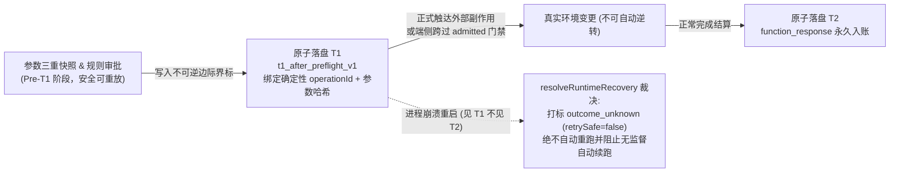

# 架构取舍与演进边界：混合 TypeScript Runtime 的代价平衡清单

## 1. 为什么任何严肃的 Agent 基础设施本质上都是一张代价交换表？

搭建原型级的智能体工具往往只问“能跑起来就行”，而生产级的混合 TypeScript 运行时却时刻在互相打架的目标之间做取舍：
- 想让多客户端随时断开重连还能共享进展，就必须在宿主机上维持强硬的写排他控制权，而不能随处实例化轻便的进程内 Loop；
- 想在 `AiSdkTurn` 运行中途响应随时插入的用户纠偏（Steering），又不敢在长达数分钟的推理期间长期死锁整个会话对象，锁粒度应该切多碎才不会破坏队列序与消息交付原子性？
- 想保证本地工具与端侧代理跨重启不重跑高危写入，却又深知外部网络世界根本做不到端到端分布式事务（Exactly-Once），该如何设置退化防线？

本章把隐藏在 Maka TypeScript 版核心层背后的底层权衡收拢为六大核心决策维度，讲透它在每一道分叉口到底“换取了什么收益”又“甘愿承担什么工程成本”。

---

## 2. 六大核心架构取舍矩阵

| 取舍维度 | 常规简化实现 | Maka TS 版的架构选型 | 换取的核心工程收益 | 承担的复杂度与边界代价 |
| :--- | :--- | :--- | :--- | :--- |
| **宿主控制模型** | 每个客户端窗口各自启动独立 Agent 循环直接读写 DB | **单 State Root 唯一 Host 权威 + `HostedExecutionAuthority` 统一收敛** | 彻底根绝桌面/CLI/Bot/Eval 并发修改覆盖与“恢复未完先接单”竞态 | 必须维护 OS 文件锁租约、`HostEpoch` 与复杂的 IPC/WS 状态广播同步机 |
| **并发锁与执行生命周期** | 用单把互斥大锁包住整轮模型+工具耗时执行 | **极短 `SessionAdmissionGate` + `BackendGeneration` 代次锁 + 二元 `SteeringLease`** | 推理期间客户端依然能无阻塞排队写 Steering 与安全读历史，热切换零污染 | 调度链路引入代次淘汰检测与 `leaseId` 显式回执，无法写简单的直通同步逻辑 |
| **持久化账本与建模哲学** | 直接原地更新单张可变 `runs`/`messages` 状态表 | **`RuntimeEvent` 无损规范脊柱 + `AgentRunStore` 操作账本 + `canonical` 往返校验** | 崩溃后状态能从纯事件流 100% 重构；计量/审计细颗粒扩展不污损模型输入上下文 | 任何看似简单的状态读取本质都是投影归约，新增字段必须同步扩展严苛 Schema |
| **工具两段提交与不确定结局** | 超时后假定失败直接重跑，或盲目封装无限重试框架 | **Pre-T1 隔离 -> `t1_after_preflight_v1` -> 越界崩溃一律封存 `outcome_unknown`** | 宁可显式向模型宣告“副作用结局不明”，也绝对禁止自动重跑写文件/转账等风险调用 | 压缩边界（`#6254`）与续跑（Continuation）必须专门设计面向 `outcome_unknown` 的安全越过语义 |
| **混合 JS/Rust 物理边界** | 全量依赖 Node `child_process("git")` 与纯 JS 网络层 | **TS 编排控制面 + 原生 Rust 数据面 (`gitoxide-helper` / Peer Mesh / Win Launcher)** | 高频 Git 检查点树 CAS 提速一个数量级，移动切网不断流，Windows 拥有可靠作业屏障 | 构建工具链必须同时协调 TypeScript Workspaces 与多平台 Cargo 原生二进制编译分发 |
| **协议递增与多模态保守策略** | 无脑复用全连接、报错就丢掉 PDF/图片默默重试 | **OpenAI Responses WS 窄门增量复用 + 结构化 PDF 拒绝准入门槛** | 长工具链 TTFT 与重传流量大幅缩减，且彻底拒绝无结构化拒绝诊断时的盲目退避 | 需要维护前缀绝对校验、5 分钟降级冷却态以及按提供商区分的文档失败处理逻辑 |

---

## 3. 四组深层系统抉择剖析

### 3.1 锁粒度劈分：为什么坚决拒绝“包住整轮推理的会话大锁”？

许多同步编程背景的开发者，最初防止并发抢跑的直觉就是在进入 Turn 时一把 `mutex.lock()` 锁死该 Session，直到模型和所有工具全部跑完再解锁。这在需要支持人机高频协同的实时桌面端里是致命的——用户想在工具跑了一半时发一条纠正指令、或者旁边视图想读取实时状态，都会因为拿不到锁而直接卡死！

Maka 在这里做出了极其精妙的时空切分（详细机制见 [01.2](../01-runtime/session-lifecycle.md) 与 [05.1](../05-coordination/queues-and-admission.md)）：
1. **`SessionAdmissionGate` 只保护几毫秒临界区**：所有客户端命令进入准入闸门后，只需完成轻量校验和持久意图写入（`RootTurnAdmission`）并登记好后台异步协程，立刻退出闸门放锁；
2. **`BackendGeneration` 用单调代次阻止僵尸写入**：如果用户在切换模型配置时引发 `RuntimeKernel` 热切重载，新旧代次实例可以安全并存至旧流物理排空，但老代次任何在 `await` 苏醒后试图反写的动作只要被检出代数落后，会被门控直接静音驳回；
3. **`SteeringLease` 管死跨内存队列的交付生死**：不再靠粗暴“拿了队列然后先从数组 `shift()` 删掉”的丢失风险写法，而是先签发临时租约 `leaseId` 喂给本步循环，只有拿到物理步骤已真正纳入提示词并开启的确认（Ack）后才核销租约——哪怕这中间突发取消或异常断连，未确认投递的纠正指令也会自动退回（Nack）留在原地一字不丢！

### 3.2 拒绝分布式事务幻觉：Pre-T1、T1/T2 与 `outcome_unknown` 边界哲学

对于跨越多重异步调用的本地或端侧工具，最危险的故障窗口发生在 **“外部命令已经下发执行，但结果回执还来不及被写回账本”** 那几百毫秒的断电里。

这套模型的架构清醒度在于：**承认“非幂等外部世界无法由客户端单独保证 Exactly-Once”**。对于发生在 `T1` 提交之前的任何中断，引擎大可以放心地清掉重试；而只要跨过了 `T1` 门限（或者端侧能力代理跨越了宿主核发的 `admitted` 准入信标）才断联，系统绝不制造虚假的乐观假象，而是强制落印不可逆的 `outcome_unknown` 标识——宁愿要求高阶推理主动去读取校验现状，也绝不悄悄替用户在黑暗中双击第二次下单！

### 3.3 混合架构边界：为什么宁愿忍受双构建链路也要拆出 Rust `native/`？

在 Pure Node.js/TypeScript 项目里维护 Rust crate 无疑提高了新贡献者的本地环境配置成本和跨平台 CI 复杂度。但 Maka 团队经过实测将三个不可让步的热点物理沉降到了 `native/` 边界中：
- 在高频工作区检查点场景里，`gitoxide-helper` 只充当零会话记忆的数据平面搬运工，依托 Rust 原生内存安全与 `gix` 无进程池冷启损耗，将成千上万文件的快照发布稳定锁定在确定性预算线之内；
- 在实时桌面网络边界，`runtime-host-peer` 扛起了 `libp2p` 与 `WebRTC Direct` 底层重连接字节流帧组装；
- 在 Windows 任务宿主端，`runtime-host-windows-task-launcher` 直接以 Win32 原语卡死受控进程树，把难以通过 Node 层包装稳固的句柄泄漏与逃逸门道统统截断在底层。

这种“**上层策略控制用 TS 敏捷演化，底层重资产数据通路与系统壁垒用独立小巧 Rust 进程/组件封装**”的策略，既保住了快速试错能力，又拿到了接近系统级语言的稳定护栏（也是后来整个团队能够顺势彻底重构出纯 Rust 微内核版前传的直接催化剂）。

### 3.4 可观测与投影同源铁律：`ModelCallCommit` 单值包装与确定性决胜算子

在传统 TS 代码里，顺手给一个更新函数加第六个可选参数 `{ usageSnapshot }` 是常事——然后半年后某位工程师多包了一层适配器函数时顺手漏传了这第 6 个参数，类型检查却因为它是可选或顺序混用没报错，线上统计面板就此莫名奇妙失明！

Maka 在核心层用了一条极聪明的手法堵死了这类低级错：**单值强类型载荷打包（`ModelCallCommit<TAttempt>`）+ 确定性比较算子（`supersedesLatestContext`）**。
- 它将调用尝试结果 `attempt` 与当时对应的上下文体积诊断快照 `latestContext` 硬绑为一个统一对象的不可分割必填成员，且只在 `AgentRunStore` 单次原子写入内一并落盘；
- 同时面对多线程队列并发到达可能出现“先完成却后落盘”的倒挂现象，状态汇总永远不信先来后到顺序，而是以 `completedAt` 加上 `attemptId` 字典序作为铁定的唯一决胜锚点——**在线热运行投影与离线冷读重启重建共跑完全同一段比较代码**，天然达成统计口径严丝合缝。

---

## 4. 总结与演进定位

回顾这套 TypeScript 架构版的全貌工程取舍，我们能看到一个清晰成熟的系统演进轨迹：
- 它证明了即使构建在 TypeScript + Node.js 的异步动态生态里，只要死守 **单 Root 写锁、无损不可变双账本、`Pre-T1 / T1 / T2` 边界密封** 与 **Rust 原生热区卸载**，依然能打磨出经得起严苛断电重启与容器级基准测试考验的高可用 Agent 平台；
- 与此同时，当你读到它的短板与负担——例如多端跨进程依赖常驻 V8 堆内存底噪、复杂状态流必须靠外挂多个独立 Rust 原生 CLI 桥接补强时，也就能彻底理解团队为何最终会走向在 [Rust 微内核演进全解](../../maka-rust-agent-infra/06-operations/rust-vs-ts-evolution.md) 中展现的纯 Rust 终极重铸路线。

至此，**00 架构基石篇** 的全景地基已全部铺平。下一章起我们将直接钻入运行时的实时血管——看看当用户在客户端敲下第一条消息发给这套系统时，`subscribe → ready`、异步 `drainTurn` 以及 `open/sequence` 游标是如何保证零掉帧接力的：请看 [订阅优先与控制解耦：断连不丢帧的端到端信令流水线](../01-runtime/request-to-response.md)。
