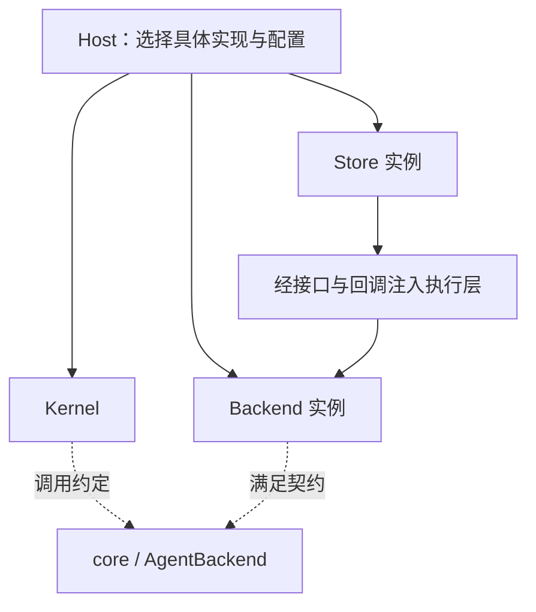
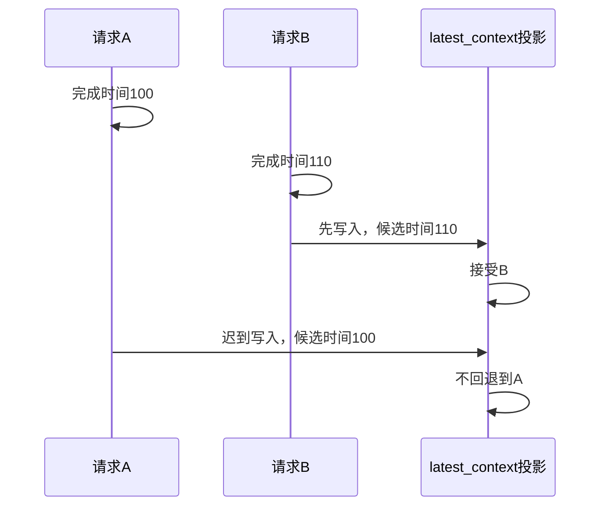

# 设计模式与权衡

[手册目录](../README.md)

本文不替项目作者补写历史 ADR。标为“源码事实”的内容可直接在代码中核对；“设计分析”是根据现有实现讨论它解决的问题、代价和适用条件。
模式名称仅用于压缩表达，不是给类附加标签。每个模式都从一个会出错的具体场景开始。

## 1. 接口与依赖注入：模型客户端的解耦

### 问题背景

假设 Kernel 直接创建模型客户端、读取凭据、打开数据库并执行模型循环。
若要测试一次取消行为，必须同时准备连接配置、凭据文件和数据库；若要替换为插件 executor，又需要在 Kernel 中增加另一套分支。
各变化之间产生了耦合。

### 源码实现

core 定义 `AgentBackend`，runtime 使用该接口，Host 选择具体实现并注入所需依赖。
接口的一部分如下；这是摘录，不是完整声明：[AgentBackend][backend]。

```ts
send(input: BackendSendInput): AsyncIterable<SessionEvent>;
stop(reason: 'user_stop' | 'redirect', mode?: BackendStopMode): Promise<void>;
dispose(): Promise<void>;
```

接口描述“调用方可要求什么”，不包含实现状态，也不在 JavaScript 运行时创建实例。
实际对象是 AiSdkBackend 或其他实现；它们可以用不同的内部结构履行相同的调用契约。
熟悉 Java 的读者可以先将其理解为依赖一个接口，再由外层传入实现对象，而不是依赖某个固定的实现类。



虚线是类型依赖，不是“运行时调用接口文件”；实线表示对象创建或提供关系。
runtime 的生产 manifest 不依赖 storage 实现，仍可使用 Host 传入的存储端口。
这就是依赖反转在本项目中的具体落点，包声明见[依赖地图](repository-map.md)。

### 代价与边界

设计分析：这使 backend 与存储可替换、测试可控制，但也把大量保证转移到接口契约上。
例如返回 AsyncIterable 并不自动保证事件已持久化；提供 stop 也不保证能撤销工具效果。
接口必须明确说明生命周期、可选能力和失败方式，不能只描述参数类型。

不应将测试用 FakeBackend 视为生产可安装的 backend。
runtime README 明确将它放在 test-only 导出中，发布打包会移除相应目录。[公共接入面][public-seam]

## 2. 流式生成器：send 的异步迭代返回

### 问题背景

一个模型步骤可能先输出文字，再给出工具意图；执行工具时又可能等待用户批准。
若只返回 `Promise<string>`，调用方只能获得最后一个值，无法及时显示活动或处理过程事件。
若将所有进度都纳入全局事件总线，则难以判断哪次执行拥有订阅、取消和清理责任。

### 源码事实

`AgentBackend.send()` 返回 `AsyncIterable<SessionEvent>`。
外层通过 `for await` 消费事件；AiSdkBackend 为每次 send 建立 Turn scope，在 finally 中移除并关闭。
它将“一次执行的事件流”与“这次执行的资源清理”放在同一控制结构中。[作用域创建与关闭][backend-send]

教学伪代码，名称仅表示控制结构：

```ts
async function consume(stream: AsyncIterable<SessionEvent>) {
  for await (const event of stream) {
    await acceptEvent(event);
  }
}
```

这里的 await 等待事件消费者完成；它不意味着整个系统的每一级都没有缓冲。
provider 网络流、内部 event buffer、持久写入、Host 订阅队列仍可能具有各自的调度和边界。
因此不能仅凭 `for await` 推导端到端背压或网络发送已暂停。

### 代价与边界

设计分析：流式接口把执行期间的控制点显式化，但调用方必须持续消费、正确取消，并处理迭代失败。
“收到 complete”与“所有外层观察者、持久化和清理已完成”仍然要按契约区分。
详细追踪见[事件回程](../01-runtime/request-to-response.md)与[生命周期](../01-runtime/session-lifecycle.md)。

## 3. 判别联合：触发原因的类型建模

### 问题背景

考虑这样一种教学反例：

```ts
// 反例，不是 Maka 接口。
interface AmbiguousTrigger {
  user?: boolean;
  goalId?: string;
  scheduledTaskId?: string;
  isContinuation?: boolean;
}
```

它允许 user=true、goalId 和 scheduledTaskId 同时存在。
每个读取者都必须判断“哪些字段不能同时出现”，新增一种触发原因后还需修改所有排除逻辑。

### 源码实现

`RuntimeInvocationRootAuthority` 以 `kind` 区分 user、goal、scheduled_task 等分支。
`RuntimeInvocationOpenSource` 又独立描述 fresh、continuation、handoff。
这两个维度分开，是因为“谁授权本次工作”与“它从哪次执行接续”并非同一个问题。[root 与 source][event-unions]

`invocationMatchesHostedRootExecution()` 按具体执行种类，逐项核对 opening 中的 root、source、configuration 与 lineage。
`lineageIsExactly()` 不仅比较期望字段的值，还要求没有额外的关系字段。

这样一条自称 goal 的记录，不能仅因碰巧带有正确的 goalId，就带着与准入身份矛盾的父子关系通过检查。[匹配代码][execution-match]

### 代价与边界

设计分析：联合类型让非法组合更难在当前 TypeScript 代码中产生，但落盘数据和网络 JSON 仍必须运行时解码。
类型擦除之后，外部输入不会因为声明了一个 interface 就自动合法。
`decodeRuntimeEvent()` 因此还检查信封字段、内容种类、动作和引用，并调用相应专用解码器。[解码代码][decode-event]

这与 Java 接口也类似：编译期类型可以约束调用者，不能替代不可信 JSON 的验证。

## 4. 事实与投影：读模型的分离

### 问题背景

某个工具返回很长的诊断信息：用户需要查看完整内容，模型下一步只需要一个受预算约束的表示，恢复还需要知道工具是否跨过派发边界。
如果只有一份 UI 消息数组，裁剪大输出就可能同时遗失恢复依据。

### 源码事实

RuntimeEvent 是执行事实模型；工具结果还有冻结的 modelProjection；转录、模型输入和恢复读取分别选择所需信息。
压缩改变的是模型请求投影，不是直接删除全部被摘要的原始事实。
AgentRunEvent 则承担计量、诊断和部分控制记录的操作需求。[事实契约][runtime-event]、[操作账本][run-event]

这种“写入事实，按用途生成读取视图”的组织与事件溯源、读写模型分离有相似之处。
但不能据此说 Maka 的所有业务状态都是纯事件溯源：准入、交互和其他控制平面仍有各自的存储与原子操作。
模式名称不能代替对具体 store 的检查。

### 影响正确性的投影示例

最近一次主请求的上下文信息用 `latest_context` 表示。
代码没有把“最近”定义为最后到达数据库的写入；它采用请求 completedAt，再以 attemptId 打破平局。



对应函数 `supersedesLatestContext()` 非常短，却承担了在线写入与冷重建必须保持一致的排序规则。[排序代码][latest-order]

仅维护一份“最后收到什么就显示什么”的缓存，会在并发写入时发生倒退。
投影可以重建，也不表示它可以任意选择排序方式；重建与在线更新必须遵循同一个定义。

## 5. 单对象提交：ModelCallCommit 的参数设计

### 问题背景

调用链有多层：tracker → backend recorder → Kernel → AgentRun → store。
假设一次调用传 `record(attempt, latestContext)`，而中间某层仍只声明 `record(attempt)`，附带的投影更新就可能意外丢失。
主请求计量正常，面板却始终读不到新的上下文状态，问题难以从最外层发现。

### 源码事实

core 明确定义：

```ts
export interface ModelCallCommit<TAttempt> {
  attempt: TAttempt;
  latestContext?: LatestContextProjectionInput;
}
```

接口上方注释解释了使用对象而不是位置参数的原因：JavaScript 可以忽略额外参数，较窄的回调签名也可能被 TypeScript 接受。
将两项内容作为一个提交对象传递，使不完整的跨层转发更容易成为类型错误，而不是运行后才暴露的遗漏。[提交结构及动机][commit]

### 代价与边界

`AgentRunAppendOptions.latestContext` 使投影随规范 attempt 一起提交，而不是先后两个互相竞争的独立写入。
此处原子提交解决的是“规范记录与它授权的派生状态不能互相矛盾”。
它没有将整个用户请求的所有工具效果纳入同一个事务。

## 6. 开放读取、限制写入：日志的跨版本兼容

### 问题背景

软件升级后，旧事件名可能不再由新代码产生；用户仍需要读取旧记录。
如果读取只接受当前事件名，旧账本将无法打开；如果写入也随意接受字符串，拼写错误又可能永久进入磁盘。

### 源码事实

`AgentRunEvent.type` 是 string，表示已解码的可读记录。
`EmittedAgentRunEvent.type` 则收窄为当前 `AGENT_RUN_EVENT_TYPES`，约束这版代码允许追加的事件。
decoder 仍严格检查外层信封和字段形状。[读取与写入类型][run-event-types]

因此“接受未知事件类型”不等于“接受任意坏数据”；它只放宽了有意开放的维度。
RuntimeEvent 中的内容联合与协议版本又有自己的规则，不能把一个账本的兼容策略推广到所有 JSON。

### 代价与边界

这是可维护性与历史可读性之间的折中。成本是读取者必须明确处理“不认识但可以保留”的记录，而不是假定每个 type 都能立即解释。

## 7. 未知结果不自动重做的保守策略

### 问题背景

外部工单已创建，进程却在保存工具结果前退出。
如果恢复器为了“自动完成任务”直接重新运行，就可能创建两张工单。
如果把没有结果写成“失败且没有效果”，则是在制造不存在的证据。

### 源码事实

当前工具结果恢复模式明确不授权自动重试副作用；历史模式的可读性也不意味着新恢复可以重新执行它们。
恢复依据调用、dispatch、response 等事实判断边界，不仅看某个可变 phase 字段。
持久化专题会逐个窗口演算其结果：[工具提交与恢复](../04-state/durable-execution.md)。

### 代价与边界

拒绝自动重做降低了“无感恢复”的覆盖范围，却避免把未知当作没发生。
需要更强恢复时，必须增加可验证的业务幂等键、结果查询或明确补偿，不能只换一个 retry 参数。
这个限制来自外部效果与本地事务的分离，不是 Agent 系统独有的疑难问题。

## 8. 多层生命周期：取消状态的建模

### 问题背景

Host 管根所有权，Session 管持续配置，backend 可以跨输入复用，Turn scope 管本次取消与工具资源。
工具还可能管理一个返回引用后继续运行的后台进程。

### 源码事实

| 想结束的东西 | 需要处理的责任 | 单个 aborted 布尔值不够表达的情况 |
| --- | --- | --- |
| 当前 provider attempt | 本次网络调用与 watchdog | 允许后续安全重试 |
| 当前逻辑工作 | 后续模型派发、工具等待、终态 | after_step 不等于立即中断 |
| 当前 backend generation | 活动 Run、模型配置与复用资源 | 切换模型前不能隐式清除仍在使用的实例 |
| Host 模块 | 停止准入、排空、释放存储与连接 | 某个 close 失败仍需关闭其他模块 |

代码在 `createRuntimeHostDomainModule()` 中缓存 closeTask，统一重复关闭；外层关闭循环收集错误并继续清理。[Host 生命周期][host-lifecycle]

### 代价与边界

这是一种资源所有权设计：谁创建或取得资源，谁必须有可定位的释放责任。
并非对象层级越深越好；层次只有在对应不同生命周期时才有必要。

## 9. 与 Pi 的设计对照

Pi 也有依赖注入、事件流、会话投影和持久任务，不应用模式名称给两个项目划分高下。
需要比较的是某个入口实际组装了哪些保证。

- Pi 默认 AgentSession 通过回调把压缩、工具和请求策略接入通用 Agent；这是清晰的上层策略与低层机制分离。
- Maka 的产品路径进一步把共享准入、State Root 写入所有权与客户端观察统一放到 Host 边界。
- Pi durable 将任务提交、等待和恢复作为独立执行路径；它不是给默认 Agent 加一个持久化开关。

因此对同样称为“可替换”“可恢复”的能力，需要进一步区分：替换的是 StreamFn、整个 backend，还是任务执行环境；恢复的是会话输入、任务阶段，还是经过核对的执行续接。
具体对照见[Pi 与 Maka](../07-comparison/pi-and-maka.md)，而不应仅以一张“支持/不支持”功能表下结论。

## 相关专题

- [领域模型](domain-model.md)：将本文的身份、来源和事实区分对应到真实字段与读取算法。
- [模型步骤内核](../01-runtime/model-step.md)：考察异步流、重试与工具结算如何放入实际循环。
- [可观测性](../06-operations/observability.md)：继续追踪 ModelCallCommit、latest_context 和计量覆盖。
- [Host 所有权与同步](../04-state/host-ownership-and-sync.md)：考察单写者、快照与增量边界如何落地。

[backend]: https://github.com/apache/maka/blob/15d0a0dd19d39e2bc09ae35940e432c636982315/packages/core/src/backend-types.ts#L246
[public-seam]: https://github.com/apache/maka/blob/15d0a0dd19d39e2bc09ae35940e432c636982315/packages/runtime/README.md#L25
[backend-send]: https://github.com/apache/maka/blob/15d0a0dd19d39e2bc09ae35940e432c636982315/packages/runtime/src/ai-sdk-backend.ts#L551
[event-unions]: https://github.com/apache/maka/blob/15d0a0dd19d39e2bc09ae35940e432c636982315/packages/core/src/runtime-event.ts#L310
[execution-match]: https://github.com/apache/maka/blob/15d0a0dd19d39e2bc09ae35940e432c636982315/packages/core/src/runtime-invocation.ts#L343
[decode-event]: https://github.com/apache/maka/blob/15d0a0dd19d39e2bc09ae35940e432c636982315/packages/core/src/runtime-event.ts#L1015
[runtime-event]: https://github.com/apache/maka/blob/15d0a0dd19d39e2bc09ae35940e432c636982315/packages/core/src/runtime-event.ts#L20
[run-event]: https://github.com/apache/maka/blob/15d0a0dd19d39e2bc09ae35940e432c636982315/packages/core/src/agent-run.ts#L20
[latest-order]: https://github.com/apache/maka/blob/15d0a0dd19d39e2bc09ae35940e432c636982315/packages/core/src/agent-run.ts#L170
[commit]: https://github.com/apache/maka/blob/15d0a0dd19d39e2bc09ae35940e432c636982315/packages/core/src/agent-run.ts#L133
[run-event-types]: https://github.com/apache/maka/blob/15d0a0dd19d39e2bc09ae35940e432c636982315/packages/core/src/agent-run.ts#L187
[host-lifecycle]: https://github.com/apache/maka/blob/15d0a0dd19d39e2bc09ae35940e432c636982315/packages/runtime-host/src/server/host-composition.ts#L56
