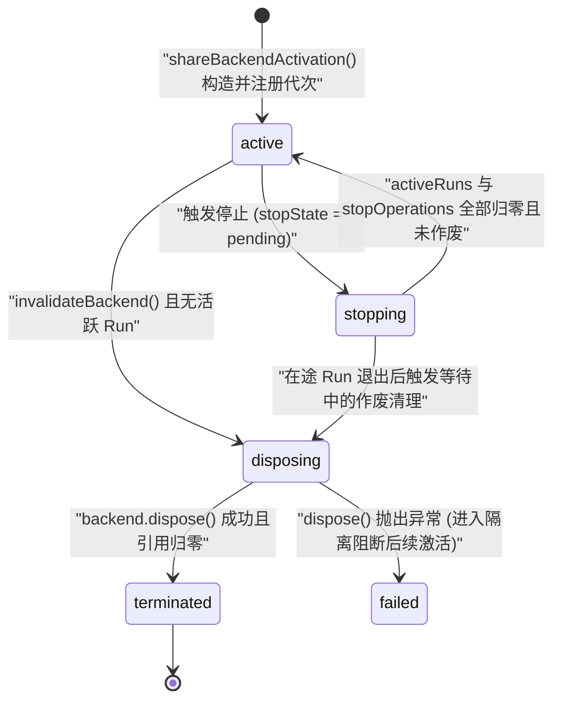

# 设计模式与架构权衡：工业级 Agent 内核的十大工程取舍

[返回手册目录](../README.md)

软件架构的本质是在相互冲突的工程约束之间做清醒的取舍。对于单人、单进程、纯内存运行的脚本型 Agent，开发速度与极简依赖是第一优先级；而对于需要支撑多客户端实时协同、工具沙箱隔离、热切换模型配置、崩溃后不重复外部副作用以及平滑升级的工业级基础设施，每一行看起来“克制甚至严苛”的接口契约背后，都在精准拦截一类真实的生产故障。

本章系统总结支撑 Maka 稳定运行的**十大核心架构权衡**。对每一项决策，我们都将直白地回答三个问题：**不这样做会出什么并发或一致性故障？Maka 选择了什么机制？我们为此付出了怎样的工程代价？**

---

## 1. 单一 State Root 写入权威 vs 多端直连数据库

- **痛点与故障推演**：当 Desktop、TUI、Bot 和评测脚本同时操作同一个工作区时，即便 SQLite 开启 WAL 模式，多进程直连依然会导致内存态 `SessionHeader` 缓存互相覆盖、流式中间片段无处广播以及后台子进程脱离单一生命周期管辖。
- **Maka 的选择**：以随机 `rootId` 与文件系统 `(dev, ino)` 绑定定义 **State Root**，通过账号本地命名空间上的排他 OS 文件锁确立唯一的 **`InteractiveRootOwner`**；所有接入端全部退化为客户端，通过统一协议访问唯一的 `RuntimeHostKernel`，并用 `HostResidencyRegistry` 精确拆分 `idle`（阻止空闲退出）与 `drain`（阻止排空与升级）两类驻留。
- **收益与代价**：彻底根除了跨客户端写脑裂，统一了凭据与子进程回收边界；代价是引入了本地 IPC/WebSocket 传输开销，必须额外治理按需启动（Ephemeral）宿主的握手竞争与退出排空死线。

---

## 2. 短时准入闸门 + 长执行句柄 + `SteeringLease` vs 贯穿全轮的互斥大锁

- **痛点与故障推演**：如果从收到消息到模型流彻底结束始终占有一把排他锁，用户在几十秒的等待期间将无法点击“停止”、无法发起运行中插话引导（Steering），甚至无法同时读取另一会话。反之，如果完全无锁，并发请求就会同时开启两个主回合。
- **Maka 的选择**：将互斥区间压缩到毫秒级的 **`SessionAdmissionGate`** 与 **`RootAdmissionOwner`** 持久链校验中；一旦进入模型流便立即释放准入短锁，转为由 `RootTurnCoordinator` 持有长执行的 `{ snapshot, completion, settled }` 句柄与 `drain` residency。对于运行中插话，不在锁外乱改内存数组，而是在每个模型步进边界通过 **`SteeringLease`**（`pullSteering` → `ackSteering` / `nackSteering`）完成原子交割——只有确认 `steering_message` 事实已落盘并进入注射集才算 `ack`，否则 `nack` 退回队列。
- **收益与代价**：兼具高并发响应性与严格的顶层单执行保证；代价是每个业务入口必须一丝不苟地衔接“预留槽位 → 持久化意图 → 驻留句柄”，不能把游离的异步 Promise 漏在生命周期外。

---

## 3. 可插拔 `AgentBackend` 端口 vs 硬编码内嵌模型循环

- **痛点与故障推演**：Maka 既需要内置支持 Anthropic/OpenAI/Google/Codex 的 AI SDK 多步循环，也需要挂载遵循 ACP（Agent Client Protocol）的外部代理插件（如 `@maka/antigravity-acp-plugin`），还要在测试中注入确定性的 `FakeBackend`。若 `RuntimeKernel` 直接耦合具体模型 SDK，每新增一种执行后端都要重写一遍 Run 账本、终态密封与取消路由。
- **Maka 的选择**：在 `@maka/core` 中定义极窄的 `AgentBackend` 端口（核心方法为 `prepareRunComposition?`、`send`、`compactHistory?`、`stop(reason, mode?)`、`respondToSandboxBoundary`、`respondToUserQuestion?`、`dispose`）。并在入站边界使用 `BackendSessionEvent` 显式剔除归属内核或 Host 专享的事件（如 `queue_update`、`message_admission`、`client_capability_request` 以及已退役的 `permission_*` 旧词汇）。
- **收益与代价**：`SessionManager`、`RuntimeKernel` 与 `AgentRun` 的终态裁决、权限交互路由与账本逻辑 100% 跨后端复用；代价是 `AiSdkBackend` 与插件之间仍需经过 `SessionEvent → RuntimeEvent` 确定性映射器，增加了新事件类型的双端对齐维护成本。

---

## 4. `BackendGeneration` 并发代次隔离 + `AiSdkTurn` 短命闭包 vs 单例可变 Backend

- **痛点与故障推演**：长寿命 `AiSdkBackend` 承载了模型路由、工具目录与连接状态（维持供应商 Prompt Cache 命中率）；但当用户在会话进行到一半时切换了模型配置（触发 `invalidateBackend`），或在点击停止后毫秒级发起新一轮提问时，旧后端的 `dispose()` 与新请求的 `send()`、甚至先后重叠的两次 `runId` 如果共享可变字段，先退出的任务会误删后继任务的 `currentRunId` 或把请求发到已被销毁的后端。
- **Maka 的选择**：Maka 在 `RuntimeKernel` 实施了极其严密的**双层时空隔离**：
  1. **纵向代次状态机（`BackendGeneration`）**：每次构造后端都分配单调递增的 `generation` 号，严格处于五种阶段之一：`'active' | 'stopping' | 'disposing' | 'failed' | 'terminated'`。通过 `shareBackendActivation` 合并并发冷启动；当代次进入 `stopping` 或 `disposing` 隔离区（Quarantine），或仍被 `activeRuns` / `stopOperations` 引用时，新激活必须等待其彻底安全落幕才能推进；所有派发（`assertRunCanDispatch`）在进入后端前再次校验当前 `generation` 仍是唯一活跃代次且未停止。
  2. **横向单轮闭包（`AiSdkTurn`）**：每次 `send()` 都独立构造全新的 `AiSdkTurn` 实例，将 `runId`、`AbortSignal`、`ToolRuntime` 与看门狗完全锁死在单轮闭包内，长寿命 `AiSdkBackend` 不持有任何 `currentRunId`。



- **收益与代价**：既保住了跨轮次的 Prompt Cache 连续性，又彻底根除了热切模型与快速重入时的并发竞态；代价是 `RuntimeKernel` 内部需要维护复杂的代次引用计数、隔离区等待及停止操作重试链路。

---

## 5. `ModelCallCommit` 单值原子打包提交 + `supersedesLatestContext` 确定性决胜

- **痛点与故障推演**：每次物理模型调用结算时，系统既要记录本次 `ModelCallAttempt`（Token 用量与费用归属），又要更新面板展示用的 `latest_context` 上下文诊断快照。如果分两次独立写库，中间进程崩溃或参数传递遗漏会造成**“费用账本记了第 2 次请求，诊断视图却停在第 1 次请求”**的数据撕裂；更隐蔽的是，JavaScript 函数若用多个位置参数传递，中间层少转发一个参数不会报类型错，只会悄悄在生产环境丢失快照！此外，重叠轮次在不同队列上并发完成时，“后到达写库”不等于“后完成请求”。
- **Maka 的选择**：
  1. **单值强类型对象打包（`ModelCallCommit<TAttempt>`）**：强制将 `{ attempt, latestContext }` 封装成单一不可分割对象参数，并在 `AgentRunStore.appendEvent(..., { durable: true, latestContext })` 的同一个底层数据库事务中原子落盘。只要中间转发层漏掉属性就会触发编译期报错。
  2. **确定性决胜算子（`supersedesLatestContext`）**：永远以 `completedAt`（完成时间）而非到达时间排序；当两个调用完成毫秒数完全一致时，引入 **`attemptId` 字典序作为无歧义决胜位（Tie-breaker）**。在线实时提交与离线冷重建（及受 `ifLedgerRevision` CAS 保护的修复路径）严格调用同一份纯函数，确保暖读与重建永远得出完全一致的“最新视图”。

- **收益与代价**：彻底消灭费用计量与诊断快照的不一致及并发乱序覆盖；代价是存储契约必须围绕领域原子事务设计，不能退化为简单的单表 CRUD 接口。

---

## 6. T1/T2 工具两段提交与显式 `Unknown Outcome` vs 盲目自动重试

- **痛点与故障推演**：执行本地文件修改、外部 API 调用或经客户端反向代理（Client Capability）触发本地工具时，存在最危险的崩溃窗口（对应恢复目录中的 `P2–P4` 故障点）：工具刚刚向外部世界发出了修改请求（或客户端刚跨越宿主下发的 `admitted` 授权切点），还未来得及向账本提交结果，宿主进程就崩溃或连接突然断开。如果恢复引擎在不知道副作用是否已经发生的情况下自动重试，就会导致重复扣款、重复提交 PR 或破坏工作区文件。
- **Maka 的选择**：拒绝制造“任意外部副作用都能自动 Exactly-Once”的幻觉，建立**边界密封 + 显式未知结果（Explicit Unknown Outcome）**机制：
  1. **先提交 T1 再执行副作用**：`ToolRuntime` 在通过前置检查后、真正执行高风险实现前，先提交非模型可见的 `toolDispatch` 事实（协议 `t1_after_preflight_v1`），绑定基于 `(invocationId, providerToolCallId)` 计算的确定性 `operationId`、规范参数哈希 `canonicalArgsHash` 与恢复策略（`ToolOutcomeRecoveryMode: 'never_auto_retry' | 'outcome_unknown'`）。执行完成后在 `T2` 事务原子提交 `function_response` 与结果期刊。
  2. **越过切点即锁死重试**：对于 Client Capability 反向调用，Broker 严格区分 `accepted`（仅收到接收回执）与 **`admitted`**（Host 批准执行外部副作用）。`admitted` 之前断线报告 `capability_lost`；一旦越过 `admitted` 或重启扫描发现已过 `T1` 但无 `T2` 的 `outcome_unknown` 记录，系统抛出 `ToolOutcomeUnknownError` 或由 `recoverClientCapabilityOutcomes()` 写入标记 `uncertainOutcome: { code: 'outcome_unknown', retrySafe: false }` 的错误响应，**坚决禁止自动化任务或无监督续跑（`allowPriorUnknownToolOutcomes` 为 false）假装其结果已知并自动重跑**。

```mermaid
sequenceDiagram
    participant Turn as "AiSdkTurn / ToolRuntime"
    participant Store as "RuntimeEventStore (SQLite)"
    participant Broker as "ClientCapabilityBroker / ToolImpl"

    Turn->>Store: 1. T1 事务: 提交 toolDispatch (operationId + argsHash)
    Note over Turn,Broker: 危险崩溃窗口 P2-P4 开始 (副作用可能正在外部生效)
    Turn->>Broker: 2. 发起执行 -> 等待 accepted -> Host 校验并下发 admitted
    alt 正常结算路径
        Broker-->>Turn: 返回执行结果
        Turn->>Store: 3a. T2 事务: 原子提交 function_response + journal
    else 进程崩溃重启 或 admitted 后断线超时
        Note over Store,Broker: 无法确认外部副作用是否已完成!
        Store-->>Turn: 3b. 抛出/收敛为 outcome_unknown (retrySafe: false)
        Note over Turn: 严禁自动重试; 仅人类显式发起新轮次时可见该不确定事实
    end
```

- **收益与代价**：彻底杜绝了崩溃恢复时的重复破坏性副作用；代价是必须引入严格的 `ToolLedgerScanner` 依赖闭包扫描与上层人工确认/对账流程。

---

## 7. 协作边界热交接（Handoff）+ 安全边界续跑 vs 任意点快照强切

- **痛点与故障推演**：版本升级或重启替换 Host 时，如果强行把正在进行中的 LLM SSE 网络流、嵌套异步回调函数或运行中的 PTY 进程序列化“热迁移”到新进程，任何底层 Socket 状态丢失都会导致无解的半残状态。
- **Maka 的选择**：放弃任意指令行热迁移，采用**可持久化的步进边界交接（Cooperative Handoff）+ 安全边界续跑（Safe Boundary Continuation）**：
  1. 旧 Host 收到升级准备指令后，冻结新准入与定时/Goal 调度器；正在运行中的 `AiSdkTurn` 推进到下一个安全步进点（所有前序模型与工具事件均已落盘）时，调用 `handoffBoundary()` 收到 `'pause'` 信号，写入不代表 Turn 完结的 `runtime_handoff_pause_v1` 封印与 `continuation_start_v2` 预申领。
  2. 旧 Host 必须向 `RuntimeHostKernel` 证明交接句柄完整覆盖了当前所有活跃的 **`drain` residencies**（验证句柄集合相等，绝不凭计数相等蒙混过关），再原子提交不可逆切点并释放写租约。
  3. 新 Host 接管租约后，重新校验 `claimId`、`boundaryDigest` 以及模型输入/Prompt/工具集兼容性（`prepareRunComposition`），以同一 `turnId` 开启全新的 `invocationId` 与 `runId` 继续推进。
- **收益与代价**：在不牺牲状态可验证性的前提下实现了长任务零感升级续跑；代价是当存在不可协同暂停的插件或长耗时本地工具时，Handoff 可能超时退回等待而无法保证 100% 瞬间切换。

---

## 8. 事件溯源双账本 + 有界 `partial` 快照 vs 原地更新或无界流日志

- **痛点与故障推演**：如果直接原地 `UPDATE messages` 表，上下文裁剪或压缩一旦触发就会永久销毁原始审计证据；但如果把流式输出中每秒几十次的 `text_delta` 全部作为永久行插入账本，一次长对话就会制造数万条碎片垃圾，拖垮恢复扫描和投影计算。
- **Maka 的选择**：以 `RuntimeEvent` 只追加不可变脊柱记录语义真源，以 `AgentRunEvent` 记录伴生计量与诊断；流式期间的 `partial: true` 片段不无限追加，而是由 `RuntimeEventStore` 合并维护有界可变呈现快照（mutable presentation snapshot），待最终 `non-partial` 事件落盘时一次性覆盖其语义位置。消费侧按需通过 `RuntimeReadModel` 与带 watermark 校验的有界分页器（`session-transcript-pager`）按需物化视图，任何缓存损坏均可 Fail-Closed 并在修复后从不可变账本无损重算。
- **收益与代价**：兼顾了无损历史审计、低存储膨胀与秒级断线重连对齐；代价是在演进期需要同时维护兼容性 `SessionStore` 投影与双账本之间的读取优先级协调。

---

## 9. 闭合判别联合 + Fail-Closed Schema vs 宽松可选字段结构体

- **痛点与故障推演**：在持久日志与跨语言（如 `@maka/eval` 的 Python 导出器）对接中，宽松的可选字段结构体极易产生“半残缺状态”或“静态字段漂移”——某个导出器漏掉了新加的 `origin` 或 `modelVisibility` 字段却毫无报错，直到生产线上所有事件校验批量失败。
- **Maka 的选择**：在核心语义域全面采用闭合判别联合（如 `RuntimeInvocationRootAuthority`、`RuntimeInvocationOpenSource`、`RuntimeInvocationRoute`、`HostHandshakeResult`），并用 `defineObjectShape` + `hasExactShape` 对反序列化执行严格键集核对；导出 `runtimeEventEnvelopeKeys()` 与 `runtimeEventEnvelopeValueDomains()` 作为跨语言测试锚点。而在确实需要跨版本兼容的伴生运维账本 `AgentRunEvent` 上，则巧妙实施**“写严格（`EmittedAgentRunEvent` 闭合目录）、读开放（`type: string` 容忍未知或退役事件）”**的双向分离契约。
- **收益与代价**：在编译期和解码边界提前拦截 99% 的状态漂移；代价是每当结构需要调整时，必须显式升级协议常量与兼容解码分支。

---

## 10. TS 控制面 + 原生 Rust 加速与安全围栏（Hybrid TS/Rust Boundary）

- **痛点与故障推演**：如果全盘使用 Node.js/TypeScript，面对大型 Git 工作区遍历与大小写折叠检查（`MANAGED_TREE_POLICY_V3`）、QUIC/WebRTC Direct P2P 穿透打洞以及 Windows 无窗服务与 Job Object 内核级进程树清理时，不仅性能捉襟见肘，还受限于系统工具链差异与安全边界漏洞；但若把快速迭代的模型适配、AI SDK 生态、MCP 协议与 Electron 业务全量重写为 Rust，研发敏捷度将大幅下降。
- **Maka 的选择**：只将三类高密度/系统级边界下沉至 `native/` Rust Crate，并用极窄的边界将其与 TS 主体隔开：
  - `maka-gitoxide-helper`：通过零 `argv`、清空 `PATH`、固定内存与树深上限的短生命期子进程隔离不可信仓库读取；
  - `maka-runtime-host-peer`：通过 N-API 动态库封装 `libp2p` / `webrtc-rs` 及跨平台进程启动身份核验；
  - `maka-runtime-host-windows-task-launcher`：用极简无窗原生 `.exe` 加上 `JOB_OBJECT_LIMIT_KILL_ON_JOB_CLOSE` 守护 Windows 托管服务进程树。
- **收益与代价**：在保留 TypeScript 高速迭代优势的同时，精准获得了系统级安全性与原生性能；代价是引入了三平台 Rust 工具链编译、N-API ABI 打包及跨进程边界的严格校验成本。

---

## 教学伪代码：核心并发与原子提交模式集成

以下伪代码浓缩展示了 `ModelCallCommit` 单值原子提交、`supersedesLatestContext` 确定性决胜以及 `T1/T2` 边界保护在实际内核中的配合方式：

```text
// 1. ModelCallCommit 单对象原子提交与确定性时序比较
function commitModelCallAttempt(agentRunStore, sessionId, runId, attempt, snapshot):
    // 打包为一个不可分割值对象，防止调用链静默丢弃快照
    commit = {
        attempt: attempt,
        latestContext: {
            attemptId: attempt.attemptId,
            orderedAt: attempt.completedAt,
            snapshot: snapshot
        }
    }

    // 同一 SQLite 事务内原子写入计量事件与派生最新上下文
    await agentRunStore.appendEvent(sessionId, runId, {
        type: "model_call_attempt_recorded",
        id: attempt.attemptId,
        data: attempt
    }, { durable: true, latestContext: commit.latestContext })

function supersedesLatestContext(candidate, incumbent):
    if incumbent == null:
        return true
    // 永远按请求真实完成时间裁决，忽略异步队列的到达先后
    if candidate.completedAt != incumbent.completedAt:
        return candidate.completedAt > incumbent.completedAt
    // 完成时间戳完全相同时，用不可变的 attemptId 字典序做确定性决胜
    return candidate.attemptId > incumbent.attemptId

// 2. T1/T2 工具执行边界与显式 outcome_unknown 收敛
function executeToolWithBoundary(toolRuntime, toolCall, commitSink, impl):
    operationId = buildToolOperationId(toolCall.invocationId, toolCall.providerToolCallId)
    argsHash = canonicalToolArgsHash(toolCall.name, toolCall.args)

    // 跨越副作用前的不可逆 T1 事务提交
    await commitSink.commitToolPrepared({
        operationId,
        toolName: toolCall.name,
        canonicalArgsHash: argsHash,
        recoveryMode: toolRuntime.recoveryModeFor(toolCall.name) // "never_auto_retry" | "outcome_unknown"
    })

    try:
        output = await impl.execute(toolCall.args)
        await commitSink.commitToolOutcome({
            operationId,
            outcome: "success",
            result: output
        })
        return output
    catch err:
        if err instanceof ToolOutcomeUnknownError:
            // 例如 Client Capability 在收到 admitted 后断线: 绝不重试，直接封存不确定事实
            await commitSink.commitToolOutcome({
                operationId,
                outcome: "error",
                isError: true,
                uncertainOutcome: { code: "outcome_unknown", retrySafe: false }
            })
        throw err
```

---

## 十大核心架构权衡全景对照表

| # | 架构决策 | 防范的核心故障 | 付出的工程代价 | 适用场景边界 |
| :--- | :--- | :--- | :--- | :--- |
| **1** | **Single Host Authority**<br/>(单根 OS 锁 + 唯一宿主) | 多端并发写导致状态脑裂与文件锁死 | 本地 IPC 开销、宿主启停与 `idle`/`drain` 驻留治理 | 多入口本地工作区平台；单次纯内存 CLI 无需此重量。 |
| **2** | **短准入闸门 + `SteeringLease`** | 长锁阻塞取消操作、插话消息丢失或重复注入 | 入口需严格追踪 `reservation` 与租约 ACK 闭环 | 支持中断、运行时插话与多路排队的交互式 Agent。 |
| **3** | **窄 `AgentBackend` 端口** | 运行内核深度绑定特定厂商 SDK 或插件 | 需维护 `SessionEvent → RuntimeEvent` 确定性映射层 | 需同时容纳内置模型、外部 ACP 插件与测试替身。 |
| **4** | **`BackendGeneration` + `AiSdkTurn` 隔离** | 热切模型配置或重叠轮次引发状态踩踏 | Kernel 需维护 5 态代次机、并发合并与隔离区 | 支持长连接 Prompt Cache 复用与运行中配置热切换。 |
| **5** | **`ModelCallCommit` + 确定性决胜** | 费用账本与上下文快照撕裂、并发乱序覆盖 | 存储层需暴露领域级原子事务而非裸 CRUD | 需要精确成本核算与高频上下文窗口诊断的系统。 |
| **6** | **T1/T2 两段边界 + `outcome_unknown`** | 崩溃窗口与断线后盲目重试引发重复外部副作用 | 不能承诺任意外部副作用 Exactly-Once，需显式对账 | 涉及写文件、Shell 执行或端侧代理的高风险操作。 |
| **7** | **协作边界 Handoff + 安全边界续跑** | 强行热迁移活跃网络流或子进程导致状态残缺 | 依赖可验证输入基线、精确驻留证明，且存在超时退避 | 需要版本升级不中断长推理任务、崩溃后可靠续跑。 |
| **8** | **事件溯源双账本 + 有界 `partial`** | 上下文裁剪销毁审计、流式碎片撑爆日志表 | 需协调派生快照、游标分页与旧表兼容优先级 | 长寿命可追溯会话与多端断线精确补帧。 |
| **9** | **闭合判别联合 + 读写非对称兼容** | 可选字段猜错分支、跨语言导出字段静默漂移 | Schema 变更必须显式版本化与维护迁移解码 | 多组件协同、离线评估对接与长期存储格式演进。 |
| **10** | **TS 控制面 + 原生 Rust 安全围栏** | JS 路径折叠绕过、OOM、缺乏成熟 P2P/Win32 原语 | 跨平台 Cargo 构建链、N-API 打包与进程边界核验 | 需同时兼具 AI 生态敏捷性与操作系统底层安全隔离。 |

---

## 工程判断与架构选型指南

阅读完上述十大权衡后，最关键的架构师判断不是“全部照抄”，而是**按系统演化阶段识别边界**：

1. **什么时候必须引入 Maka 式的重型不变量？**
   当你的 Agent 跨越以下三条临界线之一时，上述机制不再是“过度设计”，而是维持系统不崩盘的底线：
   - **多宿主/多界面并发**：同时存在桌面端、CLI、定时任务或自动化 Bot 访问同一批本地会话；
   - **有副作用的外部工具**：工具不再只是查天气或读网页，而是会修改本地代码仓库、操作真实桌面 GUI 或经由客户端发起外部系统变更；
   - **跨重启与长周期**：单次任务动辄数十分钟，用户绝不接受“关掉窗口或升级客户端后进度归零或账本损坏”。
2. **什么时候应当刻意保持克制（参考 Pi 模式）？**
   如果你只需要一个单进程、人类眼盯屏幕交互、每次执行生命周期等同于当前终端生命周期的轻量编码助手，那么嵌入当前进程的串行状态机（无常驻 Host IPC、无代次状态机、直接本地消息持久化）反而拥有更低的启动延迟、更简单的心智模型与更高的调试效率。

---

## 延伸阅读

- 深入理解 `BackendGeneration` 与 `AiSdkTurn` 在销毁时的并发清理与隔离细节，阅读 [01.2 会话与执行对象的生命周期](../01-runtime/session-lifecycle.md)。
- 详细剖析崩溃窗口 `P0-P11`、工具 `T1/T2` 事务与安全边界续跑算法，阅读 [04.1 持久化执行与崩溃恢复](../04-state/durable-execution.md)。
- 探索协作式热交接（Handoff）的不可逆切点与跨端订阅补帧协议，阅读 [04.2 Host 所有权与多端同步](../04-state/host-ownership-and-sync.md)。
- 了解 `AgentBackend` 如何支持外部 ACP 插件动态装载与生命周期治理，参阅 [01.5 插件平台与 ACP 运行时](../01-runtime/plugin-and-acp-runtime.md)。
- 深入对比 Maka（托管服务微内核）与 Pi（嵌入式轻量循环）的架构路线差异，阅读 [07.1 Agent 内核架构宏观对比](../07-comparison/overview.md)。
- 探索记忆提取、跨平台导入导出以及 Goal/Plan/EventWait 等高阶调度编排，参阅 [02.3 长期记忆与会话可移植性](../02-context/memory-and-session-portability.md) 与 [05.3 目标、计划与事件等待](../05-coordination/goals-plans-and-event-waits.md)。
