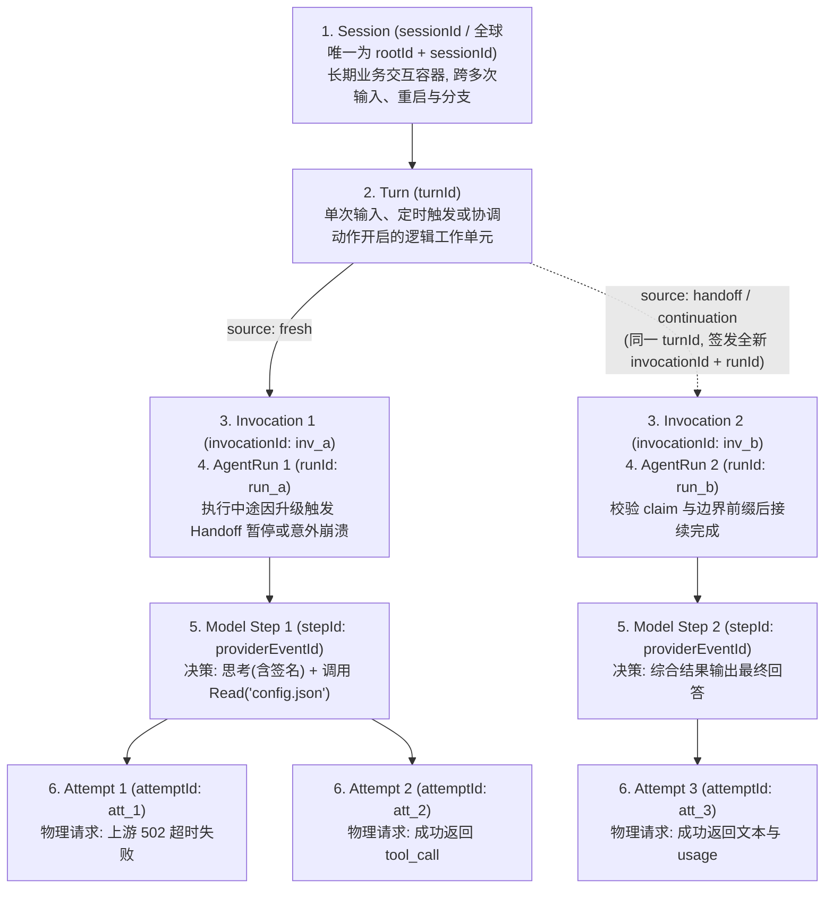
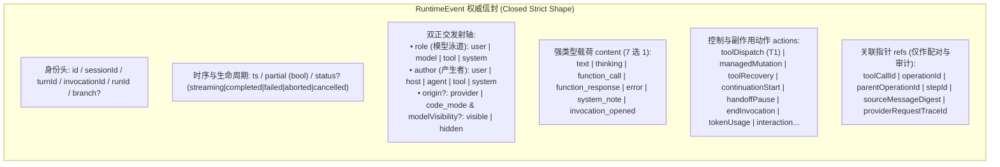

# 领域对象模型：六层身份、判别联合与双账本无损重建

[返回手册目录](../README.md)

在构建普通的问答机器人时，开发者往往只需要两个字段：`sessionId`（区分对话窗口）和 `messageId`（区分消息气泡）。但一旦 Agent 迈入真实工程环境——支持多步工具调用、HTTP 网络波动重试、运行中插话引导（Steering）、进程崩溃后的安全边界续跑（Continuation）、升级时的无中断协作交接（Handoff）以及多 Agent 协作图——这两个 ID 会在瞬间土崩瓦解。

系统必须能够毫不模糊地回答以下工程拷问：
- “模型调用第 3 次网络超时重试，算不算消耗了一次逻辑推理步数？”
- “进程强杀重启后接续跑完的这一段对话，是用户新开了一轮，还是同一轮逻辑任务的物理延续？”
- “当用户在中途切换了大模型，历史日志里第 2 轮的那笔 Token 账单究竟该按哪个连接与价格表结算？”

Maka 通过**六层正交身份体系**、**基于闭合判别联合的 `invocation_opened` 开篇事实**以及**`RuntimeEvent` vs `AgentRunEvent` 双账本结构**，从数据模型源头彻底消除了上述歧义。

---

## 1. 概念先行：逻辑工作、物理执行与双账本分离

Maka 领域模型最底层的核心抽象可以概括为三条公理：

1. **逻辑工作（Turn）与物理执行（Invocation / Run）解耦**：用户看到的一次完整提问与答复是一个逻辑 `Turn`；而在底层执行世界里，这个 `Turn` 可能先后经历崩溃续跑或热交接，跨越多个物理 `Invocation` 与 `AgentRun`。
2. **语义事实（`RuntimeEvent`）与运维计量（`AgentRunEvent`）双账本分离**：`RuntimeEvent` 是严格密封、只追加的对话与控制流语义脊柱；`AgentRunEvent` 是伴生于一旁的运维、请求重试、上下文诊断快照与计量账本。两者通过 `runId` 关联，但拥有截然不同的 Schema 演进策略。
3. **状态是日志的函数（Log Is the Source of Truth）**：不存在脱离事件脊柱而独立修改的“可变 Run 头表”。任何时刻的 Invocation 清单、终止状态和会话正文，都必须能仅凭不可变事件流确定性无损重建。

---

## 2. 故障推演：身份混淆与单表耦合会带来什么灾难？

1. **灾难一：将 `turnId` 与 `runId` 强行绑定为 1:1**
   - *后果*：若系统在执行到一半时因版本升级触发协作式交接（Handoff），或因进程崩溃进入 `safe_boundary_continuation` 续跑。如果逻辑 `Turn` 和物理 `Run` 共用同一个身份，要么新实例被当作“重复执行同一 ID”被数据库幂等拒绝，要么旧的半截记录被新写入强行覆写，导致界面上出现两段互相矛盾的回复或丢失源头审计。
2. **灾难二：将 HTTP 请求重试与模型逻辑步进（Step）混为一谈**
   - *后果*：一次模型调用因为上游 502 错误在 SDK 底层退避重试了 3 次。如果每次重试都产生一个 Step，不仅会无端耗尽 `maxSteps` 上限，更致命的是：当带有加密签名（Signature）的 Thinking 内容跨步回放时，模型无法区分哪个片段属于哪个决策步进，引发 Provider 严格校验报错。
3. **灾难三：用“可选字段大杂烩”表达执行开篇状态**
   - *后果*：如果把 `goalId`、`scheduledTaskId`、`parentRunId`、`sourceInvocationId` 全堆在一个接口里设为 `optional`，业务层很快就会写满脆弱的 `if (x.parentRunId && !x.goalId)` 猜测代码。每当新增一种触发源（如 Supervisor Wake），所有老判断逻辑都会静默漏判，引发致命的越权执行。
4. **灾难四：将语义对话历史与操作诊断埋点塞进同一张闭合 Schema 表**
   - *后果*：运营面板经常需要增删诊断埋点（例如新增或退役某类耗时统计事件）。如果它和模型交互日志共享同一个严格闭合枚举校验，新版本写下的一条新诊断记录会导致旧版本工具在扫描会话时全盘拒绝解码；或者为了省 Token 裁剪消息时把计费明细一并删掉。

---

## 3. 核心机制一：六层执行身份与全局不换用标识



### 六层身份的精确职责定义

| 层级 | 身份标识字段 | 作用域与核心语义 | 生命周期与跨越规则 |
| :--- | :--- | :--- | :--- |
| **1. Session** | `sessionId`（产品级二元组为 `(rootId, sessionId)`） | 长期存在的业务上下文与对话容器；另保留 `maka_workspace_authority` 等控制面专用流，与普通会话完全隔离。 | 跨越数天乃至数月的多轮问答、主机重启与会话导入；不同 State Root 下的同名 `sessionId` 绝不代表同一份工作。 |
| **2. Turn** | `turnId` | 由用户输入、定时任务或外部协调触发开启的**逻辑任务回合**，也是 UI 界面与续跑模型对齐的主锚点。 | **在崩溃续跑（Continuation）与协作热交接（Handoff）期间保持不变**；一个 `Turn` 可跨越多个物理执行实例。 |
| **3. Invocation** | `invocationId` | **物理执行事件脊柱（Event Spine）**，由 `invocation_opened` 确立起点，由首个非 `partial` 终态事件密封结束。 | 每次全新启动、重启续跑或热交接都会生成全新的 `invocationId`；另保留 `transcript-*` 前缀仅用于遗留转录转换归档。 |
| **4. Run** | `runId` | 单次物理执行在运营管理面（`AgentRun`）中的**生命周期封套与计量归属单位**。 | 当前主链中一个物理执行 1:1 分配一组 `(invocationId, runId)`；但语义正交——`Invocation` 负责血缘与协议脊柱，`Run` 负责 Token 计量、并发控制与操作账本。 |
| **5. Model Step** | `stepId` | 模型循环内的一次**决策步进及其关联的工具调用集**。 | 通过 `refs.stepId` 指向本 step 产出的文本/Thinking 的 `providerEventId`，确保带有加密签名的思考内容与后续 `function_call` 在 Replay 时成对还原。 |
| **6. Attempt** | `attemptId` | 为推进某一步骤或执行手工压缩（`compactHistory`）向模型供应商发起的**单次物理 HTTP/Stream 调用**。 | 记录为 `ModelCallAttempt`（含 `usageBasis`、`costBasis`、`completedAt`）；重试只增加 `Attempt`，不推进 `Step`，也不计入 `maxSteps`。 |

### 宿主与接入层不可互换的边界标识

除了执行链条的六层身份，Host 与客户端接入层面还有六组严禁混用的生命周期标识：
- **`rootId`**：State Root 在 `.maka-storage-root.json` 中的随机持久身份，协议中的 Host 逻辑身份（绝非本地文件路径）。
- **`HostEpoch`**：当前正在运行中的 Host 进程实例 UUID；每次进程重启都会生成全新 `HostEpoch`，客户端借此识别事件流代际断层。
- **`Composition ID & Revision`**：允许解释该 State Root 的程序组合标识与修订号；`Composition ID` 持久绑定在 `.maka-host-composition.json`，不因普通版本升级而改变。
- **`Host Generation`**：部署/客户端希望拉起的本地运行时安装代际；用于本地升级仲裁，不等同于通信协议版本号（`compatibilityEpoch`）。
- **`targetEpoch`**：Desktop 端在维护多 Host/多目标连接时为当前连接目标分配的生命周期代际，用于彻底拦截旧连接的迟到异步回调。
- **`PeerId`**：Peer Mesh 网络端点的密码学密钥身份；它既不是 IP 地址，也不等同于 `rootId`、`HostEpoch` 或操作授权。

---

## 4. 核心机制二：`RuntimeEvent` 权威信封与双正交轴

`RuntimeEvent` 是 Maka 唯一内部标准运行时语义事实模型（Canonical Runtime Fact Model）。它既不是直接给 React 渲染用的前端 `SessionEvent`，也不是诊断追踪行 `RunTrace`。



### 为什么 `role` 与 `author` 必须正交？

大多数简单框架把 `role` 直接当作事件产生者，但在工业级 Agent 中这很快就会捉襟见肘。Maka 将这两个概念拆成两个正交维度：
- **`role`（`user | model | tool | system`）**：回答**“这条事实在拼装大模型输入上下文时应该进入哪个历史泳道？”**
- **`author`（`user | host | agent | tool | system`）**：回答**“运行时内部究竟是哪个子系统制造了这条事实？”**

这种正交切分极其优雅地表达了复杂的控制流语义：
- **用户批准沙箱边界扩展**：该决策由人做出，但在上下文语义中它是引导系统的规则变更，因此记录为 **`role: 'system'`, `author: 'user'`**，完全不需要把它伪装成一条奇怪的聊天文本。
- **Host 自动注入的定时任务或引导输入**：虽然触发者是 Host，但模型需要把它当作一条任务指令来响应，因此记录为 **`role: 'user'`, `author: 'host'`** 并附带 `TurnOrigin` 溯源标记。
- **流式分片（`partial: true`）与最终收敛**：流式文本与思考增量通过有限的 `partial` 快照向客户端实时展示；所有构造大模型输入（Model History Projection）和恢复状态机的逻辑**必须无条件排除 `partial === true` 的事件**。

### `content` 与 `actions` 的关键契约

1. **7 种闭合 `RuntimeEventContent`**：
   - `text`：支持 `interrupted: true`（标记流失败残留片段：界面保留显示，模型重放绝不携带）、`steering: true`（标记在步进边界插入的引导文本：原文留给 UI，模型投影必须包裹进唯一规范化 Steering 信封）以及 `runtimeContextName`。
   - `thinking`：携带 `signature`（例如 Anthropic 签名思考块）与 `providerOptions`，回放时必须原封不动回传。
   - `function_call` & `function_response`：通过配对 ID 关联，`function_response` 携带 `outcome: 'success' | 'error' | 'aborted'`、原始 `providerOutput`（供原厂协议重放）与冻结的跨模型中立投影 `modelProjection`（`DurableToolResultProjection`）。
   - `error`、`system_note`（仅作会话内记事，绝不发给模型）以及 `invocation_opened`。
2. **关键控制动作（`RuntimeEventActions`）**：
   - `toolDispatch`（`t1_after_preflight_v1`）：工具通过前置预检、即将产生外部副作用前提交的不可变 T1 边界事实，绑定唯一确定性 `operationId`、参数规范哈希 `canonicalArgsHash` 与恢复模式 `recoveryMode`；受管工作区修改还会附带 `managedMutation`（`managed_mutation_v2`）与冻结的执行配置摘要。
   - `continuationStart`（`continuation_start_v2`）：接续新 Run 开启前提交的权威证明，绑定 `claimId`、`boundaryDigest` 与 `replayManifestDigest`。
   - `handoffPause`（`runtime_handoff_pause_v1`）与 `endInvocation`：前者声明物理执行优雅让出控制权（不代表逻辑 `Turn` 结束），后者或终态 `status` 声明物理执行彻底密封收官。
3. **跨语言零漂移防御**：为了防止外围工具（例如 `@maka/eval` 的 Python Harbor 导出器）重新实现校验逻辑后随版本发生字段遗漏，`runtime-event.ts` 显式导出 `runtimeEventEnvelopeKeys()` 与 `runtimeEventEnvelopeValueDomains()` 作为全仓库的单一契约真源，并在构建测试中做全集覆盖校验。

---

## 5. 核心机制三：`invocation_opened` 的闭合法典与精确血缘

每一次非控制面的物理执行在调度模型或调用任何工具之前，必须向 `RuntimeEventStore` 写入一条 `modelVisibility: 'hidden'` 的开篇事实：`invocation_opened`（`protocol: 'invocation_opened_v1'`）。它就像一张不可篡改的“执行出生证明”，固化了五个维度的元信息：

| 构件字段 | 枚举与判别分支 | 工程目的与护栏意义 |
| :--- | :--- | :--- |
| **`route`**<br/>（`RuntimeInvocationRoute`） | • `{ provenance: 'runtime', backendKind: 'ai-sdk' \| ..., llmConnectionId, modelId, providerStateIdentity? }`<br/>• `{ provenance: 'runtime', backendKind: 'plugin-executor', executorId, modelId, providerStateIdentity }`<br/>• `{ provenance: 'unknown', ... }` | 锁定本次物理执行到底经过了哪条模型连接或外部插件激活代次；`unknown` 为历史迁移数据的 **Fail-Closed** 标记——历史文本可读，但任何逻辑不得把它当成已认证路由继续调用。 |
| **`configuration`**<br/>（`RuntimeInvocationConfiguration`） | `cwd`, `permissionMode`, `collaborationMode`, `orchestrationMode`, `orchestrationSource`, `toolMode`, `agentSwarmAuthorization?`, `workspaceIdentity?` | 防止用户在中途切换工作区权限或协作模式后，导致回溯历史时无法解释第 2 轮工具当时为何被放行或拒绝。 |
| **`root`**<br/>（`RuntimeInvocationRootAuthority`） | 闭合 6 选 1 判别联合：<br/>`user` \| `context_compact` \| `scheduled_task` \| `goal` \| `agent_graph_supervisor_wake` \| `legacy_automation` | **关闭可选字段猜测黑洞**：读者直接匹配所需的触发权威分支，无需逐个检查其余 5 种字段是否为空。其中 `goal` 可携带 `goalWaiting` 溯源，Supervisor 唤醒必须校验 `wakeId` 以 `${graphId}:` 开头及特定 `graph` 编排模式。 |
| **`source`**<br/>（`RuntimeInvocationOpenSource`） | 闭合 3 选 1 判别联合：<br/>1. `{ kind: 'fresh' }`<br/>2. `{ kind: 'continuation', sourceInvocationId, sourceRunId, sourceTurnId, sourceRuntimeEventHighWater, claimId?, boundaryDigest? }`<br/>3. `{ kind: 'handoff', rootRunId, sourceInvocationId, sourceRunId, sourceTurnId, sourceRuntimeEventHighWater, claimId, boundaryDigest }` | 清晰界定本次执行是全新起步、崩溃断点续跑还是热交接接棒。`handoff` 强制要求携带 `rootRunId`、`claimId` 与前序边界摘要 `boundaryDigest`。 |
| **`lineage`**<br/>（`RuntimeInvocationLineage`） | 可选拓扑边：`parentRunId`, `resumedFromRunId`, `retriedFromRunId`, `parentTurnId`, `parentSessionId`, `regeneratedFromTurnId`, `branchOfTurnId`, `agentId`, `agentName` | 记录跨 Run / 跨 Turn / 父子 Agent 派生边；无任何血缘边时整个字段省略。 |

### 精确血缘匹配法则：`isSessionInlineInvocation` 与 `lineageIsExactly`

在重建对话界面和恢复准入验证时，有两个极其精妙的纯函数规则：
1. **哪些 Invocation 的输出属于主会话正文？（`isSessionInlineInvocation`）**：
   - 普通顶层运行（`lineage?.parentRunId === undefined`）显然属于主会话正文。
   - **关键边界**：顶层 `safe_boundary_continuation` 或 `handoff` 虽然在 `lineage` 中指向了 `parentRunId`（以追溯恢复链条），但由于它不是派生子 Agent（`opening.source.kind !== 'fresh' && lineage.agentId === undefined`），它的输出依然必须直接内联拼接进父会话的对话流中；而一旦带有 `agentId`，则被严格隔离到子 Agent 视图之外，绝不污染父会话正文。
2. **精确匹配宿主根执行（`lineageIsExactly`）**：
   - 当恢复器核验一条历史 `Invocation` 是否真正匹配某个宿主执行意图（`HostedRootExecutionDescriptor`）时，仅检查“想要的字段等于预期值”是不够的——如果未来有人多写了一条未预料到的血缘字段，宽松比对会误认身份。因此 `invocationMatchesHostedRootExecution()` 使用 `lineageIsExactly(actual, expected)` 检查键集合的长度与键值**完全全等**（例如 `safe_boundary_continuation` 必须精确拥有且仅拥有 `{ parentRunId, parentTurnId }` 两个键，而 `scheduled_task` 必须精确拥有空对象 `{}`）。

---

## 6. 核心机制四：双账本体系与无损重建算法

Maka 持久化域内部并非只有一张表，而是以 **`RuntimeEvent` 为语义中心、以 `AgentRunEvent` 为运维伴生账本、以 `StoredMessage` 为兼容展示投影**的协同体系：

| 对比维度 | `RuntimeEvent` 账本（语义事实脊柱） | `AgentRunEvent` 账本（运维与计量账本） | `StoredMessage`（会话读取/兼容投影） |
| :--- | :--- | :--- | :--- |
| **核心定位** | **唯一权威语义源**：承载用户输入、模型输出、工具 T1/T2、沙箱裁决与物理终态。 | **伴生运维账本**：承载 `ModelCallAttempt` 费用明细、`RunComposition` 基线、`ModelProjectionTransition` 与错误诊断。 | **产品展示投影**：为 UI 与旧接口服务的消息列表与 Turn 摘要缓存。 |
| **Schema 演进策略** | **严格闭合校验**：`RUNTIME_EVENT_SHAPE` 锁定键值域名，确保无漂移、可精确重建。 | **写严格、读开放（#1942）**：写入限定在 `EmittedAgentRunEvent` 目录，但读取端允许开放 `type: string`，天然兼容历史退役事件或未来新增诊断埋点。 | 派生结构；可由 `RuntimeReadModel` 从 `RuntimeEvent` 重新物化。 |
| **写后密封约束** | **严格密封（`RunSealedError`）**：一旦写入非 `partial` 终态事件，后续任何新事件追加一律拒绝；同 `id` 重放保持幂等。 | 允许伴随请求结算事务原子写入派生投影（如 `ModelCallCommit` 附带 `latest_context`），支持基于 `ifLedgerRevision` 的 CAS 修复。 | 跟随主账本更新或重建；已完结普通 Run 优先以 `RuntimeEvent` 投影为准。 |
| **典型消费者** | 模型历史投影器、恢复扫描器、`RuntimeReadModel`、评测结果导出器。 | 费用与用量统计看板、上下文窗口诊断（`latest_context`）、调用轨迹排查。 | 桌面客户端对话流、TUI 历史渲染。 |

### 无损状态重建算法与教学伪代码

为什么说 Maka 的执行状态是“无损可重建的”？因为即使所有二级索引表、内存状态或展示缓存全部丢失，只要 `RuntimeEvent` 账本还在，就能调用 `runtimeInvocationsFromSessionEvents()` 在 `O(N)` 线性扫描内重建出完全等价的物理执行清单；同时为了启动性能，`RuntimeEventStore` 提供了窄化的 `listInvocationRecoveryInventory()`，仅对**未终结**或**处于 `handoffPause`** 的记录完整解码载荷。

以下伪代码完整演示了无损重建与精确血缘核验算法：

```text
function runtimeInvocationsFromSessionEvents(sessionId, events):
    invocations = new Map() // invocationId -> RuntimeInvocationRecord

    // 第一遍扫描: 仅从非 partial 的 invocation_opened 建立物理执行档案
    // 注意: 诸如 workspace_authority 等没有开篇事件的控制面保留流自动被排除在外
    for event in events:
        if event.sessionId != sessionId or event.partial == true:
            continue
        if event.content?.kind == "invocation_opened":
            invocations.set(event.invocationId, {
                sessionId: sessionId,
                invocationId: event.invocationId,
                runId: event.runId,
                turnId: event.turnId,
                openedAt: event.ts,
                opening: event.content,
                terminalEvent: null
            })

    // 第二遍扫描: 绑定终态事件 —— 铁律: First Terminal Event Wins (首个终态获胜)
    // 在现代存储层中 RunSealedError 保证终态唯一；扫描历史遗留账本时，
    // 即使尾部存在并发竞态留下的迟到事件，也绝不允许覆写首个已确立的终态。
    for event in events:
        if event.sessionId != sessionId or event.partial == true:
            continue
        if not isTerminalRuntimeEvent(event):
            continue
        record = invocations.get(event.invocationId)
        if record != null and record.terminalEvent == null:
            record.terminalEvent = event

    // 按打开时间升序 + invocationId 字典序稳定返回
    return sort(invocations.values(), by: (a, b) -> (a.openedAt - b.openedAt) || compare(a.invocationId, b.invocationId))

// 启动恢复阶段对候选 Invocation 进行精确身份校验与保守收敛
function recoverInvocationInventory(sessionId, events, store):
    records = runtimeInvocationsFromSessionEvents(sessionId, events)
    for rec in records:
        if rec.terminalEvent == null:
            // 崩溃遗留未终结执行: 扫描其 T1/T2 工具闭环后再写入合成失败/取消终态
            // 绝不猜想模型原本打算做什么，只忠实封存既成事实
            syntheticTerminal = buildSyntheticTerminalRuntimeEvent({
                invocationId: rec.invocationId,
                status: "failed",
                failureClass: "host_crash_recovered",
                recoveryReason: "missing_terminal_event_on_startup"
            })
            await store.appendRuntimeEvent(sessionId, rec.runId, syntheticTerminal)
```

---

## 7. 工程判断与延伸阅读

1. **判断：不要为了省几个字段去合并 `turnId`、`invocationId` 和 `runId`**
   在单步聊天场景里，三者常常相等，看似冗余；但只要系统开始支持“模型重试不扣步数”、“崩溃后新开进程接续同一个用户轮次”或“热交接让出写租约”，这三层边界就成了维持数据一致性的最低成本基础设施。
2. **判断：在事实日志上执行“读开放、写严格”的边界分治**
   对于负责对话交互语义的 `RuntimeEvent`，必须保持闭合严格的字段校验与密封约束；但对于伴生的运维计量账本 `AgentRunEvent`，读取器必须允许跳过自身不认识的事件 `type`，否则系统在多版本滚动升级与历史会话迁移时会迅速僵死。

### 延伸阅读

- 深入追踪 `RuntimeHostKernel` 如何在多端接入中消费这些身份并执行六阶段恢复，阅读 [00.1 整体架构](architecture.md)。
- 了解 `RuntimeEvent` 如何经由投影器转化为大模型可见上下文，阅读 [02.1 历史事实与模型输入投影](../02-context/history-and-projection.md)。
- 探究 `AgentRun`、`BackendGeneration` 与 `AiSdkTurn` 在运行期如何围绕这些身份流转，阅读 [01.2 会话与执行对象的生命周期](../01-runtime/session-lifecycle.md)。
- 深入崩溃窗口 `P0-P11`、工具 `T1/T2` 事务与安全边界续跑算法，阅读 [04.1 持久化执行与崩溃恢复](../04-state/durable-execution.md)。
- 了解工作区版本权威如何利用保留的控制面 Spine 流独立记录提交历史，参阅 [04.3 Gitoxide 与工作区版本控制](../04-state/gitoxide-and-workspace-versioning.md)。
