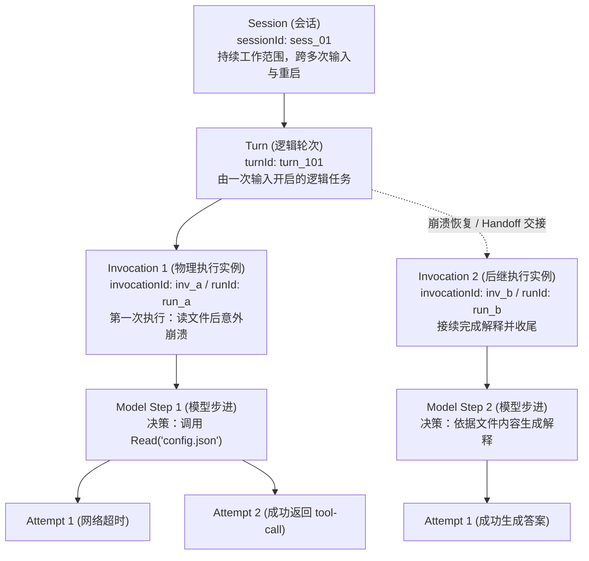

# 领域模型：Session、Turn、Run、Invocation 与事件

[返回手册目录](../README.md)

在构建简单聊天机器人时，开发者通常只需要两个 ID：`sessionId`（区分对话）和 `messageId`（区分消息）。但当 Agent 进入工程领域，支持工具调用、网络重试、后台超时和崩溃恢复时，这两个 ID 远远不够。

如果在一次任务中，模型先调用 `Read`，接着网络断线重试了两次，中途进程崩溃重启，然后由另一个执行实例接手完成——系统必须回答：**“那次重试属于哪一步决策？”“重启后的执行算不算同一个用户任务？”“这笔 Token 费用该记在谁头上？”**

Maka 通过一套严密的六层身份体系与不可变事件信封（`RuntimeEvent`）来回答这些问题。

---

## 1. 概念先行：为什么需要多层执行身份？

想象用户在一个配置排错会话中输入：**“读取 `config.json`，解释其中的超时设置。”**

如果只用 `sessionId` + `messageId` 记录，系统会立刻遭遇三大难题：

1. **逻辑任务与物理执行的冲突**：用户输入一次“读配置并解释”，这是一个逻辑任务。但如果中途软件重启，恢复程序启动了一个新的物理进程来接续未竟的工作。如果逻辑任务和物理执行共用同一个 ID，系统就无法分辨“这是用户新发了一次请求”，还是“系统在接续上次没干完的活”。
2. **模型决策与网络重试的冲突**：模型第一步决定读文件，但由于网络波动，SDK 自动发起了 3 次 HTTP 请求才拿到响应。如果每次网络请求都算作一步模型推进，最大步数限制（`maxSteps`）就会被无辜耗尽。
3. **计费归属与历史回溯的冲突**：一次逻辑任务可能跨越多个物理执行（例如经过 Handoff 交接给子任务或恢复实例），计费统计需要精确到每一次实际的物理资源消耗，而对话历史需要聚合出完整的逻辑上下文。

为此，Maka 将执行身份拆分为逻辑层、物理层与步进层。

---

## 2. 六层身份体系全景



### 各层身份的定义与职责

| 身份层级 | 标识字段 | 核心定义 | 贯穿例子（读 `config.json` 并解释） |
| :--- | :--- | :--- | :--- |
| **Session** | `sessionId` | 长期存在的业务交互容器，聚合历史与配置。 | 整个“配置排错”会话，包含今天和明天的多次追问。 |
| **Turn** | `turnId` | 由一次用户输入或授权触发开启的**逻辑工作单元**。 | “读 `config.json` 并解释超时”这一整件事。 |
| **Invocation** | `invocationId` | 一次有明确起点（`invocation_opened`）和终点（终态事件）的**物理执行实例**。 | 正常情况下 1 个 Turn 对应 1 个 Invocation；若发生重启接续或交接，1 个 Turn 会先后经历多个 Invocation。 |
| **Run** | `runId` | 与当前执行实例绑定的运行时生命周期与账本范围。 | 普通输入路径下常与 `invocationId` 取相同值，用于关联 Token 用量、诊断日志与操作记录。 |
| **Model Step** | `stepId` | 逻辑轮次内的一次**模型决策及随后的工具结算**。 | 第 1 步提出 `Read` 并拿到结果；第 2 步拿到结果生成文字解释。 |
| **Attempt** | `attemptId` | 为完成一个 Step 而实际发起的**一次底层模型请求**。 | 第 1 步首次发 HTTP 请求遇到 502 错误（Attempt 1），退避重试后成功（Attempt 2）。 |

---

## 3. 事件信封（RuntimeEvent）：事实的载体

在 Maka 中，所有运行过程都以 `RuntimeEvent` 的形式追加写入不可变账本。每条事件就像一个标准化的信封，既包含“发生了什么”，也包含“它属于谁”和“它如何影响控制流”。

### 核心结构拆解

```text
RuntimeEvent {
  // 1. 身份路由头 (用于多维索引与归属判定)
  id:           "evt_9981"
  ts:           1732496000123
  sessionId:    "sess_01"
  turnId:       "turn_101"
  runId:        "run_a"
  invocationId: "inv_a"

  // 2. 载荷与类型 (到底发生了什么)
  kind:         "tool_result" | "invocation_opened" | "assistant_message" | ...
  content:      { toolCallId: "call_1", output: "{ \"timeout\": 30 }" }

  // 3. 控制动作与来源追溯 (如何驱动状态机与关联上下文)
  actions:      { dispatch: "local_sandbox", settled: true }
  refs:         { stepId: "step_1", attemptId: "att_2", parentEventId: "evt_9980" }
}
```

### 开篇登记：`invocation_opened`

每次物理执行启动时，系统写入的第一条权威事件是 `invocation_opened`。它像一张“出生证明”，记录了本次执行的静态快照：
- **root**：顶层触发源（是用户交互触发、定时目标触发，还是 Eval 评测触发）。
- **source**：执行来源（是全新启动 `fresh`、崩溃后的接续 `continuation`，还是父子交接 `handoff`）。
- **routing & config**：本次执行使用的模型名称、供应商连接标识以及工作目录。

**为什么要把当时的配置写进 `invocation_opened`？**
因为用户在会话中途可能会切换模型（比如从模型 A 切换到模型 B）。将配置快照固化在开启事件中，后续审计或复盘时就能确切知道“第 3 轮工具调用到底是在哪个模型、哪个工作目录下发生的”，不会因为当前全局配置的改变而失真。

---

## 4. 从事件重建运行状态

因为 `RuntimeEvent` 是只追加的不可变日志，Maka 不需要靠修改数据库同一行记录来维护复杂的历史状态。任何时刻需要查看会话里发生过哪些执行、结果如何，只需要扫描事件流即可无损重建。

### 教学伪代码：从事件流重建运行清单

以下伪代码展示了如何从一堆按时间排列的事件中，精确提取出每一次物理执行的生命周期与最终结局：

```text
function rebuildInvocationInventory(sessionEvents):
    invocations = new Map() // invocationId -> InvocationRecord

    for event in sessionEvents:
        // 1. 遇到开篇事件，建立执行档案
        if event.kind == "invocation_opened":
            record = {
                id: event.invocationId,
                turnId: event.turnId,
                runId: event.runId,
                source: event.source,
                startedAt: event.ts,
                terminalOutcome: null // 尚未结束
            }
            invocations.set(event.invocationId, record)
            continue

        // 2. 遇到终态事件（完成 / 失败 / 取消 / 交接暂停）
        if event.isTerminalEvent():
            record = invocations.get(event.invocationId)
            if record != null and record.terminalOutcome == null:
                // 只采信首个到达的终态，防止后续重复或迟到事件改写历史
                record.terminalOutcome = extractOutcome(event)
                record.endedAt = event.ts

    // 3. 按开始时间排序返回，未关联到终态的记录即为“运行中”或“意外中断”
    return sortByStartedAt(invocations.values())
```

### 关键设计原则：只认首个终态

注意伪代码中的判断条件：`if record.terminalOutcome == null`。在分布式或异步系统中，可能存在超时取消与正常完成几乎同时发生的竞态条件。**Maka 规定一旦某次 Invocation 写入了首个终态事件，后续任何事件都不得改写该结果。** 这保证了状态机在重放时的绝对确定性。

---

## 5. 常见设计疑问与工程判断

1. **既然普通执行下 `runId` 和 `invocationId` 常取相同值，为什么还要保留两个字段？**
   - **判断**：职责边界不同。`invocationId` 强调的是**执行实例的拓扑与血缘**（用于追踪交接、接续链条，如 Invocation 2 继承自 Invocation 1）；而 `runId` 强调的是**操作账本与资源计费的归属单元**（如 Token 计量、沙箱进程审计）。在单一执行时它们可以共享同一个 UUID，但在引入更细粒度的内部调度或外部代理插件时，两者解耦能避免牵一发而动全身。
2. **如果进程崩溃，事件流里只有 `invocation_opened` 没有终态事件，系统怎么处理？**
   - **判断**：这正是事件溯源的价值所在。重启后的恢复扫描器通过 `rebuildInvocationInventory` 发现 `terminalOutcome == null`，立即就能判定这是一次**异常中断的执行**，进而去检查该 Invocation 下最后一条工具调用是否已结算，决定是标记“结果未知”还是发起接续（Continuation）。

---

## 6. 延伸阅读

- 了解这些领域对象在代码中的具体创建与销毁时机，阅读 [01.2 会话与执行对象的生命周期](../01-runtime/session-lifecycle.md)。
- 了解系统如何利用事件投影出模型上下文，阅读 [02.1 历史事实与模型输入投影](../02-context/history-and-projection.md)。
- 了解崩溃后如何依据事件边界进行恢复，阅读 [04.1 持久化执行与崩溃恢复](../04-state/durable-execution.md)。
