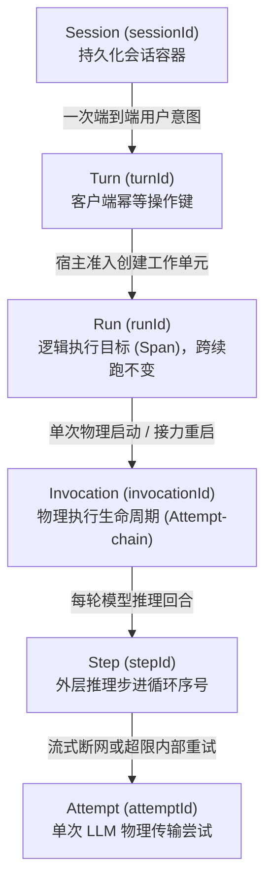

# 六层执行身份与双账本重构：如何做到跨崩溃无损历史还原？

## 1. 为什么“把状态对象原地 update 回数据库”必然导致执行历史腐烂？

原型阶段的 Agent 后端习惯在数据库里维护两张传统 CRUD 表：`sessions`（存着当前状态和系统配置）与 `messages`（每次收到模型文字或执行完工具就往后 `INSERT`，或者就地 `UPDATE status = 'done'`）。这种看似自然的设计在系统规模稍微扩大之后，就会暴露出三道致命伤：

1. **身份与范围错配**：用户在一次长回复中断后点击重试，或者后台自动做了一次上下文压缩接力，如果只有一层宽泛的 `sessionId + messageId`，后续审计和状态机根本分不清“哪条工具请求归属于刚死掉的那次传输尝试，哪条归属于新重连的这次尝试”。
2. **内存与日志双轨分裂**：如果在一次模型流式期间同时向客户端推展示消息、向审计日志写 Token 用量、又往消息表更新字段，只要程序在任意两次 `await` 之间崩溃，硬盘上的 Run 摘要就可能写着 `status = 'running'` 而实际上事件早已完结。
3. **JavaScript 隐式序列化漂移**：JS 对象极易暗藏 `undefined` 字段、访问器（Getter）、自定义原型甚至 `toJSON` 钩子。写入前通过 Schema 检查的值与 `JSON.stringify` 再 `JSON.parse` 还原出来的值一旦存在细微差异，哈希对比与冷重构就会立刻错位！

Maka 在 `packages/core` 中用**六层正交执行身份体系**、**深度往返校验的不可变 `RuntimeEvent` 脊柱**与**伴生 `AgentRunStore` 操作账本**彻底消灭了可变状态黑盒——在它的契约里，**一切宏观头部状态全是底层事件流的确定性投影函数，没有任何写者能绕开事件去单独修改状态**。

---

## 2. 六层正交身份：切分逻辑目标与物理尝试

为了同时满足前端 UI 幂等、长目标计费以及底层网络流重试恢复，Maka 将一次交互的时空坐标精细拆分为互不代替的六个层级：



这一分层中最精妙的区分在于 **`runId` 与 `invocationId` 的分离**：
- **`runId`** 代表逻辑工作归属：哪怕一次推理中途遭遇需要等待外部事件（`EventWait`）、触发高风险人工确认暂停或者经历上下文超限后的安全边界接力（Continuation），外部界面看到的归属 `runId` 始终不变，所有子任务挂靠与总量统计全数挂在同一个工作目标下。
- **`invocationId`** 则严格锚定每一次“物理启动的进程执行寿命”（源自 `runtime-invocation.ts`）：一个 `Run` 可以前后由 3 次不同的 `Invocation`（例如第 1 次跑 2 步断电、第 2 次恢复重跑接手第 3 步）接力跑完，每次接力都有自己干净闭环的开始与终点，绝不发生时间线污染。

---

## 3. 事件脊柱（`RuntimeEvent`）与无损序列化铁律

查看 `packages/core/src/runtime-event.ts` 与 `canonical-runtime-event.ts` 可以读到全架构最严厉的数据边界声明：
> **This is the single internal runtime fact model. It is NOT a UI event (`SessionEvent`) and NOT a trace row (`RunTrace`) or telemetry record.**

`RuntimeEvent` 不只是几个事件字符串名，而是由双正交轴构成的标准持久化信封：
- **核心事实流载荷**：开场必定是一个唯一的 `invocation_opened`（记录入口来源、路由快照、配置绑定及前代血缘 `RuntimeInvocationLineage`），紧跟期间发生的模型输入/输出/工具 T1 派发/T2 结算事件，最后收口于唯一的终态边界事件（完成、报错失败、中止或安全挂起交接）。
- **无损深度序列化自检（`encodeCanonicalRuntimeEvent`）**：
  普通系统写事件日志只调一次 `JSON.stringify(event)`，而 `canonical-runtime-event.ts` 在真实落盘写入数据库前，必须强硬走完**解码归一化 -> 稳定键排序序列化 -> 反向 `JSON.parse` 二次解码 -> `nodeUtil.isDeepStrictEqual` 全量比对**的四重检验！

```typescript
// 真实不变量逻辑（提炼自 packages/core/src/canonical-runtime-event.ts）
function encodeCanonicalRuntimeEvent(raw: unknown): CanonicalRuntimeEventEncoding {
  const decoded = normalizeRuntimeEventEnvelope(decodeRuntimeEvent(raw));
  // 排除任何 undefined 属性、Getter 访问器、非纯对象原型或隐藏 toJSON 钩子
  const canonicalJson = stableJsonStringify(decoded);
  const roundTripped = decodeRuntimeEvent(JSON.parse(canonicalJson));

  if (!nodeUtil.isDeepStrictEqual(decoded, roundTripped)) {
    throw new Error('RuntimeEvent is not losslessly serializable');
  }
  return { event: roundTripped, json: canonicalJson };
}
```

这一小段把守意味着：**哪怕开发者未来误往某个工具元数据对象里塞了一个带 `Date` 对象、自定义原型链或是稀疏数组的脏字段，也会在落盘瞬间被当场拦停报错，绝不允许“写进库里的东西和明天读出来重构的语义不一样”！**

---

## 4. `runtimeInvocationsFromSessionEvents`：状态永远只是事件的衍生函数

在传统数据库系统里，`listSessionInvocations` 会去查一张单独更新的 `invocations` 状态表；一旦代码有 bug 忘记更新终态列，状态表与历史流水就会彻底撕裂。

在 `packages/core/src/runtime-invocation.ts` 中，Maka 确立了**事件确定性归约定理**：
> **Rebuild a Session's invocation inventory from its events alone. This is the definition of the inventory, not a cache of it.**

哪怕是运行中频繁读取的索引表，其唯一合法语义定义也严格等价于对 `RuntimeEvent[]` 按单遍扫描折叠的结果：
- 遍历过程中**直接过滤掉 `event.partial === true` 的有界半程增量流帧**（只供界面实时打字渲染预览，永不染指规范执行历史）；
- 只有捕获到确切 **`invocation_opened`** 事实的实例才正式建档注册（未开场而发出的外围控制面通知从构造层面天然剔除）；
- 该实例后续追加的所有过程态与唯一终结事件决定其生命周期全貌——任何写者都无法撇开事件流擅自设置任何独立的运行态头字段！

---

## 5. 双账本耦合协同：`RuntimeEvent` Spine vs `AgentRunStore`

除了确定对话历史脊柱的 `RuntimeEvent` 之外，现代企业级系统往往还需要精细跟踪与大语言模型交互时的**物理工程实况**：比如某一次推理尝试换用了哪个连接地址、首字响应花了多少毫秒、因为限流重连了几次、哪条工具触发了人工风控自审（`auto_review_decided`）或者遭遇沙箱提权请求（`sandbox_escalation_granted`）。

如果把这四五十种高频工程审计事件一股脑全部塞回主对话事实流，会把供模型投影阅读的核心账本搞得臃肿不堪；反之如果直接丢到无结构文本日志里，遇到崩溃恢复和账单明细审计又查无对证。

Maka 用清晰的双账本分治完美化解了这个矛盾：

| 对比维度 | 第一账本：`RuntimeEvent` 脊柱 (`runtime-event.ts`) | 第二账本：`AgentRunStore` 操作账本 (`agent-run.ts`) |
| :--- | :--- | :--- |
| **承载核心数据** | `invocation_opened`、对话消息、模型有效语义产出、工具 T1 派发与 T2 结算、压缩检查点及唯一终态事件 | 40 余种细粒度运营态事实（`model_resolved`、`model_stream_started`/`failed`、`permission_requested`/`decided`、`sandbox_escalation_*`、`send_diagnostics_recorded`） |
| **对执行边界的决定权** | **最高真理**：决定一次 Invocation 是否算开启/结束、工具是算成功还是 `outcome_unknown` | **伴生观察者**：承载计费明细（Metering）、试错次数、诊断快照与审批合规轨迹，不自行篡改主逻辑路由 |
| **投影与可重建性** | 是 `CanonicalSessionProjection`、`StoredMessage`、模型上下文投影的唯一根源 | 与对应的 `invocationId` 强绑定，保障审计瀑布流可精准对齐每一次物理尝试而不污染模型上下文 |

---

## 6. 总结

回看 Maka TypeScript 版的整套领域模型，它成功把大量动态语言项目最害怕的并发黑洞关进了严谨的数据建模边界里：
1. **六层身份正交拆分**：彻底分离客户端幂等键 `turnId`、逻辑目标 `runId`、物理尝试 `invocationId` 与传输重构节点 `stepId`/`attemptId`；
2. **`encodeCanonicalRuntimeEvent` 无损往返校验**：在 JS 对象落库的第一道闸门彻底清扫原型链副作用与隐式字段丢失；
3. **Spine + Operational Ledger 双账本分治**：既靠不可变事件脊柱保证任何断电崩溃均能零误差重构执行目录，又靠独立 `AgentRunStore` 承接细粒度计量与安全合规审计。

既然双账本与规范事件流已经在语义层彻底定型，这些抽象模块究竟是如何装进真实的工程文件夹与 Monorepo 包拓扑里的？TypeScript 代码库又是如何做到严禁反向循环依赖，同时优雅挂载起 `gitoxide-helper` 等多个高性能 Rust 原生子模块的？请看下一篇：[TypeScript Monorepo 控制边界与 Rust 原生数据面混合拓扑](./repository-map.md)。
