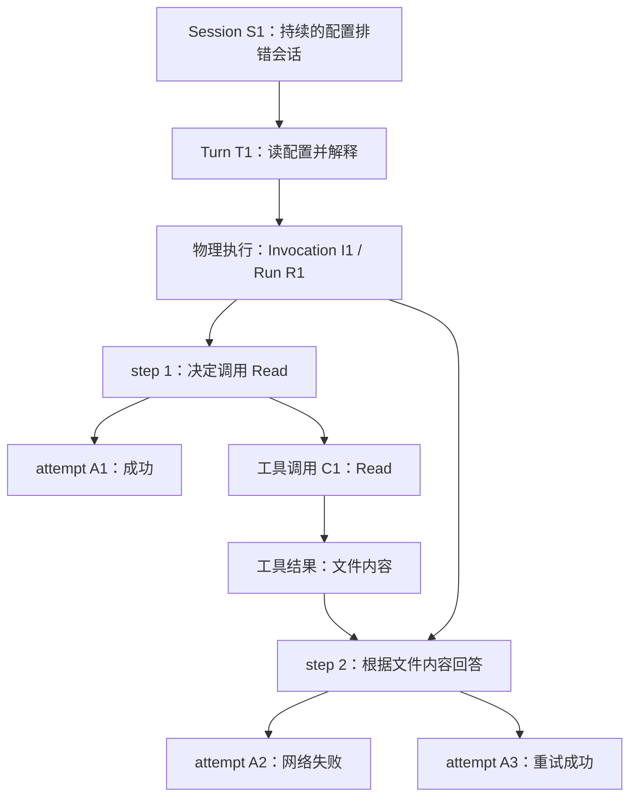
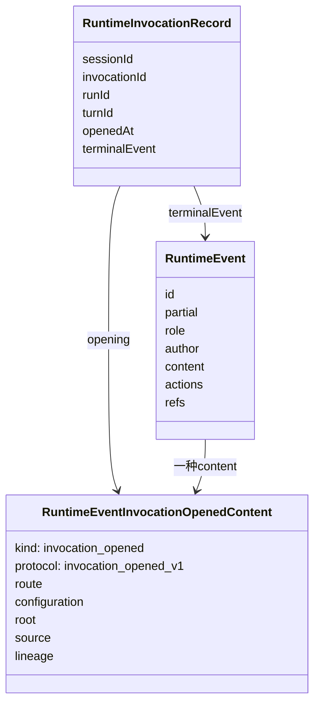

# 领域模型：Session、Turn、Run、Invocation 与事件

[手册目录](../README.md)

本文先解释名称，再将它们对应到真实的数据结构与读取算法。仅查询词义可参阅[词汇表](../GLOSSARY.md)；本文要回答的是：为什么需要这么多身份，程序如何用它们判断“这是哪一次工作”。

基线为 Maka `15d0a0d`。以下 S1、T1、R1、I1、E1 是教学占位值，不是生产 ID 的生成格式。

## 1. 任务与 ID 的多层对应关系

用户说：“读 config.json，解释为什么启动失败。”

第一次模型请求提出 Read 调用，工具返回文件内容，第二次模型请求给出解释。
如果第二次请求发生短暂网络错误，运行时还可能为其重试。

此时至少存在四个不同的计数：

| 问题 | 本例答案 | 对应概念 |
| --- | --- | --- |
| 用户在哪一段持续工作中提问？ | 配置排错会话 S1 | Session |
| 接纳了几项逻辑工作？ | “读配置并解释”这一项 T1 | Turn |
| 是否重新建立过物理执行？ | 没有，仍是 R1 / I1 | Run / Invocation |
| 模型做了几步决策、发了几次请求？ | 两个 step；第二步重试后共三个 attempt | Model Step / Provider Attempt |

如果仅用一个 `requestId` 表示所有层次，第二次网络请求就容易被当作第二项用户任务。
反之，如果将同一 Turn 内所有请求合并为一次调用，则无法解释重试费用和失败片段的来源。



图中的包含关系是这个场景的解释模型，不是声称每个方框都有独立数据库表或 TypeScript 类。
例如 step 是循环中的边界，不能据图杜撰一个 `StepManager`。

相关契约：[BackendSendInput 的执行身份][backend-input]、[RuntimeEvent 的身份字段][event-envelope]、[模型尝试的实际记录](../06-operations/observability.md)。

## 2. Run 与 Invocation：语义与取值的关系

`RuntimeInvocationRecord` 用于描述一次物理执行：它何时打开、采用什么配置、从哪里继续、有没有终态。
`runId` 则将其关联到运行生命周期和操作账本。

当前契约说明一个 invocation 对应一个 run；常规路径可能为两个字段使用相同字符串。
**两个字段的值相同，不代表这两个词在所有 API 中都可以互换。**
代码显式保留它们，是为了让执行事实、操作记录、来源关系分别有明确的连接点。

以下摘自真实接口，未修改字段名：[RuntimeInvocationRecord][invocation-record]。

```ts
export interface RuntimeInvocationRecord {
  sessionId: string;
  invocationId: string;
  runId: string;
  turnId: string;
  openedAt: number;
  opening: RuntimeEventInvocationOpenedContent;
  terminalEvent?: RuntimeEvent;
}
```

注意此处没有可独立随意设置的 `status` 字段。
结果从 `terminalEvent` 推导；配置与来源从 `opening` 取得。
如果另行保存一份可独立更新的运行结果，就可能出现“header 写成功，最后一个事实却写失败”的两套答案。
接口上方的注释明确说明，旧式可变 Run header 中的信息现在由事件组成的主干来定义。

### 2.1 进程内对象与持久身份的区分

源码中还存在一个实际的 `AgentRun` 类，它参与当前进程的执行。
不应将这个对象与上述 `RuntimeInvocationRecord` 视为同一对象：

| 对象或记录 | 作用 | 进程退出后怎样处理 |
| --- | --- | --- |
| 进程内 AgentRun | 执行中的协调、事件接收和收尾 | 原对象、闭包和 Promise 不再存在 |
| RuntimeInvocationRecord | 对已保存运行事实的读取结果 | 可以由事件重新构造 |
| AgentRunEvent | 计量、请求组成、权限决定等操作记录 | 从操作账本读取 |
| Session 的 UI 状态 | 当前屏幕需要的显示信息 | 重新订阅或读取投影 |

创建和销毁这些对象的代码在[会话与对象生命周期](../01-runtime/session-lifecycle.md)展开。
本篇仅强调一个原则：持久身份允许再次定位工作，但不会使原来的 JavaScript 对象自动恢复。

### 2.2 三种“继续”操作的语义差异

| 情况 | 哪一层变化 | 不能误读为 |
| --- | --- | --- |
| 同 step 的 provider retry | 新的物理请求 attempt | 必然新建 Session、Turn 或 Run |
| safe-boundary continuation | 验证旧来源后建立新的物理执行身份 | 复用旧网络连接或原调用栈 |
| cooperative handoff | 后继物理执行接过原逻辑 Turn | 原逻辑工作已经成功完成 |

`RuntimeInvocationOpenSource` 是可区分联合类型：`fresh`、`continuation`、`handoff` 各自要求不同字段。
例如 handoff 必须携带 `rootRunId`、来源身份、`claimId` 和边界摘要，不能用一个 `isResume: true` 表达完整依据。[来源类型][open-source]

具体恢复入口可能对 Turn 身份采取不同策略；阅读代码时应跟随来源字段，不应假定任何名为 resume 的函数都保持原 turnId。

## 3. RuntimeEvent 的四个组成部分

首先考察一条最小工具调用事实。以下是符合字段形状的教学数据，不是本次运行采集的记录：

```json
{
  "id": "E-call-1",
  "sessionId": "S1",
  "turnId": "T1",
  "invocationId": "I1",
  "runId": "R1",
  "ts": 1000,
  "partial": false,
  "role": "model",
  "author": "agent",
  "content": {
    "kind": "function_call",
    "id": "C1",
    "name": "Read",
    "args": { "path": "config.json" }
  }
}
```

它没有展示实际派发所需的完整 T1 数据，不能用它替代真实提交协议。
此处仅用于辨认字段层次：[RuntimeEvent][event-envelope]。

| 部分 | 字段举例 | 回答的问题 |
| --- | --- | --- |
| 身份信封 | id、sessionId、turnId、runId、invocationId | 这件事属于谁，如何关联？ |
| 内容 | content.kind、text、args、result | 说了什么、提出什么工具调用、返回什么？ |
| 控制动作 | actions.endInvocation、toolDispatch、handoffPause | 是否跨过控制或执行边界？ |
| 关联引用 | refs.stepId、operationId、parentToolCallId | 与哪个步骤、工具操作或嵌套调用关联？ |

`content` 与 `actions` 不是同义词。
“模型说想执行 Read”属于内容；“运行时已跨过允许派发的持久边界”属于控制事实。
若只保存一段聊天文本，就无法可靠区分这两者。

### 3.1 role 与 author 的并存原因

`role` 回答内容在对话中扮演的角色；`author` 回答系统内部由谁产生。
Host 可以生成一段模型应按 user-role 理解的输入，但它不应因此伪装成终端用户手工输入。
同样，系统写下的执行开始事实可以是 `role: system`、`author: system`，但必须隐藏于模型历史。

因此源码把二者设计成不同字段，而不是根据角色反推来源。[角色与作者][roles]
这不代表每一种 role/author 组合都合理；合法组合的具体策略由运行层落实。

### 3.2 partial、hidden、interrupted：三个独立维度

| 字段 | 表达的意思 | 典型例子 |
| --- | --- | --- |
| `partial: true` | 还只是将被完整内容取代的流式片段 | “配置中的…” |
| `modelVisibility: hidden` | 明确不交给模型作为历史内容 | invocation 的 opening 事实 |
| `content.interrupted: true` | 已中断响应的片段，保留用于展示 | 网络失败前出现的半句回答 |

不能仅凭“有没有 text”判断是否应发给模型。
`runtimeEventHasModelVisibleContent()` 只检查内容是否属于可投影种类及显式 hidden 状态，**不负责 partial 过滤**。
它对一条带 text 的 partial 事件可能返回 true；调用方还必须执行完整的投影过滤。
这不是函数的判断遗漏，而是它的职责边界；源码注释明确提醒了调用方。[内容资格检查][visible-content]

也不应将“partial 不进模型历史”解释为“partial 一律不写盘”。
流式显示、持久缓冲和稳定历史有不同需求；具体缓冲策略见[请求与事件回程](../01-runtime/request-to-response.md)。

## 4. opening 的内容与派发前固定原则

一次 invocation 的 opening 不是普通聊天消息，而是后续解释运行事实的依据。



图中展示接口之间的字段关系，不表示它们都是用 `new` 创建的类。
五组 opening 数据各自有用途：[opening 契约][opening]。

| 字段 | 保存什么 | 如果运行中只读当前配置会怎样 |
| --- | --- | --- |
| route | 后端、连接、模型及可用的 provider 状态身份 | 用户换模型后，旧 reasoning 的来源可能被错误解释 |
| configuration | 当时的 cwd、权限、协作、编排、工具模式 | 无法说明旧动作是在什么执行条件下产生的 |
| root | 谁授权产生这次执行，例如 user、goal | 自动触发与用户直接输入被混淆 |
| source | fresh、continuation 或 handoff 的来源关系 | 无法验证后继执行接续哪一段历史 |
| lineage | 父 Session/Run/Turn、重试或分支关系 | 子助手结果与根会话内容难以区分 |

`route.provenance: unknown` 不等于“默认相信当前 provider”。
它表示旧数据不能提供可信来源证明；旧内容可以继续显示，但 provider 私有状态不能据此获得回放资格。
这是数据可读性与执行安全分别处理的例子。

`buildInvocationOpenedEvent()` 将 opening 包装为非 partial、模型隐藏的 system 事件。
这样它既成为持久事实，又不会被误认为一条供模型遵循的新 system prompt。[构造函数][build-opening]

## 5. 从事件重建运行清单的算法

关键函数是 `runtimeInvocationsFromSessionEvents(sessionId, events)`。
它不是返回某个全局内存 Map；它就地从给定事件数组构造清单。[完整实现][inventory]

### 5.1 第一遍扫描：收集 opening

函数创建 `Map<string, RuntimeInvocationRecord>`，key 是 invocationId。
遍历时排除其他 Session 的事件与 partial 事件，只在 content.kind 为 `invocation_opened` 时建立记录。
每条记录保存该 opening 自身的时间 `event.ts`，而非后续读取时的时间。

这一步解释了：有事件不等于有普通 Run。
存储拥有的某些控制流没有 invocation opening，因此不会被误列为一次模型执行。

### 5.2 第二遍扫描：定位首个终态

第二遍仍过滤 Session 和 partial，再调用 `isTerminalRuntimeEvent()`。
只对第一遍已经发现的 invocation 关联终态，并且已有 terminalEvent 时不再覆盖。

不能简单取 `events.at(-1)` 的原因如下。
因为 Session 级读取可能交错多个 invocation；最后一条属于 I2，不代表 I1 没有结束。
同样需要说明为何不在第一遍遇到终态时立即处理。
两遍扫描不依赖 opening 在这份跨 invocation 数组中的偶然相对位置，所有关联都在清单已建立之后进行。

### 5.3 排序规则

输出按 `openedAt` 排序，时间相同再比较 invocationId。
未按终态时间、UI 消息位置或 Map 的偶然插入顺序决定运行列表。

纸上演算：

| 输入事件 | 第一遍动作 | 第二遍动作 |
| --- | --- | --- |
| I1 的 opening，ts=100 | 建立 I1 | 无 |
| I2 的 opening，ts=110 | 建立 I2 | 无 |
| I1 的 partial text | 跳过 | 跳过 |
| I2 的 completed terminal | 无 | 结束 I2 |
| I1 的 failed terminal | 无 | 结束 I1 |

最终列表顺序仍是 I1、I2；结果分别 failed、completed。
“后结束的执行出现在后面”不是这个读取接口的排序规则。

### 5.4 终态与成功/失败分类的关系

`isTerminalRuntimeEvent()` 接受终态 status，也接受 `actions.endInvocation === true`。
`runtimeInvocationOutcome()` 则只将明确的 completed/failed/aborted/cancelled 状态映射为结果。

因此 outcome 为 undefined 可能是：没有终态；或者有结束事实，但没有它能解释的结果分类。
调用方要进一步查看 `terminalEvent`，不能把 undefined 一概显示为“正在运行”。[结果读取][outcome]

## 6. 两类账本的职责区分

`RuntimeEvent` 记录执行事实；`AgentRunEvent` 记录计量、请求组成、权限决定和诊断等操作信息。
后者不是“随意写入的 debug log”，但也不应成为另一套独立的 invocation 终态权威。[操作账本][operational]

它的两个实现细节——`AgentRunEvent.type` 读取开放、写入收窄的跨版本兼容，以及 `ModelCallCommit` 把 attempt 与 latestContext 作为单对象提交——在[设计模式与权衡](design-tradeoffs.md)展开。
领域区分最终会影响具体函数签名，而不只是文档中的命名习惯。

## 7. 与 Pi 对照：不可直接配对的名称

| 词 | Maka | Pi 默认路径 |
| --- | --- | --- |
| Turn | 一项逻辑工作，可含多个模型 step | 低层 agent-loop 的一次 assistant 响应与对应工具结果 |
| SessionManager | 会话执行服务与后端接入的一部分 | coding-agent 中管理持久会话树和分支的组件 |
| history | RuntimeEvent 经投影形成的模型历史 | 当前会话分支经 compaction/context_edit 等投影形成的消息 |
| Run 对象 | 物理执行的生命周期参与者 | 不能直接等同于 Agent.activeRun 中的等待/取消句柄 |

例如前面的“Read 后解释”通常是一个 Maka Turn、两个 step，对应 Pi 默认循环的两个低层 turn。
这个计数差异不表示某个项目多做了用户工作，只是边界命名不同。
Pi 的实验 durable 还有自己的 task、checkpoint 和 conversation，不应强行套入默认 agent 的计数模型。
对照源头：[Pi runLoop](https://github.com/earendil-works/pi/blob/482c1381a00d8d00bc81697e4a980c593db6803e/packages/agent/src/agent-loop.ts#L163)、[Pi SessionManager](https://github.com/earendil-works/pi/blob/482c1381a00d8d00bc81697e4a980c593db6803e/packages/coding-agent/src/core/session-manager.ts)、[Pi durable](https://github.com/earendil-works/pi/blob/482c1381a00d8d00bc81697e4a980c593db6803e/packages/durable/README.md)。

## 相关专题

- [会话与对象生命周期](../01-runtime/session-lifecycle.md)：在了解身份之后，追踪持有这些身份的进程内对象如何创建、复用和清理。
- [历史与投影](../02-context/history-and-projection.md)：继续考察同一条事实为何在 UI 可见、在模型请求中不可见。
- [持久化与恢复](../04-state/durable-execution.md)：将进程崩溃插入上述事件序列，判断能够确认什么、不能确认什么。
- [设计模式与权衡](design-tradeoffs.md)：解释这些区分如何落实到接口、联合类型和持久提交结构中。

[backend-input]: https://github.com/apache/maka/blob/15d0a0dd19d39e2bc09ae35940e432c636982315/packages/core/src/backend-types.ts#L60
[event-envelope]: https://github.com/apache/maka/blob/15d0a0dd19d39e2bc09ae35940e432c636982315/packages/core/src/runtime-event.ts#L671
[invocation-record]: https://github.com/apache/maka/blob/15d0a0dd19d39e2bc09ae35940e432c636982315/packages/core/src/runtime-invocation.ts#L47
[open-source]: https://github.com/apache/maka/blob/15d0a0dd19d39e2bc09ae35940e432c636982315/packages/core/src/runtime-event.ts#L343
[roles]: https://github.com/apache/maka/blob/15d0a0dd19d39e2bc09ae35940e432c636982315/packages/core/src/runtime-event.ts#L119
[visible-content]: https://github.com/apache/maka/blob/15d0a0dd19d39e2bc09ae35940e432c636982315/packages/core/src/runtime-event.ts#L1628
[opening]: https://github.com/apache/maka/blob/15d0a0dd19d39e2bc09ae35940e432c636982315/packages/core/src/runtime-event.ts#L374
[build-opening]: https://github.com/apache/maka/blob/15d0a0dd19d39e2bc09ae35940e432c636982315/packages/core/src/runtime-invocation.ts#L107
[inventory]: https://github.com/apache/maka/blob/15d0a0dd19d39e2bc09ae35940e432c636982315/packages/core/src/runtime-invocation.ts#L66
[outcome]: https://github.com/apache/maka/blob/15d0a0dd19d39e2bc09ae35940e432c636982315/packages/core/src/runtime-invocation.ts#L214
[operational]: https://github.com/apache/maka/blob/15d0a0dd19d39e2bc09ae35940e432c636982315/packages/core/src/agent-run.ts#L20
