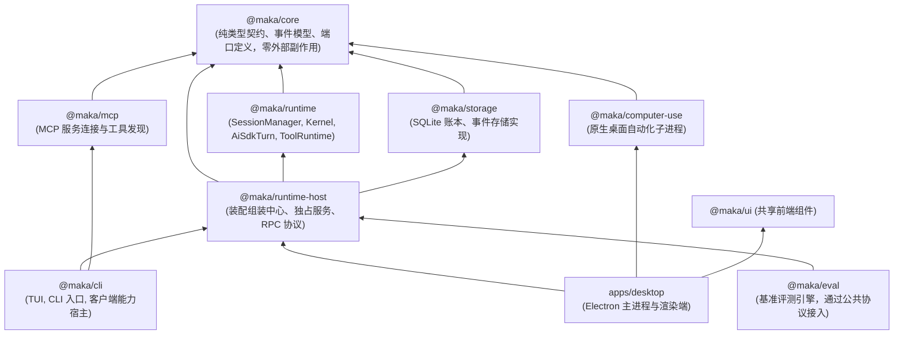
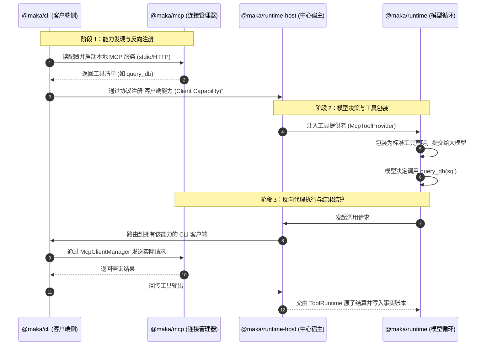

# 仓库地图：Monorepo 分层、依赖拓扑与组装边界

[返回手册目录](../README.md)

当一个系统同时包含 Electron 桌面客户端、终端 CLI/TUI、核心 Agent 循环引擎、本地 SQLite 存储以及外部 MCP 协议连接器时，如果所有代码混在同一个目录下互相 `import`，不出几周就会陷入循环依赖与无法独立测试的泥潭。

Maka 采用基于 Workspaces 的 Monorepo 分层架构。本章不仅展示各子包在物理目录上的位置，更重点解析**包与包之间的依赖方向、接口反转（Dependency Inversion）机制**，以及**一条外部能力（如 MCP 工具）是如何跨越多个子包完成组装与调用的**。

---

## 1. 架构依赖拓扑：谁能引用谁？

在大型 Agent 基础设施中，最核心的组织原则是**契约下沉、实现上浮、组装收拢**。

### 为什么 `@maka/runtime` 不直接依赖 `@maka/storage`？

注意看图中的箭头方向：**`Runtime` 只依赖 `Core`，并不直接 `import` `Storage`**。
- **原因**：`Runtime` 关注的是模型循环、步骤推进和并发控制。如果它硬编码依赖 SQLite 文件操作，那么在单元测试中就无法轻松替换成纯内存存储，也无法在未来平滑迁移到远端分布式存储（如 PostgreSQL 或 Redis）。
- **实现手段（依赖反转）**：`Core` 中定义了抽象的持久化端口（如 `RuntimeCommitSink`）；`Storage` 提供 SQLite 实现；最终由处于最上层的 `Runtime Host` 在启动装配时，将 `Storage` 实例注入到 `Runtime` 中。

---

## 2. 子包职责全景对照表

| 模块分类 | 目录路径 | 核心职责与对外暴露能力 | 典型内部组件 |
| :--- | :--- | :--- | :--- |
| **契约基石** | `packages/core` | 定义所有公共数据模型、端口接口与协议格式。 | `AgentBackend`、`RuntimeEvent`、权限契约、配置 Schema |
| **核心引擎** | `packages/runtime` | 推进会话、代次管理、模型循环、历史投影、压缩与工具结算。 | `SessionManager`、`RuntimeKernel`、`AiSdkTurn`、`ToolRuntime` |
| **持久化层** | `packages/storage` | 打开并管理 State Root，实现事件账本、控制面状态表与租约锁。 | `StateRootComposition`、`ExecutionPersistenceProvider` |
| **托管权威** | `packages/runtime-host` | 单一写入权威进程；负责协议解析、根准入、模块恢复与跨端广播。 | `HostComposition`、`RootTurnCoordinator`、Client/Server 协议 |
| **能力扩展** | `packages/mcp` | 管理 MCP 服务生命周期（stdio / HTTP），发现并代理外部工具调用。 | `McpClientManager`、Transport 传输适配器 |
| | `packages/computer-use` | 封装操作系统级别的 GUI 键鼠控制与屏幕捕获原生服务。 | `MakaCuService`（独立子进程通信） |
| **产品接入** | `packages/cli` | 提供终端命令行入口、交互式 TUI 及前端能力挂载体。 | `maka run`、`RuntimeHostRunMcp` |
| | `apps/desktop` | Electron 桌面端产品壳，装配本地原生能力与多窗口交互界面。 | 主进程装配器、UI 视图层 |
| | `packages/ui` | 桌面端与 Web 端复用的标准 React 渲染组件。 | 聊天流卡片、工具执行折叠面板 |
| **生态与评测** | `packages/eval` | 独立的基准评测编排引擎，严格通过公共 Host 协议驱动被测 Agent。 | `Experiment`、Cells、Attempts、`earliest valid` 裁决器 |
| | `packages/acp-executor-plugin` | 外部代理接入插件（ACP 协议实现），作为可插拔 `AgentBackend` 接入。 | ACP Executor 适配器、Antigravity 适配入口 |

---

## 3. 跨包协作路径示例：一次 MCP 工具是如何连上并被调用的？

为了理解这些包在运行时是如何咬合在一起的，追踪一个常见场景：**用户在 CLI 中配置了一个本地 MCP 工具（如数据库查询），并要求 Agent 调用它**。

**这段跨包路径揭示了两条重要边界**：
1. **连接归属权**：连接本地 stdio 子进程的动作发生在 CLI 客户端一侧，Host 不需要直接启动用户的本地私有工具进程。
2. **统一工具视图**：对于处于核心的 `@maka/runtime` 来说，它并不关心工具背后是本地文件读取，还是远在 CLI 另一端的 MCP 服务，它只面对统一抽象的 `ToolRuntime` 与 `McpToolProvider` 端口。

---

## 4. 模块生命周期装配：Host Composition 机制

在 `@maka/runtime-host` 中，系统并没有把所有业务初始化写成一坨难以维护的 `main()` 函数，而是采用了声明式的 **Domain Module（领域模块）组装模式**。

当 Host 启动时，各领域模块在 `HostComposition` 中声明自己的三类挂载点：
1. **Protocol Handlers**：我负责处理哪些客户端发来的 RPC 请求（如会话查询、模型切换、审批确认）。
2. **Recovery Phase**：在系统对外提供服务之前，我需要按什么阶段顺序从数据库恢复未竟状态（先恢复存储 Root -> 再恢复资源租约 -> 最后恢复待执行的任务队列）。
3. **Shutdown Hooks**：进程收到退出信号时，我需要释放哪些子进程、关闭哪些网络端口。

通过这种机制，整个应用启动具备了严格的**阶段确定性**：在存储修复和租约验证未完成前，协议端口绝不会提前放行外部请求。

---

## 5. 开发者红线：代码组织禁区

如果你正在基于 Maka 进行二次开发或新增功能模块，请遵守以下架构红线：

1. **禁止底层包反向依赖上层包**：`packages/core` 绝对不能引用任何其他工作区包；`packages/runtime` 绝对不能引用 `packages/runtime-host`、`apps/desktop` 或 `packages/cli`。
2. **禁止客户端绕过 Host 访问 Storage**：`apps/desktop` 渲染进程或 `packages/cli` 的 UI 逻辑如果需要历史记录，必须通过 Host 暴露的投影接口或 RPC 协议获取，严禁直接读取 SQLite 文件。
3. **禁止将评测逻辑混入运行内核**：`packages/eval` 中的实验对比、Cell 调度和评分器逻辑，不得侵入 `packages/runtime` 或 `packages/storage`。评测引擎必须像一个普通外部用户一样，通过公共 Host 客户端接口驱动 Maka 运行。

---

## 6. 延伸阅读

- 回到宏观视角查看四层系统的完整数据流动，阅读 [00.1 整体架构](architecture.md)。
- 了解当一个模型配置发生变化时，配置是如何穿过这些包注入到底层运行时的，阅读 [01.4 模型、连接与配置的注入](../01-runtime/provider-configuration.md)。
- 深入了解本地客户端与 MCP 服务是如何通过代理协议协同工作的，阅读 [03.2 MCP 连接与客户端能力](../03-tools/mcp-and-client-capabilities.md)。
