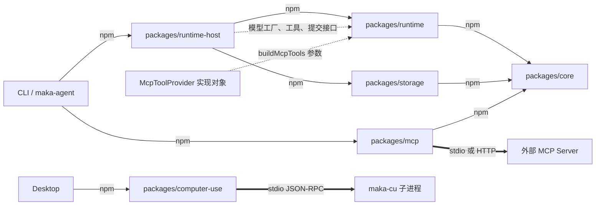
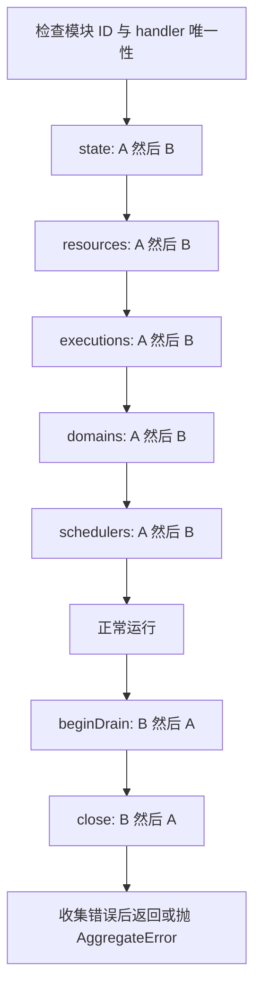

# 仓库地图：workspace、依赖与接入面

[手册目录](../README.md)

假设 CLI 配置了一个 MCP 工具，界面上却看不到它。
搜索 `mcp` 会同时找到 `packages/mcp`、`runtime/mcp-tools.ts`、CLI 的发布对象和 Desktop 的配置界面。
需要确定应修改哪一处；如果将连接客户端直接放入 Runtime，需要判定能否借此“一次解决”。

回答这个问题，必须分别追踪包依赖、对象装配和进程通信。
目录仅说明文件位置；这三条线索才说明谁创建资源、谁决定执行、失败后由谁收尾。
本文先建立地图，再沿 MCP 接入和 Host 生命周期选取两条可核对的路径。

阅读基线：2026-10-24；Maka 固定提交 `15d0a0dd19d39e2bc09ae35940e432c636982315`。
Pi 对照固定为 `482c1381a00d8d00bc81697e4a980c593db6803e`。
本文是静态源码阅读：未安装、构建、运行测试、启动原生程序或调用模型。
“测试证明”在本文中仅指现有测试写下的断言，不表示本次已运行通过。

## 1. 三种边界的区分

workspace 是根 `package.json` 纳入统一包管理的子项目，不等于一个进程。
模块在此处有两个尺度：npm 包，以及包内部拥有一组操作与生命周期的对象。
例如 Runtime Host 的 Domain Module 是后者，不要求单独的 `package.json`。

| 连线 | 准确含义 | 不能据此推出什么 |
|---|---|---|
| `A --> B`：npm 依赖 | A 的 `dependencies` 声明 B；开发依赖另标 `dev` | A 启动了 B 的进程，或实际调用顺序固定 |
| `A -.-> B`：运行时注入 | 装配代码把对象、函数或接口实现交给消费者 | 消费者必须导入实现包，或每次请求都重建对象 |
| `A ==> B`：跨进程通信 | 调用必须经过 stdio、网络或其他进程间协议 | B 一定由本仓库构建，或网络失败代表操作没发生 |

下图仅绘制与接入判断相关的边，不是完整依赖图。
`McpToolProvider` 是 Runtime 接受的接口形状；它不是必须创建的独立服务。



包边来自各 manifest；注入边来自 [Host 模型装配][model-compose] 与 [MCP 工具接口][mcp-provider]。
外部调用分别见 [MCP transport 创建][mcp-transport]、[maka-cu 的 spawn][cu-spawn]。
不应为所有 `native/` 内容绘制粗箭头：Peer 原生模块在当前 Node 进程内加载，后文单独说明。

## 2. 根清单中十三个 workspace 的交付物

根清单明确列出十三个 workspace；下表中的内部依赖只统计 `@maka/*` 的生产依赖。
表中简称均指同名 `@maka/` 包，唯独 CLI 的 npm 名称是 `maka-agent`。[根清单][root-manifest]

| 目录与包 | 生产内部依赖 | 从入口能确认的交付面 |
|---|---|---|
| `packages/core` / `@maka/core` | 无 | backend、事件、权限、配置等共享类型和纯逻辑；通过大量子路径导出。[清单][core-manifest] |
| `packages/storage` / `@maka/storage` | core | 根目录权限、执行状态与各领域存储的实现和打开入口。[清单][storage-manifest] |
| `packages/mcp` / `@maka/mcp` | core | MCP 客户端管理、连接与工具快照；根入口导出实现。[清单][mcp-manifest] |
| `packages/runtime` / `@maka/runtime` | core | 会话、模型 backend、工具执行及运行协调；不提供包根入口。[清单][runtime-manifest] |
| `packages/acp-executor-plugin` | 无 | 共享 ACP 执行器服务包；根入口与打包后的 `/plugin` 是两个导出。[清单][acp-manifest] |
| `packages/antigravity-acp-plugin` | acp-executor-plugin | Antigravity 启动配置、环境与执行器注册适配。[入口][antigravity-entry] |
| `packages/runtime-host` | core、runtime、storage、两个 ACP 插件 | 单写者 Host 的 server、client、protocol、operator 等接入面。[清单][host-manifest] |
| `packages/eval` | core、runtime-host | 实验、被测对象、执行适配和结果解释；`/harbor`、`/pier` 指向同一实现。[清单][eval-manifest] |
| `packages/computer-use` | core、runtime | 桌面操作 backend、工具适配、执行器协议与进程监督。[清单][cu-manifest] |
| `packages/cli` / `maka-agent` | core、eval、mcp、runtime、runtime-host、storage | `maka` 可执行命令；`exports` 为空，不是通用 SDK 包。[清单][cli-manifest] |
| `packages/ui` / `@maka/ui` | core | React 组件、交互状态、记录投影与展示工具。[入口][ui-entry] |
| `apps/desktop` / `@maka/desktop` | computer-use、core、mcp、runtime、runtime-host、storage | Electron 主进程、preload、renderer、assistant-web 的组合应用。[清单][desktop-manifest] |
| `website` / `@maka/website` | 无 | 独立 Astro 网站构建，不是 Desktop renderer 的别名。[清单][website-manifest] |

三个容易误读的细节：

- Runtime 的 `storage` 是 `devDependencies`，不是生产依赖；其 TypeScript 工程引用也含 storage。工程编译关系与运行依赖不是同一张图。[Runtime 清单][runtime-deps]、[编译配置][runtime-tsconfig]
- Host 没有直接声明 `@maka/mcp`。CLI 可以持有 MCP 连接，再向 Host 发布客户端能力；这是一条实际存在的接入路径，不是图遗漏了依赖。[CLI 构造过程][run-mcp-create]
- Desktop 把 `@maka/ui` 列为开发依赖，同时列入 `rendererBundledDependencies`。它进入 renderer 产物，不能据 `devDependencies` 判断“运行时不用 UI”。[Desktop 打包清单][desktop-bundled]

core 的描述强调共享类型，但不能据此说它“只有 interface、没有依赖”。
该提交仍有 `intl-messageformat`、`marked` 两个生产依赖，并导出共享算法。
判断能否下沉一段代码，应看代码是否属于共享语义以及它需要的环境，不是看文件夹名称。[core 清单][core-deps]

## 3. 从 import 字符串定位实现、接口与测试

Java 的类路径经验容易使人将 `@maka/runtime` 视为“自动汇总整个包”的命名空间。
Node 的 `exports` 是包允许外部导入的入口表；磁盘上有文件，不代表它是合法公共入口。
Runtime README 明确只承诺列出的子路径，包根导入将得到 `ERR_PACKAGE_PATH_NOT_EXPORTED`。[公开入口契约][runtime-readme]

以 `@maka/runtime/mcp-tools` 为例，查找顺序不是直接全仓搜索 `callTool`：

1. 在 `packages/runtime/package.json` 找到 `./mcp-tools`，它指向 `./dist/mcp-tools.js`。
2. 查看编译配置：`rootDir` 是 `src`，`outDir` 是 `dist`，因此回到 `src/mcp-tools.ts`。
3. 先阅读输入接口 `McpToolProvider`，再阅读 `buildMcpToolsWithIdentities`，确认它依赖什么，而非谁碰巧实现它。
4. 在 `src/__tests__/mcp-tools.test.ts` 查看注入的假 provider 和断言，确认边界顺序与输出约束。
5. 再向外查找谁创建 provider、谁拥有连接，才能解释产品接入。

这条链由 [export 映射][runtime-manifest]、[tsconfig][runtime-tsconfig]、[实现][mcp-build]、[测试][mcp-test] 关联构成。
不需要先读完近乎所有运行协调器，才能修改一个工具名称归一化问题。

其他入口需要防止“同名即同文件”的假设：

| 接入面 | 第一跳 | 第二跳与阅读重点 |
|---|---|---|
| `@maka/runtime/ai-sdk-backend` | manifest 指向 `dist/ai-sdk-backend.js` | backend 本体；生产装配另在 Host，不应将两者混为一个入口 |
| `@maka/runtime-host/server` | `dist/server/index.js` | `src/server/index.ts` 再导出 kernel、service、composition；汇总文件不是完整实现。[server 入口][host-server] |
| `@maka/runtime-host/client`、`/protocol` | 分别进入 client、protocol 的 index | 一个接连接与请求，一个提供协议定义；不能从 `/server` 的存在推断客户端应启动另一套 Runtime |
| `@maka/acp-executor-plugin/plugin` | `dist/plugin.mjs` | build 脚本明确从 `src/index.ts` bundle；不能寻找不存在的 `src/plugin.ts`。[构建声明][acp-manifest] |
| `@maka/eval/harbor`、`/pier` | 都到 `dist/harness-executor.js` | 两个公开名称不代表两套执行实现。[Eval exports][eval-manifest] |
| `@maka/ui/styles.css` | 直接指向源码 CSS | 不是所有 exports 都落到 dist。[UI 清单][ui-manifest] |

Runtime 的 `test-only/fake-backend` 虽列在源码包 exports 中，README 明确它属于测试接缝，发行打包会移除。
不能将“编辑器能导入”当作产品代码可以依赖它的依据。[测试入口约束][runtime-test-contract]

## 4. core、runtime、storage 的分包理由

具体问题是：同一个会话协调器能否接入真实模型、测试 backend 或另一种执行器，而不导入所有实现。
`core/backend-types.ts` 明确说明共享端口放在 core，是为了让实现方和消费方都不依赖某个具体 backend。[接口说明][backend-port]
此处的“端口”指消费者要求对方满足的一组方法，不是网络端口。

以下是 `AgentBackend` 中连续五行真实摘录：[接口定义][backend-interface]

```typescript
  send(input: BackendSendInput): AsyncIterable<SessionEvent>;
  compactHistory?(input: BackendCompactHistoryInput): Promise<BackendCompactHistoryResult>;
  stop(reason: 'user_stop' | 'redirect', mode?: BackendStopMode): Promise<void>;
  respondToSandboxBoundary(response: SandboxBoundaryResponse): Promise<void>;
  respondToUserQuestion?(response: UserQuestionResponse): Promise<void>;
```

`Promise<T>` 类似 Java 的一个异步结果：完成一次，获得一个 T 或失败。
`AsyncIterable<T>` 则允许消费者反复异步取得下一个 T；一次 send 可以连续产生多个会话事件。
`for await ... of` 等待的是每次迭代，不是另行启动一条 Java 工作线程，也不自动提供崩溃恢复。
问号表示能力可选；例如调用压缩前必须处理 backend 没有该方法的情况。

接口还有只读 `kind`、`sessionId`，以及释放资源的 `dispose()`。
`prepareRunComposition?` 的注释要求准备并记录同一套运行组合，但不得派发模型或工具工作；没有这个能力的 backend 不得恢复协作暂停。
这说明“实现了 send”并不等于满足所有恢复场景。[backend 完整契约][backend-interface]

输入也不是一个裸字符串。
`BackendSendInput` 将调用身份、run/turn 身份、文本、运行上下文、交互回调分开。
其中 `invocationId` 用于区别一次 backend 调用，不能简单用可能跨 continuation 的 `runId` 替代；旧 `context` 字段也明确不得充当 provider 历史。[输入字段][backend-input]

Runtime 负责使用这些语义，Storage 负责持久化实现，Host 将两者衔接起来。
例如 Runtime 定义的提交接口只有两种操作，以下为真实摘录：[RuntimeCommitSink][commit-sink]

```typescript
export interface RuntimeCommitSink {
  commitToolPrepared(input: ToolPreparedCommit): Promise<RuntimeCommitResult>;
  commitToolOutcome(input: ToolOutcomeCommit): Promise<RuntimeCommitResult>;
}
```

`ToolPreparedCommit` 携带 `operationId`、日志事件身份、provider 工具调用身份、参数哈希、恢复模式和两个运行事件。
返回值是 `{ created, runtimeEventSeq }`，分别表示是否新建以及事件序号，而不是向 Runtime 暴露 SQL 连接。
这类对象按结构满足接口即可，TypeScript 不要求像 Java 那样必须在类声明中写 `implements`。[提交数据形状][commit-shapes]

但“能注入存储”不等于每个表都能随意换一种实现。
`ExecutionPersistence` 明确把 session、agentRun、runtimeEvent、interaction、graph、eventWait、goal 放在同一一致性域：需要一起维持事务约束的一组状态。
注释禁止把原始句柄交给 Runtime，要求可信装配层提供带租约约束的能力对象；provider 也不能由客户端请求随意选择。[存储契约][persistence]

明确契约是这些接口、注释与运行检查。
基于实现的推断是：这样分包使“如何运行一次工作”与“用什么数据库保存、由谁拥有写权”可以分别变化。
这是对结构效果的解释，不是替作者宣称唯一设计动机。

## 5. Host 与 Runtime 的职责边界

State Root 指 Host 管理的一份状态根目录。
架构契约要求同一 State Root 只有一个 Runtime Host 拥有执行与写入权；多个客户端不各自开设一套会话执行器。
不同根目录可以有不同 Host，Peer 互联不意味着合并它们的写权。[单写者契约][architecture]

### 跨包装配函数示例

`createHostAiSdkBackend` 的输入不是 UI 表单，而是经过选择的能力集合：
`context`、`runtimePolicy`、`oauthCredentials`、`createRunComposer`、artifacts、usage，以及可选的 `runtimeCommitSink`。
此处的 `Pick<接口, 字段>` 表示只授予指定方法；例如 usage 只暴露记录、追赶投影和价格快照所需的操作。[装配输入][model-compose]

按控制流阅读这个文件，可以看到三种边界同时出现：

1. `createHostAiSdkBackend` 读取并解析执行目标，携带传入的取消信号，再进入构造函数。
2. 构造阶段读取价格和策略快照，创建网络 transport；需要 OAuth 时在 Host 侧解析凭据。
3. 调用注入的 `createRunComposer` 得到提示词与工具组合，包装模型工厂，最后创建 `HostAiSdkBackend`。
4. 传递给 Runtime 的是模型工厂、工具、读写回调和提交接口，而不是让 Runtime 自行打开状态目录。
5. OAuth 或组合创建失败时关闭 transport；构造 backend 失败时还尝试释放组合资源。[构造与失败清理][model-build]

完成后的清理责任如下：同文件中的 `HostAiSdkBackend` 继承 `AiSdkBackend`，在 `dispose()` 中先调用父类释放，再通过嵌套 `finally` 关闭 transport、释放客户端能力。
即使上一层清理抛出异常，也会尝试后续清理；这不是“异常时资源必然释放成功”的保证。[释放实现][model-dispose]

因此新增一种“只有桌面端知道的模型连接设置”时，通常先考察 Host 如何将其解析成 Runtime 已理解的参数。
将 Electron 配置读取直接纳入 backend，会违反 Runtime README 的环境边界；并不是少写一个 import 那么简单。[Runtime 边界][runtime-boundaries]

### Domain Module 字段与生命周期的对应

`RuntimeHostDomainModule` 用 `id` 标识模块，用 `handlers` 声明拥有的协议操作；同时拥有 `recover`、`beginDrain`、`close` 和可选 `releaseConnection`。
它表达“谁拥有这些操作及其资源”，不是另一个可独立部署的 npm 包。[模块定义][host-module]

创建模块时复制 handler、恢复回调和关闭回调数组，返回冻结对象。
闭包内的 `draining` 防止重复启动排空；`closeTask` 保存同一个关闭 Promise，重复 close 不会重新执行一次清理。
`drainFailures` 记录排空错误，在关闭阶段统一报告。[模块创建][host-module-create]

操作注册也不是“后注册覆盖前注册”。
`composeRuntimeHostDomainHandlers` 先生成 unavailable handler 表，再逐个填入；重复操作、未知操作或不是函数的 handler 都会抛错。
这禁止两个模块隐式争夺同一个 `goal.query`，避免故障随装配顺序变化。[注册检查][host-module-handlers]

下面假设模块顺序是 A、B；这是对实现的教学轨迹，不是仓库中的真实模块名。



恢复的外层循环是阶段，内层是模块：所有模块完成 state 后，才进入 resources。
每一步都 `await`；恢复函数本身没有捕获并继续，因此某一步拒绝会中断这段恢复循环，不能据图推断它自动回滚。
关闭则相反，逐模块捕获异常，尽力继续，然后抛汇总错误。[恢复与关闭循环][host-module-lifecycle]

还需区分两种顺序：模块之间逆序关闭；同一模块自身的 `close` 回调按定义数组顺序执行，并未再次逆序。
已有测试分别断言重复 handler 被拒绝、两个失败模块都被关闭、drain 失败也不阻止后续 close。[生命周期测试][host-module-test]

Storage 自身还有一层资源生命周期。
`openStorageWriterComposition` 用 `WeakSet` 记录活跃租约，并在异步校验前后都检查，防止同一租约并发打开两份 writer。
打开中途失败会逆序关闭已打开资源；关闭失败时保留活跃标记，避免潜在旧句柄仍在时再次打开。[writer 装配][storage-writers]
可选 context-offload 打开失败则记录 `contextOffloadUnavailable`，不走全部失败的路径。
因此“Host 启动失败”要分清主执行存储失败与可选能力不可用，不能统一归因于 Runtime。[可选能力分支][storage-optional]

## 6. MCP 故障的跨层排查路径

MCP 是模型工具接入协议；此处先将其理解为“发现工具说明，再按身份调用工具”的连接。
`packages/mcp` 负责客户端连接，`runtime/mcp-tools.ts` 负责将可调用描述转换为 Runtime 工具，两者并非重复实现。
CLI 的 `RuntimeHostRunMcp` 则拥有一次无界面调用的连接及向 Host 的能力发布。[CLI 所有权][run-mcp-create]

### 对象状态与 prepare 职责

`RuntimeHostRunMcp` 中有四组状态：

- `#manager` 管理 MCP Server；`#publication` 管理 Host 能力发布。连接成功与发布成功是两个事实。
- `#sessionId`、`#sessionConfigurationId` 绑定会话与配置；后者是规范化配置的 SHA-256 标识。
- `#availability` 记录 Host 连接身份；身份包含 `hostEpoch` 与 `connectionId`，断线会使旧发布失效。
- `#prepareTask`、`#closeTask` 共享初始化和关闭结果；两个 unsubscribe 函数释放监听。[字段与构造][run-mcp-create]

下面是一轮 `prepare('session-1')` 的状态表；只使用实现中的字段名与分支条件。

| 步骤 | 输入与状态变化 | 成功出口 | 失败出口 |
|---|---|---|---|
| 1. `prepare` | 接收 sessionId；已有不同会话绑定就拒绝 | 缓存并返回 `#prepareTask` | `MCP is already bound to another Session` |
| 2. 读配置 | `createMcpConfigStore(...).get()`；计算启用 server ID | 把配置交给 manager | 外层捕获并清理 |
| 3. `manager.sync` | 创建、更新、连接各 server | 同步任务结束 | 配置同步抛错时附加 preparation 错误 |
| 4. 检查状态 | 每个启用 server 都必须是 `connected` | 计算配置 hash，设置会话绑定 | 缺失或 error 状态拒绝 |
| 5. `ready` | 调用 publication 的 `settle()` | 必须得到 `published`，再检查连接 | 配置绑定冲突或发布不可用 |
| 6. 后续关闭 | 标记 closed、取消两个订阅 | 关闭或退役发布，finally 关闭 manager | 初始化保留原错误；显式关闭仍可能拒绝 |

对应控制流见 [prepare/ready][run-mcp-prepare]、[close][run-mcp-close]。
`#prepareTask ??=` 意味着同一对象后续调用复用初始化 Promise，不是每次自动重新读取配置。
此处不将其扩大解释为整个产品的所有 MCP 配置都永久冻结。

关键陷阱在第 3、4 步之间。
manager 的同步会等待各连接尝试，但对单个连接失败做捕获，让失败体现在该 server 的状态中。
因此 `await sync()` 返回，不等于所有启用 server 可用；CLI 必须额外检查状态。[manager 同步实现][mcp-sync]

现有回归测试创建一个不存在的可执行文件路径，断言 `prepare` 拒绝为 `missing (error)`，并断言能力替换次数是零。
它验证的是“不可用工具不能被宣布接入成功”，不是完整的远端 MCP 互操作测试。[CLI 失败测试][run-mcp-test]

### 工具名与执行身份的区分

`McpClientManager` 保存连接表、binding 索引、串行同步队列和可调用快照。
快照中的 descriptor 向模型描述工具，binding 则是实际调用所需的不透明身份；“不透明”表示调用者只传递，不应拆解或自行拼造。[manager 状态][mcp-manager]

`buildMcpToolsWithIdentities` 一次取出快照，逐项保留 descriptor 与 binding：
归一化 provider 可接受的名称，检查碰撞，携带参数 schema，再将闭包中的 binding 传回 provider。
输出既含 `MakaTool`，也保留原 `serverId`、`toolName`；不能用清洗后的显示名称反推原始工具身份。[工具转换][mcp-build]

调用时 manager 会检查 binding 是否属于当前 manager、连接 generation 和当前快照，连接不再有效则拒绝。
generation 是一代连接的编号：同名 Server 重连后不代表旧工具句柄仍可用。
因此“列表里有工具但点击提示 stale”应沿快照与代际失效排查，不应先删除名称归一化逻辑。[binding 校验][mcp-call]

schema 是数据结构声明，不是授权证明。
MCP 的 annotations 也只是服务方描述；Runtime 明确不将其视为安全边界，默认类别仍是 `network_send`。
本地 managed 边界没有网络权限时，直接调用路径先请求边界批准，再调用 provider；批准缺失或被拒绝都会抛错。[权限分支][mcp-security]

可选 `prepareTool` 又引入一层“准备后执行”的接口，返回 `execute` 与 `cancel`，用于承接准入后的调用。
准备路径传入完整的会话、run、turn、工具调用、目录、执行边界和权限上下文；普通 `impl` 路径传入的上下文字段更少，不能凭接口可选字段推断每条路径都具有它们。[两条调用路径][mcp-provider]
已有测试检查 prepared 路径、`boundary → provider` 顺序、取消信号传递，以及文本和图片输出上限。[工具边界测试][mcp-test-prepared]

这条路径给出的修改原则很具体：连接认证或 transport 错误排查 mcp；名称、模型输出与运行边界排查 runtime；会话绑定和发布排查 CLI/Host 接入层。
不能仅因错误文本包含 MCP，就将所有逻辑移入同一个包。

## 7. 三种扩展口：执行器插件、桌面能力与 native

### executor 插件：执行方式扩展

ACP 是 Agent Client Protocol，即客户端与外部 agent 交互的协议。
共享 ACP 插件声明 SDK 依赖；Antigravity 包提供某一外部程序的启动策略。
在后者的入口中，`configure` 校验绝对路径，计算 helper 路径，生成 `launch` 的 executable、cwd、env 和可选模型配置。[适配入口][antigravity-entry]

实际的注册并不是“安装包以后自动生效”。下面是连续真实摘录：[注入声明][antigravity-register]

```typescript
const host = Object.freeze({
  inject: ['acp'] as const,
  apply(ctx: Context, config: AntigravityAcpConfig) {
    ctx.acp.register(ctx, antigravityAcpAdapter, config);
  },
});
```

`inject` 声明运行时需要名为 acp 的服务；`apply` 才将 adapter 与配置交给服务。
npm 依赖提供包，插件注入提供对象，两者缺一都不能从目录推导出“执行器已经可用”。
该入口还声明 `kind: 'executor'`，因此新增另一种 ACP 程序的启动差异应先审查 adapter，而不是复制整个 SessionManager。
共享服务的内部协议状态机和外部 Antigravity 行为不在本文验证范围。

### computer-use 连接 Runtime 工具与操作系统能力

当前 selector 在非 `darwin` 平台、缺少二进制路径或预期 SHA-256 时返回无 backend 的结果；创建失败也降级为该结果。
因此在 Windows 上静态查看这个包，不能推断本机已具备桌面控制能力。[选择逻辑][cu-select]

`MakaCuService` 保存子进程、按请求 ID 索引的 pending 表、generation、握手结果、启动 Promise 和重启次数。
`ensureStarted` 共享正在进行的启动；启动先校验文件和可选哈希，再以 `['host']` 参数创建直接子进程，发送 `host.hello`，握手完成后才变为 ready。[启动实现][cu-start]

这是实际的跨进程边界，不是普通函数返回值。
请求进入 `writing` 或 `delivered` 后子进程消失，操作可能已经影响屏幕，不能报告“没有执行”；实现将这种情况分为 `outcome_unknown`。
若程序根本无法执行，则归为不可用，而不是结果未知。[退出分类][cu-exit]
协议不匹配或不可执行文件属于致命启动错误，不会通过重复拉起相同程序解决。[重启分类][cu-budget]

Desktop 的 `assembleDesktopNativeCapabilities` 才导入 Electron 的 app、screen、powerMonitor、nativeImage，组装覆盖层、屏幕锁、图像压缩和物理输入保护。
它再把这些能力交给 computer-use host；这种操作系统装配不是 `@maka/ui` 的职责。[Desktop 能力装配][desktop-native]

### native 与 scripts 的实际形态

| 位置 | 源码证据确定的边界 | 出问题先查什么 |
|---|---|---|
| `native/runtime-host-peer` | Cargo 的 `cdylib`、N-API 依赖；TS 用 `createRequire` 加载模块 | 原生文件路径、加载错误、API 形状；不是子进程 stdout。[Cargo][peer-cargo]、[加载器][peer-load] |
| `native/gitoxide-helper` | Cargo 声明 `maka-gitoxide-helper` 可执行目标 | 原生 helper 构建和 Host 调用接缝；本文不展开 Git 工作区语义。[Cargo][gitoxide-cargo] |
| `native/runtime-host-windows-task-launcher` | Cargo 声明任务启动器二进制，并依赖 Windows JobObjects、Threading API | Windows 任务启动原生边界；不能视为 npm 包安装问题。[Cargo][windows-cargo] |
| 根 `scripts/` | 根脚本调用它们执行生成、检查、原生构建和发布工作 | 先找 package.json 中谁调用该脚本；它们不在十三个 workspace 清单中。[根 scripts][root-scripts] |
| `website/` | 独立 workspace，Astro build；无内部包依赖 | 官网内容与站点产物，不能据页面样式相似去改 Desktop 会话 UI。[网站清单][website-manifest] |

Peer 加载器还会验证原生模块方法是否存在；加载失败和 API 不兼容都映射为 `peer_native_unavailable`。
“原生文件在磁盘上”并不足以证明该版本可用。[加载与校验][peer-load]
根脚本中的 `prepare`、`postinstall` 会产生额外动作；根 test 也会先构建测试产物，website 的 `test:dist` 自身还包含构建。
本文只读这些声明，没有把安装、构建或测试当成无副作用的目录探索命令。[根脚本][root-scripts]、[网站脚本][website-manifest]

## 8. Eval、UI 与应用壳的边界

Eval 需要知道“哪个实验、哪次尝试、结果算不算有效”；Runtime 需要知道“怎样执行工作”。
`createMakaSubjectAdapter` 将显式模型、内容、workspace 等参数组织为 `RunHostedExecutionInput['execution']`，再交给执行环境启动 shim。
它处理 transport 失败、超时、响应解码、executionId 不匹配、结果不确定等实验侧结果分类，而不是自行实现一次模型工具循环。[被测对象适配][eval-subject]
架构明确 Eval 的实验语义归 Eval，通过公共 Host 接口使用 Maka；Storage 不因此获得实验 TaskRun 的所有权。[Eval 边界契约][architecture-eval]

UI 也不只是按钮集合。
公开入口包含 transcript projection、live-turn buffer、交互队列、问题表单、工具输出流等展示与交互组织能力。
但 `@maka/ui` 没有生产依赖 runtime/storage；Desktop 的主进程和 renderer 又有各自构建入口。[UI 入口][ui-entry]、[Desktop 构建入口][desktop-manifest]
基于实现的推断：这使展示逻辑可以共享，同时将系统资源与执行权留在有相应权限的装配侧。
不能反过来说“UI 做投影，所以可以自行编写运行事件存储”；展示状态与持久执行事实不属于同一个所有者。

## 9. 新需求与故障的排查入口

下表给出的是调查路线，不表示仅修改第一站就足够。
先复现到最小边界，再决定是否跨包变更契约；本文仅作静态阅读，没有实际复现这些故障。

| 具体问题 | 第一站 | 必须接着确认的边界 |
|---|---|---|
| import 存在却报入口未导出 | 对应 manifest 的 exports | 是否误用包根、内部路径、test-only 或 bundle 别名 |
| 新 backend 只会 send，恢复时失败 | core 的 `AgentBackend` | 可选恢复能力契约；Host 是否提供相同运行组合 |
| 模型后端创建失败后连接未释放 | Host `execution-model-composition.ts` | 失败发生在 transport、composer 还是 backend 创建阶段；相应清理分支 |
| 启用 MCP Server 却没有工具 | CLI `RuntimeHostRunMcp.prepare` | manager 状态与 publication 状态分别检查，不能只看 sync 返回 |
| MCP 重连后旧工具失效 | mcp 的 binding/generation 校验 | Runtime 工具是否仍持有旧快照中的 binding |
| 工具名碰撞、图片结果过大 | Runtime `mcp-tools.ts` | 归一化规则和 toModelOutput；对应假 provider 测试 |
| 新 Host 操作莫名被覆盖 | `composeRuntimeHostDomainHandlers` | 操作是否已被另一模块拥有；禁止用装配顺序决定胜者 |
| 新持久化实现想拆分 graph 与 session | `ExecutionPersistenceProvider` | 同一事务域、租约及原始句柄限制，不只是实现几个 CRUD 方法 |
| 外部 ACP 程序启动参数不同 | 对应 adapter 的 `configure` | 共享服务接收的 launch 结构与插件 inject 声明 |
| 桌面截图不可用或执行结果未知 | selector → MakaCuService | 平台/路径/哈希/握手与实际派发阶段，不能统一标成工具失败 |
| 模型执行完成但评测结果不匹配 | Eval subject adapter | executionId、响应解码与实验结果分类，不先改 Runtime |
| 聊天记录展示顺序或交互样式错误 | UI 导出入口对应的投影/交互模块 | 原始运行事件是否正确；若正确，避免修改执行存储 |

禁止跨边界的依据也应分级：
“不能用未知 export”由包入口表限定；“handler 不能重复”由运行检查强制；“原始存储句柄不能进 Runtime”由接口契约明确；“某功能更适合 UI”则可能仍是需要讨论的设计判断。
不能将一份美观的分层图当作所有边界都被编译器强制执行的证据。

## 10. 与 Pi 对照：先固定比较层级

Pi 默认 coding-agent 清单依赖 agent、ai、MCP、codemode、TUI 等包；agent 再依赖 ai。
这是包组织事实，不足以推出“Pi 没有状态、工具或扩展能力”。[coding-agent 依赖](https://github.com/earendil-works/pi/blob/482c1381a00d8d00bc81697e4a980c593db6803e/packages/coding-agent/package.json#L43)、[agent 依赖](https://github.com/earendil-works/pi/blob/482c1381a00d8d00bc81697e4a980c593db6803e/packages/agent/package.json#L25)

`packages/agent/src/index.ts` 导出 agent 与 agent-loop；`packages/ai/src/index.ts` 明确区分核心、provider factories、API 实现和兼容入口。
学习 Maka 时，可以将它们作为循环与模型接入的对照入口，而不是将 Maka 的整个 Host 等同于 Pi 的 ai 包。[agent 入口](https://github.com/earendil-works/pi/blob/482c1381a00d8d00bc81697e4a980c593db6803e/packages/agent/src/index.ts#L1)、[ai 入口](https://github.com/earendil-works/pi/blob/482c1381a00d8d00bc81697e4a980c593db6803e/packages/ai/src/index.ts#L4)

Pi 还有单独的实验性 `packages/durable`，公开导出 Harness、GenerationTask、ToolTask、任务图类型、Storage 和 defineTask，并提供 SQLite、JSONL 等子路径。
这些是独立接入面；默认 coding-agent 的依赖表没有因此自动变成 durable Harness。[durable 入口](https://github.com/earendil-works/pi/blob/482c1381a00d8d00bc81697e4a980c593db6803e/packages/durable/src/index.ts#L35)、[存储 exports](https://github.com/earendil-works/pi/blob/482c1381a00d8d00bc81697e4a980c593db6803e/packages/durable/package.json#L63)
其 README 明确标注 Experimental；本节仅核对公开入口与依赖，不对两项目所有恢复保证作等价判断。[实验状态](https://github.com/earendil-works/pi/blob/482c1381a00d8d00bc81697e4a980c593db6803e/packages/durable/README.md#L3)

## 11. 地图的使用方式与边界

遇到问题时，先记录输入、可观察结果和最后一个确认成功的边界。
然后仅沿一条链追踪：公开入口 → 参数接口 → 创建者 → 成功与失败控制流 → 现有测试断言。
本篇详读的测试覆盖 Host handler 所有权与清理、MCP 初始化拒绝、Runtime 工具适配；没有据测试文件名称宣称覆盖整个产品。

尚未核实的边界包括外部模型服务行为、ACP 程序互操作、原生二进制实际可用性、真实 Electron 生命周期及完整发行产物。
源码描述的执行轨迹不等于已经在这台 Windows 机器上运行过。
调研环境没有可用后台子代理接口，因此采用主线程静态核对与并行读取，没有启动模型进程替代后台调研。

## 相关专题

- [架构与执行权](architecture.md)：理解为什么多个客户端共享 Host，而不是各自开设一套写者。
- [模型与配置](../01-runtime/provider-configuration.md)：继续追踪装配输入怎样成为具体模型、凭据和请求参数。
- [MCP 与客户端能力](../03-tools/mcp-and-client-capabilities.md)：展开工具发现、发布、绑定和断线失效之间的区别。
- [Host 所有权与同步](../04-state/host-ownership-and-sync.md)：深入租约、连接和状态同步，而不把 npm 依赖误认为执行权。

[root-manifest]: https://github.com/apache/maka/blob/15d0a0dd19d39e2bc09ae35940e432c636982315/package.json#L16
[root-scripts]: https://github.com/apache/maka/blob/15d0a0dd19d39e2bc09ae35940e432c636982315/package.json#L31
[core-manifest]: https://github.com/apache/maka/blob/15d0a0dd19d39e2bc09ae35940e432c636982315/packages/core/package.json#L7
[core-deps]: https://github.com/apache/maka/blob/15d0a0dd19d39e2bc09ae35940e432c636982315/packages/core/package.json#L185
[storage-manifest]: https://github.com/apache/maka/blob/15d0a0dd19d39e2bc09ae35940e432c636982315/packages/storage/package.json#L7
[mcp-manifest]: https://github.com/apache/maka/blob/15d0a0dd19d39e2bc09ae35940e432c636982315/packages/mcp/package.json#L7
[runtime-manifest]: https://github.com/apache/maka/blob/15d0a0dd19d39e2bc09ae35940e432c636982315/packages/runtime/package.json#L8
[runtime-deps]: https://github.com/apache/maka/blob/15d0a0dd19d39e2bc09ae35940e432c636982315/packages/runtime/package.json#L162
[runtime-tsconfig]: https://github.com/apache/maka/blob/15d0a0dd19d39e2bc09ae35940e432c636982315/packages/runtime/tsconfig.json#L1
[acp-manifest]: https://github.com/apache/maka/blob/15d0a0dd19d39e2bc09ae35940e432c636982315/packages/acp-executor-plugin/package.json#L13
[host-manifest]: https://github.com/apache/maka/blob/15d0a0dd19d39e2bc09ae35940e432c636982315/packages/runtime-host/package.json#L8
[eval-manifest]: https://github.com/apache/maka/blob/15d0a0dd19d39e2bc09ae35940e432c636982315/packages/eval/package.json#L23
[cu-manifest]: https://github.com/apache/maka/blob/15d0a0dd19d39e2bc09ae35940e432c636982315/packages/computer-use/package.json#L7
[cli-manifest]: https://github.com/apache/maka/blob/15d0a0dd19d39e2bc09ae35940e432c636982315/packages/cli/package.json#L2
[ui-manifest]: https://github.com/apache/maka/blob/15d0a0dd19d39e2bc09ae35940e432c636982315/packages/ui/package.json#L7
[desktop-manifest]: https://github.com/apache/maka/blob/15d0a0dd19d39e2bc09ae35940e432c636982315/apps/desktop/package.json#L12
[desktop-bundled]: https://github.com/apache/maka/blob/15d0a0dd19d39e2bc09ae35940e432c636982315/apps/desktop/package.json#L87
[website-manifest]: https://github.com/apache/maka/blob/15d0a0dd19d39e2bc09ae35940e432c636982315/website/package.json#L1
[runtime-readme]: https://github.com/apache/maka/blob/15d0a0dd19d39e2bc09ae35940e432c636982315/packages/runtime/README.md#L24
[runtime-test-contract]: https://github.com/apache/maka/blob/15d0a0dd19d39e2bc09ae35940e432c636982315/packages/runtime/README.md#L38
[runtime-boundaries]: https://github.com/apache/maka/blob/15d0a0dd19d39e2bc09ae35940e432c636982315/packages/runtime/README.md#L111
[host-server]: https://github.com/apache/maka/blob/15d0a0dd19d39e2bc09ae35940e432c636982315/packages/runtime-host/src/server/index.ts#L20
[backend-port]: https://github.com/apache/maka/blob/15d0a0dd19d39e2bc09ae35940e432c636982315/packages/core/src/backend-types.ts#L20
[backend-input]: https://github.com/apache/maka/blob/15d0a0dd19d39e2bc09ae35940e432c636982315/packages/core/src/backend-types.ts#L60
[backend-interface]: https://github.com/apache/maka/blob/15d0a0dd19d39e2bc09ae35940e432c636982315/packages/core/src/backend-types.ts#L246
[commit-sink]: https://github.com/apache/maka/blob/15d0a0dd19d39e2bc09ae35940e432c636982315/packages/runtime/src/runtime-commit-sink.ts#L52
[commit-shapes]: https://github.com/apache/maka/blob/15d0a0dd19d39e2bc09ae35940e432c636982315/packages/runtime/src/runtime-commit-sink.ts#L26
[persistence]: https://github.com/apache/maka/blob/15d0a0dd19d39e2bc09ae35940e432c636982315/packages/storage/src/execution-persistence-provider.ts#L49
[architecture]: https://github.com/apache/maka/blob/15d0a0dd19d39e2bc09ae35940e432c636982315/ARCHITECTURE.md#L24
[architecture-eval]: https://github.com/apache/maka/blob/15d0a0dd19d39e2bc09ae35940e432c636982315/ARCHITECTURE.md#L41
[model-compose]: https://github.com/apache/maka/blob/15d0a0dd19d39e2bc09ae35940e432c636982315/packages/runtime-host/src/server/execution-model-composition.ts#L83
[model-build]: https://github.com/apache/maka/blob/15d0a0dd19d39e2bc09ae35940e432c636982315/packages/runtime-host/src/server/execution-model-composition.ts#L124
[model-dispose]: https://github.com/apache/maka/blob/15d0a0dd19d39e2bc09ae35940e432c636982315/packages/runtime-host/src/server/execution-model-composition.ts#L562
[host-module]: https://github.com/apache/maka/blob/15d0a0dd19d39e2bc09ae35940e432c636982315/packages/runtime-host/src/server/host-composition.ts#L40
[host-module-create]: https://github.com/apache/maka/blob/15d0a0dd19d39e2bc09ae35940e432c636982315/packages/runtime-host/src/server/host-composition.ts#L58
[host-module-handlers]: https://github.com/apache/maka/blob/15d0a0dd19d39e2bc09ae35940e432c636982315/packages/runtime-host/src/server/host-composition.ts#L101
[host-module-lifecycle]: https://github.com/apache/maka/blob/15d0a0dd19d39e2bc09ae35940e432c636982315/packages/runtime-host/src/server/host-composition.ts#L122
[host-module-test]: https://github.com/apache/maka/blob/15d0a0dd19d39e2bc09ae35940e432c636982315/packages/runtime-host/src/__tests__/host-composition.test.ts#L40
[storage-writers]: https://github.com/apache/maka/blob/15d0a0dd19d39e2bc09ae35940e432c636982315/packages/storage/src/storage-writer-composition.ts#L98
[storage-optional]: https://github.com/apache/maka/blob/15d0a0dd19d39e2bc09ae35940e432c636982315/packages/storage/src/storage-writer-composition.ts#L189
[mcp-provider]: https://github.com/apache/maka/blob/15d0a0dd19d39e2bc09ae35940e432c636982315/packages/runtime/src/mcp-tools.ts#L50
[mcp-build]: https://github.com/apache/maka/blob/15d0a0dd19d39e2bc09ae35940e432c636982315/packages/runtime/src/mcp-tools.ts#L112
[mcp-security]: https://github.com/apache/maka/blob/15d0a0dd19d39e2bc09ae35940e432c636982315/packages/runtime/src/mcp-tools.ts#L142
[mcp-test]: https://github.com/apache/maka/blob/15d0a0dd19d39e2bc09ae35940e432c636982315/packages/runtime/src/__tests__/mcp-tools.test.ts#L39
[mcp-test-prepared]: https://github.com/apache/maka/blob/15d0a0dd19d39e2bc09ae35940e432c636982315/packages/runtime/src/__tests__/mcp-tools.test.ts#L201
[mcp-manager]: https://github.com/apache/maka/blob/15d0a0dd19d39e2bc09ae35940e432c636982315/packages/mcp/src/index.ts#L289
[mcp-sync]: https://github.com/apache/maka/blob/15d0a0dd19d39e2bc09ae35940e432c636982315/packages/mcp/src/index.ts#L452
[mcp-call]: https://github.com/apache/maka/blob/15d0a0dd19d39e2bc09ae35940e432c636982315/packages/mcp/src/index.ts#L807
[mcp-transport]: https://github.com/apache/maka/blob/15d0a0dd19d39e2bc09ae35940e432c636982315/packages/mcp/src/index.ts#L1368
[run-mcp-create]: https://github.com/apache/maka/blob/15d0a0dd19d39e2bc09ae35940e432c636982315/packages/cli/src/runtime-host-run-mcp.ts#L33
[run-mcp-prepare]: https://github.com/apache/maka/blob/15d0a0dd19d39e2bc09ae35940e432c636982315/packages/cli/src/runtime-host-run-mcp.ts#L91
[run-mcp-close]: https://github.com/apache/maka/blob/15d0a0dd19d39e2bc09ae35940e432c636982315/packages/cli/src/runtime-host-run-mcp.ts#L159
[run-mcp-test]: https://github.com/apache/maka/blob/15d0a0dd19d39e2bc09ae35940e432c636982315/packages/cli/src/__tests__/runtime-host-run-mcp.test.ts#L28
[antigravity-entry]: https://github.com/apache/maka/blob/15d0a0dd19d39e2bc09ae35940e432c636982315/packages/antigravity-acp-plugin/src/index.ts#L20
[antigravity-register]: https://github.com/apache/maka/blob/15d0a0dd19d39e2bc09ae35940e432c636982315/packages/antigravity-acp-plugin/src/index.ts#L93
[cu-select]: https://github.com/apache/maka/blob/15d0a0dd19d39e2bc09ae35940e432c636982315/packages/computer-use/src/select-backend.ts#L100
[cu-start]: https://github.com/apache/maka/blob/15d0a0dd19d39e2bc09ae35940e432c636982315/packages/computer-use/src/maka-cu-service.ts#L225
[cu-spawn]: https://github.com/apache/maka/blob/15d0a0dd19d39e2bc09ae35940e432c636982315/packages/computer-use/src/maka-cu-service.ts#L373
[cu-exit]: https://github.com/apache/maka/blob/15d0a0dd19d39e2bc09ae35940e432c636982315/packages/computer-use/src/maka-cu-service.ts#L576
[cu-budget]: https://github.com/apache/maka/blob/15d0a0dd19d39e2bc09ae35940e432c636982315/packages/computer-use/src/maka-cu-service.ts#L314
[desktop-native]: https://github.com/apache/maka/blob/15d0a0dd19d39e2bc09ae35940e432c636982315/apps/desktop/src/main/desktop-native-capability-assembly.ts#L47
[peer-cargo]: https://github.com/apache/maka/blob/15d0a0dd19d39e2bc09ae35940e432c636982315/native/runtime-host-peer/Cargo.toml#L25
[peer-load]: https://github.com/apache/maka/blob/15d0a0dd19d39e2bc09ae35940e432c636982315/packages/runtime-host/src/transport/peer-native.ts#L277
[gitoxide-cargo]: https://github.com/apache/maka/blob/15d0a0dd19d39e2bc09ae35940e432c636982315/native/gitoxide-helper/Cargo.toml#L26
[windows-cargo]: https://github.com/apache/maka/blob/15d0a0dd19d39e2bc09ae35940e432c636982315/native/runtime-host-windows-task-launcher/Cargo.toml#L26
[eval-subject]: https://github.com/apache/maka/blob/15d0a0dd19d39e2bc09ae35940e432c636982315/packages/eval/src/maka-subject.ts#L36
[ui-entry]: https://github.com/apache/maka/blob/15d0a0dd19d39e2bc09ae35940e432c636982315/packages/ui/src/index.ts#L20
