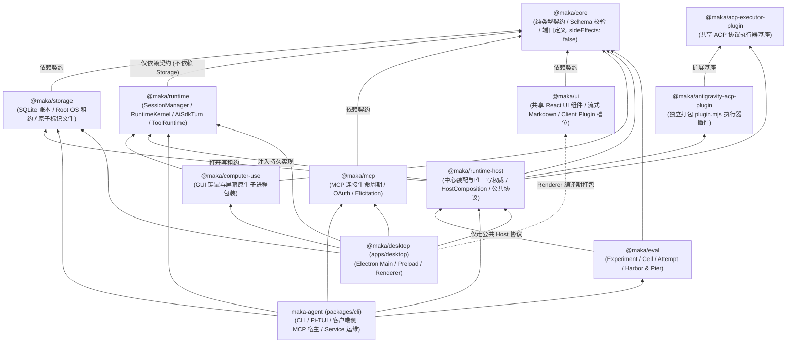
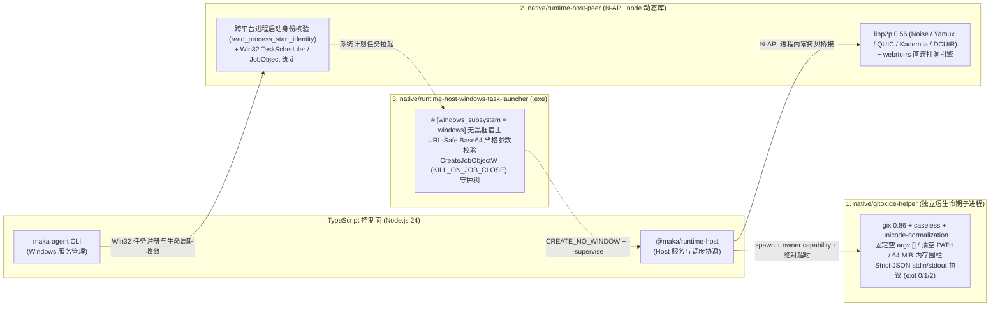
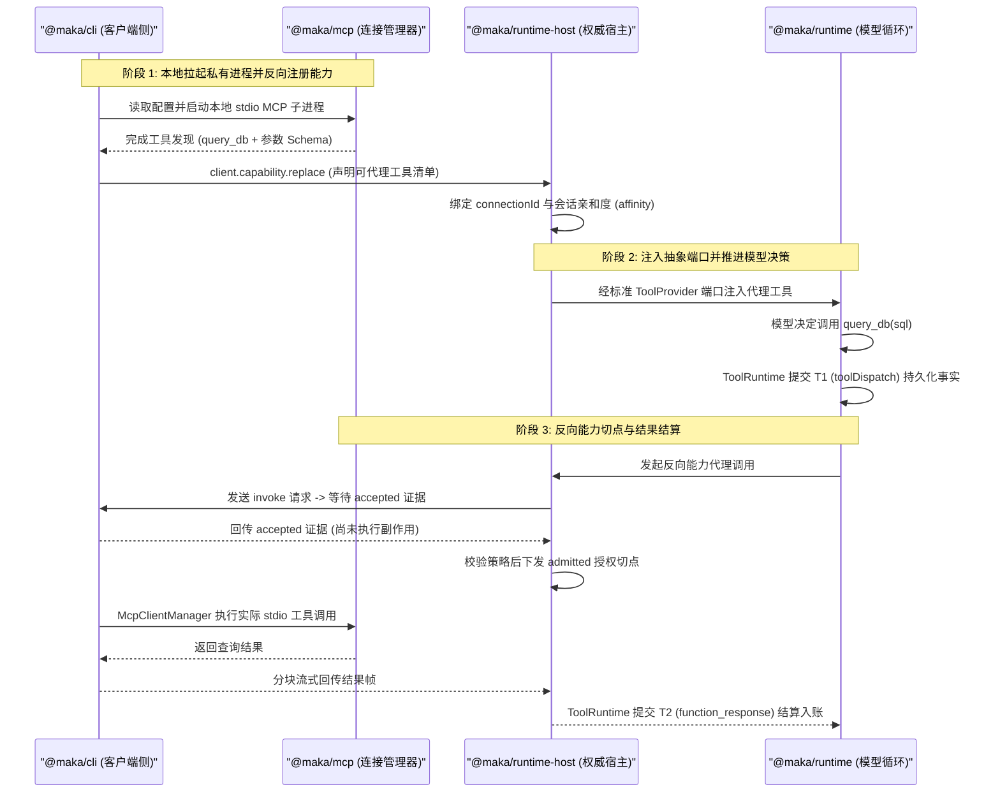

# 仓库地图：Monorepo 依赖反转、组装边界与原生 Rust 加速

[返回手册目录](../README.md)

当一个 Agent 基础设施同时容纳了纯契约模型、多模型步进引擎、SQLite 状态控制面、MCP 工具连接器、Electron 桌面端、终端 TUI、离线评测框架，甚至还要直接操控 Git 对象树、P2P 网络打洞和 Windows 系统任务计划程序时，代码组织方式的微瑕会在几周内演化成致命的架构债。

如果所有模块混在同一个目录里自由 `import`，最常见的后果就是：运行内核直接引入了数据库文件操作（导致无法在纯内存中测崩溃恢复），前端渲染组件悄悄引入了 Node.js 系统库（引发安全与打包故障），评测引擎绕过公共协议直接读取内部控制表（污染生产数据并失去对照公正性）。

Maka 的仓库结构建立在一条铁律之上：**契约下沉（TypeScript 纯类型层）、能力水平切分（零横向耦合）、装配高度收拢（由 Host 中心完成依赖注入），并将高危或重计算系统能力隔离到 `native/` 原生 Rust 模块中。**

---

## 1. 概念先行：TS Monorepo 与 Rust 原生边界的混合布局

Maka 仓库在物理上由三大部分组成：`packages/*`（11 个职责正交的公共与运行时子包）、`apps/desktop`（Electron 桌面应用壳）以及 `native/*`（3 个锁定 Rust 1.98 / Edition 2024 的原生加速与系统控制 Crate）。



### 一眼看懂“依赖反转（Dependency Inversion）”

仔细观察图中的依赖箭头，最反直觉却最关键的一条边是：**`@maka/runtime` 绝对不直接依赖 `@maka/storage`**。
- `@maka/core` 中定义了抽象的持久化与提交端口（例如 `AgentRunStore`、`RuntimeEventStore`、`RuntimeCommitSink`、`AgentBackend`）。
- `@maka/runtime` 仅针对这些纯接口编程，管理多轮步进、上下文投影、历史压缩与代次隔离。
- `@maka/storage` 独立实现基于 SQLite 与文件锁的存储引擎，同时提供一个纯内存的 `test-only/memory-execution-persistence` 参考实现。
- 处于汇聚层的 **`@maka/runtime-host`** 才是唯一把三者拧在一起的装配车间：它通过 `ExecutionPersistenceProvider` 与 `StorageWriterComposition` 打开真实存储，将狭窄的、受租约鉴权包装过的 Capability Facade 注入到 `Runtime` 中。

---

## 2. 故障推演：打破依赖与边界规则会引发什么灾难？

仓库里的每条边界禁令都有明确的工程故障作为反面教材：

1. **故障一：`@maka/runtime` 直接 `import` SQLite 或文件路径操作**
   - *后果*：一旦运行引擎耦合了本地数据库驱动，任何针对状态机、崩溃边界（P0–P11 Failpoints）和历史回放的单元测试都必须初始化真实的本地磁盘目录与原生锁，测试速度暴跌且难以精准构造损坏场景；未来也无法通过 `ExecutionPersistenceProvider` 替换成内存或远程存储后端。
2. **故障二：`@maka/eval` 渗透进 Runtime 或 Storage 内部**
   - *后果*：如果把 Benchmark 的 `Experiment`、`Cell`、`Attempt` 逻辑或评测裁判规则写进 `storage` 表结构，交互式用户数据与评测数据就会发生 Schema 污染；更严重的是，Maka 被测对象（Maka Subject）如果抄近道直接调内部函数，就不再与 Harbor/Pier 中的外部竞品站在同一条起跑线上，实验结果彻底失去说服力。
3. **故障三：Electron Renderer 视图层越权访问 Node 或原生 API**
   - *后果*：如果前端 React 组件层直接调用 `node:fs`、操作 `document` 外部通信或自行持有持久状态，就会绕过 Preload 沙箱与 `RuntimeHost` 的权限仲裁。Maka 在构建门禁中专门维护了基于 `@babel/parser` 的 AST 静态检查脚本（`check:renderer-architecture`），严格禁止在渲染入口及共享 UI 包中出现 `electron` 或 `node:*` 导入，并限制越界状态 Hook 债务扩张。
4. **故障四：用 Node.js 直接拼命令行调用系统 `git` CLI 处理托管工作区**
   - *后果*：系统内置的 `git` 版本和环境变量因用户机器而异，存在 `PATH` 劫持风险；在跨平台路径上极易遭遇 Windows/macOS 大小写折叠路径冲突（Case-folding collision）、`unicode` 正规化（NFC/NFD）不一致以及 `.git/objects/info/alternates` 指向外部恶意仓库目录引发的任意文件读取漏洞。这正是 `native/gitoxide-helper` 存在的核心理由。

---

## 3. TS Monorepo 子包全景与职责边界

下表覆盖了 `package.json` Workspaces 中全部 12 个 TypeScript 子包的真实定位与依赖约束：

| 层级分类 | 包名与目录 | 核心职责与对外导出 | 生产内部依赖 | 严格禁止的越界行为 |
| :--- | :--- | :--- | :--- | :--- |
| **第 0 层：纯契约基石** | `@maka/core`<br/>(`packages/core`) | 提供 160+ 子路径导出，定义 `RuntimeEvent`、`AgentRunEvent`、`AgentBackend`、权限模型、协议 Schema 校验与纯计算工具。 | **无**（仅含少量纯国际化与 Markdown 外部依赖） | 严禁出现磁盘 I/O、网络调用、环境变量读取或对其他任何工作区包的引用。 |
| | `@maka/acp-executor-plugin`<br/>(`packages/acp-executor-plugin`) | 封装 ACP（Agent Client Protocol）外部代理通用执行适配器。 | **无**（运行时自包含 `@agentclientprotocol/sdk`） | 不得把具体厂商插件逻辑硬编码进共享基座。 |
| **第 1 层：平行能力子包** | `@maka/storage`<br/>(`packages/storage`) | 掌控 State Root OS 锁、`.maka-host-composition.json` 绑定、SQLite 控制面、制品文件锁及工作区身份解析。 | `@maka/core` | 严禁包含大模型调度、提示词拼装或 `@maka/eval` 实验表结构。 |
| | `@maka/runtime`<br/>(`packages/runtime`) | 封装 `SessionManager`、`RuntimeKernel`、`AgentRun`、`AiSdkBackend`、`AiSdkTurn`、`ToolRuntime`、沙箱驱动、`filesystem-worker` 与 `AgentGraph`。 | `@maka/core` | **严禁生产依赖 `@maka/storage`**（`storage` 仅存在于 `devDependencies` 用于集成测试）。 |
| | `@maka/mcp`<br/>(`packages/mcp`) | 管理 MCP 客户端连接（stdio/HTTP）、OAuth 授权流、SEP-2243 Form Elicitation 与工具输出校验。 | `@maka/core` | 不得越权持有模型主循环或直接写入 `RuntimeEvent` 账本。 |
| | `@maka/ui`<br/>(`packages/ui`) | 跨平台 React 渲染组件库、虚拟列表（`virtua`）、KaTeX 公式、代码高亮及 Client Plugin 槽位系统。 | `@maka/core` | 严禁依赖 Node 内置模块或 Electron IPC 原语。 |
| | `@maka/antigravity-acp-plugin`<br/>(`packages/antigravity-acp-plugin`) | 将外部代理实现打包为独立 `plugin.mjs`，由 Host 插件平台按需动态装载。 | `@maka/acp-executor-plugin` | 通过受控插件契约与宿主交互，严禁直接触碰宿主私有内存。 |
| **第 1.5 层：扩展能力** | `@maka/computer-use`<br/>(`packages/computer-use`) | 封装操作系统级别的屏幕快照、键鼠操控服务（`MakaCuService`）及 `stdio-json-rpc` 协议桥。 | `@maka/core`, `@maka/runtime` | 仅向桌面端与授权代理暴露受控输入输出，不直接越过 `ToolRuntime`。 |
| **第 2 层：中心装配枢纽** | `@maka/runtime-host`<br/>(`packages/runtime-host`) | **唯一写入权威中心**：执行 `HostComposition`、维护连接准入、提供统一 RPC/WS/Peer 协议、运营调度器与访问控制。 | `@maka/core`, `@maka/runtime`, `@maka/storage`, ACP 插件包 | 严禁在核心逻辑中写入特定前端 UI 样式或评测业务分支。 |
| **第 3 层：产品壳与评测** | `@maka/eval`<br/>(`packages/eval`) | 基准测试编排器：管理 `Experiment` / `Cell` / `Attempt`、Harbor & Pier 适配器、网络出口审计代理（Egress Proxy）与结果裁决。 | `@maka/core`, `@maka/runtime-host` | 严禁作为生产代码依赖 `@maka/storage` 或直接实例化内部 `SessionManager`（Maka 被测主体必须走公共 Host 协议）。 |
| | `maka-agent`<br/>(`packages/cli`) | 终端 `maka` CLI、基于 Pi-TUI 的终端交互界面、客户端侧 MCP 宿主及系统服务/更新管理命令。 | `@maka/core`, `@maka/eval`, `@maka/mcp`, `@maka/runtime`, `@maka/runtime-host`, `@maka/storage` | 终端 UI 与辅助命令不得绕过 Host 协议对正在运行的托管状态根并发写盘。 |
| | `@maka/desktop`<br/>(`apps/desktop`) | Electron 桌面应用壳：主进程负责 Profile、Guest Mount、服务托管；Preload 暴露受限桥接；Renderer 挂载 `@maka/ui`。 | `@maka/computer-use`, `@maka/core`, `@maka/mcp`, `@maka/runtime`, `@maka/runtime-host`, `@maka/storage`（Renderer 消费 `@maka/ui`） | Renderer 严格遵守静态架构扫描规则，不直连存储或 Node 环境。 |

---

## 4. `native/` 原生 Rust 混合加速与安全边界

为什么不在所有地方都只写 TypeScript，也不把整个系统全部用 Rust 重写？Maka 在“快速演进的模型应用层”与“高安全/高并发/系统底层原语”之间切出了一条极度克制的混合架构边界：将核心循环与生态适配留在 TypeScript，而把三类 Node.js 力不从心或存在安全风险的能力下沉至 `native/` 下的三个 Rust Crate。



### 4.1 `native/gitoxide-helper`：零越权风险的 Git 数据面引擎

- **物理形态**：独立编译的短生命期可执行文件 `maka-gitoxide-helper`（基于 `gix = 0.86.0`、`caseless`、`unicode-normalization`、`sha2`、`serde_json`）。
- **为什么必须隔离为独立 Rust 子进程？**
  1. **防路径与字符集绕过**：在跨平台工作区树导入（Source Import）或候选提交构建时，必须遵循 `MANAGED_TREE_POLICY_V3`，严格检测大小写折叠冲突（如 `File.txt` 与 `file.txt` 在 Linux 合法但在 macOS/Windows 会相互覆盖）及 Unicode 规范化等价路径冲突。Rust 侧通过 `caseless` 与 `unicode-normalization` 原生处理，速度与精确度远超纯 JS 遍历。
  2. **绝对资源与格式围栏**：恶意的 `.git` 仓库可能携带畸形对象、无限递归符号链接或 `.git/objects/info/alternates` 外部数据库指针。`gitoxide-helper` 在打开仓库前就实施本地元数据硬限（总量 1 MiB、条目 16,384、pack 目录 1,024 项、深度 64），发现 `alternates` 直接拒绝（`repository_alternates_unsupported`）；随后用 `gix::open::Options::isolated()` + `strict_config(true)` 锁定 `1,024` 个 object-store slots 与 `64 MiB` 分配上限，只允许 40 位小写十六进制 SHA-1 OID。
  3. **极小信任面调用契约**：Node.js 侧调用入口强制校验绑定当前 `owner` 的 `GitoxideHelperInvocationCapability` 与可执行文件字节摘要；启动子进程时**固定传入空参数数组 `[]`、`shell: false`、清空子进程 `PATH`**，通过受限 `stdin`（请求体上限基于 `64 MiB` base64 编码后加 `64 KiB` 头）传输单次请求。退出码严格划分为：`0`（成功）、`1`（操作失败与白名单错误码）、`2`（策略拒绝，如非 SHA-1 仓库）。超时（inspect 5s，import/tree 操作 10min）则由共享进程树终止器强制连根清理。

### 4.2 `native/runtime-host-peer`：N-API 跨平台 P2P 传输与系统原语桥

- **物理形态**：通过 `napi` v3 编译为进程内加载的原生动态库（`cdylib`），在 Release 构建中启用 `opt-level = "s"` 与 `lto = "thin"` 以控制 CLI 全平台分包体积。
- **核心双职责**：
  1. **P2P 加密传输与穿透（`libp2p` + `webrtc-rs` + `tokio`）**：Node.js 生态缺乏成熟的 Kademlia DHT、Noise 加密通道、Yamux 多路复用、QUIC 及 DCUtR/WebRTC Direct 穿透打洞协议栈。Rust 引擎在独立 Tokio 多线程运行时中运行 `PeerEndpoint` 与 `PeerStream`，向上层提供带 ACK 位移与附着代次保护的可恢复逻辑字节流（`ResumablePeerStream`）。同时严格守住边界：**PeerId 只是网络端点密码学身份，底层连上 PeerStream 绝不自动授予任何 Host Session 权限或操作授权**，上层仍需执行完整的 Host 凭据握手。
  2. **操作系统级进程身份与 Windows 任务管控**：提供 `read_process_start_identity()` 读取进程精确的启动时间戳与身份指纹，解决“仅凭 PID 回收残留资源时，因操作系统复用 PID 而误杀无辜进程”的经典安全隐患；在 Windows 平台上通过 `windows` crate 直接操作 Task Scheduler 与 Win32 Job Object。

### 4.3 `native/runtime-host-windows-task-launcher`：无窗守护与进程树束缚器

- **物理形态**：Windows 专用原生轻量启动器（`maka-runtime-host-task-launcher.exe`），编译为 `#![windows_subsystem = "windows"]`。
- **解决什么痛点？** 在 Windows 上通过任务计划程序（Task Scheduler）拉起长期后台 `runtime-host serve` 服务时，直接启动 `node.exe` 会弹出闪烁的黑色控制台窗口，且当任务计划程序停止任务时，往往只杀掉顶层外壳而漏掉子孙进程。
- **精妙设计**：
  - 启动器自身通过 `CreateJobObjectW` 创建带 `JOB_OBJECT_LIMIT_KILL_ON_JOB_CLOSE` 标志的 Win32 Job Object 并绑死当前进程树，确保启动器终止时整个子树由内核自动连坐清理。
  - 参数解析拒绝任意 Shell 拼接，强制要求参数经由 URL-safe Base64 无填充编码且能无损逆向还原，仅允许 `--once` 与 `--supervise`（且必须严格匹配绝对路径下的 `runtime-host serve`）两种模式；在 `--supervise` 模式下子进程非 0 退出则以固定 `2s` 间隔拉起重启。

### 原生 Rust 模块横向对比

| Rust Crate | 集成形态 | 核心技术栈 | 解决的核心系统障碍 | 关键安全/资源约束 |
| :--- | :--- | :--- | :--- | :--- |
| `native/gitoxide-helper` | 短生命期独立子进程（Stdio Strict JSON） | `gix 0.86`, `caseless`, `unicode-normalization`, `serde_json` | 消除系统 `git` 差异、防止路径大小写折叠漏洞与仓库元数据 OOM | 空 `argv []`、`shell: false`、禁 `alternates`、`1,024` 对象槽位、`64 MiB` 内存上限、绝对超时强杀 |
| `native/runtime-host-peer` | 进程内 N-API 原生扩展（`cdylib`） | `libp2p 0.56`, `webrtc-rs`, `tokio 1.53`, `napi`, `windows` | 高可靠 P2P 加密直连/打洞、跨平台启动身份防误杀、Win32 任务调度 | 仅输出认证字节流，不拥有 Host 凭据鉴权与 State Root 写入授权 |
| `native/runtime-host-windows-task-launcher` | Windows 无窗常驻守护二进制（`.exe`） | `windows 0.62` (JobObjects / Threading), `base64` | 消除后台 Node 服务控制台弹窗（`CREATE_NO_WINDOW`）、杜绝孤儿 Host 子树 | 仅允许严格 Base64 参数与绝对路径 `runtime-host serve`、`KILL_ON_JOB_CLOSE` 内核级销毁 |

---

## 5. 跨包协作实战：一条外部 MCP 工具如何跨越四层边界被调用？

为了看清这些子包在运行期是如何咬合在一起的，我们追踪一个典型场景：**用户在本地终端（`maka-agent` CLI）配置了一个私有 stdio MCP 数据库工具 `query_db`，并在对话中让模型调用它。**



这段跨包路径揭示了两条极其精妙的边界隔离：
1. **进程归属与隔离**：访问本地私有资源（如数据库凭证、局部环境变量）的 stdio 子进程由用户所在的客户端（CLI / Desktop）就近托管，运行在远端或隔离环境中的 `Runtime Host` 无需知道也不必拥有用户的本地私钥进程。
2. **端口统一性**：对于核心包 `@maka/runtime` 里的 `AiSdkTurn` 与 `ToolRuntime` 而言，无论是本机沙箱工具还是远在另一台机器客户端背后的 MCP 工具，都被统一抽象在 `MakaTool` 与 `HostedInteractionBridge` / 代理调用边界后面；同样受控于 `T1/T2` 事务提交规则与 `admitted` 之后不可逆断线的 `outcome_unknown` 语义。

---

## 6. 教学伪代码：中心装配与受限原生子进程边界

以下伪代码浓缩了 `@maka/runtime-host` 在装配阶段如何落实“依赖反转”，以及如何安全调用原生 `maka-gitoxide-helper`：

```text
// 1. 中心装配边界 (@maka/runtime-host): 仅在此处将 Storage 实现注入 Runtime 抽象端口
function assembleHostedRuntime(ownerLease, persistenceProvider):
    // 通过 OS 租约打开唯一可写持久化组合
    storage = await openStorageWriterComposition(ownerLease, {
        executionProvider: persistenceProvider
    })

    // 为 Runtime 构造窄化的持久化能力 Facade（不暴露原始 SQLite DB Handle）
    runtimeCommitSink = createLeaseScopedCommitSink(storage.execution.runtimeEventStore)
    agentRunStoreFacade = createNarrowAgentRunStore(storage.execution.agentRunStore)

    // @maka/runtime 只看到 @maka/core 定义的端口，对 SQLite 零感知
    sessionManager = new SessionManager({
        store: storage.execution.sessionStore,
        agentRunStore: agentRunStoreFacade,
        runtimeEventStore: storage.execution.runtimeEventStore,
        runtimeCommitSink: runtimeCommitSink
    })
    return { storage, sessionManager }

// 2. 原生子进程调用边界: 严格受限的 Gitoxide Helper 调用
function invokeGitoxideHelper(capability, requestPayload, abortSignal):
    // 校验调用能力令牌归属，并在 spawn 前重验 helper 二进制字节摘要
    verifiedBinary = await verifyGitoxideHelperArtifactForInvocation(capability)
    canonicalRepoPath = await realpath(requestPayload.repositoryPath)

    // 检查请求字节硬限（严防超大 payload 拖垮子进程）
    encodedRequest = serializeStrictJson(requestPayload, maxBytes: MAX_REQUEST_BYTES)

    // 固定空 argv、禁止 shell、清空 PATH 仅保留最低限度系统变量
    child = spawn(verifiedBinary.path, [], {
        shell: false,
        env: minimalSanitizedEnv(),
        stdio: ["pipe", "pipe", "pipe"]
    })

    // 绑定共享进程树终止器：超时或信号中止时连同潜在子进程强杀清理
    return await executeWithProcessTreeGuard(child, encodedRequest, {
        timeoutMs: resolveOperationTimeout(requestPayload.kind), // inspect: 5s, import: 10min
        maxStdoutBytes: MAX_STDOUT_BYTES,
        maxStderrBytes: MAX_STDERR_BYTES,
        signal: abortSignal,
        decodeExit: (exitCode, stdout, stderr) ->
            if exitCode == 0: return decodeSuccess(stdout)
            if exitCode == 2: return decodePolicyRejection(stdout) // 如非 SHA-1 仓库
            throw StableHelperError(decodeAllowlistedReason(exitCode, stdout, stderr))
    })
```

---

## 7. 工程规范与架构守护防线

为了防止后续迭代把“依赖图”走样成一纸空文，Maka 仓库在脚本与测试层设置了自动化结构守卫：

1. **禁止底层反向引用**：`@maka/core` 保持零工作区依赖且声明 `sideEffects: false`；`@maka/runtime` 绝不在 `dependencies` 中引入 `@maka/storage`。
2. **禁止渲染端逃逸（`check:renderer-architecture`）**：通过 AST 静态解析强制保证 `apps/desktop/src/renderer` 与 `@maka/ui` 不包含任何 `electron` 或 `node:*` 导入，防止桌面前端越权。
3. **禁止构建产物陈旧漂移（`check:stale` 与 `sync:model-metadata`）**：Monorepo 按拓扑序（`core → storage → mcp → runtime → acp-executor-plugin → antigravity-acp-plugin → runtime-host → computer-use → eval → cli → ui → desktop`）编译，`check:stale` 防止修改底层契约后直接拿着过期 `dist/` 运行上层包。
4. **禁止评测逻辑污染核心表**：`@maka/eval` 必须以独立黑盒客户端身份连入 `RuntimeHost`，`storage` 中不保留任何 `TaskRun` 或评测打分根表。

---

## 8. 延伸阅读

- 了解 `HostComposition` 如何在启动期将上述子包串联为六阶段恢复流程，阅读 [00.1 整体架构](architecture.md)。
- 理解跨包流转的六层执行身份与事件结构契约，阅读 [00.3 领域对象模型](domain-model.md)。
- 深入学习混合 TS/Rust 边界及插件系统的设计权衡，阅读 [00.4 设计模式与架构权衡](design-tradeoffs.md)。
- 探索外置 ACP 执行插件与插件平台运行时装配，参阅 [01.5 插件平台与 ACP 运行时](../01-runtime/plugin-and-acp-runtime.md)。
- 深入探究 GUI 自动化与受管 PTY 终端架构，参阅 [03.5 Computer Use 与 PTY 运行时](../03-tools/computer-use-and-pty.md)。
- 详细了解 `gitoxide-helper` 如何构建托管工作区的不可变树提交与版本权威，参阅 [04.3 Gitoxide 与工作区版本控制](../04-state/gitoxide-and-workspace-versioning.md)。
