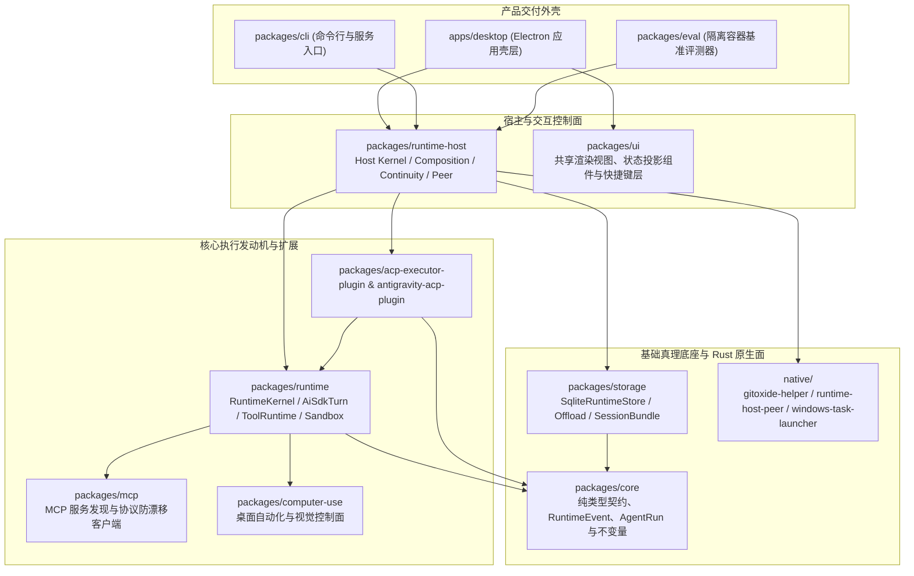
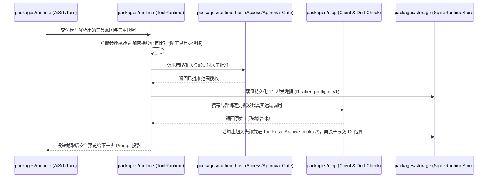

# TypeScript Monorepo 控制边界与 Rust 原生数据面混合拓扑

## 1. 为什么在 TypeScript Monorepo 之下还需要三个独立 Rust `native/` 子系统？

当采用 TypeScript + Node.js 作为主工程底座时，开发复杂业务逻辑、交互编排与外部插件适配的迭代效率极高；但在构建生产级桌面及终端 Agent 运行时时，纯粹的 Node.js 脚本进程很快会撞上三堵无法仅靠 JS 库绕过的工程墙：

1. **Git 数据面与海量树操作开销**：若靠 TS 频繁 `spawn("git")` 子进程去处理成千上万文件的检查点快照、索引构建与原子引用更新，不仅跨进程拉起延迟巨大，还极其容易污染用户工作区自身的 Git 暂存区、受环境变量牵连且难以保证 CAS 原子性。
2. **弱网跨设备流式传输韧性**：当桌面端作为 Host 开启多端协同，移动设备或远端控制台在 Wi-Fi/蜂窝网络频繁切换之际需要断点无缝接管大字节流，纯 JS 上层重连逻辑难以做到极低开销的连接底层可恢复迁移。
3. **Windows 无特权隔离启动边界**：在 Windows 上既要防止沙箱进程拖着子树逃逸、又要精确接管环境变量与隔离路径创建，单纯的 Node `child_process` API 在作业对象（Job Object）与安全权限收敛上显得捉襟见肘。

因此，Maka 在 TS Monorepo 结构中划定了清晰的 **“TS 控制面与策略编排 + Rust 原生数据面与安全执行面（`native/`）”** 混合架构拓扑。

---

## 2. Workspaces 包依赖图谱与反向依赖禁令

打开根目录 `package.json` 中的 `workspaces` 配置，Maka 将全仓库划为 12 个功能边界清晰的 TypeScript 子包（连同 1 个产品桌面壳层与 3 个原生 Rust Crate），严格贯彻自顶向下的有向无环依赖流：

### 各包核心工程边界一览

| 目录路径 | 职责锚点 | 严苛架构边界 |
| :--- | :--- | :--- |
| **`packages/core`** | 领域零副作用契约中心 | **绝对零存储实现、零网络、零外部运行器依赖**；统领 `RuntimeEvent`、六层身份、`canonical-runtime-event` 与各类 Schema 解码器 |
| **`packages/storage`** | 唯一持久化事实存储层 | 掌管 SQLite Schema、`write-queue` 串行写通道、Context Offload、`SessionBundle` 打包与工作区版本事务 |
| **`packages/runtime`** | 推理循环、工具结算与沙箱逻辑 | 实现 `RuntimeKernel`、`AiSdkTurn`、`ToolRuntime`、压缩规划与双路沙箱构造；通过 Port 接口依赖持久能力，绝不直接跨过 Host 私连数据库 |
| **`packages/runtime-host`** | 单一权威调度宿主 | 持有 State Root 排他锁、`SessionAdmissionGate`、`AccessAuthority`、`ClientCapability` 经纪人以及 Peer Mesh 组网协调 |
| **`packages/mcp` & `packages/computer-use`** | 垂直外部协议与桌面自动化模块 | 收敛各自高频变动的第三方协议细节与原生视控契约，对外仅暴露经由 `core` 定义的清晰边界接口 |
| **`packages/acp-executor-plugin` & `antigravity-acp-plugin`** | 异构外部执行器接入插件 | 将外置 ACP 代理按 `AgentBackend` 契约平滑并入同一内核准入与回收生命周期 |
| **`packages/eval` / `packages/cli` / `apps/desktop` / `packages/ui`** | 应用组装与独立校验产品 | Electron 渲染端架构甚至由专门守卫命令 `check:renderer-architecture` 与打包预算门禁 `check:artifact-budget` 硬核检查 |

---

## 3. 原生 Rust 三大混合基座（`native/`）

为什么在 `package.json` 的构建与测试链路中专门嵌入了 `test:gitoxide-helper`（`cargo test`）和 `build:runtime-host-peer` 等原生指令？三大 `native/` 目录揭示了混合架构下性能与安全分流的最核心切口：

1. **`native/gitoxide-helper`（纯 Rust `gix` 工作区检查点与数据面）**：
   - 基于 `gitoxide` (`gix`) 构建的超轻短生命周期进程；
   - **不持有会话授权、也不做业务裁决**，只接受上层颁发的不可伪造不透明能力包（`Opaque Capability`），通过 CAS 引用校验（`refs/maka/accepted` 与 `MustNotExist`）完成海量源代码树的扫描、内容寻址归档与原子迁出恢复。
2. **`native/runtime-host-peer`（可恢复 Peer Mesh 网络传输引擎）**：
   - 基于 Rust `libp2p` 与 `WebRTC Direct` 构建原生节点，作为 Node 扩展或原生引擎嵌入 `runtime-host`；
   - 借助内置的传输偏移量记录与 ACK 对账机制（`ResumablePeerStream`），让远程控制台在蜂窝网络抖动甚至切换 IP 后依然能毫秒级续传字节流。
3. **`native/runtime-host-windows-task-launcher`（Windows 安全作业发射器）**：
   - 弥补 Node.js 在 Windows 下缺乏原生活跃作业组强约束（Job Object）、受控句柄继承与低权限隔离拉起的天然短板，保障在 Win32 平台上同样执行严格收敛的命令进程边界。

---

## 4. 一次外部 MCP 工具调用的完整跨包接力路径

为了看清这些分层的真实咬合方式，让我们追踪一次普通外部 MCP 工具（例如修改某条远端工单）究竟如何严格跨越多重边界落地：

整个调用路径中：**`Mcp` 永远拿不到直写数据库或绕开 `Host` 自批准的入口；`Host` 也无需理解 MCP JSON-RPC 的任何细节；一切事实流与超大输出被 `Storage` 整齐消化在双账本与内容归档仓库之中**。

---

## 5. 架构铁律自动化守护防线

好的仓库拓扑不能只靠架构师在文档里呼吁，必须转译为 CI 上跑不通就阻止合入的硬门禁。在 Maka TypeScript 根目录 `package.json` 中可以看到完整的自动化守卫指令：
- **统一代码格式与静态规则（`biome lint` / `format:check`）**：统一全 Monorepo 成百上千个模块的代码风格边界；
- **渲染器越界拦截（`check:renderer-architecture`）**：防止 `apps/desktop` 前端 UI 层偷偷引入本应归属 `runtime-host` 或 `storage` 的重后端代码或文件系统调用；
- **包体膨胀卡点（`check:artifact-budget`）与启动正确性回归（`test:startup-correctness`）**：确保混编架构不会在多端打包后悄然塞入非预期的重依赖或打乱 Host 六阶段启动时序。

---

## 6. 总结

Maka TypeScript Monorepo 的仓库布局体现了清晰的“**重规则放在 `core`、重权责放在 `runtime-host`、重演化隔离在 `storage` 与 `runtime`、重系统性能与安全下沉进 Rust `native/`**”设计智慧。这种混合布局既保留了 TypeScript 生态在高频交互编排上的敏捷性，又通过极精简的 Rust 边界避开了 Node.js 在大规模 Git 树与 OS 安全域上的原生弱项。

了解了系统的物理分层、双账本对象和 Monorepo 边界之后，我们在做技术决策时必然会好奇：**这套混合 TypeScript 运行时究竟为了实现高可靠性付出了多大复杂度代价，它在哪些地方做出了与众不同的工程取舍？** 下一篇将把全系统的权衡清单摊开在桌面——[架构取舍与演进边界：混合 TypeScript Runtime 的代价平衡清单](./design-tradeoffs.md)。
