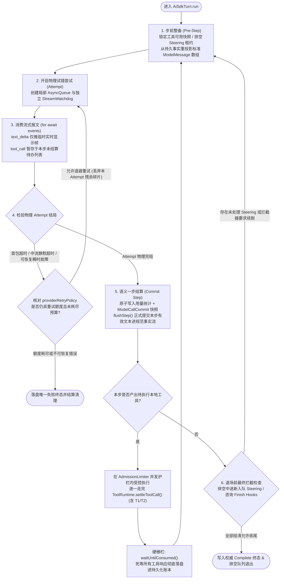

# AiSdkTurn 双层循环：流式看门狗、步间 Steering 与工具结算栅栏

## 1. 为什么在生产里调用大模型不能只靠 `for await (const chunk of stream)`？

在入门级的 AI 脚本教程里，实现一个带工具调用能力的 Agent 回合只需寥寥 20 行代码：发请求给 SDK，等返回，拿到 `tool_calls` 就调用本地函数，把结果塞进 `messages` 数组再调下一次模型。但只要把它放进真实的多端长程生产场景，这套天真循环立刻会在三个节点彻底崩坏：

1. **物理传输层静默卡死（Silent Hang）与部分碎片污染**：网络链路可能连着建立成功甚至刚吐了两个字，中间路由黑洞了。连接既没主动报 TCP Reset，SDK 的 `for await` 就死等在那里直到天荒地老；更麻烦的是，那刚吐出的两个半截文字千万不能留在供下一轮模型重试的正式消息历史里，否则重连后模型看到自己“说了一半又从头说”。
2. **工具刚投递完，上下文里还根本没有结果**：外层步循环如果不等这批并发启动的工具彻底把 `T1/T2` 结果写盘并在规范存储确认消费，下一步立刻重构上下文发给大模型，就会因为缺了对应的 `function_response` 引发 API 400 协议炸裂错误。
3. **动态纠偏（Steering）插入时机撕裂**：用户在模型第 2 轮工具跑完正打算开口总结的时候发送了补充指令；或者就在大模型正在全速吐废话时用户按下了纠偏打断。什么时候该立即掐断当前流，什么时候又该等本批原子工具全部落定后再统一注入纠偏消息？

Maka 在 `packages/runtime/src/ai-sdk-turn.ts` 中通过**外层 Step（语义推演步）与内层 Attempt（物理网络流试错）的双重嵌套循环**，配合 `StreamWatchdog`、`StepBuilder` 缓冲提交与工具结算严格栅栏，精细治理了这每一处断裂面。

---

## 2. 外层 Step vs 内层 Attempt：双重嵌套的责任边界

把“业务逻辑的步进”与“网络物理传输的重连尝试”混在同一个 `while` 循环里，是造成无数 Agent 状态污染的总根源。`AiSdkTurn` 将两者劈成了完全正交的两层状态机：



注意图中的几条工程防线，没有任何一条是多余装饰：

1. **碎片绝不先污染规范脊柱**：在内层 `Attempt` 流式消费阶段，所有收到的 `text_delta` 或思考 `thinking_delta` 仅经由实时推送通道（带有 `partial = true` 标记）渲染在终端屏幕上让用户看到打字机效果；**只要这轮物理请求途中因为断网或超时失败了，整段半成品随旧 `Attempt` 就地蒸发丢弃，下一次物理重试从洁净投影的历史基线重新发出**。唯有内层拿到可靠完结信号后，步骤结算 `flushStep()` 才一锤定音将该次胜出 `Attempt` 的全部语义产出正式刻入不可变的 `RuntimeEvent` 脊柱！
2. **双模式参数实时检验拦截**：在吐出 `tool_call` 并真正提交执行前，`ai-sdk-turn.ts` 引入了完整的 Ajv（含 Draft 2019/2020 支持）与 Zod 严格契约验证器；对于流式网络传输截断或模型吐错的残缺工具入参，直接由 `ai-sdk-tool-repair` 修复规范化或拦截返回给模型自纠，绝不把坏数据透传打崩宿主工具执行器。

---

## 3. 内层传输守护神：双阶段 `StreamWatchdog`

普通的 SDK `timeout: 60000` 只设一个固定整段请求总超时，这会导致两个极其荒谬的工程 bug：**要么把认真吐了 2 分钟长代码的大模型半道活活掐死；要么服务端其实 5 秒后就死锁断气了，客户端还要干等足足 55 秒才知道报错！**

`packages/runtime/src/stream-watchdog.ts` 实现了一个根据响应阶段切换策略的**双阈值看门狗（Dual-Phase StreamWatchdog）**：

- **阶段一：首包活性看门狗（First-Token / Header Timeout）**：从 HTTP 请求发出直至收到第一个有效事件响应头或词元前的倒计时；由于大推理模型通常需要十几秒甚至数十秒进行首个思考块 Prefill，此阶段容忍按模型家族独立调配较稳健的首包等待线。
- **阶段二：流间步进停滞看门狗（Inter-Chunk Stall Timeout）**：只要流已经正常打开并开始输送词元，每收到一个 `text_delta` / `thinking_delta` / `tool_call_delta`，看门狗就自动清零复归（Feed Watchdog）！但如果两个连续数据帧之间的**静止盲区**超过了规定阈值，哪怕整个请求总运行才 20 秒，看门狗也会立刻果断判定传输通道静默死锁，当场中断底层 Socket 并把这次 Attempts 送入上层快速重连通道。

---

## 4. Steering 抢占时机与工具结算死锁规避

在一个支持交互式并发的多步 Loop 里，“什么时候消费用户插话（Steering）”和“怎么等工具彻底落库”决定了整个引擎会不会丢失指令或漏掉工具结果：

1. **步边界与 `Code Mode` 主动让权机制**：
   - 在每步开启之前的 **`Prep`** 阶段，系统优先排空此时已经挂入待投递区的用户纠正指令（借助 `SteeringLease` 两阶段投递租约，见 [05.1](../05-coordination/queues-and-admission.md)）；
   - 如果上一步没有任何局部工具调用，模型觉得已经讲完打算直接收尾（**`FinishCheck`**），引擎在真正打出 `Complete` 终态前还会做最后一次兜底检查：立刻再去检查一眼在刚才这轮最后吐字几秒内有没有新插进来的 Steering 消息，或钩子要求延续；只要有一条待办，Turn 就绝不封箱完结，而是折回 `Prep` 再跑完最后一棒！
   - 更妙的是引入了 **`isEventWaitSteeringInterruption`** 与 **`CodeModeSteeringInterruption`**：当某步恰好正陷在漫长的后台代码沙箱（`executeCodeCell`）或事件等待挂起中，新的高优 Steering 可以受控触发安全中断切换，把“尚未完结的异步细胞中断现场”诚实包裹进提示词，立刻掉头听从用户新指挥。
2. **工具执行控制：`AdmissionLimiter` 与强制消费栅栏 `waitUntilConsumed()`**：
   - 当一步内模型并发甩出 12 个本地工具调用时，Turn 不会直接 `Promise.all` 无限制炸出 12 个重型 OS 子进程，而是全数过 **`AdmissionLimiter`** 并发限流令牌槽控制吞吐峰值；
   - 而一旦所有通过准入的 `ToolRuntime.settleToolCall()` 纷纷结束并写入 `RuntimeEvent`，外层循环绝对不会凭本地返回值直接抢先进入下一轮重投影——必须死等存储/异步泵通道反馈所有结果事件已经确认写入规范账本（**`waitUntilConsumed()`**），确保下一步从 `SqliteRuntimeStore` 重构出来喂给模型的 `ModelMessage[]` **百分之百包含刚才刚写完的那几条工具回答**。

---

## 5. `flushStep()` 结算、双循环骨架与结构方案对比

当外层确认单步圆满落定准备向前跨步时，`AiSdkTurn` 会同时封账两份互补资产：
1. **向模型和用户提交语义步**：调用 `flushStep()` 通过 `pushAndWaitUntilConsumed` 落地完整有序的助手回复部分（Text / Thinking / Provider Tool Calls），同步计入 Token 用量（`TokenUsageEvent`）；
2. **绑定单值计量体（`ModelCallCommit`）**：将在当前 `Attempt` 记录到的延迟（TTFT / TPS）、请求形貌体积（`ContextBudgetDiagnostic`）与重试轨迹通过单值封装原子写入伴生 `AgentRunStore`（详析见 [06.2](../06-operations/observability.md)）。哪怕第 3 步之后机器突然断电，前面第 1、2 步花出去的每一点 Token 与每一毫秒流逝都已经在盘面上丝毫不差。

### 5.1 核心双循环状态机骨架（Step / Attempt + Watchdog + AckWait）

```typescript
// 教学级提炼自 packages/runtime/src/ai-sdk-turn.ts 的核心步进与围栏骨架
async function runAiSdkTurnLoop(ctx: TurnRunContext): Promise<TurnOutcome> {
  let stepCount = 0;

  while (true) {
    // 1. 步前整备：排空 Steering 租约、重投影持久规范事实（绝不直读半程 partial 碎片）
    const steeringLeases = await ctx.pullSteering?.();
    const messages = await projectCanonicalMessages(ctx.store, ctx.sessionId, steeringLeases);
    if (steeringLeases?.length) ctx.ackSteering?.(steeringLeases.map((l) => l.leaseId));

    // 2. 内层物理 Attempt 试错循环：断流重试丢弃碎片重来，绝不污染外层规范历史
    let stepResult: ModelStepOutcome | undefined;
    while (true) {
      const watchdog = new StreamWatchdog(ctx.watchdogConfig); // 首包延迟 + 流间帧停滞双阶段守护
      try {
        stepResult = await consumeProviderStream(messages, {
          onDelta: (delta) => {
            watchdog.feed(delta.phase); // 每次有效词元刷新看门狗
            ctx.emitPartialDelta(delta); // 仅投送 transient 显示层 (partial = true)
          },
          signal: watchdog.abortSignal,
        });
        break; // 物理传输圆满完结，跳出 Attempt 循环
      } catch (err) {
        const decision = providerRetryDecision(classifyFailure(err), extractHeaders(err));
        if (!decision.reason || !ctx.hasRetryBudgetRemaining()) throw err;
        await sleepClamped(decision.retryAfterMs); // 遵守退避（钳位 <= MAX_TIMER_DELAY_MS）后干净重开
      }
    }

    // 3. 语义结算（flushStep）：原子入库并同步提交 ModelCallCommit，推送完整步事件并等队列消化确认
    stepCount += 1;
    await ctx.commitStepUsageAndDiagnostics(stepCount, stepResult);
    await ctx.queue.pushAndWaitUntilConsumed(buildCommittedStepEvent(stepResult));

    // 4. 分支判定：存在本地工具调用 -> 受 AdmissionLimiter 限流结算后死等完全落库
    if (stepResult.localToolCalls.length > 0) {
      await settleToolsWithinLimiter(ctx.admissionLimiter, stepResult.localToolCalls, (call) =>
        ctx.toolRuntime.settleToolCall(call),
      );
      await ctx.queue.waitUntilConsumedThroughCurrent(); // 关键栅栏：死等所有 T2 结果入库再投影下一步
      continue;
    }

    // 5. 退场拦截（FinishCheck）：再排一轮末端到达的 Steering 或 Finish Hooks 避免丢失末班车
    const trailingSteering = await ctx.pullSteering?.();
    const shouldContinue = (trailingSteering?.length ?? 0) > 0 || (await ctx.beforeTurnFinish());
    if (shouldContinue) continue;

    return await ctx.emitTerminalCompleteAndDrain();
  }
}
```

### 5.2 循环架构对比：单层简单 Loop vs Step/Attempt 双层隔离

| 维度 | 传统单层 `for/while` SDK 循环 | Maka `AiSdkTurn` Step/Attempt 双循环 |
| :--- | :--- | :--- |
| **中流断线重连干净度** | 已输出到 UI 或局部数组的半截文字难以剥离，重试容易产生“双头句”或重复调用工具 | `Attempt` 失败即销毁本次残片；仅 `flushStep()` 胜出后才入账 `RuntimeEvent` |
| **假死检测灵敏度** | 固定整段超时（要不掐死长推理，要不傻等死流半分钟） | 首包超时宽容思考预热，流开启后按 chunk 喂狗实现秒级死流抓捕 |
| **工具回流与下一轮一致性** | 工具 Promise 结束即直接进入下一步，高并发下异步落库未完可能导致下一帧丢响应 | `waitUntilConsumedThroughCurrent()` 死等所有 `T2` 结果彻底进账后才重算输入 |

---

## 6. 总结

`AiSdkTurn` 展现了一个工业级推理执行循环应有的秩序与洁癖：
- **内外分治**：内层 `Attempt` 尽情试错重连且只推临时预览帧；外层 `Step` 只接纳完整胜利的尝试结果，保证规范账本里不存在半分撕裂残言。
- **动态看门狗**：把固定的“请求总时限”进化为基于活性帧喂狗的“首包 + 帧间隔”双重监控，兼顾长思考宽容度与死流秒级自愈能力。
- **步末强围栏**：`AdmissionLimiter` 限并发、`waitUntilConsumed()` 保因果一致性、退场 `FinishCheck` 防止末班 Steering 擦肩而过。

看清了内部循环如何严密协调模型步进后，模型层外部接线的复杂性才刚展开：**同一个逻辑连接下挂着 OAuth 动态失效凭据怎么办？前端改配置热更新如何用 CAS 防覆写？支持 WebSocket 全双工的 OpenAI Responses 接口如何精准复用状态而又不产生哪怕一个字节错位？** 下一篇直击配置注入、凭据流转与增量协议网关——[四元配置解耦与 WS 增量传输：OAuth 动态注权、并发 CAS 与 5 分钟冷却退避](./provider-configuration.md)。
