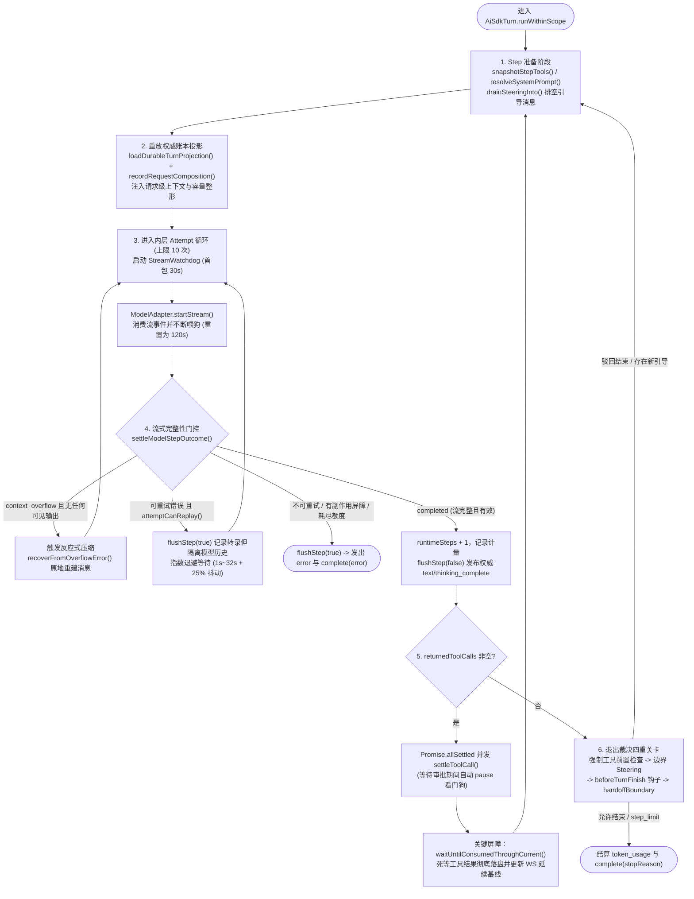

# 模型循环：工具调用下的多轮步进与结算

[返回手册目录](../README.md)

当用户发出指令“读取 `config.json`，并解释其中的超时设置”时，大语言模型本身并没有读取本地磁盘的能力。它只能在第一轮推理中输出“调用 `Read("config.json")`”的结构化意图；宿主的运行时在沙箱与权限门控下真正读取文件后，将结果回传给模型，模型才能在下一轮推理中给出基于事实的解释。

这看似简单的“推理 → 调工具 → 再推理”，在生产环境下却布满工程暗礁：**如果流式连接中途静默挂起怎么办？如果模型已经调用了服务端搜索工具，网络断线还能安全重试吗？如果模型把工具名拼错大小写或者参数 JSON 畸形，是直接报错退出还是就地自愈？当模型认为“我答完了”想结束时，如何防止它其实漏跑了测试？**

本章深入剖析 Maka 模型循环引擎（`AiSdkTurn`）与适配器（`ModelAdapter`）的核心运转机制。

---

## 1. 概念先行：Turn、Step 与 Attempt 的三层执行边界

构建工业级 Agent 循环的第一条原则，就是**严格隔离逻辑工作流、模型推理步进与底层物理网络尝试**。混淆这三层概念会导致步数配额被网络抖动白白耗光，或者重试时产生重复扣费和状态污染。

| 执行单位 | 物理与逻辑边界 | 在“读 `config.json` 并解释”中的对应 | 对重试、计数与历史的影响 |
| :--- | :--- | :--- | :--- |
| **Turn（逻辑轮次）** | 由一次用户输入触发的完整工作流，对应一个 `AiSdkTurn` 作用域。 | 从用户提问到生成最终解释的整个过程（可跨 Handoff 交接）。 | 持有 `ToolRuntime`、队列和累加用量账本。 |
| **Step（模型步进）** | 外层 `agentLoop` 的一次“模型决策 + 本地工具结算”。 | **Step 1**：决定 `Read` 并拿到文件内容；<br>**Step 2**：依据内容生成最终解释。 | `maxSteps`（最大步数）**只计算成功完成结算的 Step**；失败重试的网络尝试不耗步数。 |
| **Attempt（物理尝试）** | 内层请求循环在某一个 Step 内真正发出的单次 HTTP/WS 请求。 | Step 2 首次请求遇 502 断线（Attempt 1），退避后重发成功（Attempt 2）。 | 重试上限为 `MAX_PROVIDER_ATTEMPTS_PER_STEP = 10`；可安全重试的失败对模型上下文投影完全透明。 |

---

## 2. 外层 Step 与内层 Attempt 双循环全景图

`AiSdkTurn` 采用“**外层 Step 循环推进业务事实 + 内层 Attempt 循环守护网络传输 + 异步队列驱动账本背压**”的三段式精密设计：



---

## 3. 核心机制深度解析

### 3.1 外层 Step 准备与“先落盘后注入”不变量
每轮外层 `agentLoop` 开头并非简单拿内存列表发请求，而是依次执行三项关键装配：
1. **步进工具快照与模式投影（`snapshotStepTools`）**：重新采样当前已激活工具集（包含上一轮通过 `tool_search` 新发现的工具）并依据当前 `ToolMode` 投影为 `direct`（直调模式）或 `code_mode`（单 `exec` 沙箱执行单元模式）。如果上一轮发生了沙箱越界拒绝，系统会直接强制剥离越界工具、进入仅总结的 `sandboxBoundaryFinalizationStep`。
2. **动态提示词与请求表面指纹（`recordRequestComposition`）**：动态组装 `systemPrompt`（含插件片段、Swarm/Graph 编排提示及收尾约束提示），并在真正发包前通过 `recordRequestComposition()` 将本步的系统提示词哈希、工具目录哈希与策略哈希写入 `AgentRun` 审计账本。
3. **引导消息排空（`drainSteeringInto`）与 `persist-before-include` 不变量**：如果在工具执行期间用户通过界面发来了插队引导（Steering），Step 边界会拉取引导消息租约，并调用 `queue.pushAndWaitUntilConsumed()` 死等 `steering_message` 写入 `RuntimeEvent` 账本，然后才调用 `ackSteering()` 并把消息放进本步上下文。**如果写账本前消费端崩溃或分离，租约立即被 `nackSteering()` 退回队列，保证大模型绝不会执行一条账本里没有记载的指令。**

### 3.2 `StreamWatchdog` 双阶段看门狗与审批期间暂停
生产环境下最隐蔽的故障是“静默假死连接”：TCP 连接既不断开也不吐 500 错误，而是永远停在半途。若设置全局固定 30 秒超时，正常的 2 分钟长代码生成会被误杀；若统一放宽到 10 分钟，假死连接又会卡死体验。

`StreamWatchdog` 通过**双阶段超时 + 活跃重置 + 暂停引用计数**完美化解了这一矛盾：

| 看门狗阶段 | 触发与重置规则 | 默认阈值 | 设计目的 |
| :--- | :--- | :--- | :--- |
| **`connect`（首包等待）** | `watchdog.start()` 启动时进入，等待第一个 SDK chunk 到达。 | **30 秒**（`DEFAULT_STREAM_CONNECT_TIMEOUT_MS = 30_000`） | 快速识别服务端握手卡死、队列拥堵假死，尽快触发 Attempt 重试。 |
| **`idle`（流式活跃期）** | 每次消费原始 SDK stream part 前回调 `onStreamActivity()`，调用 `watchdog.markActivity()` 切换到 `idle` 并重置倒计时。 | **120 秒**（`DEFAULT_STREAM_IDLE_TIMEOUT_MS = 120_000`） | 只要数据仍在流动（哪怕仅产生思考过程碎片或心跳），连接就能安全持续运行数十分钟。 |
| **暂停机制（`pause` / `resume`）** | `ToolRuntime` 等待用户沙箱边界确认或提问交互时，通过引用计数 `pauseCount` 暂停计时器；用户应答后 `resume()` 恢复并视同一次活动重算起点。 | 不限时 | **人类思考审批时间不是模型沉默**。防止用户在弹出的确认框前犹豫 3 分钟时，底层看门狗误以为超时而强杀整个 Turn。 |

一旦触发超时，`onTimeout` 会构造带 `MODEL_STREAM_TIMEOUT` 标记的错误并立刻 `abort` 本次物理请求专用的 `providerRequestAbortController`（注意：它只掐断当前 Attempt，不会破坏外层 Turn 的生命信号），随后交由 Attempt 循环判定重试。

### 3.3 为什么必须等流结束才调用工具？与流式完整性门控
即便流式响应在半途已经拼出了一段看起来完整的工具参数 JSON，Maka 也**绝不在流式过程中提前启动任何本地工具**，原因有四点：
1. 模型可能在一轮内连续请求多个关联工具，必须集齐完整批次才能通过 `Promise.allSettled` 统一编排与检查独占语义；
2. 响应可能在后续输出时因 `max_tokens` 或网络断开截断，提前执行残缺意图会留下脏副作用；
3. 模型在吐工具前可能先吐出了思考链（Thinking）或签名（Signature），必须先与本步助手记录原子结清；
4. 只有流式完整门控校验通过，才能保证“模型说过的话”与“工具做过的事”在因果账本上严丝合缝。

在消费完一条物理流后，Maka 通过**单调证据标志**与 **Adapter 结算门控**严防“假完成”与“不安全重试”：

- **Attempt 内部四枚单调证据标志**：
  1. `attemptSawVisibleContent`：是否已向用户呈现过非空文本或思考增量。
  2. `attemptSawToolInput`：是否已经收到工具参数增量流。
  3. `attemptSawToolActivity`：服务端是否已经执行了内置工具（例如 OpenAI/DeepSeek 服务端内置 `WebSearch`）。一旦为 `true`，说明远端已产生不可观测的外部副作用。
  4. `attemptSawReplayBarrier`：是否产生了分段边界、厂商 `providerOptions` 或思考签名等不可重放的内部状态屏障。
  - **两条铁律**：
    * 只有 `attemptHasNoObservableOutput()`（上述无可见输出、无工具活动、无屏障且未收集到工具输入/调用）成立时，遇到 `context_overflow` 才允许调用 `recoverFromOverflowError()` 原地压缩后无缝重发该 Attempt。
    * 只有 `attemptCanReplay()`（`!attemptSawToolActivity && !attemptSawReplayBarrier`）成立时，网络故障才被允许自动重试！一旦服务端内置工具已开跑或跨越了不可重放屏障，系统将直接拒绝自动重试（标记 `because: 'side_effects' | 'observable_output'`），杜绝盲目重放引发重复搜索或状态分裂。
- **`ModelAdapter.settleModelStepOutcome()` 防假完成门控**：
  部分不稳定中转网关在后端断开时不会抛异常，而是直接发一个无内容的 `finishReason: 'stop'` 假结束帧。`classifyModelFinishBoundary()` 强制校验：如果收到 `finishReason === 'stop'`，但既没有任何响应证据（`hasResponseEvidence === false`）又没有可用计量用量（`hasUsableStepUsage === false`），直接将其定性为 `'incomplete'` 并转化为可重试的 `stream_truncated` 失败，绝不允许一个空消息蒙混过关！此外，若检测到 `sawUnfinalizedPlaintextSummary`（流结束了却漏掉推理摘要的封口元数据），也会 fail-closed 报错拒绝继续，防止下轮重放失去推理态。

### 3.4 `ai-sdk-tool-repair`：畸形与未知工具调用的自我修复闭环
大模型在长上下文压力下经常出现两类工具调用失误：把工具名大小写写错（如 `read_file` 写成 `Read_File`），或者调用了不存在的工具、传错参数 JSON/Schema。如果直接把异常抛给用户导致 Turn 失败，Agent 的容错率会极低。

`ModelAdapter` 通过 AI SDK 的 `repairToolCall` 回调将所有解析或校验失败的工具意图路由至 `repairMakaToolCall()` 进行精准分诊：
1. **大小写无感自动纠偏**：从当前步活跃的 `currentRepairToolNames()`（随 `tool_search` 动态激活而更新，从而让刚激活的工具本轮就能被纠偏）做不区分大小写的精确匹配。如果命中，直接修正 `toolName` 并正常执行，无需额外消耗一轮模型对话。
2. **结构化降级重定向至 `invalid` 内置靶工具**：若工具完全不存在或参数违反 Zod/JSON Schema，修复器绝不悄然丢弃，而是将其改写为调用内部保留工具 **`INVALID_TOOL_NAME = 'invalid'`**，并由 `describeUnrepairableToolCall()` 生成高信息密度的诊断参数：
   - 若工具名未知：明确列出当前步骤所有合法的 `Available tools` 清单；
   - 若参数 Schema 违规：通过 `formatToolArgsViolationText` 结合该工具的参数 Schema 与分类提示（`categoryHint`）指明缺少哪些必填字段或类型错误；
   - **越界意图识别（`isProviderSandboxBoundaryAttempt`）**：专门检查模型是否试图通过未知沙箱边界申请或违规声明 `bash.boundary_intent` 绕过权限，并打上 `sandboxBoundaryAttempt: true` 标记，在 `invalid` 执行时转为可恢复的 `SandboxCommandError`。
3. **闭环纠偏**：在随后的工具执行阶段，`buildInvalidMakaTool()` 会抛出结构化报错并作为标准 `ToolResult` 落盘，在下一轮 Step 中精准反馈给模型，促使模型立刻按正确工具名和参数自我修正！

### 3.5 `flushStep` 分段结算、长度截断处理与 `beforeTurnFinish` 退出裁决

1. **`flushStep`（按步与按推理完整性切分持久化）**：
   一个 Turn 可能跨越多步推理与多次文本输出（甚至在同一物理步内通过 `providerItemBoundary` 输出多段内容）。`flushStep(interrupted)` 负责把当前步累积的 `stepThinkingParts` 与 `stepText` 固化为 `thinking_complete` 与 `text_complete` 事件。
   - 若中途因错误或中止打断（`interrupted = true`），`flushStep` 会精细检查每一段思考的 `hasFinalizedReasoning(part)` 状态：把**已经拿到完整签名/封口数据的思考段**与**半途中断的片段（标为 `interrupted: true`）**拆开存放在不同记录里；
   - 若该错误将被内层 Attempt 重试，带有 `interrupted: true` 的碎片只留存在转录视图供用户追溯“刚才屏幕上闪过什么”，在下一轮 `loadDurableTurnProjection()` 重构模型输入时会被自动排除，绝不污染重发上下文！而纯工具调用步骤（既无文字也无思考）则跳过写入，保持账本简洁。
2. **长度截断（`finishReason === 'length'`）的克制处理哲学**：
   很多框架一看到 `length` 就猜测“上下文快爆了”并自动触发历史压缩。Maka 经过严密工程验证后刻意禁止这种行为：从外部根本无法区分截断是因为“上下文窗口刚好耗尽”，还是“模型厂商自身硬编码了较小的单次输出上限（如 4K/8K）”。依据不可区分的信号擅自执行有损压缩会无端丢掉关键上下文。因此 Maka 将 `length` 如实映射为 `stopReason: 'max_tokens'`，完整保留已截断输出交由用户或上层策略决定是否续写。
3. **退出裁决的四重关卡**：
   当某一步模型没有提出任何本地工具调用（或仅调用了声明 `finishTurnOnSuccess: true` 的独占退出型工具）准备结束时，必须依次闯过四道关卡：
   - **关卡 1：宿主前置工具强制检查（`resolvedSystemPrompt.requireToolCall`）**：如果当前轮次带有宿主强制要求调用工具的前提约束而模型直接纯文本收尾，循环将其打回并允许最多 2 次边界修复（`missingPrerequisiteAttempts`），超限则明确报错拒绝静默完成。
   - **关卡 2：边界新 Steering 探测**：再次调用 `drainSteeringInto()` 检查在模型推理期间是否又有新的用户引导插队；如有，立即撤销结束候选，带着新引导进入 Step N+1。
   - **关卡 3：`beforeTurnFinish` 插件门控裁决（`PluginTurnFinishService`）**：当候选原因为 `'end_turn'` 时，依次调用已注册的 `TurnFinishCheck` 插件（例如“代码改动后必须跑通单元测试”校验插件）。只要任意检查返回 `{ allow: false, feedback }`，引擎便将 `feedback` 拼入下一轮 `requestSystemPromptBase`，打回给模型继续干活！
   - **关卡 4：`step_limit` 与合作交接边界（`handoffBoundary`）**：确定继续循环前，核验 `runtimeSteps < maxSteps` 预算，并询问 `AgentRun` 是否存在 Host 发起的部署热迁移暂停信号（`handoffBoundary`）；若命中暂停，则不发 `complete` 直接在当前安全步进点优雅收敛流。

---

## 4. 教学伪代码：`AiSdkTurn` 双循环与核心门控

```text
function runAiSdkTurnLoop(turnContext):
    runtimeSteps = 0
    finishFeedback = undefined

    agentLoop: while true:
        // --- 1. Step 准备：工具快照、提示词、引导消息排空与账本投影 ---
        { plan, providerTools, modelTools } = snapshotStepTools()
        resolvedPrompt = await resolveSystemPrompt()
        await drainSteeringInto(turnContext.queue) // 内含 pushAndWaitUntilConsumed 死等落盘
        requestMessages = await loadDurableTurnProjection() // 重放账本并裁剪过长工具输出

        // 记录本步不可变请求表面指纹 (SystemPrompt / Tools / ProviderOptions Hash)
        requestCompositionId = await recordRequestComposition(runId, runtimeSteps, ...)
        attemptMessages = appendRuntimeContexts(requestMessages, resolvedPrompt.contexts)

        // --- 2. 内层 Attempt 重试循环 ---
        providerAttempt = 0
        returnedToolCalls = []
        providerOutcome = null

        for (;;):
            providerAttempt += 1
            returnedToolCalls.length = 0
            // 重置四枚单调安全证据标志
            attemptSawVisibleContent = false
            attemptSawToolActivity = false
            attemptSawToolInput = false
            attemptSawReplayBarrier = false

            startWatchdog(connectTimeout: 30_000, idleTimeout: 120_000)
            stream = modelAdapter.startStream({
                messages: attemptMessages,
                tools: modelTools,
                onStreamActivity: () => watchdog.markActivity(), // 喂狗重置为 120s
                repairToolCall: ({ toolCall, error }) => repairMakaToolCall({
                    toolCall, availableToolNames: currentRepairToolNames(), error
                })
            })

            for await event in stream.events:
                if event.kind == "text":
                    attemptSawVisibleContent = true
                    stepText += event.text
                    queue.push(textDelta(event.text))
                else if event.kind == "tool-input" and event.providerExecuted:
                    attemptSawToolActivity = true
                else if event.kind == "tool-call":
                    if event.toolCall.providerExecuted:
                        attemptSawToolActivity = true // 远端副作用已发生，禁止盲目重试
                    else:
                        returnedToolCalls.push(event.toolCall)
                else if event.providerItemBoundary:
                    attemptSawReplayBarrier = true
                    await flushStep(false)

            watchdog.stop()
            providerOutcome = await stream.outcome

            if providerOutcome.kind == "completed":
                runtimeSteps += 1
                await recordAccountedStepUsage(providerOutcome.usage)
                await flushStep(false)
                break // 本步物理请求成功，退出 Attempt 循环

            // 失败分支 A：无可见输出时的上下文溢出，触发反应式压缩原地重试
            if providerOutcome.failure.kind == "context_overflow" and
               not attemptSawVisibleContent and not attemptSawToolActivity and
               not attemptSawReplayBarrier and providerAttempt < 10:
                recovered = await compaction.recoverFromOverflowError(attemptMessages)
                if recovered:
                    attemptMessages = recovered.messages
                    continue

            // 失败分支 B：严格校验是否允许安全重试
            if attemptSawToolActivity or attemptSawReplayBarrier:
                declineReason = attemptSawToolActivity ? "side_effects" : "observable_output"
                throw TerminalFailure(providerOutcome.failure, declineReason)
            if providerAttempt >= 10 or not providerOutcome.failure.retryable:
                throw TerminalFailure(providerOutcome.failure)

            await flushStep(interrupted: true) // 保存片段给转录，但排除出下次模型历史
            await retrySleep(exponentialBackoffWithJitter(providerAttempt))

        // --- 3. 队列消费屏障与本地工具结算 ---
        await queue.waitUntilConsumedThroughCurrent()
        if returnedToolCalls.length > 0:
            // 工具内部若需用户审批，会自动调用 watchdog.pause() / resume()
            await Promise.allSettled(returnedToolCalls.map(call =>
                toolRuntime.settleToolCall(call, turnContext.queue)
            ))
            await queue.waitUntilConsumedThroughCurrent() // 死等 tool_result 彻底入账本

            // 若启用 OpenAI Responses 增量延续，以账本重放结果校验后推进基线
            if providerOutcome.continuation == "pending":
                updateResponsesContinuationBaseline(attemptMessages, await loadDurableTurnProjection())
            continue agentLoop

        // --- 4. 退出裁决四重关卡 ---
        if resolvedPrompt.requireToolCall and not exceedsPrerequisiteRetries():
            continue agentLoop
        if await drainSteeringInto(turnContext.queue) > 0:
            continue agentLoop

        finishReason = mapFinishReason(providerOutcome.finishReason) // 'length' -> 'max_tokens'
        if finishReason == "end_turn" and beforeTurnFinish != null:
            decision = await beforeTurnFinish({ sessionId, turnId, signal })
            if not decision.allow:
                finishFeedback = decision.feedback // 注入驳回反馈，迫使模型继续迭代
                continue agentLoop

        if await handoffBoundary() == "pause":
            handoffPaused = true
            break agentLoop

        emitComplete(runtimeSteps >= maxSteps ? "step_limit" : finishReason)
        break agentLoop
```

---

## 5. 多维对比

### 5.1 流式重试安全性判断矩阵

| 失败时观测到的流式证据 | `attemptHasNoObservableOutput` | `attemptCanReplay` | 遇到 `context_overflow` | 遇到可重试网络错误 / 看门狗超时 |
| :--- | :--- | :--- | :--- | :--- |
| **完全未收到任何有效片段** | `true` | `true` | 允许原地压缩并重试 | 允许退避重试（不污染模型历史） |
| **仅流出了纯文本/思考碎片（无状态屏障）** | `false` | `true` | 不触发压缩，交由策略裁决 | 允许重试；`flushStep(true)` 留存转录碎片但在下次历史投影中剔除 |
| **已跨越推理摘要/分段边界（`providerOptions`）** | `false` | `false` | 拒绝重放 | **拒绝重试（`observable_output`）**，防止重放状态断裂 |
| **已触发服务端内置工具（`providerExecuted`）** | `false` | `false` | 拒绝重放 | **拒绝重试（`side_effects`）**，防止远端检索或写操作被重复执行 |

### 5.2 对照 Pi：内存数组单循环 vs 投影驱动双循环

| 对比维度 | Maka（`AiSdkTurn` 双循环引擎） | Pi（`agent-loop.ts` 轻量化循环） |
| :--- | :--- | :--- |
| **上下文来源** | 每步经 `waitUntilConsumedThroughCurrent()` 等待工具结果落盘后，重新从 `RuntimeEvent` 账本投影并按需裁剪 | 直接向内存 `messages` 数组 `push` 助手回复与工具结果，零序列化延迟立即发起下一轮 |
| **看门狗与抗假死** | 内置 `StreamWatchdog`（30s 首包 + 120s 活跃重置），审批等待期间通过引用计数自动暂停 | 依赖底层传输超时与显式 `AbortSignal` 取消控制 |
| **畸形工具调用容错** | 自动大小写纠偏 + 重定向至 `invalid` 工具并返回精确 Schema 诊断给模型自愈 | 由底层模型回调或验证器抛错处理，无统一 `invalid` 靶工具重定向机制 |
| **退出裁决扩展** | 支持 `beforeTurnFinish` 插件检查门控与 `handoffBoundary` 合作式暂停交接 | 基于常规停止原因与可选的 `followUp` / `steering` 队列驱动退出 |

---

## 6. 延伸阅读

- 了解 `beforeTurnFinish` 插件服务是如何通过微内核注册并介入退出裁决的，阅读 [01.5 插件运行时与 ACP 外部执行器](plugin-and-acp-runtime.md)。
- 了解 `loadDurableTurnProjection` 如何把不可变事件账本转化为模型消息并处理历史压缩，阅读 [02.1 历史事实与模型输入投影](../02-context/history-and-projection.md)。
- 了解本地工具执行 `settleToolCall()` 内部的两阶段提交（T1/T2）与权限门控，阅读 [03.1 工具执行内核](../03-tools/tool-runtime.md)。
