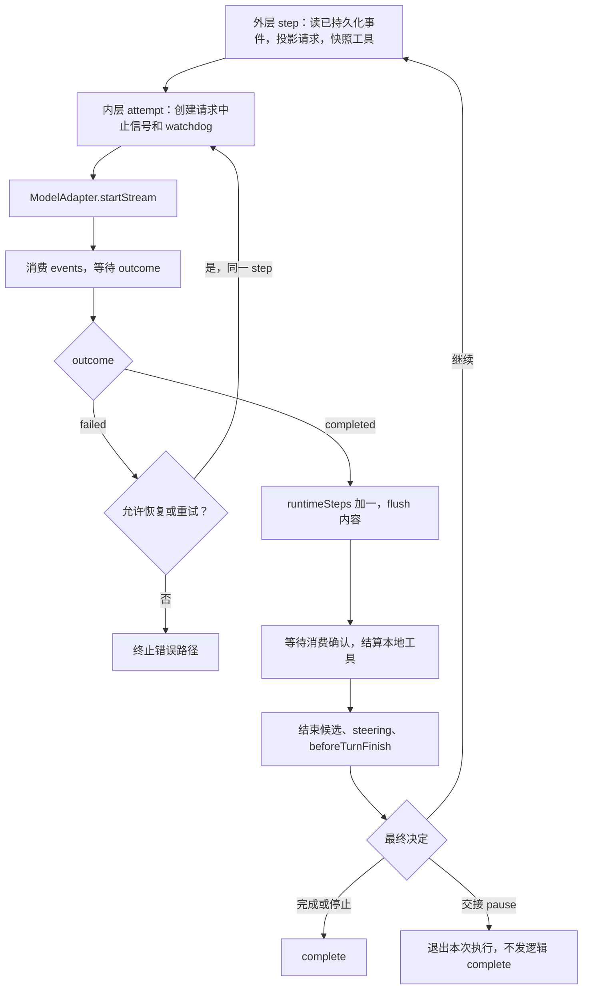
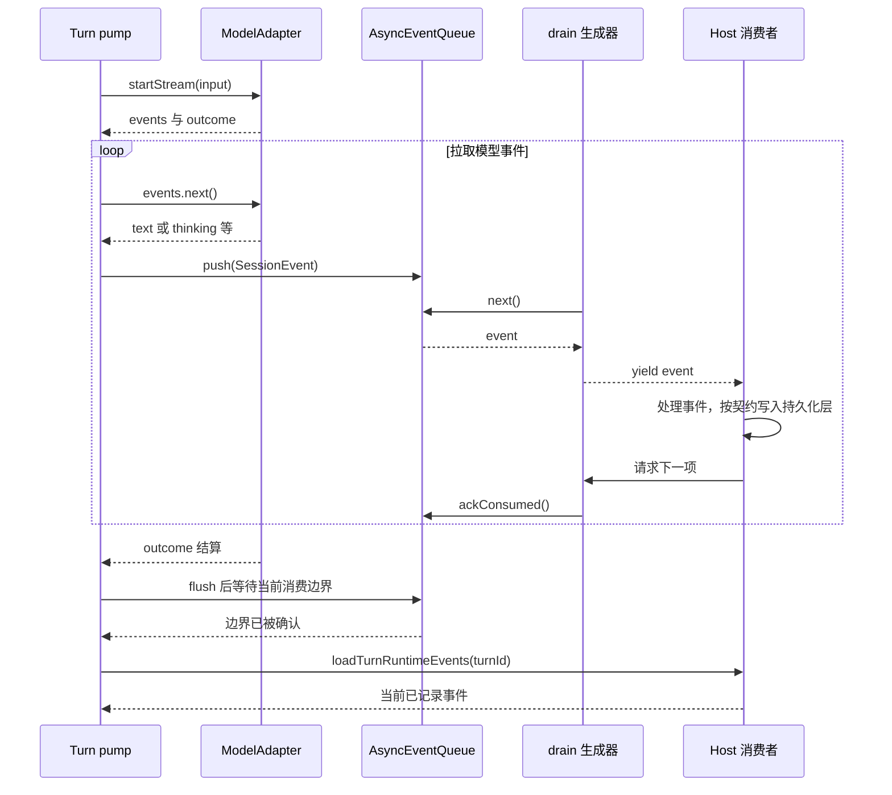

# 模型循环：工具调用下的多轮请求

[手册目录](../README.md)

用户输入：“读取配置文件，并解释其中的超时设置。”
模型先返回 `Read` 调用，文件读取完成后，模型才能依据结果进行解释。
第二次请求若断线，需要判定是重新读取文件，还是仅重新请求解释。
界面已经显示“我先看看配置”，该文本是否代表请求成功，同样需要依据边界判定。
这些问题都不能只看 SDK 的 `finishReason`，必须沿 Maka 的请求、流和工具结算三个边界阅读代码。

本文依据 Maka 提交 `15d0a0dd19d39e2bc09ae35940e432c636982315`，对照 Pi 提交 `482c1381a00d8d00bc81697e4a980c593db6803e`，日期为 2026-10-24。
本文基于源码与现有测试的静态阅读：未运行测试、真实模型、工具或构建。
文中的文件内容、消息 ID 和示例文本均为教学取值，并非运行日志。

## 1. 三个计数单位

本文将模型服务提供方简称为 provider；将一次请求的最终确认称为“结算”，以区别于流中暂时收到的内容。

| 单位 | 本文中的含义 | Read → 解释的例子 |
| --- | --- | --- |
| Turn | 同一个 `turnId` 下的一轮逻辑工作；物理执行可因交接暂停 | 用户的一次要求 |
| step | 外层循环的一次模型决策及随后可能发生的工具结算 | 第一步要求 Read；第二步解释 |
| attempt | 一个 step 内的一次物理 provider 请求 | 第二步第一次断线，第二次重试 |

源码的 `runtimeSteps` 在 `providerOutcome.kind === 'completed'` 后递增。
因此其计数对象是已成功结算的模型步骤，既不是工具数，也不是 HTTP 请求数；失败 attempt 不递增。
`maxSteps = 2` 可以对应两次成功请求和若干失败请求，并不保证最多发出两次请求。
它也不表示“最多调用两次工具”：一个 step 可以返回多个工具，纯文本回答也会消耗一个 step。[外层与 attempt 循环][turn-loop] [成功计数][turn-completed]

对象的寿命与上述单位不同。
`AiSdkBackend` 持有会话级服务；`send()` 为本次执行打开 `AiSdkTurn`，转发其事件，最后删除活动实例并调用 `close()`。
Turn 关闭时结束 adapter 的 continuation lane（按 Turn 隔离的 provider 续接状态），并结束工具运行作用域。
交接返回 `pause` 可以结束本次物理执行而不发出逻辑 `complete`，因此不应将“一次 send 返回”直接等同于“用户要求已完成”。[Backend 生命周期][backend-send] [Turn 关闭][turn-fields] [交接判定][turn-finish]

`AiSdkTurn` 的重要字段并非一张平铺的方法目录，而是若干组寿命不同的状态：

- `turnId`、`runId`、`toolRuntime` 固定在实例上，工具运行服务也捕获本次身份，避免交叠执行时影响其他运行。
- `abortController` 和 `aborted` 表示立即中止；`stopRequested` 还表达“当前步骤结束后停”，不能合并为一个布尔值。
- `turnYield` 表达事件等待、计划交接等让出控制权的原因；`handoffPaused` 表达物理执行暂停。
- `activeTools` 连接会话共享的活动工具状态；请求发送前另取快照，不能将共享状态直接当作每个 attempt 的固定输入。
- `stepText`、`stepThinkingParts`、`returnedToolCalls` 是循环局部变量，并非跨所有请求累积的一份“最终回答”。[实例字段][turn-fields] [工具作用域][backend-tools] [局部累积器][turn-flush]

## 2. 循环控制权：SDK 与调用方

`ModelAdapter` 负责将 Maka 的消息、工具描述与流事件转换到 SDK 边界；`AiSdkTurn` 决定请求能否重试、工具何时执行、是否继续下一步。
下图仅绘制主要路径，省略计量、诊断与上下文细节。



这是两层含义不同的循环：外层推进任务，内层恢复同一个模型步骤。
SDK 并未隐式执行另一套“工具 → 模型 → 工具”循环。
adapter 调用 `streamText` 时设置 `maxRetries: 0`；紧邻注释明确说明，没有 continuation predicate 时只执行一个 provider step，继续运行由上层 Runtime 决定。
本地函数工具的 lowering（转换为 SDK 请求结构）仅传递描述、schema 等信息，不交出执行函数。[SDK 调用边界][adapter-dispatch] [工具转换][adapter-tools]

这是源码明确的职责契约，并非单纯的架构推测。
由此可以推断：Maka 需要在重试与工具副作用之间统一作出决定，不能让 SDK 自动重试绕过自身判定。
但这并不能证明所有底层传输库均无内部重连；本文仅核实此处显式传给 AI SDK 的配置及其 mock 测试。

## 3. 请求与返回值的边界定义

`ModelAdapterStreamInput` 将一个物理请求所需的事实一并传递：

| 输入 | 使用方式与边界 |
| --- | --- |
| `messages: ModelMessage[]` | provider 可见的投影结果，并非原样转发完整会话事件 |
| `tools`、`activeTools` | 工具描述集合与本次允许集合；空 active 集合会显式使用 `toolChoice: 'none'` |
| `system`、`maxOutputTokens` | 本次系统指令和输出上限，本文不展开配置解析 |
| `abortSignal`、`onStreamActivity` | 请求取消信号，以及收到原始流片段的活动通知 |
| `repairToolCall` | 修复工具调用的输入；不意味着 adapter 会执行该工具 |
| `historyCompactBoundary` | 此次消息使用的压缩边界，随请求传递，不能在结算时再推断会话当前边界 |
| `continuationKey` | Turn 级续接通道标识，不是“让任务继续”的命令 |

`historyMessageCount` 还区分稳定重放的历史前缀与仅供本次请求使用的上下文，服务于缓存边界。
这些字段见[请求契约][adapter-input]；消息的角色联合类型见[ModelMessage][protocol-message]。

返回值包含两条通道，以下为真实源码摘录：

```ts
export interface ModelStreamResult {
  events: AsyncIterable<ModelStreamEvent>;
  outcome: Promise<ModelStepOutcome>;
}
```

`events` 提供正在发生的文本、推理片段或工具意图；`outcome` 只给出一次权威结算。
`ModelStepOutcome` 用 `kind` 区分两种形状：成功有 `finishReason`，失败有 `failure`；两者都可能带用量和 `hasResponseEvidence`。
这里的联合类型可类比为 Java 中“成功结果/失败结果”两个受限子类型，检查 `kind` 后才能读取对应字段。[返回契约][protocol-outcome]

成功结果的 `continuation: 'pending'` 表示 adapter 暂存了可供 provider 续接的状态。
它并不表示 Turn 已决定继续：工具结果落定后，Turn 还需从持久化投影补齐 response 一侧，再记录或清除该状态。[adapter 续接结算][adapter-outcome] [工具后续接][turn-continuation]

## 4. AsyncIterable、yield 与 await 的等待语义

`Promise<T>` 可以类比 Java 的 `CompletableFuture<T>`：最终返回一个值或失败。
`await` 暂停当前异步函数，允许其他异步工作继续；它不等于阻塞整个 JavaScript 进程，也不自动创建工作线程。
`AsyncIterable<T>` 则是一串异步取得的值，每次 `next()` 返回一个 Promise，兑现为 `{ value, done }`。
`for await` 的含义是：等待下一项，处理后再请求下一项。

`async *` 声明异步生成器，`yield event` 将一项交给调用者并暂停生成器；调用者再次拉取时，才从 `yield` 后继续。
`yield* turn.run()` 是转发另一条迭代流，并非一次性读取全部事件。
Maka 的 `runWithinScope` 另外启动一个异步 pump，负责请求与入队；对外生成器负责排队输出，两者可以在 `await` 处交替推进。[pump 与消费出口][turn-pump] [Backend 转发][backend-send]



关键不在箭头数量，而在 `yield` 之后的确认：`drain` 先 `yield ev`，恢复后才 `queue.ackConsumed()`。
因此“消费者再次拉取”被视为“前一个事件已经处理完成”的信号。
`waitUntilConsumedThroughCurrent()` 记录调用时的 `pushedCount`，等待 `consumedCount` 追平；之后新入队的事件不会无限延长该等待。[drain][turn-drain] [队列确认][queue]

这是一份协作契约，并非 `yield` 自带的磁盘事务。
消费者若先拉取下一项、后异步写库，便破坏了这一顺序；等待确认本身也不能证明数据库 reader 一定能读到数据。
所以 Turn 在关键边界还会实际调用 durable reader（读取已持久化事件的接口）；测试用 `drainDurably` 在循环体内先记录事件，再继续拉取。[读取边界][turn-projection] [测试消费器][test-harness]

另一个容易颠倒的顺序是先 `await result.outcome` 再消费 `events`。
adapter 在异步迭代器的 `finally` 中结算 outcome；若根本不开始消费，便没有调用方驱动这条流程。
Maka 的正常顺序是先迭代，遇到 error 则退出迭代，再等待 outcome；adapter 对延后发现的 reasoning 元数据错误，还专门先结算 outcome 再 yield error，避免提前退出使等待者悬空。[adapter 迭代器][adapter-outcome]

## 5. 外层准备与内层尝试的分工

进入外层 step 时，Turn 重新快照工具、解析当前系统提示、吸收 steering（运行中追加的引导输入），并从已记录事件重建请求历史。
“投影”指从运行事件提取 provider 能理解的 `ModelMessage[]`，并应用已有压缩和工具结果裁剪，并非修改原始事件本身。
这些工作会影响真实请求的消息、工具 schema 和输出容量，因此请求准备不只是拼接一段 prompt。[投影入口][turn-projection] [外层准备][turn-loop]

随后建立 `attemptMessages`、`providerAttempt = 0` 等局部变量，进入内层循环。
每次 attempt 增加编号、清空旧的本地工具意图、创建请求级 `AbortController`，并重置本次观察标志。
通常重试复用该 step 的 `attemptMessages` 和工具快照，不重新启动外层准备；上下文溢出恢复是会替换消息的例外。[attempt 初始化][turn-attempt]

可将执行过程概括为以下教学伪代码；这是控制流摘要，并非可调用 API：

```text
while 还需要一个模型步骤:
    从已记录事件准备消息与工具快照
    for 本步骤的每次物理尝试:
        清空本次工具意图；启动请求级监测
        消费流；取得权威 outcome
        if 失败且可以恢复: 更新必要状态后重试本步骤
        if 失败且不能恢复: 进入终止错误路径
        runtimeSteps += 1；flush；离开 attempt 循环
    等待事件处理；结算本地工具
    决定完成、停止、交接，或开始下一个步骤
```

请求前会再次检查 `loopStopReason`。
这是处理竞态的必要检查：用户可能在重试等待、压缩或交接期间要求停止，不能仅因已进入循环就再次发出请求。[派发前停止检查][turn-attempt]

## 6. 流到三类运行状态的转换

adapter 逐个拉取 SDK chunk，先调用 `onStreamActivity()`，再翻译成零个或多个 Maka 事件。
因此“没有新增可见文字”不等于“连接没有活动”：原始 start、finish 或其他不对外展示的片段仍能刷新活动时间。
SDK 的 finish 边界由 adapter 内部消费，不会直接伪装成 Session 的 `complete`。[流翻译][adapter-outcome] [活动测试][test-activity]

| Maka 事件 | Turn 改变的变量 | 立即产生的效果 |
| --- | --- | --- |
| `text` | 追加 `stepText`；非空时标记可见内容 | 入队 `text_delta`，尚不是完整消息 |
| `thinking-start` / `thinking` | 创建或定位 reasoning part，累积文本和元数据 | 入队 `thinking_delta`，保留分组身份 |
| `thinking-signature` | 给对应 part 保存签名，设置 replay barrier | 不将签名拼入用户文本 |
| 本地 `tool-call` | 追加 `returnedToolCalls` | 暂不执行，也不在此处发出本地 `tool_start` |
| provider 执行的 `tool-input` / `tool-call` | 标记工具活动；必要时记录输入 | provider 已可能做外部工作，不能视为纯意图 |
| `provider-tool-result` | 清理输入关联，标记工具活动 | 入队 provider 结果，不再由本地 ToolRuntime 执行 |
| `error` | 结束当前事件消费 | 失败类型最终由 outcome 决定 |

以上分支集中在[Turn 的事件消费段][turn-stream]；事件字段由[ModelStreamEvent][protocol-events]定义。
“工具意图”即模型提出的调用数据，如 `toolCallId`、`toolName`、`input`；它与工具已运行并非同一事实。
当断线发生在本地工具执行之前时，这一区别使旧意图可以安全丢弃并重试。

推理内容也不是一个不断追加的字符串。
`stepThinkingPartsById` 按 `reasoningPartId` 关联片段；部分 Responses 数据还可从 provider metadata 提取 item 身份。
签名必须写入正确的 part，不能将第一步的签名带入第二步。
若 provider 给出最终 `reasoningSummaryText`，源码以最终摘要替换已拼接文本，保证持久化边界与最终内容一致。
已完成的 part 之后又出现游离 delta 时，会另建 part，避免污染已确认的摘要。[reasoning 分组][turn-stream]

这里的 reasoning 指 provider 暴露的推理相关文本、摘要或回放元数据，并不意味着所有模型都会提供完整内部思考。
provider 签名和原生 item 元数据还可能设置 replay barrier，即“当前 attempt 不允许整体重放”的边界；普通文本没有同样的含义。

## 7. stop、flush 与 Turn 完成的判定

adapter 同时记录是否看见最终 finish、是否存在响应证据、最近 step 的用量是否可信，以及显式 failure。
结算时优先处理取消或已有 failure，再处理网络错误、缺失/不完整 finish、过滤和错误结束等情况。
只有通过这些检查才返回 `completed`。[结束边界分类][adapter-classify]

| 看见的流 | adapter 如何理解 |
| --- | --- |
| 有文本，却没有最终 finish | 仍可能是 `stream_truncated`，不能用“已经显示文本”冒充成功 |
| 空 `stop`，无响应证据且无有效 step 用量 | 边界不完整，不能视为可靠空回答 |
| 空 `stop`，provider 明确报告有效的零用量 | 可以完成；零不是“未知” |
| 有文本，最终 stop，缺用量 | 可以完成；内容成功与计量完整并非同一件事 |
| 原始结束原因是 `network_error` | 归一为可重试的网络失败 |
| 原本成功，但应有的最终 plaintext reasoning 元数据缺失 | 转成失败；若已有真实 provider 错误，不以该校验错误覆盖它 |

这些区别均有 adapter 测试断言，并非本文对网络的经验判断。[空 stop 与用量测试][test-empty] [reasoning 错误优先级测试][test-reasoning-error]

成功进入 Turn 后先递增 `runtimeSteps`，记录用量，再调用 `flushStep()`。
flush 的作用是将累积器发布为 `thinking_complete`、`text_complete` 等完整片段事件，然后清空本段状态。
没有文本也没有 thinking 时直接清空返回，不为纯工具步骤生成一条空助手消息。[flush 实现][turn-flush]

通常一个步骤产生一个助手消息 ID，但不能将其视为不可违反的规则。
原生 Responses item 边界可提前 flush 并轮换 ID；失败重试也会更换 ID。
有 thinking 和文本时先发布 thinking 完成，再发布文本完成，使对应内容保持关联。
失败后保留片段可使用 `flushStep(true)` 标为 interrupted；已最终确认的 reasoning part 仍与未完成片段分开处理。[流中 item 边界][turn-stream] [失败 flush][turn-retry]

还有一个容易凭直觉误读的细节：最终 catch 调用 `flushStep(!this.aborted)`，立即用户中止与 provider 失败并不使用同一个 interrupted 值。
因此不应将 `interrupted` 简化解释为“任何停止都为 true”。[终止清理][turn-terminal]

## 8. Read 用例的变量级跟踪

设 `maxSteps = 2`，有可用的 durable reader，普通本地 Read 不要求结束 Turn，没有新 steering，结束 hook 允许完成。
以下 `m1`、`m2`、`read-1` 为教学符号；`runtimeSteps` 初始为 0，表中的步序使用读者习惯的 1、2。

| 时点 | `runtimeSteps` / `providerAttempt` | 流累积器与工具意图 | 后续动作依据 |
| --- | --- | --- | --- |
| 第一步派发前 | `0 / 1` | ID=`m1`；文本空；工具数组空 | 请求包含用户问题和 Read 描述 |
| 收到“先读取配置” | `0 / 1` | `stepText` 增长；可见标志=true | 发 delta，不运行工具 |
| 收到 Read 调用 | `0 / 1` | `returnedToolCalls=[read-1]` | 仅暂存 `{toolName,input,...}` |
| outcome completed | `1 / 1` | flush 后文本/推理累积器清空；调用数组仍在 | 成功边界已确认，才进入本地工具阶段 |
| Read 结算完成 | `1 / 1` | 发布 tool_start/tool_result，等待消费确认 | 工具结果进入可重放的已记录事件 |
| 第一步结束判定 | `1 / 1` | 有普通本地调用，结束候选为空 | 预算未满，需第二步解释 |
| 第二步派发前 | `1 / 1` | 新 ID=`m2`；新 step 的 attempt 从 1 开始 | 重读当前 Turn 事件，投影包含 Read 结果 |
| 收到解释并成功结算 | `2 / 1` | 文本 flush；本地调用数组空 | stop 映射成 end_turn 候选 |
| 结束 hook 允许 | `2 / 1` | `terminalStopReason='end_turn'` | 正常完成优先于预算耗尽的兜底原因 |

以下是教学数据示例，字段符合 `ModelMessage` / `ToolCallPart` / `ToolResultPart` 契约；省略系统指令、推理元数据等，并非存储事件的原样 JSON：

```json
[
  { "role": "user", "content": "读取配置并解释超时设置" },
  { "role": "assistant", "content": [
    { "type": "text", "text": "先读取配置。" },
    { "type": "tool-call", "toolCallId": "read-1", "toolName": "Read",
      "input": { "path": "settings.txt" } }
  ] },
  { "role": "tool", "content": [
    { "type": "tool-result", "toolCallId": "read-1", "toolName": "Read",
      "output": { "type": "text", "value": "timeout = 30" } }
  ] }
]
```

实际结果由工具与投影决定，不保证 Read 固定输出上述文本包装。
重要的关联是相同 `toolCallId` 将意图与结果配对；`tool_start.stepId` 又将执行关联到当前助手消息 ID。
现有两步测试分别提供 reasoning、签名、文本和 Read，断言两个助手消息 ID 不同、签名各归其位、工具关联第一步。[两步关联测试][test-two-step]

此处不存在“将内存中的 tool result 直接传回 SDK”这一捷径。
在将要继续且需要 reader 的路径，Turn 会在工具执行前检查 reader 并实际读取，避免先产生副作用、再发现无法重建后续请求。
随后使用 `Promise.allSettled` 收齐本批结算；该 Promise 等待所有任务结束，单项失败不会使其他项的结果遗失，之后再抛出首个拒绝原因。
它并不等于承诺所有工具不受限制地并发执行；权限与工具调度仍由 ToolRuntime 负责。[工具结算入口][turn-tools] [reader 失败测试][test-reader]

## 9. next step、beforeTurnFinish 与短路的时机

短路（short-circuit）指已有充分条件后跳过剩余路径；此处不存在统一命名为 `shortCircuit` 的 API。
最重要的短路是工具主动要求完成：只有本步恰好一个本地工具、具有 `exclusive_step` 执行语义、声明 `finishTurnOnSuccess`，且结算没有 `providerError`，才设置 `toolRequestedFinish`。
普通 Read、失败工具或多个调用不能仅凭名称获得该待遇；即使符合条件，也仍需通过结束 hook。[工具完成条件][turn-tool-finish] [四种工具结束测试][test-tool-finish]

工具结束后，判定顺序如下，交换顺序会改变行为：

1. 有普通本地工具调用时先不形成结束候选；特殊工具完成可形成 `end_turn`；否则映射模型的 finish reason。
2. Host 若要求先取得工具凭据，而本步没有调用，执行有界修复；没有预算、没有 reader 或修复超限则报错，不静默完成。
3. 对可继续的普通结束候选再吸收 steering；若收到新输入，撤销结束候选，进入新 step。
4. 候选为 `end_turn` 且没有停止原因时，调用 `beforeTurnFinish`；否决反馈存入 `finishFeedback`，供下一步请求使用。
5. 最后按停止原因、结束候选、预算耗尽的顺序决定终态。[结束控制流][turn-finish]

最终优先级的真实源码摘录：

```ts
terminalStopReason =
  this.loopStopReason ??
  finishCandidateReason ??
  (stepLimitReached ? 'step_limit' : undefined);
```

`??` 只在左侧为 `null` 或 `undefined` 时采用右侧，并非字符串真假判断。
所以第二步自然完成且恰好用尽预算时是 `end_turn`；hook 否决导致候选消失、预算又耗尽时才是 `step_limit`。
hook 不会因“反正不能继续”而被跳过；没有 reader 且被否决时，后面的继续检查可能报错。[hook 预算测试][test-hook]

若仍需继续，则检查 reader、等待消费边界、询问 `handoffBoundary`；返回 `pause` 就暂停本次执行，否则轮换消息 ID 进入新 step。
provider 的 `tool-calls` finish 本身并不保证 Turn 完成；原生 continuation pending 也不保证 Turn 继续。
这两个信号描述 provider 层事实，最终控制权仍在上述判定链。

## 10. 第二步断线的处理

失败恢复要区分四个单调标志：本次一旦观察到便保持为 true，直至下一 attempt 重置。

| 本次发生了什么 | 关键标志 | 普通重试的含义 |
| --- | --- | --- |
| 只有普通文本或无特殊元数据的 thinking | `attemptSawVisibleContent` | 不单独禁止重试；失败片段可保留为 interrupted |
| 本地工具意图，尚未执行 | `returnedToolCalls`；可能有 `attemptSawToolInput` | 不单独禁止重试；下次 attempt 清空旧意图 |
| provider 已开始执行自己的工具 | `attemptSawToolActivity` | 禁止整体重放，避免重复外部动作 |
| 签名、原生 item 等回放敏感边界 | `attemptSawReplayBarrier` | 禁止整体重放，不能只按纯文字处理 |

`attemptCanReplay()` 实际只要求没有工具活动、没有 replay barrier。
用于溢出恢复的 `attemptHasNoObservableOutput()` 更严格，还要求没有可见内容；不要把这两个谓词写成同一个“没输出”。
`hasResponseEvidence` 又是 adapter 判定 finish 可信度的事实，不直接等同于这两个重试谓词。[attempt 标志][turn-attempt] [失败策略][turn-retry]

普通重试依次检查可重放性、step 剩余预算、本 step 尝试上限、failure 是否可重试。
当前上限是每 step **10 次，包含首次请求**。
允许时先 flush 失败片段、换消息 ID、发布 scheduled 事件、等待退避，再在实际派发前发布 started；不会递增 `runtimeSteps`。[失败分支][turn-retry]

考虑上述例子的第二步返回“空 stop 且未知用量”。
adapter 将其判定为截断，Turn 重试第二步；第一步已经成功结算的 Read 不在第二步的待执行数组里。
现有测试明确断言：`maxSteps = 2`，provider 调用 3 次，Read 只执行 1 次；第 2、3 次请求都携带同一工具结果，最后正常完成。[工具后空 stop 重试测试][test-after-tool]

另一个测试在失败 attempt 中先发部分 thinking 和 Write 意图，再制造网络错误。
重试成功后旧调用没有 `tool_start` 或 `tool_result`，后续请求也不携带失败片段；这是“意图不等于副作用”的直接证据。[丢弃本地意图测试][test-discard]
相反，provider 的 `tool-input-start` 只要声明 `providerExecuted`，即使还没有最终调用/结果，失败后也拒绝重试。[provider 活动测试][test-provider-tool]

最终用量不能简单取最后一次请求：代码汇总多步及需要计量的失败请求。
若某次应计量请求缺少可信用量，会标记 `sawUnusableStepUsage`，避免把局部总数冒充完整总数。
“任务最后成功”与“所有费用都能准确统计”仍是两个不同的结论。[用量收束][turn-usage]

## 11. stop、watchdog、compaction 的接入位置

watchdog 是按时间监测请求是否仍活跃的看门狗，并非另一层模型循环。
每次 attempt 创建请求级中止控制器，信号与 Turn 的中止信号合并传给 adapter。
默认连接等待为 30 秒、流空闲为 120 秒；每个原始 SDK 片段都算活动，不只计算文本 delta。
超时只先中止该请求，交给正常失败策略决定重试或终止，不直接把整个 Turn 永久标记为用户取消。[watchdog 接线][turn-watchdog] [计时器实现][watchdog]

watchdog 在事件迭代结束后、`await result.outcome` 前停止。
因此它并非覆盖任意 SDK 结果 Promise、数据库写入和全部后处理的总期限；本文不能据此声称所有悬挂都一定被超时清理。
工具之后的模型超时还会保留 `model_after_tool_timeout` 终止分类，便于区分“工具未完成”与“工具已完成但解释失败”。[停止计时与 outcome][turn-completed] [失败分类][turn-retry]

stop 有两种语义：立即停止设置 `aborted` 并中止 Turn 信号；`after_step` 只设置 `stopRequested`。
后者允许当前请求及工具结算走到边界，随后以 `user_stop` 收束，不生成一条立即 abort 事件。
如果在退避等待期间收到 after_step，它不一定立刻取消等待，但派发前检查会阻止下一次请求。[停止字段][turn-fields] [停止竞态测试][test-stop]

compaction 指缩减将要发送给模型的上下文，并不等于删除事件历史；本文中有三个接入位置：

- 初始历史准备：选择已有预算状态和 checkpoint，构造有效历史；不应将其概括为“每次按估算 token 必压缩”。
- 外层请求投影：结合本步实际消息、系统指令和工具集合决定派发内容；应用新压缩边界的事件要先被消费确认。
- 内层失败恢复：`context_overflow` 且仍可恢复时调用 `recoverFromOverflowError`，替换 `attemptMessages`，继续同一步的下一 attempt。[历史准备][turn-history] [请求投影][turn-loop] [溢出恢复][turn-retry]

溢出恢复还要求没有可观察输出、保留未知历史模式未开启、step 有预算、attempt 未到上限。
恢复后的请求临时使用不超过 8000 的保守输出上限；成功后清除该次恢复专用上限，下一 step 可重新计算。
`length` 结束不是输入超窗的证明，不能一律触发该路径。
本文只解释调用边界，不展开压缩摘要算法、watchdog 嵌套暂停和重试退避公式。

## 12. 与 Pi 对照：术语对齐与策略比较

Pi 默认链路从 `coding-agent` 创建 `Agent`，接到 `agent` 的循环，再通过 `ai` 的流接口调用模型。
`createAgentSession` 注入的 `streamFn` 使用 `modelRuntime.streamSimple`；请求选项中也有 retry/timeout 配置，不能概括为“Pi 不支持重试或超时”。[Pi 默认装配](../../../packages/coding-agent/src/core/sdk.ts#L351)

| 观察点 | Maka 本文路径 | Pi 默认 agent 路径 |
| --- | --- | --- |
| 循环命名 | 外层 step，内层 provider attempt | 外层处理 follow-up，内层处理工具和 steering；该内层不是 retry |
| 一次响应之后 | outcome → flush →工具结算→结束判定 | 助手消息→工具执行→`finishTurn`→`turn_end` |
| 下一次上下文 | 要求通过 reader 重建当前 Turn 事件 | agent 循环更新 `currentContext.messages`，并留有准备钩子 |
| 完成控制 | `beforeTurnFinish` 可否决 end_turn | `finishTurn` 可明确 end/continue，工具批次也可要求 terminate |

Pi 的 `turn_end` 对应一次助手响应与这一批工具结果，不等于 Maka 整个逻辑 Turn 结束；直接按名称一一对应会误读两侧代码。
Pi 还有 `prepareNextTurn` / `prepareRequest` 可调整上下文、模型和推理设置，所以“默认内存循环”不意味着没有上下文处理接入点。[Pi 循环](../../../packages/agent/src/agent-loop.ts#L163)

Pi 的流也通过异步迭代产生事件，并提供结果 Promise；两者都需要区分增量展示和最终消息。
Pi 默认循环对 error/aborted 响应直接结束；对 length 截断响应不执行可能残缺的工具参数，而生成失败结果。[Pi 响应与工具边界](../../../packages/agent/src/agent-loop.ts#L241) [Pi 事件流](../../../packages/ai/src/utils/event-stream.ts#L27)

另有实验性的 `packages/durable`，不能以默认路径代替它得出结论。
其 `ToolTask` 在执行前写 checkpoint，恢复时要求保存的与当前工具定义都允许 replay-safe（可安全重放），否则报告 interrupted。
这是另一条明确的恢复安全策略，并非默认 coding-agent 已自动具备的行为，也不是 Pi 完全不具备的能力。[Pi durable 工具恢复](../../../packages/durable/src/harness/tool.ts#L123)

## 13. 用现有测试验证理解

以下仅列出静态读取的断言；本文并未声称这些测试在当前环境执行通过。

| 阅读位置 | 先预测，再核对的内容 |
| --- | --- |
| [adapter 单次请求测试][test-sdk-retry] | 为什么 `maxRetries: 0` 时一个 adapter 请求不会自行重试？ |
| [空 stop 测试][test-empty] | 未知用量与明确零用量，为什么得出不同 outcome？ |
| [两步消息测试][test-two-step] | 第一、二步签名、messageId、tool stepId 各指向谁？ |
| [结束 hook 测试][test-hook] | hook 在预算耗尽时是否仍运行？否决后为何是 step_limit？ |
| [reader 边界测试][test-reader] | 为什么 reader 故障应发生在本地工具执行前？ |
| [工具后重试测试][test-after-tool] | 三次 provider 请求为何只有一次 Read？ |

这些测试主要使用 mock LanguageModel 和内存事件账本。
它们能证实循环对输入事件和故障的预期反应，不能替代真实 provider 网络行为、生产存储事务或跨进程恢复验证。
本地没有安装可供核对的 AI SDK 依赖，本文未进一步审计 SDK 内部；单 step 语义依据 Maka 的适配代码、明确注释和现有 mock 测试。
模型配置、OAuth、工具权限实现和压缩算法不在本文范围之内。

[backend-send]: ../../../../maka/packages/runtime/src/ai-sdk-backend.ts#L551
[backend-tools]: ../../../../maka/packages/runtime/src/ai-sdk-backend.ts#L493
[turn-fields]: ../../../../maka/packages/runtime/src/ai-sdk-turn.ts#L617
[turn-flush]: ../../../../maka/packages/runtime/src/ai-sdk-turn.ts#L902
[turn-pump]: ../../../../maka/packages/runtime/src/ai-sdk-turn.ts#L1292
[turn-projection]: ../../../../maka/packages/runtime/src/ai-sdk-turn.ts#L1355
[turn-loop]: ../../../../maka/packages/runtime/src/ai-sdk-turn.ts#L1531
[turn-attempt]: ../../../../maka/packages/runtime/src/ai-sdk-turn.ts#L1635
[turn-stream]: ../../../../maka/packages/runtime/src/ai-sdk-turn.ts#L1744
[turn-completed]: ../../../../maka/packages/runtime/src/ai-sdk-turn.ts#L1923
[turn-retry]: ../../../../maka/packages/runtime/src/ai-sdk-turn.ts#L2041
[turn-tools]: ../../../../maka/packages/runtime/src/ai-sdk-turn.ts#L2214
[turn-tool-finish]: ../../../../maka/packages/runtime/src/ai-sdk-turn.ts#L2304
[turn-continuation]: ../../../../maka/packages/runtime/src/ai-sdk-turn.ts#L2331
[turn-finish]: ../../../../maka/packages/runtime/src/ai-sdk-turn.ts#L2351
[turn-usage]: ../../../../maka/packages/runtime/src/ai-sdk-turn.ts#L2456
[turn-terminal]: ../../../../maka/packages/runtime/src/ai-sdk-turn.ts#L2584
[turn-drain]: ../../../../maka/packages/runtime/src/ai-sdk-turn.ts#L3070
[turn-watchdog]: ../../../../maka/packages/runtime/src/ai-sdk-turn.ts#L1315
[turn-history]: ../../../../maka/packages/runtime/src/ai-sdk-turn.ts#L2832
[adapter-input]: ../../../../maka/packages/runtime/src/model-adapter.ts#L124
[adapter-dispatch]: ../../../../maka/packages/runtime/src/model-adapter.ts#L379
[adapter-outcome]: ../../../../maka/packages/runtime/src/model-adapter.ts#L435
[adapter-classify]: ../../../../maka/packages/runtime/src/model-adapter.ts#L726
[adapter-tools]: ../../../../maka/packages/runtime/src/model-adapter.ts#L1513
[protocol-message]: ../../../../maka/packages/runtime/src/model-protocol.ts#L139
[protocol-events]: ../../../../maka/packages/runtime/src/model-protocol.ts#L370
[protocol-outcome]: ../../../../maka/packages/runtime/src/model-protocol.ts#L417
[queue]: ../../../../maka/packages/runtime/src/async-queue.ts#L43
[watchdog]: ../../../../maka/packages/runtime/src/stream-watchdog.ts#L20
[test-sdk-retry]: ../../../../maka/packages/runtime/src/__tests__/model-adapter-onerror.test.ts#L323
[test-empty]: ../../../../maka/packages/runtime/src/__tests__/model-adapter-onerror.test.ts#L405
[test-reasoning-error]: ../../../../maka/packages/runtime/src/__tests__/model-adapter-onerror.test.ts#L127
[test-activity]: ../../../../maka/packages/runtime/src/__tests__/model-adapter-stream-activity.test.ts#L32
[test-hook]: ../../../../maka/packages/runtime/src/__tests__/ai-sdk-backend.test.ts#L117
[test-tool-finish]: ../../../../maka/packages/runtime/src/__tests__/ai-sdk-backend.test.ts#L270
[test-provider-tool]: ../../../../maka/packages/runtime/src/__tests__/ai-sdk-backend.test.ts#L556
[test-stop]: ../../../../maka/packages/runtime/src/__tests__/ai-sdk-backend.test.ts#L202
[test-reader]: ../../../../maka/packages/runtime/src/__tests__/ai-sdk-backend.test.ts#L9118
[test-discard]: ../../../../maka/packages/runtime/src/__tests__/ai-sdk-backend.test.ts#L11497
[test-two-step]: ../../../../maka/packages/runtime/src/__tests__/ai-sdk-backend.test.ts#L15914
[test-after-tool]: ../../../../maka/packages/runtime/src/__tests__/ai-sdk-backend.test.ts#L18830
[test-harness]: ../../../../maka/packages/runtime/src/__tests__/ai-sdk-backend.test.ts#L18487

## 相关专题

- [请求历史与投影](../02-context/history-and-projection.md)：说明为什么事件账本、界面消息和 provider 请求并非同一份数据。
- [工具运行时](../03-tools/tool-runtime.md)：继续追踪意图如何经过权限、执行和结果结算变成可重放事件。
- [重试、超时与幂等](../06-operations/retry-timeout-idempotency.md)：深入四类重放条件、退避等待和重复请求的安全边界。
- [上下文压缩](../02-context/compaction.md)：追踪请求前投影与 context_overflow 恢复各自如何选择压缩边界。
