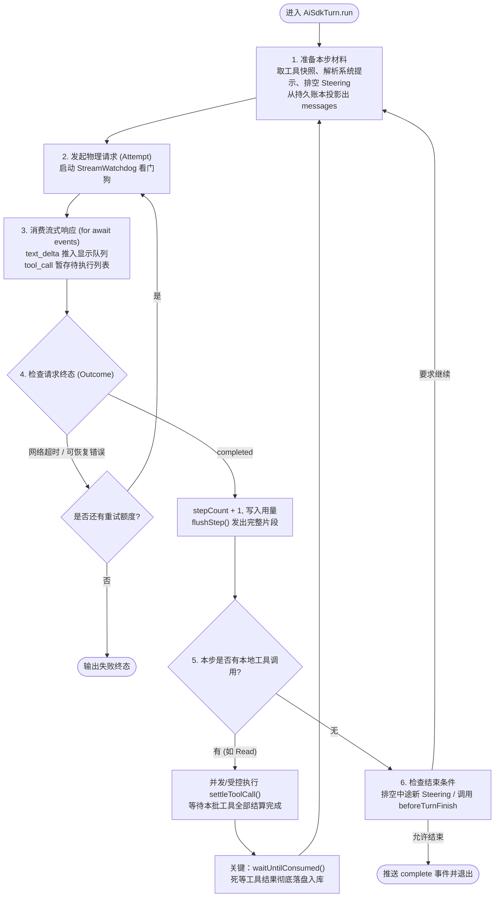

# 模型循环：工具调用下的多轮步进与结算

[返回手册目录](../README.md)

用户发送指令：**“读取 `config.json`，并解释其中的超时设置。”**
大语言模型本身无法读取本地磁盘，它只能根据提示词提出“我想读取 `config.json`”的工具意图；由宿主的运行时真正去读取文件后，再把文件内容带给模型，模型才能做出基于事实的解释。

这看似简单的“问一次、答一次”，在底层实际上是一个精密的状态机循环。本章深入解析 Maka 模型循环引擎（`AiSdkTurn`）的工作机制：它如何区分逻辑步进与网络重试、如何安全处理流式数据、如何卡点等待工具结果落盘，以及如何做出停止决策。

---

## 1. 概念先行：Turn、Step 与 Attempt 的三层边界

在深入循环逻辑前，必须严格区分三个执行单位。如果混淆了它们，系统的重试策略、步数配额和界面进度都会出错：

| 执行单位 | 物理含义 | 在“读 `config.json` 并解释”中的对应 | 对计数与重试的影响 |
| :--- | :--- | :--- | :--- |
| **Turn（逻辑轮次）** | 由一次用户意图触发的完整工作流。 | 从“用户发问”到“输出最终解释”的整个过程。 | 包含多个 Step；可能因交接（Handoff）暂停。 |
| **Step（模型步骤）** | 外层循环的一次“模型决策 + 工具结算”。 | **Step 1**：决定读文件并拿到结果；<br>**Step 2**：根据结果生成最终解释。 | `maxSteps`（步数上限）只计算**成功完成**的 Step，失败的网络请求不消耗步数。 |
| **Attempt（请求尝试）** | 在某一个 Step 内实际发出的 HTTP/RPC 请求。 | Step 2 第一次发请求时遇到 502 断线（Attempt 1），退避 2 秒后重新发请求成功（Attempt 2）。 | 重试发生在 Attempt 层，对上层模型历史投影完全透明。 |

---

## 2. 步进循环全景图

Maka 的模型循环采用**双层循环 + 背压确认队列**的架构：外层 `agentLoop` 推进逻辑 Step，内层 `attempt` 循环处理网络级流式请求与看门狗守护，外围通过异步队列将事件有序交付给存储层。



---

## 3. 关键机制深度解析

### 3.1 为什么流式输出时，不能一拿到完整 JSON 就立刻执行工具？
假设模型在流式输出工具参数时，客户端依次收到了两段片段：
- 片段 1：`{"path":"conf`
- 片段 2：`ig.json"}`

即使某一个瞬间客户端用容错 JSON 解析器拼出了合法的对象，**系统也绝不能在流尚未明确结束前就启动 `ToolRuntime`！**
原因有三：
1. **流式截断风险**：模型可能因为达到 `max_tokens` 截断或网络中途断开而中止，这组工具调用可能根本不完整（或缺少后续字段）。
2. **模型同时调用多个工具**：一个 Step 里模型可能先提出 `Read("a.json")`，紧接着提出 `Read("b.json")`，必须在完整的 `Outcome === 'completed'` 到达后，才能拿到完整的本批工具清单并统一做并发/顺序编排。
3. **展示与执行的隔离**：`text_delta` 仅作为临时展示态推向客户端渲染打字机效果；只有当流正常结清后，`flushStep()` 才会发布权威的 `text_complete` 片段并进入工具执行阶段。

### 3.2 看门狗（StreamWatchdog）：防止“假死连接”
大模型网关在高压下常出现一种棘手故障：**TCP 连接没有断开，也不报 500 错误，就是永远不再吐出下一个 Token。** 如果单纯依靠全局请求超时，一个正常输出 2 分钟的长回答会被误杀；如果超时设得太大，假死连接又会白白卡死用户半小时。

Maka 在每个 Attempt 中注入了**基于流式活跃度的看门狗（`onStreamActivity`）**：
- 每次从 `result.events` 收到任何合法的增量包（哪怕是一个空格或心跳），就调用 `watchdog.markActivity()` 重置空闲计时器。
- 一旦超过闲置阈值（例如 30 秒无任何数据流动），看门狗立即触发 `AbortController` 掐断当前假死连接，由 Attempt 层自动发起下一次重试。

### 3.3 背压确认（`waitUntilConsumedThroughCurrent`）：为什么必须死等事件入库？
这是事件溯源架构中最容易忽略的竞态陷阱。
设想第 1 步 `Read("config.json")` 执行完毕，返回了 `timeout = 30`。`ToolRuntime` 把这个结果事件塞进了异步队列 `queue` 中，然后立刻返回。
如果循环不加等待直接进入第 2 步，去调用 `loadDurableTurnProjection()` 从数据库读取历史来构造下一次的 Prompt——此时后台消费者可能还没来得及把刚刚的 `tool_result` 写入 SQLite！结果第 2 步发给模型的历史里缺少工具结果，模型陷入死循环继续请求读文件。

因此，在进入下一步之前，循环必须执行两道同步卡点：
1. `Promise.allSettled(...)`：确保本批所有本地工具都已物理执行完毕。
2. `await queue.waitUntilConsumedThroughCurrent()`：明确阻塞，直到队列中截至当前的所有事件（包括刚刚提交的工具结果）都已被上层消费并安全落盘，才准许重绘下一次请求的上下文。

---

## 4. 教学伪代码：`AiSdkTurn` 核心循环

以下伪代码浓缩了 `AiSdkTurn` 在一次逻辑轮次内的完整控制契约：

```text
function runAgentLoop(turnContext):
    stepCount = 0
    
    while true:
        // --- 1. 步进准备阶段 ---
        // 在每一步边界，先排空运行中插队的引导输入 (Steering)
        await drainSteeringInputs(turnContext.sessionId, turnContext.queue)
        
        // 从权威账本重新投影，确保拿到最新的已提交事实 (包含上一步的工具结果)
        messages = await projectHistoryToMessages(turnContext.turnId)
        tools = snapshotStepTools()
        systemPrompt = await resolveSystemPrompt()

        // --- 2. Attempt 层物理请求与重试循环 ---
        outcome = null
        returnedToolCalls = []
        
        for attempt in 1 .. MAX_ATTEMPTS:
            watchdog.start(IDLE_TIMEOUT_MS)
            try:
                stream = modelAdapter.startStream({ messages, tools, systemPrompt, signal })
                for await event in stream.events:
                    watchdog.markActivity() // 收到任何片段即喂狗续命
                    
                    if event.kind == "text":
                        turnContext.queue.push(textDelta(event.text))
                    else if event.kind == "tool-call":
                        returnedToolCalls.push(event.toolCall)
                
                outcome = await stream.outcome
                if outcome.kind == "completed":
                    break // 本步成功，跳出重试循环
            catch err:
                if not isRetryable(err) or attempt == MAX_ATTEMPTS:
                    throw err
                await backoffWait(attempt)
            finally:
                watchdog.stop()

        // --- 3. 结算本步模型输出 ---
        stepCount += 1
        await recordUsage(outcome.usage)
        await flushStepEvents() // 发布完整 text_complete

        // --- 4. 本地工具结算阶段 ---
        if returnedToolCalls.length > 0:
            await Promise.allSettled(
                returnedToolCalls.map(call => 
                    toolRuntime.settleToolCall(call, turnContext.signal, turnContext.queue)
                )
            )
            // 关键卡点：必须等工具结果事件被消费落盘，才能在下一轮投影中看到它
            await turnContext.queue.waitUntilConsumedThroughCurrent()
            continue // 直接进入 Step N+1

        // --- 5. 退出裁决阶段 (本步无本地工具调用) ---
        // 检查此时是否有新到达的引导输入，或外部钩子 (如自动验证测试) 要求继续
        if await hasNewSteeringInput() or await hookBeforeTurnFinish() == "continue":
            continue

        if stepCount >= MAX_STEPS:
            emitComplete("step_limit")
        else:
            emitComplete(mapFinishReason(outcome.finishReason))
        break
```

---

## 5. 案例推演：两步完成“读配置并解释”

将上述伪代码映射到我们的贯穿案例上，数据轨迹清晰可见：

- **Step 1**：
  1. `projectHistoryToMessages` 读取出 `[User: "读取 config.json 并解释超时设置"]`。
  2. 模型返回流：`text_delta("我先读取配置文件...")` + `tool_call(id="call_1", name="Read", path="config.json")`。
  3. 识别到本地工具调用，派发 `toolRuntime.settleToolCall`。读到 `request_timeout_seconds = 30`，写入账本并 `waitUntilConsumed`。
- **Step 2**：
  1. 回到循环顶部，`projectHistoryToMessages` 投影出三条关联消息：
     `[User: 要求, Assistant: 调用 call_1, ToolResult(call_1): "request_timeout_seconds = 30"]`。
  2. 模型基于事实输出完整解释：“配置中的超时设置为 30 秒……”，此时 `returnedToolCalls` 为空。
  3. 检查 `beforeTurnFinish` 允许结束，发出 `complete(stopReason="end_turn")` 事件，外层 `send()` 的 `finally` 关闭工具作用域，轮次圆满结束。

---

## 6. 对照 Pi：内存数组循环 vs 投影驱动循环

- **Pi 的循环 (`agent-loop.ts`)**：直接维护一个内存中的 `messages` 数组。每一步收到模型响应后，直接往内存数组 `push` 进助手消息和工具结果，然后立即发起下一轮循环。极其轻量、零持久化序列化开销。
- **Maka 的循环 (`AiSdkTurn`)**：每一步从权威事件账本重新**投影**出模型消息，并通过 `DeliveryAckQueue` 与存储层保持同步。虽然增加了一次投影和同步确认的开销，但它换来了**进程随时崩溃都能精准定位已结算事实**以及**多端实时状态绝对一致**的生产级能力。

---

## 7. 延伸阅读

- 深入了解模型循环中 `settleToolCall()` 如何做参数校验、权限拦截和原子落盘，阅读 [03.1 工具执行内核](../03-tools/tool-runtime.md)。
- 深入了解 `projectHistoryToMessages` 如何把事件账本转成模型消息，阅读 [02.1 历史事实与模型输入投影](../02-context/history-and-projection.md)。
- 深入了解 Attempt 层重试的错误分类与退避策略，阅读 [06.1 重试、超时与幂等](../06-operations/retry-timeout-idempotency.md)。
