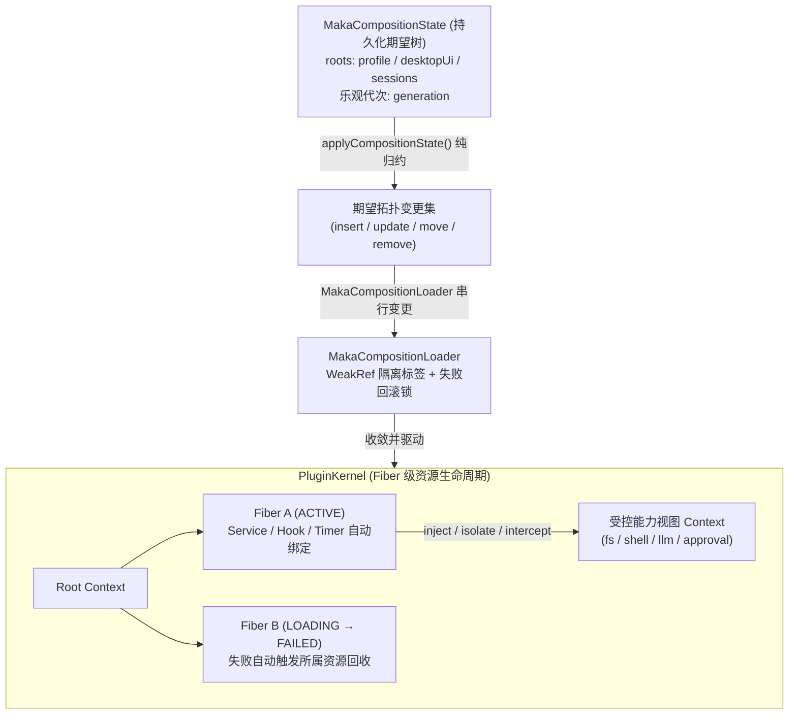
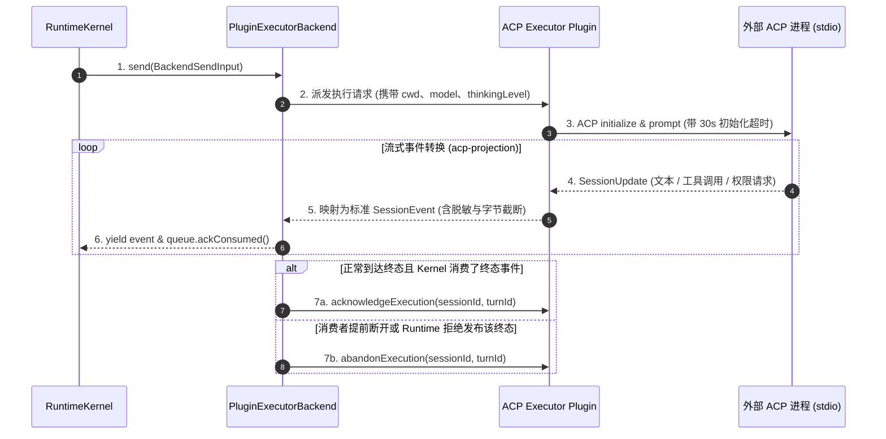

# 插件运行时、技能治理与 ACP 外部执行器

[返回手册目录](../README.md)

当用户希望让 Agent 接入企业内部私有工具、自定义面板 UI、第三方技能包（Skills），甚至通过同一套桌面和终端壳层去驱动外部 Agent 进程（如 Antigravity 等遵循 ACP 协议的代理）时，核心运行时面临一个严峻的架构考验：**如何在赋予扩展极高灵活性的同时，防止一个写坏的插件泄漏内存、越权调用系统资源，或者在外部执行器中途失联时把半截状态污染进正式历史？**

Maka 没有选择简单粗糙的“导入一段 JS 脚本直接跑”，而是设计了一套基于 **Fiber 生命周期树、声明式组合树（Composition Tree）、技能加密锁治理（Skill Lock Governance）与三态交接协议（`PluginExecutorBackend`）** 的插件与外部执行体系。

---

## 1. 概念先行：为什么插件不能直接 `require()` 了事？

在传统的脚本扩展模型中，加载一个插件通常只是执行一段初始化函数，往全局对象上挂载几个工具或监听器。这种做法在常驻托管的 Runtime Host 进程中会迅速引发四大灾难：

1. **卸载泄漏与幽灵回调**：插件在运行时注册了定时器和事件监听器。一旦用户禁用或热重载插件，如果不能自动清理该插件名下注册的所有资源，旧版回调就会继续在后台悄悄运行并消费内存。
2. **热更新状态撕裂**：当新版本插件加载失败时，如果已经把旧版本从内存中销毁一半，系统就会陷入既无法用新版、又退不回旧版的瘫痪状态。
3. **能力越权**：一个只负责格式化 Markdown 的小插件，如果没有作用域隔离（Scope Isolation），就能顺手访问网络代理、密钥库和 Shell 引擎。
4. **外部 Agent 结果语义冲突**：通过 ACP（Agent Client Protocol）接入的外部 Agent 拥有自己的推理循环。当消费方断开连接或 Runtime 拒绝接收它的终态时，外部系统可能已经算出了结果，如何严谨处理“已发布 / 被拒绝 / 未结算”的边界？

Maka 通过**微内核 Fiber 调度 + 期望状态归约树 + 三态后端适配器**解决了上述全部问题。

---

## 2. 插件微内核：`PluginKernel` 与 `MakaCompositionLoader`

Maka 的插件系统由两层职责分离的组件构成：**底层 `PluginKernel` 负责 Fiber 级资源隔离与自动回收**，**上层 `MakaCompositionLoader` 负责声明式期望状态收敛与热重载事务**。



### 2.1 `Context` 与 `Fiber`：非所有权的能力视图
在 `PluginKernel` 中，每个运行的插件实例都对应唯一一个 **Fiber**，状态严格沿 `PENDING → LOADING → ACTIVE → UNLOADING → DISPOSED`（或 `FAILED`）流转：
- **非所有权视图（Non-owning Capability View）**：插件拿到的 `Context` 并不是全局对象，而是绑定到单一 Fiber 的局部投影，且受限于配置声明的 `inject`（依赖注入声明）、`isolate`（服务作用域隔离）与 `intercept`（拦截器）。
- **自动级联清理**：插件在 `Context` 上注册的一切工具、服务、钩子和事件监听，全都被 `PluginKernel` 自动记录在该 Fiber 的副作用树（`EffectMeta`）下。一旦插件卸载、热重载或启动抛出异常，内核无需依赖插件自己写干净的析构函数，直接销毁 Fiber 即可将所有派生副作用连根回收。

### 2.2 声明式组合树与事务回滚热重载
Runtime Host 不直接命令式地“先去启动插件 A 再去关掉插件 B”，而是通过纯函数归约器 `applyCompositionState()`，先在存储层以乐观代次（`baseGeneration`）提交一份全新的期望状态树 `MakaCompositionState`（划分为 `profile` 全局、`desktopUi` 界面与 `session:<id>` 会话级三个根节点），再通知 `MakaCompositionLoader` 将实时运行时收敛至目标状态。

- **隔离标签防内存泄漏**：服务与上下文可能比单个组合条目活得更久，Loader 使用 `WeakRef<symbol>` 配合 `FinalizationRegistry` 按生命周期驻留隔离标签，并防范旧代次 Finalizer 误删新代次标签的经典竞态。
- **失败原子回退**：执行 `reload(pkg)` 热更新时，Loader 先备份旧版包定义；如果新版插件在收敛激活期间抛错，Loader 立即恢复旧版包注册并回滚组合，保证线上服务不中断。

---

## 3. 受控能力端口：插件能触碰什么？

插件绝对禁止直接导入宿主底层数据库或操作系统敏感接口。Host 通过组合规则向插件暴露细粒度的标准服务接口（`plugin-*-service`）：

| 能力端口模块 | 核心职责与保护边界 |
| :--- | :--- |
| **`plugin-fs-service` / `plugin-shell-service`** | 将文件读写与命令执行路由回会话的 `ExecutionBoundary` 和沙箱策略，禁止插件绕过路径边界。 |
| **`plugin-llm-service` / `plugin-tool-service`** | 允许插件通过受控适配器发起辅助模型调用或向模型注册新工具，用量计入统一账本。 |
| **`plugin-approval-service` / `plugin-user-question-service`** | 任何需要人类确认或提问的动作，必须经过 Host 统一的审批状态机与持久化记录。 |
| **`plugin-client-bridge-service`** | 允许插件向已连接的前端 UI（Desktop/TUI）发送受控的渲染更新或前端能力桥接请求。 |
| **`plugin-executor-service`** | 允许外接执行器插件（如 ACP 代理）注册成为标准 `AgentBackend` 供会话选用。 |

---

## 4. Skill 治理：加密锁文件与调用回执

除了代码插件，Maka 还支持通过 `SKILL.md` 为模型动态注入领域知识与操作指南。然而，“把 Markdown 指令塞给模型”在工程上极易出现两大漏洞：**本地磁盘文件被意外篡改或软链接劫持**，以及**界面无法证实模型刚才是否真的按用户要求加载了特定技能**。

Maka 为此引入了严格的双重治理机制：

### 4.1 基于 SHA-256 锁文件的来源治理（`SkillsGovernance`）
Maka 将技能严格划分为 `bundled`（内置随包发行）、`managed`（本地受管库安装）与 `workspace`（项目目录自带）三类，并通过 `.maka` 锁文件（`SkillLockFile`）校验完整性：
- **防篡改与防符号链接逃逸**：每次发现或加载技能时，校验器计算当前 `SKILL.md` 的 SHA-256 摘要，与锁文件中的 `contentSha256` 比对，精确产出 `up_to_date`、`update_available`、`local_modified` 等状态；若检测到锁文件本身是符号链接，直接返回 `lock_symlink` 安全拒绝，防止跨目录读取篡改。

### 4.2 不可篡改的技能调用回执（`SkillInvocationReceipt`）
当用户在对话中显式输入 `/skill-name` 或模型自主加载某项技能时，运行时不仅将技能指令文本注入提示词，还会生成一条带长度截断保护的结构化回执 `SkillInvocationReceipt`（包含 `invocation` 模式 `explicit/auto`、`id`、`scope`、`source` 与 `truncated` 标记）。前端界面渲染聊天记录时，正是依据这些已落盘的成功回执将文本中的 `/skill` 令牌冻结为可点击的技能徽章（`InlineReference`），保证历史记录绝对真实可溯。

---

## 5. ACP 外部执行器接入：`PluginExecutorBackend`

企业环境经常需要在一个统一的 Maka 工作台内，调度遵循 **ACP（Agent Client Protocol）** 的外部智能体（例如 `@maka/acp-executor-plugin` 与 `@maka/antigravity-acp-plugin`）。

Maka 没有为外部 Agent 单独写一套平行调度器，而是通过适配器 `PluginExecutorBackend` 将其完整接入标准的 `AgentBackend` 接口：



### 5.1 为什么必须区分 `published`、`rejected` 与 `unsettled` 三种结算状态？
这是集成外部异步 Agent 时最关键的防丢防重机制：
- 只有当外部插件产生了合法终态结果且 `RuntimeKernel` 的同步消费者（`onSessionEvent`）**真正消费并确认落盘**了该终态事件，适配器才判定为 `published` 并调用 `acknowledgeExecution()` 通知插件消除待处理标记。
- 如果外部插件在算出结果前就崩溃了（`unsettled`），适配器既不确认也不遗弃，保留原始不确定性。
- **最微妙的边界**：如果外部插件其实已经算出了终态结果，但上层消费者在此时断开了连接，或者 `Runtime` 校验认为结果非法而拒收（`rejected`），`PluginExecutorBackend` 在 `finally` 块中会精确识别 `settlement !== 'unsettled' && !acknowledged`，显式调用 `abandonExecution()` 告知插件“宿主并未采纳这次结果”，防止外部插件误以为任务已完美交付给用户！

### 5.2 并发限流与隔离目录防逃逸
在 `acp-executor-plugin` 内部，同样贯彻了严密的资源边界：
- 初始化强制 30 秒超时、取消操作强制 15 秒超时（防止僵死 ACP 子进程卡住整个会话）；
- 借助 `AdmissionLimiter` 管控并发启动的外部进程数；
- 暴露给外部 ACP 进程的文件读写回调 `readWorkspaceTextFile / writeWorkspaceTextFile` 严格经过 `realpath` 规范化与工作区边界 containment 校验，防止外部 Agent 越过工作区目录读写宿主敏感文件。

---

## 6. 教学伪代码：插件组合热重载与三态执行器桥接

```text
// === 1. 组合热重载：先提交期望树，再带回滚锁驱动 Fiber 收敛 ===
async function reloadPluginPackageSafe(loader, newPackage):
    previousPackage = loader.getInstalled(newPackage.packageId)
    assert previousPackage != null, "Package must be installed before reload"

    // 加串行变更锁，防止并发修改组合树
    await loader.withMutationLock(async () => {
        loader.registerPackage(newPackage)
        try:
            // 找到所有引用该包的 Fiber，依次执行 UNLOADING (回收旧副作用) -> LOADING -> ACTIVE
            await loader.reconcileAffectedEntries(newPackage.packageId)
        catch err:
            // 热更新失败时立即还原旧版本注册并回滚重启旧 Fiber，保障服务不瘫痪
            loader.registerPackage(previousPackage)
            await loader.reconcileAffectedEntries(previousPackage.packageId)
            throw new PluginReloadRollbackError(err)
    })

// === 2. PluginExecutorBackend：外部执行器的三态结算契约 ===
async function* bridgeExternalExecutor(binding, input):
    queue = new AsyncEventQueue()
    abort = new AbortController()
    acknowledged = false

    // 后台任务：消费外部插件事件并产出终态标记 ('published' | 'rejected' | 'unsettled')
    producer = produceExternalEvents(binding, input, abort.signal, queue)
        .finally(() => queue.close())

    try:
        for await event in queue:
            yield event
            queue.ackConsumed() // 死等 Kernel 将事件持久化后再继续

        settlement = await producer
        if settlement == "published" and binding.acknowledgeExecution != null:
            try:
                await binding.acknowledgeExecution(input.sessionId, input.turnId)
                acknowledged = true
            catch:
                // 确认失败时不假装成功，落入 finally 走显式 abandon 暴露不确定性
                pass
    finally:
        abort.abort("Consumer detached")
        settlement = await producer.catch(() => "unsettled")
        
        // 关键边界：只要外部产出了结算结果但未能被宿主确认采纳，必须显式通知放弃
        if settlement != "unsettled" and not acknowledged and binding.abandonExecution != null:
            await binding.abandonExecution(input.sessionId, input.turnId)
```

---

## 7. 对照 Pi：轻量扩展钩子 vs Fiber 微内核与 ACP 桥接

| 对比维度 | Maka (`PluginKernel` + `PluginExecutorBackend`) | Pi (`extensions` 扩展机制) |
| :--- | :--- | :--- |
| **扩展运行形态** | 基于 Fiber 树的声明式组合状态，支持按全局、UI、单会话三级节点隔离注入与事务回滚热重载。 | 应用启动时加载本地扩展模块，直接向内存 `AgentSession` 注册工具函数和事件钩子（如 `beforeToolCall`）。 |
| **资源回收与隔离** | 卸载或失败时自动回收该 Fiber 下注册的全部服务、定时器和监听；能力必须通过 `inject` 显式授权。 | 共享同一应用进程上下文，生命周期与整个 `AgentSession` 绑定，开发自由度极高但无精细热卸载隔离。 |
| **Skill 安全治理** | 配备 SHA-256 锁文件校验（防符号链接与本地篡改）以及不可变调用回执 `SkillInvocationReceipt`。 | 直接读取工作区及用户配置目录下的上下文与 Skill Markdown 文件，透明简单、零校验开销。 |
| **外部 Agent 接入** | 内置规范化的 `AgentBackend` 端口与 ACP 协议适配器，带三态结算协议（`published/rejected/unsettled`）。 | 通过扩展脚本（如 `subagent` 示例）直接派生子进程收集 JSON 流，不涉及跨会话三态持久化协议。 |

---

## 8. 延伸阅读

- 了解 `AgentBackend` 端口如何接入 `RuntimeKernel` 并参与后端代次管理，阅读 [01.2 会话与执行对象的生命周期](session-lifecycle.md)。
- 了解 `PluginExecutorBackend` 背后的外部服务协议是如何通过 `McpClientManager` 与客户端能力进一步扩展的，阅读 [03.2 MCP 连接与客户端能力代理](../03-tools/mcp-and-client-capabilities.md)。
- 了解整个插件包和工作区在 Monorepo 中的依赖分布，阅读 [00.2 仓库与依赖地图](../00-foundations/repository-map.md)。
