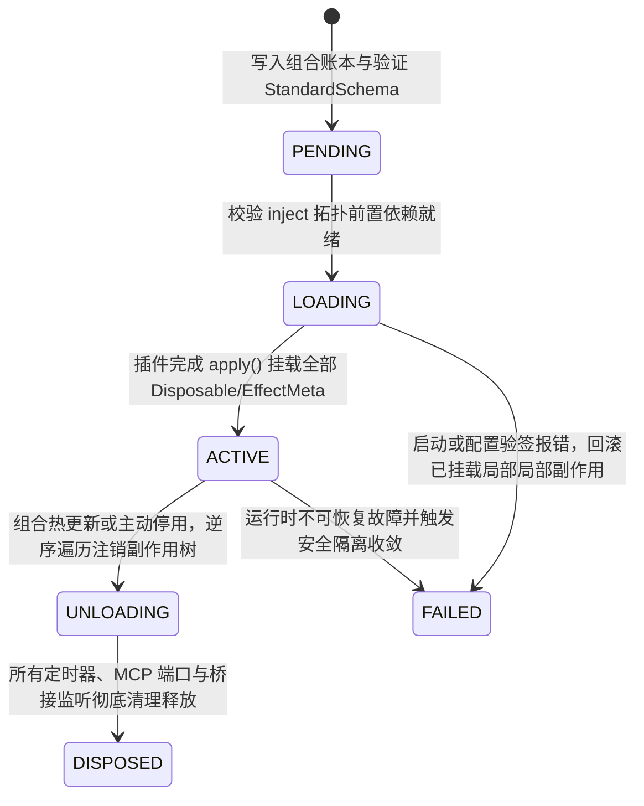
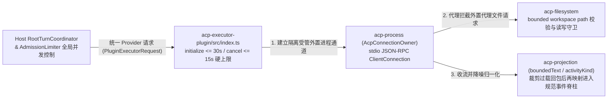

# Fiber 插件微内核与 ACP 异构桥梁：能力托管、Skill 验签与生命周期隔离

## 1. 为什么插件系统不能简单写成“动态 `import()` + `eventEmitter.on()`”？

让第三方扩展或者内置垂直业务能力介入 Agent 主循环，最直接的懒人做法是暴露几个全局 Hook，然后用 Node 的动态加载直接跑一遍扩展代码。但在一个需要长期跑批、支持热停机组合和远程托管的 Host 引擎里，这种粗放插件模型很快会变成无法管控的系统黑洞：

1. **资源幽灵与卸载污染**：一个插件注册了几个监听回调、打开了两个本地轮询定时器、占着某条数据库查询游标；用户禁用了该插件或重启重载新组合时，旧代码遗留在全局监听器表里的幽灵闭包依然在后台静悄悄触发，持续消耗内存并篡改新会话数据！
2. **隐式循环依赖与未验证的配置爆炸**：插件 A 依赖插件 B 提供的某项外部存储服务，加载顺序稍有错乱就在某个冷门路径炸出 `undefined is not a function`；或者配置文件错传了个字段直到运行半小时后才崩溃。
3. **外置闭源或独立协议代理（ACP）与内核割裂**：如何让像 Antigravity 这类遵循 **Agent Client Protocol (`@agentclientprotocol/sdk`)** 的强大外置执行器，既保留自己的内部自主工作循环，又不被越界赋予任意读写宿主机盘面、破坏会话账本或绕开全局 `AdmissionLimiter` 并发限额的特权？

Maka TypeScript 版针对这两条战线给出了极为精致的分层解决架构：在宿主内部构造具备严格依赖注入与副作用树清理的 **Fiber 插件微内核（`PluginKernel`）** 与组合验证台（`HostPluginPlatform`）；在外部代理边界，用遵从统一 `PluginExecutorProvider` 接口与受限工作区门禁的 **ACP Bridge（`acp-executor-plugin`）** 完成受控收编。

---

## 2. Fiber 插件微内核：副作用树清理、依赖拓扑与 Standard Schema 验签

翻开 `packages/runtime/src/plugin-kernel.ts` 与 `packages/runtime-host/src/server/plugin-platform.ts`，可以看到这套内生于 TypeScript 环境的轻量微内核如何用“组合式生命周期纤维（Fiber）”取代散漫的全局回调：

拆解这套微内核的四大纪律支撑：
1. **显式六态生命周期与精确依赖注入（`inject`）**：每个扩展必须声明依赖清单 `inject`；只有前置依赖已经稳定进入 `ACTIVE` 态，下游插件才被放行步入 `LOADING`。启动即验算全局配置遵循的 **`StandardSchema` (`~standard.validate`)**，所有畸形插件配置在未触及业务逻辑前一毫秒即当场驳回。
2. **自动串联清理树（`Disposable` + `EffectMeta`）**：插件在执行过程中注册的任何命令（`PluginCommandInspection`）、模型工具（`PluginToolInspection`）、系统提示碎片（`PluginSystemPromptInspection`）乃至远端客户端通信绑定（`PluginClientBridgeService`），均被微内核记账挂靠在同一颗 Fiber 上下文的局部副作用树之下。**卸载或停用插件时，完全不指望插件作者手写易漏的 `teardown()` 方法——内核沿副作用树自动逆序一次性注销该分支挂出的全部句柄**，彻底消除卸载后漏网监听器的隐患。
3. **可审计组合存储与包完整校验（`HostPluginPlatform`）**：在真正拉起扩展组合前，宿主通过 `TrustedPluginPackageLoader`、`HostPluginCompositionStore` 及 `plugin-composition-patch` 完成包完整性审计与目录权限对齐，防止未签核来路不明的代码块溜进受管主机空间。

---

## 3. 技能生态治理（Skills）：防漂移验签、摘要注入与调用审计

相比常驻后台的插件服务，模型在日常推理中按需挂载的能力包被称为 **Skills**。常见框架把 `SKILL.md` 全塞进每次请求的系统提示词前头，不仅白白烧光上万输入 Token，更无法感知用户中途修改了磁盘技能文本甚至调包。

Maka 把 Skill 管理收归系统账本与运行时审计流中（还记得我们在 `agent-run.ts` 看到的四个明确审计事件：`skill_catalog_built`、`skill_searched`、`skill_loaded`、`skill_load_failed` 吗？）：
- **按需延迟披露（Catalog -> Search -> Load）**：初始请求只注入极精简的 Skill 目录清单与触发描述（由 `skill_catalog_built` 建档），仅当模型真正判断需要某技能时再按需通过检索引擎触发全量拉取加载（`skill_loaded`），大幅压缩日常上下文占用；
- **校验加密快照与调用溯源**：所有经过检索激活的 Skill 文本及脚本内容结合内容哈希锁定校验基线，搭配 `SkillInvocationResult` 在 `RootTurnCoordinator` 与 `AgentRunStore` 中留下完整追溯依据，确保每次技能挂载与执行结果“查得出版本号、核对得上原始摘要”。

---

## 4. ACP 异构外部执行器接入：`packages/acp-executor-plugin`

在面对像 **Antigravity ACP (`antigravity-acp-plugin`)** 或其它遵从 `@agentclientprotocol/sdk` 的独立编码执行代理时，微内核拒绝将控制大权一股脑拱手相让，而是借助实现了统一 `PluginExecutorProvider` 契约的 **ACP Bridge** 把异构外部进程严密关进控制框架之内：

审视 `packages/acp-executor-plugin/src/index.ts` 与相关模块实现，最见真章的是这四道护城河：
1. **严格的握手与强制撤离硬时钟**：初始化握手强制限定 **`INITIALIZE_TIMEOUT_MS = 30_000`**（30 秒内未返回即判失败），而在取消打断外置代理时设置了 **`CANCEL_TIMEOUT_MS = 15_000`**（15 秒优雅收尾门限）——超出即触发底层强清理通道，绝不任由挂死的第三方客户端无限吊住宿主队列！
2. **文件权限宿主代持（`acp-filesystem`）**：当远程或外置 ACP 代理在推理途中声称“我想读取或写入工作区某个文件”并向 SDK 发起文件能力回调时，Bridge 绝不放任对方拿着任意字符串路径裸扫硬盘，而是强制通过 `readWorkspaceTextFile` / `writeWorkspaceTextFile` 走统一路径边界规范化（检查绝对路径与实路径解引用逃逸）并纳入全局许可门控。
3. **跨界面与账本有界投影（`acp-projection`）**：第三方外置代理吐出的内部流块结构（`SessionUpdate`、`ToolCallUpdate`、`ToolCallContent`）往往携带五花八门且长度不受控的异构数据。`acp-projection` 利用 **`boundedText`、`summarizeToolContent` 与 `projectToolResult`** 在跨越返回内核边界时先完成规范归一化和有界截断保护，避免异构外部工具一步撑爆主系统的投影账本与前端帧上限（`PLUGIN_CLIENT_BUNDLE_CHUNK_MAX_BYTES`）。
4. **全局拥塞共治（`AdmissionLimiter`）**：即便切换成外置 ACP 引擎运行子任务，依然受统一注入的 `AdmissionLimiter` 统筹全局并行任务槽配额，绝不会因为用户把后端换成了外部执行插件就意外冲垮宿主机硬件算力上限。

---

## 5. 总结

Maka TypeScript 版在插件与外部代理治理上展现出同样高度克制的边界哲学：
- 对内借助 **Fiber 插件微内核 (`FiberState` + `Disposable` 副作用树 + `StandardSchema`)**，把动态扩展热更新与卸载清理的可靠性做进统一生命周期管道；
- 对技能借助 **渐进目录披露与加密账本溯源**，在压缩首轮 Prompt 成本的同时保证执行审计完全闭环；
- 对外借助 **`acp-executor-plugin`** 加上 **30s/15s 超时硬底线、`acp-filesystem` 代理门控和 `acp-projection` 有界转换**，成功把独立的外部 ACP 执行体无缝并入单一 State Root 控制体系之下。

至此，**01 运行时内核与模型协议篇（5 篇）** 已全面讲透从信令入站、代次防撞、`AiSdkTurn` 双循环、OAuth/WS 增量网关再到插件与 ACP 桥接的整条运行时主干道。接下来我们将转向智能化执行系统的记忆中枢——**02 上下文投影、安全压缩与长期记忆篇**，首先解剖底层极其精妙的三账本投影归约机制、防 400 重放规划器与 `maka://` 大内容按页懒读体系：[三账本投影归约与资源卸载：从 ModelProjectionTransitionLedger 到 Read-Page](../02-context/history-and-projection.md)。
