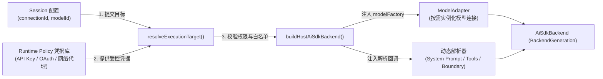
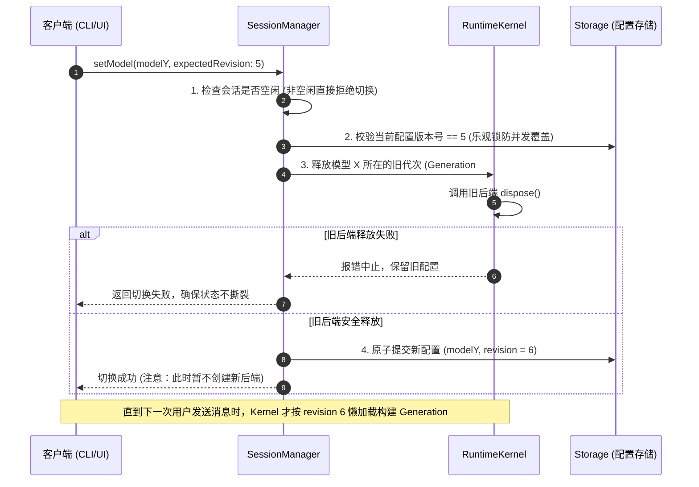

# 模型、连接与配置的注入

[返回手册目录](../README.md)

在实际应用中，用户经常需要在同一个会话中切换不同的大模型（例如先用高性价比模型阅读代码，再用旗舰推理模型设计架构），或者使用受企业管控的 OAuth 网关与私有网络代理。

如果把 API Key 和模型实例直接写死在环境变量或全局变量中，就会面临三大难题：**切换模型时在途请求崩溃、OAuth 令牌过期无法动态刷新、以及多客户端同时修改配置导致互相覆盖。** 本章解析 Maka 是如何安全解析连接材料、按不同寿命注入配置，并在会话空闲时安全切换模型的。

---

## 1. 概念先行：连接、模型与凭据的解耦

在简单的 SDK 调用中，开发者往往直接把 `{ apiKey: "sk-...", model: "gpt-4o" }` 传给请求函数。Maka 将其拆分为三个独立概念：

1. **连接（Connection）**：代表“怎么连到某个模型供应商”，包含服务地址（Base URL）、代理设置、鉴权方式（API Key 或 OAuth）以及可用模型白名单。
2. **执行目标（Execution Target）**：会话配置中指定的逻辑标识（连接 ID 或 Slug + 目标模型名）。
3. **凭据材料（Credential Material）**：真正发起 HTTP 请求所需的密钥或动态 Token，受 **Runtime Policy（运行时策略库）** 统一管控。

**为什么要把凭据和模型实例分开装配？**
一方面，凭据属于高敏资产，不应散落在业务层的 `Session` 记录中（`Session` 只存连接 ID，不存明文 Key）；另一方面，企业环境广泛使用 OAuth 鉴权，Token 只有几十分钟有效期，必须在每次发起网络请求时动态获取或刷新，而不能在会话初始化时一次性写死。

---

## 2. 装配链路：Host 如何将配置注入到 Turn？

当一个冷会话准备激活后端时，Host 会通过**依赖注入（Dependency Injection）**将模型能力、工具、系统提示词和存储边界组装进 `AiSdkBackend`。



### 凭据的延迟绑定机制
- **API Key 模式**：密钥通过受保护的 `modelFactory` 闭包进入底层适配器，不直接暴露给上层客户端或事件日志。
- **OAuth 模式**：在装配阶段只绑定凭据身份，真正的 `access_token` 是在 `AiSdkTurn` 发出实际 HTTP 请求的瞬间，由请求拦截包装器实时向 `OAuthExecutionAuthority` 申请并注入请求头的。若遇到令牌即将过期，权威层自动完成无感续期。

---

## 3. 寿命分级：什么随代次固定，什么按步动态读取？

在 `AiSdkBackend` 的一次生命周期内，并非所有配置项都以相同的频率更新。Maka 根据**缓存友好性**与**实时一致性**的权衡，对注入的材料做了精细的刷新粒度划分：

| 注入项 | 更新频率 / 作用域 | 为什么这样设计？ |
| :--- | :--- | :--- |
| **模型连接与适配器 (`ModelAdapter`)** | **随 `BackendGeneration` 固定** | 维持底层连接池与配置一致性；更换模型必须触发代次轮换，防止同一步骤中模型突然改变。 |
| **工具声明清单 (`Tool Declarations`)** | **每次 `Model Step` 开始时取快照** | 允许运行中通过 `tool_search` 激活新工具，但在同一轮次内保持工具声明稳定，最大化命中厂商的 Prompt Cache。 |
| **系统提示词 (`System Prompt`)** | **每次 `Model Step` 准备时动态解析** | 允许动态注入最新的工作区状态、日期或环境提示，同时兼顾缓存前缀稳定。 |
| **会话安全边界 (`ExecutionBoundary`)** | **每次工具执行时实时读取** | 若用户在运行途中收紧了目录访问权限，工具执行层能立刻生效拦截，无需重启整个模型后端。 |

---

## 4. 模型切换：乐观锁与平滑代次交接

设想用户正在使用模型 X 讨论架构，接着决定在同一个会话里切换到模型 Y 继续提问。如果此时另一个桌面端窗口也同时在修改配置，或者后台还有未完成的任务，直接覆盖配置就会引发灾难。

Maka 采用 **空闲检查 + 版本乐观锁（`expectedRevision`） + 先放后建** 的标准流程：



### 为什么不在切换配置时立刻构建模型 Y 的后端？
因为用户可能在菜单里连续点选切换三次模型，最后才发一条消息。采用**懒加载（Lazy Initialization）**策略：切换配置时只负责“清理旧代次”和“持久化新配置”；只有当下一条用户消息真正到达时，`RuntimeKernel.ensureActiveBackend()` 才会依据最新配置构建新的后端实例，避免无谓的初始化开销。

---

## 5. 教学伪代码：配置解析与版本乐观锁切换

```text
// === 配置装配与延迟凭据注入 ===
function buildBackendForGeneration(sessionConfig):
    // 1. 解析连接与目标校验
    target = runtimePolicy.resolveExecutionTarget(sessionConfig.connectionId, sessionConfig.modelId)
    if not target.isAllowedModel(sessionConfig.modelId):
        throw new PolicyViolationError("Model not permitted on this connection")

    // 2. 构建延迟凭据获取工厂 (支持 OAuth 自动刷新)
    modelFactory = () => {
        credentials = runtimePolicy.acquireLiveCredentials(target.connectionId)
        return createProviderClient(target.providerType, credentials, target.proxySettings)
    }

    // 3. 注入动态解析器，返回标准化的 Backend 实例
    return new AiSdkBackend({
        modelFactory,
        resolveSystemPrompt: () => promptBuilder.build(sessionConfig.workspace),
        resolveTools: () => toolRegistry.getActiveSnapshot(sessionConfig.sessionId),
        readBoundary: () => boundaryStore.getCurrent(sessionConfig.sessionId)
    })

// === 安全切换模型配置 (乐观锁 + 资源释放) ===
function transitionModelConfiguration(sessionId, newConfig, expectedRevision):
    // 1. 确保当前没有正在运行的 Turn
    if runtimeKernel.hasActiveRuns(sessionId):
        throw new SessionBusyError("Cannot switch model while a turn is running")

    // 2. 乐观锁比对，防止多端同时修改导致配置丢失
    currentRecord = sessionStore.load(sessionId)
    if currentRecord.revision != expectedRevision:
        throw new ConflictError("Session config was modified by another client")

    // 3. 必须先彻底释放旧代次资源，才能更新数据库配置
    await runtimeKernel.disposeGeneration(sessionId)

    // 4. 提交新配置并递增版本号
    sessionStore.updateConfig(sessionId, newConfig, nextRevision: expectedRevision + 1)
```

---

## 6. 延伸阅读

- 了解模型切换时 `RuntimeKernel` 如何隔离老旧代次下的残留请求，阅读 [01.2 会话与执行对象的生命周期](session-lifecycle.md)。
- 了解凭据材料在工具执行层是如何受控注入（如注入给 CLI 执行脚本而防止泄漏到日志），阅读 [03.4 分层授权与凭据生命周期](../03-tools/permissions-and-secrets.md)。
