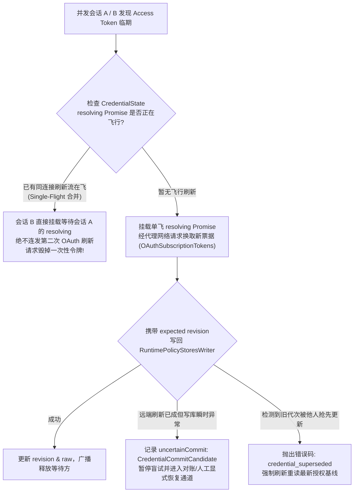
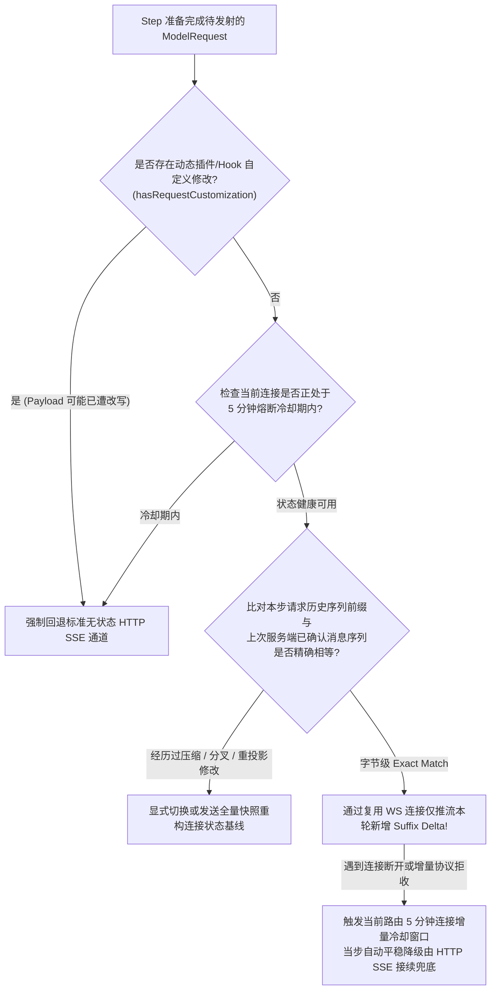

# 四元配置解耦与 WS 增量传输：OAuth 动态注权、并发 CAS 与 5 分钟冷却退避

## 1. 为什么直接把“API Key + Base URL + Model Name”写进会话配置表早晚会失控？

许多 Agent 工具在配置层把供应商连接参数做成一个简单的扁平 JSON 对象：用户在设置里填入密钥与模型 ID，创建会话时直接把整块配置原样塞进会话配置表里保存。一旦系统进入多端生产环境与复杂订阅生态（如企业网关、OAuth 周期换票、模型目录实时变动与长连接复用），这种偷懒建模会接连诱发四类顽疾：

1. **订阅凭据泄露与半截刷新覆盖**：把静态密码或 OAuth Refresh Token 直接存进会话上下文或模型配置里，不仅造成敏感数据暴露面膨胀，当两个并发会话发现 Access Token 刚好同时过期并一起去请求刷新服务端时，由于很多 OAuth 供应商执行一次性的 Refresh Token 轮换（Rotation），慢一步覆盖落库的那个线程会直接毁掉整个账号的刷新链条！
2. **全局设置变更篡改进行中的规则或丢失更新**：用户打开两个设置窗格并发编辑同一个供应商参数，后点保存的静默吞掉前面窗格改了一半的字段；或者一个长工具链跑在半路，突然后台换掉了参数导致 Prompt 缓存前缀彻底失效。
3. **长工具链全量重发拖垮延迟**：在支持 OpenAI Responses API WebSocket 状态复用的长流程中，若每跑一个 `Read` 就重新上传几十万 Token 的全量历史与系统说明，不仅网络 RTT 飙升，序列化与上传拥塞也会直接抵消本地工具高速化的全部收益。

Maka TypeScript 版在模型接入与传输架构中以**四元身份物理拆解**、**单飞并发合并 OAuth 刷新权（`OAuthExecutionAuthority`）**、**乐观修订锁（`expectedRevision`）**与**严格三关护卫的 WebSocket 增量复用网关**给出了成体系的系统设计。

---

## 2. 四元配置拆解：连接、执行路由、凭据定位器与状态指纹

在 `packages/core` 与 `packages/runtime-host` 的模型装配边界中，传统大杂烩配置被精密分解为四块生命周期完全不同、互不污染的组件：

| 抽象层级 | 核心语义载体 | 变更节奏与安全属性 |
| :--- | :--- | :--- |
| **1. 连接目录 (`llm-connections`)** | 物理供应商定义（协议种类 `ProviderKind`、`baseUrl`、自定义代理头、超时覆盖与可用模型目录投影） | 按工作区/账号全局配置变化；不含高危裸密码正文 |
| **2. 运行期执行路由 (`RuntimeExecutionConnection`)** | 当前轮次准入绑定后确定的目标（选定连接 Slug、具体模型 ID、Thinking 档位及路由不变式指纹） | 绑定于每一次 `Invocation` 准入，保证单次尝试周期内的模型定位契约 |
| **3. 凭据定位器与密库 (`CredentialLocator` & `SecretStore`)** | 加密隔离库内的检索地址指向（例如 `oauth_token` 订阅引用或 `Managed Secret` 句柄） | **永不直接透传进会话事件脊柱或渲染端协议包**；仅在执行瞬间受控唤醒读取 |
| **4. 刷新状态修订指针 (`revision` & `credentialId`)** | 面向订阅式凭据并发续命时的单调递增版本锁游标 | 专治高并发过期刷新覆盖、与刷新落库瞬间断电造成的前后代撕裂 |

---

## 3. 并发刷新单飞锁与不确定恢复：`OAuthExecutionAuthority`

对于依托 OAuth 2.0 授权运行的订阅型接入（如 Codex OAuth、GitHub Copilot 或特定平台授权订阅），最令人崩溃的生产故障莫过于 **“刷新并发竞争（Concurrent Refresh Race）”** 与 **“刷新发出但写库掉电（Uncertain Commit）”**。

查看 `packages/runtime-host/src/server/oauth-execution-authority.ts` 源码，可以看到一套极为老练的防御式凭据状态机（`CredentialState`）：



请看这套状态机在并发工程上的四项硬保护：
1. **单飞合并刷新（Single-Flight Refresh Coalescing）**：同一条连接在某个高并发时刻即便同时跑着 10 个子任务，所有请求撞到 `401` 或提前临期窗口时都会命中同一条共享的 **`resolving?: Promise<OAuthSubscriptionTokens>`** 槽位，由唯一领头人向服务端发起刷新并落盘更新，从物理上彻底根绝两次平行刷新互踢令牌作废。
2. **强制重刷去重判断（`resolvingForceRefresh`）**：区分“常规顺带发现过期”和“刚刚被远端网关当场打回 `401` 需要强制重刷”两种强度，确保不会错误复用一轮普通检查去掩盖刚发生的强制吊销报错。
3. **落盘失联候选保存（`uncertainCommit?: CredentialCommitCandidate`）**：如果在“从 OAuth 供应商拿到新的一对一次性 Refresh + Access Token”到“写完本地加密库持久化文件”之间磁盘或存储协程掉线失联，系统绝不允许把新拿到的短命一次性令牌随便丢弃重刷（那样会导致账号当场锁定失效！），而是精准挂起暂存并收束明确错误码（`credential_unavailable` / `credential_superseded` / `refresh_failed` / `persistence_failed`）保障后续安全收口。

```typescript
// 教学级提炼自 OAuthExecutionAuthority 的单飞刷新与不确定提交保护
async function acquireFreshAccessToken(state: CredentialState, forceRefresh: boolean): Promise<OAuthSubscriptionTokens> {
  if (state.uncertainCommit) {
    // 上一次拿到新一次性 Refresh Token 后写库断联：禁止盲目再发起一次 OAuth 刷新摧毁账号！
    throw new OAuthExecutionCredentialError('persistence_failed', 'Pending uncertain OAuth commit must be reconciled first');
  }

  // Single-Flight 并发合并：若已有同强度在途刷新，直接共享同一个 resolving Promise
  if (state.resolving && (state.resolvingForceRefresh || !forceRefresh)) {
    return await state.resolving;
  }

  state.resolvingForceRefresh = forceRefresh;
  state.resolving = (async () => {
    const tokens = await refreshTokensOverScopedProxy(state.providerType, state.raw);
    try {
      const nextRev = await policyWriter.commitRotatedOAuthTokens({
        credentialId: state.credentialId,
        expectedRevision: state.revision, // 乐观 CAS 防旧代次覆盖
        tokens,
      });
      state.revision = nextRev;
    } catch (err) {
      state.uncertainCommit = { credentialId: state.credentialId, revision: state.revision };
      throw err;
    } finally {
      state.resolving = undefined;
    }
    return tokens;
  })();

  return await state.resolving;
}
```

---

## 4. 配置热修订：乐观锁 `expectedRevision` 与三态寿命周期

多窗口同时修改全局模型参数时，如何保证后点保存的人不覆盖前一个窗口的修改？
`packages/runtime-host` 在 `configuration-coordinator` 与连接编排器上要求任何变更写操作必须提交当前读入版本的 **`expectedRevision`**。底层存储采用带版本比较的一步原子 `UPDATE ... WHERE revision = ?`：若期间已被另一个端修改递增版本，后置写入即刻遭到拒签，强迫客户端拉取最新合并态再确认。

同时整个配置寿命严格按热生效边界切分：
- **全局目录与凭据更改**即时写库生效，并供新发起请求动态抽取；
- **进行中的逻辑 `Invocation` 绑定关系**受 `RuntimeKernel` 的 `BackendGeneration` 代次锁隔离（参见 [01.2](./session-lifecycle.md)），热调整后老一轮在飞任务不受污染按旧契约跑完结算，紧随其后的全新回合平滑切入新版配置通道。

---

## 5. 窄门增量传输：OpenAI Responses WebSocket 与 5 分钟冷却熔断

结合 `docs/architecture/openai-responses-incremental-transport.md` 规范与模型协议适配器实现，当会话直连支持状态化响应的 OpenAI Responses API 时，Maka 拒绝将全量几百 KB 对话历史每次反复传向公网，设计了一套严苛的**有状态 WebSocket 增量通道（`store: false` 连接局部延续增量）**：



为什么这三道门禁（**`hasRequestCustomization` 旁路** + **精确前缀字面等价校验** + **5 分钟故障冷却窗**）缺一不可？
- 因为一旦本地经过历史裁剪、安全压缩（`Compaction`）或者插件 Hook 动态改动了 System Prompt 中的某个标点，此时如果客户端误以为服务端连接的还是原来的旧状态并只发送工具结果 Delta，远端服务端延续出来的历史与本地内存就会发生隐形认知分叉——这是绝对不可审计的灾难；
- 而一旦遇到网关防火墙或服务端限流拒绝增量状态连接，通过立即打上 **5 分钟冷却时间戳** 并无痛滑落至标准 HTTPS SSE 重试，既保住了当轮用户体验零中断，又避免接下来每一次工具步都在同一条不通的 WebSocket 上撞墙白费延迟。

| 传输决策维度 | 普通无状态 HTTP 全量模式 | Maka Responses WebSocket 增量模式 |
| :--- | :--- | :--- |
| **每步发送载荷** | 每轮重传全量 System + N 轮完整历史 | 仅发送上一轮服务器已认领前缀之后的 Suffix Delta |
| **安全性与分叉防护** | 每次全量无状态，绝不存在前缀对齐偏移 | 三重强制门槛（无 Custom Request / Exact Prefix Match / 5 分钟异常冷却熔断）确保严格零偏移 |
| **网络切换与降级** | 原生无长状态切换成本 | 遇拒收立即原地退回标准 HTTP SSE 重连且冷却 5 分钟避免反复重试踩雷 |

---

## 6. 总结

Maka 的模型接入与网关层架构证明了：优秀的模型接入基础设施绝非几行 HTTP Client 包装，而是在认证、并发写与状态传输上同步做到极致严谨：
1. **四元物理拆解 + 隔离密库**：让模型定义、运行时路由、高危密文凭据与乐观版本指针互不掺水；
2. **`OAuthExecutionAuthority` 单飞合并**：面对严酷的一次性 Token 轮换接口，彻底根除并发刷新自相残杀；
3. **WS 增量传输的三道死防线**：仅在绝对无自定义篡改、严格历史前缀一致且非冷却期下开启极致低延迟后缀发送，一遇风吹草动毫秒级稳妥降级回传统 SSE。

目前为止，我们已经看清了系统如何与官方原生 LLM 端口打交道。然而在实际产品演化中，开发者往往还要接入海量第三方插件工具、本地 Hook 扩展甚至外置闭源 CLI 编码代理（如 Antigravity / 其他 ACP 兼容协议引擎）。Maka 是如何在保留 Node.js 插件扩展自由度的同时，防止失控插件撕毁整颗内核、并用统一协议收编外置 ACP 执行器的？下一篇揭开 Fiber 微内核与 ACP 异构桥梁的设计内幕——[Fiber 插件微内核与 ACP 异构桥梁：能力托管、Skill 验签与生命周期隔离](./plugin-and-acp-runtime.md)。
