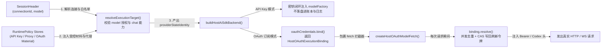
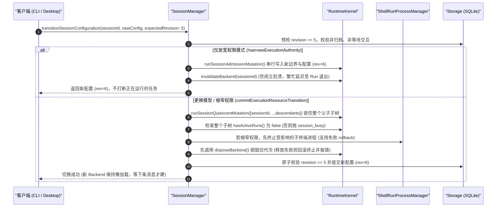
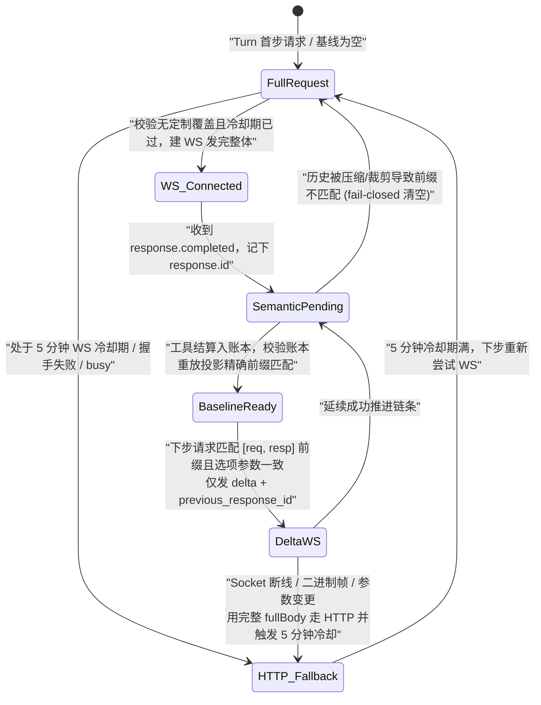

# 模型、连接与配置的注入

[返回手册目录](../README.md)

在真实的工程产品中，用户极少自始至终只用一个硬编码的 API Key 和单一模型。他们会在同一个长会话里先用高性价比模型读代码、再切换旗舰推理模型改架构；会在企业环境中使用受限的网络代理与仅有几十分钟有效期的 OAuth 订阅令牌；也会在多端窗口同时调整会话的权限级别。

如果像原型项目那样把 `{ apiKey, model }` 直接传死在环境变量中，系统立刻会面对四大工程难题：**密钥如何在多端间不泄露、OAuth 令牌在长工具循环途中过期了怎么办、多窗口并发改配置如何防止互相覆盖、以及在超长工具循环中如何安全复用连接状态而不破坏权威账本？**

本章深度剖析 Maka 的配置注入与传输治理体系，并重点拆解 **OpenAI Responses WebSocket 增量传输机制**的底层原理与 fail-closed 回退设计。

---

## 1. 概念先行：连接、执行目标、凭据与状态指纹的四元解耦

Maka 拒绝将配置杂糅在业务会话里，而是由 `ExecutionModelAuthority` 与 `RuntimePolicy` 共同维护四元分离契约：

1. **执行目标（Execution Target）**：保存在 `SessionHeader` 中的纯逻辑引用（`llmConnectionId`、`llmConnectionSlug`、`model`、`thinkingLevel`），不含任何敏感秘钥。
2. **连接定义（`RuntimeExecutionConnection`）**：受 `RuntimePolicy` 托管的连接策略对象，包含供应商类型（`providerType`）、基址（`baseUrl`）、默认协议（`defaultApiProtocol`）、授权模型列表及请求覆盖规则（`requestBodyOverlay`）。
3. **凭据材料（`RuntimePolicyCredentialMaterial`）**：高敏资产（静态 API Key、自定义加密请求头、网络代理凭证、OAuth Refresh/Access Token），通过受限凭证定位器（`CredentialLocator`）存储，永远不写入 `Session` 快照或 `RuntimeEvent` 账本。
4. **状态指纹（`providerStateIdentity`）**：由 `ExecutionModelAuthority` 在装配后端时计算出的不可变 SHA-256 指纹，编码了 `connectionId`、`providerType`、规范化端点 URL、凭据 ID 与修订号、请求头修订号以及声明的 API 协议（`apiProtocol`）。**只要影响服务端推理态或协议线的要素任一变动，该指纹即刻改变**，从而阻止跨协议/跨凭据强行重放加密思考签名等私有状态。

---

## 2. 凭据解析与 OAuth 瞬时动态换取（`OAuthExecutionAuthority`）



### 2.1 `RuntimePolicy` 准入拦截
在构建任何原生模型后端（包括主对话和标题/记忆提取等辅助调用）前，`resolveExecutionTarget()` 执行严格的策略校验：
- 通过 `authorizeConnectionModel()` 验证请求的 `model` 确实被该连接白名单授权，并通过 `isModelExplicitlyUnsupportedForChat()` 拦截非对话模型；
- 提取并构造受控的隔离网络代理快照（`ProxiedFetchTransport`，支持 HTTP/HTTPS/SOCKS5 及绕过名单）；
- 若该连接走静态 API Key，校验密钥存在性并注入工厂闭包；若走 OAuth 订阅授权（如 `openai-codex`），则不固化访问令牌，而是绑定一个 **`HostOAuthExecutionBinding`**。

### 2.2 发包瞬间动态换取 Token 与 CAS 原子持久化
OAuth 令牌通常带有极短的有效期，且许多厂商使用**一次性轮换刷新令牌（Rotating Refresh Token）**——如果两个并发请求同时拿着同一个旧 Refresh Token 去换新 Token，第二个请求不仅会失败，甚至可能触发厂商风控吊销整套会话。

`HostOAuthExecutionAuthority` 通过以下四重机制保障并发动态换取的绝对安全：
1. **请求瞬时解析与并发合并（`state.resolving`）**：`createHostOAuthModelFetch()` 在每一次 `fetch()` 真正发出网络包的那一微秒才调用 `binding.resolve()`。同一连接下的并发请求会共同等待同一个 `state.resolving` Promise；若某个请求遭遇 401 触发了 `forceRefresh()`，而当前正有一个普通 `resolve` 在途，它会等普通解析完成后再升级为强刷请求。
2. **数据库级 CAS 原子落盘（`compareAndSetOAuthCredential`）**：拿到新 Token 后，向 `RuntimePolicy` 写入新凭据时必须携带 `{ credentialId, revision }` 乐观条件。一旦发现存储层已被其他进程或外部操作改写，立刻失效本地绑定并抛出 `credential_superseded`。
3. **未决提交哨兵（`uncertainCommit`）与自愈对账**：如果写回存储时遇到连接抖动导致返回 `commit_outcome_unknown`（不确定新令牌是否已写入 SQLite），Authority 会在内存状态挂上 `uncertainCommit` 哨兵；下一次请求进入 `#reconcileUncertainCommit()` 时，先反查权威存储确认该次写入是否真正落地，既不丢失已消耗的一次性 Refresh Token，也不错误覆盖新状态。
4. **401 强制刷新防死循环**：遇到服务端 401 拒绝时，`refreshOAuthAccessToken` 触发 `forceRefresh()`；若换回来的 `access_token` 与刚才被拒的令牌完全一致（例如不支持刷新接口的静态长期账号令牌），直接返回 `null` 终止重放，绝不陷入 401 重试死循环。

---

## 3. 配置寿命分级与乐观锁 `expectedRevision` 热切换

在 `AiSdkBackend` 的生命周期内，不同注入材料按**提示词缓存稳定性**与**安全实时性**被严格分为四个更新粒度：

| 注入项 | 寿命 / 更新粒度 | 背后的工程权衡 |
| :--- | :--- | :--- |
| **`ModelAdapter` & `providerStateIdentity` & `providerOptions`** | **随 `BackendGeneration` 固定** | 维持底层连接、思考参数与协议线一致性；修改模型或连接必须销毁并重建代次。 |
| **工具声明清单（`Tool Declarations`）** | **每 Step 开始快照 + Backend 级 `sessionActiveTools` 累加** | 允许运行时通过 `tool_search` 动态补充工具，但已激活工具名不会在 Turn 间被清除，最大化保护服务端 Prompt Cache 前缀。 |
| **系统提示词（`System Prompt` & Contexts）** | **每次 `Model Step` 准备时动态装配** | 支持插件变量（如当前工作区状态、实时环境上下文）在步进边界即时生效，同时保持基座段落排序稳定。 |
| **执行安全边界（`ExecutionBoundary` / `permissionMode`）** | **每次本地工具执行前实时读取** | 若用户在运行中途放宽权限，工具层立即感知生效，无需重启或打断在途模型后端。 |

### 两类配置切换路径的分流（`transitionSessionConfiguration`）
当用户切换模型或修改权限模式时，多端并发可能同时发起修改。`SessionManager` 引入 **`expectedRevision` 乐观锁**，并根据变更是否缩窄安全边界分流处理：



> [!TIP]
> **为什么换模型时不立即构建新 `AiSdkBackend`？**
> 用户常常在界面下拉框里连续试选两三个模型才真正发一条消息。采用**先放后建（Dispose Now, Build Lazily）**策略：配置提交只负责彻底摧毁旧模型代次并原子推进 `revision`，只有当下一条消息真正到达 `RuntimeKernel.ensureActive()` 时，才按新配置懒加载创建新一代后端。

---

## 4. 重点机制：OpenAI Responses WebSocket 增量传输机制

在大模型进行动辄数十步的工具调用循环时，传统的 HTTP POST 模式必须在每一步把整个历史对话（包括前 20 轮工具输出、大图附件和冗长代码）完整序列化并重新上传一次。这带来了显著的带宽损耗与首包延迟。

Maka 为原生 API-Key 模式的 OpenAI Responses 适配器构建了一套**在保持 `RuntimeEvent` 权威账本不变前提下的 WebSocket 增量传输引擎**（由 `ModelAdapter`、`openai-responses-continuation.ts`、`openai-responses-websocket.ts` 与 `responses-reasoning-state.ts` 协同构成）。

### 4.1 设计铁律与准入边界
该优化必须遵守一条最高不变量：**增量传输绝不允许改变实际发给模型的逻辑请求内容**。以下场景会显式绕过 WebSocket 增量通道，保留完整 HTTP 路径：
- 连接配置了自定义请求头或请求体覆盖（`hasRequestCustomization === true`）；
- 采用 OAuth 订阅鉴权（如 `openai-codex` 走其自带的刷新感知传输层）或使用 OpenAI Chat Completions 协议；
- 某条 Turn 通道上同时出现了并发竞争请求（`state.busy === true`），后来者直接退回完整 HTTP 请求，避免两条流在一个 Socket 上交叉错乱。

### 4.2 双层基线校验与增量裁剪流程

Maka 将增量传输状态严格按 `continuationKey`（即 `turnId`）隔离为独立的 `LaneState`（绝不在并发 Turn 间共享连接或链条），并在**语义层**与**物理线路层**建立了双保险基线：



1. **物理请求截获与线路基线（`OpenAiResponsesTransportState`）**：
   - `ModelAdapter.startStream()` 为请求注入稳定缓存键 `promptCacheKey: "maka:" + sessionId`（若调用方未显式指定）与内部路由头 `x-maka-openai-responses-lane: turnId`。
   - `wrapFetch()` 拦截 `/responses` 流式 POST 请求并剥离私有头。`prepareWireRequest()` 对比当前请求体除了 `input` 和 `previous_response_id` 以外的所有参数（`tools`、`instructions`、`model`、`temperature` 等）是否与上次成功基线 `baseline.fullBody` 完全深相等（`isDeepStrictEqual`）。
   - 如果完全一致且 WebSocket 处于 `OPEN` 状态，直接把精简后的增量体打包成 `{ type: 'response.create', ...body }` 通过长连接发送，并将服务端吐回的 WebSocket JSON 帧实时转码为标准 SSE（`data: <json>\n\n`）送入 AI SDK 流解析器。
   - **断线重连防 `previous_response_not_found` 保护**：在 `store: false` 模式下，OpenAI 的延续状态仅绑定在当前那条物理 WebSocket 的服务端内存中。一旦发生断连需要重建 Socket 或回退到 HTTP，如果还带着旧 `previous_response_id` 必报错。因此只要检测到未打开原有 Socket 或处于 `httpFallback` 状态，传输层会自动用基线里保留的原始完整输入与输出拼出全量请求体：`fullBody = [...baseline.fullBody.input, ...baseline.responseOutput, ...body.input]`，实现无损全量重发！
2. **语义基线与“以账本重放为准”的 fail-closed 校验（`openai-responses-continuation.ts`）**：
   - 一次成功的响应结束后，`ModelAdapter` 并不直接把 AI SDK 内存里的 `sdk.response.messages` 当成真实基线——因为经过 `RuntimeEvent` 持久化之后，下一轮从账本重放出来的消息结构（如特定 `providerOptions` 位置、工具结果的剪裁状态）才是下一次请求真正见到的前缀。
   - 等当前步的所有本地工具执行并落盘后，`AiSdkTurn` 重新从账本加载 `persistedProjection`，调用 **`persistedOpenAiResponsesStepMessages(attemptMessages, persistedProjection, settledToolCallIds)`**。
   - 该函数逐项深比 `persistedProjection` 是否严格以刚刚发出去的 `attemptMessages` 为起始前缀，且末尾精确紧跟本批刚结算完毕的所有 `toolCallId` 结果。**只要中间发生过一次历史压缩、裁剪或任何不一致，立刻 fail-closed 清除延续基线（`clearContinuation`）**，下步自然回退为全量发送。
   - 在下一步开始时，`planOpenAiResponsesContinuation()` 再次用 `isDeepStrictEqual` 校验完整消息数组是否精确等于 `[...baseline.requestMessages, ...baseline.responseMessages]` 且后面至少多出 1 条新消息，满足后才切片下发增量数组。
3. **非截断 `response.incomplete` 严格报错**：
   收到 `response.incomplete` 帧时，仅当 `incompleteReason === 'max_output_tokens'` 时视为正常受限完成；如果是其他原因（如内容审核中断、服务端异常截断），直接触发失败，防止被当成静默成功的空回合。

### 4.3 5 分钟全局 WS 冷却期与并发隔离
如果在企业防火墙或弱网环境下 WebSocket 握手超时（`DEFAULT_CONNECT_TIMEOUT_MS = 15_000`，支持继承底层代理 Agent）或运行中途物理断线/收到非法二进制帧：
- 传输层立即将该通道标记为 `httpFallback = true`，清空关联基线，并调用 `deferWebSocketRetry()` 在实例级别设置 **`webSocketUnavailableUntil = now() + 5 * 60_000`（5 分钟冷却期）**，随后立刻无感切换至重构好的 `fullBody` HTTP 请求完成本步（注意：用户主动触发的 `AbortError` 不会启动 5 分钟冷却）。
- **并发通道不误伤**：冷却期只阻止尚无健康 Socket 的新请求再去反复浪费 15 秒尝试握手，**绝不驱逐同一后端上其他并发 Turn 已经健康打开的 WebSocket 连接**；当 5 分钟冷却到期后，正在使用 HTTP 的会话也能在下一次发起时重新升级回 WebSocket。
- **零字节上限的恢复快照**：每个活跃 Lane 在整个 Turn 期间保留完整的 `fullBody` 快照而不做字节封顶（即使含多张高清图像），以保证哪怕在第 20 步突然掉线退回 HTTP 时依然能 100% 重构出完整历史；Turn 结束时 `endLane()` / `close()` 会同步释放全部内存。

### 4.4 `responses-reasoning-state` 推理态的跨步无损保留
在使用 Open Responses 协议（支持 `plaintext-summary` 推理摘要模式）时，模型常在一个推理块中输出多段带结构边界的摘要。如果跨步或降级回全量 HTTP 重放时把多段摘要糊成一整块，或者混入了未封口的残片，供应商端校验就会失败。

`responses-reasoning-state.ts` 构造了一套严密的状态保留协议：
1. **私有命名空间与边界长度编码**：在模型推理项封口时，通过 `plaintextResponsesReasoningProviderOptions()` 在消息的 `providerOptions.makaResponses`（`version: 1`）中记录 `{ profile, itemId, summaryPartLengths }`，并用严格的白名单正则与大小上限防注入（`MAX_ITEM_ID_LENGTH = 512`、`MAX_SUMMARY_PARTS = 128`）。
2. **防厂商响应伪造（`withoutMakaResponsesState`）**：流解析阶段收到厂商发来的任意原生 `providerOptions` 时，强制剥离其中的 `makaResponses` 键，确保厂商永远无法通过外部报文伪造 Maka 内部的回放状态。
3. **无损重建与防重复拼接**：在下一轮或跨端重放构造消息时，`replayPlaintextResponsesProviderOptions()` 按照 `summaryPartLengths` 精确切分文本还原 `{ type: 'summary_text', text }[]` 数组，并显式写入 **`reasoningContent: null`**——阻止 `@ai-sdk/open-responses` 的默认回退逻辑将文本重复拼进推理正文导致格式破坏。

---

## 5. 教学伪代码：OAuth 动态注入、乐观锁切换与 Responses 增量传输

```text
// === 1. OAuth 请求瞬时解析与 CAS 原子更新 ===
function createHostOAuthModelFetch(binding, baseFetch):
    return async (url, init) => {
        // 发包瞬间才向 Authority 申请当前有效令牌（并发请求合并等待）
        tokens = await waitForCaller(binding.resolve(), init.signal)
        headers = injectBearerAndCodexHeaders(init.headers, tokens.access_token)
        response = await baseFetch(url, { ...init, headers })

        if response.status == 401 and binding.forceRefresh:
            refreshed = await binding.forceRefresh() // 内部带 CAS 乐观更新与 uncertainCommit 对账
            if refreshed.access_token != tokens.access_token:
                headers.set("Authorization", "Bearer " + refreshed.access_token)
                return await baseFetch(url, { ...init, headers })
        return response
    }

// === 2. 乐观锁模型切换 (先静默清旧代次，后提交存储) ===
async function transitionModelConfiguration(sessionId, newConfig, expectedRevision):
    if not narrowsExecutionAuthority(currentBoundary, newConfig.permissionMode):
        // 只放宽权限：不阻断当前执行，提交后延迟失效后端
        next = await runtimeKernel.runSessionAdmissionMutation([sessionId], () => {
            assertRevision(sessionId, expectedRevision)
            return store.updateSessionConfiguration(sessionId, newConfig, expectedRevision)
        })
        await runtimeKernel.invalidateBackend(sessionId)
        return next

    // 换模型或缩窄权限：必须锁定整个父子会话子树并确保全空闲
    return await runtimeKernel.runSessionQuiescentMutation([sessionId, ...descendants], async () => {
        if anyActiveRuns([sessionId, ...descendants]): throw SessionBusyError()
        assertRevision(sessionId, expectedRevision)

        // 先物理清理旧代次与受控子进程，全部成功才允许更新数据库版本号
        await shellRuns.terminateSession(sessionId)
        try:
            await runtimeKernel.disposeBackend(sessionId)
            committed = await store.updateSessionConfiguration(sessionId, newConfig, expectedRevision)
            await shellRuns.commitSessionClose()
            return committed
        catch err:
            shellRuns.rollbackSessionClose()
            throw err
    })

// === 3. OpenAI Responses 双层基线校验与 WebSocket/HTTP 回退 ===
function wrapResponsesFetch(transportState, laneId, httpFetch):
    return async (url, init) => {
        body = parseResponsesStreamBody(url, init)
        if not laneId or not body: return await httpFetch(url, init)

        lane = transportState.getOrCreateLane(laneId)
        prepared = prepareWireRequest(body, lane.wire)
        if not prepared:
            lane.httpFallback = true
            throw RetryableTransportError("Continuation baseline mismatch")

        // 冷却期中（且非已有健康 Socket）、已降级或通道正忙：自动还原完整请求走 HTTP
        inCooldown = lane.socket?.readyState != OPEN and transportState.isCooldownActive()
        if lane.httpFallback or inCooldown or lane.busy:
            lane.clearSemantic()
            return await httpFetch(url, withJsonBody(init, prepared.fullBody))

        // store=false 断线重连决不能发送 previous_response_id，必须走完整体
        wireBody = (body.previous_response_id != null and lane.socket?.readyState != OPEN)
            ? prepared.fullBody
            : prepared.wireBody

        try:
            lane.busy = true
            lane.socket = await openSocketWithProxy(url, headers, connectTimeout: 15_000)
            return streamWebSocketAsSse(lane.socket, wireBody, {
                onCompleted: (resp) => {
                    lane.busy = false
                    lane.wire = { fullBody: prepared.fullBody, responseId: resp.id, responseOutput: resp.output }
                },
                onTransportFailure: () => {
                    lane.busy = false
                    lane.httpFallback = true
                    lane.wire = undefined
                    transportState.deferWebSocketRetry(cooldownMs: 300_000) // 开启 5 分钟冷却
                }
            })
        catch connectErr:
            lane.busy = false
            lane.httpFallback = true
            if isAbort(connectErr): throw connectErr
            transportState.deferWebSocketRetry(cooldownMs: 300_000)
            // 无感降级回 HTTP 发送全量体，对上层 ModelAdapter 完全透明
            return await httpFetch(url, withJsonBody(init, prepared.fullBody))
    }
```

---

## 6. 多维对比

### 6.1 OpenAI Responses 增量传输故障转移矩阵

| 异常场景 | 语义基线与物理基线动作 | 传输降级与冷却行为 | 数据一致性保证 |
| :--- | :--- | :--- | :--- |
| **首轮请求 / 上下文被压缩改写** | `planOpenAiResponsesContinuation` 精确前缀校验不通过，清空基线 | 若冷却期外，通过 WS 发送完整消息体并建立新基线 | 请求语义与无优化路径 100% 等价 |
| **Tools / System / 参数发生变更** | `prepareWireRequest` 深比非输入属性不一致 | `wireBody` 自动回退为重构后的 `fullBody`，替换旧基线 | 避免远端沿用旧工具或旧指令继续推理 |
| **WS 握手超时 (15s) 或中途断流** | 清空本通道 `wire` 与 `semantic` 基线，置 `httpFallback = true` | 触发 **5 分钟全局 WS 冷却**；立即用 `fullBody` 走 HTTP 重试 | 绝不发失效的 `previous_response_id`，不驱逐其他并发健康 Socket |
| **存在自定义 Header / Body Overlay** | 装配阶段绕过 `wrapFetch` 拦截器 | 全程保持标准 HTTP 全量请求，不建立 WS 状态 | 确保企业网关自定义规则完整生效 |
| **用户主动 Abort 取消** | 立即销毁当前 Socket 并清除通道链条 | **不触发** 5 分钟全局冷却期 | 不因单次用户中断误伤后续会话 |

### 6.2 对照 Pi：简单配置传递 vs 策略权威与增量传输

| 对比维度 | Maka（策略权威与代次装配） | Pi（轻量级直接配置） |
| :--- | :--- | :--- |
| **凭据管理** | `RuntimePolicy` 统一加密托管，`HostOAuthExecutionAuthority` 发包瞬时换取与 CAS 刷新，`Session` 不存明文 | 由宿主应用在启动参数或 `AuthStorage` / `ModelRegistry` 中直接读取并传入 `streamFn` |
| **配置切换保护** | 区分放宽与缩窄，带 `expectedRevision` 乐观锁、父子静默围栏与先放后建懒加载 | 进程内同步调用模型切换方法（如 `session.setModel()`），直接覆盖当前内存字段 |
| **长循环传输优化** | 支持 Turn 级隔离的 OpenAI Responses WebSocket 增量发送 + 双重严格前缀校验 + 5 分钟冷却与推理态切片保留 | 标准全量消息数组随调随传（依赖厂商原生的 Prompt Caching 前缀缓存） |

---

## 7. 延伸阅读

- 了解切换配置触发 `disposeBackend` 与 `invalidateBackend` 背后的代次状态机细节，阅读 [01.2 会话与执行对象的生命周期](session-lifecycle.md)。
- 了解凭据是如何安全隔离注入到本地命令行脚本与沙箱工具执行环境中的，阅读 [03.4 分层授权与凭据生命周期](../03-tools/permissions-and-secrets.md)。
- 了解模型请求失败后的三层重试策略与幂等性边界，阅读 [06.1 重试、超时与幂等](../06-operations/retry-timeout-idempotency.md)。
