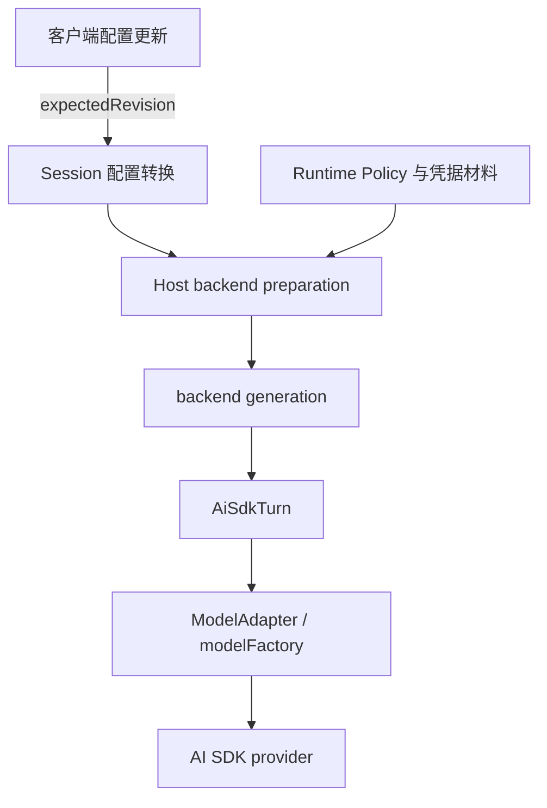
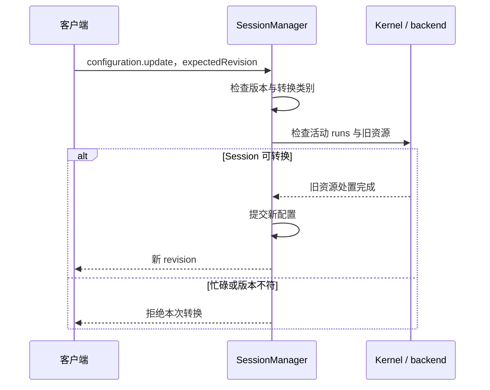

# 模型、连接与配置的注入

[手册目录](../README.md)

一次模型调用所需的信息不止 model 字符串。Session 保存目标配置，Host 解析连接与秘密材料，backend generation 持有相应执行资源，Turn 再按步骤准备请求。改变其中一项时，需要明确哪些资源仍可复用。

适用范围：Maka 提交 `15d0a0dd19d39e2bc09ae35940e432c636982315`，Pi 对照提交 `482c1381a00d8d00bc81697e4a980c593db6803e`；本文依据源码静态核对，未调用模型服务。

## 1. 配置来源

该图表示配置与执行资源的传递。凭据解析见下节；秘密存储的版本控制见[权限与凭据](../03-tools/permissions-and-secrets.md)。

## 2. 连接与凭据的解析路径

从 Session 配置到一次可用连接，入口在 `createHostAiSdkBackend()` 与 `prepareHostAiSdkBackend()`：两者都先调用 `resolveExecutionTarget()`，再用解析结果构建 backend。[解析入口][resolve-target]、[backend 构建][backend-build]

`resolveExecutionTarget()` 依次完成四项工作：

1. 把 header 中的连接引用（llmConnectionId 或 Slug）转为 bound 或 catalog_slug 引用。
2. 经 runtime policy 的 `resolveExecutionConnection()` 读取连接目录，返回 ready（附 secretMaterial 与 networkProxy），或 not_found / identity_mismatch / disabled / provider_retired / credential_not_configured。[连接解析][connection-resolve]
3. 查询 `PROVIDER_REGISTRY` 定位 provider，`authorizeConnectionModel()` 校验该 model 可用，组装 `RuntimeExecutionConnection`，并生成 sha256 的 provider 状态身份。
4. 凭据入形：OAuth 连接经 `oauthCredentials.bind()` 得到 oauthBinding；否则从 secretMaterial 取 apiKey；`parseRequestHeaders()` 将 request_headers 型秘密解析为请求头。

模型连接凭据存放在 credential vault（`credential-vault.json`）。Locator 区分五类材料：connection 的 api_key / oauth_token / request_headers，web_search 的 api_key，network_proxy 的 password；装配入口是 `prepareConnectionMaterial()`。[vault 文档][vault-document]、[vault 编码][vault-codec]、[材料装配][material-assembly]

注入方式按材料类型区分：

- api_key 与 request_headers 在 `modelFactory` 包装 `getAIModel()` 时注入 fetch 与请求头，随 backend generation 存续。
- OAuth 在 backend 构建时经 `binding.resolve()` 取初始 token；此后每次 fetch 前重新 resolve 获取新 token，由 `authenticatedOAuthFetch()` 写入 `Authorization: Bearer`，刷新经 CAS 写回 vault。[OAuth 执行绑定][oauth-authority]

解析粒度：主执行 backend 在创建时解析一次；标题、recap、记忆抽取等辅助调用每次重新 `resolveExecutionTarget()`。

失败分支：连接不 ready 抛 `AuxiliaryModelCallConfigurationError`；vault 无条目且要求秘密时返回 credential_not_configured；OAuth 刷新失败为 refresh_failed，CAS 失败为 credential_superseded；vault 文档损坏按 invalid_document 拒绝，不会静默重建。

## 3. 模型、压缩、工具与权限的注入位置

配置的来源在 Host，使用的时点在 runtime。二者之间通常传递接口或回调，而非在调用后立即获得最终答案。

| 注入内容 | Host 组装位置 | 逐次使用位置或边界 |
| --- | --- | --- |
| model、connection、凭据、providerOptions | `prepareHostAiSdkBackend()` / `buildHostAiSdkBackend()` | 当前 backend generation 的 ModelAdapter 解析模型与请求 |
| `modelFactory` | 包装 `getAIModel`，注入 fetch、headers，必要时绑定 OAuth | ModelAdapter 请求模型实例，Turn 发起单步流 |
| 历史压缩函数与预算 | Host 构造 summarizer、contextBudget，选择压缩路线 | backend 压缩服务与 Turn 请求准备；不是 UI 删除几条消息 |
| checkpoint / 当前 Turn reader | backend preparation context 的 load/record 回调 | 读取已提交上下文，工具后续 step 也使用 reader |
| `tools` / `resolveTools` | run composer 汇聚内置与插件贡献 | backend 提供快照，Turn 每 step 固定本次集合 |
| `systemPrompt` | Host 的异步 prompt resolver，追加运行环境 context | Turn 每 step 解析；可记录 source revisions 与组成哈希 |
| `readExecutionBoundary` / `readPermissionMode` | 读取 store 的函数，不只是旧 header 值 | ToolRuntime 在相关执行边界读取，具体工具再应用限制 |
| `beforeTurnFinish` | Host 业务约束与插件贡献 | Turn 候选结束时检查，可返回反馈促使继续 |
| `runtimeCommitSink` | 同一个 `stores.runtimeEventStore` | ToolRuntime 的 T1/T2；非 UI 回调代写 |
| 模型计量及组成记录 | recorder hooks 与 Host accounting 回调 | 请求/attempt 边界记录；不能从屏幕 token 数反推唯一事实 |

主要证据集中在 [buildHostAiSdkBackend][backend-build] 与 [Host backend 注册与注入][host-backend]。
动态回调并不表示所有配置都能在运行中的 step 任意改变：工具集合按 step 快照化，模型连接则与 backend generation 绑定。
插件扩展通过 Host 的工具、prompt、结束 hook 等入口进入组合，无需将插件实现纳入 `ModelAdapter`。
本文仅证明这些扩展入口已接线，不声称任意插件源文件修改都会自动热重载。

模型切换也应从配置路径理解：

1. CLI `setModel()` 调用配置更新，发送 `session.configuration.update`，携带 `expectedRevision`，并非直接修改客户端持有的模型对象。
2. Runtime 的 `transitionSessionConfiguration()` 验证配置版本并选择转换路径；模型等执行配置变化进入 execution-resource transition。
3. 该路径要求相关 Session 静止，检查活动 runs，先处置旧 backend，再提交配置；忙碌或版本冲突可能导致更新被拒绝。
4. 后续执行通过 Kernel 的 backend 激活路径使用新配置。仅 permission 的边界转换、Host 的 idle-backend invalidation 各有相应分支。

定位：[CLI.setModel][driver-model]、[配置转换][manager-config]、[执行资源转换][manager-transition]。
这与“工具在执行边界读取最新权限”并不矛盾：读取一个允许变化的边界状态，与在进行中的模型请求内替换整套 provider 配置，是不同的动作。

## 4. 一次模型更换的完整含义

设 Session 当前使用配置 revision 8，客户端读取该值后希望切换模型。

1. 客户端提交目标模型与 expectedRevision 8。
2. Host 检查这是否仍是当前配置；其他客户端已经更新时，旧版本不能覆盖新版本。
3. 执行资源转换检查活动执行。进行中的请求不能通过替换配置对象变为另一个 provider 的请求。
4. 允许转换后，旧 backend 被处置，配置提交。后续输入在激活路径中取得新一代 backend。

此处展示模型等执行资源变化的路径。权限边界变化另有分支，不应将所有配置更新概括为完全相同的销毁重建流程。对象所有权与失效条件详见[生命周期](session-lifecycle.md)。

## 5. 配置值的读取时机

模型连接与 backend generation 绑定；工具列表按 step 快照化；system prompt 可由异步 resolver 在 step 准备时产生；工具执行读取可信的当前边界。它们的读取时机由各自契约规定，不能将“使用了回调”理解为所有字段随时热更新。

例如工具获得新的执行边界，不代表已发出的模型 HTTP 请求更换了 API key。一个字段的更新粒度不能推导另一字段的生命周期。

## 6. 与 Pi 对照

Pi 的 createAgentSession 同样组装模型运行时、Agent 与会话策略，开发者无需手写整个循环。Maka 的标准路径进一步将配置转换置于 Host 服务边界，通过版本与运行资源状态协调多个客户端。比较应落实到具体入口，而非以 SDK 是否可调用作为区别。

- [Pi SDK](../../../packages/coding-agent/src/core/sdk.ts#L411)：考察模型运行时与 streamFn 的注入方式。
- [模型循环](model-step.md)：考察配置就绪后一次真实请求如何推进。
- [请求计量](../06-operations/observability.md)：考察实际 provider 尝试如何留下用量证据。

## 相关专题

- [会话与执行对象的生命周期](session-lifecycle.md)：backend generation 的所有权与失效条件。
- [分层授权与凭据生命周期](../03-tools/permissions-and-secrets.md)：凭据库、访问凭据与 Managed Secret 的边界。
- [完整调用链](request-to-response.md)：注入完成的配置在一次真实请求中何时被消费。

[resolve-target]: ../../../../maka/packages/runtime-host/src/server/execution-model-authority.ts#L1089
[connection-resolve]: ../../../../maka/packages/storage/src/runtime-policy/coordinator.ts#L826
[vault-document]: ../../../../maka/packages/storage/src/runtime-policy/credential-vault-document.ts#L49
[vault-codec]: ../../../../maka/packages/core/src/runtime-policy/credential-vault-codec.ts#L42
[material-assembly]: ../../../../maka/packages/storage/src/runtime-policy/coordinator.ts#L1698
[oauth-authority]: ../../../../maka/packages/runtime-host/src/server/oauth-execution-authority.ts#L347
[backend-build]: ../../../../maka/packages/runtime-host/src/server/execution-model-composition.ts#L140
[host-backend]: ../../../../maka/packages/runtime-host/src/server/execution-composition.ts#L1356
[driver-model]: ../../../../maka/packages/cli/src/runtime-host-session-driver.ts#L777
[manager-config]: ../../../../maka/packages/runtime/src/session-manager.ts#L1205
[manager-transition]: ../../../../maka/packages/runtime/src/session-manager.ts#L1888
