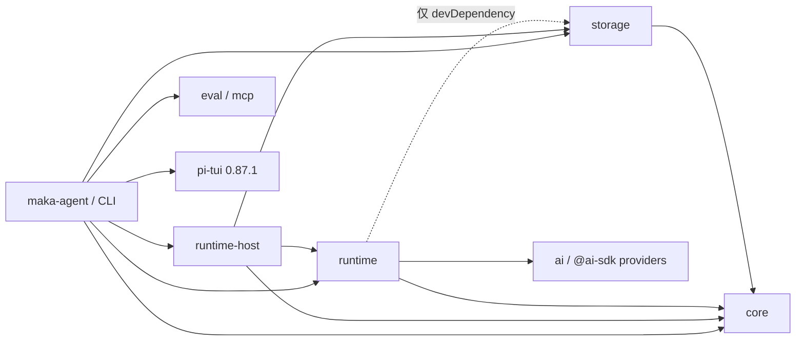
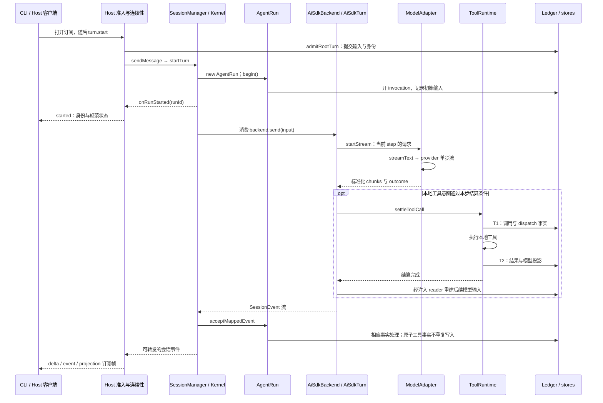

# 从输入到回答：完整调用链

[手册目录](../README.md)

本文沿一条普通输入展开调用链，回答“谁创建谁、谁调用谁、结果从何处返回”。
适用范围是 Maka 提交 `15d0a0dd19d39e2bc09ae35940e432c636982315` 的普通交互式 `ai-sdk` backend 路径，核对日期为 2026-10-24。
Pi 对照基线为 `482c1381a00d8d00bc81697e4a980c593db6803e`，引用当前工作区源码，保留其原有未提交修改。
以下 trace 为沿源码重建的执行轨迹，并非本次调用付费模型获得的日志；未运行安装、构建或测试。
外部 executor、WorkHub 协调输入、恢复及协作交接另有分支，不应将本文的普通请求链推广到所有 backend。

## 1. 问题：输入提交后的执行主体

首先考察两条输入：“你好”和“读取 config.json，解释模型配置”。
前者可能仅产生一次文本响应；后者通常先产生工具意图，工具执行之后再请求模型。
两者都经过 Host，但 Host 本身并不实现模型 step 循环。

```text
用户：“读取 config.json，解释模型配置”
  客户端获得 started + runId             ≠ 模型已经回答
  模型产生 Read 意图                    ≠ 文件已经读取
  ToolRuntime 返回成功                   ≠ 整个逻辑 Turn 已结束
  订阅收到 tool_result                   ≠ 收到了完整、可重放的工具事实
```

阅读时应区分三种关系：包依赖表示发布与导入关系；对象组合表示服务的持有者；调用链表示一次操作的推进方式。
例如 storage 是 Host 组装时传入 runtime 的接口实现，这并不意味着 runtime 的生产依赖必须导入 storage。
同样，`AgentRun` 名称中含 Run，也不意味着它持有推进模型的 `for (;;)`。

## 2. package.json：依赖图而非请求顺序

下表仅列出与主链相关的直接依赖，不应视为完整依赖清单。

| 包 | 已声明的相关生产依赖 | 需注意的边界 |
| --- | --- | --- |
| `maka-agent`，位于 `packages/cli` | core、eval、mcp、runtime、runtime-host、storage；`pi-tui@0.87.1` | 终端组件复用并不等同于复用 Pi Agent 循环 |
| `@maka/runtime-host` | core、runtime、storage，以及 executor 插件等 | 产品服务的组装位置 |
| `@maka/runtime` | core、`ai@7.0.122`、相应 `@ai-sdk/*` 等 | storage 仅列于 **devDependencies**，并非生产依赖 |
| `@maka/storage` | core、`fs-native-extensions` | 提供 Host 注入的持久化实现 |
| `@maka/core` | `intl-messageformat` | 共享契约及基础实现，不应笼统称为纯类型包 |
| Pi `coding-agent` | agent-core、ai、tui、mcp、codemode 等 | 未将 durable 作为默认引擎依赖 |
| Pi `agent` / `durable` | 两者分别依赖 pi-ai；durable 还依赖 Chord 等 | durable 不经由 pi-agent-core 运行默认循环 |

证据：[CLI manifest][pkg-cli]、[Host manifest][pkg-host]、[runtime 生产依赖][pkg-runtime]与[开发依赖][pkg-runtime-dev]、[storage][pkg-storage]、[core][pkg-core]；Pi 的 [coding-agent][pi-pkg-coding]、[agent][pi-pkg-agent]、[durable][pi-pkg-durable]。



实线仅表示这些 manifest 中的直接生产依赖；图中省略无关依赖，不展开 eval/mcp 的下游。
Maka CLI 的 manifest 未包含 `pi-agent-core` 或 `pi-ai`；本文分析的执行链进入 Maka 自身的 Kernel、Turn 和 AI SDK。
`ModelAdapter` 是 `packages/runtime/src/model-adapter.ts` 中的模块，并非另一个 workspace 包。

## 3. 组装一次、按会话复用、逐次创建：三种生命周期

Host 的 [createExecutionRuntimeHostComposition][host-compose] 打开 storage 后，获取 session、run、runtime event 等 store。
它注册 backend 工厂，将这些接口传入 `SessionManager`，并把同一个 `runtimeEventStore` 作为 `runtimeCommitSink` 传向 AI SDK backend。
因此工具提交与 RuntimeEvent 消费能够落入同一事实来源；二者并非相互独立的 UI 日志。

| 生命周期 | 实际创建或持有关系 | 不应绘制的关系 |
| --- | --- | --- |
| Host execution composition | 创建 stores、BackendRegistry、SessionManager、RootTurnCoordinator 等 | 每条用户消息重新打开整套服务 |
| SessionManager | 构造时持有注入的 Kernel，未注入则 `new RuntimeKernel` | AgentRun 创建 SessionManager |
| Kernel 的 Session backend generation | `ensureActive()` 激活或复用 backend，维护活动 runs 与代际约束 | 每次 `sendMessage` 必然重建 backend |
| 一次物理执行 | `RuntimeKernel.startTurn()` 创建 `AgentRun`，注入 `reserveRun` 等 hooks | `AgentRun` 内部拥有模型循环 |
| AiSdkBackend | 持有 ModelAdapter、消息投影、压缩及共享配置服务 | 把全部单次请求状态放在共享 backend 上 |
| 每次 backend.send | `openTurnScope()` 创建 AiSdkTurn；Turn 获得独立 ToolRuntime | 多次 send 共用同一个 ToolRuntime 状态 |
| 每个模型 step | Turn 快照化当前工具集合、解析 prompt、重建模型输入 | step 等于新的 Host Session 或新的 backend |

此处存在回调协作，并非一棵没有反向引用的对象树：

```text
SessionManager.runtimeKernel
  Kernel.startTurn() → new AgentRun({ hooks: reserveRun, unregisterRun, ... })
  Kernel.runAgentTurn() → AgentRun.begin()
    begin() → hooks.reserveRun(...) → Kernel.reserveParentRun() / ensureActive()
    begin() 返回 { backend, backendInput, initialRuntimeEvent }
  Kernel.streamAgentRun() → Kernel.runBackendEventStream() → backend.send(...)
```

因此可以说 Kernel 创建并管理 Run、驱动 backend；不应改写为“SessionManager 调用 AgentRun，AgentRun 再调用模型 backend”。
`begin()` 确实取得 active backend 引用并将其返回，但实际消费 `backend.send()` 的代码位于 Kernel。
初始化传入 `modelFactory`、`resolveTools`、存储接口，也不意味着初始化时已调用模型或执行工具。
定位：[SessionManager 构造][manager-create]、[Kernel.startTurn][kernel-start]、[AgentRun.begin][run-begin]、[Kernel.ensureActive][kernel-active]。

## 4. 普通 turn.start：从客户端到模型的请求时序

CLI 的 [preparePrompt][driver-prompt] 先确保 Session 与订阅通道存在，登记目标 `turnId` 的事件消费流，再请求 `turn.start`。
先订阅可避免“模型已开始输出，客户端尚未建立事件入口”的窗口；请求应答与事件流仍是两个通道。
Host 经过 operation 分派，进入 `HostInteractiveTurnCoordinator.#start()`，普通输入交由 `RootTurnCoordinator`。



为突出职责划分，图中将事件回程合并绘制于末尾；实际 text、tool 等事件在执行期间流式返回，并非全部等待工具结束。
Host 的 started 应答由 `onRunStarted` 推进，无需等待最终文本；事件与应答在客户端的实际抵达时间不应视为新的因果保证。

沿源码逐跳展开：

1. `dispatchOperation()` 分派已知 operation；它不负责模型执行或事实持久化。
2. `#start()` → `startInteractiveRootMessage()` → `startRootMessage()`。
3. `startRootMessage()` 在 Session admission 内验证身份、输入及能力，再调用 `RootAdmissionOwner.admitRootTurn()`。
4. `prepareAdmittedTurn()` 建立活动执行，借 `sessionAdmission.detach()` 启动 `drainTurn()`；长时间模型流不会一直持有准入锁。
5. 普通 message 分支进入 `startRootMessageTurn()`，携带准入的 runId、userMessageId，以 `durability: 'required'` 调用 `manager.sendMessage()`。
6. `sendMessage()` 委托 Kernel；Kernel 创建 AgentRun，准备 backend，再调用 `run.begin()`。
7. Kernel 使用 begin 返回的 backend/input 进入 `streamAgentRun()` 和 `runBackendEventStream()`，后者实际 `for await backend.send(...)`。
8. backend 创建本次 Turn；Turn 才拥有多 step 循环、工具结算及继续/结束判断。

完整入口见后文源码表。另一个入口 `turn.message.submit` 处理消息放置，可在空闲时开启根 Turn，也可进入当前输入或后续输入路径；它不只是“运行期间追加消息”。

## 5. Trace A：一次纯文本回答

设定：普通 Session、无技能预处理、无工具、无重试、无压缩、Host 允许结束；输入为“你好”。
以下文本仅为示意 payload，函数与事件边界来自实现。

```text
preparePrompt("你好")
  channel.eventsForTurn(T)；request('turn.start', { turnId: T, ... })
  Host admission 保存 T 与拟定 R；后台 drain 消费 manager.sendMessage
  AgentRun.begin()：invocation I + 初始用户 RuntimeEvent + priorRuntimeContext
  Kernel：onRunStarted → 消费 backend.send({ turnId:T, runId:R, invocationId:I, ... })
  AiSdkBackend.openTurnScope()：新的 AiSdkTurn / ToolRuntime
  AiSdkTurn.agentLoop：工具快照、system prompt、当前持久投影、请求组成记录
  ModelAdapter.startStream() → ai.streamText() → provider
    provider text-delta("你好") → ModelStreamEvent(kind='text')
    AiSdkTurn → SessionEvent(type='text_delta')
    Kernel → AgentRun.acceptMappedEvent → Host continuity → subscription.session_delta
  provider 完成 → Turn flushStep → text_complete
  无需继续 + beforeTurnFinish 允许 → token_usage / complete → Run 收尾
  Host 读取规范终态并 publishTerminalProjection
  CLI channel 接受帧、更新投影，向该 Turn 的消费方输出事件
```

`ModelAdapter.startStream()` 调用 `streamText()` 时设置 `maxRetries: 0`，一个 adapter 请求并非“交给 SDK 运行完整 Agent”；上层 Turn 决定下一 step，并管理自身的 provider attempt。
完整论证与 `MockLanguageModelV4` 测试见[模型循环](model-step.md)与[适配器测试][test-adapter]。

`text_complete` 表示一个模型 step 的文本完成，不保证整个 Maka Turn 结束。
工具、多步反馈、steering 或结束 hook 都可能使同一 Turn 再次进入模型请求。
细节定位：[AiSdkTurn 主循环][turn-loop]、[ModelAdapter.startStream][adapter-stream]、[Kernel 事件消费][kernel-events]。

## 6. Trace B：读文件后继续回答

设定：本次采用 direct 工具路径，已启用的本地 `Read` 合法可用，模型第一步发出调用，第二步解释内容。
模型返回的工具名称与参数属于意图；工具实现函数不会随 schema 一并发送给 provider。
`lowerModelTools()` 构造模型侧声明，本地执行则进入 `ToolRuntime` 的 `tool.impl()`。

```text
同一 Turn T / 当前 Run R
  step 1：ModelAdapter 返回 Read 调用意图及本步 outcome
  AiSdkTurn 等待该步可结算，再调用 ToolRuntime.settleToolCall
    参数校验、工具可用性等前置门禁
    prepareDurableToolAttempt
      T1 commitToolPrepared：function_call + toolDispatch，绑定 operationId
    发布 tool_start
    读取本次执行所需的当前 boundary / permission，构造 ToolContext
    tool.impl(args, toolContext)：读取文件
    构造结果及持久化 modelProjection
    T2 commitToolOutcome：function_response + modelProjection
    发布 tool_result；向 Turn 返回 settlement
  Turn 等待事件被内部消费，清掉原始结果批次
  step 2：重读本次 durable RuntimeEvents → 模型输入投影 → startStream
    模型输出解释 → text_complete → complete
```

这是正常本地工具分支，并非所有工具的统一授权顺序：client-capability 工具另有执行前准备，部分边界检查发生得更早。
原生 provider 工具也不能直接套用本地 `tool.impl` 轨迹；Code Mode 则增加外层调用与嵌套工具关系。
这些变体见[工具运行时](../03-tools/tool-runtime.md)与[分层授权与凭据生命周期](../03-tools/permissions-and-secrets.md)。

两个不可省略的事实边界：T1 提交成功之后才进入实际调用；T2 保存结果及供下一次模型使用的投影。
二者并非对文件系统副作用实施“两阶段事务提交”，更不保证外部动作可以回滚。
T2 失败会抛出 `RuntimeCommitBoundaryError`，不能将“工具已产生副作用而结果未提交”伪装为普通可重试工具错误。

前置拒绝可能不存在 T1，也没有 operationId；这类拒绝经普通事件通道呈现。
相反，带原子工具协议标记的事件已由 sink 提交，`AgentRun.acceptMappedEvent()` 会跳过重复 ledger 写入。
工具原始返回值仍参与本次结算逻辑，但后续模型历史以持久投影为依据，而非直接追加该内存对象。
定位：[settleToolCall][tool-settle]、[T1/T2 构造][tool-commit]、[Turn 的工具结算调用][turn-tools]。

## 7. Trace C：终态后重复提交 turnId

设定：客户端未收到第一次应答，但知道自身生成的 turnId；此时原执行已进入终态。
根准入身份使 Host 能够区分“重复提交”与“另一条新的输入”。

```text
第一次 turn.start(T, 内容 A)
  admission(T, R, A) → 执行 → 规范终态
第二次 turn.start(T, 内容 A)
  startRootMessage → readRootTurnAdmission(T)
  验证 execution kind、payload、输入与授权一致
  readRunIfPresent(R) → readCanonicalSnapshot → 已终态
  返回 completedStart({ ok:true, result:snapshot })，不再次调用模型
第二次若变成 turn.start(T, 内容 B)
  身份对应不同 payload → operation_conflict，不把它当作同一次输入
```

该分支位于 [startRootMessage][root-start]，不能据此概括为“任何失败重试都绝不会创建后继 Run”。
非终态、恢复、handoff 各有自身的判定；本文仅证明终态重复请求这一实际分支。
不应将此 turnId 与工具 operationId 混用；后者由 invocationId 和 providerToolCallId 构造。
[身份测试][test-tool-id]还验证参数对象键顺序不影响参数哈希，而不同调用身份不会因参数相同而被合并。

## 8. 模型、压缩、工具与权限的注入位置

配置的来源在 Host，使用的时点在 runtime；二者之间通常传递接口或回调，而非调用后立即获得最终答案。
每项内容（modelFactory、历史压缩、tools、systemPrompt、权限读取、runtimeCommitSink、计量记录等）的组装位置与逐次使用边界，以及模型切换的四步配置路径，集中于[模型、连接与配置的注入](provider-configuration.md)。

## 9. 回程：ledger 到 UI 的投影转换

| 层次 | 本链中的例子 | 表达的含义 |
| --- | --- | --- |
| provider 流 | SDK text chunk、tool intent、finish metadata | 外部模型响应，不是 Maka 已提交事实 |
| ModelStreamEvent / outcome | `kind: 'text'`、标准化失败与 continuation | ModelAdapter 的单步协议 |
| SessionEvent | `text_delta`、`tool_start`、`tool_result`、`complete` | backend 与 runtime 消费者之间的执行事件 |
| RuntimeEvent / 其他控制记录 | 用户输入、function_call/response、终态、准入身份 | 各自拥有提交规则的历史与控制事实 |
| Host subscription frame | session_delta、session_event、session_projection | 向客户端同步的协议视图，具有自身的顺序与边界 |
| CLI projector / UI | 文本行、工具状态、Turn 事件流 | 从帧及 transcript 重建的展示，不是存储写入权威 |

Kernel 的 `onSessionEvent` 先调用 `run.acceptMappedEvent()`，再将事件送向外层；但不能因此认为“每个可见 delta 都立即完成了耐久提交”。
`AgentRun.recordRuntimePartial()` 对新文本流的首块同步写入，之后可按 80ms / 8KiB 合并；非 partial 边界会等待缓冲刷新。
普通 append、durability-required 写入、终态 barrier 亦有不同保证；canonical store 失败不能任意当作可忽略的 UI 问题。
因此“partial 全都不存”与“每个 delta 都是不可变终态事实”均不成立。[源码][run-partials]

工具路径另有例外：T1/T2 已提交的原子工具事实，不由通用 SessionEvent 映射通道再次写入。
`provider_retry` 可以告知客户端正在重试，也不是每次都增加一条模型可见语义历史。
内部 `waitUntilConsumedThroughCurrent()` 等待的是 runtime 消费确认，不是终端用户已经看见文本。

Host 的 `acceptRuntimeEvent()` 将文本组织成带 offset 的 `subscription.session_delta`。
工具 `subscription.session_event` 也会裁剪字段；例如 tool_result 主要携带身份、状态与耗时，不包含全部工具输出。
完整历史经 transcript 读取与对齐，而非将收到的若干帧 JSON 直接当作恢复输入。
终态由 `publishTerminalProjection()` 验证规范快照、解除发布 fence 后发布，并非把 backend 的 raw complete 原样广播。

客户端 `RuntimeHostSessionChannel.open()` 建立订阅和初始 transcript；`#pump()` 消费帧，`#accept()` 交给 projector 并发出本地事件。
断线重建 UI 与重新执行模型并非同一件事，订阅 sequence 也不等于 ledger 的事件顺序编号。
定位：[Host 连续性处理][continuity-event]、[终态发布][continuity-terminal]、[CLI channel][cli-channel]。

## 10. 与 Pi 对照：按职责而非类名

| 问题 | Maka 本文路径 | Pi 默认 coding-agent / agent / ai |
| --- | --- | --- |
| 谁组装产品服务 | Runtime Host 打开 store、注册 backend、注入能力 | `createAgentSession()` 组装资源、Agent、AgentSession |
| 谁驱动通用执行 | Kernel 管运行生命周期；AiSdkTurn 管模型 step | Agent 管状态与生命周期，`runLoop()` 管模型/工具迭代 |
| 谁负责一次模型响应 | ModelAdapter → AI SDK 单步流 | 注入的 `streamFn` → ModelRuntime.streamSimple → pi-ai |
| 谁执行工具 | ToolRuntime，含本次身份、边界及 T1/T2 | agent-loop 的工具执行路径，支持工具前后 hook |
| 谁提供产品级策略 | Host / SessionManager / backend 回调共同提供 | AgentSession 安装上下文、工具和边界策略，见关系文档 |
| 谁提供可继续的历史 | RuntimeEvent 及控制事实，经模型投影读取 | 会话管理层恢复历史，Agent 消费消息上下文 |
| 谁呈现流式输出 | Host subscription → CLI channel/projector → UI | AgentEvent 经会话/模式层到 UI；不是同一协议 |

Pi 的 [SDK 组装][pi-sdk]显式创建 `Agent` 并注入 `streamFn`，调用 `modelRuntime.streamSimple()`；不应仅绘制未经说明的 agent → ai 包导入箭头。
[Agent.prompt][pi-prompt]进入生命周期包装，再调用 `runAgentLoop()`；[runLoop][pi-loop]在 assistant 响应及工具结果之后发出 `turn_end`。
因此一次“Read 后解释”通常是一个 Maka Turn 的两个模型 step，对应 Pi 默认循环的两个低层 turn。
这是该简单例子的边界对照，并非 Maka Run、AiSdkTurn、Pi run 之间固定的一对一映射；重试和 handoff 会使计数进一步分离。

Pi 还有独立的实验 durable 路径：manifest 不经 agent-core；[Harness.open][pi-harness]创建 HarnessImpl，打开存活任务；HarnessImpl 注入 TaskScheduler、Storage、models 和 env。
其 `openTasks()` 明确处理遗留 running 任务，`buildEnv()` 提供执行环境入口；不能因此将默认 AgentSession 描述为没有恢复，也不能将 durable 当作默认底层。
编排、恢复和沙箱分别见[任务图](../05-coordination/agent-graph.md)、[持久化](../04-state/durable-execution.md)与[沙箱](../03-tools/sandbox.md)；默认链的详细对象关系见[既有 Pi 文档](../../coding-agent-agent-relationship.md)。

## 11. 源码定位与下钻顺序

| 入口与函数 | 精确落点及阅读目的 |
| --- | --- |
| [createExecutionRuntimeHostComposition][host-compose] | `execution-composition.ts:364`；storage 在369，sink 在1447，manager 在1792 |
| [buildHostAiSdkBackend][backend-build] | `execution-model-composition.ts:140`；模型、压缩、工具、权限与 recorder 注入 |
| [preparePrompt][driver-prompt] | `runtime-host-session-driver.ts:462`；先建立事件入口，492 发 turn.start |
| [dispatchOperation][host-dispatch] / [#start][host-start] | dispatcher:349；interactive-turn-coordinator:74；协议到领域操作 |
| [startInteractiveRootMessage][root-interactive] / [startRootMessage][root-start] | root-turn-coordinator:1845 / 2112；普通输入、重复身份和准入 |
| [RootAdmissionOwner.admitRootTurn][root-admit] | root-admission-owner:85；将身份与输入交给 store |
| [prepareAdmittedTurn][root-prepare] | root-turn-coordinator:2890；3062 detach drain，3163 startRootMessageTurn，3205 drainTurn |
| [SessionManager.sendMessage][manager-send] | session-manager:2313；2328 转交 Kernel |
| [RuntimeKernel.startTurn][kernel-start] | runtime-kernel:720；753 创建 AgentRun 并注入 hooks |
| [AgentRun.begin][run-begin] / [acceptMappedEvent][run-accept] | agent-run:983 / 879；前者建立输入，后者处理回程事实 |
| [runAgentTurn][kernel-run] / [runBackendEventStream][kernel-events] | runtime-kernel:1409 / 1879；1607 streamAgentRun，1917 backend.send |
| [openTurnScope / send][backend-send] | ai-sdk-backend:551 / 585；每次新建作用域并 finally close |
| [AiSdkTurn.agentLoop][turn-loop] | ai-sdk-turn:1531；1707 adapter.startStream，2264 settleToolCall |
| [ModelAdapter.startStream][adapter-stream] | model-adapter:291；379 streamText，408 maxRetries:0 |
| [ToolRuntime.settleToolCall][tool-settle] / [prepareDurableToolAttempt][tool-commit] | tool-runtime:795 / 1937；1636 impl，2044 T1，2115 T2 |
| [acceptRuntimeEvent][continuity-event] / [publishTerminalProjection][continuity-terminal] | session-continuity-coordinator:749 / 671；普通事件与规范终态分流 |
| [RuntimeHostSessionChannel.open][cli-channel] | runtime-host-session-channel:196；593 pump，872 accept |
| [Pi SDK][pi-sdk] / [Pi runLoop][pi-loop] | sdk:411；agent-loop:163；确认默认路径的组装与循环口径 |

## 12. 本章术语

| 术语 | 本篇中的含义 |
| --- | --- |
| admission / 准入 | 在允许执行前确认输入、身份、冲突及控制权，并非请求已经结束 |
| backend generation | 某 Session 当前激活的一代 backend；配置或生命周期变化可使其失效 |
| Turn / step / attempt | 逻辑工作、其中的模型步骤、该步骤的物理 provider 尝试；不应混为同一计数 |
| ledger / 事实账本 | 已提交的执行历史来源；并非 UI 临时消息数组 |
| projection / 投影 | 从事实得到的模型输入或界面视图，同一事实可有不同投影 |
| sink / reader | 注入的写入/读取接口；调用接口不要求 runtime 生产依赖 storage 包 |

## 13. 源码练习

1. 仅阅读 manifest 与对象创建点：删除依赖图的虚线后，解释 Host 为何仍能向 runtime 提供 storage。指出初始化注入与每次执行分别发生在何处。
2. 仅阅读 `model-adapter-onerror.test.ts` 的 mock 用例：模拟一次 provider 503，说明 adapter 调用计数为1的原因；若发生重试，应到哪一层查找。再找出非空文本但 usage 不可用的测试，区分内容完成与计量完整。
3. 在纸面重放 Trace B：分别在 T1 前、impl 后但 T2 前、T2 后断开进程。列出可确认的事实、不可确认的副作用，以及为何不能仅凭 UI 的 tool_result 决定自动重做。

这些练习无需访问模型服务，也不要求运行仓库测试。若需继续追踪机制，可阅读[运行时](session-lifecycle.md)、[持久化](../04-state/durable-execution.md)与[工具](../03-tools/tool-runtime.md)。

## 相关专题

- [生命周期](session-lifecycle.md)：区分长寿命 backend、单次 Turn 和流消费结束。
- [模型步骤内部](model-step.md)：进入调用链中的循环，理解工具之后为何继续请求。
- [工具运行时](../03-tools/tool-runtime.md)：下钻参数校验、T1/T2 与结果投影。

[pkg-cli]: https://github.com/apache/maka/blob/15d0a0dd19d39e2bc09ae35940e432c636982315/packages/cli/package.json#L21
[pkg-host]: https://github.com/apache/maka/blob/15d0a0dd19d39e2bc09ae35940e432c636982315/packages/runtime-host/package.json#L36
[pkg-runtime]: https://github.com/apache/maka/blob/15d0a0dd19d39e2bc09ae35940e432c636982315/packages/runtime/package.json#L162
[pkg-runtime-dev]: https://github.com/apache/maka/blob/15d0a0dd19d39e2bc09ae35940e432c636982315/packages/runtime/package.json#L197
[pkg-storage]: https://github.com/apache/maka/blob/15d0a0dd19d39e2bc09ae35940e432c636982315/packages/storage/package.json#L79
[pkg-core]: https://github.com/apache/maka/blob/15d0a0dd19d39e2bc09ae35940e432c636982315/packages/core/package.json#L185
[pi-pkg-coding]: https://github.com/earendil-works/pi/blob/482c1381a00d8d00bc81697e4a980c593db6803e/packages/coding-agent/package.json#L43
[pi-pkg-agent]: https://github.com/earendil-works/pi/blob/482c1381a00d8d00bc81697e4a980c593db6803e/packages/agent/package.json#L25
[pi-pkg-durable]: https://github.com/earendil-works/pi/blob/482c1381a00d8d00bc81697e4a980c593db6803e/packages/durable/package.json#L146
[host-compose]: https://github.com/apache/maka/blob/15d0a0dd19d39e2bc09ae35940e432c636982315/packages/runtime-host/src/server/execution-composition.ts#L364
[backend-build]: https://github.com/apache/maka/blob/15d0a0dd19d39e2bc09ae35940e432c636982315/packages/runtime-host/src/server/execution-model-composition.ts#L140
[manager-create]: https://github.com/apache/maka/blob/15d0a0dd19d39e2bc09ae35940e432c636982315/packages/runtime/src/session-manager.ts#L934
[driver-prompt]: https://github.com/apache/maka/blob/15d0a0dd19d39e2bc09ae35940e432c636982315/packages/cli/src/runtime-host-session-driver.ts#L462
[host-dispatch]: https://github.com/apache/maka/blob/15d0a0dd19d39e2bc09ae35940e432c636982315/packages/runtime-host/src/server/operation-dispatcher.ts#L349
[host-start]: https://github.com/apache/maka/blob/15d0a0dd19d39e2bc09ae35940e432c636982315/packages/runtime-host/src/server/interactive-turn-coordinator.ts#L74
[root-interactive]: https://github.com/apache/maka/blob/15d0a0dd19d39e2bc09ae35940e432c636982315/packages/runtime-host/src/server/root-turn-coordinator.ts#L1845
[root-start]: https://github.com/apache/maka/blob/15d0a0dd19d39e2bc09ae35940e432c636982315/packages/runtime-host/src/server/root-turn-coordinator.ts#L2112
[root-admit]: https://github.com/apache/maka/blob/15d0a0dd19d39e2bc09ae35940e432c636982315/packages/runtime-host/src/server/root-admission-owner.ts#L85
[root-prepare]: https://github.com/apache/maka/blob/15d0a0dd19d39e2bc09ae35940e432c636982315/packages/runtime-host/src/server/root-turn-coordinator.ts#L2890
[manager-send]: https://github.com/apache/maka/blob/15d0a0dd19d39e2bc09ae35940e432c636982315/packages/runtime/src/session-manager.ts#L2313
[kernel-start]: https://github.com/apache/maka/blob/15d0a0dd19d39e2bc09ae35940e432c636982315/packages/runtime/src/runtime-kernel.ts#L720
[kernel-run]: https://github.com/apache/maka/blob/15d0a0dd19d39e2bc09ae35940e432c636982315/packages/runtime/src/runtime-kernel.ts#L1409
[kernel-events]: https://github.com/apache/maka/blob/15d0a0dd19d39e2bc09ae35940e432c636982315/packages/runtime/src/runtime-kernel.ts#L1879
[kernel-active]: https://github.com/apache/maka/blob/15d0a0dd19d39e2bc09ae35940e432c636982315/packages/runtime/src/runtime-kernel.ts#L2808
[run-begin]: https://github.com/apache/maka/blob/15d0a0dd19d39e2bc09ae35940e432c636982315/packages/runtime/src/agent-run.ts#L983
[run-accept]: https://github.com/apache/maka/blob/15d0a0dd19d39e2bc09ae35940e432c636982315/packages/runtime/src/agent-run.ts#L879
[run-partials]: https://github.com/apache/maka/blob/15d0a0dd19d39e2bc09ae35940e432c636982315/packages/runtime/src/agent-run.ts#L1833
[backend-send]: https://github.com/apache/maka/blob/15d0a0dd19d39e2bc09ae35940e432c636982315/packages/runtime/src/ai-sdk-backend.ts#L551
[turn-loop]: https://github.com/apache/maka/blob/15d0a0dd19d39e2bc09ae35940e432c636982315/packages/runtime/src/ai-sdk-turn.ts#L1531
[turn-tools]: https://github.com/apache/maka/blob/15d0a0dd19d39e2bc09ae35940e432c636982315/packages/runtime/src/ai-sdk-turn.ts#L2264
[adapter-stream]: https://github.com/apache/maka/blob/15d0a0dd19d39e2bc09ae35940e432c636982315/packages/runtime/src/model-adapter.ts#L291
[tool-settle]: https://github.com/apache/maka/blob/15d0a0dd19d39e2bc09ae35940e432c636982315/packages/runtime/src/tool-runtime.ts#L795
[tool-commit]: https://github.com/apache/maka/blob/15d0a0dd19d39e2bc09ae35940e432c636982315/packages/runtime/src/tool-runtime.ts#L1937
[continuity-event]: https://github.com/apache/maka/blob/15d0a0dd19d39e2bc09ae35940e432c636982315/packages/runtime-host/src/server/session-continuity-coordinator.ts#L749
[continuity-terminal]: https://github.com/apache/maka/blob/15d0a0dd19d39e2bc09ae35940e432c636982315/packages/runtime-host/src/server/session-continuity-coordinator.ts#L671
[cli-channel]: https://github.com/apache/maka/blob/15d0a0dd19d39e2bc09ae35940e432c636982315/packages/cli/src/runtime-host-session-channel.ts#L196
[test-adapter]: https://github.com/apache/maka/blob/15d0a0dd19d39e2bc09ae35940e432c636982315/packages/runtime/src/__tests__/model-adapter-onerror.test.ts#L323
[test-tool-id]: https://github.com/apache/maka/blob/15d0a0dd19d39e2bc09ae35940e432c636982315/packages/runtime/src/__tests__/runtime-commit-sink.test.ts#L25
[pi-sdk]: https://github.com/earendil-works/pi/blob/482c1381a00d8d00bc81697e4a980c593db6803e/packages/coding-agent/src/core/sdk.ts#L411
[pi-prompt]: https://github.com/earendil-works/pi/blob/482c1381a00d8d00bc81697e4a980c593db6803e/packages/agent/src/agent.ts#L373
[pi-loop]: https://github.com/earendil-works/pi/blob/482c1381a00d8d00bc81697e4a980c593db6803e/packages/agent/src/agent-loop.ts#L163
[pi-harness]: https://github.com/earendil-works/pi/blob/482c1381a00d8d00bc81697e4a980c593db6803e/packages/durable/src/harness/harness.ts#L488
